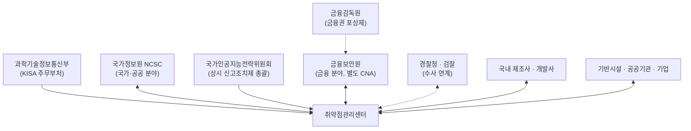

# 유관기관과 국제협력

| 레벨 | 상태 | 최종 개정 |
|---|---|---|
| 🟡 | 📝 초안 | 2026-10-21 |

> **한눈에 보기**
> 센터는 정부(과기정통부, 국정원, 국가AI전략위), 타 분야 전담기관(금융보안원), 제조사, 해외 CERT, 그리고 CVE 생태계(MITRE, CNA)와 연결된다.
> KISA는 국내에서 **포괄적 범위를 가진 CNA**(CVE 번호 부여 기관)다. 📎 센터가 그 창구일 가능성이 높다. 🔎

## 1. 국내

| 기관 | 관계 | 출처 |
|---|---|---|
| 과학기술정보통신부 | KISA 주무부처. 상시 신고조치제 공동 추진, GTAC 참여 | 📎 [다음 2026-05-29](https://v.daum.net/v/20260529120046524) |
| 국가정보원 (NCSC) | 국가·공공 분야 소관. 상시 신고조치제 공동 추진. 공공기관 대상은 국정원 역할 🔎 | 📎 [아시아경제](https://view.asiae.co.kr/article/2026052811291977316) |
| 국가인공지능전략위원회 | 상시 신고조치제 총괄, 제도화 세미나 주최 | 📎 [ZDNet 2026-06-18](https://zdnet.co.kr/view/?no=20260618112122) |
| 금융보안원 | 금융 분야 취약점 전담. 포괄적 범위의 CNA. 센터는 금융 관련 정보를 이관 | 📎 [디지털타임스](https://www.dt.co.kr/article/11438707), [데이터넷](https://www.datanet.co.kr/news/articleView.html?idxno=214623) |
| 금융감독원 | 금융권 취약점 포상제(건당 최대 1,000만 원, 70개사) 운영. KISA 제도와 별개 | 📎 [아시아경제 2026-05-18](https://view.asiae.co.kr/article/2026051811422356057) |

🔎 **내부 확인**: 기관별 정식 협의체 이름, 정보공유 협약 여부, 담당 창구.

## 2. 국제

| 상대 | 관계 | 센터 업무와의 접점 |
|---|---|---|
| **MITRE / CVE 프로그램** | KISA는 포괄적 범위의 CNA. 국내 6개 CNA 중 금보원과 KISA만 자사 제품 외 범위 📎 [디지털타임스](https://www.dt.co.kr/article/11438707) | 국내 제품 취약점에 CVE 번호 부여. 신고포상제 유효 건의 CVE 발급 🔎 |
| **FIRST** | 전 세계 CERT 협의체. 2026년 CVE 6만 6천 건 전망의 출처 | 국제 정보공유, CVSS 표준 |
| **해외 CERT** | 해외 제품 취약점은 해외 CERT·제조사에 전달 📎 [포털](https://knvd.krcert.or.kr/) | 입수 단계 ③ 조치의 해외 경로 |
| **OpenAI GTAC** | 정부·기관용 신뢰 기반 접근 프로그램. 2026년 5월 참여 📎 [다음](https://v.daum.net/v/20260529120046524) | AI 점검 모델 |
| **우방국 사이버보안 기관** | AI 기반 위협 대응체계 공동 구축 계획 📎 [다음](https://v.daum.net/v/20260529120046524) | 국제 협력 |

### CNA로서의 일 🔴

CNA(CVE Numbering Authority)는 자기 범위 안의 취약점에 CVE 번호를 부여하고 기록을 관리한다. 포괄적 범위 CNA는 특정 제품에 묶이지 않고 국내 제품 전반을 다룰 수 있다.

센터가 CNA 업무를 맡고 있다면 🔎 다음을 익혀야 한다.

- CVE 레코드 작성 규칙(영향 제품·버전, 취약점 유형 CWE, 참고 링크)
- 발급 시점 결정: 제조사 패치 전 예약(reserved) → 공개 시 게시
- 중복·범위 분쟁 처리(다른 CNA와 겹칠 때)
- 국내 식별 체계와의 매핑 🔎

## 3. 제조사·개발사와의 관계

센터 업무 네 단계 중 ③ 조치는 전적으로 제조사의 협조에 달려 있다.

| 상황 | 접근 |
|---|---|
| 보안 담당 창구가 있는 대기업 | 정식 채널, CVE 조율, 공개 일정 합의 |
| 창구가 없는 중소 개발사 | 대표 연락처부터. 재현 절차를 쉽게. 완화책 먼저 |
| 외주로 만들고 개발사가 사라진 제품 | 사용 기관에 완화책. 제품 교체 권고 |
| 해외 제조사 | 해외 CERT 경유 또는 제조사 보안 창구(security@) 직접 |
| 오픈소스 프로젝트 | 메인테이너에게 비공개 보고(GitHub Security Advisory 등). 패치 후 공개 |

🔎 **내부 확인**: 제조사 응답 시한, 무응답 시 공개 정책(예: 90일 규칙 채택 여부).

## 체크리스트

- [ ] 국내 다섯 기관과 센터의 관계를 한 줄씩 말할 수 있는가?
- [ ] CNA가 무엇이고 KISA가 어떤 범위의 CNA인지 설명할 수 있는가?
- [ ] 제조사 유형별 접근 차이를 말할 수 있는가?

## 변경 이력

| 날짜 | 변경 | 기여자 |
|---|---|---|
| 2026-10-21 | 초안 작성 | @anthonynoh5202 |
