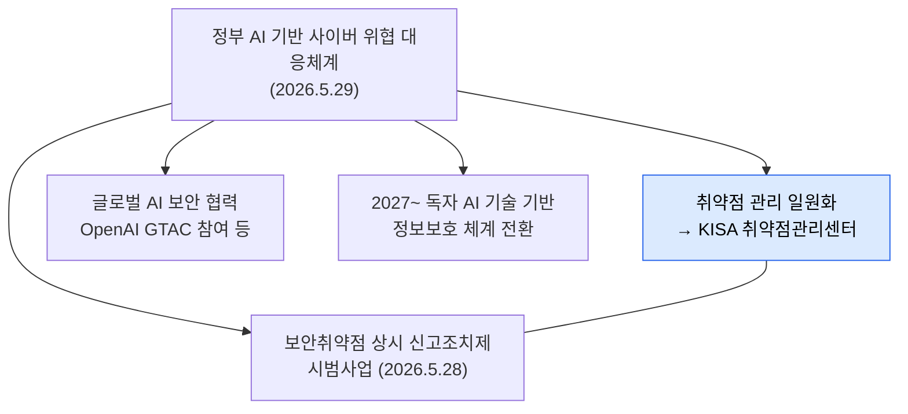

# 센터는 왜 생겼나

| 레벨 | 상태 | 최종 개정 |
|---|---|---|
| 🟢 | 🔄 개정중 | 2026-10-22 |

> **한눈에 보기**
> 취약점이 너무 많이, 너무 빨리 나온다. 공개된 취약점이 한 해 6만 건을 넘고, 공개 당일에 이미 악용되는 비율이 눈에 띄게 늘었다.
> AI가 공격의 속도를 바꿨다. 정부는 2026년 5월 "AI 기반 사이버 위협 대응체계"를 가동하면서 **취약점 관리를 국가 차원에서 일원화**하기로 했고, 그 실행 조직으로 KISA 안에 취약점관리센터를 두었다.

## 1. 숫자로 보는 배경

| 지표 | 수치 | 출처 |
|---|---|---|
| 2026년 공개 예상 CVE 건수 | 약 66,000건 (역대 최대 전망, FIRST 추정) | 📎 [ZDNet 2026-09-22](https://zdnet.co.kr/view/?no=20260922142056), [디일렉](https://www.thelec.kr/news/articleView.html?idxno=62628) |
| 2025년 실제 악용된 취약점 | 884건, 그중 29%는 공개 당일 또는 그 이전에 악용 | 📎 [한국경제 2026-09-22](https://www.hankyung.com/article/202609220821i) |

숫자가 말하는 것은 두 가지다. **발견되는 취약점 수가 사람이 하나씩 검토할 수 있는 범위를 넘었다**는 것, 그리고 **공개에서 악용까지의 시간이 "며칠"에서 "당일"로 줄었다**는 것이다.

## 2. AI가 바꾼 것

센터장은 2026년 9월 KISA 이슈앤톡에서 이렇게 정리했다. 📎 [데일리시큐 2026-09](https://www.dailysecu.com/news/articleView.html?idxno=208222), [파이낸셜뉴스](https://www.fnnews.com/news/202609221004217085)

- 공격 **기법**이 아니라 **속도**가 달라졌다. 취약점 공개 후 공격 준비까지 "10분" 수준이라는 표현이 나온다. 📎 [보안뉴스](https://www.boannews.com/news/articleView.html?idxno=145983)
- 따라서 취약점 관리의 무게중심이 **발견**에서 **검증과 조치**로 옮겨가고 있다. 많이 찾는 것보다 "진짜 위험한 것"을 빨리 가려내 고치게 하는 것이 관건이다.
- 자산·권한·NHI(Non-Human Identity, 사람이 아닌 계정과 키) 관리가 핵심이 된다.

이 관점은 센터의 일하는 방식 전체를 설명한다. 센터는 "취약점을 찾는 곳"이기 전에 **"취약점이 조치되게 만드는 곳"**이다. [4장 업무 흐름](04-workflow.md)에서 구체적으로 본다.

## 3. 정부 대응체계 안에서의 센터

2026년 5월 29일, 정부는 AI 기반 사이버 위협 대응체계를 발표했다. 📎 [연합뉴스(다음) 2026-05-29](https://v.daum.net/v/20260529120046524)

세 가지가 같은 시기에 묶여 나왔다는 점이 중요하다.

| 항목 | 내용 | 센터와의 관계 |
|---|---|---|
| 취약점 관리 일원화 | 국내외 취약점·패치 정보를 한 곳에서 수집·검증·전파 | **센터가 그 "한 곳"** |
| 상시 신고조치제 시범사업 | 화이트해커가 실제 운영망의 취약점을 365일 신고하고 기관이 조치·공개 | 센터가 KISA 측 운영 주체 ([2부 6장](../02-programs/06-cvd-vdp.md)) |
| AI 보안 협력 | OpenAI 정부·기관용 프로그램(GTAC)으로 보안 특화 모델 활용 | 센터가 취약점 점검에 실제 사용 ([2부 9장](../02-programs/09-ai.md)) |

## 4. "일원화"가 뜻하는 것 🟡

일원화 이전에는 취약점 정보가 여러 경로로 흩어져 있었다. 신고포상제로 들어오는 것, 118(KISA 전화 상담·신고 창구)로 들어오는 것, 해외 CERT(다른 나라의 사고 대응 조직. [부록 A](../../appendix/a-glossary.md))를 비롯한 유관기관에서 오는 것, 침해사고 분석이나 기반시설 점검처럼 KISA 안에서 나오는 것. 각각 다른 팀이 다른 기준으로 다뤘다.

**센터 신설 이전의 기능 배치.** 2026년 5월에 모든 것이 새로 생긴 것은 아니다. 공개 자료로 말할 수 있는 것은 세 가지다. 신고포상제는 2012년 10월부터 KISA가 운영해 왔다([2부 5장](../02-programs/05-bug-bounty.md)). 그 접수 창구인 사이버 보안 취약점 정보 포털의 도메인(knvd.krcert.or.kr)은 KISA의 KrCERT/CC 도메인 체계를 쓴다. 보안공지는 보호나라&KrCERT/CC 사이트(boho.or.kr)로 나간다([2부 7장](../02-programs/07-portal-advisory.md)). 📎 [정보통신신문](https://www.koit.co.kr/news/articleView.html?idxno=104141), [포털](https://knvd.krcert.or.kr/), [보호나라](https://www.boho.or.kr/) 즉 신고 접수와 공지 발행 같은 기능은 센터 신설 전에도 KISA 안에서, 침해대응(KrCERT/CC) 체계와 가까운 곳에서 돌아가고 있었다. 2026년 5월의 변화는 취약점 신고·조치·공개 제도의 운영을 센터라는 한 조직의 소관으로 묶은 것이다. 📎 [연합뉴스(다음) 2026-05-29](https://v.daum.net/v/20260529120046524), [데이터넷 2026](https://www.datanet.co.kr/news/articleView.html?idxno=214623) 따라서 센터의 업무는 **이관된 것**(신고 접수·검증, 공지 발행 등)과 **새로 생긴 것**(상시 신고조치제 운영, AI 활용 점검 등)이 섞여 있다. 전입자, 특히 침해대응 출신은 이 구분을 알아야 "내가 하던 일"과 "새로 배울 일"을 나눌 수 있다([제3편 2부 15장](../../vol3-practice/02-onboarding/15-transfer.md)).

🔎 어느 기능이 이관 전에 어느 팀 소관이었고 언제 센터로 넘어왔는지, CNA 업무가 포함되는지는 공개 자료로 확인되지 않는다. 이 책은 그 경계를 추측하지 않는다.

포털이 공개한 처리 절차 기준으로 센터의 입구는 **넷**이다. 내부 입수, 신고포상제, 118 외부 신고, 유관기관 공유. 내부 입수에는 사고 분석·점검·AI 탐지가 포함되고, 해외 CERT는 유관기관 공유에 들어간다. ([4장](04-workflow.md))

센터는 이 입구들을 하나의 흐름으로 묶는다. 📎 [데이터넷 2026](https://www.datanet.co.kr/news/articleView.html?idxno=214623)

1. 국내외 취약점과 패치 정보를 **모은다**
2. 국내 영향을 **분석**하고, 재현 가능성과 악용 가능성을 **검증**한다
3. 유효한 것만 개발사와 사용 기업에 **조치 방법과 함께 전달**한다
4. 공공·금융 등 다른 소관 분야의 정보는 해당 기관에 **넘긴다**
5. 파급력이 큰 것은 유관기관 공유와 **대국민 보안공지**로 **전파**한다

🔎 **내부 확인**: 일원화 이전 각 경로를 맡았던 팀과, 센터 신설로 이관된 업무의 정확한 목록. 기능별 이관 전 소속과 이관 시점([부록 F](../../appendix/f-verify.md) 4·32번).

## 체크리스트

- [ ] "발견보다 검증과 조치"라는 센터의 관점을 한 문장으로 말할 수 있는가?
- [ ] 2026년 5월에 함께 나온 세 가지(일원화, 상시 신고조치제, AI 협력)를 구분할 수 있는가?
- [ ] 취약점이 센터로 들어오는 입구 넷을 대고, 내부 입수에 무엇이 포함되는지 말할 수 있는가?
- [ ] 센터 업무 가운데 센터 신설 이전부터 KISA가 운영하던 것과 2026년 5월에 새로 생긴 것을 하나씩 댈 수 있는가?

## 변경 이력

| 날짜 | 변경 | 기여자 |
|---|---|---|
| 2026-10-21 | 초안 작성 | @anthonynoh5202 |
| 2026-10-22 | 독자 테스트 반영: 출처 날짜가 맞지 않는 침해사고 1,236건 행 삭제, 입구 수를 포털 절차의 넷으로 통일, 118·해외 CERT 첫 등장 설명 | @anthonynoh5202 |
| 2026-10-22 | 독자 테스트 반영: 4절에 "센터 신설 이전의 기능 배치" 단락 추가(이관된 것과 새로 생긴 것의 구분, 이관 전 소속은 🔎) | @anthonynoh5202 |
