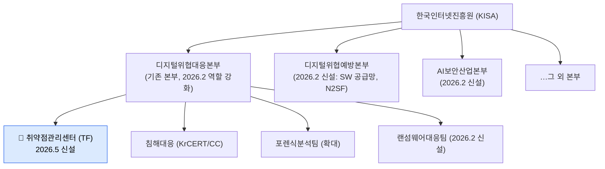

# 조직 안에서의 위치

| 레벨 | 상태 | 최종 개정 |
|---|---|---|
| 🟢 | 🔄 개정중 | 2026-10-22 |

> **한눈에 보기**
> 취약점관리센터는 KISA **디지털위협대응본부** 아래에 2026년 5월 신설된 조직이다. 📎
> 출범 당시 TF(태스크포스) 형태였고, 6월 인사에서 센터장(TF)이 단장급으로 보임됐다. 📎
> 정부가 밝힌 목표 규모는 40명 수준이지만, 2026년 10월 보도 기준 실제 상근 전담 인력은 그보다 훨씬 적다. 📎

## 1. 조직도

그림의 약어 둘은 이 책 전체에서 자주 나온다. **KrCERT/CC**(Korea Computer Emergency Response Team Coordination Center)는 KISA의 인터넷침해대응센터로 침해사고 신고 접수와 대응을 맡는 조직이고, **N2SF**(National Network Security Framework, 국가망 보안체계)는 국가·공공기관의 망 분리를 대신하는 등급 기반 보안 체계다. [부록 A 용어집](../../appendix/a-glossary.md)

📎 2026년 2월 9일자 조직개편: AI보안산업본부·디지털위협예방본부·랜섬웨어대응팀 신설, 디지털위협대응본부는 포렌식분석팀 확대 등 역할 강화. [KISA 보도자료](https://www.kisa.or.kr/402/form?postSeq=2573), [데일리시큐](https://www.dailysecu.com/news/articleView.html?idxno=204896), [머니투데이](https://www.mt.co.kr/tech/2026/02/03/2026020308271646188)
📎 센터의 소속: "KISA 디지털위협대응본부 취약점관리센터 센터장" [바이라인네트워크 2026-09-21](https://byline.network/2026/09/21-619/)

🔎 **내부 확인**: 센터 내부의 팀 구성(예: 분석·검증, 제도 운영, 기술지원, AI)과 각 팀의 정원. 위 그림의 디지털위협대응본부 산하 다른 조직 목록도 공개 자료로 조합한 것이라 내부 조직도로 대체해야 한다.

## 2. 신설 경위

| 시점 | 일 | 출처 |
|---|---|---|
| 2026-02-09 | KISA 조직개편. 취약점관리센터는 이때 포함되지 않음 | 📎 [KISA](https://www.kisa.or.kr/402/form?postSeq=2573) |
| 2026-05 | AI 활용 사이버위협 대응을 위해 KISA 내 취약점관리센터 신설 (TF) | 📎 [네이트뉴스 2026-10-05](https://m.news.nate.com/view/20261005n17033) |
| 2026-05-28/29 | 정부 상시 신고조치제 시범사업 발표, AI 기반 사이버 위협 대응체계 발표 | 📎 [다음 2026-05-29](https://v.daum.net/v/20260529120046524) |
| 2026-06 | KISA 인사: 취약점관리센터장(TF) 단장급 보임 | 📎 [네이트뉴스 2026-06-19](https://m.news.nate.com/view/20260619n21038) |
| 2026-09-21 | KISA 이슈앤톡. 센터장이 센터 운영 방향 공개 설명 | 📎 [바이라인네트워크](https://byline.network/2026/09/21-619/) |
| 2026-10 | 국정감사. 인력·예산 미반영 지적 | 📎 [네이트뉴스](https://m.news.nate.com/view/20261005n17033), [아시아경제](https://view.asiae.co.kr/article/2026101511545218158) |

## 3. 인력과 예산 현황 🔴

2026년 10월 국정감사 시기의 보도를 그대로 옮긴다. 보도마다 수치가 조금씩 달라 둘 다 적는다.

| 항목 | 보도 내용 | 출처 |
|---|---|---|
| 정부가 밝힌 목표 규모 | "1개 단, 40명 수준" | 📎 [네이트뉴스](https://m.news.nate.com/view/20261005n17033) |
| 실제 인원 | 상근·비상근 합쳐 24명, 그중 11명 비상근. 상근 전담은 13명 | 📎 [네이트뉴스](https://m.news.nate.com/view/20261005n17033), [서플](https://supple.kr/news/cmuv3qtq6002rq86ii49n1enl) |
| 2027년 증원 요구 | 20명 요구, 재정 당국 검토에서 0명 반영 | 📎 [네이트뉴스](https://m.news.nate.com/view/20261005n17033) |
| 2027년 예산 요구 | AI 해킹 자동화시스템 구축 등 170억 원 요구, 미반영 | 📎 [네이트뉴스(단독)](https://m.news.nate.com/view/20261005n09654) |

이것이 센터 직원에게 뜻하는 것:

- **한 사람이 여러 역할**을 맡는다. 분석가가 제도 운영도, 기업 응대도 한다. 온보딩에서 "내 업무 범위"를 좁게 잡지 말아야 하는 이유다.
- **AI 활용은 선택이 아니다.** 인력으로 감당이 안 되는 물량을 AI로 선별하고 사람이 검증하는 구조가 센터의 전제다. ([2부 9장](../02-programs/09-ai.md))
- **비상근 인력과의 협업**이 일상이다. 🔎 비상근 인력의 소속(파견, 위촉, 타 부서 겸임 등)과 협업 규칙은 내부 확인.

🔎 **내부 확인**: 위 수치의 기준일과 현재 정원표. 국정감사 이후 변동 여부.

## 4. 센터장

2026년 6월 인사에서 취약점관리센터장(TF)으로 단장급 보임. 📎 [네이트뉴스 2026-06-19](https://m.news.nate.com/view/20260619n21038). 이름은 공개 인사 발표와 언론 인터뷰에 실려 있으며, 이 책에서는 직위로만 부른다.

센터장의 공개 발언은 센터의 방향을 가장 직접적으로 보여 준다. [부록 E 출처](../../appendix/e-sources.md)에 인터뷰 기사 목록이 있다. 신입 직원은 그중 하나 이상을 꼭 읽기를 권한다.

## 체크리스트

- [ ] 센터가 어느 본부 소속인지 말할 수 있는가?
- [ ] 2026년 2월 조직개편과 5월 센터 신설을 구분할 수 있는가?
- [ ] 인력 현황이 업무 방식에 미치는 영향 세 가지를 댈 수 있는가?

## 변경 이력

| 날짜 | 변경 | 기여자 |
|---|---|---|
| 2026-10-21 | 초안 작성 | @anthonynoh5202 |
| 2026-10-22 | 독자 테스트 반영: KrCERT/CC·N2SF 첫 등장에 원어와 한 줄 설명 추가 | @anthonynoh5202 |
