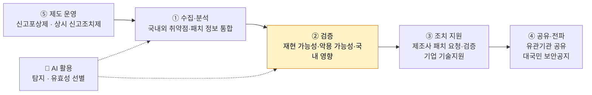
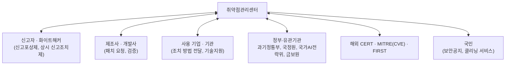

# 역할과 기능

| 레벨 | 상태 | 최종 개정 |
|---|---|---|
| 🟢 | 📝 초안 | 2026-10-21 |

> **한눈에 보기**
> 센터는 취약점의 **탐지·분석 → 검증 → 조치 지원 → 정보 공유·전파**까지 전 과정을 맡는다. 📎
> 여기에 **제도 운영**(신고포상제, 상시 신고조치제)과 **기업 기술지원**, 그리고 이 모든 것을 떠받치는 **AI 활용**이 더해진다.

## 1. 다섯 가지 기능

공개 자료에 나타난 센터의 업무를 다섯 묶음으로 정리했다. 📎 [네이트뉴스 2026-10-05](https://m.news.nate.com/view/20261005n17033), [데이터넷](https://www.datanet.co.kr/news/articleView.html?idxno=214623), [사이버 보안 취약점 정보 포털](https://knvd.krcert.or.kr/)

| 기능 | 하는 일 | 자세히 |
|---|---|---|
| ① 수집·분석 | 국내외 취약점과 패치 정보를 통합 관리. 신규 취약점 여부, 파급도 분석 | [4장](04-workflow.md) |
| ② 검증 | 제보된 취약점이 진짜인지, 재현되는지, 악용 가능한지, 국내에 영향이 있는지 판단. **센터가 가장 강조하는 단계** | [4장](04-workflow.md), [2부 9장](../02-programs/09-ai.md) |
| ③ 조치 지원 | 제조사에 조치 요청, 패치 개발·검증. 해외 제품은 해외 CERT·제조사에 전달. 기업 대상 기술지원 | [2부 8장](../02-programs/08-assessment-support.md) |
| ④ 공유·전파 | 유관기관 정보공유, 파급력 큰 건은 대국민 보안공지. 공공·금융 등 타 소관은 해당 기관에 이관 | [2부 7장](../02-programs/07-portal-advisory.md) |
| ⑤ 제도 운영 | 보안 취약점 신고포상제, 상시 신고조치제(CVD/VDP) 시범사업 운영 | [2부 5장](../02-programs/05-bug-bounty.md), [6장](../02-programs/06-cvd-vdp.md) |

## 2. 센터가 "하지 않는" 것 🟡

경계를 알면 협업이 쉬워진다. 공개 자료 기준이며 🔎 내부 확인이 필요하다.

| 이것은 | 주로 여기서 | 센터와의 접점 |
|---|---|---|
| 침해사고 접수·분석·대응 | KrCERT/CC (침해대응) | 사고 분석 중 발견된 취약점이 센터로 온다. 센터의 보안공지가 사고 예방에 쓰인다 |
| 포렌식 | 포렌식분석팀 | 악용된 취약점의 근본 원인 확인 |
| 랜섬웨어 대응 | 랜섬웨어대응팀 | 랜섬웨어가 쓰는 초기 침투 취약점 정보 공유 |
| SW 공급망 보안, 국가망 보안체계(N2SF) | 디지털위협예방본부 | 공급망 취약점(오픈소스, 의존성)의 분석·전파 |
| 금융 분야 취약점 | 금융보안원 (별도 CNA) | 타 소관 정보 이관 |
| 국가·공공 분야 | 국가정보원 NCSC | 타 소관 정보 이관, 상시 신고조치제 공동 추진 |

[3부 10장 원내 협업](../03-partners/10-internal.md)과 [11장 유관기관](../03-partners/11-external.md)에서 자세히 다룬다.

## 3. 센터의 관점: 발견 < 검증·조치

센터장의 발언을 요약하면 다음과 같다. 📎 [테크M](https://www.techm.kr/news/articleView.html?idxno=155469), [아이티데일리](https://www.itdaily.kr/news/articleView.html?idxno=241783)

- 제보된 취약점의 **유효성을 분석하고 실제 취약점인지 판단하는 과정**이 기업에 상당한 부담이다. 센터가 이 부담을 덜어 준다.
- AI가 10건을 찾으면 분석가가 재검증했을 때 유효한 것은 5~6건 수준이다. **사람의 검증이 반드시 들어간다.**
- 유효하다고 판단된 취약점만 해당 기업에 전달해 조치하게 한다.
- 공개된 취약점 수가 늘어난다고 위험이 그만큼 커지는 것은 아니다. **위험한 것부터** 조치하게 하는 것이 센터의 역할이다. 📎 [다음(현장+)](https://v.daum.net/v/7fTCbGhDyA)

신입 직원이 가장 먼저 익혀야 할 감각은 "이 취약점이 **국내에서, 지금, 실제로** 얼마나 위험한가"를 묻는 습관이다.

## 4. 이해관계자 지도

각 화살표마다 "누가 먼저 연락하는가, 어떤 채널로, 얼마나 빨리"가 정해져 있다. 🔎 내부 연락 체계와 SLA(응답 시한)는 내부 확인.

## 체크리스트

- [ ] 다섯 가지 기능을 순서대로 말할 수 있는가?
- [ ] "센터가 하지 않는 것" 세 가지와 그 담당 조직을 댈 수 있는가?
- [ ] 이해관계자 여섯 부류 각각에 대해 센터가 주는 것과 받는 것을 말할 수 있는가?

## 변경 이력

| 날짜 | 변경 | 기여자 |
|---|---|---|
| 2026-10-21 | 초안 작성 | @anthonynoh5202 |
