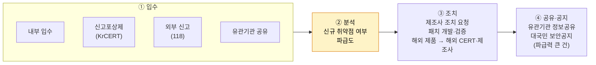

# 핵심 업무 흐름: 취약점의 생애주기

| 레벨 | 상태 | 최종 개정 |
|---|---|---|
| 🟢 (3절은 🟡) | 📝 초안 | 2026-10-21 |

> **한눈에 보기**
> 취약점 하나가 센터에 들어와서 나가기까지: **입수 → 분석 → 조치 요청·패치 검증 → 공유·공지**. 📎
> 이 네 단계는 KISA 사이버 보안 취약점 정보 포털이 공개한 처리 절차이며, 담당 부서는 취약점관리센터(TF)로 명시되어 있다.
> 각 단계에서 센터가 "결정"하는 것이 무엇인지 알면 자기 일이 전체 어디에 있는지 보인다.

## 1. 네 단계

📎 [사이버 보안 취약점 정보 포털 운영 소개](https://knvd.krcert.or.kr/operationIntroduce.do)



| 단계 | 센터가 결정하는 것 | 산출물 |
|---|---|---|
| ① 입수 | 어느 경로로 들어왔는가, 중복인가 | 접수 기록, 식별번호 |
| ② 분석 | **신규인가**(이미 알려진 것인가), **파급도**는 어느 정도인가, 재현되는가 | 분석 보고, 위험도 판정 |
| ③ 조치 | 누구에게(국내 제조사 / 해외 CERT·제조사) 무엇을(패치 요청, 완화책) 요청하는가. 패치가 실제로 막는가 | 조치 요청, 패치 검증 결과 |
| ④ 공유·공지 | 유관기관에 공유할 것인가, 대국민 공지할 것인가, **언제** 할 것인가 | 보안공지, 공유 기록 |

## 2. 각 단계에서 생기는 질문

### ① 입수
- 입구가 다르면 **신고자의 기대**가 다르다. 신고포상제는 포상 평가를 기다리고, 118 신고는 빠른 답을 기다리고, 유관기관은 공유 기록을 기다린다.
- 중복 여부는 입수 단계에서 걸러야 뒤가 가볍다. 국내외 취약점 DB(CVE, 국내 식별 체계)와 대조한다. 🔎 국내 식별번호 체계(예: KVE)의 부여 규칙은 내부 확인.

### ② 분석
- "신규인가"는 **CVE가 있는가**만이 아니다. 알려진 취약점의 **새로운 영향 경로**일 수도 있다.
- "파급도"는 국내 사용 현황을 봐야 한다. 해외에서 Critical이어도 국내 설치가 없으면 우선순위가 낮고, 반대로 해외에선 조용해도 국내 특정 제품에 널리 쓰이면 높다. **이것이 센터가 존재하는 이유 중 하나다.**
- 재현은 가능하면 직접 한다. 재현 안 되는 제보는 제조사도 움직이지 않는다. 재현 기술은 [제2편 분석 기술 7부 워크스루](../../vol2-tech/part7-walkthroughs/00-overview.md)를 참고한다.

### ③ 조치
- 제조사에 보내는 요청은 **재현 절차 + 영향 + 수정 제안**이 들어가야 고쳐진다. 보고서 쓰기는 [바이블 8부](../../vol2-tech/part8-reporting/01-report-structure.md)와 같은 원칙이다.
- 패치 검증은 "증상이 사라졌는가"가 아니라 "원인이 없어졌는가"를 본다. 변형(variant)이 남아 있으면 다시 요청한다.
- 해외 제품은 센터가 직접 고칠 수 없다. 해외 CERT와 제조사에 전달하고, **국내 사용자 대상 완화책**을 먼저 공지하는 것이 현실적일 때가 많다.

### ④ 공유·공지
- 공지가 늦다는 불만이 있다. 자체 보안 인력이 있는 기업은 "이미 패치했는데 공지가 온다"고 한다. 센터장은 **공개 전 유효성·위험도 분석이 시간을 만든다**고 설명했다. 📎 [전자신문 2026-09-22](https://www.etnews.com/20260922000300)
- 그래서 ②를 빠르게 하는 것이 ④를 빠르게 하는 유일한 길이다. AI 활용의 목적이 여기에 있다. ([2부 9장](../02-programs/09-ai.md))

## 3. 시간축: 침해대응과 무엇이 다른가 🟡

전입 직원, 특히 침해대응 출신이 가장 먼저 느끼는 차이다.

| | 침해대응 (KrCERT/CC) | 취약점관리 (센터) |
|---|---|---|
| 시작점 | **사고가 났다** | **사고가 날 수 있다** |
| 시간 압박 | 시간 단위. 피해 확산 차단 | 일~주 단위. 단, 악용 중인 취약점은 시간 단위 |
| 상대 | 피해 기관 | 제조사, 사용 기관, 신고자 |
| 끝 | 복구와 원인 보고 | 패치 배포와 공지, 그리고 **적용 확인** |
| 성공의 정의 | 피해 최소화 | **사고가 안 나는 것** (측정이 어렵다) |

두 흐름은 서로 먹인다. 사고 분석에서 나온 취약점은 센터의 입구 ①이 되고, 센터의 공지는 사고를 예방한다. [3부 10장](../03-partners/10-internal.md)에서 연결 방법을 다룬다.

## 4. 사례로 따라가기 🟡

🔎 **내부 확인**: 센터가 실제 처리한 사례 하나를 익명화해 이 절에 넣으면 신입 교육 자료로 가장 효과가 크다. 넣을 때는 아래 틀을 쓴다.

```
- 입수: 경로, 날짜, 제보 형태
- 분석: 신규 여부 판단 근거, 파급도 판정과 이유, 재현 여부
- 조치: 누구에게 무엇을 요청했나, 패치까지 걸린 시간, 검증 결과
- 공지: 공유 범위, 공지 시점 결정 이유
- 배운 것: 다음에 더 빨리 하려면
```

공개 사례로는 2021년 Log4Shell(CVE-2021-44228) 같은 전 세계 공통 사건에서 국내 CERT가 어떻게 움직였는지를 [바이블 7부 1장](../../vol2-tech/part7-walkthroughs/01-cve-2021-44228-log4shell.md)과 함께 보면 좋다.

## 체크리스트

- [ ] 네 단계와 각 단계의 산출물을 말할 수 있는가?
- [ ] "파급도"를 판단할 때 국내 사용 현황을 왜 봐야 하는지 설명할 수 있는가?
- [ ] 공지가 늦어지는 구조적 이유와 그 해법을 말할 수 있는가?
- [ ] 침해대응과 취약점관리의 시간축 차이를 설명할 수 있는가?

## 변경 이력

| 날짜 | 변경 | 기여자 |
|---|---|---|
| 2026-10-21 | 초안 작성 | @anthonynoh5202 |
