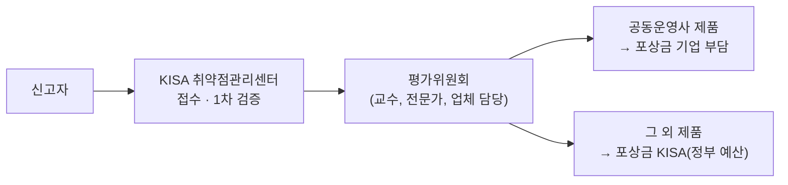

# 보안 취약점 신고포상제

| 레벨 | 상태 | 최종 개정 |
|---|---|---|
| 🟢 (4절은 🟡) | 🔄 개정중 | 2026-10-23 |

> **한눈에 보기**
> 2012년 10월부터 운영해 온 KISA의 대표 제도. 국내에 유통되는 소프트웨어의 **신규** 보안 취약점을 신고받아 평가하고 포상한다. 📎
> 기업이 공동운영사로 참여하면 자사 제품 포상금을 기업이 부담하고, 나머지는 KISA가 정부 예산으로 지급한다. 📎
> 담당 부서는 취약점관리센터(TF). 신고는 사이버 보안 취약점 정보 포털로 받는다. 📎

## 1. 제도 개요

| 항목 | 내용 | 출처 |
|---|---|---|
| 시작 | 2012년 10월 | 📎 [정보통신신문](https://www.koit.co.kr/news/articleView.html?idxno=104141)(2절의 포상금 정부 부담 지적과 같은 기사. 제도 시작 시점을 언급. [부록 C](../../appendix/c-timeline.md) 첫 행과 같은 출처) |
| 대상 | 국내에서 유통되는 소프트웨어(펌웨어 포함)의 **최신 버전**에 영향을 주는 신규 취약점 | 📎 [KISA 집중 신고기간 공지](https://www.kisa.or.kr/402/form?postSeq=1715&lang_type=KO) |
| 접수 | 사이버 보안 취약점 정보 포털 (knvd.krcert.or.kr), 상시 | 📎 [포털](https://knvd.krcert.or.kr/) |
| 평가 | 위험도·파급도·발굴 난이도. 1차 KISA 내부 검증, 2차 외부 평가위원회 | 📎 [포털](https://knvd.krcert.or.kr/), [데일리시큐(2018)](https://www.dailysecu.com/news/articleView.html?idxno=28083) |
| 주기 | 분기별 평가·지급 | 📎 [한국경제 2025-08](https://www.hankyung.com/article/202508064290i) |
| 포상금 | 건당 최대 1,000만 원 (하한 5만 원이라는 2018년 보도 있음) | 📎 [포털](https://knvd.krcert.or.kr/), [데일리시큐(2018)](https://www.dailysecu.com/news/articleView.html?idxno=28083) |
| 담당 | 취약점관리센터(TF) | 📎 [포털](https://knvd.krcert.or.kr/) |

🔎 **내부 확인**: 현행 운영 규정의 정확한 명칭·개정일, 포상금 하한·상한, 평가위원회 구성 규칙.

## 2. 공동운영사

- 2014년부터 공동운영사가 늘기 시작했고, 한때 17개사에 이르렀다. 📎 [보안뉴스](https://m.boannews.com/html/detail.html?idx=126755)
- 참여와 이탈이 있다. 네이버는 공동운영을 종료하고 독자 운영으로 전환했고, 카카오모빌리티는 2025년 8월 새로 참여했다. 📎 [아이뉴스24](https://www.inews24.com/view/1206121), [한국경제](https://www.hankyung.com/article/202508064290i)
- 2025년 국정감사에서 **포상금의 83~90%를 정부 예산이 부담**한다는 지적이 있었다. 기업이 자기 제품 취약점의 비용을 더 부담해야 한다는 논지다. 📎 [정보통신신문](https://www.koit.co.kr/news/articleView.html?idxno=104141), [일요서울](https://www.ilyoseoul.co.kr/news/articleView.html?idxno=507957)
- 2026년 8월 11일, 포털에 "2026년도 KISA 포상금 소진에 따른 일반신고 전환 안내"가 게시됐다. 📎 [포털 공지](https://knvd.krcert.or.kr/)

🔎 **내부 확인**: 현재 공동운영사 목록, 포상금 소진 이후 일반신고 처리 방식, 2027년 예산.

## 3. 신고자 입장에서 본 흐름

센터 직원은 신고자가 무엇을 기대하는지 알아야 한다.

1. 포털에서 신고서 작성 (재현 절차, 영향, 환경)
2. KISA 1차 검증: 신규인가, 재현되는가 → 여기서 걸러지는 비율이 높다
3. 제조사 통보와 조치 (신고자는 이 사이 기다린다)
4. 분기 평가위원회: 위험도·파급도·난이도 점수
5. 포상금 지급
6. **공개 제한**: 패치 완료 후에도 일정 기간(2018년 기준 120일) 신고자는 논문·언론·컨퍼런스에 공개할 수 없고, 공동운영사 관련 취약점은 더 엄격하다. 📎 [데일리시큐(2018)](https://www.dailysecu.com/news/articleView.html?idxno=28083) 🔎 현행 기준 확인

신고자 응대에서 가장 흔한 질문은 "지금 어느 단계인가"와 "언제 공개할 수 있는가"다. 두 답을 바로 줄 수 있도록 내부 추적 시스템을 익혀 둔다. 🔎

## 4. 평가 기준 다루기 🟡

| 축 | 보는 것 | 분석가의 판단 포인트 |
|---|---|---|
| 위험도 | CVSS 류의 기술적 심각도. 인증 필요 여부, 원격 가능 여부, 영향 범위 | 벡터를 기계적으로 매기되, "국내 환경에서 실제로"를 한 번 더 묻는다 |
| 파급도 | 영향받는 제품의 국내 사용 규모, 사용 분야(기반시설, 공공, 다수 국민) | 설치 수, 시장 점유, 대체 가능성 |
| 발굴 난이도 | 자동 스캐너로 나오는가, 깊은 분석이 필요한가 | 같은 유형의 과거 제보와 비교 |

평가는 기술 점수이기도 하지만 **제도의 신뢰**이기도 하다. 낮게 매기면 신고자가 떠나고, 높게 매기면 예산이 바닥난다(2026년 8월 소진 사례). 분석가의 일관성이 곧 제도의 지속성이다.

## 5. 관련 행사와 변형

| 이름 | 내용 | 출처 |
|---|---|---|
| 집중 신고기간 | 특정 제품군(예: 2024년 웹 브라우저 플러그인, IP카메라)을 정해 기간 한정 신고 접수 | 📎 [KISA](https://www.kisa.or.kr/402/form?postSeq=1715&lang_type=KO) |
| 핵 더 키사(Hack the KISA) | KISA 자체 홈페이지를 대상으로 한 취약점 발굴 행사 | 📎 [보안뉴스](https://m.boannews.com/html/detail.html?idx=134577) |
| 핵더챌린지 버그바운티 | 2025년 시즌1. 위험도에 따라 건당 최대 100만 원 | 📎 [보안뉴스](https://m.boannews.com/html/detail.html?idx=137566) |

이 행사들은 **상시 신고조치제**([6장](06-cvd-vdp.md))로 이어지는 징검다리였다. "특정 기간, 특정 대상"에서 "365일, 실제 운영망"으로 확장된 것이 2026년의 변화다.

## 체크리스트

- [ ] 공동운영사 제품과 그 외 제품의 포상금 재원 차이를 설명할 수 있는가?
- [ ] 1차 검증과 2차 평가위원회의 역할 차이를 말할 수 있는가?
- [ ] 신고자가 가장 자주 묻는 두 질문에 답할 준비가 되어 있는가?

## 변경 이력

| 날짜 | 변경 | 기여자 |
|---|---|---|
| 2026-10-21 | 초안 작성 | @anthonynoh5202 |
| 2026-10-23 | 독자 테스트 2차 반영: 1절 표의 제도 시작(2012년 10월) 출처가 2절 83~90% 지적과 같은 정보통신신문 기사임을 명시하고 부록 C와 통일, 메타 표의 최종 개정일을 변경 이력과 맞춤 | @anthonynoh5202 |
