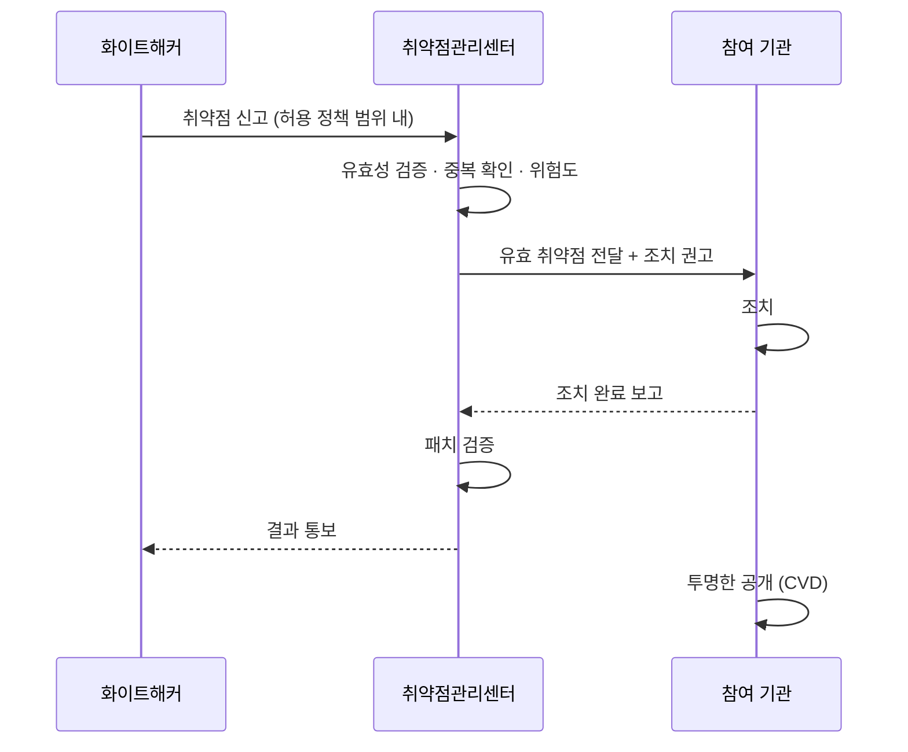

# 보안취약점 상시 신고조치제 (CVD/VDP)

| 레벨 | 상태 | 최종 개정 |
|---|---|---|
| 🟢 (4절은 🔴) | 🔄 개정중 | 2026-10-22 |

> **한눈에 보기**
> 2026년 5월 28일 발표된 국내 첫 **취약점 신고·조치·공개(CVD) + 취약점 공개 정책(VDP)** 시범사업. 📎
> 화이트해커가 **실제 운영망**을 포함한 대상에서 365일 24시간 취약점을 찾아 신고하면, 기관이 조치하고 투명하게 공개한다. 📎
> 국가인공지능전략위원회·과기정통부·국정원·KISA가 함께 추진하며, **2027년 제도화**가 목표다. 📎

## 1. 무엇이 새로운가

| | 기존 신고포상제 | 상시 신고조치제 |
|---|---|---|
| 대상 | 소프트웨어 제품 | **기관·기업의 실제 운영 서비스** |
| 기간 | 상시이지만 제품 중심 | 365일 24시간, 서비스 중심 |
| 허용 범위 | 제품 분석 | 기관이 **사전에 공개한 허용 정책(VDP)** 안에서 운영망 탐색 |
| 법적 위험 | 제품 분석은 비교적 안전 | 운영망 탐색은 정보통신망법상 침입으로 간주될 수 있었음 → **허용 정책으로 해소** |
| 공개 | 제한적 | 조치 후 **투명하게 공개**(CVD) |
| AI 활용 | 명시 없음 | 참여 해커의 **AI 활용 해킹 허용** |

📎 [아시아경제 2026-05-28](https://view.asiae.co.kr/article/2026052811291977316), [보안뉴스](https://m.boannews.com/html/detail.html?tab_type=1&idx=143845), [KDI 정책자료](https://eiec.kdi.re.kr/policy/materialView.do?depth1=&depth2=&device=&num=281714&pg=&pp=&search_txt=&topic=&type=)

핵심은 **"홈페이지 취약점 발굴은 불법"**이라는 오랜 장벽을 넘은 것이다. 그동안 민간 전문가가 운영 중인 서비스의 취약점을 찾는 것은 그 자체로 처벌 위험이 있었다. 📎 [뉴시스 2020](https://mobile.newsis.com/view/NISX20201021_0001205008)

## 2. 시범사업 개요

| 항목 | 내용 |
|---|---|
| 발표 | 2026-05-28 |
| 추진 | 국가인공지능전략위원회, 과학기술정보통신부, 국가정보원, KISA |
| 참여 기관 | 15곳. 민간 7곳(LG유플러스, 넥슨, 삼성생명 등), 공공 8곳(건강보험심사평가원, 한전ON, 국가교통정보센터 등) |
| 화이트해커 모집 | 2026-05-29 ~ 06-12. 대한민국 국적 19세 이상, 인원 제한 없음 |
| 참여 조건 | 사전 윤리교육 이수, 기관별 허용 정책(대상·범위) 준수 |
| 운영 기간 | 2026년 6월부터 약 5개월 |
| 결과 공개 | 2026년 연말 예정 |
| 제도화 | 2027년 목표. 2026-06-18 국가AI전략위 세미나에서 제도화 방안 논의 |

📎 [데일리시큐](https://www.dailysecu.com/news/articleView.html?idxno=206932), [전자신문](https://www.etnews.com/20260528000278), [ZDNet 2026-06-18](https://zdnet.co.kr/view/?no=20260618112122), [국가AI전략위 공고](https://www.aikorea.go.kr/web/board/brdDetail.do?menu_cd=000012&num=683)

## 3. 센터의 역할

🔎 **내부 확인**: 위 흐름은 공개 자료의 제도 설명을 바탕으로 한 추정이다. 실제 접수 시스템, 센터와 참여 기관의 역할 분담, 국정원(공공 기관 담당 여부), 조치 시한, 공개 시점 규칙은 내부 운영 지침으로 대체해야 한다.

센터 직원에게 이 제도가 뜻하는 것:

- **신고 물량이 다르다.** 제품 하나가 아니라 15개 기관의 운영 서비스 전체가 대상이다. AI 활용까지 허용되어 자동화된 신고가 들어온다. 유효성 선별([9장](09-ai.md))이 병목이 된다.
- **상대가 다르다.** 제조사가 아니라 **서비스 운영 기관**이다. "패치를 내 달라"가 아니라 "설정을 바꾸고, 코드를 고치고, 재배포하라"는 요청이 된다.
- **공개가 기본값이다.** 조치 후 공개가 원칙이므로, 공개 문안과 시점을 처음부터 염두에 둔다.

## 4. 제도화를 앞둔 쟁점 🔴

공개 자료에서 드러난 논점이다. 정책 담당자가 다룰 영역이다.

| 쟁점 | 내용 | 출처 |
|---|---|---|
| 법적 면책의 근거 | "처벌 걱정 없이"라는 표현이 쓰였지만, 명문의 면책 조항이 아니라 기관별 허용 정책과 사전 교육이 조건. 법제화 시 어떻게 규정할지 | 📎 [보안뉴스](https://m.boannews.com/html/detail.html?tab_type=1&idx=143845) |
| 조치 시한 | 공개 취약점을 빠르게 조치하도록 하는 지침이 국내에 없다. 미국식 가이드라인 참고 필요 | 📎 [전자신문 2026-09-22](https://www.etnews.com/20260922000300) |
| 적용 대상과 일정 | 법제화 일정, 적용 대상, 조치 시한은 미확정 | 📎 [데이터넷](https://www.datanet.co.kr/news/articleView.html?idxno=214623) |
| 센터 인력 | 15개 기관 시범만으로도 인력 압박. 확대 시 더 심각 | 📎 [네이트뉴스](https://m.news.nate.com/view/20261005n17033) |

[3부 12장 법과 제도](../03-partners/12-legal.md)에서 이어진다.

## 체크리스트

- [ ] 신고포상제와 상시 신고조치제의 차이를 "대상·범위·공개" 세 축으로 설명할 수 있는가?
- [ ] 시범사업 참여 기관 수와 운영 기간을 말할 수 있는가?
- [ ] 제도화를 앞둔 쟁점 두 가지를 댈 수 있는가?

## 변경 이력

| 날짜 | 변경 | 기여자 |
|---|---|---|
| 2026-10-21 | 초안 작성 | @anthonynoh5202 |
