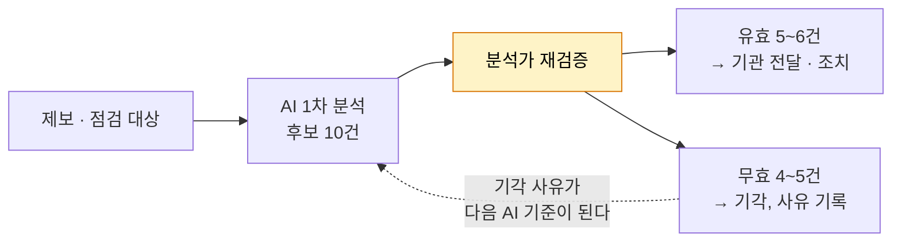

# AI를 활용한 탐지와 검증

| 레벨 | 상태 | 최종 개정 |
|---|---|---|
| 🟡 | 🔄 개정중 | 2026-10-22 |

> **한눈에 보기**
> 센터는 신설 목적 자체가 "AI를 활용한 사이버위협 대응"이다. 📎
> 2026년 5월 과기정통부와 KISA는 OpenAI의 정부·기관용 프로그램(GTAC)에 참여해 보안 특화 모델을 취약점 점검에 쓰기 시작했다. 📎
> 센터장의 요약: **AI가 10건을 찾으면 유효한 것은 5~6건.** 사람의 재검증은 선택이 아니라 구조다. 📎

## 1. 무엇에 쓰는가

| 용도 | 내용 | 출처 |
|---|---|---|
| 제보 유효성 선별 | 신고포상제·상시 신고조치제로 들어온 제보가 실제 취약점인지 1차 판단 | 📎 [테크M](https://www.techm.kr/news/articleView.html?idxno=155469) |
| 기반시설 점검 | 기반시설의 공개 웹페이지와 상용·오픈소스 SW를 AI로 점검 | 📎 [디일렉](https://www.thelec.kr/news/articleView.html?idxno=62628) |
| 위험 선별 | 연 6만 건 넘는 공개 취약점 중 "진짜 위험"을 가려내기 | 📎 [ZDNet](https://zdnet.co.kr/view/?no=20260922142056) |
| AI 해킹 자동화시스템 (계획) | 2027년 예산 170억 원 요구, 미반영 | 📎 [네이트뉴스(단독)](https://m.news.nate.com/view/20261005n09654) |

🔎 **내부 확인**: 실제 사용 중인 모델과 도구, 데이터 반출 규칙(제보 내용을 외부 모델에 넣어도 되는 범위), 결과 기록·감사 방식.

## 2. 사람이 하는 일

센터장은 사람 둘이 일주일에서 한 달 걸릴 일을 AI가 당긴다고 했지만, 동시에 유효율이 절반 수준이라고도 했다. 📎 [MTN](https://news.mtn.co.kr/news-detail/2026092210051435127) 분석가의 일은 세 가지로 바뀐다.

1. **검증**: AI 결과를 재현한다. 재현 안 되면 기각.
2. **기각 사유 기록**: 왜 오탐인지 적는다. 이것이 쌓여야 AI 기준이 좋아진다.
3. **맥락 판단**: AI는 "국내에서, 이 기관에서, 지금" 얼마나 위험한지 모른다. 그 판단은 사람이 한다.

## 3. 한계와 방향

- **해외 모델의 한계**: 국내 공격 양상과 보안 환경을 충분히 반영하지 못한다는 것이 센터장의 평가다. 📎 [MTN](https://news.mtn.co.kr/news-detail/2026092210051435127)
- **한국형 보안 AI**: KISA는 보안 특화 국산 기반 모델을 추진한다. 정부 계획상 2027년부터 독자 AI 기술 기반 정보보호 체계로 전환. 📎 [한국경제 2026-09-22](https://www.hankyung.com/article/202609220821i), [다음 2026-05-29](https://v.daum.net/v/20260529120046524)
- **공격자도 AI를 쓴다**: 상시 신고조치제가 해커의 AI 활용을 허용한 것은, 공격자가 이미 그렇게 하기 때문이다. 방어가 같은 속도를 내지 못하면 뒤처진다.

## 4. 센터 직원의 AI 사용 원칙 (제안) 🔎

공개 자료에는 없다. 센터가 내부 원칙을 세울 때 출발점으로 쓸 수 있는 초안이다.

| 원칙 | 내용 |
|---|---|
| 재현 없이는 전달하지 않는다 | AI 결과는 후보다. 사람이 재현한 것만 기관에 간다 |
| 민감 정보는 넣지 않는다 | 신고자 정보, 기관 내부 정보, 미공개 취약점의 세부 내용은 외부 모델에 넣기 전에 규칙을 확인한다 |
| 기각도 기록한다 | 오탐 사유가 자산이다 |
| AI가 못 하는 것을 안다 | 국내 파급도, 기관 맥락, 정책 판단 |
| 결과를 설명할 수 있어야 한다 | "AI가 그렇다고 했다"는 근거가 아니다 |

## 체크리스트

- [ ] 센터가 AI를 쓰는 네 가지 용도를 말할 수 있는가?
- [ ] "10건 중 5~6건"이 분석가의 일을 어떻게 바꾸는지 설명할 수 있는가?
- [ ] 외부 모델에 넣어도 되는 정보의 범위를 확인했는가? 🔎

## 변경 이력

| 날짜 | 변경 | 기여자 |
|---|---|---|
| 2026-10-21 | 초안 작성 | @anthonynoh5202 |
