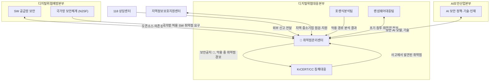

# 원내 협업

| 레벨 | 상태 | 최종 개정 |
|---|---|---|
| 🟢 | 🔄 개정중 | 2026-10-23 |

> **한눈에 보기**
> 취약점은 센터 혼자 다루지 않는다. 사고 대응, 포렌식, 랜섬웨어, 공급망, AI 산업, 118, 지역센터가 모두 취약점 정보를 주고받는다. 🔎 이 지도는 공개 조직개편 자료로 조합한 것이며, 보안공지의 발행 주체를 비롯한 접점의 방향은 내부 확인이 필요하다.
> 전입 직원은 이 연결고리를 이미 안다. 그것이 전입 직원의 가장 큰 자산이다.

## 1. 협업 지도

공개된 조직개편 자료를 바탕으로 한 지도다. 🔎 내부 조직도와 실제 협업 채널로 대체해야 한다.

🔎 보안공지는 보호나라(KrCERT/CC가 운영하는 사이트)에 게시된다. 공지의 발행 주체가 센터인지 KrCERT/CC인지, 그래서 위 화살표의 방향이 센터 → KrCERT/CC가 맞는지는 내부 확인이 필요하다.

📎 조직 구성: [KISA 2026-02 조직개편](https://www.kisa.or.kr/402/form?postSeq=2573), [데일리시큐](https://www.dailysecu.com/news/articleView.html?idxno=204896)

## 2. 부서별 접점

| 부서 | 센터에 주는 것 | 센터가 주는 것 | 흔한 마찰 |
|---|---|---|---|
| **KrCERT/CC 침해대응** | 사고 분석 중 확인된 악용 취약점, 공격 IoC(침해 지표) | 보안공지 🔎(발행 주체·방향은 내부 확인), "지금 악용 중" 경보, 패치 정보 | 시간축 차이. 사고팀은 "지금 당장", 센터는 "검증 후". 악용 중 취약점은 센터도 시간 단위로 움직여야 한다 |
| **포렌식분석팀** | 침투 경로의 근본 원인(어떤 취약점이 어떻게) | 해당 취약점의 기술 분석, 변형 가능성 | 증거 보전 vs 재현 실험의 충돌 |
| **랜섬웨어대응팀** | 랜섬웨어 그룹이 쓰는 초기 침투 취약점 목록 | 해당 취약점의 국내 노출 현황, 공지 | 공개 시점. 랜섬웨어는 공개 당일 악용이 흔하다 |
| **SW 공급망 보안** | 오픈소스·의존성 취약점, SBOM 정보 | 국내 영향 분석, 제조사 조치 요청 | "누가 제조사인가"가 불명확한 오픈소스 |
| **N2SF (국가망 보안체계)** | 국가망에 적용되는 SW의 취약점 관리 요구 | 해당 SW의 취약점·패치 정보 | 공공 분야는 국정원 소관과 겹친다 🔎 |
| **AI보안산업본부** | 보안 AI 모델, 기술 과제 | 실제 취약점 데이터, 현장 요구사항 | 데이터 공유 규칙 🔎 |
| **118** | 외부 신고 1차 접수 | 응대 스크립트, 자주 묻는 질문 답 | 기술 질문을 118이 답하기 어렵다 |
| **지역정보보호지원센터** | 지역 중소기업 현황, 점검 요청 | 점검 기술, 조치 방법 | 지역별 인력 편차 |

🔎 **내부 확인**: 각 접점의 정식 채널(시스템, 메일 그룹, 회의체)과 비상 연락 체계.

## 3. 협업이 잘 되게 하는 습관

- **같은 식별자로 부른다.** CVE 번호, 국내 식별번호, 제품명+버전. "그 취약점"은 없다.
- **상태를 공유한다.** 입수·분석·조치·공지 중 어디인지 상대가 물어보기 전에 보이게 한다. 🔎 공유 시스템
- **시간축을 명시한다.** "검증 중, 예상 N일" 또는 "악용 확인, 즉시 공지"처럼 상대가 자기 일정을 잡을 수 있게.
- **사고 → 취약점 → 공지 → 예방**의 고리를 닫는다. 사고팀이 준 취약점이 공지로 나갔고 그 뒤 같은 사고가 줄었는지 함께 본다.

## 체크리스트

- [ ] 센터와 가장 자주 협업하는 부서 세 곳과 그 접점을 말할 수 있는가?
- [ ] 침해대응팀과의 시간축 차이를 어떻게 좁힐지 설명할 수 있는가?
- [ ] 자기 이전 부서(전입자라면)와 센터의 접점을 그릴 수 있는가?

## 변경 이력

| 날짜 | 변경 | 기여자 |
|---|---|---|
| 2026-10-21 | 초안 작성 | @anthonynoh5202 |
| 2026-10-22 | 독자 테스트 반영: 협업 지도와 2절 표의 보안공지 화살표 방향에 🔎 추가(발행 주체는 내부 확인) | @anthonynoh5202 |
| 2026-10-23 | 독자 테스트 2차 반영: 한눈에 보기에 🔎 추가(공개 자료로 조합한 지도, 보안공지 발행 주체 등은 내부 확인) | @anthonynoh5202 |
