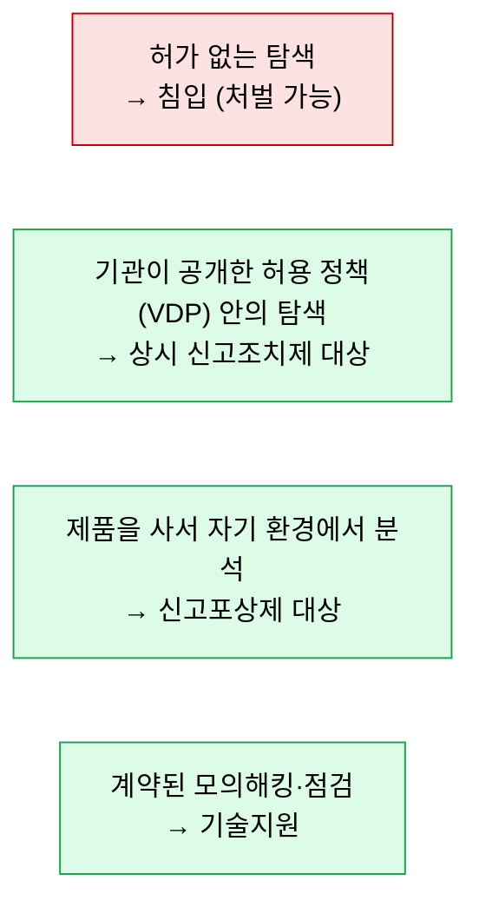

# 법과 제도의 근거

| 레벨 | 상태 | 최종 개정 |
|---|---|---|
| 🔴 | 🔄 개정중 | 2026-10-22 |

> **한눈에 보기**
> 센터의 일은 "남의 시스템의 약점을 찾아 알리는" 일이라 법의 경계 위에 있다.
> 현행법은 허가 없는 접근을 금지하고, 상시 신고조치제는 **허용 정책**으로 그 경계를 열었으며, 2027년 제도화는 그것을 법에 쓰려는 시도다.
> 이 장은 공개 자료 기준의 **개요**다. 법률 해석은 🔎 법무 담당과 확인한다.

## 1. 관련 법령 개요

| 법령 | 센터 업무와의 관계 | 비고 |
|---|---|---|
| 정보통신망 이용촉진 및 정보보호 등에 관한 법률 | 정당한 권한 없는 접근(침입) 금지. 포털 주의사항의 근거. 취약점 신고·공유 체계의 근거 📎 [포털](https://knvd.krcert.or.kr/) | 🔎 해당 조문과 KISA 업무 위탁 근거 |
| 정보통신기반 보호법 | 주요정보통신기반시설의 취약점 분석·평가. 기반시설 점검의 근거 | 🔎 KISA의 역할 조문 |
| 신고포상제 운영 규정 | 평가 기준, 포상금, 공개 제한 | 🔎 규정 명칭·개정 이력 |
| (제정 논의) 상시 신고조치제 관련 법제 | 2027년 제도화 목표 📎 [ZDNet](https://zdnet.co.kr/view/?no=20260618112122) | 미정 |

🔎 **내부 확인**: 이 표는 공개 자료로 "존재"만 확인한 수준이다. 조문 번호와 해석은 반드시 내부 법무 검토를 거친다.

## 2. "허용된 범위"라는 개념

센터 직원이 매일 쓰는 판단 기준이다.

- 상시 신고조치제의 "처벌 걱정 없이"는 **명문 면책이 아니라** 기관별 허용 정책 + 사전 윤리교육이라는 조건부 구조다. 📎 [보안뉴스](https://m.boannews.com/html/detail.html?tab_type=1&idx=143845) 신고자에게 설명할 때 이 차이를 정확히 전한다.
- 허용 범위 밖의 신고가 들어오면? 🔎 내부 지침 확인. 정보의 가치와 신고자의 행위를 분리해 다루는 원칙이 필요하다.

## 3. 공개 정책

| 질문 | 현재 (공개 자료 기준) | 쟁점 |
|---|---|---|
| 신고자는 언제 공개할 수 있나 | 패치 후 일정 기간 제한(2018년 기준 120일), 공동운영사 건은 더 엄격 📎 [데일리시큐(2018)](https://www.dailysecu.com/news/articleView.html?idxno=28083) 🔎 현행 | 연구자 유인 vs 사용자 보호 |
| 제조사가 안 고치면 | 🔎 | 무응답 시 공개 시한(국제적으로 90일 관행) 채택 여부 |
| 기관의 조치 시한 | 국내에 지침 없음. 미국식 가이드라인 참고 필요 📎 [전자신문](https://www.etnews.com/20260922000300) | 제도화의 핵심 쟁점 |
| CVD의 "투명한 공개" | 상시 신고조치제 원칙 📎 | 공개 범위와 형식 |

## 4. 2027년 제도화를 향한 논의

| 시점 | 일 | 출처 |
|---|---|---|
| 2026-05-28 | 시범사업 발표. "2027년 제도화 목표" | 📎 [전자신문](https://www.etnews.com/20260528000278) |
| 2026-06-18 | 국가AI전략위 세미나, 제도화 방안 구체화 | 📎 [ZDNet](https://zdnet.co.kr/view/?no=20260618112122) |
| 2026-09-21 | 센터장: 신속 패치 지침 법제화 필요성 제기 | 📎 [전자신문](https://www.etnews.com/20260922000300) |
| 2026 연말 | 시범사업 결과 공개 예정 | 📎 [데일리시큐](https://www.dailysecu.com/news/articleView.html?idxno=206932) |

제도 담당자가 준비할 것:

- 시범사업 **데이터**: 신고 건수, 유효율, 조치 소요일, 공개까지 걸린 시간. 법제화 논거는 숫자다.
- **해외 사례**: 미국 CISA의 BOD 20-01(연방기관 VDP 의무화), 네덜란드 CVD 가이드라인, 일본 IPA·JPCERT의 조기경계 파트너십. 🔎 센터 내 비교 자료 유무
- **센터 인력 산정 근거**: 제도가 확대되면 물량이 어떻게 늘지 추정.

## 체크리스트

- [ ] 허용 범위 네 가지를 그림으로 그릴 수 있는가?
- [ ] "처벌 걱정 없이"가 정확히 무엇을 뜻하는지 신고자에게 설명할 수 있는가?
- [ ] 제도화의 핵심 쟁점 세 가지를 댈 수 있는가?

## 변경 이력

| 날짜 | 변경 | 기여자 |
|---|---|---|
| 2026-10-21 | 초안 작성 | @anthonynoh5202 |
