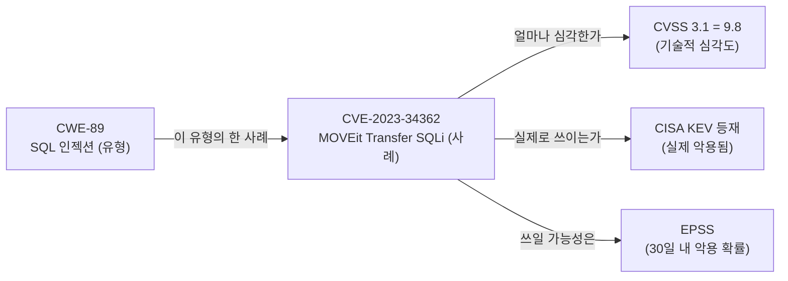
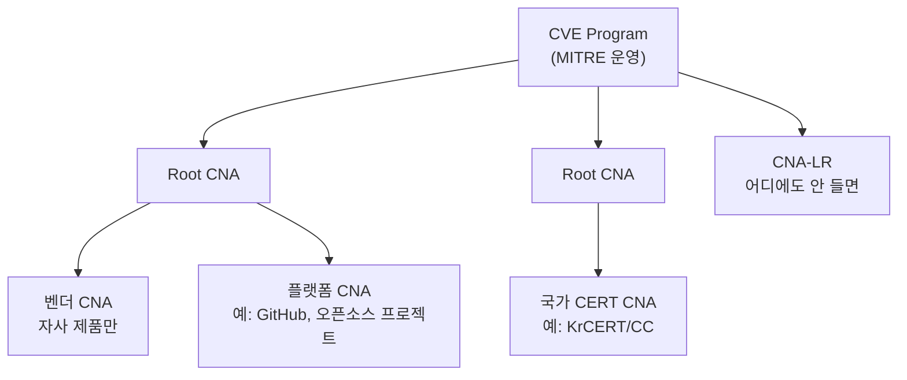
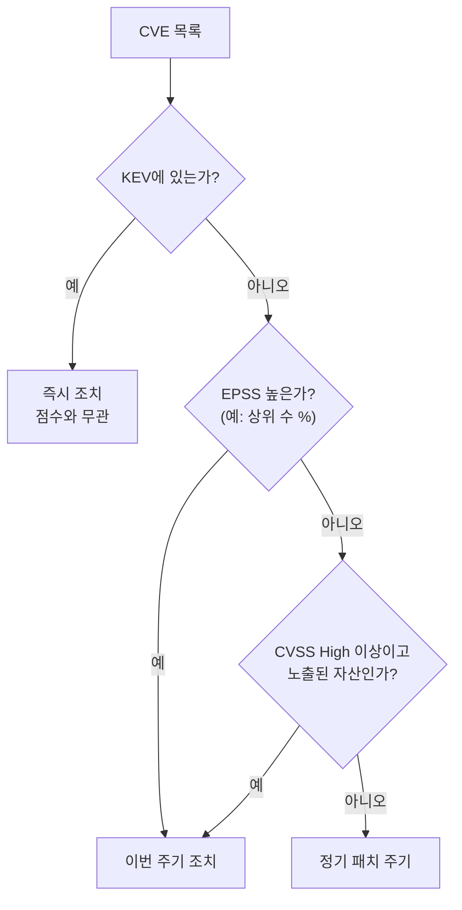

# CWE · CVE · CVSS 체계

| 레벨 | 상태 | 최종 개정 |
|---|---|---|
| 🟢 | 🔄 개정중 | 2026-10-22 |

> **한눈에 보기**
> CWE는 '유형', CVE는 '사례', CVSS는 '점수'다. 이 셋을 읽을 줄 알면 전 세계 취약점 정보를 같은 언어로 이해할 수 있다.
> 점수는 기술적 심각도일 뿐이다. "지금 실제로 악용되는가"는 KEV와 EPSS가 따로 말해 준다.
> 이 장을 읽고 나면 NVD 페이지 하나를 위에서 아래까지 읽고 설명할 수 있어야 한다.

## 1. 세 체계의 관계



<figure>
<figcaption>그림 1. 하나의 취약점은 네 가지 질문에 답해야 한다. 어떤 유형인가(CWE), 어느 제품의 어떤 사례인가(CVE), 기술적으로 얼마나 심각한가(CVSS), 실제로 악용되는가(KEV·EPSS).</figcaption>
</figure>

| 체계 | 운영 | 답하는 질문 | 분석가가 쓰는 순간 |
|---|---|---|---|
| **CWE** (Common Weakness Enumeration) | MITRE | 어떤 **종류**의 실수인가 | 보고서에 유형을 적을 때, 패턴을 검색할 때 |
| **CVE** (Common Vulnerabilities and Exposures) | CVE Program (MITRE 운영, 미 CISA 후원), CNA 네트워크 | 어느 제품의 어떤 **사례**인가 | 신고된 것이 이미 알려진 것인지 확인할 때 |
| **CVSS** (Common Vulnerability Scoring System) | FIRST | 기술적으로 얼마나 **심각**한가 | 조치 우선순위의 출발점 |
| **KEV** (Known Exploited Vulnerabilities) | 미 CISA | 실제로 **악용되었는가** | "지금 당장" 패치 목록 |
| **EPSS** (Exploit Prediction Scoring System) | FIRST | 앞으로 악용될 **확률**은 | 수천 건 중 우선순위를 가를 때 |

## 2. CWE: 약점의 유형

CWE는 "취약점이 생기는 방식"의 목록이다. CVE가 "이 제품의 이 버전에 이런 문제가 있다"라면, CWE는 "그 문제는 입력을 쿼리 문자열에 이어 붙여서 생겼다"는 식의 분류다. [1부 1장](01-what-is-vulnerability.md)의 "근본 원인" 세 묶음을 아주 잘게 쪼갠 것이라고 보면 된다.

### 2.1 구조

CWE 항목은 추상화 수준이 다르다. 보고서에 쓸 때는 가능한 한 구체적인 것을 고른다.

| 수준 | 뜻 | 예 |
|---|---|---|
| Pillar | 가장 추상적인 묶음 | CWE-707 부적절한 중화(neutralization) |
| Class | 언어·기술에 독립적인 유형 | CWE-74 인젝션 |
| Base | 구체적인 유형. **보고서에 보통 이 수준을 쓴다** | CWE-89 SQL 인젝션, CWE-79 XSS |
| Variant | 특정 언어·기술에 한정 | CWE-564 Hibernate SQL 인젝션 |

같은 항목을 여러 관점으로 묶은 것이 **뷰**(view)다. 연구용 전체 계층은 CWE-1000(Research Concepts), 개발자용은 CWE-699(Software Development)다. NVD가 CVE에 CWE를 붙일 때 쓰는 축약 목록은 CWE-1003이다. NVD에서 보는 CWE 번호가 1003 뷰 밖의 세밀한 항목으로 안 나오는 이유다.

### 2.2 Top 25 읽는 법

MITRE와 CISA는 해마다 "가장 위험한 소프트웨어 약점 25"를 낸다. 2024년판은 2023년 6월부터 2024년 6월 사이에 공개된 CVE 3만여 건의 CWE 매핑과 CVSS 점수를 집계해 만들었다. 📎 [CISA 2024-11-20](https://cisa.gov/news-events/alerts/2024/11/20/2024-cwe-top-25-most-dangerous-software-weaknesses), [MITRE 2024 목록](https://cwe.mitre.org/top25/archive/2024/2024_top25_list)

| 순위 | CWE | 이름 | 이 책에서 |
|---|---|---|---|
| 1 | CWE-79 | XSS | [3부 2장](../part3-web/02-xss.md) |
| 2 | CWE-787 | 경계 밖 쓰기 | [4부 2장](../part4-binary/02-stack-overflow.md), [4장](../part4-binary/04-heap.md) |
| 3 | CWE-89 | SQL 인젝션 | [3부 1장](../part3-web/01-sql-injection.md) |
| 4 | CWE-352 | CSRF | [3부 4장](../part3-web/04-auth-session.md) |
| 5 | CWE-22 | 경로 조작 | [3부 6장](../part3-web/06-file-upload-path-traversal.md) |
| 6 | CWE-125 | 경계 밖 읽기 | [7부 2장 Heartbleed](../part7-walkthroughs/02-cve-2014-0160-heartbleed.md) |
| 7 | CWE-78 | OS 명령 인젝션 | [3부 1장](../part3-web/01-sql-injection.md) 원리 동일 |
| 8 | CWE-416 | Use-After-Free | [4부 5장](../part4-binary/05-uaf.md) |
| 9 | CWE-862 | 인가 누락 | [3부 5장](../part3-web/05-access-control.md) |
| 10 | CWE-434 | 위험한 파일 업로드 | [3부 6장](../part3-web/06-file-upload-path-traversal.md) |

읽을 때 주의할 점이 둘 있다. 첫째, 순위는 **보고된 CVE 수**에 크게 좌우된다. 웹 취약점이 상위를 차지하는 것은 웹 제품이 많고 CNA가 많기 때문이지, 바이너리 취약점이 덜 위험해서가 아니다. 둘째, 목록은 매년 바뀌고 "현재 목록"은 [MITRE Top 25 페이지](https://cwe.mitre.org/top25/)에서 확인한다. 보고서에는 몇 년판인지 적는다.

> 🟡 CWE를 고를 때 가장 흔한 실수는 **결과**를 유형으로 적는 것이다. "원격 코드 실행"은 CWE가 아니다. 코드 실행에 이른 **원인**(역직렬화, 명령 인젝션, 버퍼 오버플로)이 CWE다.

## 3. CVE: 사례의 식별자

### 3.1 식별자와 상태

`CVE-2021-44228`은 세 부분이다. 접두어, 연도, 일련번호. 연도는 **ID가 할당되거나 공개된 해**이지 취약점이 만들어진 해가 아니다. 일련번호는 네 자리 이상이고 상한이 없다. 2024년 한 해에 공개된 CVE는 4만 건을 넘었다. 📎 [Jerry Gamblin, 2024 CVE Data Review (2025-01)](https://jerrygamblin.com/2025/01/05/2024-cve-data-review/)

CVE 레코드에는 상태가 있다.

| 상태 | 뜻 | 분석가에게 |
|---|---|---|
| Reserved | ID만 할당됨. 내용 없음 | 벤더가 조율 중이라는 신호. 공개 전 번호만 받아 둔 것 |
| Published | 내용이 공개됨 | 이때부터 NVD·스캐너가 인식한다 |
| Rejected | 중복, 오류 등으로 철회 | 이 번호를 보고서에 쓰지 않는다 |

### 3.2 누가 번호를 주는가: CNA

번호는 MITRE 한 곳이 주지 않는다. **CNA**(CVE Numbering Authority)라 부르는 수백 개 조직이 각자의 **범위**(scope) 안에서 ID를 할당하고 레코드를 쓴다. Apache, Microsoft, GitHub 같은 벤더·플랫폼이 자사 제품의 CNA이고, 국가 CERT가 그 나라의 조정 CNA 역할을 한다. 어느 CNA의 범위에도 들지 않으면 상위 Root나 최후의 CNA(CNA of Last Resort)가 맡는다. 📎 [CNA 운영 규칙 v4.0 (2024-08-08 발효)](https://www.cve.org/Resources/Roles/Cnas/CNA_Rules_v4.0.pdf)



<figure>
<figcaption>그림 2. CNA는 계층 구조다. 신고자는 보통 제품 벤더가 CNA인지 먼저 확인하고, 아니면 국가 CERT나 상위 Root에 요청한다.</figcaption>
</figure>

**한국의 CNA.** KISA는 침해사고대응팀 명의(KrCERT/CC)로 2018년 2월 CNA 자격을 얻었다. 📎 [ZDNet Korea 2018-02-20](https://zdnet.co.kr/view/?no=20180220111319) 금융보안원의 소개 자료에 따르면 국내 CNA 가운데 KISA만 **포괄적인 범위**를 갖고, 삼성·LG전자·네이버·한화비전은 자사 제품으로 범위가 한정된다. 📎 [금융보안원, 국내 금융권 공급망 보안을 위한 CVE 발급기관](https://www.fsec.or.kr/bbs/detail?menuNo=69&bbsNo=11407) 이 말은 국내 소프트웨어의 취약점을 신고했는데 벤더가 CNA가 아니면, KISA가 번호를 줄 수 있다는 뜻이다. KISA가 할당한 CVE 목록은 [취약점 정보 포털의 CVE 게시판](https://knvd.krcert.or.kr/info/cve)에 있다. 현재 CNA 목록과 범위는 [cve.org 파트너 목록](https://www.cve.org/PartnerInformation/ListofPartners)이 기준이다. 🔎 센터의 CNA 운영 절차(할당 기준, 레코드 작성 담당)는 내부 지침으로 대체한다.

### 3.3 CVE 레코드, NVD, 벤더 권고는 다르다

같은 CVE를 세 곳에서 볼 수 있고, 내용이 다를 수 있다.

| 출처 | 누가 쓰나 | 무엇이 있나 | 믿을 것 |
|---|---|---|---|
| **CVE 레코드** (cve.org, [GitHub cvelistV5](https://github.com/CVEProject/cvelistV5)) | CNA가 작성. ADP(CISA 등)가 보강 | 영향 버전, 설명, CNA가 매긴 CVSS, CWE | 영향 버전은 CNA가 가장 정확하다 |
| **NVD** (nvd.nist.gov) | NIST가 CVE 레코드를 받아 보강 | CVSS, CWE(1003 뷰), CPE 식별자 | 검색·자동화에 편하다. 보강이 늦거나 CNA와 점수가 다를 수 있다 |
| **벤더 권고** | 벤더 | 패치 버전, 완화책, 악용 여부 | **조치의 1차 자료** |

레코드를 직접 열어 보면 차이가 보인다. Log4Shell(CVE-2021-44228)의 CVE 레코드에서 CNA인 Apache는 심각도를 "critical"이라고만 적었고, CVSS 3.1 벡터 10.0은 CISA의 ADP 컨테이너가 추가한 것이다. CWE도 CNA는 CWE-502(역직렬화), CWE-400, CWE-20 세 개를 적었다. 📎 [cvelistV5 CVE-2021-44228](https://github.com/CVEProject/cvelistV5/blob/main/cves/2021/44xxx/CVE-2021-44228.json) 2024년부터 CISA가 ADP(Authorized Data Publisher)로서 CVE 레코드에 CVSS·CWE·SSVC를 보강하는 "Vulnrichment"를 하고 있어, NVD만이 보강 출처가 아니다.

> 🟡 신고가 들어오면 가장 먼저 할 일은 **"이미 CVE가 있는가"** 확인이다. 제품명·버전으로 NVD와 벤더 권고를 찾고, 없으면 신규 후보다. 중복 판단은 [제3편 1장](../../vol3-practice/01-workflow-tech/01-intake-analysis.md)에서 업무 흐름으로 다시 다룬다.

## 4. CVSS: 심각도 점수

CVSS는 취약점의 **기술적 특성**을 메트릭으로 적고 0.0~10.0 점수로 바꾸는 규격이다. 현재 3.1(2019년)과 4.0(2023년 11월 1일 발표)이 함께 쓰인다. 📎 [Red Hat, FIRST announces CVSS v4.0 release](https://www.redhat.com/en/blog/first-announces-cvss-v40-release) 벡터 문자열을 읽을 줄 알면 점수가 왜 그렇게 나왔는지 설명할 수 있다.

정성 등급은 두 버전이 같다.

| 점수 | 등급 |
|---|---|
| 0.0 | None |
| 0.1 ~ 3.9 | Low |
| 4.0 ~ 6.9 | Medium |
| 7.0 ~ 8.9 | High |
| 9.0 ~ 10.0 | Critical |

### 4.1 CVSS 3.1 벡터 해석: CVE-2021-44228

```
CVSS:3.1/AV:N/AC:L/PR:N/UI:N/S:C/C:H/I:H/A:H   → 10.0 Critical
```

| 메트릭 | 값 | 뜻 | Log4Shell에서 |
|---|---|---|---|
| AV (Attack Vector) | N (Network) | 어디서 공격하나. N > A(인접) > L(로컬) > P(물리) | 로그에 남는 문자열이면 어디서든. HTTP 헤더 하나로 충분 |
| AC (Attack Complexity) | L (Low) | 공격자가 통제 못 하는 조건이 필요한가 | 없다. 페이로드 한 줄 |
| PR (Privileges Required) | N (None) | 어떤 권한이 필요한가 | 인증 불필요 |
| UI (User Interaction) | N (None) | 사용자가 뭔가 해야 하나 | 없다 |
| S (Scope) | C (Changed) | 취약한 컴포넌트 밖까지 영향이 번지나 | 라이브러리 취약점이 호스트 전체 장악으로 |
| C / I / A | H / H / H | 기밀성·무결성·가용성 영향 | 원격 코드 실행이므로 셋 다 최대 |

벡터의 앞 네 개(AV·AC·PR·UI)는 **착취 가능성**, 뒤 세 개(C·I·A)는 **영향**이고, S는 영향을 어느 범위로 계산할지 정한다. 점수는 이 값들을 공식에 넣어 나온다. 같은 "RCE"라도 로컬 접근이 필요하고(AV:L) 관리자 권한이 필요하면(PR:H) 점수는 S:C 그대로여도 8.2로, 범위 변화가 없으면(S:U) 6.7로 떨어진다. **벡터를 보지 않고 점수만 보면 이 차이를 놓친다.**

### 4.2 CVSS 4.0 벡터 해석: CVE-2024-0012

4.0은 3.1에서 자주 논란이 됐던 부분을 손봤다.

| 바뀐 것 | 3.1 | 4.0 |
|---|---|---|
| 공격 전제 조건 | AC에 섞여 있었다 | **AT**(Attack Requirements) 분리. 경쟁 조건 같은 "공격자가 통제 못 하는 조건" |
| 사용자 상호작용 | N / R | N / **P**(Passive, 사용자가 평소 하는 행동으로 충분) / **A**(Active, 특별한 행동 필요) |
| 영향 범위 | S(Scope) 하나로 뭉뚱그림 | **취약한 시스템**(VC·VI·VA)과 **후속 시스템**(SC·SI·SA)의 영향을 따로 적는다 |
| 시간 메트릭 | Temporal | **Threat** 그룹. 핵심은 E(Exploit Maturity): A(Attacked) / P(POC) / U(Unreported) |
| 보조 정보 | 없음 | **Supplemental** 메트릭. 점수에는 안 들어가고 맥락만 준다: Safety, Automatable, Recovery, Value Density, Response Effort, Provider Urgency |
| 점수 이름 | Base / Temporal / Environmental | CVSS-B(기본), CVSS-BT(+위협), CVSS-BE(+환경), CVSS-BTE |

📎 메트릭과 값의 정의: [FIRST CVSS v4.0 계산기 설정](https://github.com/FIRSTdotorg/cvss-v4-calculator/blob/main/cvss_config.js), [FIRST CVSS v4.0 규격](https://www.first.org/cvss/v4-0/)

실제 벡터를 읽어 본다. Palo Alto Networks가 CNA로서 PAN-OS 관리 인터페이스 인증 우회(CVE-2024-0012)에 매긴 값이다. 📎 [cvelistV5 CVE-2024-0012](https://github.com/CVEProject/cvelistV5/blob/main/cves/2024/0xxx/CVE-2024-0012.json)

```
CVSS:4.0/AV:N/AC:L/AT:N/PR:N/UI:N/VC:H/VI:H/VA:H/SC:L/SI:N/SA:N/AU:N/R:U/V:C/RE:H/U:Red
→ 9.3 Critical
```

| 메트릭 | 값 | 뜻 |
|---|---|---|
| AV:N / AC:L / AT:N / PR:N / UI:N | 네트워크, 복잡도 낮음, 전제 조건 없음, 권한 불필요, 상호작용 불필요 | 3.1과 같은 뜻. AT:N은 "경쟁 조건 같은 운이 필요 없다" |
| VC:H / VI:H / VA:H | 취약한 시스템(방화벽 관리 평면)의 C·I·A 모두 High | 관리자 권한을 얻는다 |
| SC:L / SI:N / SA:N | 후속 시스템에는 기밀성 Low만 | 방화벽 뒤 시스템이 바로 장악되지는 않는다. 3.1의 S:C/S:U보다 세밀하다 |
| AU:N | Automatable: No | 대량 자동화 공격이 쉽지 않다고 벤더가 판단 |
| R:U | Recovery: User | 복구에 운영자 개입 필요 |
| V:C | Value Density: Concentrated | 장비 하나에 가치가 집중됨 |
| RE:H | Response Effort: High | 대응 비용이 크다 |
| U:Red | Provider Urgency | 벤더가 매긴 긴급도. 최고 단계 |

AU·R·V·RE·U는 점수 9.3에 들어가지 않는다. 그런데도 적는 이유는 "점수는 같아도 대응이 다르다"는 정보를 벡터 안에 남기기 위해서다. 같은 레코드에 두 번째 벡터(`AT:P/PR:H/.../VI:H` → 5.9)가 있는 것도 참고할 만하다. 조건이 붙은 다른 공격 경로를 따로 매긴 것이다.

### 4.3 점수의 한계

CVSS 기본 점수는 **환경을 모른다**. 인터넷에 노출된 결제 서버와 격리망의 테스트 서버에서 같은 취약점은 같은 점수를 받는다. [1부 1장](01-what-is-vulnerability.md)의 "취약점은 같고 위험은 다르다"가 이 얘기다. 조직 맥락을 넣는 자리가 환경 메트릭(CR·IR·AR, M* 수정 메트릭)이고, 실제 악용 정보를 넣는 자리가 Threat 메트릭이다. 둘을 실제로 매기는 연습은 [8부 2장 영향도 산정](../part8-reporting/02-severity.md)에서 한다.

기억할 것 세 가지.

- 점수는 **CNA가 매긴 것**과 **NVD가 매긴 것**이 다를 수 있다. 보고서에는 어느 쪽인지 적는다.
- 점수는 취약점 **하나**에 대한 것이다. 낮은 점수 둘을 연쇄하면 Critical이 된다.
- 9.8과 10.0의 차이보다 "실제로 악용되는가"의 차이가 훨씬 크다. 다음 절.

## 5. KEV와 EPSS: 점수가 말해 주지 않는 것

해마다 수만 건이 공개되는데 그중 실제 공격에 쓰이는 것은 일부다. CVSS 7.0 이상을 전부 즉시 패치하라는 정책은 현장에서 지켜지지 않는다. 그래서 "실제 악용"을 따로 추적하는 두 체계가 생겼다.

### 5.1 CISA KEV: 악용이 확인된 목록

미국 CISA가 운영하는 **알려진 악용 취약점 카탈로그**다. 2021년 11월 연방기관 의무 지침 BOD 22-01과 함께 시작했고, 등재 기준은 세 가지다. CVE ID가 있을 것, 실제 악용의 신뢰할 만한 증거가 있을 것, 명확한 조치 방법이 있을 것. 공개 PoC가 있다고 등재되지는 않는다. 📎 [CISA KEV](https://www.cisa.gov/known-exploited-vulnerabilities) 현재 연방기관 조치 의무의 근거는 BOD 26-04로 갱신되었다. 📎 [cisagov/kev-data](https://github.com/cisagov/kev-data)

카탈로그는 JSON과 CSV로 받을 수 있어 자동화에 바로 쓴다. 미국 기관 대상 지침이지만 "악용이 확인된 취약점 목록"으로서의 가치는 어느 나라든 같다.

```bash
# KEV에 특정 CVE가 있는지 확인 (jq 필요)
curl -s https://www.cisa.gov/sites/default/files/feeds/known_exploited_vulnerabilities.json \
  | jq -r '.vulnerabilities[] | select(.cveID=="CVE-2024-0012") | [.cveID, .dateAdded, .dueDate] | @tsv'
```

### 5.2 FIRST EPSS: 악용될 확률

EPSS는 CVE마다 **앞으로 30일 안에 악용 활동이 관측될 확률**(0~1)과 전체 CVE 중 백분위를 매일 산출한다. 기계학습 모델이고 벤더, 공개 PoC 유무, CWE, 참조 링크 종류 같은 특성을 쓴다. 모델은 개정된다. v4는 2025년 3월 17일에 나왔다. 📎 [FIRST EPSS](https://www.first.org/epss/) CVSS가 "얼마나 나쁜가"라면 EPSS는 "얼마나 노릴 것 같은가"다. 두 값은 독립이다. CVSS 9.8인데 EPSS 1%인 취약점이 흔하다.

```bash
# EPSS 점수 조회
curl -s "https://api.first.org/data/v1/epss?cve=CVE-2021-44228" | jq '.data[0]'
```

### 5.3 셋을 함께 쓰는 순서



<figure>
<figcaption>그림 3. 우선순위의 첫 질문은 점수가 아니라 "악용되고 있는가"다. EPSS 임계값은 조직이 정한다.</figcaption>
</figure>

CISA는 여기에 **SSVC**(Stakeholder-Specific Vulnerability Categorization)라는 의사결정 트리도 쓴다. CVE 레코드의 CISA ADP 컨테이너에 SSVC 값(Exploitation, Automatable, Technical Impact)이 들어 있으니 레코드를 열 때 같이 본다. 📎 [cvelistV5 CVE-2025-32433](https://github.com/CVEProject/cvelistV5/blob/main/cves/2025/32xxx/CVE-2025-32433.json)

## 6. OWASP Top 10과 이 책

OWASP Top 10은 분류 체계가 아니라 **인식 제고 문서**다. 항목 하나가 여러 CWE를 묶고, 판본마다 묶는 방식이 바뀐다. 보고서의 유형 표기는 CWE로 하고, OWASP Top 10은 "왜 중요한가"를 설명할 때 쓴다.

2021년판과 이 책 3부의 대응은 다음과 같다. 📎 [OWASP Top 10:2021](https://owasp.org/Top10/2021/)

| 2021 | 항목 | 이 책 3부 |
|---|---|---|
| A01 | Broken Access Control | [5장 접근 제어](../part3-web/05-access-control.md), [6장 경로 조작](../part3-web/06-file-upload-path-traversal.md) |
| A02 | Cryptographic Failures | [4장 인증과 세션](../part3-web/04-auth-session.md) 일부 |
| A03 | Injection | [1장 SQLi](../part3-web/01-sql-injection.md), [2장 XSS](../part3-web/02-xss.md), [9장 SSTI](../part3-web/09-ssti.md) |
| A04 | Insecure Design | [2부 3장 위협 모델링](../part2-methodology/03-threat-modeling.md), [10장 로직 취약점](../part3-web/10-race-condition.md) |
| A05 | Security Misconfiguration | [8장 XXE](../part3-web/08-xxe.md), [5부 2장 클라우드](../part5-extended/02-cloud.md) |
| A06 | Vulnerable and Outdated Components | [2부 2장 정보 수집(SCA)](../part2-methodology/02-recon.md), [5부 4장 공급망](../part5-extended/04-supply-chain.md) |
| A07 | Identification and Authentication Failures | [4장 인증과 세션](../part3-web/04-auth-session.md) |
| A08 | Software and Data Integrity Failures | [7장 역직렬화](../part3-web/07-deserialization.md), [5부 4장 공급망](../part5-extended/04-supply-chain.md) |
| A09 | Security Logging and Monitoring Failures | 각 장의 "6. 방어 · 탐지" 행 |
| A10 | Server-Side Request Forgery | [3장 SSRF](../part3-web/03-ssrf.md) |

2025년판이 2025년 11월에 나왔다. 공급망 실패(A03)와 예외 상황 처리 오류(A10)가 새로 들어갔고 SSRF는 접근 제어 항목으로 흡수되었다. 📎 [OWASP Top 10:2025 소개](https://owasp.org/Top10/2025/0x00_2025-Introduction) 이 책의 장 구성은 CWE 기준이므로 판본이 바뀌어도 대응표만 갱신하면 된다.

## 체크리스트

이 장을 읽고 나면 다음을 할 수 있어야 한다.

- [ ] NVD 페이지에서 CNA 점수와 NVD 점수를 구분해 읽을 수 있는가?
- [ ] CVSS 3.1 벡터 `AV:L/AC:H/PR:H/UI:R/S:U/C:L/I:N/A:N`이 왜 낮은 점수인지 각 메트릭으로 설명할 수 있는가?
- [ ] CVSS 4.0에서 S:C가 어떤 메트릭으로 대체됐는지 말할 수 있는가?
- [ ] "RCE"가 왜 CWE가 아닌지 설명할 수 있는가?
- [ ] KEV 등재 기준 세 가지를 댈 수 있는가?
- [ ] CVSS 9.8이면서 EPSS가 낮은 취약점에 어떤 우선순위를 줄지 근거를 댈 수 있는가?
- [ ] 국내 제품 취약점의 CVE 번호를 어디에 요청해야 하는지 아는가?

## 더 읽기

- [CWE 공식 사이트](https://cwe.mitre.org/) · 항목 검색, 뷰, Top 25
- [CVE Program: CNA 운영 규칙](https://www.cve.org/Resources/Roles/Cnas/CNA_Rules_v4.0.pdf) · CNA가 무엇을 해야 하는지 규정한 1차 자료
- [CVEProject/cvelistV5](https://github.com/CVEProject/cvelistV5) · 모든 CVE 레코드의 JSON 원본. 자동화의 출발점
- [FIRST CVSS v3.1 규격](https://www.first.org/cvss/v3-1/), [CVSS v4.0 규격](https://www.first.org/cvss/v4-0/) · 메트릭 정의와 공식
- [FIRST EPSS](https://www.first.org/epss/) · 모델 설명과 API
- [CISA KEV 카탈로그](https://www.cisa.gov/known-exploited-vulnerabilities-catalog) · JSON/CSV 피드
- [OWASP Top 10](https://owasp.org/Top10/) · 2021, 2025 판본
- Jerry Gamblin, [2024 CVE Data Review](https://jerrygamblin.com/2025/01/05/2024-cve-data-review/) (2025) · 연간 CVE 통계

## 변경 이력

| 날짜 | 변경 | 기여자 |
|---|---|---|
| 2026-10-21 | 초안(뼈대) 작성 | @anthonynoh5202 |
| 2026-10-22 | 본문 작성. CVSS 3.1/4.0 실제 벡터 해석, KEV·EPSS, CNA, OWASP 대응표 추가 | @anthonynoh5202 |
| 2026-10-22 | 기술 검증: CVE-2021-44228·2023-34362·2024-0012·2025-32433 레코드(cvelistV5) 대조, CVSS 3.1 점수 공식 재계산(AV:L/PR:H 변형 8.2/6.7로 정정), KEV BOD 26-04 확인, Top 25 집계 건수 완화 | 검증팀 |
