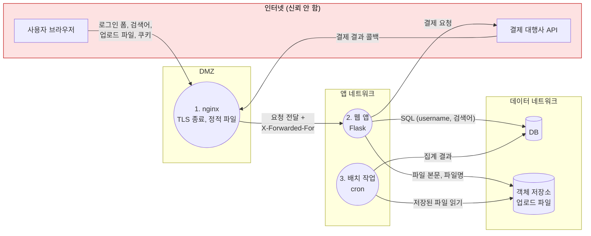
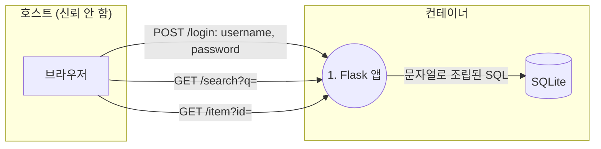

# 공격 표면과 신뢰 경계

| 레벨 | 상태 | 최종 개정 |
|---|---|---|
| 🟢 | 🔄 개정중 | 2026-10-22 |

> **한눈에 보기**
> 공격 표면은 '외부 입력이 들어오는 모든 곳'이다. 분석의 첫 단계는 항상 이 지점을 빠짐없이 나열하는 것이다.
> 나열한 입력 지점을 데이터 흐름도(DFD) 위에 올리고 신뢰 경계를 그으면, 어디를 깊게 볼지가 정해진다.
> 공격 표면은 취약점이 아니다. 취약점이 **있을 수 있는 자리**다. 줄일수록 분석도 방어도 쉬워진다.

## 1. 공격 표면이란

**공격 표면**(attack surface)은 공격자가 시스템에 데이터를 넣거나 시스템에서 데이터를 빼낼 수 있는 모든 지점의 집합이다. 세 가지로 나눠 보면 빠뜨리는 것이 줄어든다.

| 축 | 질문 | 예 |
|---|---|---|
| **진입점**(entry point) | 데이터가 어디로 들어오나 | HTTP 엔드포인트, 열린 포트, 파일 파서, 환경변수 |
| **채널**(channel) | 어떤 통로로 오나 | TCP 소켓, 유닉스 소켓, 파이프, 공유 메모리, USB |
| **데이터**(untrusted data) | 무엇이 들어오나 | 요청 본문, 업로드 파일, 설정 파일, DB에 저장된 과거 입력 |

[1부 1장](01-what-is-vulnerability.md)에서 "취약점은 신뢰 경계를 넘은 입력이 설계자의 가정을 깨는 지점"이라고 했다. 공격 표면은 그 **입력이 들어오는 문**의 목록이고, 신뢰 경계는 **문 안쪽과 바깥쪽을 가르는 선**이다. 둘을 함께 그려야 "이 문으로 들어온 데이터가 어느 선을 넘어 어디까지 가는가"가 보인다.

공격 표면이 넓다고 반드시 취약한 것은 아니다. 그러나 문이 많을수록 잠그지 않은 문이 있을 확률이 높고, 분석자도 방어자도 그 문을 전부 봐야 한다. 그래서 공격 표면은 **분석의 범위**이자 **설계의 지표**다.

## 2. 입력 지점 열거 체크리스트

분석을 시작할 때 아래 표를 위에서 아래로 훑는다. "해당 없음"이라고 쓸 수 있을 때까지 각 항목을 확인한다. 빠뜨리기 쉬운 것을 오른쪽에 적었다.

| 분류 | 확인할 것 | 자주 빠뜨리는 것 |
|---|---|---|
| **네트워크** | 리슨 중인 포트와 프로토콜, HTTP 엔드포인트 전부(메서드 포함), WebSocket, gRPC, 관리용 포트 | 헬스체크·메트릭 엔드포인트, 디버그 포트, IPv6 바인딩, 리버스 프록시 뒤에서만 열린 포트 |
| **HTTP 요청의 각 부분** | 경로, 쿼리, 본문(JSON·폼·멀티파트), 헤더, 쿠키 | `Host`·`X-Forwarded-For` 같은 신뢰되는 헤더, `Content-Type`에 따라 갈리는 파서, HTTP 메서드 오버라이드 |
| **파일** | 업로드 파일, 설정 파일, 가져오기(import) 기능, 로그 파일을 다시 읽는 코드 | 압축 파일 안의 경로, 파일 이름 자체, 이미지 메타데이터(EXIF), 심볼릭 링크 |
| **환경변수·인자** | 프로세스 시작 시 읽는 모든 값 | 컨테이너 오케스트레이터가 주입하는 값, `PATH`·`LD_PRELOAD` 류, `.env` 파일 |
| **IPC** | 유닉스 소켓, 명명된 파이프, D-Bus, 공유 메모리, 시그널 | 소켓 파일 권한, 같은 호스트의 다른 사용자 |
| **사용자 인터페이스** | 폼, 클립보드, 드래그 앤 드롭, URL 스킴 핸들러(`myapp://`) | 딥링크, 브라우저 확장과의 메시지 |
| **외부 서비스 응답** | 호출하는 API·DB·캐시의 **응답** | "우리가 호출한 서버"의 응답도 입력이다. DNS 응답, OAuth 콜백 |
| **저장된 데이터** | DB·캐시·큐에서 읽어 오는 값 | 과거에 저장된 사용자 입력(second-order), 다른 서비스가 쓴 값 |
| **시간·스케줄** | cron, 타이머, 큐 소비자 | 입력이 "사람"이 아니라 "큐 메시지"인 경로 |
| **하드웨어·물리** | USB, 블루투스, NFC, 시리얼 콘솔 | IoT·펌웨어에서 가장 넓은 면. [5부 3장](../part5-extended/03-iot-firmware.md) |

소스가 있을 때는 코드에서 직접 센다. 몇 가지 시작점이다.

```bash
# 리슨 포트 (실행 중인 환경에서)
ss -tlnp

# Flask 라우트 전부
flask --app app routes

# Spring: 요청 매핑 애너테이션
grep -rnE "@(Get|Post|Put|Delete|Request)Mapping" --include='*.java' src/

# 환경변수를 읽는 곳 (Python / Node / Go)
grep -rnE "os\.(environ|getenv)|process\.env\.|os\.Getenv" --include='*.py' --include='*.js' --include='*.ts' --include='*.go' .

# 파일을 여는 곳 (Python)
grep -rnE "\bopen\(|Path\(.*\)\.(read|write)" --include='*.py' .
```

목록은 "엔드포인트 N개"처럼 숫자로 끝나지 않는다. 각 항목에 **누가 접근할 수 있는가**(인증 전/후, 관리자만, 내부망만)를 붙여야 다음 단계에서 쓸 수 있다.

## 3. 신뢰 경계 그리기

**신뢰 경계**(trust boundary)는 "이 선을 넘는 데이터는 검증이 필요하다"는 선이다. 경계는 여러 겹이고, 어느 겹을 그릴지는 분석 목적에 따라 다르다.

| 겹 | 경계 | 넘어오는 것 |
|---|---|---|
| 인터넷 ↔ 조직 | 방화벽, 로드밸런서 | 익명 사용자의 요청 |
| 프로세스 ↔ 프로세스 | 서비스 간 호출, 큐 | 다른 팀이 만든 서비스의 메시지 |
| 사용자 권한 ↔ 관리자 권한 | 인가 검사 | 로그인한 일반 사용자의 요청 |
| 프로세스 ↔ 커널 | 시스템 콜 | 유저 모드 프로그램의 인자 |
| 애플리케이션 ↔ 라이브러리 | 함수 호출 | 보통 경계로 안 그리지만, 파서 라이브러리는 그려야 한다 |

경계를 잘못 그리는 전형적인 사례가 셋 있다.

1. **"내부망이니까 신뢰한다."** 내부 서비스 간 호출에 경계를 안 그리면 SSRF 하나로 내부 전체가 열린다. [3부 3장](../part3-web/03-ssrf.md)
2. **"관리자가 넣은 값이니까 신뢰한다."** 관리자 계정은 탈취된다. 관리자 입력도 경계를 넘는 입력이다.
3. **"DB에서 읽은 값이니까 신뢰한다."** DB에 넣기 전에 검증했다고 믿는 순간 second-order 인젝션이 생긴다. [3부 1장 7절](../part3-web/01-sql-injection.md)

규칙은 간단하다. **데이터를 만든 주체와 지금 쓰는 주체가 다르면 경계가 있다.** 그 사이에 검증이 없으면 거기가 후보다.

## 4. 데이터 흐름도(DFD) 작성법

**데이터 흐름도**(Data Flow Diagram, DFD)는 위협 모델링에서 가장 널리 쓰는 시스템 그림이다. 요소가 네 개뿐이라 30분이면 그린다.

| 요소 | 기호(관례) | 뜻 | 이 책의 Mermaid 표기 |
|---|---|---|---|
| 외부 개체(external entity) | 사각형 | 우리가 통제하지 않는 사람·시스템 | `["..."]` |
| 프로세스(process) | 원 | 데이터를 처리하는 코드 | `(("..."))` |
| 데이터 저장소(data store) | 두 줄 | DB, 파일, 캐시, 큐 | `[("...")]` |
| 데이터 흐름(data flow) | 화살표 | 데이터가 이동하는 방향과 내용 | `-->` 에 데이터 이름 |
| 신뢰 경계(trust boundary) | 점선 | 신뢰 수준이 바뀌는 선 | `subgraph` |

### 4.1 순서

1. **외부 개체**를 먼저 놓는다. 사용자, 관리자, 외부 API, 다른 팀 서비스.
2. **프로세스**를 놓는다. 처음에는 "웹 앱" 하나로 충분하다. 필요해지면 쪼갠다.
3. **저장소**를 놓는다. DB, 파일 시스템, 캐시, 큐, 로그.
4. **흐름**을 그린다. 화살표마다 **무슨 데이터**가 가는지 적는다. "요청"이 아니라 "username, password"처럼.
5. **경계**를 긋는다. 2절의 열거 목록에서 찾은 입력 지점이 모두 경계를 넘는 화살표 위에 있는지 확인한다.

### 4.2 예시: 작은 웹 서비스



<figure>
<figcaption>그림 1. 네 겹의 신뢰 경계를 subgraph로 표시한 DFD. 붉은 영역에서 나오는 화살표가 1차 공격 표면이고, 결제 콜백과 배치 작업이 읽는 "저장된 파일"처럼 사용자 입력이 돌아 들어오는 경로가 2차 공격 표면이다.</figcaption>
</figure>

이 그림에서 바로 질문이 나온다.

- nginx가 붙이는 `X-Forwarded-For`를 앱이 신뢰하면, 사용자가 같은 헤더를 보내면 어떻게 되는가?
- 결제 대행사의 콜백은 외부 개체에서 오는 입력이다. 서명 검증이 있는가?
- cron이 읽는 파일은 사용자가 올린 것이다. 업로드 시점과 다른 코드로 파싱하는가? [3부 6장](../part3-web/06-file-upload-path-traversal.md)

질문이 나오면 DFD가 제 역할을 한 것이다. 답은 [2부 3장 위협 모델링](../part2-methodology/03-threat-modeling.md)에서 STRIDE로 체계화한다.

### 4.3 그릴 때의 규칙

- 프로세스에 **번호**를 붙인다. 보고서와 회의에서 "2번 프로세스"로 부를 수 있다.
- 화살표에 **데이터 이름**을 쓴다. 이름이 안 떠오르면 그 흐름을 이해하지 못한 것이다.
- 한 장에 프로세스 **7개 이하**. 넘으면 하나를 골라 별도 DFD로 확대한다(레벨 1 → 레벨 2).
- 그림은 Mermaid 텍스트로 저장소에 둔다. 코드가 바뀌면 그림도 diff로 바뀐다.

## 5. 공격 표면 축소

분석가가 공격 표면을 세는 이유는 결국 **줄이라고 권고하기 위해서**다. 보고서의 "방어" 절에서 쓸 수 있는 원칙이다.

| 원칙 | 조치 | 예 |
|---|---|---|
| **없애라** | 쓰지 않는 기능·엔드포인트·포트를 제거 | 디버그 엔드포인트, 샘플 앱, 예전 API 버전 |
| **노출을 줄여라** | 필요한 곳에서만 닿게 | 관리 포트는 `127.0.0.1` 바인딩, 메트릭은 내부망만 |
| **인증을 앞에 세워라** | 인증 전 공격 표면을 최소화 | 로그인 전 접근 가능한 엔드포인트 수를 센다 |
| **권한을 줄여라** | 프로세스·계정 권한 최소화 | DB 계정 읽기 전용, 컨테이너 non-root |
| **입구를 하나로** | 입력 검증을 한 지점에 모아라 | 파서 하나, 스키마 검증 하나 |
| **기본값을 안전하게** | 설정 안 하면 잠긴 상태 | 기본 비밀번호 없음, 기본 CORS 닫힘 |

"인증 전 공격 표면"은 특히 중요하다. CVSS에서 `PR:N`인 취약점이 가장 높은 점수를 받는 이유와 같다. [1부 2장](02-cwe-cve-cvss.md) 로그인 전 닿을 수 있는 엔드포인트가 세 개인 시스템과 서른 개인 시스템은 같은 코드 품질이라도 위험이 다르다.

## 6. 실습 🧪

실습 환경 [`labs/web-sqli/`](https://github.com/anthonynoh5202/anthonynoh/tree/main/labs/web-sqli)의 공격 표면 지도를 그린다. 소스가 있으므로 화이트박스 열거다.

```bash
cd labs/web-sqli
docker compose up --build -d
```

1. **네트워크 진입점.** `docker-compose.yml`의 `ports`를 본다. `127.0.0.1:8080:8080`이다. 호스트 밖에서는 닿을 수 없다. 이것이 [1부 4장](04-ethics-and-law.md)에서 말하는 격리의 한 형태다.
2. **엔드포인트.** `app/app.py`에서 `@app.route`를 전부 찾는다. `/`, `/login`(POST), `/search`, `/item`. 각각 어떤 파라미터를 읽는지 적는다.
3. **인증 전/후.** 네 엔드포인트 모두 인증 없이 닿는다. 인증 전 공격 표면이 100%다.
4. **저장소.** SQLite 파일 하나. 앱만 접근한다. 경계는 "앱 ↔ DB" 한 겹.
5. **DFD를 그린다.** 아래가 답안 예시다. 먼저 직접 그린 뒤 비교한다.



6. **결론.** 경계를 넘는 흐름은 세 개이고, 셋 모두 검증 없이 SQL 문자열에 들어간다. [3부 1장](../part3-web/01-sql-injection.md)의 세 가지 실습(인증 우회, UNION, 블라인드)이 정확히 이 세 화살표다.

같은 연습을 [OWASP Juice Shop](https://owasp.org/www-project-juice-shop/)으로 하면 엔드포인트가 수십 개로 늘고, 인증 전/후 구분과 관리자 기능이 생긴다. 열거 목록을 표로 만들고 DFD를 레벨 2까지 그려 보는 것이 다음 단계다.

## 체크리스트

이 장을 읽고 나면 다음을 할 수 있어야 한다.

- [ ] 공격 표면의 세 축(진입점·채널·데이터)으로 대상 시스템을 설명할 수 있는가?
- [ ] 2절의 열거 표를 끝까지 적용해 "해당 없음" 항목까지 채웠는가?
- [ ] 각 입력 지점에 "누가 접근 가능한가"를 붙였는가?
- [ ] 외부 서비스의 **응답**과 DB에서 **읽어 오는 값**을 입력으로 셌는가?
- [ ] DFD의 모든 화살표에 데이터 이름이 있는가?
- [ ] 신뢰 경계가 subgraph로 표시되어 있고, 열거한 입력 지점이 모두 경계를 넘는 화살표 위에 있는가?
- [ ] 보고서의 방어 절에 "공격 표면 축소" 권고를 한 줄 이상 넣을 수 있는가?

## 더 읽기

- [OWASP Attack Surface Analysis Cheat Sheet](https://cheatsheetseries.owasp.org/cheatsheets/Attack_Surface_Analysis_Cheat_Sheet.html) · 열거 항목과 측정 방법
- [OWASP Threat Modeling Cheat Sheet](https://cheatsheetseries.owasp.org/cheatsheets/Threat_Modeling_Cheat_Sheet.html) · DFD 요소와 작성 단계
- Adam Shostack, *Threat Modeling: Designing for Security*, Wiley, 2014 · 2장 "Strategies for Threat Modeling"의 DFD 설명
- Pratyusa K. Manadhata, Jeannette M. Wing, "An Attack Surface Metric", *IEEE Transactions on Software Engineering*, 2011 · 공격 표면을 정량화한 원 논문
- [Mermaid flowchart 문법](https://mermaid.js.org/syntax/flowchart.html) · subgraph, 노드 모양

## 변경 이력

| 날짜 | 변경 | 기여자 |
|---|---|---|
| 2026-10-21 | 초안(뼈대) 작성 | @anthonynoh5202 |
| 2026-10-22 | 본문 작성. 열거 체크리스트, DFD 작성법(Mermaid), 축소 원칙, 실습 추가 | @anthonynoh5202 |
