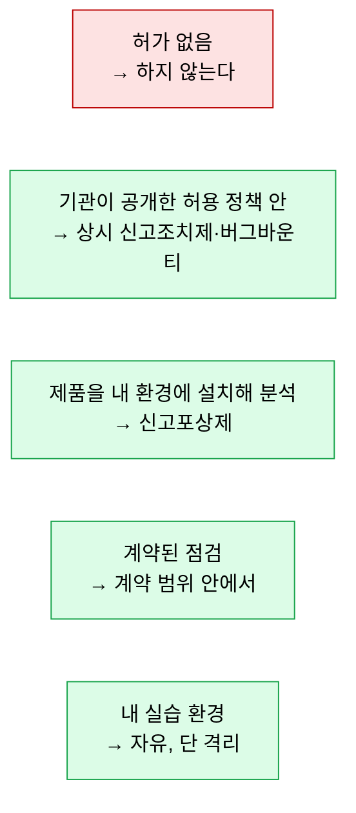
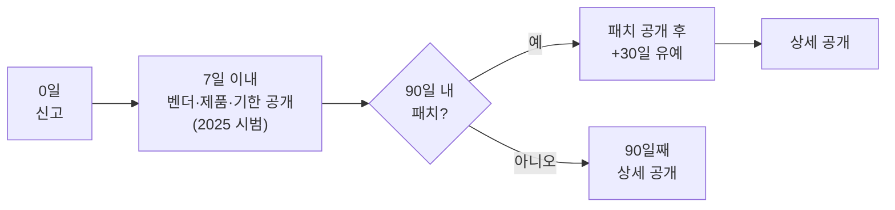

# 윤리와 법적 범위

| 레벨 | 상태 | 최종 개정 |
|---|---|---|
| 🟢 | 🔄 개정중 | 2026-10-22 |

> **한눈에 보기**
> 허가 없는 테스트는 기법의 정교함과 관계없이 범죄다. 이 장은 '어디까지가 허용되는가'를 한국 법과 국제 관행 기준으로 정리한다.
> 한국에서 허용의 형태는 네 가지다. 내 환경에서의 제품 분석, 계약, 기관이 공개한 허용 정책, 그리고 이 셋 중 어디에도 없으면 하지 않는 것.
> 이 장은 법률 자문이 아니다. 조문 번호는 공개 자료로 확인한 것만 적었고, 해석은 🔎 법무 검토를 거친다.

## 1. 원칙: 허가가 전부다

취약점 분석 기술은 공격자의 기술과 같다. 둘을 가르는 것은 기술이 아니라 **허가**(authorization)와 **범위**(scope)다. 허가는 "이 시스템을 테스트해도 된다"이고, 범위는 "어디까지, 어떤 방법으로, 언제까지"다. 둘 중 하나라도 없으면 멈춘다.

| 허가의 형태 | 범위를 정하는 문서 | 예 |
|---|---|---|
| **소유** | 없음. 내가 주인 | 내 노트북의 Docker 실습 환경 |
| **제품을 사서 내 환경에서 분석** | 소프트웨어 라이선스(역분석 금지 조항 확인) | 신고포상제 대상 제품을 로컬에 설치해 분석 |
| **계약** | 계약서, 작업 범위서(SOW), 테스트 규칙(Rules of Engagement) | 모의해킹 용역, 기관 기술지원 점검 |
| **공개된 허용 정책** | 버그바운티 정책, 취약점 공개 정책(VDP) | 상시 신고조치제 참여 기관의 허용 정책, 해외 플랫폼의 프로그램 범위 |
| **공개 실습 사이트** | 사이트 이용 약관 | PortSwigger Academy, pwn.college, 자체 설치한 Juice Shop |

허용 정책에는 반드시 **범위 밖**이 적혀 있다. 범위 밖 서브도메인, 서비스 거부(DoS) 테스트, 사회공학, 타인 계정 접근, 실제 데이터 열람은 대부분 금지다. 정책이 허용하지 않은 것은 금지된 것으로 읽는다.



<figure>
<figcaption>그림 1. 한국에서 분석가가 서 있을 수 있는 다섯 자리. 붉은 칸에서 하는 일은 기법과 선의에 관계없이 처벌 대상이 될 수 있다.</figcaption>
</figure>

## 2. 한국 법의 틀

### 2.1 정보통신망법: 침입 금지

「정보통신망 이용촉진 및 정보보호 등에 관한 법률」(정보통신망법) 제48조 제1항은 **정당한 접근권한 없이 또는 허용된 접근권한을 넘어** 정보통신망에 침입하는 행위를 금지한다. 위반 시 제72조 제1항 제1호에 따라 3년 이하 징역 또는 3천만 원 이하 벌금이다. 📎 [로톡, 정보통신망 침입죄 성립 기준](https://www.lawtalk.co.kr/posts/163444) 🔎 현행 조문 문언은 [국가법령정보센터](https://www.law.go.kr/)에서 확인한다.

분석가가 알아야 할 해석 세 가지다.

1. **접근권한은 서비스 제공자가 정한다.** 이용자가 "이 정도는 괜찮겠지"라고 판단할 몫이 아니다. 내 계정으로 로그인했어도 제공자가 허용한 범위를 넘으면 "허용된 접근권한을 넘은 침입"이 될 수 있다. 📎 [법률신문, 접근권한 판단 기준](https://www.lawtimes.co.kr/news/193154)
2. **보호조치를 깨지 않아도 침입이다.** 타인의 아이디·비밀번호를 부정하게 써서 들어가는 것도 침입에 해당한다는 것이 대법원 판례다. 📎 [로톡, 타인 계정 로그인](https://www.lawtalk.co.kr/posts/99115)
3. **결과가 없어도 성립한다.** 데이터를 빼내지 않았고 피해가 없었다는 것은 침입죄 성립과 별개다.

세 가지를 합치면 이렇게 된다. **공개 서비스에서 `'`를 하나 넣어 보는 것도, 허용 정책이 없다면 범위를 넘는 행위로 다퉈질 수 있다.** "홈페이지 취약점 발굴은 불법"이라는 오랜 장벽이 여기서 나왔고, 2026년 상시 신고조치제가 **허용 정책**으로 이 장벽을 넘으려는 이유다. [제1편 2부 6장](../../vol1-center/02-programs/06-cvd-vdp.md)

같은 조의 다른 항은 악성프로그램의 전달·유포와 대량의 신호·데이터로 장애를 일으키는 행위를 금지한다. 실습용 악성 샘플을 실수로 공유 폴더에 올리는 것, 스캐너로 서비스 거부를 일으키는 것이 여기에 닿는다.

### 2.2 형법: 업무방해

형법 제314조 제2항(컴퓨터등장애업무방해) 🔎 조문 번호는 [국가법령정보센터](https://www.law.go.kr/)에서 확인한다. 이 조항은 정보처리장치에 허위 정보나 부정한 명령을 입력하거나 기타 방법으로 정보처리에 장애를 일으켜 업무를 방해하는 행위를 처벌한다. 판례는 업무방해의 결과가 실제로 발생하지 않아도 정보처리에 장애가 생기면 성립한다고 본다. 📎 [네플라, 컴퓨터등장애업무방해죄 해설](https://www.nepla.ai/wiki/형사/명예-신용범죄/컴퓨터등장애업무방해죄-형법-제314조-제2항-x6w9wdz4v8gk) 퍼징이나 부하 테스트를 운영 서비스에 하면 바로 이 조항이 문제 된다. **허용 정책이 있어도 DoS는 거의 항상 범위 밖**이다.

### 2.3 정보통신기반 보호법: 기반시설 점검의 근거

「정보통신기반 보호법」은 국가 안보·경제에 중요한 시스템을 **주요정보통신기반시설**로 지정하고, 제9조에서 관리기관의 장이 정기적으로 취약점을 분석·평가하도록 한다. 🔎 조문 번호는 [국가법령정보센터](https://www.law.go.kr/)에서 확인한다. 관리기관은 이 분석·평가를 한국인터넷진흥원 등 법이 정한 기관에 위탁할 수 있다. 📎 [정보통신기반 보호법 제9조](https://www.itwiki.kr/w/정보통신기반_보호법_제9조) 센터가 기반시설 점검을 **할 수 있는** 법적 근거이고, 동시에 점검은 **관리기관의 요청·위탁 범위 안에서만** 한다는 한계다. 자세한 것은 [제1편 3부 12장](../../vol1-center/03-partners/12-legal.md).

### 2.4 분석 중 개인정보를 보게 되면

허용 범위 안에서도 SQL 인젝션 증명 과정에서 타인의 개인정보가 화면에 나올 수 있다. 원칙은 세 가지다. **필요한 최소**(행 하나, 또는 내 계정의 데이터)만 증명에 쓴다. **저장하지 않는다**(스크린샷에 타인 데이터가 있으면 가린다). **즉시 보고한다**. 버그바운티 정책 대부분이 같은 원칙을 명문화하고 있고, 개인정보 보호 법령상 의무는 🔎 법무 검토 사항이다.

## 3. 한국의 제도적 통로

허가 없이 찾을 수 없다면, **허가가 있는 통로**로 간다. 센터가 운영하는 두 제도가 그것이다.

| | 보안 취약점 신고포상제 | 보안취약점 상시 신고조치제 (CVD/VDP) |
|---|---|---|
| 대상 | 국내 유통 소프트웨어의 신규 취약점 | 참여 기관이 **실제 운영하는** 서비스 |
| 분석 장소 | 제품을 **내 환경에 설치**해서 | 기관이 공개한 **허용 정책 범위 안**의 운영망 |
| 시작 | 2012년 | 2026년 5월 28일 시범사업 발표, 2027년 제도화 목표 |
| 자세히 | [제1편 2부 5장](../../vol1-center/02-programs/05-bug-bounty.md) | [제1편 2부 6장](../../vol1-center/02-programs/06-cvd-vdp.md) |

📎 [다음뉴스 2026-05-28, 보안취약점 상시 신고제 시범 도입](https://v.daum.net/v/20260528120313244), [머니투데이 2026-05-28](https://www.mt.co.kr/tech/2026/05/28/2026052809152585103)

상시 신고조치제에서 분석가가 정확히 알아야 할 점은 **"처벌 걱정 없이"가 명문의 면책 조항이 아니라는 것**이다. 기관별 허용 정책과 사전 윤리교육을 조건으로 하는 구조이며, 법 개정으로 면책을 명확히 하는 것은 제도화 단계의 과제다. 📎 [바이라인네트워크 2026-02-25, 법제화 추진](https://byline.network/2026/02/25-529/) 따라서 허용 정책에 적힌 대상·방법·기간을 **문자 그대로** 지키는 것이 참여자의 유일한 보호막이다. 범위 밖에서 찾은 것은 신고해도 보호되지 않을 수 있다.

센터 직원이 신고자를 응대할 때 이 차이를 정확히 전해야 한다. "허용 정책 안에서 찾은 것"과 "우연히 봤다"는 것은 신고의 가치가 아니라 신고자의 법적 위치가 다르다. 🔎 범위 밖 신고의 처리 원칙은 내부 지침을 따른다.

## 4. 공개: 책임 있는 공개에서 조율된 공개로

### 4.1 용어

| 용어 | 뜻 | 비고 |
|---|---|---|
| **전체 공개**(full disclosure) | 벤더와 상관없이 즉시 공개 | 1990~2000년대 논쟁. 벤더 압박 효과, 사용자 위험 |
| **책임 있는 공개**(responsible disclosure) | 벤더에 먼저 알리고, 패치 후 공개 | "책임"이 연구자에게만 지워진다는 비판 |
| **조율된 공개**(coordinated vulnerability disclosure, CVD) | 발견자·벤더·조정자가 **일정을 합의**해 공개 | 현재의 표준 용어. 벤더에게도 기한 책임이 있다 |
| **취약점 공개 정책**(vulnerability disclosure policy, VDP) | 조직이 "이렇게 신고하면 이렇게 처리한다"를 공개한 문서 | CVD의 벤더 쪽 약속 |

CVD에는 보통 네 역할이 있다. **발견자**(finder), **벤더**(vendor), **조정자**(coordinator, 국가 CERT 등), **배포자**(deployer, 패치를 적용하는 운영자). 센터는 한국에서 조정자다.

### 4.2 국제 표준: ISO/IEC 29147과 30111

두 표준은 짝이다. **ISO/IEC 29147:2018**(Vulnerability disclosure)은 벤더가 외부로부터 신고를 **받고** 권고문을 **내는** 바깥쪽 인터페이스를, **ISO/IEC 30111:2019**(Vulnerability handling processes)는 신고를 받은 뒤 조치까지의 **내부 처리** 절차를 다룬다. 📎 [ANSI 블로그, ISO/IEC 29147:2018 소개](https://blog.ansi.org/2018/11/iso-iec-29147-2018-vulnerability-disclosure/), [Security Boulevard, ISO/IEC 30111](https://securityboulevard.com/2021/02/and-dont-forget-iso-iec-30111/) 벤더에게 "VDP를 만들어 달라"고 권고할 때 근거로 인용한다.

### 4.3 90일 관행

공개 기한의 사실상 표준은 Google Project Zero가 만들었다. 벤더에게 **90일**을 주고, 기한 안에 패치가 나오면 사용자가 적용할 **30일**을 더 기다린 뒤 공개한다. 2025년 7월부터는 "Reporting Transparency" 시범으로, 신고 후 **1주일 안에** 벤더명·제품·신고일·기한 만료일을 먼저 공개하기 시작했다. 상류 벤더가 고쳤는데 하류 제품에 반영이 늦는 "패치 격차"를 줄이려는 것이다. 90일 자체는 바뀌지 않았다. 📎 [CyberScoop 2025-07](https://cyberscoop.com/project-zero-google-zero-day-vulnerability-disclosure/), [Schneier on Security 2025-08](https://www.schneier.com/blog/archives/2025/08/google-project-zero-changes-its-disclosure-policy.html), [Project Zero 공개 정책](https://googleprojectzero.blogspot.com/p/vulnerability-disclosure-policy.html)



<figure>
<figcaption>그림 2. Project Zero의 기한 구조. 많은 연구자와 기관이 이 틀을 변형해 쓴다.</figcaption>
</figure>

한국의 신고포상제는 패치 후에도 일정 기간 신고자의 공개를 제한한다. [제1편 2부 5장](../../vol1-center/02-programs/05-bug-bounty.md) 기한 규칙은 제도마다 다르므로, 신고하기 전에 **그 제도의 공개 규칙**을 읽는다. 공개 규칙을 어기면 포상이 취소될 뿐 아니라 2절의 법 문제가 다시 생길 수 있다.

### 4.4 좋은 신고의 조건

공개 절차가 잘 돌아가려면 신고 자체가 재현 가능해야 한다. 영향 버전, 재현 절차, 최소 증명, 영향 평가, 연락처. 구조는 [2부 7장](../part2-methodology/07-reporting.md)과 [8부 1장](../part8-reporting/01-report-structure.md)에서 다룬다.

## 5. 미국: CFAA와 2022년 법무부 지침

한국 분석가가 미국 법을 아는 이유는 둘이다. 해외 벤더 제품을 신고할 때 그 벤더의 법적 환경이 미국이고, 해외 버그바운티 플랫폼의 약관이 미국법을 따르는 경우가 많다.

- **CFAA**(Computer Fraud and Abuse Act, 18 U.S.C. § 1030)는 "권한 없는 접근"과 "허가된 접근 권한의 초과"를 처벌한다. 오랫동안 이용약관 위반도 범죄가 되는지 논쟁이 있었다.
- **Van Buren v. United States (2021-06-03)**: 연방대법원은 "허가된 접근의 초과"를 좁게 읽었다. 접근 권한이 있는 시스템에서 **접근이 금지된 영역**(파일, 폴더, DB)에 들어가야 해당하고, 접근 가능한 정보를 **부적절한 목적**으로 쓴 것만으로는 해당하지 않는다. 이른바 "문이 열려 있는가 닫혀 있는가"(gates-up-or-down) 기준이다. 📎 [Cornell LII, Van Buren v. United States](https://www.law.cornell.edu/supremecourt/text/19-783)
- **법무부 기소 지침 (2022-05-19)**: 미 법무부는 CFAA 기소 정책을 개정해 **선의의 보안 연구**(good-faith security research)는 기소하지 않는다고 명문화했다. 선의의 연구란 "보안 결함을 시험·조사·수정할 목적으로, 개인이나 공공에 해를 끼치지 않는 방식으로, 그 정보를 보안 향상에 쓰는" 활동이다. 📎 [Morrison Foerster, DOJ 지침 해설 (2022-05-25)](https://www.mofo.com/resources/insights/220525-cyber-crime-charging-policy), [미 법무부 보도자료](https://www.justice.gov/opa/pr/department-justice-announces-new-policy-charging-cases-under-computer-fraud-and-abuse-act)

한계도 분명하다. 이 지침은 **형사 기소** 정책이다. 민사 소송, 주(state) 법, 다른 나라 법에는 영향이 없다. "선의"의 경계도 결국 검사가 판단한다. 한국의 상시 신고조치제가 명문 면책 없이 허용 정책에 기대는 것과 구조가 닮았다. **어느 나라든 "정책이 허용한 범위 안"이 가장 안전한 자리다.**

## 6. 실습 환경을 격리하는 이유

이 책의 실습 환경은 일부러 취약하게 만들어져 있다. 격리하지 않으면 세 가지 문제가 생긴다.

| 문제 | 무슨 일이 일어나나 | 조치 |
|---|---|---|
| **법적** | 스캐너·익스플로잇이 실수로 실제 서비스에 닿는다. 2절의 침입·업무방해가 된다 | 대상을 `localhost`·사설 IP로 **명시**한다. 와일드카드 범위 금지 |
| **기술적** | 취약한 실습 앱이 외부에 노출되면 **내가** 침입당한다 | 컨테이너 포트를 `127.0.0.1`에만 바인딩. 공용 Wi-Fi에서 `0.0.0.0` 바인딩 금지 |
| **증거** | 재현 환경이 오염되면 "되는지 안 되는지"를 말할 수 없다 | 스냅샷에서 시작하고, 끝나면 버린다 |

이 책의 `labs/web-sqli/docker-compose.yml`은 `"127.0.0.1:8080:8080"`으로 포트를 묶는다. 호스트 밖에서는 닿지 않는다. 실습 환경을 직접 만들 때도 같은 규칙을 따른다.

```yaml
# ❌ 취약: 모든 인터페이스에 노출
ports:
  - "8080:8080"

# ✅ 안전: 루프백에만 바인딩
ports:
  - "127.0.0.1:8080:8080"
```

추가 규칙 세 가지.

- 스캐너·퍼저를 돌릴 때 대상 인자를 **환경변수나 상수로 고정**한다. 복사해 붙인 명령의 대상이 바뀌는 사고가 가장 흔하다.
- 실습 중에는 회사 VPN을 끊는다. 내부망 주소로 가는 스캔 패킷 하나가 사고 보고서가 된다.
- 악성 샘플, 익스플로잇 코드는 실습 디렉터리 밖으로 옮기지 않는다. 특히 공유 드라이브와 메신저.

환경 구성은 [1부 5장](05-lab-setup.md)에서 이어진다.

## 7. 회색 지대 판단표

현장에서 자주 만나는 상황이다. 답의 공통점은 "멈추고, 기록하고, 보고한다"다.

| 상황 | 판단 | 이유 |
|---|---|---|
| 업무 중 쓰는 회사 시스템에서 이상한 동작을 봤다 | 재현 시도 없이 보안 담당에게 보고 | 내 계정이라도 "허용된 접근권한을 넘는" 재현은 침입이 될 수 있다 |
| 공개 사이트에서 에러 메시지에 SQL이 노출된 것을 우연히 봤다 | 더 이상 요청을 보내지 않는다. 기관에 VDP가 있으면 그 절차로, 없으면 센터 신고 경로로 | 다음 요청부터는 "우연"이 아니다 |
| 버그바운티 범위 밖 서브도메인에서 취약점을 찾았다 | 범위 밖은 신고해도 보호받지 못할 수 있다. 정책의 범위 밖 조항을 읽는다 | 범위는 문자 그대로 |
| 증명 과정에서 타인 데이터가 보였다 | 중단, 가리고, 즉시 보고. 추가 열람 금지 | 2.4절 |
| 허용 정책 안의 대상에 자동 스캐너를 돌리고 싶다 | 정책이 자동화·속도 제한을 허용하는지 확인 | 과도한 요청은 업무방해 |
| AI 도구로 페이로드를 만들어 테스트하고 싶다 | 도구가 바뀌어도 허가·범위 규칙은 같다. 상시 신고조치제는 AI 활용을 명시적으로 허용한다 📎 [머니투데이 2026-05-28](https://www.mt.co.kr/tech/2026/05/28/2026052813381287885) | 책임은 도구가 아니라 사람에게 있다 |
| 이미 공개된 CVE를 운영 중인 타사 서비스에 확인해 보고 싶다 | 하지 않는다. 허용 정책이 없으면 "확인"도 침입 | N-day 검증은 내 환경에서 |

## 체크리스트

이 장을 읽고 나면 다음을 할 수 있어야 한다.

- [ ] 내가 지금 하려는 테스트의 허가 형태(소유·제품 분석·계약·허용 정책·실습 사이트)를 한 단어로 말할 수 있는가?
- [ ] 범위를 정한 **문서**를 읽었고, 범위 밖 항목을 알고 있는가?
- [ ] 정보통신망법상 "접근권한을 정하는 주체"가 누구인지 설명할 수 있는가?
- [ ] 신고포상제와 상시 신고조치제의 분석 장소 차이를 설명할 수 있는가?
- [ ] 상시 신고조치제의 "처벌 걱정 없이"가 무엇을 전제로 하는지 신고자에게 설명할 수 있는가?
- [ ] 책임 있는 공개와 조율된 공개의 차이를 말할 수 있는가?
- [ ] 실습 환경의 포트가 `127.0.0.1`에만 바인딩되어 있는가?
- [ ] 타인 데이터가 보였을 때 할 세 가지를 말할 수 있는가?

## 더 읽기

- [국가법령정보센터](https://www.law.go.kr/) · 정보통신망법, 정보통신기반 보호법, 형법 현행 조문
- [ISO/IEC 29147:2018](https://www.iso.org/standard/72311.html), [ISO/IEC 30111:2019](https://www.iso.org/standard/69725.html) · 취약점 공개·처리 국제 표준
- [The CERT Guide to Coordinated Vulnerability Disclosure](https://vuls.cert.org/confluence/display/CVD) · CVD의 역할·절차·난제를 정리한 CERT/CC 문서
- [Google Project Zero 공개 정책](https://googleprojectzero.blogspot.com/p/vulnerability-disclosure-policy.html) · 90일 기한의 원문
- [Van Buren v. United States 판결문](https://www.law.cornell.edu/supremecourt/text/19-783) · CFAA 해석의 기준
- [미 법무부 CFAA 기소 정책 (2022)](https://www.justice.gov/opa/pr/department-justice-announces-new-policy-charging-cases-under-computer-fraud-and-abuse-act) · 선의의 보안 연구 정의
- [KISA 사이버 보안 취약점 정보 포털](https://knvd.krcert.or.kr/) · 신고포상제 접수와 주의사항

## 변경 이력

| 날짜 | 변경 | 기여자 |
|---|---|---|
| 2026-10-21 | 초안(뼈대) 작성 | @anthonynoh5202 |
| 2026-10-22 | 본문 작성. 한국 법 틀, 제도적 통로, CVD·ISO 표준·90일 관행, CFAA, 격리, 회색 지대 판단표 추가 | @anthonynoh5202 |
| 2026-10-22 | 기술 검증: ISO 29147:2018/30111:2019 연도, Project Zero 90+30·2025-07 투명성 시범, Van Buren 2021-06-03, DOJ 2022-05-19 서술 확인. 형법·기반보호법 조문에 🔎 law.go.kr 확인 표시 추가 | 검증팀 |
