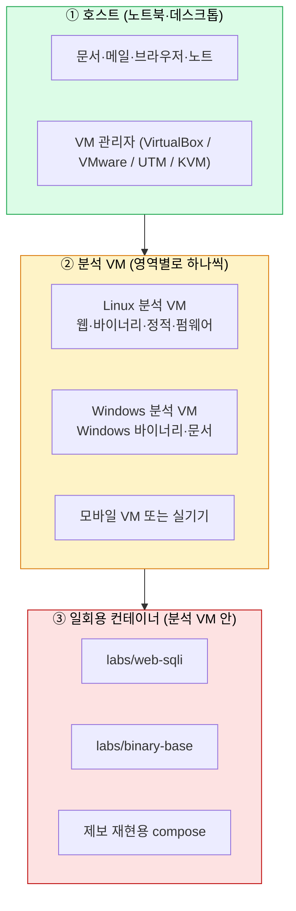

# 분석 환경 구축: 워크스테이션과 도구

| 레벨 | 상태 | 최종 개정 |
|---|---|---|
| 🟢 (4절 이후 🟡) | 🔄 개정중 | 2026-10-22 |

> **한눈에 보기**
> [5장](05-lab-setup.md)의 실습 환경은 "책의 예제를 돌리는 곳"이고, 이 장의 분석 환경은 "실제 제보와 바이너리를 다루는 곳"이다.
> 분석 환경은 **세 겹**으로 만든다. 호스트는 깨끗하게, 분석 VM은 격리되게, 일회용 컨테이너는 버리기 쉽게.
> 도구는 영역별로 묶어 설치하며, 저장소의 `tools/setup-analyst.sh`가 Ubuntu 24.04에서 이 장의 설치를 그대로 수행한다.

## 1. 실습 환경과 분석 환경은 다르다

| | 실습 환경 ([5장](05-lab-setup.md)) | 분석 환경 (이 장) |
|---|---|---|
| 다루는 것 | 책이 준비한 취약 앱 | **외부에서 온** 제보, 바이너리, 펌웨어, 패킷 |
| 신뢰 | 내용을 안다 | **모른다**. 악성일 수 있다 |
| 격리 | 로컬 포트 바인딩이면 충분 | VM 단위 격리, 스냅샷, 네트워크 통제 |
| 수명 | 실습 끝나면 `docker compose down` | 건별 스냅샷, 증거 보관 |
| 도구 | 장마다 두세 개 | 영역별 세트 |

센터 업무([제3편 검증](../../vol3-practice/01-workflow-tech/02-verification.md))에서 재현은 "제보된 버전 그대로, 격리된 환경에서"가 원칙이다. 이 장은 그 "격리된 환경"을 만드는 법이다.

## 2. 세 겹 구조



| 겹 | 원칙 | 이유 |
|---|---|---|
| ① 호스트 | 분석 도구를 **설치하지 않는다**. 샘플을 **열지 않는다** | 호스트가 오염되면 메일·문서·자격증명이 모두 위험하다 |
| ② 분석 VM | 영역별로 분리. **스냅샷**을 기본 상태에서 찍어 두고 건이 끝나면 되돌린다 | 이전 건의 흔적이 다음 건을 오염시키지 않는다. 재현 환경을 되살릴 수 있다 |
| ③ 컨테이너 | 제보 재현은 compose 파일로. 끝나면 `down -v` | 재현 환경이 코드로 남고, 다음 사람이 10분 안에 같은 환경을 띄운다 |

### 네트워크 통제

| 모드 | 언제 | 설정 |
|---|---|---|
| **차단** | 출처 불명 바이너리·문서를 처음 열 때 | VM 네트워크 어댑터 비활성 또는 호스트 전용(host-only) |
| **감시** | 샘플이 어디로 연결하는지 볼 때 | 호스트 전용 + VM 안 mitmproxy/tcpdump, 가짜 DNS(모든 질의를 로컬로) |
| **제한** | 도구 설치·패키지 갱신 | NAT. 설치 후 다시 차단으로 |
| **없음** | 실제 서비스 대상 테스트 | **허가 범위 안에서만**. [4장](04-ethics-and-law.md) |

🔎 센터의 망 분리 정책(인터넷망·업무망·분석망)과 샘플 반입 절차는 내부 규정을 따른다.

<!-- internal:start -->
(내부판) 분석망 접속 방법, 샘플 반입 승인 절차, 스냅샷 보관 기간, 증거 보관 서버 경로.
<!-- internal:end -->

## 3. 하드웨어와 기본 OS

| 항목 | 권장 | 이유 |
|---|---|---|
| CPU | 가상화 지원(VT-x/AMD-V) 8코어 이상 | VM 2~3개 동시 구동, 퍼징 |
| 메모리 | 32GB 이상 (최소 16GB) | Ghidra·IDA는 큰 바이너리에서 수 GB, VM마다 4~8GB |
| 디스크 | NVMe 1TB 이상 | VM 이미지·스냅샷·코퍼스가 빠르게 쌓인다 |
| 호스트 OS | 무엇이든. 분석 도구는 VM에 | 호스트는 깨끗하게 |
| Linux 분석 VM | **Ubuntu 24.04 LTS** | 이 책의 모든 명령과 설치 스크립트의 기준. Kali도 되지만 "미리 깔린 것"보다 "왜 까는지"를 아는 것이 먼저다 |
| Windows 분석 VM | Windows 11 평가판 + Visual Studio Build Tools + WinDbg | Windows 바이너리·문서 취약점 |
| Apple Silicon | UTM 또는 VMware Fusion으로 ARM Ubuntu. x86-64 바이너리는 컨테이너를 `--platform linux/amd64`로 | 느리지만 동작한다. 성능이 필요하면 x86 서버에 SSH |

## 4. 도구 지도: 영역별 세트

도구는 "언제 쓰는가"로 고른다([제2편 도구 1장](../part6-tools/00-when-to-use-what.md)). 여기서는 설치 단위로 묶는다. ★는 첫날 반드시, ☆는 해당 영역을 맡을 때.

### 4.1 기본 (base) ★

| 도구 | 용도 | 설치 |
|---|---|---|
| git, build-essential, python3, pipx | 모든 것의 바탕 | apt |
| Docker + Compose v2 | 실습·재현 환경 | apt `docker.io docker-compose-v2` |
| jq, tmux, tree, file, xxd | 일상 | apt |

### 4.2 웹 (web) ★

| 도구 | 용도 | 설치 | 장 |
|---|---|---|---|
| **Burp Suite Community** | 프록시·반복·침입 | [공식 다운로드](https://portswigger.net/burp/communitydownload) (GUI) | [도구 2장](../part6-tools/01-burp-proxy.md) |
| mitmproxy | 스크립트 가능한 프록시 | `pipx install mitmproxy` | 〃 |
| OWASP ZAP | 무료 스캐너·프록시 | [공식](https://www.zaproxy.org/download/) 또는 Docker `ghcr.io/zaproxy/zaproxy:stable` | 〃 |
| sqlmap, ffuf, nikto, whatweb, nmap | 자동화 탐지·열거 | apt | [웹 1장](../part3-web/01-sql-injection.md) 등 |
| nuclei, httpx | 템플릿 스캔, 기술 스택 식별 | GitHub 릴리스 바이너리 | [방법론 2장](../part2-methodology/02-recon.md) |

### 4.3 바이너리 (binary) ★

| 도구 | 용도 | 설치 | 장 |
|---|---|---|---|
| gcc, clang, gdb, gdb-multiarch | 컴파일·디버깅 | apt | [바이너리 1장](../part4-binary/01-memory-basics.md) |
| **pwndbg** | gdb 확장 | 공식 저장소 `setup.sh` | [도구 4장](../part6-tools/03-debuggers.md) |
| **pwntools**, ropper, ROPgadget | 익스플로잇 작성·가젯 | 전용 venv에 pip | [바이너리 8장](../part4-binary/08-rop.md) |
| checksec | 완화 기법 확인 | pwntools에 포함 (`pwn checksec`) | [바이너리 7장](../part4-binary/07-mitigations.md) |
| **Ghidra** | 디컴파일 | GitHub 릴리스 zip + JDK | [도구 3장](../part6-tools/02-ghidra-ida.md) |
| radare2 | CLI 디스어셈블러 | apt | 〃 |
| AFL++ | 퍼징 | apt `afl++` | [바이너리 9장](../part4-binary/09-fuzzing.md) |
| strace, ltrace, patchelf, QEMU user | 동적 관찰, 다른 아키텍처 실행 | apt | [방법론 5장](../part2-methodology/05-dynamic-analysis.md) |

### 4.4 정적 분석 (static) ★

| 도구 | 용도 | 설치 | 장 |
|---|---|---|---|
| **Semgrep** | 패턴·오염 분석 | `pipx install semgrep` | [도구 6장](../part6-tools/05-sast-semgrep-codeql.md) |
| CodeQL CLI | 데이터 흐름 분석 | GitHub 릴리스 번들 (약 1GB) | 〃 |

### 4.5 모바일 (mobile) ☆

| 도구 | 용도 | 설치 |
|---|---|---|
| adb, fastboot | 기기 연결 | apt `android-tools-adb` |
| apktool, jadx | APK 언패킹·디컴파일 | apt / GitHub 릴리스 |
| Frida, objection | 런타임 계측 | `pipx install frida-tools objection` |
| Android Studio 에뮬레이터 | 루팅 가능한 가상 기기 | [공식](https://developer.android.com/studio) |

[확장 1장](../part5-extended/01-mobile.md)

### 4.6 클라우드 (cloud) ☆

| 도구 | 용도 | 설치 |
|---|---|---|
| AWS CLI | 설정 조회 | `pipx install awscli` |
| Trivy | 이미지·IaC·SBOM 스캔 | GitHub 릴리스 deb |
| Checkov | IaC 정책 검사 | `pipx install checkov` |

[확장 2장](../part5-extended/02-cloud.md)

### 4.7 펌웨어 (firmware) ☆

| 도구 | 용도 | 설치 |
|---|---|---|
| binwalk, squashfs-tools, mtd-utils | 언패킹 | apt |
| QEMU system (arm, mips) | 에뮬레이션 | apt |
| EMBA | 자동 분석 | 전용 VM, [공식](https://github.com/e-m-b-a/emba) |

[확장 3장](../part5-extended/03-iot-firmware.md)

## 5. 설치: 스크립트로

저장소의 [`tools/setup-analyst.sh`](https://github.com/anthonynoh5202/anthonynoh/blob/main/tools/setup-analyst.sh)가 4절의 세트를 Ubuntu 24.04에 설치한다. 모듈을 골라 실행하고, 여러 번 실행해도 안전하다.

```bash
git clone https://github.com/anthonynoh5202/anthonynoh.git
cd anthonynoh
sudo ./tools/setup-analyst.sh --base --web --binary --static   # ★ 세트
sudo ./tools/setup-analyst.sh --mobile --cloud --firmware      # ☆ 세트 (필요할 때)
sudo ./tools/setup-analyst.sh --static --codeql                # CodeQL 번들까지
```

스크립트가 하는 일과 하지 않는 일:

| 한다 | 하지 않는다 |
|---|---|
| apt → pipx → 공식 GitHub 릴리스 순서로 설치 | 출처 불명 설치 스크립트를 `curl \| sh`로 실행 |
| pwntools 계열을 전용 venv(`~/.venvs/analysis`)에 격리 | 시스템 Python을 오염 |
| 릴리스 바이너리를 `~/tools/bin`에 | `/usr/bin`에 직접 복사 |
| GUI 도구(Burp, ZAP, Android Studio)의 공식 다운로드 위치 안내 | GUI 설치 파일을 자동 실행 |

설치가 끝나면 PATH를 추가하고 새 셸에서 확인한다.

```bash
echo 'export PATH="$HOME/.local/bin:$HOME/tools/bin:$PATH"' >> ~/.bashrc && exec bash
./tools/setup-analyst.sh --check
```

`--check`는 영역별로 도구 존재와 버전을 출력한다. `!` 표시가 있으면 그 줄의 도구만 다시 설치한다.

## 6. 설치: 손으로 (스크립트가 하는 일을 이해하기 위해)

스크립트를 한 번은 직접 따라 해 보는 것을 권한다. 무엇이 어디에 깔리는지 알아야 문제가 생겼을 때 고칠 수 있다.

### 6.1 기본

```bash
sudo apt update
sudo apt install -y build-essential git curl wget unzip jq tmux python3 python3-pip python3-venv pipx \
                    docker.io docker-compose-v2
sudo usermod -aG docker "$USER"     # 재로그인 후 docker 명령에 sudo 불필요
pipx ensurepath
```

### 6.2 바이너리

```bash
sudo apt install -y gdb gdb-multiarch gcc clang lldb nasm binutils elfutils patchelf strace ltrace \
                    afl++ radare2 qemu-user qemu-user-static openjdk-21-jdk

# pwndbg: 공식 저장소의 setup.sh 가 ~/.gdbinit 에 한 줄을 추가한다
git clone https://github.com/pwndbg/pwndbg ~/pwndbg && (cd ~/pwndbg && ./setup.sh)

# pwntools 계열은 전용 venv
python3 -m venv ~/.venvs/analysis
~/.venvs/analysis/bin/pip install pwntools ropper ROPgadget
ln -sf ~/.venvs/analysis/bin/{pwn,ROPgadget,ropper,checksec} ~/.local/bin/

# Ghidra: 공식 릴리스 zip. 요구 JDK 버전은 그 릴리스의 README 에 있다
# https://github.com/NationalSecurityAgency/ghidra/releases → ghidra_X.Y_PUBLIC_YYYYMMDD.zip
unzip ghidra_*.zip -d ~/tools && ~/tools/ghidra_*/ghidraRun
```

pwntools를 venv에 두는 이유: pwntools는 의존성이 많고 시스템 Python과 충돌하기 쉽다. 스크립트를 쓸 때는 `source ~/.venvs/analysis/bin/activate` 또는 venv의 python을 직접 지정한다.

### 6.3 웹

```bash
sudo apt install -y nmap sqlmap ffuf nikto whatweb
pipx install mitmproxy
# nuclei, httpx: https://github.com/projectdiscovery/<도구>/releases 의 linux_amd64.zip 을 ~/tools/bin 에
# Burp Suite Community: https://portswigger.net/burp/communitydownload (GUI 설치 파일)
```

Burp를 설치한 뒤 브라우저에 Burp CA 인증서를 넣는다([도구 2장](../part6-tools/01-burp-proxy.md)). 분석 VM의 브라우저에만 넣고, 호스트 브라우저에는 넣지 않는다.

### 6.4 정적 분석

```bash
pipx install semgrep
# CodeQL: https://github.com/github/codeql-action/releases 의 codeql-bundle-linux64.tar.gz
tar -xzf codeql-bundle-linux64.tar.gz -C ~/tools && ln -sf ~/tools/codeql/codeql ~/.local/bin/codeql
```

### 6.5 모바일·클라우드·펌웨어

```bash
sudo apt install -y android-tools-adb apktool binwalk squashfs-tools qemu-system-arm qemu-system-mips
pipx install frida-tools objection awscli checkov
# jadx: https://github.com/skylot/jadx/releases  / Trivy: https://github.com/aquasecurity/trivy/releases
```

## 7. 설치 확인

새 셸에서 다음을 실행해 본다. 하나라도 안 되면 그 도구의 설치 단계만 다시 한다.

```bash
# 바이너리 세트가 서로 맞물려 도는지 한 번에 확인
cat > /tmp/t.c <<'EOF2'
#include <stdio.h>
int main(void){ char b[16]; gets(b); puts(b); return 0; }
EOF2
gcc -g -fno-stack-protector -no-pie -w /tmp/t.c -o /tmp/t
checksec --file=/tmp/t            # NX enabled, No PIE, No canary 가 보여야 한다
ROPgadget --binary /tmp/t | tail -2
gdb -q -batch -ex 'info functions main' /tmp/t | head -3   # pwndbg 로딩 메시지가 먼저 보인다
pwn cyclic 32

# 웹·정적
mitmproxy --version && semgrep --version && sqlmap --version | head -1

# Docker
docker run --rm hello-world | head -2
```

기대 출력의 예(버전은 다를 수 있다):

```
[*] '/tmp/t'
    Arch:       amd64-64-little
    RELRO:      Partial RELRO
    Stack:      No canary found
    NX:         NX enabled
    PIE:        No PIE (0x400000)
```

## 8. 운영 습관

| 습관 | 방법 |
|---|---|
| **기본 스냅샷** | 설치 직후 VM 스냅샷 "clean". 건이 끝나면 되돌린다 |
| **건별 작업 디렉터리** | `~/cases/<식별번호>/` 아래에 재현 compose, 노트, 증거. [방법론 1장 4절](../part2-methodology/01-overview.md)의 분석 노트 |
| **증거 보관** | 재현 스크립트·로그·샘플의 SHA-256을 노트에. [방법론 6장](../part2-methodology/06-exploit-verification.md) |
| **도구 갱신 주기** | 분기마다 `setup-analyst.sh`를 다시 돌리고 `--check`. pwndbg·Ghidra·Semgrep은 자주 바뀐다 |
| **샘플은 VM 밖으로 내보내지 않는다** | 보고서에는 해시와 재현 절차만 |
| **PoC 보관** | 접근 통제된 곳에. 🔎 센터 규정 |
| **자격증명 분리** | 분석 VM에 업무 계정·메일·VPN 자격증명을 두지 않는다 |

## 9. Windows 분석 VM

Windows 바이너리와 문서(Office, PDF) 취약점을 다룰 때 필요하다. 이 책의 중심은 Linux지만 센터 업무에서 피할 수 없다.

| 도구 | 용도 | 설치 |
|---|---|---|
| WinDbg | 커널·사용자 디버깅, 크래시 분석 | `winget install Microsoft.WinDbg` |
| Visual Studio Build Tools | 컴파일, 심볼 | 공식 |
| Sysinternals (Process Monitor, Process Explorer) | 동적 관찰 | 공식 |
| x64dbg | 사용자 모드 디버거 | 공식 |
| Ghidra / IDA Free | 디컴파일 | 공식 |
| Windows Defender 제외 설정 | 샘플 폴더가 삭제되지 않게 | 분석 VM에서만 |

Windows VM도 네트워크 차단과 스냅샷 원칙은 같다. [도구 4장 WinDbg](../part6-tools/03-debuggers.md)

## 10. 컨테이너만으로 시작하기

VM을 만들 여유가 없을 때, 또는 책의 바이너리 장만 따라 할 때는 저장소의 공용 컨테이너로 시작할 수 있다.

```bash
docker build -t vmc-binary-base labs/binary-base
docker run --rm -it --cap-add=SYS_PTRACE --security-opt seccomp=unconfined -v "$PWD:/work" vmc-binary-base
```

gdb+pwndbg, pwntools, AFL++, radare2가 들어 있다. 단, ptrace 권한을 준 컨테이너는 격리가 약하므로 **출처 불명 샘플은 넣지 않는다**. [`labs/binary-base/README.md`](https://github.com/anthonynoh5202/anthonynoh/blob/main/labs/binary-base/README.md)

## 체크리스트

- [ ] 호스트에 분석 도구를 설치하지 않았는가?
- [ ] 분석 VM의 "clean" 스냅샷이 있는가?
- [ ] 출처 불명 샘플을 열 때 네트워크를 끊는가?
- [ ] `setup-analyst.sh --check`에 `!`가 없는가?
- [ ] 7절의 확인 명령이 모두 기대 출력을 내는가?
- [ ] 분석 VM에 업무 자격증명이 없는가?

## 더 읽기

- [pwndbg 공식 저장소](https://github.com/pwndbg/pwndbg) · 설치와 명령
- [pwntools 설치 문서](https://github.com/Gallopsled/pwntools) · 의존성과 venv 권장
- [Ghidra 릴리스](https://github.com/NationalSecurityAgency/ghidra/releases) · 각 릴리스의 JDK 요구 버전
- [AFL++ 설치 문서](https://github.com/AFLplusplus/AFLplusplus/blob/stable/docs/INSTALL.md)
- [Docker seccomp 기본 프로파일](https://github.com/moby/moby/blob/master/profiles/seccomp/default.json) · ptrace가 왜 막히는가
- [SANS "Building a Malware Analysis Lab"](https://www.sans.org/) 류의 랩 구성 원칙은 취약점 분석 환경에도 그대로 적용된다

## 변경 이력

| 날짜 | 변경 | 기여자 |
|---|---|---|
| 2026-10-22 | 초안 작성. 설치 스크립트와 binary-base 컨테이너 추가 | @anthonynoh5202 |
