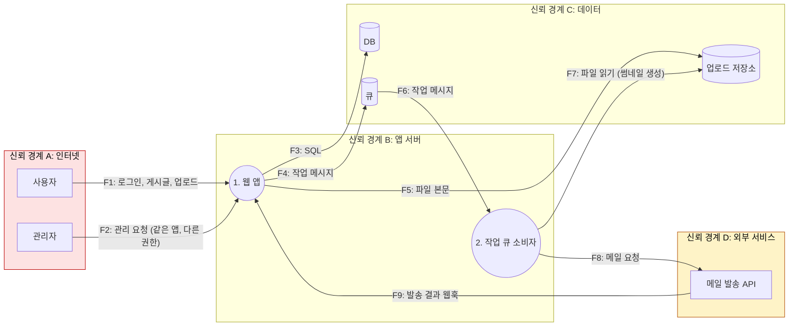
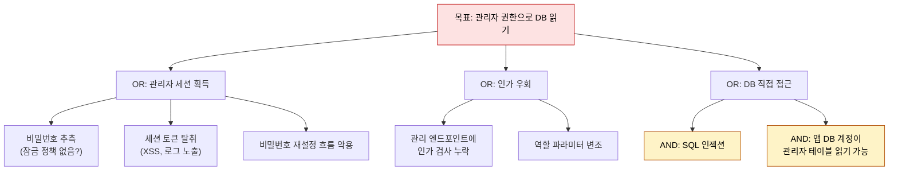

# 위협 모델링

| 레벨 | 상태 | 최종 개정 |
|---|---|---|
| 🟡 | 🔄 개정중 | 2026-10-22 |

> **한눈에 보기**
> '누가, 무엇을, 어떤 경로로' 노릴지 먼저 그린다. STRIDE 한 장이면 어디를 깊게 볼지 정해진다.
> 위협 모델링은 네 가지 질문에 답하는 일이다. 무엇을 만들고 있나, 무엇이 잘못될 수 있나, 어떻게 할 것인가, 충분히 했나.
> 완벽한 모델은 없다. 30분짜리 모델이 모델 없는 분석보다 낫고, 다음 분석에서 고치면 된다.

## 1. 네 가지 질문

위협 모델링 방법론은 많지만 뿌리는 하나다. Adam Shostack이 정리하고 2020년 Threat Modeling Manifesto가 채택한 **네 가지 질문**이다. 📎 [Threat Modeling Manifesto](https://threatmodelingmanifesto.org/), [Shostack, The Four Question Framework](https://shostack.org/files/papers/The_Four_Question_Framework.pdf)

| 질문 | 이 장에서 | 산출물 |
|---|---|---|
| 1. 무엇을 만들고 있나? (What are we working on?) | 2절 시스템 모델링 | 신뢰 경계가 표시된 DFD |
| 2. 무엇이 잘못될 수 있나? (What can go wrong?) | 3절 STRIDE, 4절 공격 트리 | 위협 목록 |
| 3. 어떻게 할 것인가? (What are we going to do about it?) | 5절 우선순위와 대응 | 우선순위가 매겨진 대응 목록 |
| 4. 충분히 했나? (Did we do a good enough job?) | 6절 워크숍의 마지막 5분 | 검토 기록, 다음 할 일 |

취약점 **분석가**에게 위협 모델링은 설계 도구가 아니라 **탐색 순서를 정하는 도구**다. 입력 지점이 서른 개면 서른 개를 같은 깊이로 볼 수 없다. 모델은 "여기부터"를 말해 준다. 그리고 발견이 모델을 고친다. [2부 1장](01-overview.md)의 "발견한 것이 앞 단계를 다시 시킨다"가 이것이다.

## 2. 시스템 모델링: DFD에 신뢰 경계 표시

첫 질문의 답은 그림이다. DFD의 요소와 그리는 순서는 [1부 3장](../part1-foundations/03-attack-surface.md)에서 다뤘다. 여기서는 위협 모델링에 쓸 수 있는 형태로 한 번 더 그린다. 핵심은 **경계를 넘는 화살표마다 번호를 붙이는 것**이다. 3절의 STRIDE는 그 번호마다 돈다.



<figure>
<figcaption>그림 1. 경계를 넘는 흐름 F1~F9에 번호를 붙였다. 붉은 경계는 익명 입력, 노란 경계는 "우리가 부르지만 우리 것이 아닌" 서비스다. F9처럼 외부에서 돌아오는 화살표를 빠뜨리기 쉽다.</figcaption>
</figure>

그림을 그리면서 확인할 것 세 가지.

- 경계를 넘지 않는 화살표는 지금은 무시해도 된다. 경계를 넘는 화살표는 **하나도 빠지면 안 된다.**
- "같은 앱, 다른 권한"(F1과 F2)은 같은 프로세스라도 흐름을 나눈다. 인가 검사는 이 두 흐름 사이에 있다.
- 큐 소비자(2번)가 받는 메시지는 사용자가 만든 것이다. 큐를 거쳤다고 신뢰 수준이 올라가지 않는다.

## 3. STRIDE 요소별 질문 목록

**STRIDE**는 1999년 Microsoft의 Loren Kohnfelder와 Praerit Garg가 만든 위협 분류다. 여섯 글자가 각각 깨뜨리는 보안 속성과 짝을 이룬다. 📎 [OWASP Threat Modeling Cheat Sheet](https://cheatsheetseries.owasp.org/cheatsheets/Threat_Modeling_Cheat_Sheet.html)

| 글자 | 위협 | 깨지는 속성 | 이 책에서 |
|---|---|---|---|
| **S** | Spoofing (위장) | 인증(authentication) | [3부 4장](../part3-web/04-auth-session.md) |
| **T** | Tampering (변조) | 무결성(integrity) | [3부 1장](../part3-web/01-sql-injection.md), [7장](../part3-web/07-deserialization.md), [4부](../part4-binary/00-overview.md) |
| **R** | Repudiation (부인) | 책임 추적(accountability) | 각 장의 "탐지" 행 |
| **I** | Information disclosure (정보 노출) | 기밀성(confidentiality) | [3부 3장 SSRF](../part3-web/03-ssrf.md), [8장 XXE](../part3-web/08-xxe.md), [7부 2장 Heartbleed](../part7-walkthroughs/02-cve-2014-0160-heartbleed.md) |
| **D** | Denial of service (서비스 거부) | 가용성(availability) | [3부 10장](../part3-web/10-race-condition.md), [4부 9장 퍼징](../part4-binary/09-fuzzing.md) |
| **E** | Elevation of privilege (권한 상승) | 인가(authorization) | [3부 5장](../part3-web/05-access-control.md), [7부 4장 sudo](../part7-walkthroughs/04-cve-2021-3156-sudo-baron-samedit.md) |

### 3.1 요소별로 돈다 (STRIDE-per-element)

여섯 위협을 모든 요소에 다 묻지 않는다. 요소 종류마다 해당하는 위협이 정해져 있다. Shostack의 표를 따른다.

| DFD 요소 | S | T | R | I | D | E |
|---|---|---|---|---|---|---|
| 외부 개체 | ✓ | | ✓ | | | |
| 프로세스 | ✓ | ✓ | ✓ | ✓ | ✓ | ✓ |
| 데이터 저장소 | | ✓ | (로그면 ✓) | ✓ | ✓ | |
| 데이터 흐름 | | ✓ | | ✓ | ✓ | |

### 3.2 질문 목록

경계를 넘는 흐름 F1~F9와 프로세스 1~2에 대해 아래 질문을 **그대로 읽는다**. 답이 "모른다"면 그것이 분석 대상이다.

**S — 위장**
- 이 흐름의 보낸 쪽이 누구인지 어떻게 아는가? 세션, 토큰, 서명, IP 중 무엇을 믿는가?
- 그 증명은 재사용·추측·탈취할 수 있는가? (세션 고정, 토큰 만료, 약한 비밀번호 정책)
- 외부 서비스의 **콜백**(F9)은 어떻게 검증하는가? 서명이 없으면 누구나 보낼 수 있다.
- 내부 서비스 간 호출(F4, F6)에 인증이 있는가, "내부망이니까" 없는가?

**T — 변조**
- 이 흐름의 데이터가 어디서 **코드·쿼리·명령·경로**로 해석되는가? (인젝션 계열 전부)
- 길이·타입·범위를 어디서 검사하는가? 검사 지점이 사용 지점과 같은 경계 안에 있는가?
- 저장소의 값이 다시 읽힐 때 다시 검증하는가? (second-order)
- 직렬화된 객체·XML·YAML을 역직렬화하는 곳이 있는가?
- 큐 메시지(F6)를 소비자가 "앱이 만든 것"으로 믿는가?

**R — 부인**
- 이 행동이 누가 언제 했는지 로그에 남는가? 로그에 사용자 ID와 요청 ID가 있는가?
- 로그를 사용자 입력으로 오염시킬 수 있는가? (로그 인젝션, 그리고 Log4Shell)
- 관리 작업(F2)은 별도로 감사되는가?

**I — 정보 노출**
- 에러 메시지가 스택 트레이스·경로·쿼리를 보여 주는가?
- 이 프로세스가 URL을 받아 **대신 요청**하는 기능이 있는가? (SSRF)
- 응답에 다른 사용자의 데이터가 섞일 수 있는가? (IDOR, 캐시 키 충돌)
- 저장소 접근 권한이 프로세스별로 나뉘어 있는가, 하나의 계정인가?
- 메모리를 바이트 단위로 다루는 코드(파서, 네이티브 모듈)가 길이를 입력에서 받는가?

**D — 서비스 거부**
- 요청 크기·개수·시간에 제한이 있는가? 파일 업로드 크기는?
- 입력 하나로 비용이 폭발하는 연산이 있는가? (정규식, 압축 해제, 재귀 파서, 이미지 변환)
- 큐가 막히면 어떻게 되는가? 재시도가 폭주하는가?
- 경쟁 조건으로 자원을 중복 소비할 수 있는가?

**E — 권한 상승**
- "누구인가"(인증) 다음에 "해도 되는가"(인가)를 **매 요청** 확인하는가?
- 객체 ID를 바꾸면 남의 것이 나오는가? 역할을 바꾸는 파라미터가 클라이언트에 있는가?
- 프로세스가 필요 이상의 권한(root, DB 관리자, 클라우드 IAM)으로 도는가?
- 업로드한 파일이 실행 가능한 위치에 놓이는가?

질문의 답을 표로 적으면 위협 목록이 된다. 한 줄의 형식은 "**[흐름/요소] [STRIDE 글자] [무엇이 잘못되면] [결과]**"다. 예: "F1 T: 검색어가 SQL에 문자열로 들어가면 → DB 전체 읽기".

## 4. 공격 트리

STRIDE가 **요소별**로 넓게 훑는다면, **공격 트리**(attack tree)는 **목표별**로 깊게 판다. Bruce Schneier가 1999년 정리한 방법이다. 📎 [Schneier, Attack Trees (Dr. Dobb's Journal, 1999-12)](https://www.schneier.com/academic/archives/1999/12/attack_trees.html) 뿌리에 공격자의 목표를 놓고, 자식에 그 목표를 이루는 방법을 놓는다. 자식이 모두 필요하면 AND, 하나면 되면 OR다.



<figure>
<figcaption>그림 2. 공격 트리. 노란 잎 둘은 AND 관계다. SQL 인젝션이 있어도 DB 계정 권한이 분리되어 있으면 이 경로는 막힌다. 방어가 어느 잎을 끊는지 그림에서 바로 보인다.</figcaption>
</figure>

잎마다 속성을 붙이면 트리가 우선순위 도구가 된다. "가능/불가능", "필요한 비용·장비", "탐지 가능성". 가장 싼 경로가 공격자가 먼저 갈 길이고, 그 경로의 가장 싼 방어가 우리가 먼저 할 일이다.

분석가에게 공격 트리가 특히 유용한 순간은 **발견한 취약점의 영향을 설명할 때**다. "SQLi가 있다"보다 "SQLi + DB 계정 권한 과다 = 관리자 DB 읽기"가 심각도를 설명한다. [8부 2장](../part8-reporting/02-severity.md)의 연쇄 평가가 이것이다.

## 5. 우선순위: 영향 × 가능성

위협 목록은 길다. 모두 같은 깊이로 볼 수 없으니 두 축으로 자른다.

| | 가능성 낮음 | 가능성 중간 | 가능성 높음 |
|---|---|---|---|
| **영향 높음** (전체 데이터, 코드 실행) | 2순위 | **1순위** | **1순위** |
| **영향 중간** (한 사용자 데이터, 일부 기능) | 3순위 | 2순위 | **1순위** |
| **영향 낮음** (정보성, 불편) | 4순위 | 3순위 | 2순위 |

**가능성**을 판단하는 단서는 다음과 같다. 인증 전에 닿는가(CVSS의 PR:N), 공개 PoC나 유사 CVE가 있는가(EPSS가 높은 유형인가), 입력이 코드로 해석되는가, 필요한 조건이 공격자 손에 있는가. **영향**은 공격 트리의 뿌리가 무엇인가다. [1부 2장](../part1-foundations/02-cwe-cve-cvss.md)의 CVSS 메트릭을 **점수가 아니라 질문**으로 쓰면 이 두 축을 일관되게 매길 수 있다.

숫자로 정밀하게 매기려는 유혹을 경계한다. Microsoft가 썼던 DREAD(Damage, Reproducibility, Exploitability, Affected users, Discoverability)는 사람마다 값이 달라 재현성이 낮다는 비판을 받았다. 3×3이면 충분하다. 중요한 것은 **왜 그 칸인지 한 줄 적는 것**이다.

위협마다 대응을 하나 정한다. 📎 [OWASP Threat Modeling Cheat Sheet](https://cheatsheetseries.owasp.org/cheatsheets/Threat_Modeling_Cheat_Sheet.html)

| 대응 | 뜻 | 예 |
|---|---|---|
| **완화**(mitigate) | 가능성이나 영향을 줄인다 | 파라미터화된 쿼리, 속도 제한 |
| **제거**(eliminate) | 기능·경로를 없앤다 | 쓰지 않는 관리 엔드포인트 삭제 |
| **이전**(transfer) | 다른 주체가 책임진다 | 결제는 대행사, 인증은 IdP |
| **수용**(accept) | 알고 감수한다. **기록이 필수** | 내부 도구의 낮은 영향 위협 |

분석가의 보고서에서 "수용"은 조직이 결정할 일이다. 분석가는 가능성과 영향의 **근거**를 제공한다.

## 6. 30분 워크숍 진행법

위협 모델링은 혼자보다 셋이서 할 때 빠르다. 시스템을 아는 사람, 공격을 아는 사람, 적는 사람. 30분 안에 1순위 목록까지 간다.

| 시간 | 할 일 | 산출물 |
|---|---|---|
| 0~5분 | **범위 고정.** 오늘 볼 기능 하나를 정한다. "로그인부터 게시글 작성까지" | 한 문장 |
| 5~12분 | **DFD.** 화이트보드나 Mermaid. 외부 개체 → 프로세스 → 저장소 → 흐름 → 경계 순서. 경계 넘는 흐름에 번호 | 그림 1 수준의 DFD |
| 12~22분 | **STRIDE 패스.** 번호 순서대로 3.2절 질문을 읽는다. 답이 아니라 **위협 한 줄**만 적는다. 토론 금지, 적기만 | 위협 목록 10~20줄 |
| 22~27분 | **우선순위.** 5절 3×3 매트릭스에 놓는다. 1순위만 합의 | 1순위 3~5개 |
| 27~30분 | **네 번째 질문.** 빠진 경계가 없는가? 1순위마다 다음 행동과 담당 | 다음 할 일 목록 |

진행 규칙 다섯 가지.

1. **그림 없이 시작하지 않는다.** 말로 하면 각자 다른 시스템을 상상한다.
2. **STRIDE 패스 중에는 해결책을 말하지 않는다.** "그건 이미 막았어요"는 적어 두고 나중에 검증한다. 막았다는 믿음이 틀린 경우가 가장 흔한 발견이다.
3. **"모른다"는 좋은 답이다.** 모르는 것이 분석 대상이다.
4. **결과는 저장소에 둔다.** DFD는 Mermaid로, 위협 목록은 Markdown 표로. 코드와 함께 diff된다.
5. **30분에 끝낸다.** 못 끝낸 것은 다음 세션의 범위다. 길어지면 다음부터 아무도 안 온다.

위협 목록의 형식은 아래로 통일한다.

```markdown
| # | 요소 | STRIDE | 위협 | 영향 | 가능성 | 순위 | 대응 | 담당 |
|---|---|---|---|---|---|---|---|---|
| 1 | F1 | T | 검색어가 SQL 문자열에 들어가면 DB 전체 읽기 | 높음 | 높음 | 1 | 완화: 파라미터화 | 백엔드 |
| 2 | F9 | S | 웹훅에 서명 검증이 없으면 발송 결과 위조 | 중간 | 중간 | 2 | 완화: HMAC 검증 | 백엔드 |
```

센터 업무에 맞춘 변형이 하나 있다. **신고된 취약점을 검증할 때** 그 취약점이 DFD의 어느 흐름, STRIDE의 어느 글자인지 먼저 놓는다. 그러면 "같은 흐름의 다른 글자", "같은 글자의 다른 흐름"이 추가 점검 후보가 된다. 신고 하나가 같은 유형 세 개로 늘어나는 일이 흔하다.

## 7. 도구

그림은 Mermaid와 Markdown으로 충분하다. 규모가 커지면 도구를 쓴다.

| 도구 | 방식 | 언제 |
|---|---|---|
| [OWASP Threat Dragon](https://owasp.org/www-project-threat-dragon/) | GUI로 DFD를 그리면 STRIDE 등 규칙 엔진이 위협을 제안 | 팀이 그림 중심으로 일할 때 |
| [OWASP pytm](https://owasp.org/www-project-pytm/) | Python 코드로 모델을 쓰고 DFD·보고서를 생성 | 모델을 코드와 함께 버전 관리할 때 |
| [Microsoft Threat Modeling Tool](https://learn.microsoft.com/en-us/azure/security/develop/threat-modeling-tool) | 스텐실 기반 DFD와 STRIDE 자동 생성 | Windows·Azure 환경 |

pytm은 모델이 곧 코드라서 분석가에게 잘 맞는다. 최소 예시다.

```python
from pytm import TM, Actor, Server, Datastore, Dataflow, Boundary

tm = TM("web-sqli")
internet = Boundary("Internet")
user = Actor("User", inBoundary=internet)
app = Server("Flask app")
db = Datastore("SQLite")

Dataflow(user, app, "GET /search?q=", protocol="HTTP")
Dataflow(app, db, "SQL built by string concat", protocol="SQLite")
tm.process()
```

`python3 tm.py --dfd | dot -Tpng -o dfd.png`로 그림을, `--report <템플릿>`으로 위협 목록을 뽑는다. 템플릿 파일과 세부 옵션은 pytm 문서를 따른다.

## 8. 실습 🧪

[`labs/web-sqli/`](https://github.com/anthonynoh5202/anthonynoh/tree/main/labs/web-sqli)의 위협 모델을 30분에 만든다. 혼자 해도 된다.

1. **범위**: 앱 전체. 엔드포인트가 네 개뿐이다.
2. **DFD**: [1부 3장 6절](../part1-foundations/03-attack-surface.md)의 그림에 흐름 번호를 붙인다. F1 `/login`, F2 `/search`, F3 `/item`, F4 앱 → SQLite.
3. **STRIDE 패스**: F1~F4에 3.2절 질문을 읽는다. 최소한 다음이 나와야 한다.
   - F1 S: 비밀번호 검증이 SQL에 의존 → 인증 우회
   - F1·F2·F3 T: 입력이 SQL 문자열에 연결 → 임의 쿼리
   - F2 I: 에러 메시지에 쿼리 노출
   - F4 E: 앱이 DB 전체에 하나의 연결로 접근 → 인젝션 시 전체 테이블
   - 프로세스 1 R: 로그인 실패가 기록되지 않음
4. **우선순위**: T가 1순위. 인증 전, 코드로 해석, PoC 자명.
5. **검증**: [3부 1장 4절](../part3-web/01-sql-injection.md)의 실습 세 개가 위협 목록의 T 세 줄과 일치하는지 확인한다. 일치하면 모델이 탐색 순서를 맞게 정한 것이다.
6. **고치고 다시**: 파라미터화한 뒤 위협 목록에서 T 줄의 대응을 "완화됨(검증일)"으로 바꾼다. 모델은 살아 있는 문서다.

## 체크리스트

**모델**
- [ ] 네 가지 질문 중 어디까지 답했는지 말할 수 있는가?
- [ ] DFD에 경계를 넘는 모든 흐름이 번호와 데이터 이름을 갖고 있는가?
- [ ] 외부에서 **돌아오는** 흐름(콜백, 웹훅)과 큐·저장소를 거쳐 돌아오는 흐름을 넣었는가?

**위협**
- [ ] 요소 종류별로 해당하는 STRIDE 글자만 물었는가?
- [ ] 위협 한 줄이 "[요소] [글자] [무엇이 잘못되면] [결과]" 형식인가?
- [ ] "이미 막았다"고 한 항목을 검증 대상으로 적어 두었는가?

**우선순위와 대응**
- [ ] 3×3 매트릭스의 칸마다 근거 한 줄이 있는가?
- [ ] 1순위마다 대응(완화·제거·이전·수용)과 담당이 있는가?
- [ ] 결과가 저장소에 텍스트로 들어 있는가?

## 더 읽기

- Adam Shostack, *Threat Modeling: Designing for Security*, Wiley, 2014 · STRIDE-per-element, 네 가지 질문의 원전
- [Threat Modeling Manifesto](https://threatmodelingmanifesto.org/) (2020) · 가치와 원칙, 피해야 할 패턴
- [Shostack, The Four Question Framework for Threat Modeling](https://shostack.org/files/papers/The_Four_Question_Framework.pdf) · 질문의 문구가 왜 그렇게 정해졌는지
- [OWASP Threat Modeling Cheat Sheet](https://cheatsheetseries.owasp.org/cheatsheets/Threat_Modeling_Cheat_Sheet.html) · 네 단계와 대응 유형
- [OWASP Threat Modeling Project](https://owasp.org/www-project-threat-modeling/) · 방법론·도구 모음
- Bruce Schneier, [Attack Trees](https://www.schneier.com/academic/archives/1999/12/attack_trees.html), *Dr. Dobb's Journal*, 1999 · 공격 트리의 원문
- [OWASP Threat Dragon](https://owasp.org/www-project-threat-dragon/), [OWASP pytm](https://owasp.org/www-project-pytm/) · 도구 문서

## 변경 이력

| 날짜 | 변경 | 기여자 |
|---|---|---|
| 2026-10-21 | 초안(뼈대) 작성 | @anthonynoh5202 |
| 2026-10-22 | 본문 작성. 네 가지 질문, DFD 경계 표시, STRIDE 질문 목록, 공격 트리, 우선순위, 30분 워크숍, 도구, 실습 추가 | @anthonynoh5202 |
| 2026-10-22 | 기술 검증: 완료(pytm 예시·옵션 README 대조, STRIDE-per-element 표 확인), 수정 없음 | 검증팀 |
