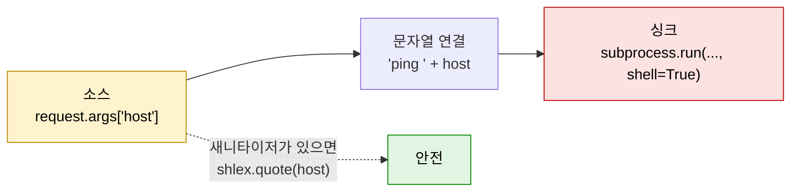

# 정적 분석

| 레벨 | 상태 | 최종 개정 |
|---|---|---|
| 🟡 | 🔄 개정중 | 2026-10-22 |

> **한눈에 보기**
> 코드를 실행하지 않고 읽는다. 소스(source)에서 싱크(sink)까지의 데이터 흐름을 따라가는 것이 핵심이다.
> 사람은 "어디가 위험한가"를 판단하고, 도구는 "그 패턴이 어디에 또 있는가"를 찾는다.
> 산출물은 취약점 목록이 아니라 **동적 분석으로 확인할 후보 목록**이다.

## 1. 소스·싱크·새니타이저 모델

정적 분석의 거의 모든 기법은 세 단어로 설명된다.

| 용어 | 뜻 | 예 |
|---|---|---|
| **소스**(source) | 신뢰 경계 바깥에서 데이터가 들어오는 지점 | HTTP 파라미터, 파일 내용, 소켓 수신, 환경 변수 |
| **싱크**(sink) | 데이터가 "명령"으로 해석되는 위험한 지점 | `execute()`, `system()`, `eval()`, `strcpy()`, 파일 경로 열기 |
| **새니타이저**(sanitizer) | 소스와 싱크 사이에서 데이터를 안전하게 만드는 처리 | 파라미터 바인딩, `shlex.quote()`, 허용 목록 검사, 정수 범위 검사 |



<figure>
<figcaption>그림 1. 소스에서 싱크로 가는 경로에 새니타이저가 없으면 취약점 후보다. 정적 분석은 이 경로를 찾는 일이다.</figcaption>
</figure>

취약점은 **소스에서 싱크까지 새니타이저를 거치지 않는 경로**가 있을 때 생긴다. 이 문장이 정적 분석의 전부다. [1부 1장](../part1-foundations/01-what-is-vulnerability.md)의 신뢰 경계를 코드 위에 올려놓은 것이다.

세 가지를 조심해야 한다.

- **새니타이저는 위치에 묶여 있다.** SQL 문자열 위치용 이스케이프는 컬럼명 위치에서 무의미하다. HTML 본문용 인코딩은 속성 값이나 `<script>` 안에서 무의미하다. "검증 함수를 거쳤다"가 아니라 "**이 싱크에 맞는** 검증을 거쳤다"를 확인한다.
- **데이터는 모양을 바꾸며 흐른다.** `host`가 `cmd = f"ping {host}"`로 들어가면 `cmd` 전체가 오염(taint)된다. 변수가 바뀌어도 오염은 전파된다. 이것을 추적하는 것이 오염 추적(taint tracking)이다.
- **싱크는 라이브러리 안에 숨어 있다.** `os.system()`은 보이지만, ORM의 `raw()`나 템플릿 엔진의 `render_template_string()`은 싱크처럼 보이지 않는다. 취약점 유형별 싱크 목록은 3부·4부 각 장의 "2. 발생하는 코드 패턴"에 있다.

## 2. 수동 코드 리뷰: 두 가지 전략

도구를 돌리기 전에 사람이 코드를 읽는 방향은 둘 중 하나다.

### 2.1 입력 지점부터 (소스 → 싱크, 전방 추적)

진입점(HTTP 라우트, CLI 파서, 파일 로더)을 모두 찾고, 각 입력이 어디로 가는지 따라 내려간다.

```bash
# 웹 앱의 진입점 찾기 (Flask / Django / Spring)
grep -rnE "@(app|bp)\.(route|get|post)|path\(|@(Get|Post|Request)Mapping" --include='*.py' --include='*.java' .
# 입력을 읽는 지점
grep -rnE "request\.(args|form|json|files|cookies|headers)" --include='*.py' .
```

| 장점 | 단점 |
|---|---|
| 공격 표면 전체를 빠짐없이 본다. 놓치는 진입점이 없다 | 입력 하나가 수십 개 함수를 거치면 추적이 길고 지루하다 |
| 인증·권한 누락처럼 "싱크가 없는" 취약점(IDOR, 접근 제어)을 찾는 유일한 방법이다 | 큰 코드베이스에서는 끝까지 못 간다 |
| 위협 모델링([3장](03-threat-modeling.md))의 데이터 흐름도와 바로 이어진다 | |

### 2.2 위험 함수부터 (싱크 → 소스, 후방 추적)

위험한 함수 호출을 모두 찾고, 각 인자가 어디서 왔는지 거슬러 올라간다. [SQL 인젝션 장 3.1절](../part3-web/01-sql-injection.md)의 grep이 이 방식이다.

```bash
# C: 경계 검사 없는 복사 함수
grep -rnE "\b(strcpy|strcat|sprintf|gets|memcpy)\s*\(" --include='*.c' --include='*.h' .
# Python: 코드/명령 실행
grep -rnE "\b(eval|exec|os\.system|subprocess\.\w+|pickle\.loads|yaml\.load)\s*\(" --include='*.py' .
```

| 장점 | 단점 |
|---|---|
| 빠르다. 싱크 수는 진입점 수보다 훨씬 적다 | 싱크 목록에 없는 함수는 영원히 못 본다 |
| 인젝션·메모리 손상처럼 "싱크가 명확한" 유형에 효율적이다 | 로직 취약점, 권한 누락은 못 찾는다 |
| 도구로 자동화하기 쉽다 | 인자가 상수인 호출이 대부분이라 노이즈가 많다 |

### 2.3 실제로는 둘을 섞는다

경험상 순서는 이렇다. (1) 싱크부터 훑어 **싸게 잡히는 것**을 1~2시간 안에 걷어낸다. (2) 위협 모델에서 우선순위가 높은 진입점 두세 개를 골라 **소스부터 끝까지** 따라간다. (3) 그 과정에서 새로 알게 된 싱크(프로젝트 고유 래퍼 함수)를 목록에 추가하고 (1)로 돌아간다.

리뷰 중 메모는 [1장 4절 분석 노트](01-overview.md) 형식으로 남긴다. "`app/views.py:88` `host` ← `request.args` → `utils.run_ping()` → `subprocess.run(shell=True)`. 새니타이저 없음. 동적 확인 필요." 이 한 줄이 정적 분석의 산출물이다.

## 3. Semgrep: 패턴을 빠르게 넓게

Semgrep은 코드를 **구문 트리 수준의 패턴**으로 검색한다. grep과 달리 공백·줄바꿈·변수명 차이를 무시하고, `...`로 "임의의 인자"를 표현한다. 빌드가 필요 없고 파일 단위로 돌아가므로 수십만 줄도 몇 분이면 끝난다.

**언제 쓰는가**: 코드 리뷰 첫날, "이 패턴이 어디에 또 있는가"를 물을 때. 그리고 CI에 넣어 같은 실수가 다시 들어오는 것을 막을 때.

```bash
pip install semgrep
# 공식 레지스트리 룰셋으로 스캔
semgrep scan --config p/default .
semgrep scan --config p/security-audit --config p/owasp-top-ten .
# SARIF로 저장 (GitHub code scanning 등에 올릴 때)
semgrep scan --config p/default --sarif --sarif-output=semgrep.sarif .
```

레지스트리 룰은 출발점이다. 진짜 가치는 **분석 대상에 맞는 룰을 직접 쓸 때** 나온다. 아래는 Flask 요청 값이 `subprocess`에 닿는 경로를 찾는 오염 추적 룰이다. Semgrep 1.182.0에서 동작을 확인했다.

```yaml
# taint-cmd.yaml
rules:
  - id: flask-request-to-subprocess
    languages: [python]
    severity: ERROR
    message: >-
      Flask 요청 값이 검증 없이 subprocess에 도달한다 (OS 명령 인젝션 가능).
      shlex.quote 또는 허용 목록으로 검증한 뒤 shell=False로 호출하라.
    mode: taint
    pattern-sources:
      - pattern: flask.request.$ANY
    pattern-sanitizers:
      - pattern: shlex.quote(...)
    pattern-sinks:
      - patterns:
          - pattern-either:
              - pattern: subprocess.$FUNC(...)
              - pattern: os.system(...)
```

`mode: taint`를 켜면 Semgrep이 소스·새니타이저·싱크를 1절의 모델 그대로 받아 흐름을 따라간다. 다음 코드에 돌리면 13행만 잡힌다. 18행은 `shlex.quote()`를 거쳤고, 23행은 소스가 없기 때문이다.

```python
# app.py
@app.route("/ping")
def ping():
    host = flask.request.args.get("host")
    return subprocess.check_output("ping -c 1 " + host, shell=True)   # ❌ 13행: 탐지됨

@app.route("/ping2")
def ping2():
    host = shlex.quote(flask.request.args.get("host"))
    return subprocess.check_output("ping -c 1 " + host, shell=True)   # ✅ 18행: 새니타이저 통과

@app.route("/static")
def fixed():
    return os.system("ping -c 1 127.0.0.1")                           # ✅ 23행: 소스 없음
```

```
$ semgrep scan --config taint-cmd.yaml --metrics=off app.py
    app.py
   ❯❯❱ flask-request-to-subprocess
           13┆ return subprocess.check_output("ping -c 1 " + host, shell=True)
```

> 🟡 Semgrep의 오염 추적은 기본적으로 **함수 안(intraprocedural)** 에서 동작한다. `host`가 다른 함수로 넘어가 거기서 싱크에 닿으면 기본 설정으로는 놓친다. 함수 경계를 넘는 추적은 CodeQL이나 Semgrep Pro의 영역이다. 룰 문법 상세는 [6부 5장](../part6-tools/05-sast-semgrep-codeql.md)에서 다룬다.

## 4. CodeQL: 데이터 흐름을 느리게 깊게

CodeQL은 코드를 **데이터베이스로 변환**하고, 그 위에서 QL 쿼리를 돌린다. 함수 호출을 넘나드는 전역 오염 추적(global taint tracking)이 가능해서 "요청 파라미터가 다섯 함수를 거쳐 쿼리에 닿는" 경로를 찾는다. 대신 컴파일 언어는 빌드가 필요하고, 수십 분에서 수 시간이 걸린다.

**언제 쓰는가**: Semgrep으로 걷어낸 뒤, 호출 깊이가 깊은 코드베이스에서 "정말 없는가"를 확인할 때. 그리고 한 CVE의 패턴을 쿼리로 만들어 **변종(variant)을 찾을 때**.

```bash
# 1. 데이터베이스 생성 (Python처럼 빌드가 없는 언어)
codeql database create db-py --language=python --source-root .
# 컴파일 언어는 빌드 명령을 넘긴다
codeql database create db-c --language=cpp --source-root . --command="make -j4"

# 2. 표준 보안 쿼리 묶음으로 분석, SARIF로 출력
codeql database analyze db-py codeql/python-queries \
    --format=sarif-latest --output=results.sarif --download
```

쿼리의 최소 골격은 다음과 같다. `DataFlow::ConfigSig`를 구현한 모듈에 소스와 싱크를 적고, `TaintTracking::Global<...>`에 넘기면 흐름 모듈이 만들어진다. 아래는 CodeQL 공식 Python 가이드의 예시로, "네트워크 입력이 파일 경로에 닿는" 경로를 찾는다.

```ql
import python
import semmle.python.dataflow.new.DataFlow
import semmle.python.dataflow.new.TaintTracking
import semmle.python.dataflow.new.RemoteFlowSources
import semmle.python.Concepts

module RemoteToFileConfiguration implements DataFlow::ConfigSig {
  predicate isSource(DataFlow::Node source) {
    source instanceof RemoteFlowSource
  }

  predicate isSink(DataFlow::Node sink) {
    sink = any(FileSystemAccess fa).getAPathArgument()
  }
}

module RemoteToFileFlow = TaintTracking::Global<RemoteToFileConfiguration>;

from DataFlow::Node input, DataFlow::Node fileAccess
where RemoteToFileFlow::flow(input, fileAccess)
select fileAccess, "This file access uses data from $@.",
  input, "user-controllable input."
```

읽는 법은 이렇다.

- `RemoteFlowSource`는 표준 라이브러리가 미리 정의한 **소스 집합**이다. Flask의 `request.args`, Django의 `request.GET` 등 프레임워크별 입력 지점이 이미 모델링되어 있다.
- `FileSystemAccess`는 `Concepts` 모듈이 정의한 **싱크 개념**이다. 같은 모듈에 `SqlExecution`, `SystemCommandExecution`, `CodeExecution`이 있다. 싱크 한 줄만 바꾸면 다른 취약점 유형의 쿼리가 된다.
- 표준 쿼리 `py/sql-injection`, `py/command-line-injection`은 이 골격 위에 세심한 새니타이저 모델을 얹은 것이다. 직접 쓰기 전에 표준 쿼리가 이미 있는지 먼저 본다.

> 🟡 CodeQL의 모듈형 데이터 흐름 API(`ConfigSig`, `Global<...>`)는 2023년 CodeQL 2.12~2.13 무렵 도입되었고, 예전 `class ... extends TaintTracking::Configuration` 문법은 폐기(deprecated)되었다. 인터넷의 오래된 예시를 그대로 쓰면 컴파일되지 않는다. 데이터베이스 생성·쿼리 작성·CI 통합의 상세는 [6부 5장](../part6-tools/05-sast-semgrep-codeql.md)을 본다.

## 5. 바이너리 정적 분석

소스가 없으면 바이너리를 읽는다. 원리는 같다. 소스는 `recv()`·`read()`·`argv`, 싱크는 `strcpy()`·`system()`·`memcpy()`이고, 그 사이의 흐름을 기계어 위에서 따라간다.

| 도구 역할 | 하는 일 | 쓰는 때 |
|---|---|---|
| `strings`, `file`, `readelf -h -l -d`(또는 `checksec`) | 문자열·아키텍처·보호 기법(NX, PIE, RELRO) 확인 | 처음 5분. 포맷 문자열, 하드코딩된 경로·URL·자격증명을 찾는다 |
| 디스어셈블러(disassembler) | 기계어 → 어셈블리. 제어 흐름 그래프를 그린다 | 정확한 명령어 순서가 중요할 때 (취약 명령어, 패치 비교) |
| 디컴파일러(decompiler) | 어셈블리 → C 비슷한 의사코드 | 큰 함수의 논리를 빠르게 이해할 때. **대부분의 시간을 여기서 보낸다** |
| 바이너리 diff | 패치 전후 함수 비교 | N-day 분석. 패치가 어디를 고쳤는지 역으로 취약점을 찾는다 |

```bash
file ./target                         # 아키텍처, 스트립 여부, 동적/정적 링크
strings -n 8 ./target | grep -iE "http|passw|/tmp|%s"
objdump -d ./target | grep -E "call.*<(strcpy|sprintf|system)@plt>"   # 위험 함수 호출 지점
```

디컴파일 결과는 **소스가 아니라 추정**이다. 타입이 틀리고, 구조체 필드가 `*(a1 + 0x18)`로 보이고, 인라인된 함수는 사라진다. 디컴파일러 출력에서 후보를 잡은 뒤 반드시 디스어셈블리로 확인하고, 다시 디버거([5장](05-dynamic-analysis.md))로 실제 값을 본다. Ghidra와 IDA의 사용법은 [6부 2장](../part6-tools/02-ghidra-ida.md)에서, 메모리 손상 유형별로 바이너리에서 무엇을 보는지는 [4부](../part4-binary/00-overview.md) 각 장에서 다룬다.

## 6. 오탐 다루기

정적 분석 도구의 출력은 취약점이 아니라 **경고**다. 경고를 셋으로 나눈다.

| 분류 | 뜻 | 처리 |
|---|---|---|
| **진양성**(true positive) | 실제로 소스→싱크 경로가 있고 새니타이저가 없다 | 동적 분석으로 넘긴다 |
| **오탐**(false positive) | 경로가 없거나, 도구가 모르는 새니타이저가 있다 | 룰을 고치거나 억제 주석을 단다 |
| **도달 불가/수용** | 경로는 있지만 입력이 내부 신뢰 값이거나, 수정 비용 대비 위험이 작다 | 이유를 적고 닫는다. "안 고친다"는 결정도 기록이다 |

오탐이 많으면 사람들이 도구를 끈다. 오탐률을 낮추는 순서는 다음과 같다.

1. **싱크를 좁힌다.** `subprocess.$FUNC(...)`보다 `subprocess.$FUNC(..., shell=True, ...)`가 노이즈가 적다. 상수 인자 호출을 `pattern-not`으로 뺀다.
2. **프로젝트 고유 새니타이저를 가르친다.** 팀이 만든 `safe_path()`, `validate_id()`를 Semgrep의 `pattern-sanitizers`나 CodeQL의 `isBarrier`에 등록한다. 이것이 오탐을 가장 많이 줄인다.
3. **정밀도 태그를 쓴다.** CodeQL 표준 쿼리의 `@precision high`는 오탐이 적도록 설계된 쿼리다. 처음에는 `high`만 켜고, 익숙해지면 `medium`을 더한다.
4. **억제는 이유와 함께.** Semgrep은 해당 줄에 `# nosemgrep: rule-id` 주석으로 억제한다. 룰 ID 없이 `# nosemgrep`만 쓰면 그 줄의 모든 룰이 꺼지므로 피한다. 억제 주석 옆에는 "왜 안전한가"를 한 줄 적는다.

반대도 있다. **미탐**(false negative)은 도구가 조용하다고 안전하다는 뜻이 아니다. 도구는 자기가 아는 소스와 싱크만 본다. 프로젝트 고유 래퍼 함수, 리플렉션, 동적 코드 생성, 설정 파일로 결정되는 동작은 정적 분석의 사각지대다. 그래서 정적 분석의 끝은 항상 "후보 목록을 들고 [5장](05-dynamic-analysis.md)으로 간다"이다.

## 체크리스트

**리뷰 시작 전**
- [ ] 분석 대상의 소스(진입점) 목록을 만들었는가?
- [ ] 취약점 유형별 싱크 목록(3부·4부 각 장 2절)을 손에 들고 있는가?
- [ ] 프로젝트 고유 래퍼 함수(DB, 명령 실행, 파일 접근)를 싱크 목록에 추가했는가?

**도구 실행**
- [ ] Semgrep 레지스트리 룰셋을 먼저 돌리고, 대상에 맞는 룰을 1개 이상 직접 썼는가?
- [ ] CodeQL 데이터베이스가 빌드 오류 없이 만들어졌는가? (빌드 실패분은 분석에서 빠진다)
- [ ] 경고를 진양성/오탐/수용으로 분류하고 이유를 적었는가?

**끝내기 전**
- [ ] 새니타이저가 **그 싱크 위치에 맞는 것**인지 확인했는가?
- [ ] 후보마다 "파일:줄, 소스, 싱크, 새니타이저 유무, 다음 할 일"이 노트에 있는가?
- [ ] 도구가 조용한 영역(리플렉션, 동적 생성, 설정 기반 동작)을 수동으로 봤는가?

## 더 읽기

- [Semgrep: Taint analysis](https://semgrep.dev/docs/writing-rules/data-flow/taint-mode) · `mode: taint` 룰 문법 공식 문서
- [Semgrep Registry](https://semgrep.dev/explore) · `p/default`, `p/security-audit` 등 룰셋 목록과 각 룰의 소스
- [CodeQL: Analyzing data flow in Python](https://codeql.github.com/docs/codeql-language-guides/analyzing-data-flow-in-python/) · 4절 쿼리의 출처. `ConfigSig`와 `TaintTracking::Global` 공식 설명
- [CodeQL CLI: database create](https://docs.github.com/en/code-security/reference/code-scanning/codeql/codeql-cli-manual/database-create) · 옵션 전체 목록
- [github/codeql: python/ql/src/Security/CWE-089/SqlInjection.ql](https://github.com/github/codeql/blob/main/python/ql/src/Security/CWE-089/SqlInjection.ql) · 표준 쿼리 `py/sql-injection`의 실제 소스
- Dowd, McDonald, Schuh, *The Art of Software Security Assessment* (2006), 4장 "Application Review Process" · 수동 코드 리뷰 전략(2절)의 원전
- GitHub Security Lab, [CodeQL zero to hero part 3](https://github.blog/security/vulnerability-research/codeql-zero-to-hero-part-3-security-research-with-codeql/) (2024) · 변종 찾기 실습

## 변경 이력

| 날짜 | 변경 | 기여자 |
|---|---|---|
| 2026-10-21 | 초안(뼈대) 작성 | @anthonynoh5202 |
| 2026-10-22 | 본문 작성. Semgrep 오염 추적 룰 동작 확인(1.182.0), CodeQL 예시는 공식 가이드 기준 | @anthonynoh5202 |
| 2026-10-22 | 기술 검증: Semgrep 1.182.0으로 taint 룰 실행(13행만 탐지, `# nosemgrep: rule-id` 동작 확인), CodeQL 쿼리를 github/codeql 공식 가이드 원문·`codeql/python-queries` 팩 이름과 대조. NX/RELRO 확인 명령(`readelf -h`→`-h -l -d`)과 CodeQL API 도입 버전 서술 정정 | 검증팀 |
