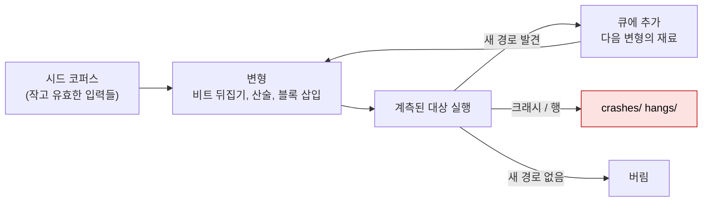

# 동적 분석

| 레벨 | 상태 | 최종 개정 |
|---|---|---|
| 🟡 | 🔄 개정중 | 2026-10-22 |

> **한눈에 보기**
> 실행시켜서 관찰한다. 퍼징은 '예상 밖 입력을 자동으로', 디버깅은 '특정 입력을 정밀하게' 본다.
> 정적 분석이 준 후보를 "실제로 그렇게 동작하는가"로 바꾸는 단계다.
> 산출물은 **재현 입력**과 그 입력이 만든 **관찰 결과**(크래시, 응답 차이, 시스템 콜)다.

## 1. 정적이 지도라면 동적은 현장이다

정적 분석([4장](04-static-analysis.md))은 "이 경로가 있을 수 있다"까지만 말한다. 디컴파일러는 타입을 틀리고, 오염 추적은 프로젝트 고유 새니타이저를 모른다. 동적 분석은 프로그램을 실제로 돌려 그 불확실성을 없앤다.

| 질문 | 기법 | 절 |
|---|---|---|
| 이 프로그램이 실제로 무슨 파일·소켓·프로세스를 건드리는가? | 계측(instrumentation) | 2 |
| 사람이 생각 못 한 입력에서 무너지는가? | 퍼징(fuzzing) | 3 |
| 이 입력에서 메모리와 레지스터가 정확히 어떻게 되는가? | 디버거 | 4 |
| 요청을 바꾸면 서버가 어떻게 반응하는가? | 프록시 | 5 |
| 이 크래시가 취약점인가, 그냥 버그인가? | 크래시 분류(triage) | 6 |

모든 동적 분석은 **실습 환경 안에서** 한다. 환경 구축은 [기초 5장](../part1-foundations/05-lab-setup.md), 허용 범위는 [기초 4장](../part1-foundations/04-ethics-and-law.md)을 따른다.

## 2. 계측: 프로그램이 하는 일을 본다

계측은 프로그램을 고치지 않고 바깥에서 행동을 기록하는 것이다. 코드를 읽기 전에 10분만 계측해도 "어디를 읽어야 하는지"가 보인다.

### 2.1 시스템 콜 추적: strace

`strace`는 프로세스가 커널에 요청하는 시스템 콜을 모두 기록한다. 소스가 없어도 되고, 바이너리를 바꾸지도 않는다.

```bash
# 파일 관련 콜만, 자식 프로세스까지, 파일로 저장
strace -f -e trace=%file -o st.txt ./target input.bin
# 네트워크 콜만
strace -e trace=%network -o st2.txt ./target
# 실행 중인 프로세스에 붙기 (시각 포함, 문자열 길게)
strace -p 1234 -f -tt -s 256
```

```
4437  openat(AT_FDCWD, "/usr/lib/python3.13/__pycache__/linecache.cpython-313.pyc", O_RDONLY|O_CLOEXEC) = 3
4437  openat(AT_FDCWD, "/etc/hostname", O_RDONLY|O_CLOEXEC) = 3
4437  +++ exited with 0 +++
```

보는 것은 세 가지다. **어떤 파일을 여는가**(설정 파일, 임시 파일, 상대 경로 로드 → 경로 조작·심볼릭 링크 후보), **어디에 연결하는가**(`connect()`의 주소 → SSRF·하드코딩된 서버), **무엇을 실행하는가**(`execve()`의 인자 → 명령 인젝션 후보). `-f`가 없으면 `fork()`된 자식의 동작이 빠지므로 거의 항상 붙인다.

주요 옵션: `-f` 자식 프로세스 추적, `-o 파일` 출력 저장, `-e trace=%file|%network|%process` 콜 종류 필터, `-tt` 시각, `-s N` 문자열 출력 길이, `-y` 파일 디스크립터 옆에 경로 표시.

### 2.2 라이브러리 호출 추적: ltrace

`ltrace`는 공유 라이브러리 함수 호출(`strcpy`, `system`, `SSL_read` 등)을 기록한다. 시스템 콜보다 한 층 위를 본다. `ltrace -S`는 시스템 콜까지 함께 보여 준다. 정적 링크 바이너리에서는 동작하지 않고, 최근 배포판에는 기본 설치되어 있지 않은 경우가 많다. `strace`로 시작하고 라이브러리 수준이 필요할 때 추가한다.

### 2.3 로그와 샌드박스

애플리케이션 로그는 가장 싼 계측이다. 웹 앱이면 로그 레벨을 DEBUG로 올리고 쿼리 로그(MySQL `general_log`, PostgreSQL `log_statement = 'all'`)를 켠다. 입력이 **어떤 쿼리로 변했는지** 그대로 보이면 SQL 인젝션 확인이 몇 초로 줄어든다.

샌드박스(sandbox)는 관찰 대상이 분석 환경을 망가뜨리지 않게 격리한다. 이 책의 실습은 Docker 컨테이너를 기본 샌드박스로 쓴다. 악성 가능성이 있는 샘플이나 네트워크로 나가는 동작이 의심되면 **네트워크를 끊은** 컨테이너나 VM에서 돌린다(`docker run --network none`).

## 3. 퍼징: 커버리지 피드백이 무작위를 탐색으로 바꾼다

퍼징은 프로그램에 변형된 입력을 자동으로 수없이 넣어 크래시를 찾는 기법이다. 1990년대의 퍼저는 무작위 바이트를 넣었다. 현대 퍼저는 **어떤 입력이 새 코드 경로를 열었는지** 피드백을 받아 그 입력을 우선 변형한다. 이것이 커버리지 기반(coverage-guided) 퍼징이다.



<figure>
<figcaption>그림 1. 커버리지 기반 퍼징 루프. 컴파일 시 삽입된 계측 코드가 "이 입력이 어느 분기를 지났는가"를 퍼저에 알려 준다.</figcaption>
</figure>

### 3.1 AFL++ 기본 흐름

AFL++은 가장 널리 쓰이는 커버리지 기반 퍼저다. 흐름은 네 단계다.

```bash
# 1. 계측 컴파일러로 빌드. AFL_USE_ASAN=1을 켜면 크래시 없이 지나가는 메모리 오류도 잡힌다
export AFL_USE_ASAN=1
CC=afl-cc CXX=afl-c++ ./configure --disable-shared && make clean all
# 단일 파일이면
afl-cc -g -o target target.c

# 2. 시드 준비. 작고 유효한 입력 몇 개. 중복 커버리지 제거
afl-cmin -i seeds_raw -o seeds -- ./target @@

# 3. 퍼징 시작. @@ 자리에 AFL++이 생성한 입력 파일 경로가 들어간다
afl-fuzz -i seeds -o out -- ./target @@
# stdin으로 읽는 프로그램이면 @@를 뺀다

# 4. 결과는 out/default/crashes/ 와 out/default/hangs/ 에 쌓인다
ls out/default/crashes/
```

시드는 **작고 유효해야** 한다. 1KB짜리 유효한 PNG 하나가 1MB짜리 열 개보다 낫다. 변형 횟수가 파일 크기에 반비례하기 때문이다. SQL·HTTP처럼 키워드가 많은 포맷은 `-x 사전파일`로 토큰 사전을 준다.

### 3.2 하네스: 퍼징은 하네스 작성이 전부다

퍼저는 "파일을 받아 실행되는 프로그램"만 돌릴 수 있다. 라이브러리 함수 하나, 네트워크 서버의 파싱 루틴 하나를 퍼징하려면 그것을 감싸는 작은 프로그램, **하네스**(harness)를 써야 한다.

```c
// harness.c — 라이브러리의 parse_record()를 파일 입력으로 퍼징한다
#include <stdio.h>
#include <stdlib.h>
#include "record.h"   /* int parse_record(const unsigned char *buf, size_t len); */

int main(int argc, char **argv) {
    if (argc < 2) return 1;
    FILE *f = fopen(argv[1], "rb");
    if (!f) return 1;
    unsigned char buf[65536];
    size_t n = fread(buf, 1, sizeof buf, f);
    fclose(f);
    parse_record(buf, n);   /* 퍼징 대상. 반환값은 무시한다 */
    return 0;
}
```

좋은 하네스의 조건은 세 가지다. (1) **입력에서 대상 함수까지 최단 거리**. 인증, 네트워크, 초기화를 건너뛴다. (2) **결정적**. 같은 입력이면 같은 경로. 난수·시각·스레드를 고정한다. (3) **빠르다**. 초당 수백~수천 회 실행이 목표다. 하네스가 잘못되면 퍼저는 며칠 동안 아무것도 못 찾는다. 하네스 설계와 libFuzzer·구조화 입력 퍼징은 [바이너리 9장](../part4-binary/09-fuzzing.md)과 [도구 4장](../part6-tools/04-fuzzers.md)에서 다룬다.

## 4. 디버거로 상태 추적

퍼저가 "이 입력에서 죽는다"를 주면, 디버거는 "**왜** 죽는가"를 준다. 특정 입력 하나를 넣고 명령어 단위로 멈춰 메모리와 레지스터를 본다.

| 명령 | 하는 일 |
|---|---|
| `gdb -q ./target` / `run 인자` | 시작, 실행 |
| `break 함수` / `break 파일:줄` | 중단점. 정적 분석에서 찾은 싱크에 건다 |
| `bt` | 호출 스택. 크래시 직후 가장 먼저 친다 |
| `info registers` | 레지스터. `rip`(다음 명령), `rsp`(스택), `rbp`(프레임) |
| `x/8gx $rsp` | 메모리 덤프. 8개를 8바이트 16진수로 |
| `p 변수` / `p/x 변수` | 변수 값 |
| `watch 변수` | 값이 바뀔 때 멈춤. "누가 이 값을 덮었나"에 답한다 |
| `ni` / `si` / `finish` | 명령어 단위 실행, 함수 호출 안으로, 현재 함수 끝까지 |
| `p $_siginfo._sifields._sigfault.si_addr` | 시그널을 일으킨 접근 주소 |

[바이너리 2장](../part4-binary/02-stack-overflow.md)의 32바이트 스택 버퍼에 56바이트를 넣고 gdb로 본 실제 세션이다.

```
$ gdb -q --args ./stack $(python3 -c "print('A'*40+'BBBBBBBB'+'C'*8)")
(gdb) run
Program received signal SIGSEGV, Segmentation fault.
0x0000000000401196 in greet (name=...) at stack.c:8
(gdb) bt
#0  0x0000000000401196 in greet (...) at stack.c:8
#1  0x4242424242424242 in ?? ()
#2  0x4343434343434343 in ?? ()
Backtrace stopped: Cannot access memory at address 0x4141414141414149
(gdb) info registers rip rsp rbp
rip            0x401196            0x401196 <greet+64>
rsp            0x7fffffffc5c8      0x7fffffffc5c8
rbp            0x4141414141414141  0x4141414141414141
(gdb) x/6gx $rsp
0x7fffffffc5c8: 0x4242424242424242  0x4343434343434343
```

읽는 법: `rbp`가 `0x41414141…`('A')로 덮였고, `rsp`가 가리키는 복귀 주소 자리에 `0x42424242…`('B')가 있다. `ret` 명령이 이 값을 `rip`에 넣으려다 실패한 것이다. **입력의 41~48번째 바이트가 복귀 주소를 통제한다**는 사실이 확정됐다. 이것이 [6장](06-exploit-verification.md)의 "제어" 단계로 넘어가는 증거다.

pwndbg·GEF 같은 확장을 붙이면 스택·레지스터·디스어셈블리가 한 화면에 나온다. Windows의 WinDbg, 모바일·동적 계측의 Frida까지 포함한 디버거 사용법은 [도구 3장](../part6-tools/03-debuggers.md)에서 다룬다.

## 5. 프록시로 요청·응답 조작

웹 애플리케이션의 디버거는 **가로채는 프록시**(intercepting proxy)다. 브라우저와 서버 사이에 앉아 요청을 멈추고, 고치고, 다시 보낸다. 브라우저가 못 보내는 값을 보내는 것이 목적이다.

| 바꾸는 것 | 보는 것 | 찾는 취약점 |
|---|---|---|
| 숨은 필드, 비활성화된 폼 값 | 서버가 클라이언트 검증만 믿는가 | 가격 조작, 권한 상승 |
| `id=123` → `id=124` | 남의 자원이 나오는가 | IDOR ([웹 5장](../part3-web/05-access-control.md)) |
| 파라미터에 `'`, `{{7*7}}`, `../` | 에러, 평가 결과, 다른 파일 | 인젝션 계열 |
| `Content-Type`, 파일 확장자 | 서버가 어떤 기준으로 파일을 받는가 | 업로드 ([웹 6장](../part3-web/06-file-upload-path-traversal.md)) |
| 요청을 그대로 두 번, 동시에 | 두 번 처리되는가 | 경쟁 조건 ([웹 10장](../part3-web/10-race-condition.md)) |
| 응답의 `"role":"user"` → `"admin"` | 클라이언트가 응답을 믿고 UI를 여는가 | 클라이언트 측 권한 검사 |

클라이언트가 보낸 모든 것은 입력이다. 쿠키, 헤더, JSON 필드 이름, 멀티파트 경계까지. [기초 1장](../part1-foundations/01-what-is-vulnerability.md)의 신뢰 경계가 정확히 프록시가 앉은 자리에 있다. 프록시는 반복 전송(Repeater), 자동 변형(Intruder), 스캐너를 묶어 제공하고, 상세는 [도구 1장](../part6-tools/01-burp-proxy.md)에서 다룬다. 명령줄에서는 `curl -x http://127.0.0.1:8080`으로 같은 프록시를 거치게 해 재현 스크립트를 만든다.

## 6. 크래시 분류(triage)

퍼저는 하룻밤에 수백 개의 크래시를 만든다. 대부분은 같은 버그의 변형이고, 일부는 취약점이 아니다. 분류하지 않으면 보고서를 쓸 수 없다.

### 6.1 ASan 출력 읽기

AddressSanitizer(ASan)는 컴파일 시 메모리 접근마다 검사 코드를 넣어, 크래시로 이어지지 않는 오류까지 **첫 발생 지점에서** 잡는다. 퍼징 빌드에는 항상 켠다. 16바이트 힙 버퍼에 25바이트를 `strcpy`한 실제 출력이다.

```
$ gcc -g -fsanitize=address -fno-omit-frame-pointer heap.c -o heap && ./heap AAAAAAAAAAAAAAAAAAAAAAAA
==4657==ERROR: AddressSanitizer: heap-buffer-overflow on address 0x502000000020 at pc 0x7f58998a7923 ...
WRITE of size 25 at 0x502000000020 thread T0
    #0 0x7f58998a7922 in strcpy ../../../../src/libsanitizer/asan/asan_interceptors.cpp:563
    #1 0x562d663e0225 in main heap.c:6
0x502000000020 is located 0 bytes after 16-byte region [0x502000000010,0x502000000020)
allocated by thread T0 here:
    #0 0x7f58998fd9c7 in malloc ...
    #1 0x562d663e0200 in main heap.c:5
SUMMARY: AddressSanitizer: heap-buffer-overflow ... in strcpy
Shadow bytes around the buggy address:
=>0x502000000000: fa fa 00 00[fa]fa fa fa fa fa fa fa fa fa fa fa
```

| 줄 | 뜻 | 분류에 미치는 영향 |
|---|---|---|
| `ERROR: AddressSanitizer: heap-buffer-overflow` | 오류 종류 | 유형이 심각도를 1차로 정한다 (아래 표) |
| `WRITE of size 25` | 읽기/쓰기, 크기 | **WRITE가 READ보다 심각**하다. 크기가 입력에 따라 변하면 공격자 통제 |
| `#0 … strcpy` `#1 … heap.c:6` | 오류 지점 스택 | 중복 제거의 기준. 같은 스택 = 같은 버그 |
| `0 bytes after 16-byte region` | 할당 경계와의 거리 | 바로 뒤면 인접 청크 메타데이터를 덮는다 |
| `allocated by … heap.c:5` | 할당 지점 스택 | 어떤 객체가 피해자인지 |
| 섀도 바이트 `[fa]` | 접근한 곳의 상태 (`fa` 힙 레드존, `fd` 해제됨, `00` 정상) | `fd`면 use-after-free |

### 6.2 exploitability 판단

| ASan 유형 / 시그널 | 1차 판단 | 다음 질문 |
|---|---|---|
| `heap-buffer-overflow` **WRITE**, `stack-buffer-overflow` WRITE | 높음 | 쓰는 내용과 길이를 입력이 통제하는가 |
| `heap-use-after-free` | 높음 | 해제와 재사용 사이에 공격자가 할당을 끼울 수 있는가 |
| `SEGV on unknown address` + `rip`가 입력 바이트 | 높음 | 4절의 예. 실행 흐름 통제 확정 |
| `*-buffer-overflow` **READ** | 중간 | 읽은 내용이 출력으로 나가는가 (정보 유출, Heartbleed 유형) |
| `SEGV on address 0x0` 근처 READ | 낮음 | 널 역참조. 대개 DoS에 그친다. 커널·서비스 데몬이면 가용성 영향 |
| `stack-overflow`(재귀), `allocation-size-too-big` | 낮음 | 자원 고갈. 원격 유발 가능하면 DoS |
| `UndefinedBehaviorSanitizer: signed-integer-overflow` | 상황 의존 | 그 값이 길이·인덱스로 쓰이는가 ([바이너리 6장](../part4-binary/06-integer-overflow.md)) |

이 표는 **출발점**이지 결론이 아니다. 널 역참조가 권한 상승이 된 사례도 있고, WRITE 오버플로가 보호 기법([바이너리 7장](../part4-binary/07-mitigations.md)) 때문에 DoS로 끝나는 경우도 흔하다. 최종 판단은 [6장](06-exploit-verification.md)에서 실제로 제어를 얻어 보는 것이다.

### 6.3 분류 작업 순서

1. **중복 제거**: 오류 지점 스택의 상위 3~5 프레임이 같으면 같은 버그로 묶는다. 수백 개가 열 개 안팎으로 줄어든다.
2. **최소화**: `afl-tmin -i crash -o crash.min -- ./target @@`로 크래시를 유지하는 최소 입력을 만든다. 2KB 입력이 30바이트가 되면 원인이 눈에 보인다.
3. **ASan 없이 재현**: 보호 기법이 켜진 실제 빌드에서도 죽는지 확인한다. ASan 빌드에서만 보이는 오류는 심각도를 따로 적는다.
4. **자동 분류 보조**: CERT의 gdb 확장 `exploitable`은 크래시 상태를 휴리스틱으로 `EXPLOITABLE`, `PROBABLY_EXPLOITABLE`, `UNKNOWN` 등으로 분류한다. 보호 기법 우회 가능성은 고려하지 않으므로 우선순위 정렬용으로만 쓴다.
5. **노트**: 버그마다 "최소 입력 파일, ASan 요약 한 줄, 스택 상위 3프레임, 1차 판단, 다음 질문"을 적는다. [6장](06-exploit-verification.md)과 [7장](07-reporting.md)의 재료다.

## 체크리스트

**시작 전**
- [ ] 대상이 실습 환경(컨테이너·VM) 안에 있고, 허가 범위를 확인했는가?
- [ ] 정적 분석에서 넘어온 후보 목록이 있는가? 없다면 왜 무작위로 찌르고 있는가?

**계측·퍼징**
- [ ] `strace -f`로 파일·네트워크·프로세스 동작을 한 번 훑었는가?
- [ ] 퍼징 빌드에 `AFL_USE_ASAN=1`을 켰는가?
- [ ] 시드가 작고 유효한가? `afl-cmin`을 돌렸는가?
- [ ] 하네스가 결정적이고 초당 수백 회 이상 도는가?

**분류**
- [ ] 크래시를 스택 기준으로 중복 제거하고 `afl-tmin`으로 최소화했는가?
- [ ] 각 버그에 READ/WRITE, 크기 통제 여부, 1차 판단을 적었는가?
- [ ] ASan 없는 빌드에서도 재현했는가?

## 더 읽기

- [strace(1) 매뉴얼](https://man7.org/linux/man-pages/man1/strace.1.html) · `-e trace=%file` 등 필터 클래스 전체
- [AFL++ 공식 문서: Fuzzing in depth](https://aflplus.plus/docs/fuzzing_in_depth/) · 3절 명령의 출처. 빌드·시드·`afl-cmin`·`afl-tmin` 공식 절차
- [AddressSanitizer 문서 (google/sanitizers wiki)](https://github.com/google/sanitizers/wiki/AddressSanitizer) · 오류 유형과 섀도 메모리 설명, `ASAN_OPTIONS` 플래그
- [GDB 매뉴얼](https://sourceware.org/gdb/current/onlinedocs/gdb/) · 4절 명령의 공식 정의
- [CERTCC/exploitable](https://github.com/CERTCC/exploitable) · gdb `exploitable` 확장. 분류 규칙은 `lib/rules.py`
- Zalewski, M., ["Pulling JPEGs out of thin air"](https://lcamtuf.blogspot.com/2014/11/pulling-jpegs-out-of-thin-air.html) (2014) · 커버리지 피드백만으로 유효한 JPEG가 만들어지는 것을 보인 글. 3절 원리의 가장 짧은 증명

## 변경 이력

| 날짜 | 변경 | 기여자 |
|---|---|---|
| 2026-10-21 | 초안(뼈대) 작성 | @anthonynoh5202 |
| 2026-10-22 | 본문 작성. strace·gdb·ASan 출력은 실제 실행 결과, AFL++ 명령은 공식 문서 기준 | @anthonynoh5202 |
| 2026-10-22 | 기술 검증: ASan·gdb 예시 재실행으로 출력 형식 확인, AFL++ 명령을 docs/fuzzing_in_depth.md와 대조. 수정 없음 | 검증팀 |
| 2026-10-22 | 독자 테스트 반영: 장 참조 표기를 편·부 이름 규칙으로 통일 | @anthonynoh5202 |
