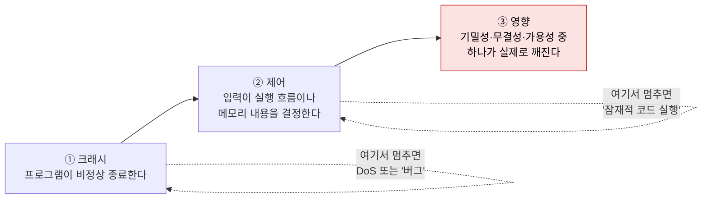

# 익스플로잇 검증

| 레벨 | 상태 | 최종 개정 |
|---|---|---|
| 🔴 | 🔄 개정중 | 2026-10-22 |

> **한눈에 보기**
> '크래시가 난다'와 '공격자가 뭔가를 얻는다'는 다르다. 영향도 판단에 필요한 최소한의 증명을 만든다.
> PoC(proof of concept)의 목적은 영향 증명이지 무기 제작이 아니다. 증명이 끝나는 지점에서 멈춘다.
> 산출물은 다른 사람이 실행하면 같은 결과가 나오는 **재현 스크립트**와 그 **증거**다.

## 1. PoC의 목적

동적 분석([5장](05-dynamic-analysis.md))이 끝나면 손에 든 것은 "이 입력에서 이런 현상이 난다"이다. 보고서를 읽는 개발자와 심각도를 매기는 사람에게는 그것으로 부족하다. 그들이 묻는 것은 **"그래서 공격자가 무엇을 얻는가"** 다.

PoC는 그 질문에 답하는 **가장 짧은 실행 가능한 증거**다. 세 가지를 분명히 한다.

| PoC가 하는 일 | PoC가 하지 않는 일 |
|---|---|
| 취약점이 실재함을 재현 가능하게 보인다 | 실제 서비스에서 동작하게 다듬는다 |
| 공격자가 얻는 것(읽기·쓰기·실행)의 **종류**를 보인다 | 얻는 것을 **최대화**한다 (전체 DB 덤프, 지속 백도어) |
| 심각도 판단에 필요한 조건(인증 필요 여부, 사용자 상호작용)을 드러낸다 | 탐지 회피, 보호 기법 우회를 완성한다 |

"무기"(weaponized exploit)는 신뢰성, 범용성, 은닉성을 갖춘 코드다. 분석가에게 그 세 가지는 필요 없다. 실습 환경에서 한 번 동작하고, 왜 동작하는지 설명할 수 있으면 충분하다. 무기화에 쓰는 시간은 보고서 품질을 높이지 않고, 유출됐을 때의 피해만 키운다. [1부 1장](../part1-foundations/01-what-is-vulnerability.md)의 구분으로 말하면, 이 장이 만드는 것은 "익스플로잇"의 최소 형태이며 그 목적은 "취약점"의 영향을 측정하는 것이다.

## 2. 크래시 → 제어 → 영향

메모리 손상 취약점의 검증은 세 계단을 오른다. 각 계단이 심각도를 한 단계씩 올린다.



<figure>
<figcaption>그림 1. 세 계단. 보고서의 심각도는 어느 계단까지 올라갔는지로 결정된다. 각 계단의 증거를 따로 남긴다.</figcaption>
</figure>

### 2.1 크래시: 재현된다

조건은 두 가지다. **결정적으로** 재현되고(같은 입력, 같은 결과), **최소화**되어 있다(`afl-tmin`, 또는 손으로 바이트를 줄여서). 5장 6절의 분류 결과가 여기 해당한다. 이 단계만으로 보고할 수 있는 것은 가용성 영향(DoS)이다. 원격에서 인증 없이 서비스 데몬을 죽일 수 있으면 그것만으로도 High가 될 수 있다.

### 2.2 제어: 입력이 무엇을 결정하는가

[5장 4절](05-dynamic-analysis.md)의 gdb 세션이 제어 증명의 전형이다.

```
rbp            0x4141414141414141     ← 입력의 'A' 영역
(gdb) x/2gx $rsp
0x7fffffffc5c8: 0x4242424242424242     ← 복귀 주소 자리에 입력의 'B' 영역
```

"입력의 41~48번째 바이트가 복귀 주소가 된다"는 문장이 증거다. 이것을 보이기 위해 셸을 띄울 필요는 없다. 복귀 주소 자리에 **알아볼 수 있는 값**(`0x4242…`, 또는 `0xdeadbeef`)을 넣고 그 값이 `rip`에 도달하는지만 확인한다. 아래가 이 단계의 재현 스크립트다.

```python
# poc_control.py — 복귀 주소 통제 증명. 실습 환경의 ./stack 전용
import subprocess
payload = b"A" * 40 + b"\xef\xbe\xad\xde\x00\x00\x00\x00"  # 0xdeadbeef
r = subprocess.run(["./stack", payload], capture_output=True)
print("exit:", r.returncode)   # -11 (SIGSEGV) 이면 크래시
# gdb에서 rip 또는 복귀 주소 자리가 0xdeadbeef 인지 확인한다
```

제어의 종류에 따라 증거가 다르다.

| 제어 종류 | 증거 |
|---|---|
| 실행 흐름 (복귀 주소, 함수 포인터, vtable) | `rip`/복귀 주소가 입력 바이트와 일치 |
| 쓰기 위치·내용 (write-what-where) | 지정한 주소에 지정한 값이 써짐 (`x/gx 주소`) |
| 읽기 범위 (OOB read) | 입력으로 정한 길이만큼 메모리가 출력에 섞여 나옴 |
| 길이·인덱스 (정수 오버플로) | 조작된 값이 `malloc`·`memcpy` 인자로 전달됨 (`break memcpy` 후 `info registers`) |

### 2.3 영향: 실제로 무엇이 깨지는가

제어를 얻은 뒤 **보호 기법([4부 7장](../part4-binary/07-mitigations.md))을 넘어 실제 효과를 내는 것**이 영향 증명이다. NX가 켜져 있으면 셸코드 대신 ROP([4부 8장](../part4-binary/08-rop.md))가 필요하고, ASLR이 켜져 있으면 주소 유출이 먼저 필요하다. 이 단계는 비용이 크다. 그래서 어디까지 갈지를 **먼저 정한다**(3절).

실습 환경에서 영향의 증거는 "부작용이 작고 눈에 띄는 것"으로 고른다.

| 영향 | 실습 환경에서의 증거 | 하지 않는 것 |
|---|---|---|
| 코드 실행 | `/tmp/pwned-<날짜>` 파일 생성, 또는 `id` 출력 | 리버스 셸, 지속성, 다른 호스트 접근 |
| 메모리·파일 읽기 | 실습용으로 심어 둔 토큰 문자열(`FLAG{...}`) 한 줄 | 실제 자격증명·개인정보 추출 |
| 쓰기·변조 | 실습 계정 하나의 필드 하나 변경 | 대량 변경, 삭제, 스키마 변경 |
| 가용성 | 프로세스 종료 1회와 재시작 로그 | 반복 공격, 자원 고갈 지속 |

## 3. 어디서 멈추는가

영향 증명의 깊이는 **심각도 판단이 바뀌지 않는 지점**까지다. 거기서 한 단계 더 가는 것은 분석이 아니라 취미다.

| 취약점 | 충분한 증명 | 불필요한 것 |
|---|---|---|
| SQL 인젝션 | 다른 테이블의 행 1개를 읽는다 ([3부 1장 5절](../part3-web/01-sql-injection.md)) | 전체 덤프, 파일 쓰기, OS 명령 |
| XSS | `document.domain`이 대화상자에 찍힌다 | 세션 탈취 스크립트, 피싱 페이지 |
| SSRF | 내부 주소(메타데이터 엔드포인트)의 응답 첫 줄 | 내부 서비스 열거, 자격증명 획득 |
| 스택 오버플로 | 복귀 주소 통제 (2.2절) + 실습 환경의 `/tmp/pwned` | 보호 기법 우회를 끝까지 한 범용 익스플로잇 |
| Use-after-free | 해제된 객체의 함수 포인터를 입력으로 덮었음을 디버거로 확인 | 힙 스프레이로 안정화한 코드 실행 |
| 역직렬화 | 무해한 가젯(`sleep 5`)으로 코드 실행 경로 확인 | 실제 명령 실행, 파일 시스템 변경 |

"복귀 주소 통제까지 확인했고, NX·ASLR이 켜져 있어 완전한 코드 실행은 추가 작업이 필요하다"는 문장은 **정직하고 충분한** 보고다. 심각도 산정 방법은 [8부 2장](../part8-reporting/02-severity.md)에서 다룬다.

> 🔴 예외가 있다. 벤더가 "이론적 문제"라며 수정을 거부하거나, 보호 기법 때문에 영향이 정말 없을 수 있다고 주장할 때는 한 계단 더 올라가야 할 수 있다. 그래도 **실습 환경 안에서**, 그리고 **필요한 만큼만**이다.

## 4. 실습 환경 밖에서 하지 말아야 할 것

익스플로잇 검증은 이 책에서 법적 위험이 가장 큰 단계다. [1부 4장](../part1-foundations/04-ethics-and-law.md)을 전제로, 이 단계에서 특히 지킬 것을 적는다.

**하지 않는다**
- 허가 범위 문서에 없는 호스트, 계정, 데이터에 접근하지 않는다. "같은 회사 것 같아서"는 허가가 아니다.
- 실제 서비스에서 쓰기·삭제·명령 실행을 시도하지 않는다. 읽기 증명으로 충분하지 않다고 판단되면 **먼저 묻는다**.
- 실제 사용자의 데이터를 읽지 않는다. 테스트 계정 두 개를 만들어 서로를 대상으로 한다.
- 발견한 자격증명으로 로그인하지 않는다. 자격증명이 보인다는 사실 자체가 증거다.
- 가용성 영향을 실제 서비스에서 확인하지 않는다. 크래시 1회도 서비스 중단이다.
- 공격 코드를 공개 저장소, 메신저, 개인 장비에 두지 않는다.

**한다**
- 실제 서비스에서 확인이 꼭 필요하면, 범위와 방법을 **서면으로** 합의하고 담당자가 지켜보는 시간에 한다.
- 모든 요청에 식별 헤더(예: `X-Pentest: <담당자>-<일자>`)를 넣어 운영팀이 로그에서 구분하게 한다.
- 실수로 범위를 넘었으면 즉시 멈추고 그 사실을 먼저 보고한다. 숨기는 것이 범위 이탈보다 더 큰 문제다.

## 5. 증거 수집

증거는 "내가 봤다"를 "누구나 다시 볼 수 있다"로 바꾼다. 보고서([7장](07-reporting.md))를 쓸 때가 아니라 **검증하는 동안** 모은다. 나중에 다시 만들 수 없는 것이 많다.

| 증거 | 형태 | 왜 필요한가 |
|---|---|---|
| **재현 스크립트** | 인자 없이 실행되는 파일 1개 (`poc.py`, `poc.sh`, `curl` 한 줄) | 개발자가 10분 안에 재현한다. 7장의 기준 |
| **환경 명세** | 대상 버전·커밋 해시, OS, 빌드 플래그, 설정 파일 | 패치 후 "재현 안 된다"가 버전 차이인지 수정 효과인지 가른다 |
| **입력 파일과 해시** | 최소화된 크래시 입력 + `sha256sum` | 전달 중 변형되지 않았음을 보인다 |
| **원본 출력** | ASan 전문, gdb 세션, HTTP 요청·응답 원문 | 요약이 아니라 원문. 스크린샷이 아니라 텍스트 |
| **시각** | 각 실행의 타임스탬프 | 서버 로그와 대조한다 |
| **부정 결과** | "패치 버전에서는 같은 입력에 정상 종료" | 패치 검증([8부 3장](../part8-reporting/03-patch-verification.md))의 대조군 |

```bash
# 증거 디렉터리의 최소 구성 예
evidence/
├── README.md          # 환경 명세, 실행 순서, 기대 결과
├── poc.py             # 재현 스크립트
├── crash.min          # 최소화된 입력
├── SHA256SUMS         # sha256sum poc.py crash.min > SHA256SUMS
├── asan.log           # ./target crash.min 2> asan.log
├── gdb.log            # gdb -batch -ex run -ex bt -ex "info registers" --args ./target crash.min > gdb.log
└── http/              # 웹이면 요청·응답 원문 (.txt)
```

재현 스크립트의 조건은 하나다. **다른 사람이 README의 순서대로 실행하면 같은 결과가 나온다.** 자신의 홈 디렉터리 경로, 환경 변수, 미리 열어 둔 세션에 의존하면 실패한다. 스크립트를 쓴 뒤 새 컨테이너에서 한 번 실행해 본다. 이것이 검증의 마지막 단계다.

스크린샷은 보조다. GUI 상태(대화상자, 브라우저 화면)처럼 텍스트로 남길 수 없는 것에만 쓰고, 그 경우에도 같은 내용을 텍스트로(응답 본문, 콘솔 로그) 함께 남긴다. [기여 가이드](../../appendix/g-contributing.md)의 "스크린샷보다 텍스트" 원칙은 보고서에도 그대로 적용된다.

## 6. 센터 업무에서

이 장은 분석 기술로서의 검증을 다뤘다. 센터에서는 같은 기술을 **재현(L1) → 원인(L2) → 영향(L3)** 세 수준으로 나누고, 급박도에 따라 어디서 멈출지를 정한다. 악용 중인 취약점은 L1만 하고 공지하고, 신고포상제 평가는 L3까지 간다. 그 기준과 절차는 [3편 검증 단계](../../vol3-practice/01-workflow-tech/02-verification.md)에서 다룬다. 실제 CVE를 재현부터 영향 증명까지 따라가는 훈련은 [7부 워크스루](../part7-walkthroughs/00-overview.md)에 있다.

## 체크리스트

**시작 전**
- [ ] 이 취약점의 심각도를 바꾸는 "충분한 증명"이 무엇인지 한 줄로 정했는가?
- [ ] 대상이 실습 환경 안에 있고, 실제 서비스가 아닌가?
- [ ] 테스트 계정·테스트 데이터만 쓰는가?

**검증 중**
- [ ] 크래시가 결정적으로 재현되고 최소화되었는가?
- [ ] "입력의 몇 번째 바이트가 무엇을 결정하는가"를 디버거 출력으로 보였는가?
- [ ] 영향 증거가 부작용이 작은 것(파일 생성, 토큰 한 줄)인가?
- [ ] 충분한 증명에 도달한 뒤 멈췄는가?

**끝내기 전**
- [ ] 재현 스크립트를 새 환경에서 실행해 봤는가?
- [ ] 환경 명세, 입력 해시, 원본 출력, 시각이 증거 디렉터리에 있는가?
- [ ] 공격 코드가 허가된 저장소에만 있는가?

## 더 읽기

- [CERT Guide to Coordinated Vulnerability Disclosure](https://vuls.cert.org/confluence/display/CVD) · 검증과 공개 사이에서 분석가가 지켜야 할 원칙. 특히 "PoC 공개" 관련 절
- [OWASP Web Security Testing Guide](https://owasp.org/www-project-web-security-testing-guide/) · 웹 취약점별 "확인되었다"의 기준
- [Google Project Zero: Vulnerability Disclosure FAQ](https://googleprojectzero.blogspot.com/p/vulnerability-disclosure-faq.html) · 영향 증명과 PoC 공개에 대한 대표적 연구 조직의 입장
- Dowd, McDonald, Schuh, *The Art of Software Security Assessment* (2006), 5장 "Memory Corruption" · 크래시에서 제어로 가는 길의 체계적 설명
- [MITRE CWE: CWE-787 Out-of-bounds Write](https://cwe.mitre.org/data/definitions/787.html) · "쓰기"가 "읽기"보다 왜 심각한지의 근거

## 변경 이력

| 날짜 | 변경 | 기여자 |
|---|---|---|
| 2026-10-21 | 초안(뼈대) 작성 | @anthonynoh5202 |
| 2026-10-22 | 본문 작성. 제어 증명 예시는 5장의 실제 gdb 세션과 연결 | @anthonynoh5202 |
