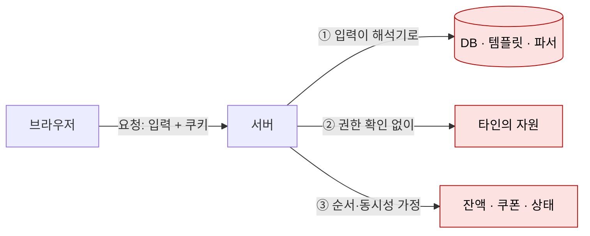

# 웹 취약점 개요

| 레벨 | 상태 | 최종 개정 |
|---|---|---|
| 🟢 | 🔄 개정중 | 2026-10-22 |

> **한눈에 보기**
> 웹 취약점은 대부분 '입력을 코드나 명령으로 해석하는 곳'과 '누가 무엇을 할 수 있는지 확인하지 않는 곳'에서 생긴다. 이 두 축에 '순서와 상태를 잘못 가정하는 곳'을 더해 3부를 묶는다.
> 3부를 읽기 전에 필요한 것은 HTTP 요청 하나를 손으로 읽고 고칠 수 있는 능력뿐이다.

## 1. 세 축

[1부 1장](../part1-foundations/01-what-is-vulnerability.md)의 근본 원인 셋을 웹에 적용하면 3부의 지도가 된다.

| 축 | 깨지는 가정 | 질문 | 장 |
|---|---|---|---|
| **인젝션**(injection) | "이 입력은 데이터다" | 입력이 어떤 **해석기**(DB, 브라우저, 템플릿 엔진, XML 파서, 역직렬화기)에 닿는가 | [1 SQLi](01-sql-injection.md) · [2 XSS](02-xss.md) · [7 역직렬화](07-deserialization.md) · [8 XXE](08-xxe.md) · [9 SSTI](09-ssti.md) |
| **접근 제어**(access control) | "이 요청은 허가된 사용자가 허가된 자원에 보낸 것이다" | 서버가 **누구인지**(인증)와 **해도 되는지**(인가)를 요청마다 확인하는가 | [4 인증·세션](04-auth-session.md) · [5 IDOR·권한 상승](05-access-control.md) · [3 SSRF](03-ssrf.md) · [6 업로드·경로](06-file-upload-path-traversal.md) |
| **로직**(logic) | "단계는 이 순서로, 한 번에 하나씩 일어난다" | 순서를 건너뛰거나, 동시에 두 번 보내거나, 상태를 되돌리면 어떻게 되는가 | [10 경쟁 조건·로직](10-race-condition.md) |

SSRF와 파일 업로드는 "입력이 URL·경로로 해석된다"는 점에서 인젝션이기도 하다. 이 책은 **공격자가 얻는 것**(서버 내부망 접근, 파일 시스템 접근) 기준으로 접근 제어 축에 둔다. 분류는 도구이지 정답이 아니다.



<figure>
<figcaption>그림 1. 요청 하나가 서버 안에서 세 종류의 가정을 만난다. 3부의 각 장은 이 셋 중 하나가 깨지는 지점을 다룬다.</figcaption>
</figure>

## 2. HTTP 복습

3부 전체에서 쓰는 만큼만 복습한다. 더 필요하면 [RFC 9110](https://www.rfc-editor.org/rfc/rfc9110)을 본다.

### 2.1 요청과 응답

```http
POST /login HTTP/1.1
Host: 127.0.0.1:8080
Content-Type: application/x-www-form-urlencoded
Cookie: session=abc123
Content-Length: 27

username=admin&password=x
```

```http
HTTP/1.1 200 OK
Content-Type: text/html; charset=utf-8
Set-Cookie: session=def456; HttpOnly; Secure; SameSite=Lax

<!doctype html>...
```

분석가가 보는 곳은 다섯 군데다. 이 다섯이 **모두 입력**이다.

| 위치 | 예 | 자주 터지는 것 |
|---|---|---|
| 경로 | `/files/../../etc/passwd` | 경로 조작 |
| 쿼리 문자열 | `?id=1`, `?url=http://` | SQLi, IDOR, SSRF |
| 헤더 | `Host`, `X-Forwarded-For`, `User-Agent`, `Referer` | 호스트 헤더 인젝션, 로그 XSS, 접근 제어 우회 |
| 쿠키 | `session=`, `role=` | 세션 고정, 권한 변조 |
| 본문 | 폼, JSON, XML, multipart | 모든 인젝션, XXE, 업로드 |

"사용자가 입력할 수 없는 값"은 없다. 브라우저가 만든 헤더도, 숨은 폼 필드도, 프록시로 고치면 입력이다.

### 2.2 쿠키 속성

| 속성 | 의미 | 없으면 |
|---|---|---|
| `HttpOnly` | JavaScript에서 읽지 못함 | XSS로 세션 탈취 |
| `Secure` | HTTPS에서만 전송 | 평문 구간에서 노출 |
| `SameSite=Lax` / `Strict` | 다른 사이트에서 시작된 요청에 안 붙음 | CSRF. Chrome은 속성이 없으면 Lax로 취급한다 |
| `Domain` / `Path` | 전송 범위 | 서브도메인 간 공유로 범위 확대 |

### 2.3 동일 출처 정책과 CORS

**동일 출처 정책**(Same-Origin Policy, SOP)은 브라우저가 **스킴·호스트·포트**가 모두 같은 출처의 문서만 서로의 응답을 읽게 하는 규칙이다. 요청을 보내는 것 자체는 대개 막지 않는다. **읽기**를 막는다. 이 차이가 CSRF(보내기만 하면 됨)와 XSS(같은 출처에서 실행되니 다 읽음)의 차이다.

| 상황 | 요청 | 응답 읽기 | 쿠키 |
|---|---|---|---|
| ``, `<form>` 제출 (단순 요청) | 보냄 | 못 읽음 | SameSite 규칙에 따라 붙음 |
| `fetch()` 교차 출처, CORS 헤더 없음 | 보냄 | 차단 | `credentials: 'include'` 아니면 안 붙음 |
| `fetch()` + `Access-Control-Allow-Origin: https://a.example` | 보냄 | 읽음 | `Access-Control-Allow-Credentials: true` 가 있어야 붙음 |
| 비단순 요청 (`PUT`, `Content-Type: application/json` 등) | **OPTIONS 사전 요청**(preflight) 먼저 | 서버가 허용하면 | 위와 같음 |
| `Access-Control-Allow-Origin: *` | 보냄 | 읽음 | `*`와 `Credentials: true`는 함께 쓸 수 없다 |

CORS(Cross-Origin Resource Sharing)는 SOP를 **서버가 여는** 장치다. 취약한 CORS는 `Origin` 헤더를 그대로 `Allow-Origin`에 반사하면서 `Allow-Credentials: true`를 주는 설정이다. 그러면 어느 사이트든 로그인 사용자의 응답을 읽는다. [4장](04-auth-session.md)에서 다룬다.

## 3. OWASP Top 10 2021과 이 책의 대응

OWASP Top 10은 가장 널리 쓰이는 웹 위험 분류다. 📎 [OWASP Top 10:2021](https://owasp.org/Top10/2021/) 2021판 기준으로 3부와 대응시킨다.

| OWASP 2021 | 이 책 | 비고 |
|---|---|---|
| A01 Broken Access Control | [5장](05-access-control.md), [4장](04-auth-session.md), [6장](06-file-upload-path-traversal.md) | 경로 조작, CSRF 포함 |
| A02 Cryptographic Failures | [4장](04-auth-session.md) 일부 | 비밀번호 저장, 토큰 생성 |
| A03 Injection | [1장](01-sql-injection.md), [2장](02-xss.md), [9장](09-ssti.md) | XSS가 2021부터 여기 포함 |
| A04 Insecure Design | [10장](10-race-condition.md), [2부 3장 위협 모델링](../part2-methodology/03-threat-modeling.md) | 코드가 아니라 설계 |
| A05 Security Misconfiguration | [8장](08-xxe.md), [5부 2장 클라우드](../part5-extended/02-cloud.md) | XXE가 2021부터 여기 포함 |
| A06 Vulnerable and Outdated Components | [5부 4장 공급망](../part5-extended/04-supply-chain.md) | |
| A07 Identification and Authentication Failures | [4장](04-auth-session.md) | |
| A08 Software and Data Integrity Failures | [7장](07-deserialization.md), [5부 4장](../part5-extended/04-supply-chain.md) | 역직렬화가 2021부터 여기 포함 |
| A09 Security Logging and Monitoring Failures | [8부 3장 탐지 룰](../part8-reporting/03-patch-verification.md) | |
| A10 Server-Side Request Forgery | [3장](03-ssrf.md) | |

2025년에 공개된 **OWASP Top 10:2025**는 A03을 "Software Supply Chain Failures"로 넓히고, SSRF를 A01에 흡수했으며, A10에 "Mishandling of Exceptional Conditions"(예외 처리 오류, 실패 시 열림)를 새로 넣었다. 📎 [OWASP Top 10:2025 Introduction](https://owasp.org/Top10/2025/0x00_2025-Introduction/) 이 책의 장 구성은 유형 기준이라 두 판 어느 쪽으로도 대응된다. 보고서에 OWASP 항목을 적을 때는 **판(2021/2025)을 명시**한다.

## 4. 프록시 준비

3부의 모든 실습은 **요청을 가로채 고쳐 보내는** 것으로 시작한다. 브라우저 개발자 도구로는 재전송과 변조가 불편하다. 프록시가 필요하다.

| 도구 | 특징 | 권장 |
|---|---|---|
| Burp Suite Community | 사실상 표준. Repeater(재전송)·Intruder(반복, Community는 속도 제한) | 3부 기본 도구 |
| OWASP ZAP → ZAP | 무료·오픈소스. 자동 스캔이 기본 탑재 | Burp 대안 |
| mitmproxy | CLI·Python 스크립팅. 자동화에 적합 | 반복 작업을 코드로 만들 때 |

준비 순서는 네 단계다.

1. 프록시를 띄우고 브라우저가 `127.0.0.1:8080`(Burp 기본)을 거치게 한다. 실습 앱도 8080을 쓰므로 **둘 중 하나의 포트를 바꾼다**. Burp 쪽을 8081로 바꾸는 것이 간단하다.
2. 프록시의 CA 인증서를 브라우저에 설치한다. HTTPS 대상이 아니면 생략해도 된다.
3. 실습 앱([1부 5장](../part1-foundations/05-lab-setup.md))에 접속해 요청이 프록시 히스토리에 잡히는지 본다.
4. 요청 하나를 Repeater로 보내 파라미터를 고쳐 재전송한다. 응답이 바뀌면 준비가 끝난 것이다.

프록시 없이 `curl`만으로도 3부 대부분을 할 수 있다. [부록 B](../../appendix/b-cheatsheets.md)의 HTTP 조작 체크리스트가 그 용도다. 도구 상세는 [6부 1장](../part6-tools/01-burp-proxy.md).

## 5. 읽는 순서

- **처음이면** 1장 → 2장 → 5장. 인젝션 하나, 클라이언트 하나, 접근 제어 하나로 세 축을 한 번씩 밟는다.
- **실무자면** 3장 SSRF와 7장 역직렬화. 최근 Critical의 다수가 여기서 나온다.
- **시니어면** 각 장의 7절 우회 기법과 10장.

각 장은 [기준 장인 1장](01-sql-injection.md)과 같은 10개 절 구조다. 4절 실습은 `labs/web-sqli`가 있는 1장을 빼면 [PortSwigger Web Security Academy](https://portswigger.net/web-security) 등 공개 환경의 특정 랩을 지정한다.

## 체크리스트

이 장을 읽고 나면 다음을 할 수 있어야 한다.

- [ ] HTTP 요청에서 입력이 들어오는 다섯 위치를 말할 수 있는가?
- [ ] "요청은 보내지만 응답은 못 읽는다"가 CSRF와 XSS를 어떻게 가르는지 설명할 수 있는가?
- [ ] `Access-Control-Allow-Origin`이 `Origin`을 반사할 때 왜 위험한지 설명할 수 있는가?
- [ ] 프록시로 요청을 잡아 파라미터 하나를 고쳐 재전송할 수 있는가?
- [ ] 보고서에 OWASP 항목을 적을 때 판을 명시하는가?

## 더 읽기

- [RFC 9110 HTTP Semantics](https://www.rfc-editor.org/rfc/rfc9110) · 메서드·헤더·상태 코드의 원전
- [RFC 6265 HTTP State Management Mechanism](https://www.rfc-editor.org/rfc/rfc6265) · 쿠키 명세
- [MDN: Same-origin policy](https://developer.mozilla.org/en-US/docs/Web/Security/Same-origin_policy) · [MDN: CORS](https://developer.mozilla.org/en-US/docs/Web/HTTP/CORS)
- [OWASP Top 10:2021](https://owasp.org/Top10/2021/) · [OWASP Top 10:2025](https://owasp.org/Top10/2025/)
- [PortSwigger Web Security Academy](https://portswigger.net/web-security) · 3부 각 장의 실습 랩
- Dafydd Stuttard, Marcus Pinto, *The Web Application Hacker's Handbook* 2판 (Wiley, 2011) · 오래됐지만 방법론은 그대로

## 변경 이력

| 날짜 | 변경 | 기여자 |
|---|---|---|
| 2026-10-21 | 초안(뼈대) 작성 | @anthonynoh5202 |
| 2026-10-22 | 본문 작성. 세 축, HTTP 복습, OWASP 대응표, 프록시 준비 | @anthonynoh5202 |
