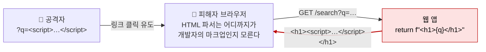

# 크로스 사이트 스크립팅 (XSS)

| 레벨 | 상태 | 최종 개정 | CWE |
|---|---|---|---|
| 🟢 입문 (7절은 🔴) | 🔄 개정중 | 2026-10-22 | [CWE-79](https://cwe.mitre.org/data/definitions/79.html) |

> **한눈에 보기**
> 사용자 입력이 HTML·JavaScript 문맥에 그대로 들어가면, 피해자의 브라우저는 그것을 "데이터"가 아니라 "페이지의 일부"로 실행한다.
> 공격자는 피해자의 브라우저 안에서, 피해자의 권한으로, 피해자가 할 수 있는 모든 작업을 한다.
> 막는 방법은 **문맥에 맞는 출력 인코딩**이고, 두 번째 그물은 **엄격한 CSP**다.

## 1. 원리

XSS는 SQL 인젝션과 같은 인젝션이다. 다만 파서가 DB가 아니라 **피해자의 브라우저**이고, 섞이는 언어가 SQL이 아니라 HTML·JavaScript다. 신뢰 경계(trust boundary)는 서버가 응답 HTML을 조립하는 한 줄, 또는 클라이언트 스크립트가 DOM에 문자열을 꽂는 한 줄에서 무너진다.



<figure>
<figcaption>그림 1. Reflected XSS의 흐름. 서버는 입력을 그대로 되돌려 줄 뿐이고, 코드가 실행되는 곳은 피해자의 브라우저다. 피해자의 쿠키·토큰·권한이 모두 그 브라우저 안에 있다.</figcaption>
</figure>

### 유형

| 유형 | 입력이 어디서 와서 어디로 가는가 | 특징 |
|---|---|---|
| **Reflected** | 요청(쿼리스트링, 폼) → 서버 → 같은 응답 | 피해자가 링크를 클릭해야 한다. 서버 로그에 남는다 |
| **Stored** | 요청 → DB 저장 → 나중에 다른 사용자의 페이지 | 클릭 유도가 필요 없다. 관리자 페이지에 뜨면 영향이 가장 크다 |
| **DOM 기반** | URL 조각(`location.hash`), `postMessage` 등 → 클라이언트 JS → DOM | 서버를 거치지 않을 수 있다. 서버 로그와 WAF에 안 보인다 |

세 유형은 "입력이 어느 경로로 브라우저에 닿는가"의 차이일 뿐, 근본 원인은 같다. **문맥(context)을 모른 채 문자열을 이어 붙였다**는 것이다.

### 문맥이 전부다

같은 입력이라도 어느 위치에 들어가느냐에 따라 "위험한 문자"가 다르다. 그래서 XSS 방어는 "특수문자 제거"가 아니라 **출력 위치에 맞는 인코딩**이다.

| 출력 문맥 | 예 | 경계를 깨는 문자 | 올바른 처리 |
|---|---|---|---|
| HTML 본문 | `<div>{x}</div>` | `<` `>` `&` | HTML 엔티티 인코딩 (`&lt;` `&gt;` `&amp;`) |
| HTML 속성 | `<input value="{x}">` | `"` `'` (따옴표 없으면 공백도) | 속성을 항상 따옴표로 감싸고 `&quot;` `&#x27;` 인코딩 |
| JavaScript 문자열 | `var s = '{x}';` | `'` `\` 줄바꿈 `</script>` | `\xHH` 이스케이프. 더 좋은 방법은 값을 JS에 넣지 않고 `data-*` 속성이나 JSON `<script type="application/json">`으로 넘기고 `</` 를 `<\/` 로 바꾸는 것 |
| URL | `<a href="{x}">` | `javascript:` 스킴 자체 | 스킴을 `http`/`https` 허용 목록으로 검사한 뒤 퍼센트 인코딩 |
| CSS | `<div style="color:{x}">` | `url(` `;` `expression(` | 사용자 입력을 CSS에 넣지 않는다. 꼭 필요하면 허용 목록 값만 |
| 이벤트 핸들러 | `onclick="f('{x}')"` | 두 겹 문맥(HTML 속성 안의 JS) | 쓰지 않는다. `addEventListener`로 분리 |

### 영향: "쿠키 탈취"가 아니라 "권한 있는 작업 수행"

XSS의 영향을 "세션 쿠키 탈취"로만 설명하면 틀린 보고서가 된다. 오늘날 세션 쿠키는 대부분 `HttpOnly`라서 `document.cookie`로 읽을 수 없다. 그러나 스크립트는 **피해자의 브라우저 안에서 피해자의 쿠키가 자동으로 붙는 요청**을 보낼 수 있다. 공격자는 쿠키를 가져갈 필요가 없다. 그 자리에서 쓰면 된다.

- 피해자 권한으로 `fetch('/account/change-email', {method:'POST', …})` 를 보낸다. CSRF 토큰은 같은 출처의 페이지를 `fetch`로 읽어 DOM에서 꺼내면 된다. 즉 **XSS는 모든 CSRF 방어를 무력화한다**.
- 관리자가 보는 페이지의 Stored XSS는 관리자 권한으로 사용자 생성, 설정 변경, 플러그인 업로드를 한다. 웹 앱에서 RCE까지 가는 가장 흔한 경로다.
- 페이지를 통째로 바꿔 가짜 로그인 폼을 띄운다(피싱). 같은 출처, 같은 URL 표시줄이라 사용자가 구분할 수 없다.
- `localStorage`에 저장된 JWT 같은 토큰은 `HttpOnly` 보호가 없으므로 그대로 읽힌다.

## 2. 발생하는 코드 패턴

### 서버 측: 문자열로 HTML 조립

```python
# ❌ 취약: Flask, 입력을 HTML 문자열에 직접 넣는다
from flask import Flask, request
app = Flask(__name__)

@app.route("/search")
def search():
    q = request.args.get("q", "")
    return f"<h1>검색 결과: {q}</h1>"
```

```python
# ✅ 안전: 템플릿 엔진의 자동 이스케이프를 쓴다
from flask import Flask, request, render_template
app = Flask(__name__)

@app.route("/search")
def search():
    return render_template("search.html", q=request.args.get("q", ""))
# templates/search.html:  <h1>검색 결과: {{ q }}</h1>
```

Jinja2(Flask)와 Django 템플릿은 `{{ }}` 출력을 기본으로 HTML 인코딩한다. 그 보호를 끄는 세 가지 구멍이 있다. `{{ q|safe }}`, `Markup(q)`, 그리고 `render_template_string(f"...{q}...")`. 마지막 것은 XSS이면서 동시에 [SSTI](09-ssti.md)다.

```js
// ❌ 취약: Express, 템플릿 리터럴로 응답 조립
app.get('/search', (req, res) => {
  res.send(`<h1>검색 결과: ${req.query.q}</h1>`);
});

// ✅ 안전: 템플릿 엔진의 이스케이프 출력. EJS는 <%= %>가 인코딩, <%- %>는 안 한다
app.get('/search', (req, res) => {
  res.render('search', { q: req.query.q });   // search.ejs: <h1>검색 결과: <%= q %></h1>
});
```

### 클라이언트 측: DOM 싱크

```js
// ❌ 취약: URL 조각을 HTML로 해석하는 싱크에 넣는다
document.getElementById('msg').innerHTML = decodeURIComponent(location.hash.slice(1));

// ✅ 안전: 텍스트로만 넣는다
document.getElementById('msg').textContent = decodeURIComponent(location.hash.slice(1));
```

위험한 싱크(sink): `innerHTML`, `outerHTML`, `document.write()`, `insertAdjacentHTML()`, `eval()`, `setTimeout(문자열)`, `location.href = …`, jQuery의 `.html()`, `$()`에 문자열을 넘기는 경우. 위험한 소스(source): `location.*`, `document.referrer`, `window.name`, `postMessage`의 `event.data`, 서버에서 온 JSON의 문자열 필드.

### 프레임워크의 "일부러 뚫어 둔 문"

React·Vue·Angular는 바인딩 출력을 기본으로 인코딩한다. 문제는 그 보호를 **의도적으로 끄는 API**가 있고, 이름이 경고를 담고 있는데도 자주 쓰인다는 것이다.

```jsx
// ❌ 취약: React
<div dangerouslySetInnerHTML={{ __html: comment.body }} />
// ✅ 안전: 서식이 필요 없으면 그냥 바인딩
<div>{comment.body}</div>
// ✅ 서식(리치 텍스트)이 꼭 필요하면 살균(sanitize) 후에만
<div dangerouslySetInnerHTML={{ __html: DOMPurify.sanitize(comment.body) }} />
```

| 프레임워크 | 안전한 기본 | 보호를 끄는 API |
|---|---|---|
| React | `{value}` | `dangerouslySetInnerHTML`, `href={userUrl}`에 `javascript:` 스킴 |
| Vue | `{{ value }}` | `v-html` |
| Angular | `{{ value }}`, `[innerHTML]`(자동 살균) | `DomSanitizer.bypassSecurityTrustHtml()` 계열 |
| jQuery | `.text()` | `.html()`, `.append(문자열)`, `$(문자열)` |
| Jinja2 / Django | `{{ value }}` | `\|safe`, `Markup()`, `mark_safe()`, `autoescape off` |

`href`, `src`, `action` 속성에 사용자 URL을 바인딩하는 것은 인코딩으로 못 막는다. `javascript:alert(1)`은 인코딩할 특수문자가 없다. **스킴 허용 목록**만이 답이다.

## 3. 탐지 방법

### 3.1 코드 리뷰 / 정적 분석

**grep으로 싱크부터 찾는다.**

```bash
# 클라이언트 JS: HTML 해석 싱크
grep -rnE "\.(innerHTML|outerHTML)\s*=|document\.write\(|insertAdjacentHTML\(|\.html\(" --include='*.js' --include='*.ts' --include='*.jsx' --include='*.tsx' --include='*.vue' .
# 프레임워크의 보호 해제
grep -rnE "dangerouslySetInnerHTML|v-html|bypassSecurityTrust" --include='*.js' --include='*.jsx' --include='*.tsx' --include='*.vue' --include='*.ts' .
# 서버 템플릿의 보호 해제
grep -rnE "\|\s*safe\b|mark_safe\(|Markup\(|autoescape\s+off|<%-" --include='*.py' --include='*.html' --include='*.ejs' .
```

**Semgrep**: 공식 레지스트리의 XSS 룰셋을 쓴다.

```bash
semgrep --config p/xss .
```

**CodeQL**: 소스(요청 파라미터, `location`)에서 싱크(HTML 출력, `innerHTML`)까지 흐름을 추적한다. 기본 쿼리 `js/xss`, `py/reflective-xss`, `java/xss`. [6부 5장](../part6-tools/05-sast-semgrep-codeql.md)에서 실행법을 다룬다.

**리뷰할 때 보는 순서**

1. 출력 지점을 전부 찾는다. 서버는 템플릿의 보호 해제 지점과 문자열로 HTML을 조립하는 곳, 클라이언트는 위 싱크 목록.
2. 각 출력에 들어가는 값이 어디서 왔는지 거슬러 올라간다. DB에서 왔다면 **그 값이 처음 저장될 때 누가 넣었는가**까지 본다(Stored).
3. 중간에 인코딩이 있다면 **출력 문맥과 맞는가**를 확인한다. HTML 인코딩된 값을 JS 문자열이나 `href`에 넣으면 소용없다.
4. 살균 라이브러리를 쓴다면 버전과 설정을 본다. 직접 만든 정규식 필터는 7절의 우회 목록으로 바로 검증한다.

### 3.2 동적 테스트

**1단계: 반사 확인.** 모든 파라미터에 고유한 마커를 넣고 응답에서 찾는다. 마커에는 문맥을 가르는 문자를 전부 포함한다.

```
zx9q"'<>/\
```

응답에서 `zx9q`를 찾고, 뒤따르는 문자 중 **무엇이 인코딩되지 않고 살아남았는가**를 본다. 이것이 다음 단계를 결정한다.

**2단계: 문맥 판단과 페이로드 선택.**

| 반사 위치 | 살아남은 문자 | 시도 |
|---|---|---|
| HTML 본문 | `<>` | `` |
| 따옴표 속성 안 | `"` | `" autofocus onfocus=alert(document.domain) x="` |
| JS 문자열 안 | `'` | `'-alert(document.domain)-'` |
| JS 문자열 안, `'` 인코딩됨 | `</` | `</script>` |
| `href` 속성 | 아무것도 필요 없음 | `javascript:alert(document.domain)` |

`alert(1)` 대신 `alert(document.domain)`을 쓴다. 어느 출처(origin)에서 실행됐는지가 화면에 나오므로, 샌드박스 도메인에서 뜬 것을 본 사이트 XSS로 착각하지 않는다.

**3단계: DOM 기반은 따로 본다.** 서버 응답에 마커가 없어도 끝이 아니다. 브라우저 개발자 도구에서 `location.hash`, `location.search`, `window.name`을 읽는 코드를 찾고, 그 값이 어느 싱크로 가는지 따라간다. Burp Suite의 **DOM Invader**가 소스→싱크 흐름을 자동으로 표시해 준다([6부 1장](../part6-tools/01-burp-proxy.md)).

**자동화와 수동의 분담**: 스캐너(Burp Scanner, ZAP)는 Reflected를 넓게 찾는다. Stored는 "입력한 곳"과 "출력되는 곳"이 다르고 시간차가 있어 스캐너가 놓치기 쉽다. 입력 지점마다 고유 마커를 넣고, 관리자 페이지·이메일·PDF 내보내기 같은 **다른 사용자가 보는 모든 화면**을 사람이 확인해야 한다.

## 4. 실습 🧪

PortSwigger Web Security Academy의 XSS 랩을 쓴다. 무료이고 브라우저만 있으면 된다. [XSS 랩 목록](https://portswigger.net/web-security/cross-site-scripting)에서 다음 순서로 푼다.

| 순서 | 랩 | 배우는 것 |
|---|---|---|
| 1 | Reflected XSS into HTML context with nothing encoded | 가장 단순한 형태. 3.2의 1~2단계 |
| 2 | Stored XSS into HTML context with nothing encoded | 입력 지점과 출력 지점이 다르다 |
| 3 | DOM XSS in `document.write` sink using source `location.search` | 서버를 거치지 않는 XSS |
| 4 | DOM XSS in `innerHTML` sink using source `location.search` | `innerHTML`에서는 `<script>`가 실행되지 않는다. ``를 쓴다 |
| 5 | Reflected XSS into attribute with angle brackets HTML-encoded | 속성 문맥. `<`가 막혀도 `"`로 나간다 |
| 6 | Reflected XSS into a JavaScript string with angle brackets HTML encoded | JS 문자열 문맥 |
| 7 | Exploiting cross-site scripting to steal cookies | `HttpOnly`가 없을 때의 영향 |
| 8 | Exploiting XSS to perform CSRF | **이 장의 핵심**. 쿠키 없이 피해자 권한으로 작업 수행 |
| 9 | Reflected XSS protected by CSP, with CSP bypass | 7절. CSP가 있어도 설계가 틀리면 뚫린다 |

랩마다 "Exploit server"가 있어 피해자에게 보낼 페이지를 올릴 수 있다. 실제 서비스의 사용자에게 페이로드를 보내는 것은 어떤 명분으로도 허가 범위 밖이다.

**로컬에서 10줄로 재현하기.** 2절의 취약한 Flask 코드를 `app.py`로 저장하고 실행하면 `http://127.0.0.1:5000/search?q=`에서 바로 뜬다. `render_template`로 바꾸고 같은 URL이 `&lt;img …&gt;`로 보이는지 확인하는 것까지가 실습이다.

```bash
pip install flask && flask --app app run
```

## 5. 익스플로잇 검증

`alert`가 떴다는 것은 "스크립트가 실행된다"는 존재 증명일 뿐이다. 심각도를 정하려면 **그 스크립트로 무엇을 할 수 있는가**를 실습 환경 안에서 한 단계씩 올린다.

| 단계 | 확인 | 심각도에 미치는 영향 |
|---|---|---|
| 1 | `alert(document.domain)`이 대상 출처에서 뜬다 | 존재 확인 |
| 2 | 누가 보는 페이지인가: 본인만(Self-XSS), 임의 사용자(Reflected), 모든 사용자 또는 관리자(Stored) | 피해자 범위. Self-XSS는 보통 Informational |
| 3 | 피해자 권한으로 상태 변경 요청이 성공한다 (이메일·비밀번호 변경, 글 작성) | 계정 탈취 수준. High |
| 4 | 관리자 문맥에서 사용자 권한 변경·설정 변경·파일 업로드가 된다 | 시스템 장악. Critical |
| 5 | `document.cookie`에 세션이 보인다 (`HttpOnly` 없음) | 3단계를 더 쉽게 만든다. 단독으로 심각도를 올리진 않는다 |

3단계 증명은 외부로 데이터를 보낼 필요가 없다. 같은 출처에 `fetch`를 보내고 응답을 `console.log`로 보여 주는 것으로 충분하다. 보고서에는 "쿠키를 훔쳤다"가 아니라 "피해자 권한으로 X를 수행했다"고 쓴다. 영향도 산정 기준은 [8부 2장](../part8-reporting/02-severity.md)을 따른다.

## 6. 방어

| 계층 | 조치 | 효과 |
|---|---|---|
| 코드 | **출력 문맥에 맞는 인코딩**. 템플릿 엔진의 자동 이스케이프를 끄지 않는다 | 근본 제거 |
| 코드 | 리치 텍스트는 살균 라이브러리(DOMPurify, 서버는 언어별 HTML 살균기)로. 직접 만든 정규식 필터 금지 | 허용 마크업만 통과 |
| 코드 | URL 속성은 스킴 허용 목록(`http`, `https`) | `javascript:` 차단 |
| 프레임워크 | `dangerouslySetInnerHTML`·`v-html`·`bypassSecurityTrust*`·`\|safe`를 린트로 막고 예외는 리뷰 필수 | 기본값으로 차단 |
| 프레임워크 | **Trusted Types** (`Content-Security-Policy: require-trusted-types-for 'script'`) | DOM 싱크에 문자열 대입 자체를 브라우저가 거부 |
| 인프라 | **엄격한 CSP**: nonce 기반 + `'strict-dynamic'`, `object-src 'none'`, `base-uri 'none'` | 인젝션이 있어도 실행을 막는 두 번째 그물 |
| 인프라 | 쿠키 `HttpOnly`, `Secure`, `SameSite` | 5단계 영향 축소. 3단계는 못 막는다 |
| 탐지 | CSP `report-to`로 위반 보고 수집. 사용자 입력 지점의 `<`·`on*=` 패턴 로그 | 사후 대응 |

**CSP는 이렇게 쓴다.** 호스트 허용 목록 방식(`script-src cdn.example.com`)은 7절에서 보듯 거의 항상 우회된다. 요청마다 난수 nonce를 만들어 모든 `<script>`에 붙이고, 그 스크립트가 동적으로 불러오는 것은 `'strict-dynamic'`으로 신뢰를 전파한다.

```http
Content-Security-Policy: script-src 'nonce-{요청마다 새 난수}' 'strict-dynamic'; object-src 'none'; base-uri 'none'
```

nonce는 요청마다 CSPRNG로 새로 만들고, 응답 HTML 안에서 사용자 입력이 nonce 값 근처에 반사되지 않는지 확인한다. 배포 전에 Google의 [CSP Evaluator](https://csp-evaluator.withgoogle.com/)에 정책을 넣어 본다.

**하지 말아야 할 것**

- 입력 시점의 필터링(`<script>` 제거)에 의존하는 것. 출력 문맥마다 위험 문자가 다르므로 입력에서 다 걸러낼 수 없고, 필터는 우회된다.
- "`<`와 `>`만 인코딩하면 된다"는 생각. 속성·JS·URL 문맥에서는 소용없다.

## 7. 우회 기법 🔴

방어가 불완전할 때 공격자가 어디로 돌아가는지. **왜 블랙리스트와 호스트 허용 목록 CSP가 안 되는지**를 이해하기 위해 읽는다.

### 필터 우회

| 방어 | 우회 |
|---|---|
| `<script>` 차단 | ``, `<svg onload=…>`, `<details open ontoggle=…>`, `<body onload=…>` 등 이벤트 핸들러 수백 개 |
| `on` 으로 시작하는 속성 차단 | 대소문자 `OnError`, 속성 이름과 `=` 사이 공백·개행·`/` (``) |
| `alert`, `(` `)` 차단 | 템플릿 리터럴 `alert\`1\``, `throw` + `onerror=alert` 조합, `location=name` 류 |
| `javascript:` 차단 | HTML 엔티티 `java&#x09;script:`, `&#106;avascript:` (href 속성 안에서는 엔티티가 먼저 디코딩된다) |
| 공백 차단 | `/` 로 대체 `<svg/onload=…>` |
| 한 번만 치환 (`replace('<script>', '')`) | `<scr<script>ipt>` 처럼 제거 후 남는 문자열로 조립 |

목록이 길어지는 것 자체가 교훈이다. 브라우저의 HTML 파서는 관대하게 설계되어 있어 "위험한 문자열"을 열거하는 접근은 끝이 없다. PortSwigger의 [XSS cheat sheet](https://portswigger.net/web-security/cross-site-scripting/cheat-sheet)가 브라우저별 동작을 가장 넓게 정리해 둔다.

### 살균기 우회 (mXSS)

살균기가 본 DOM과 브라우저가 최종적으로 만든 DOM이 다르면 뚫린다. 살균기가 안전하다고 판단한 마크업을 `innerHTML`로 다시 직렬화·파싱하는 과정에서 구조가 바뀌는(mutation) 현상을 이용한다. `<svg>`·`<math>` 안의 네임스페이스 전환, `<noscript>`, `<template>` 주변이 단골이다. DOMPurify도 여러 차례 이런 우회가 보고되어 패치됐으므로, **살균 라이브러리는 항상 최신 버전**이어야 한다. jQuery 3.5.0 이전의 `htmlPrefilter`(8절 CVE-2020-11023)도 같은 종류다.

### CSP 우회

| CSP 설계 결함 | 우회 |
|---|---|
| `script-src 'unsafe-inline'` | 인라인 스크립트가 그냥 실행된다. CSP가 없는 것과 같다 |
| 호스트 허용 목록에 JSONP 엔드포인트가 있는 도메인 | `<script src="https://허용도메인/api?callback=alert(1)//">`. 응답이 `alert(1)//({…})` 로 와서 실행된다 |
| 허용 도메인에서 AngularJS 같은 프레임워크를 제공 | 프레임워크를 불러와 `ng-app` 디렉티브로 표현식 실행 (script gadget) |
| nonce를 쓰지만 `base-uri` 누락 | `<base href="//공격자/">` 로 상대 경로 스크립트의 출처를 바꾼다 |
| nonce가 응답마다 같다 / 예측 가능 | nonce를 그대로 붙여 넣는다 |
| `'strict-dynamic'` 없이 nonce만 | 신뢰된 스크립트가 동적으로 추가하는 스크립트가 막혀 개발자가 결국 `'unsafe-inline'`을 추가하게 된다 |
| `object-src` 누락 | 구형 브라우저에서 플러그인 콘텐츠로 우회 |
| 스크립트 실행은 막았지만 마크업 인젝션은 남음 | **dangling markup**: `` 등을 이용해 살균된 입력이 다시 실행 가능 마크업으로 변함. 2025년 1월 CISA KEV 등재 | [jQuery 블로그](https://blog.jquery.com/2020/04/10/jquery-3-5-0-released/) |
| [CVE-2022-27926](https://nvd.nist.gov/vuln/detail/CVE-2022-27926) | Zimbra Collaboration 9.0 | `/public/launchNewWindow.jsp`의 Reflected XSS. Winter Vivern(TA473)이 유럽 정부·군 기관의 웹메일 자격 증명 수집에 악용 | [Zimbra 권고](https://wiki.zimbra.com/wiki/Zimbra_Security_Advisories) |
| [CVE-2023-43770](https://nvd.nist.gov/vuln/detail/CVE-2023-43770) | Roundcube < 1.6.3 | text/plain 메일의 링크를 HTML로 바꾸는 `rcube_string_replacer`에서 Stored XSS. 메일을 열기만 하면 실행. 2024년 2월 CISA KEV 등재 | [1.6.3 릴리스](https://github.com/roundcube/roundcubemail/releases/tag/1.6.3) |
| [CVE-2024-37383](https://nvd.nist.gov/vuln/detail/CVE-2024-37383) | Roundcube < 1.5.7, 1.6.x < 1.6.7 | SVG `<animate attributeName="href">`를 걸러내는 검사가 값 끝의 공백(`"href "`)을 처리하지 못해 Stored XSS. 피싱 메일로 정부 기관 공격에 악용 | [1.6.7 릴리스](https://github.com/roundcube/roundcubemail/releases/tag/1.6.7) |

**PDF.js (CVE-2024-4367) 에서 배울 것**: XSS는 "웹 폼"에서만 나오지 않는다. 데이터를 코드로 컴파일하는 모든 경로가 싱크다. 패치는 `FontMatrix` 값이 숫자 배열인지 검사하도록 바꿨다(권고문·분석 기준). PDF.js를 내장한 수많은 웹·Electron 앱이 같이 영향을 받았다는 점에서 공급망 문제이기도 하다.

**jQuery (CVE-2020-11023) 에서 배울 것**: 살균 후에 문자열을 **다시 가공하는 코드**가 있으면 살균은 무효가 된다. 패치는 3.5.0에서 `htmlPrefilter`의 자동 닫는 태그 변환을 제거했다. 5년 뒤 KEV에 오른 것은 오래된 jQuery를 안 바꾸는 사이트가 그만큼 많다는 뜻이다.

**Roundcube 두 건에서 배울 것**: 둘 다 "살균하는 코드가 있었는데 한 경우를 놓친" 사례다. 2024년 건은 `attributeName="href"`를 걸러내되 `attributeName="href "`(끝에 공백)는 통과시켰다. 패치는 속성 값을 `trim`한 뒤 비교하도록 바꿨다(`rcube_washtml.php` 패치 커밋 기준). 정규식 기반 살균이 왜 위험한지 보여 주는 교과서적 예다. 두 건 모두 국가 배후 그룹이 웹메일 자격 증명 수집에 썼고, Stored XSS 하나가 조직 전체의 이메일로 이어졌다.

## 9. 체크리스트

**코드 리뷰할 때**
- [ ] 템플릿 자동 이스케이프가 켜져 있고, 끄는 지점(`|safe`, `v-html`, `dangerouslySetInnerHTML`, `bypassSecurityTrust*`)마다 정당한 이유와 살균이 있는가?
- [ ] 문자열 연결로 HTML을 만드는 코드가 있는가?
- [ ] `innerHTML`·`document.write`·`.html()` 싱크에 들어가는 값의 출처를 추적했는가?
- [ ] `href`·`src`에 사용자 URL이 들어가면 스킴 허용 목록이 있는가?
- [ ] JS 안에 서버 값을 넣을 때 `</script>`와 줄바꿈을 처리하는가? (`data-*` 속성이나 JSON 블록으로 넘기는 것이 더 낫다)
- [ ] 살균 라이브러리 버전이 최신인가?

**테스트할 때**
- [ ] 모든 파라미터(쿼리, 폼, JSON 필드, 헤더, 파일명, 업로드 파일 내용)에 마커를 넣고 반사 위치와 살아남은 문자를 기록했는가?
- [ ] Stored 입력이 나타나는 **다른 사용자·관리자 화면, 이메일, 내보내기 파일**을 확인했는가?
- [ ] `location.hash`·`postMessage`를 읽는 클라이언트 코드를 봤는가? (DOM Invader)
- [ ] CSP가 있다면 CSP Evaluator에 넣어 봤고, 허용 도메인의 JSONP·프레임워크를 확인했는가?
- [ ] `alert`에서 멈추지 않고 5절 3단계(권한 있는 작업)까지 증명했는가?

**배포 전**
- [ ] CSP가 nonce + `'strict-dynamic'` + `object-src 'none'` + `base-uri 'none'`인가? `'unsafe-inline'`이 없는가?
- [ ] 세션 쿠키에 `HttpOnly`, `Secure`, `SameSite`가 있는가?
- [ ] SAST(Semgrep `p/xss`, CodeQL)가 CI에 있는가?

## 10. 더 읽기

- [CWE-79](https://cwe.mitre.org/data/definitions/79.html) · 공식 정의. 하위 유형 CWE-80(기본 XSS), CWE-83(속성), CWE-87(대체 문법)
- [OWASP XSS Prevention Cheat Sheet](https://cheatsheetseries.owasp.org/cheatsheets/Cross_Site_Scripting_Prevention_Cheat_Sheet.html) · 문맥별 인코딩 규칙의 표준 참고
- [OWASP DOM based XSS Prevention Cheat Sheet](https://cheatsheetseries.owasp.org/cheatsheets/DOM_based_XSS_Prevention_Cheat_Sheet.html) · 소스·싱크 목록
- [W3C Content Security Policy Level 3](https://www.w3.org/TR/CSP3/) · `'strict-dynamic'`, `nonce`, `report-to`의 규격
- Weichselbaum, Spagnuolo, Lekies, Janc, [*CSP Is Dead, Long Live CSP!*](https://research.google.com/pubs/archive/45542.pdf), ACM CCS 2016 · 호스트 허용 목록이 왜 실패하는지에 대한 원 논문
- [web.dev: Strict CSP](https://web.dev/articles/strict-csp) · nonce 기반 정책 배포 가이드 (Google)
- [DOMPurify](https://github.com/cure53/DOMPurify) · 클라이언트 HTML 살균기. 릴리스 노트의 우회 이력이 mXSS 교재다
- [PortSwigger XSS cheat sheet](https://portswigger.net/web-security/cross-site-scripting/cheat-sheet) · 브라우저별 이벤트 핸들러·태그 동작 표 (실습 환경에서만)

## 변경 이력

| 날짜 | 변경 | 기여자 |
|---|---|---|
| 2026-10-21 | 초안(뼈대) 작성 | @anthonynoh5202 |
| 2026-10-22 | 10섹션 본문 작성. 문맥별 인코딩, CSP 설계·우회, 프레임워크 구멍, CVE 5건 | @anthonynoh5202 |
| 2026-10-22 | 기술 검증: CVE 5건 레코드 대조(전부 실존). Roundcube CVE-2024-37383 결함·패치 설명을 패치 커밋(속성 값 trim) 기준으로 정정, Django 템플릿을 Jinja2로 묶은 서술 수정. Flask 예제 2종 실행 확인 | 검증팀 |
