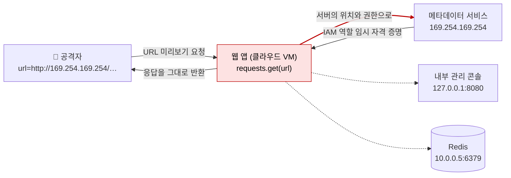

# 서버 측 요청 위조 (SSRF)

| 레벨 | 상태 | 최종 개정 | CWE |
|---|---|---|---|
| 🟡 실무 (7절은 🔴) | 🔄 개정중 | 2026-10-22 | [CWE-918](https://cwe.mitre.org/data/definitions/918.html) |

> **한눈에 보기**
> 서버가 사용자가 지정한 URL로 요청을 보내면, 공격자는 서버의 **위치**(내부망 안)와 **권한**(클라우드 역할, 방화벽 예외)을 빌려 쓴다.
> 가장 흔한 결말은 클라우드 메타데이터 서비스에서 임시 자격 증명을 꺼내 스토리지 전체를 가져가는 것이다.
> 막는 핵심은 **목적지 허용 목록**과 **네트워크 분리**이고, 클라우드에서는 **IMDSv2 강제**가 피해 범위를 결정한다.

## 1. 원리

SSRF는 "내부망에서 오는 요청은 믿는다"는 가정이 깨지는 취약점이다. 내부 서비스는 보통 인증이 약하거나 없다. 방화벽이 외부를 막아 주기 때문이다. 그런데 웹 앱이 사용자가 준 URL을 그대로 가져오면, 웹 앱이 **공격자의 프록시**가 된다. 신뢰 경계는 "외부 vs 내부"가 아니라 "URL을 받는 코드 한 줄"에 있다.



<figure>
<figcaption>그림 1. 공격자는 방화벽 밖에 있지만, 웹 앱이 대신 요청을 보낸다. 메타데이터 서비스는 "같은 VM에서 온 요청"만 보고 자격 증명을 내준다.</figcaption>
</figure>

### 어디서 생기는가

URL을 입력받아 서버가 가져오는 모든 기능이 후보다. 웹훅(webhook) 등록, 링크 미리보기, 아바타·이미지 URL 가져오기, URL로 파일 가져오기(import), HTML을 PDF로 변환하는 렌더러, SSO 설정의 메타데이터 URL(SAML·OIDC discovery), XML 외부 개체([XXE](08-xxe.md)는 SSRF의 한 통로다), 그리고 리버스 프록시·WAF 자체의 라우팅 로직.

### 유형

| 유형 | 응답을 어떻게 보는가 | 난이도 |
|---|---|---|
| 일반(full response) | 서버가 가져온 내용을 그대로 돌려준다 | 🟢 |
| 반(半)블라인드 | 본문은 안 보이지만 상태 코드·에러 메시지·응답 시간이 다르다 | 🟡 |
| 블라인드 | 아무 차이도 없다. 외부(OOB) 콜백으로만 확인한다 | 🔴 |

### 클라우드 메타데이터: 왜 SSRF가 Critical이 되는가

클라우드 VM은 링크 로컬 주소 `169.254.169.254`의 메타데이터 서비스에서 자기 설정과 **역할의 임시 자격 증명**을 받는다. 이 서비스는 네트워크 위치로만 신뢰를 판단한다. 그래서 VM 안의 어떤 프로세스든, 그 프로세스를 조종하는 누구든 자격 증명을 꺼낼 수 있다.

| 클라우드 | 자격 증명 경로 | 요구 사항 |
|---|---|---|
| AWS IMDSv1 | `GET http://169.254.169.254/latest/meta-data/iam/security-credentials/<역할명>` | 없음. **GET 하나면 끝** |
| AWS IMDSv2 | 먼저 `PUT http://169.254.169.254/latest/api/token` + 헤더 `X-aws-ec2-metadata-token-ttl-seconds: 21600` → 받은 토큰을 `X-aws-ec2-metadata-token` 헤더로 | PUT 메서드, 커스텀 헤더, 응답 hop limit 기본 1, `X-Forwarded-For`가 있으면 거부 |
| GCP | `GET http://metadata.google.internal/computeMetadata/v1/instance/service-accounts/default/token` | 헤더 `Metadata-Flavor: Google` 필수 |
| Azure | `GET http://169.254.169.254/metadata/identity/oauth2/token?api-version=2018-02-01&resource=https://management.azure.com/` | 헤더 `Metadata: true` 필수 |

IMDSv1과 나머지의 차이가 핵심이다. 흔한 SSRF는 **메서드와 헤더를 바꿀 수 없다**. URL만 바꿀 수 있다. 그래서 GET 하나로 자격 증명을 주는 IMDSv1은 SSRF 한 방에 뚫리고, PUT이나 커스텀 헤더를 요구하는 나머지는 "헤더까지 제어할 수 있는 SSRF"(7절)가 필요하다. AWS는 2019년 11월에 IMDSv2를 내놓으며 그 목적이 "열린 WAF, 열린 리버스 프록시, 패치 안 된 SSRF"에 대한 심층 방어라고 밝혔다 ([AWS Security Blog, 2019](https://aws.amazon.com/blogs/security/defense-in-depth-open-firewalls-reverse-proxies-ssrf-vulnerabilities-ec2-instance-metadata-service/)).

**Capital One, 2019.** AWS에서 운영하던 WAF의 설정 오류로 공격자가 WAF를 통해 메타데이터 서비스에 요청을 보낼 수 있었고, WAF에 붙은 IAM 역할의 임시 자격 증명을 받아 S3에서 신용카드 신청 데이터를 가져갔다. 미국 약 1억 명, 캐나다 약 600만 명이 영향을 받았다 📎 ([KrebsOnSecurity, 2019](https://krebsonsecurity.com/2019/07/capital-one-data-theft-impacts-106m-people/)). 당시 메타데이터 서비스는 IMDSv1이었고, 이 사건 몇 달 뒤 IMDSv2가 나왔다. 이 장에서 가장 중요한 사례다. SSRF 자체는 Medium으로 보일 수 있지만, **서버가 어떤 권한을 갖고 있는가**가 심각도를 정한다.

## 2. 발생하는 코드 패턴

```python
# ❌ 취약: 사용자가 준 URL을 그대로 가져온다 (링크 미리보기)
import requests
from flask import Flask, request
app = Flask(__name__)

@app.route("/preview")
def preview():
    url = request.args.get("url")
    r = requests.get(url, timeout=5)        # 리다이렉트도 자동으로 따라간다
    return r.text[:2000]
```

```python
# ❌ 취약: "검증"이 있지만 틀렸다
if url.startswith("https://img.example.com"):   # https://img.example.com.evil.net 통과
    ...
if "169.254.169.254" not in url:                 # 10진수·IPv6·DNS로 우회 (7절)
    ...
```

```python
# ✅ 안전: 스킴·호스트·해석된 IP를 검사하고, 리다이렉트는 직접 따라가며 매번 다시 검사한다
import ipaddress, socket
from urllib.parse import urlparse
import requests

ALLOWED_HOSTS = {"img.example.com", "cdn.example.com"}   # 가능하면 허용 목록

def is_public_ip(ip: str) -> bool:
    a = ipaddress.ip_address(ip)
    return not (a.is_private or a.is_loopback or a.is_link_local
                or a.is_multicast or a.is_reserved or a.is_unspecified)

def safe_fetch(url: str, hops: int = 3) -> requests.Response:
    for _ in range(hops):
        p = urlparse(url)
        if p.scheme not in ("http", "https") or p.hostname is None:
            raise ValueError("scheme/host")
        if p.hostname not in ALLOWED_HOSTS:
            raise ValueError("host not allowed")
        addrs = {ai[4][0] for ai in socket.getaddrinfo(p.hostname, None)}
        if not addrs or not all(is_public_ip(a) for a in addrs):
            raise ValueError("resolves to internal address")
        r = requests.get(url, timeout=5, allow_redirects=False)
        if r.is_redirect:
            url = r.headers["Location"]          # 다음 홉도 같은 검사를 받는다
            # 상대 경로 Location('/next')은 처리하지 않는다. 실제 코드에서는
            # urljoin(r.url, ...)으로 절대 URL로 만든 뒤 같은 검사를 거친다
            continue
        return r
    raise ValueError("too many redirects")
```

이 코드도 완벽하지 않다. `getaddrinfo`로 검사한 IP와 `requests`가 실제 연결할 때 다시 조회하는 IP가 다를 수 있다(DNS 리바인딩, 7절). 애플리케이션 코드만으로 SSRF를 완전히 막기는 어렵다. 그래서 6절의 **네트워크 계층 방어**가 반드시 같이 가야 한다.

```js
// ❌ 취약: Node, 웹훅 URL을 그대로 호출
app.post('/webhooks', async (req, res) => {
  const r = await fetch(req.body.url, { method: 'POST', body: JSON.stringify(event) });
  res.json({ status: r.status });
});
// ✅ 안전의 방향: URL 객체로 파싱 → 스킴·호스트 허용 목록 → DNS 해석 결과 검사 →
//    redirect: 'manual' 로 홉마다 재검사 → 가능하면 egress 프록시를 통해서만 나간다
```

## 3. 탐지 방법

### 3.1 코드 리뷰 / 정적 분석

**grep으로 "서버가 요청을 보내는 함수"를 전부 찾는다.** 그 인자가 사용자 입력에서 오는지 거슬러 올라간다.

```bash
# Python
grep -rnE "(requests|httpx)\.(get|post|request)\(|urllib\.request\.urlopen\(|urlopen\(" --include='*.py' .
# Node
grep -rnE "\b(fetch|axios|got|superagent)\s*\(|http[s]?\.(get|request)\(" --include='*.js' --include='*.ts' .
# Java
grep -rnE "new URL\(|openConnection\(|HttpClient|RestTemplate|WebClient" --include='*.java' .
# PHP
grep -rnE "curl_exec\(|file_get_contents\(\s*\\\$|fopen\(\s*\\\$" --include='*.php' .
```

**Semgrep**: OWASP Top 10 룰셋에 언어별 SSRF 룰이 들어 있다.

```bash
semgrep --config p/owasp-top-ten .
```

**CodeQL**: `py/full-ssrf`, `py/partial-ssrf`, `java/ssrf`, `js/request-forgery`. "partial"은 호스트는 고정이고 경로만 사용자 제어인 경우다. 경로만 제어해도 `../`와 `@`, `#`로 호스트를 바꿀 수 있는 파서가 있으므로 무시하지 않는다.

**리뷰할 때 보는 것**

1. 요청 함수의 URL 인자가 리터럴인가, 조립된 것인가.
2. 조립된 값에 검증이 있다면 **스킴·호스트·해석된 IP** 세 가지를 다 보는가. 문자열 `startswith`·`contains`·정규식은 7절의 우회에 거의 다 무너진다.
3. 리다이렉트를 자동으로 따라가는가(`requests`의 기본값은 따라간다).
4. 검증 후 실제 연결까지 DNS를 다시 조회하는가.
5. 그 서버가 **어디서 실행되는가**. 클라우드 VM이면 메타데이터 접근이 가능한지, IMDSv2가 강제되는지가 영향도를 정한다.

### 3.2 동적 테스트

**1단계: URL을 받는 모든 지점을 찾는다.** 쿼리·폼·JSON 필드만이 아니다. `Referer`·`X-Forwarded-Host` 같은 헤더, XML·SVG·PDF 안의 URL, OAuth `redirect_uri`, 프로필 이미지 URL도 포함한다.

**2단계: OOB 콜백으로 존재를 확인한다.** 각 지점에 자기만의 콜백 도메인을 넣는다. Burp Collaborator나 [interactsh](https://github.com/projectdiscovery/interactsh) 같은 OOB 서버를 쓴다. DNS 조회만 와도 "서버가 그 이름을 해석했다"는 증거이고, HTTP 요청까지 오면 User-Agent로 어떤 라이브러리가 요청하는지도 알 수 있다. **블라인드 SSRF는 이 단계로만 찾을 수 있다.**

```
url=http://<고유값>.<내 OOB 도메인>/
```

**3단계: 루프백과 내부 포트를 두드린다.** 응답 본문·상태 코드·시간을 비교한다.

| 입력 | 기대 |
|---|---|
| `http://127.0.0.1:80/` | 자기 자신의 웹 페이지가 돌아오면 full-response SSRF |
| `http://127.0.0.1:22/` | SSH 배너나 "connection reset" 류 에러. 열린 포트와 닫힌 포트의 에러가 다르면 포트 스캔 가능 |
| `http://127.0.0.1:1/` (닫힌 포트) | 즉시 실패. 열린 포트와 응답 시간이 다르면 반블라인드 |
| `http://169.254.169.254/latest/meta-data/` | 디렉터리 목록이 보이면 AWS. `Metadata-Flavor` 없이 403이면 GCP 가능성 |

**4단계: 메타데이터 경로를 확인한다.** 1절 표의 경로를 순서대로. 응답이 보이지 않아도 3단계의 시간·에러 차이로 "도달 여부"는 알 수 있다.

**자동화의 역할**: 스캐너는 2단계(OOB 콜백)를 모든 파라미터에 넓게 뿌리는 데 유용하다. 3·4단계는 대상 환경(클라우드 종류, 내부 서비스)에 따라 사람이 골라야 한다.

## 4. 실습 🧪

PortSwigger Web Security Academy의 [SSRF 랩](https://portswigger.net/web-security/ssrf)을 다음 순서로 푼다.

| 순서 | 랩 | 배우는 것 |
|---|---|---|
| 1 | Basic SSRF against the local server | 재고 확인 API의 URL을 `http://localhost/admin`으로. full-response SSRF |
| 2 | Basic SSRF against another back-end system | 내부 대역 `192.168.0.X:8080`을 스캔해 관리 콘솔 찾기 (Burp Intruder) |
| 3 | Blind SSRF with out-of-band detection | `Referer` 헤더가 SSRF 지점. Collaborator로만 확인 |
| 4 | SSRF with blacklist-based input filter | `127.1`, `localhost` 대소문자, 이중 URL 인코딩 (7절) |
| 5 | SSRF with whitelist-based input filter | `@`·`#`·URL 인코딩으로 파서 혼동 (7절) |
| 6 | SSRF with filter bypass via open redirection vulnerability | 허용된 호스트의 open redirect를 거쳐 내부로 |

**로컬에서 재현하기.** 터미널 두 개면 된다. 하나는 "내부 서비스" 역할, 하나는 2절의 취약한 `preview` 앱이다.

```bash
# 터미널 1: 루프백에만 묶인 내부 서비스 (외부에서는 못 본다)
mkdir -p /tmp/internal && echo "SECRET=internal-only" > /tmp/internal/secret.txt
python3 -m http.server 8081 --bind 127.0.0.1 --directory /tmp/internal
# 터미널 2: 2절의 ❌ 코드를 app.py로 저장하고
pip install flask requests && flask --app app run --port 5000
```

브라우저에서 `http://127.0.0.1:5000/preview?url=http://127.0.0.1:8081/secret.txt` 를 열면 외부에서 접근할 수 없어야 할 파일이 보인다. 이어서 `url=http://2130706433:8081/secret.txt`(10진수 IP)와 `url=http://127.0.0.1.nip.io:8081/secret.txt`(공용 DNS)로도 되는지 확인한다. nip.io는 외부 DNS 조회가 되어야 풀리므로, 외부 DNS가 막힌 망에서는 이 셋째 입력만 실패한다(실습 앱의 문제가 아니다). 마지막으로 `safe_fetch`로 바꾸고 셋 다 막히는지 본다. **고치는 것까지가 실습이다.**

## 5. 익스플로잇 검증

"서버가 외부로 DNS 조회를 했다"와 "클라우드 계정 전체가 넘어간다"는 심각도가 전혀 다르다. 허가 범위 안에서 다음 단계까지 올라가며 어디서 멈추는지 기록한다.

| 단계 | 확인 | 심각도에 미치는 영향 |
|---|---|---|
| 1 | OOB 콜백이 온다 | 존재 확인. 단독이면 Low~Medium |
| 2 | 루프백·내부 대역의 응답이 돌아온다 (또는 포트별 시간·에러 차이) | 내부 포트 스캔, 내부 서비스 노출. Medium~High |
| 3 | 인증 없는 내부 서비스(관리 콘솔, Elasticsearch, 내부 API)에 읽기·쓰기가 된다 | 그 서비스의 영향도를 따른다. High |
| 4 | 메타데이터에서 자격 증명이 나온다 | 클라우드 계정 침해. **Critical** |
| 5 | 그 자격 증명이 실제로 무엇을 할 수 있는가 | 영향 범위 확정 |

5단계는 허가받은 범위에서만, **최소한의 읽기 전용 호출**로 한다. `aws sts get-caller-identity`는 어떤 역할인지만 보여 주고 아무것도 바꾸지 않는다. 그 이상(S3 목록, 데이터 다운로드)은 보고서에 "가능함"으로 적고 실제로 하지 않는다. Capital One 사건에서 공격자가 한 일을 분석가가 따라 할 필요는 없다. 임시 자격 증명은 **테스트가 끝나면 즉시 고객에게 알려 역할을 교체**하게 한다.

## 6. 방어

| 계층 | 조치 | 효과 |
|---|---|---|
| 코드 | **목적지 허용 목록** (호스트 단위). 안 되면 스킴·호스트·해석된 IP 세 가지 검사 | 근본 제거에 가장 가깝다 |
| 코드 | 리다이렉트 자동 추적 끄기, 홉마다 재검사. 스킴은 `http`/`https`만 | 리다이렉트·`file://`·`gopher://` 차단 |
| 코드 | 응답을 그대로 돌려주지 않는다. 필요한 필드만 파싱해서 반환 | full-response를 블라인드로 낮춘다 |
| 프레임워크 | 외부 요청을 전담하는 **egress 프록시**(예: Stripe의 [Smokescreen](https://github.com/stripe/smokescreen))만 통해 나간다. 프록시가 내부 대역·메타데이터를 거부 | DNS 리바인딩까지 한 곳에서 막는다 |
| 인프라 | **IMDSv2 강제** (`HttpTokens=required`), hop limit 1 유지. GCP·Azure는 헤더 요구가 기본 | GET-only SSRF로는 자격 증명을 못 꺼낸다 |
| 인프라 | URL을 가져오는 서비스를 별도 네트워크 세그먼트·별도 VM에 두고, 메타데이터와 내부 대역으로의 egress를 방화벽(iptables, 보안 그룹)에서 차단 | 피해 범위 축소 |
| 인프라 | 서버의 클라우드 역할에 최소 권한. "S3 전체 읽기" 같은 역할을 웹 서버에 주지 않는다 | 4단계가 되어도 5단계가 작다 |
| 탐지 | 임시 자격 증명이 VM 밖에서 쓰이는 것을 탐지 (AWS GuardDuty의 `InstanceCredentialExfiltration` 계열 탐지), 내부 대역·메타데이터로 가는 웹 서버 egress 로그 | 사후 대응 |

**하지 말아야 할 것**

- 블랙리스트(`127.0.0.1`, `169.254.169.254`, `localhost` 문자열 차단). 7절의 표 한 줄이면 다 우회된다.
- "내부망이니까 인증 없어도 된다"는 내부 서비스 설계. SSRF는 그 가정을 정확히 노린다.
- URL을 가져온 뒤 검사하는 것. 요청이 이미 나간 뒤다.

## 7. 우회 기법 🔴

필터가 있을 때 공격자가 어디로 돌아가는지. **왜 문자열 검사로는 안 되는지**를 이해하기 위해 읽는다.

### IP 표기

같은 `127.0.0.1`을 쓰는 방법이 열 가지가 넘는다. 어느 것을 받아들이는지는 라이브러리마다 다르다.

| 표기 | 값 | 비고 |
|---|---|---|
| `2130706433` | 10진수 정수 | `169.254.169.254` 는 `2852039166` |
| `0x7f000001`, `0x7f.0x0.0x0.0x1` | 16진수 | |
| `0177.0.0.1`, `017700000001` | 8진수 | 앞의 `0`이 8진수 표시 |
| `127.1`, `127.0.1` | 생략형 | 빠진 옥텟이 0으로 채워진다 |
| `[::1]`, `[0:0:0:0:0:0:0:1]` | IPv6 루프백 | |
| `[::ffff:127.0.0.1]`, `[::ffff:7f00:1]` | IPv4 매핑 IPv6 | IPv6 검사만 하는 코드 우회 |
| `0.0.0.0`, `[::]` | 미지정 주소 | 리눅스에서는 루프백으로 연결된다 |
| `[fd00:ec2::254]` | AWS IMDS의 IPv6 주소 | IPv4만 막은 필터 우회 |
| `127.0.0.1.nip.io`, `localtest.me` | 공용 DNS가 루프백을 가리킨다 | 호스트명 검사만 하는 코드 우회 |

### DNS 리바인딩

검사 시점과 연결 시점 사이에 DNS 응답을 바꾼다. 공격자 도메인의 TTL을 0으로 두고, 첫 조회에는 공용 IP를, 두 번째 조회에는 `169.254.169.254`를 돌려준다. 2절의 `safe_fetch`가 `getaddrinfo`로 검사한 뒤 `requests`가 다시 조회하는 틈이 정확히 이것이다. 막으려면 **검사한 IP로 직접 연결**해야 한다(IP로 접속하고 `Host` 헤더·SNI를 원래 호스트명으로 설정). 애플리케이션에서 이것을 바르게 하기는 까다로워서 egress 프록시에 맡기는 것이 현실적이다.

### 리다이렉트

허용된 외부 호스트가 `302 Location: http://169.254.169.254/…`를 돌려주면 끝이다. 공격자가 그 호스트를 소유하거나, 허용 호스트에 open redirect가 있으면 된다(4절 랩 6). 리다이렉트는 스킴도 바꿀 수 있다. 어떤 클라이언트는 `http://`에서 시작해 `file://`이나 `gopher://`로 리다이렉트되는 것을 따라간다.

### URL 파서 불일치

검증하는 파서와 요청하는 파서가 다르면, 같은 문자열을 서로 다른 호스트로 읽는다. Orange Tsai가 2017년 Black Hat에서 체계적으로 정리했다 ([*A New Era of SSRF*](https://www.blackhat.com/docs/us-17/thursday/us-17-Tsai-A-New-Era-Of-SSRF-Exploiting-URL-Parser-In-Trending-Programming-Languages.pdf)).

```
http://allowed.example.com@127.0.0.1/      # @ 앞을 userinfo로 보는 파서 vs 호스트로 보는 파서
http://127.0.0.1#@allowed.example.com/     # # 뒤를 프래그먼트로 보는 파서 vs 무시하는 파서
http://allowed.example.com\@127.0.0.1/     # \ 를 / 로 정규화하는 파서
http://allowed.example.com%2F@127.0.0.1/   # 인코딩된 / 의 처리 차이
```

허용 목록 검사가 정규식이나 `urlparse` 한 번이고 실제 요청은 다른 라이브러리라면 반드시 이 네 가지를 넣어 본다.

### 스킴과 프로토콜

`gopher://`는 임의의 TCP 바이트를 보낼 수 있어 Redis(`SET`·`CONFIG SET dir`로 파일 쓰기)·memcached·SMTP 같은 텍스트 프로토콜 서비스를 조종한다. `file:///etc/passwd`는 로컬 파일 읽기, `dict://`는 포트 배너 수집에 쓰인다. 어느 스킴을 지원하는지는 클라이언트 라이브러리가 정한다(curl 계열이 가장 많이 지원한다). `http`/`https`만 허용하는 것이 6절에 있는 이유다.

### 헤더 주입으로 IMDSv2·GCP 넘기기

1절에서 "헤더를 요구하면 GET-only SSRF로는 안 된다"고 했다. 예외는 공격자가 헤더까지 넣을 수 있는 경우다. (1) URL 경로에 `%0d%0a`를 넣었을 때 요청 줄 뒤에 헤더를 추가해 주는 구형 클라이언트, (2) 웹훅처럼 사용자가 헤더를 직접 설정하는 기능, (3) 서버 안에서 이미 코드 실행이 되는 경우. IMDSv2는 PUT 메서드와 hop limit까지 요구하므로 (1)로도 어렵다. 그래서 IMDSv2 강제는 "완전한 방어"는 아니지만 **흔한 SSRF 대부분을 Critical에서 끌어내린다**.

## 8. 실제 CVE 사례

| CVE | 제품 | 핵심 | 패치 |
|---|---|---|---|
| [CVE-2021-26855](https://nvd.nist.gov/vuln/detail/CVE-2021-26855) | Microsoft Exchange 2013/2016/2019 (ProxyLogon) | 인증 전 SSRF. 프런트엔드가 백엔드로 요청을 전달할 때 공격자가 목적지를 제어, Exchange 서비스 권한으로 백엔드 API에 도달. CVE-2021-27065(파일 쓰기)와 묶여 웹셸 배포 | [MS 권고](https://msrc.microsoft.com/update-guide/vulnerability/CVE-2021-26855) |
| [CVE-2024-21893](https://nvd.nist.gov/vuln/detail/CVE-2024-21893) | Ivanti Connect Secure / Policy Secure | SAML 컴포넌트의 SSRF. 인증 없이 제한된 리소스에 접근(권고문 기준). 앞선 두 제로데이의 완화 조치를 우회하는 데 악용 | [Ivanti 권고](https://forums.ivanti.com/s/article/CVE-2024-21888-Privilege-Escalation-for-Ivanti-Connect-Secure-and-Ivanti-Policy-Secure) |
| [CVE-2021-22214](https://nvd.nist.gov/vuln/detail/CVE-2021-22214) | GitLab CE/EE 10.5 이상 | CI Lint API가 `.gitlab-ci.yml`의 `include: remote:`를 따라가며 내부 URL을 가져옴. 인증 없는 사용자도 가능 | [GitLab 이슈](https://gitlab.com/gitlab-org/gitlab/-/issues/322926) |
| [CVE-2020-13379](https://nvd.nist.gov/vuln/detail/CVE-2020-13379) | Grafana 3.0.1~7.0.1 | 인증 없는 `/avatar/` 엔드포인트가 해시여야 할 값을 그대로 URL에 넣어 프록시로 동작 | [Grafana 권고](https://grafana.com/blog/2020/06/03/grafana-6.7.4-and-7.0.2-released-with-important-security-fix/) |
| [CVE-2019-8451](https://nvd.nist.gov/vuln/detail/CVE-2019-8451) | Atlassian Jira 8.4.0 미만 | `/plugins/servlet/gadgets/makeRequest`의 허용 목록 검사(`JiraWhitelist`) 논리 오류로 인증 전 SSRF. AWS 인스턴스의 메타데이터 노출 위험이 지적됨 | [Atlassian 이슈](https://jira.atlassian.com/browse/JRASERVER-69793) |

**ProxyLogon (CVE-2021-26855) 에서 배울 것**: SSRF가 "내부 포트 스캔" 정도로 끝나지 않는 이유다. 프런트엔드·백엔드 구조에서 프런트엔드의 SSRF는 **백엔드가 프런트엔드를 신뢰한다**는 가정을 그대로 가져온다. 패치는 프런트엔드가 백엔드로 전달하는 요청에서 공격자 제어 값이 목적지·인증 컨텍스트에 쓰이지 못하게 바꿨다(권고문 기준). 2021년 3월 공개 직후 전 세계 수만 대의 Exchange 서버가 공격받았다.

**Grafana (CVE-2020-13379) 에서 배울 것**: 패치는 아바타 값이 **정확히 32자리 16진수**인지 검사하도록 바꿨다. "URL을 조립하는 값은 형식이 정해져 있다"면 그 형식을 강제하는 것이 가장 단순한 방어다. 인증이 필요 없는 엔드포인트였기 때문에 심각도가 올라갔다.

**Jira (CVE-2019-8451) 에서 배울 것**: 허용 목록이 있었지만 **검사 로직이 틀렸다**. 7절의 파서 불일치가 실제 제품에서 어떻게 나타나는지 보여 준다. 허용 목록은 "있다"가 아니라 "파서와 같은 방식으로 호스트를 읽는가"를 확인해야 한다.

## 9. 체크리스트

**코드 리뷰할 때**
- [ ] 서버가 외부로 요청을 보내는 모든 함수 호출을 찾았는가? URL 인자의 출처를 추적했는가?
- [ ] 검증이 스킴·호스트·**해석된 IP** 세 가지를 다 보는가? 문자열 비교만 하고 있지는 않은가?
- [ ] 리다이렉트를 자동으로 따라가는가? 따라간다면 홉마다 재검사하는가?
- [ ] `file://`·`gopher://` 등 다른 스킴을 클라이언트가 지원하는가?
- [ ] 가져온 응답을 그대로 사용자에게 돌려주는가?

**테스트할 때**
- [ ] URL을 받는 지점을 헤더·XML·SVG·PDF·OAuth 파라미터까지 포함해 찾았는가?
- [ ] 모든 지점에 OOB 콜백을 넣어 봤는가? (블라인드 SSRF)
- [ ] 루프백·내부 대역·메타데이터 경로를 시도했고, 시간·에러 차이를 기록했는가?
- [ ] 필터가 있으면 7절의 IP 표기·파서 불일치·리다이렉트를 시도했는가?
- [ ] 자격 증명이 나왔다면 읽기 전용 호출로 권한만 확인하고 즉시 보고했는가?

**배포 전**
- [ ] 클라우드 VM이면 IMDSv2가 `required`인가? hop limit이 1인가?
- [ ] 웹 서버의 클라우드 역할이 최소 권한인가?
- [ ] 웹 서버에서 메타데이터·내부 대역으로의 egress가 방화벽에서 막혀 있는가(필요한 것만 예외)?
- [ ] 외부 요청이 egress 프록시를 통해서만 나가는가?
- [ ] SAST(CodeQL `py/full-ssrf` 등)가 CI에 있는가?

## 10. 더 읽기

- [CWE-918](https://cwe.mitre.org/data/definitions/918.html) · 공식 정의
- [OWASP SSRF Prevention Cheat Sheet](https://cheatsheetseries.owasp.org/cheatsheets/Server_Side_Request_Forgery_Prevention_Cheat_Sheet.html) · 허용 목록·네트워크 분리 설계 지침
- [AWS: IMDSv2 사용 설정](https://docs.aws.amazon.com/AWSEC2/latest/UserGuide/configuring-instance-metadata-service.html) · 토큰·TTL·hop limit·`HttpTokens=required`의 공식 문서
- [AWS Security Blog: Defense in depth against SSRF (2019)](https://aws.amazon.com/blogs/security/defense-in-depth-open-firewalls-reverse-proxies-ssrf-vulnerabilities-ec2-instance-metadata-service/) · IMDSv2를 만든 이유
- [GCP: VM 메타데이터 조회](https://cloud.google.com/compute/docs/metadata/querying-metadata) · `Metadata-Flavor: Google` 요구 사항
- Orange Tsai, [*A New Era of SSRF: Exploiting URL Parser in Trending Programming Languages*](https://www.blackhat.com/docs/us-17/thursday/us-17-Tsai-A-New-Era-Of-SSRF-Exploiting-URL-Parser-In-Trending-Programming-Languages.pdf), Black Hat USA 2017 · 파서 불일치의 원 자료
- Brian Krebs, [*Capital One Data Theft Impacts 106M People*](https://krebsonsecurity.com/2019/07/capital-one-data-theft-impacts-106m-people/), 2019 · 사건 경위
- [PortSwigger: SSRF](https://portswigger.net/web-security/ssrf) · 무료 실습 랩
- [Smokescreen](https://github.com/stripe/smokescreen) · Stripe의 SSRF 방지용 egress 프록시 (오픈소스)
- [확장 2장 클라우드와 컨테이너](../part5-extended/02-cloud.md) · 메타데이터·IAM 역할의 큰 그림

## 변경 이력

| 날짜 | 변경 | 기여자 |
|---|---|---|
| 2026-10-21 | 초안(뼈대) 작성 | @anthonynoh5202 |
| 2026-10-22 | 10섹션 본문 작성. 클라우드 메타데이터·IMDSv2, 파서 불일치·DNS 리바인딩, Capital One 사례, CVE 5건 | @anthonynoh5202 |
| 2026-10-22 | 기술 검증: CVE 5건 레코드 대조(전부 실존). Ivanti 행의 미확인 Rapid7 링크·세부 서술을 공식 권고로 교체, GitLab 이슈 번호와 Jira 영향 버전을 레코드 기준으로 수정. safe_fetch·is_public_ip 실행 확인 | 검증팀 |
| 2026-10-22 | 독자 테스트 반영: 4절 `127.0.0.1.nip.io`에 외부 DNS 필요 주석, `safe_fetch`가 상대 Location을 처리하지 않는 점 주석, 변경 이력의 CVE 건수를 표(5건)와 일치. 장 참조 표기 정리 | @anthonynoh5202 |
