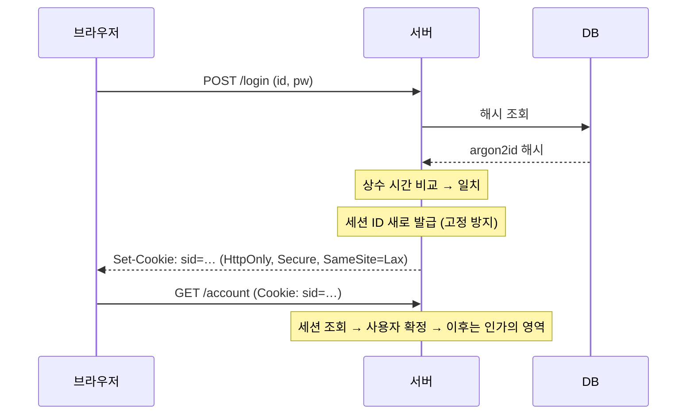

# 인증과 세션 관리

| 레벨 | 상태 | 최종 개정 | CWE |
|---|---|---|---|
| 🟡 실무 (7절은 🔴) | 🔄 개정중 | 2026-10-22 | [CWE-287](https://cwe.mitre.org/data/definitions/287.html) |

> **한눈에 보기**
> 인증은 "당신이 누구인가"를 한 번 확인하는 일이고, 세션은 "그 사실을 얼마나 오래, 무엇을 근거로 믿을 것인가"다.
> 비밀번호 해시, 비교 로직, 세션 토큰, JWT, OAuth, MFA 중 **가장 약한 고리 하나**가 깨지면 계정이 통째로 넘어간다.
> 막는 핵심은 검증된 라이브러리의 기본값을 쓰고, **직접 만들지 않는 것**이다.

## 1. 원리

인증 체계의 신뢰 경계는 두 번 넘어간다. 첫 번째는 로그인 시점이다. 사용자가 보낸 비밀(비밀번호, OTP, 외부 IdP의 토큰)을 서버가 검증한다. 두 번째는 그 이후 모든 요청이다. 서버는 "아까 확인한 그 사람"임을 증명하는 **세션 식별자**를 믿는다. 취약점은 이 두 경계 중 하나에서 **서버가 확인하지 않은 것을 믿을 때** 생긴다.



<figure>
<figcaption>그림 1. 정상적인 로그인과 세션 흐름. 이 장의 취약점은 각 단계에서 "확인"이 빠지거나 틀린 경우다. 세션 확정 이후 "이 사용자가 이 자원을 봐도 되는가"는 <a href="05-access-control.md">5장 접근 제어</a>의 문제다.</figcaption>
</figure>

### 깨지는 지점 다섯 가지

| 지점 | 무엇을 잘못 믿는가 | 결과 |
|---|---|---|
| 비밀 저장 | "DB는 안 털린다" → 평문·빠른 해시 저장 | DB 유출 시 전 계정의 비밀번호 복원 |
| 검증 로직 | "비교는 비교일 뿐" → 응답 차이·시간 차이 | 사용자 열거, 토큰 한 글자씩 추측, 무제한 브루트포스 |
| 세션 토큰 | "ID는 아무거나" → 예측 가능한 ID, 로그인 전 ID 재사용, 만료 없음 | 세션 추측·고정·영구 탈취 |
| 위임 토큰(JWT) | "토큰에 적힌 대로" → 헤더의 `alg`·`kid`·`jwk`를 신뢰 | 서명 없이 토큰 위조 |
| 외부 인증(OAuth·MFA) | "흐름이 복잡하니 어딘가에서 확인하겠지" → `redirect_uri`·`state`·2단계 순서 미검증 | 코드 탈취, 강제 계정 연결, MFA 건너뛰기 |

## 2. 발생하는 코드 패턴

### 비밀번호 저장

```python
# ❌ 취약: 빠른 해시. GPU 한 장이 초당 수십억 번 계산한다. 솔트가 있어도 마찬가지다
import hashlib
stored = hashlib.sha256((salt + password).encode()).hexdigest()
```

```python
# ✅ 안전: 메모리 하드 KDF. OWASP 최소 권장(Argon2id m=19MiB, t=2, p=1)
from argon2 import PasswordHasher, exceptions
ph = PasswordHasher(time_cost=2, memory_cost=19 * 1024, parallelism=1)  # memory_cost 단위는 KiB

stored = ph.hash(password)
try:
    ph.verify(stored, password)      # 불일치면 VerifyMismatchError
except exceptions.VerifyMismatchError:
    ...
```

```js
// ✅ 안전: Node, bcrypt. 비용 계수 10 이상. 입력이 72바이트에서 잘린다는 점을 안다
const bcrypt = require('bcrypt');
const stored = await bcrypt.hash(password, 10);
const ok = await bcrypt.compare(password, stored);
```

OWASP Password Storage Cheat Sheet의 현재 권장값은 다음과 같다 📎 ([출처](https://cheatsheetseries.owasp.org/cheatsheets/Password_Storage_Cheat_Sheet.html)). **Argon2id** m=19 MiB, t=2, p=1 (1순위). **scrypt** N=2^17, r=8, p=1. **bcrypt** 비용 계수 10 이상, 72바이트 제한. **PBKDF2-HMAC-SHA256** 600,000회 이상 (FIPS 요구 시). 이 수치는 개정되므로 적용 시점에 다시 확인한다.

### 비교 로직: 타이밍과 열거

```python
# ❌ 취약: 문자열 == 는 첫 불일치 바이트에서 멈춘다. 앞자리가 맞을수록 느리다
if request.form["token"] == stored_reset_token:
    ...
# ❌ 취약: 사용자가 없으면 해시 계산을 건너뛴다 → 존재하는 계정은 응답이 100ms 느리다
user = User.get(username)
if user and ph.verify(user.hash, password):
    ...
```

```python
# ✅ 안전: 상수 시간 비교 + 사용자가 없어도 같은 비용을 치른다
import hmac
if hmac.compare_digest(request.form["token"], stored_reset_token):
    ...

DUMMY_HASH = ph.hash("dummy-password-for-timing")

def _verify(h: str, pw: str) -> bool:        # ph.verify는 불일치 시 예외를 던지므로 bool로 감싼다
    try:
        ph.verify(h, pw)
        return True
    except exceptions.VerifyMismatchError:
        return False

user = User.get(username)
target = user.hash if user else DUMMY_HASH
ok = _verify(target, password) and user is not None
```

```js
// ✅ 안전: Node. timingSafeEqual은 길이가 같아야 하므로 해시를 먼저 맞춘다
const crypto = require('crypto');
const h = (s) => crypto.createHash('sha256').update(s).digest();
const ok = crypto.timingSafeEqual(h(given), h(stored));
```

로그인 실패 메시지도 열거 통로다. "사용자가 없습니다"와 "비밀번호가 틀렸습니다"를 구분하면 공격자는 유효한 계정 목록을 먼저 만든 뒤 비밀번호를 집중한다. 메시지, 상태 코드, 응답 시간, 응답 길이가 모두 같아야 한다.

### 세션 식별자

```python
# ❌ 취약: 예측 가능한 세션 ID
sid = hashlib.md5(f"{username}{int(time.time())}".encode()).hexdigest()
# ❌ 취약: 로그인 전에 받은 세션 ID를 로그인 후에도 그대로 쓴다 (세션 고정)
session["user_id"] = user.id
```

```python
# ✅ 안전: CSPRNG 256비트, 로그인 성공 시 새 ID
import secrets
sid = secrets.token_urlsafe(32)
```

```js
// ✅ 안전: express-session, 로그인 성공 직후 ID 재발급
req.session.regenerate((err) => {
  if (err) return next(err);
  req.session.userId = user.id;
  res.redirect('/');
});
```

Django의 `login()`은 세션 키를 자동으로 교체한다. 프레임워크를 쓰면 대부분 해결되지만, 직접 만든 세션 저장소나 "remember me" 토큰은 같은 기준(CSPRNG, 64비트 이상 엔트로피, 로그인 시 재발급, 서버 측 만료, 로그아웃 시 서버에서 폐기)을 손으로 지켜야 한다.

Flask처럼 **세션을 서명된 쿠키에 담는** 프레임워크는 서명 키가 곧 모든 계정의 열쇠다. 기본값·예제 키를 그대로 배포하면 누구나 임의 사용자의 세션을 만들 수 있다(8절 Apache Superset).

### JWT

JWT는 "서명된 주장(claim)"이다. 취약점은 거의 전부 **검증 코드가 토큰 헤더의 지시를 따르는** 데서 온다.

```python
# ❌ 취약: 서명 검증 끔. 아무나 payload를 쓴다
jwt.decode(token, options={"verify_signature": False})
# ❌ 취약 (PyJWT 1.x): 허용 알고리즘을 명시하지 않아 토큰의 alg를 그대로 따랐다. 2.x는 이 호출을
#    DecodeError로 거부한다. Node jsonwebtoken도 algorithms를 생략하면 키 종류에서 추론하므로 명시한다
jwt.decode(token, key)
```

```python
# ✅ 안전: 알고리즘·대상·발급자를 고정. 만료(exp)는 기본으로 검사된다
jwt.decode(token, public_key, algorithms=["RS256"], audience="my-api", issuer="https://idp.example.com")
```

| 함정 | 공격 | 올바른 검증 |
|---|---|---|
| `alg: none` | 서명 부분을 비우고 payload를 바꾼다 | `none`을 절대 허용 목록에 넣지 않는다 |
| HS/RS 키 혼동 | 서버가 RS256 공개키로 검증하는데 `alg: HS256`으로 바꾸고 **공개키를 HMAC 비밀로** 서명 | 알고리즘 고정. 키 종류와 알고리즘을 묶어 관리 |
| 만료 미검증 | 오래전 유출된 토큰이 영원히 유효 | `exp` 필수, 짧은 수명, 폐기 목록 또는 짧은 액세스 + 리프레시 |
| `kid` 인젝션 | `kid: "../../dev/null"`로 빈 키를 쓰게 하거나, `kid`가 SQL에 들어가면 인젝션 | `kid`는 서버가 가진 키 목록의 **조회 키**로만. 경로·쿼리에 넣지 않는다 |
| `jwk`·`jku`·`x5u` 헤더 | 토큰 안에 공격자 공개키를 넣거나, 공격자 URL에서 키를 받아오게 함 | 헤더의 키를 신뢰하지 않는다. `jku`는 허용 목록 호스트만 |
| 약한 HMAC 비밀 | `secret`, `password` 같은 비밀을 사전 공격으로 찾아 서명 위조 | 256비트 이상 난수 비밀 |

### OAuth 2.0 / OIDC

흐름이 길어서 "어딘가에서 확인하겠지"가 가장 많이 일어나는 곳이다. 인가 코드 흐름의 흔한 실수 네 가지.

1. **`redirect_uri` 부분 일치.** 인가 서버가 `https://app.example.com/`으로 시작하면 통과시키면, `https://app.example.com/open-redirect?to=attacker`나 `https://app.example.com.attacker.net/`으로 코드가 간다. RFC 9700은 정확한 문자열 일치를 요구한다(네이티브 앱의 localhost 포트만 예외).
2. **`state` 누락.** 클라이언트가 `state`를 안 쓰면 공격자가 자기 계정의 코드를 담은 콜백 URL을 피해자에게 열게 해 **피해자 계정을 공격자의 소셜 계정과 연결**한다(forced profile linking, 로그인 CSRF).
3. **PKCE 없음.** 공개 클라이언트(모바일·SPA)는 코드가 가로채이면 끝이다. `code_verifier` 없이는 교환이 안 되게 한다.
4. **ID 토큰 검증 생략.** `iss`, `aud`, `nonce`, 서명, 만료를 모두 확인한다. "이메일이 같으면 같은 사용자"로 연결하면, 이메일을 검증하지 않는 IdP를 통해 남의 계정에 로그인한다.

### MFA

| 패턴 | 설명 |
|---|---|
| 2단계 건너뛰기 | 비밀번호 확인 후 **세션이 이미 인증 상태**이고 OTP 페이지는 그 위에 얹은 것. `/account`로 직접 가면 된다 |
| 응답 조작 | 클라이언트가 `{"success": false}`를 보고 화면을 바꾼다. 응답을 `true`로 바꾸면 통과 |
| 사용자 파라미터 교체 | OTP 검증 요청에 `username`이 들어 있고, 서버가 세션이 아니라 그 값으로 사용자를 정한다 |
| OTP 브루트포스 | 6자리, 레이트리밋 없음, 만료 없음이면 100만 번이면 끝난다 |
| 우회 경로 | 비밀번호 재설정·"기기 기억" 쿠키·API 토큰 발급이 MFA를 거치지 않는다 |

## 3. 탐지 방법

### 3.1 코드 리뷰 / 정적 분석

```bash
# 빠른 해시로 비밀번호 저장
grep -rnE "(md5|sha1|sha256)\(.*(pass|pwd)" --include='*.py' --include='*.js' --include='*.php' --include='*.java' .
# JWT 검증 약화
grep -rnE "verify_signature.*False|verify:\s*false|algorithms?\s*[:=]\s*\[?\s*['\"]none|jwt\.decode\([^)]*\)$" --include='*.py' --include='*.js' --include='*.ts' .
# 토큰·서명을 == 로 비교
grep -rnE "(token|signature|hmac|otp)\w*\s*(==|===|!=)\s*" --include='*.py' --include='*.js' --include='*.php' .
```

**Semgrep**: `p/jwt` 룰셋이 알고리즘 미지정·검증 해제·하드코딩 비밀을 잡는다. **CodeQL**: `py/weak-sensitive-data-hashing`, `js/insufficient-password-hash`, `java/missing-jwt-signature-check`.

**리뷰할 때 보는 순서**

1. 비밀번호 해시 함수와 파라미터. 라이브러리 기본값을 낮춘 곳이 있는가.
2. 비밀을 비교하는 모든 `==`. 사용자 조회 실패 경로가 성공 경로와 같은 비용인가.
3. 세션 ID를 만드는 코드(직접 만들었다면 왜인가), 로그인 성공 직후 재발급하는가, 로그아웃이 서버 측 세션을 지우는가.
4. JWT `decode`/`verify` 호출의 옵션. `kid`·`jku`가 어디에 쓰이는가.
5. OAuth 콜백 핸들러. `state` 비교, `redirect_uri` 등록 방식(정확 일치인가), ID 토큰의 `aud`·`nonce` 검사.
6. MFA 검증이 **서버 세션의 상태 머신**으로 구현됐는가, 아니면 프런트엔드 화면 순서에 의존하는가.

### 3.2 동적 테스트

| 대상 | 입력 | 기대 반응 |
|---|---|---|
| 사용자 열거 | 존재/비존재 계정으로 로그인·재설정·가입 | 메시지·코드·길이·**시간**이 같아야 한다. 시간은 수십 번 반복해 중앙값 비교 |
| 레이트리밋 | 같은 계정에 50회 실패 | 잠금 또는 지연. `X-Forwarded-For` 바꿔서 다시 |
| 세션 고정 | 로그인 전 쿠키 값 기록 → 로그인 | 값이 바뀌어야 한다 |
| 세션 폐기 | 로그아웃 후 이전 쿠키로 요청 | 401이어야 한다 |
| 쿠키 속성 | `Set-Cookie` 헤더 | `HttpOnly; Secure; SameSite` |
| JWT | 서명 삭제, `alg: none`, 공개키로 HS256 서명, `exp` 과거로, `kid` 조작 | 전부 401. Burp의 **JWT Editor** 확장이나 [jwt_tool](https://github.com/ticarpi/jwt_tool)로 자동화 |
| OAuth | `redirect_uri`에 경로 추가·서브도메인·`@`·`#`, `state` 제거 후 재생 | 인가 서버가 거부해야 한다 |
| MFA | OTP 단계에서 보호 페이지 직접 접근, 응답 조작, `username` 교체, OTP 1,000회 시도 | 전부 차단 |

스캐너는 쿠키 속성·알려진 JWT 결함·약한 비밀을 잘 잡는다. 열거·고정·MFA 순서·OAuth 흐름은 **비즈니스 흐름을 이해한 사람**이 자기 소유 계정 두 개 이상으로 해야 한다.

## 4. 실습 🧪

PortSwigger Web Security Academy의 세 카테고리를 쓴다. [Authentication](https://portswigger.net/web-security/authentication), [JWT](https://portswigger.net/web-security/jwt), [OAuth](https://portswigger.net/web-security/oauth).

| 순서 | 랩 | 배우는 것 |
|---|---|---|
| 1 | Username enumeration via different responses | 메시지 차이로 계정 목록 만들기 |
| 2 | Username enumeration via response timing | 시간 차이. `X-Forwarded-For`로 레이트리밋 우회 |
| 3 | 2FA simple bypass | 2단계 건너뛰기 |
| 4 | 2FA broken logic | `verify` 파라미터의 사용자 교체 |
| 5 | JWT authentication bypass via unverified signature | 서명을 아예 안 본다 |
| 6 | JWT authentication bypass via flawed signature verification | `alg: none` |
| 7 | JWT authentication bypass via weak signing key | 사전 공격으로 HMAC 비밀 찾기 (hashcat) |
| 8 | JWT authentication bypass via jwk header injection | 토큰 안의 공개키를 믿는다 (CVE-2018-0114와 같은 결함) |
| 9 | JWT authentication bypass via kid header path traversal | `kid: ../../../dev/null` |
| 10 | JWT authentication bypass via algorithm confusion | RS256 공개키로 HS256 서명 |
| 11 | Forced OAuth profile linking | `state` 누락 |
| 12 | OAuth account hijacking via redirect_uri | `redirect_uri` 검증 부족 |

**로컬에서 재현하기: `alg: none`.** PyJWT 설치 후 다음을 실행하면, 검증을 끈 호출은 위조 토큰을 받아들이고 올바른 호출은 거부하는 것을 10초 안에 본다.

```python
import base64, json, jwt
b64 = lambda d: base64.urlsafe_b64encode(json.dumps(d, separators=(",", ":")).encode()).rstrip(b"=").decode()
forged = f"{b64({'alg': 'none', 'typ': 'JWT'})}.{b64({'sub': 'admin'})}."

print(jwt.decode(forged, options={"verify_signature": False}))        # ❌ {'sub': 'admin'} 통과
print(jwt.decode(forged, "server-secret", algorithms=["HS256"]))      # ✅ InvalidAlgorithmError
```

## 5. 익스플로잇 검증

인증 결함은 "이론상 가능"과 "실제로 계정을 넘길 수 있음"의 차이가 크다. **자기 소유 계정 사이에서만** 다음을 증명한다.

| 단계 | 확인 | 심각도에 미치는 영향 |
|---|---|---|
| 1 | 열거·타이밍 차이가 있다 | 단독으로는 Low. 다른 결함의 전제 조건 |
| 2 | 브루트포스가 실제로 가능하다 (레이트리밋·잠금 없음) | 1과 결합하면 Medium~High |
| 3 | 세션 고정·재사용·추측으로 **자기 두 번째 계정**의 세션을 얻는다 | 계정 탈취. High |
| 4 | JWT·서명 쿠키를 위조해 다른 역할(admin)로 인식된다 | 전 계정 탈취 가능. Critical |
| 5 | MFA를 켠 자기 계정에 MFA 없이 들어간다 | MFA를 믿는 조직에 특히 치명적. High~Critical |

4단계 증명은 `sub`를 자기 두 번째 계정으로 바꾸는 것으로 충분하다. `admin`으로 바꿔 관리자 화면을 여는 것은 허가 범위를 확인한 뒤에 한다. 비밀번호 사전 공격은 실습 환경이나 자기 계정에만 한다. 영향도 산정은 [보고 2장](../part8-reporting/02-severity.md)을 따른다.

## 6. 방어

| 계층 | 조치 | 효과 |
|---|---|---|
| 코드 | Argon2id/scrypt/bcrypt, OWASP 권장 파라미터 이상 | DB 유출 시 피해 축소 |
| 코드 | 상수 시간 비교, 실패 경로의 비용 동일화, 통일된 오류 메시지 | 열거·타이밍 제거 |
| 코드 | 세션 ID는 CSPRNG, 로그인 시 재발급, 서버 측 만료·폐기 | 고정·추측·영구 세션 제거 |
| 코드 | JWT는 알고리즘·`aud`·`iss`·`exp` 고정 검증. 헤더의 키 정보를 신뢰하지 않음 | 위조 제거 |
| 코드 | OAuth는 `redirect_uri` 정확 일치, `state`·`nonce`·PKCE 필수 | 코드 탈취·강제 연결 제거 |
| 코드 | MFA는 서버 세션의 상태 머신. 모든 인증 경로(재설정, API 토큰, 기기 기억)가 같은 상태 머신을 거침 | 건너뛰기 제거 |
| 프레임워크 | 인증을 직접 짜지 않고 프레임워크·검증된 라이브러리 사용. 기본 비밀 키 배포를 CI에서 차단 | 기본값으로 차단 |
| 인프라 | 레이트리밋(계정별 + IP별 + 전역), 자격 증명 스터핑 탐지, 유출 비밀번호 목록 대조 | 브루트포스 비용 상승 |
| 탐지 | 로그인 실패 급증, 한 IP의 다중 계정 시도, 지리적 불가능 이동, 세션 ID 재사용 | 사후 대응 |

**하지 말아야 할 것**: 자체 해시·자체 토큰·자체 JWT 파서. 비밀번호 최대 길이 제한이나 특수문자 강제 같은 복잡도 규칙(NIST SP 800-63B는 길이와 유출 목록 대조를 권하고 주기적 변경 강제를 반대한다). 로그인 성공 전에 사용자별로 다른 응답을 주는 모든 것.

## 7. 우회 기법 🔴

| 방어 | 우회 |
|---|---|
| IP 기반 레이트리밋 | `X-Forwarded-For` 변조(프록시 설정이 틀린 경우), IP 풀, 계정을 바꿔 가며 같은 비밀번호(password spraying) |
| 재설정 토큰은 안전 | 재설정 **링크의 호스트**가 `Host` 헤더에서 오면 공격자 호스트로 링크가 가고, 피해자가 클릭하면 토큰이 `Referer`로 샌다(Host header poisoning) |
| 세션 쿠키 `HttpOnly` | XSS로 쿠키 대신 그 자리에서 요청을 보낸다 ([2장 XSS](02-xss.md)). `SameSite` 없으면 로그인 CSRF로 공격자 세션을 피해자에게 심는다 |
| JWT `jku` 허용 목록 | 허용 도메인의 open redirect, 허용 도메인에 파일 업로드, URL 파서 불일치 ([3장 SSRF](03-ssrf.md) 7절과 같은 기법) |
| HS/RS 혼동은 공개키를 모르면 못 한다 | 공개키는 `/.well-known/jwks.json`, TLS 인증서, 또는 서명 두 개로 RSA 공개키를 복원하는 도구로 얻는다 |
| 타이밍 공격은 네트워크 지터 때문에 실전성이 없다 | 같은 연결에서 두 요청을 동시에 보내 **도착 순서**로 비교하는 Timeless Timing Attacks (Van Goethem et al., USENIX Security 2020). HTTP/2 멀티플렉싱이 전제 |
| OAuth `redirect_uri` 정확 일치 | 등록된 URI 자체에 open redirect, 등록된 호스트의 서브도메인 탈취, 여러 인가 서버를 쓰는 클라이언트의 mix-up 공격(코드를 다른 서버에 보내게 함) |
| MFA 응답 조작 차단 | 세션이 "1단계 통과" 상태로 들어간 뒤 **다른 기능**(API 토큰 발급, 이메일 변경)이 2단계를 요구하는지 각각 확인한다. 보통 하나는 빠져 있다 |

### 7.1 JWT 알고리즘 혼동: RS256 → HS256

**원리.** 서버는 IdP의 **공개키**로 RS256 서명을 검증한다. 검증 코드가 토큰 헤더의 `alg`를 그대로 따르고, 어떤 알고리즘이든 "설정에 있는 그 키"를 넘기는 구조라면, 헤더를 `HS256`으로 바꾼 토큰은 **공개키 바이트를 HMAC 비밀로 쓰는 검증**을 받게 된다. 공개키는 이름 그대로 공개다. `/.well-known/jwks.json`, TLS 인증서, 또는 같은 키로 만든 서명 두 개에서 모듈러스를 복원하는 방법으로 얻는다. 공격자는 `HMAC-SHA256(key = 공개키 바이트, data = header.payload)`로 서명하면 되고, 서버는 같은 계산을 하므로 일치한다. 조건은 하나다. **서버가 메모리에 쥔 키와 바이트 단위로 같아야 한다.** PEM이면 줄 끝의 개행까지, DER이면 DER 그대로, JWK에서 변환했다면 서버가 변환한 결과와 같은 형식이어야 하므로 실제 점검에서는 몇 가지 형식을 다 시도한다.

실습 환경에서 자기 키로 재현하면 20줄이 안 된다. 취약한 검증기는 통과시키고, 라이브러리는 거부한다.

```python
# confusion.py  (실습용. 키는 방금 만든 자기 것)
import base64, hmac, hashlib, json, jwt
from cryptography.hazmat.primitives.asymmetric import rsa
from cryptography.hazmat.primitives import serialization
priv = rsa.generate_private_key(public_exponent=65537, key_size=2048)
pub_pem = priv.public_key().public_bytes(serialization.Encoding.PEM,
          serialization.PublicFormat.SubjectPublicKeyInfo)          # 서버가 검증에 쓰는 공개키
b64 = lambda d: base64.urlsafe_b64encode(d).rstrip(b"=").decode()
head, body = b64(b'{"alg":"HS256","typ":"JWT"}'), b64(b'{"sub":"admin"}')
sig = b64(hmac.new(pub_pem, f"{head}.{body}".encode(), hashlib.sha256).digest())   # 공개키 = HMAC 키
forged = f"{head}.{body}.{sig}"
# ❌ 취약: 헤더의 alg를 따르고 "그 키"로 HMAC 비교
print(hmac.compare_digest(sig, b64(hmac.new(pub_pem, f"{head}.{body}".encode(), hashlib.sha256).digest())))  # True
# ✅ PyJWT 2.15: 둘 다 예외. 첫 호출의 예외로 스크립트가 멈추면 둘째 결과를 못 보므로 각각 try/except로 감싼다
for algs in (["RS256"], ["HS256"]):
    try:
        jwt.decode(forged, pub_pem, algorithms=algs)
    except jwt.exceptions.PyJWTError as e:
        print(algs, type(e).__name__, e)
# ['RS256'] InvalidAlgorithmError The specified alg value is not allowed
# ['HS256'] InvalidKeyError The specified key is an asymmetric key or x509 certificate and should not be used as an HMAC secret.
```

**라이브러리가 막는 두 겹.** 첫째는 알고리즘 허용 목록이다. PyJWT 2.x는 `algorithms`를 생략하면 `decode()` 자체를 거부하고, 토큰의 `alg`가 목록에 없으면 `InvalidAlgorithmError`다. 둘째는 **키 종류와 알고리즘의 결합**이다. 허용 목록에 `HS256`이 들어 있더라도, `HMACAlgorithm.prepare_key()`가 키가 PEM·SSH·DER 형식이면 거부한다(PEM·SSH 검사는 2.4.0에서 추가된 [CVE-2022-29217](https://nvd.nist.gov/vuln/detail/CVE-2022-29217)의 패치이고, DER 검사는 2.14.0에서 추가됐다).

```python
# PyJWT jwt/algorithms.py, HMACAlgorithm.prepare_key (2.15)
if (is_pem_format(key_bytes) or is_ssh_key(key_bytes) or self._is_der_key(key_bytes)):
    raise InvalidKeyError("The specified key is an asymmetric key or x509 certificate and"
                          " should not be used as an HMAC secret.")
```

Node의 jsonwebtoken 9.x는 `verify.js`에서 키를 먼저 `KeyObject`로 만들고, `algorithms`가 없으면 **키 종류에서** 허용 목록을 정한 뒤, `alg` 접두사와 키 종류가 맞는지 한 번 더 본다.

```js
// jsonwebtoken verify.js (9.0.2)
if (!options.algorithms) {
  if (secretOrPublicKey.type === 'secret') { options.algorithms = HS_ALGS; }
  else if (['rsa', 'rsa-pss'].includes(secretOrPublicKey.asymmetricKeyType)) { options.algorithms = RSA_KEY_ALGS }
  …
}
if (options.algorithms.indexOf(decodedToken.header.alg) === -1) { return done(new JsonWebTokenError('invalid algorithm')); }
if (header.alg.startsWith('HS') && secretOrPublicKey.type !== 'secret') {
  return done(new JsonWebTokenError(`secretOrPublicKey must be a symmetric key when using ${header.alg}`))
}
```

위 `forged`를 jsonwebtoken 9.0.2에 넣으면 옵션 없이는 `invalid algorithm`, `{algorithms:['HS256']}`을 줘도 `secretOrPublicKey must be a symmetric key when using HS256`이다. 그러므로 코드 리뷰에서 볼 것은 (1) `algorithms`가 명시되어 있는가, (2) 라이브러리 버전이 키 종류 검사를 포함하는가(PyJWT ≥ 2.4.0, jsonwebtoken ≥ 9.0.0), (3) **자체 구현** 검증기가 있는가다. 3번이 있으면 거의 확실히 취약하다.

### 7.2 세션 고정: "로그인 때 재발급한다"를 우회하는 흐름

세션 고정(session fixation)은 공격자가 **먼저 안** 세션 ID로 피해자가 로그인하게 만드는 공격이다. 흐름은 네 단계다.

1. 공격자가 사이트에 접속해 세션 ID `S`를 받는다. 서버가 아무 값이나 세션으로 받아들이는 설정(PHP `session.use_strict_mode=0`, 기본값)이면 받을 필요도 없이 지어내면 된다.
2. 피해자 브라우저에 `S`를 심는다. URL 재작성(`;jsessionid=S`, `?PHPSESSID=S`)을 쓰는 서버면 링크 하나로 끝난다. 쿠키만 쓰는 서버면 같은 상위 도메인의 다른 서브도메인에서 `Set-Cookie: sid=S; Domain=.example.com`을 내린다(서브도메인 XSS·헤더 인젝션). 옛 자료의 `<meta http-equiv="Set-Cookie">`는 현행 브라우저가 무시한다.
3. 피해자가 `S`를 가진 채 로그인한다. 서버가 ID를 바꾸지 않으면 `S`가 인증된 세션이 된다.
4. 공격자가 `S`로 요청을 보낸다.

방어는 2절의 `session_regenerate_id(true)`·`req.session.regenerate()`처럼 **인증 성공 시점에 ID를 바꾸는 것**이다. 그런데 "로그인 때 바꾼다"가 구현되어 있어도 다음 경로에서 흔히 빠진다.

| 빠지는 곳 | 왜 |
|---|---|
| 로그인 **이외의** 인증 경로 | OAuth 콜백, SSO 복귀, "로그인 유지" 쿠키로 자동 로그인, 비밀번호 재설정 뒤 자동 로그인, 이메일 매직 링크. 메인 로그인 핸들러에만 `regenerate`가 있다 |
| 재발급 시점이 **인증 전** | 로그인 **페이지를 열 때** ID를 바꾸고 자격 증명 확인 뒤에는 안 바꾼다. 공격자가 로그인 페이지를 먼저 열어 "바뀐 뒤의" ID를 받아 심으면 된다 |
| 권한 **상승** 시점 | 일반 사용자 → 관리자 전환, MFA 2단계 통과, 재인증(sudo mode). 세션의 신뢰 수준이 올라갈 때마다 바꿔야 한다 |
| 프레임워크 기본값 신뢰 | 컨테이너 인증을 쓰지 않고 직접 로그인 폼을 만들면 Tomcat의 `changeSessionIdOnAuthentication` 같은 보호가 적용되지 않는다 |

점검 절차는 단순하다. 인증 경로마다 **로그인 직전 쿠키 값을 적어 두고, 성공 직후 값과 비교한다.** 같으면 고정이다. Burp라면 Proxy history에서 로그인 요청의 `Cookie`와 응답의 `Set-Cookie`를 나란히 본다. 응답에 `Set-Cookie`가 없으면 그 경로는 재발급을 안 한 것이다.

### 7.3 OAuth `redirect_uri` 검증 우회 패턴

인가 서버는 `redirect_uri`가 **등록된 값과 같은지** 확인한다. 이 비교가 느슨하면 인가 코드나 토큰이 공격자에게 간다. 공개 연구(PortSwigger Web Security Academy의 OAuth 랩, RFC 9700 4.1절)에서 반복되는 패턴은 세 가지다.

**1. 부분 일치.** 등록값으로 "시작하면" 통과시키는 검증이다. 다음이 모두 `https://client.example/callback`으로 시작한다.

```
https://client.example/callback/../redirect?to=https://attacker.example   ← 경로 순회. 클라이언트 서버가 정규화하면 /redirect
https://client.example/callback?next=https://attacker.example             ← 파라미터 추가. 콜백이 next를 따르면 끝
https://client.example/callback#@attacker.example
https://client.example.attacker.example/callback                          ← 호스트 "시작" 일치
https://client.example@attacker.example/callback                          ← userinfo. 검증기와 브라우저가 호스트를 다르게 읽는다
```

마지막 두 줄은 [3장 SSRF](03-ssrf.md) 7절의 URL 파서 불일치와 같은 기법이다. 검증기는 문자열로, 브라우저는 RFC 3986으로 읽는다.

**2. 정확 일치 + 클라이언트의 오픈 리다이렉트.** 인가 서버가 정확 일치를 해도, 등록된 콜백 페이지(또는 같은 호스트의 다른 경로)에 오픈 리다이렉트가 있으면 결합된다. 흐름은 이렇다. 공격자가 `redirect_uri=https://client.example/callback/../open-redirect?url=https://attacker.example`처럼 **인가 서버의 느슨한 검증**(1번)이나, 검증을 통과하는 정상 콜백에서 **클라이언트의 자체 리다이렉트**를 거치게 만든다. 인가 서버는 코드(또는 implicit 흐름의 토큰)를 붙여 클라이언트로 돌려보내고, 클라이언트가 다시 공격자 사이트로 보낸다. `code`는 `Referer`로, implicit 흐름의 `#access_token=`은 브라우저가 리다이렉트 시 프래그먼트를 유지하는 성질 때문에 공격자 페이지의 `location.hash`로 도착한다. PortSwigger의 "Stealing OAuth access tokens via an open redirect" 랩이 정확히 이 조합이다.

**3. 인가 서버 혼동(mix-up).** 클라이언트가 여러 인가 서버를 쓸 때, 공격자가 자기 인가 서버로 흐름을 시작시키고 피해자가 정직한 서버에서 받은 코드를 공격자 서버에 보내게 만든다. 대응은 RFC 9700 4.4절의 `iss` 파라미터 검증이다.

점검에서는 `redirect_uri`에 위 변형을 하나씩 넣어 인가 서버가 **거부**하는지 본다. 하나라도 통과하면, 그 URI로 실제로 코드가 전달되는지는 **자기 소유 계정과 자기 서버**로만 확인한다. 보고서에는 "부분 일치 검증"처럼 원인을 적고, RFC 9700 4.1.3절의 **단순 문자열 비교**를 권고로 쓴다. 클라이언트 쪽에는 오픈 리다이렉트 제거와 PKCE·`state`를 함께 적는다. 코드가 새더라도 PKCE의 `code_verifier`가 없으면 토큰으로 바꾸지 못한다.

## 8. 실제 CVE 사례

| CVE | 제품 | 핵심 | 패치 |
|---|---|---|---|
| [CVE-2015-9235](https://nvd.nist.gov/vuln/detail/CVE-2015-9235) | node-jsonwebtoken < 4.2.2 | 검증 시 토큰 헤더의 `alg`를 그대로 따름. RS256 공개키로 검증하는 서버에 HS256 토큰(공개키를 HMAC 비밀로 서명)을 보내면 통과. "키 혼동"의 원조 | [커밋](https://github.com/auth0/node-jsonwebtoken/commit/1bb584b) |
| [CVE-2018-0114](https://nvd.nist.gov/vuln/detail/CVE-2018-0114) | Cisco node-jose < 0.11.0 | JWS 헤더에 담긴 `jwk` 공개키로 서명을 검증. 공격자가 자기 키 쌍으로 서명하고 공개키를 헤더에 넣으면 통과 | [릴리스](https://github.com/cisco/node-jose/releases) |
| [CVE-2022-29217](https://nvd.nist.gov/vuln/detail/CVE-2022-29217) | PyJWT < 2.4.0 | `algorithms`를 전체 목록으로 넘기면 공개키 PEM을 HMAC 키로 받아들이는 키 혼동 가능 | [권고](https://github.com/jpadilla/pyjwt/security/advisories/GHSA-ffqj-6fqr-9h24) |
| [CVE-2022-21449](https://nvd.nist.gov/vuln/detail/CVE-2022-21449) | Oracle Java SE 15~18 ("Psychic Signatures") | ECDSA 검증에서 `r`·`s`가 0이 아닌지 검사하지 않아, 전부 0인 서명이 모든 메시지에 유효. ES256 JWT·SAML·OIDC·WebAuthn에 영향 | [Oracle CPU 2022-04](https://www.oracle.com/security-alerts/cpuapr2022.html) |
| [CVE-2023-27524](https://nvd.nist.gov/vuln/detail/CVE-2023-27524) | Apache Superset ≤ 2.0.1 | 설치 예제의 기본 `SECRET_KEY`를 그대로 쓰는 인스턴스에서 Flask 세션 쿠키를 임의 사용자로 위조. 인터넷 노출 인스턴스의 약 2/3가 해당 📎 ([Horizon3, 2023](https://www.horizon3.ai/cve-2023-27524-insecure-default-configuration-in-apache-superset-leads-to-rce/)) | [분석 (Horizon3)](https://www.horizon3.ai/cve-2023-27524-insecure-default-configuration-in-apache-superset-leads-to-rce/) |
| [CVE-2023-7028](https://nvd.nist.gov/vuln/detail/CVE-2023-7028) | GitLab CE/EE 16.1~16.7 | 비밀번호 재설정 요청의 이메일 파라미터에 **검증되지 않은 두 번째 주소**를 넣으면 재설정 링크가 그 주소로도 발송. 사용자 상호작용 없이 계정 탈취 (CVSS 10.0) | [GitLab 공지](https://about.gitlab.com/releases/2024/01/11/critical-security-release-gitlab-16-7-2-released/) |

**jsonwebtoken (CVE-2015-9235) 에서 배울 것**: 패치는 `verify()`에 `algorithms` 옵션을 추가하고, 키 종류와 토큰의 `alg`가 맞지 않으면 거부하도록 바꿨다. 10년이 지난 지금도 같은 결함이 다른 라이브러리·다른 언어에서 반복된다(PyJWT 2022). 검증 코드가 **입력(토큰)에 적힌 알고리즘**을 따르는 설계는 그 자체가 결함이다.

**Java (CVE-2022-21449) 에서 배울 것**: 네이티브 C++ 구현을 Java로 다시 쓰면서 `r`·`s`가 0이 아닌지 검사하는 한 줄이 빠졌고, 패치는 그 검사를 되돌렸다(Neil Madden의 분석 기준). 코드가 완벽해도 **라이브러리 아래층**이 깨지면 ES256 JWT·SAML·WebAuthn이 한꺼번에 뚫린다. 코드 리뷰로는 못 찾고, 의존성·런타임 버전 추적(SCA)이 인증 보안의 일부인 이유다.

**Superset (CVE-2023-27524) 에서 배울 것**: 코드 결함이 아니라 **기본값**이다. 패치는 기본 키로 실행되면 서버가 기동을 거부하도록 바꿨다(권고문 기준). "예제 설정을 그대로 배포"는 설정 문제가 아니라 전 계정 탈취이고, 서명 쿠키 기반 세션의 특성상 서버 측 세션 저장소가 없어 폐기도 어렵다.

**GitLab (CVE-2023-7028) 에서 배울 것**: 재설정 흐름은 로그인 흐름과 같은 수준의 인증 경로다. 이메일 배열을 받는 API 변경이 검증 로직을 비껴갔다. 패치는 재설정 메일을 **검증된 주소에만** 보내도록 바꿨다(공지 기준). 2FA가 켜진 계정은 비밀번호가 바뀌어도 로그인이 막혔다. MFA가 "마지막 그물"로 작동한 사례다.

## 9. 체크리스트

**코드 리뷰할 때**
- [ ] 비밀번호가 Argon2id/scrypt/bcrypt로 저장되고 파라미터가 OWASP 권장 이상인가?
- [ ] 비밀 비교가 상수 시간인가? 사용자 없음 경로가 같은 비용인가? 오류 메시지가 통일됐는가?
- [ ] 세션 ID가 CSPRNG이고, 로그인 성공 시 재발급되며, 로그아웃이 서버 측에서 폐기하는가?
- [ ] JWT 검증이 알고리즘·`aud`·`iss`·`exp`를 고정하는가? `kid`·`jku`·`jwk` 헤더를 어떻게 쓰는가?
- [ ] OAuth 콜백이 `state`를 비교하고, `redirect_uri`가 정확 일치로 등록되며, PKCE를 쓰는가?
- [ ] MFA 상태가 서버 세션에 있고 모든 인증 경로가 그것을 거치는가?

**테스트할 때**
- [ ] 로그인·가입·재설정에서 존재/비존재 계정의 응답(메시지·코드·길이·시간)을 비교했는가?
- [ ] 로그인 전후 세션 ID, 로그아웃 후 재사용을 확인했는가?
- [ ] JWT에 서명 삭제·`none`·키 혼동·`exp` 조작·`kid` 조작을 넣어 봤는가?
- [ ] MFA 단계에서 보호 페이지 직접 접근·응답 조작·파라미터 교체·브루트포스를 시도했는가?

**배포 전**
- [ ] 쿠키에 `HttpOnly; Secure; SameSite`가 있고 HSTS가 켜져 있는가?
- [ ] 레이트리밋과 로그인 실패 알림이 있는가?
- [ ] JWT·암호 라이브러리와 런타임(JDK 등)이 최신이고 SCA가 CI에 있는가? 기본 비밀 키로 기동하면 실패하는가?

## 10. 더 읽기

- [CWE-287](https://cwe.mitre.org/data/definitions/287.html) 인증 부적절, [CWE-384](https://cwe.mitre.org/data/definitions/384.html) 세션 고정, [CWE-347](https://cwe.mitre.org/data/definitions/347.html) 서명 검증 부적절
- [OWASP Password Storage Cheat Sheet](https://cheatsheetseries.owasp.org/cheatsheets/Password_Storage_Cheat_Sheet.html) · 해시 알고리즘과 파라미터의 현재 권장값
- [OWASP Session Management Cheat Sheet](https://cheatsheetseries.owasp.org/cheatsheets/Session_Management_Cheat_Sheet.html) · 세션 ID 엔트로피·수명·쿠키 속성
- [NIST SP 800-63B](https://pages.nist.gov/800-63-3/sp800-63b.html) · 비밀번호 정책(길이, 유출 목록 대조, 주기적 변경 반대)의 근거
- [RFC 8725: JSON Web Token Best Current Practices](https://www.rfc-editor.org/rfc/rfc8725) · `alg` 고정, `none` 금지, 키 혼동 방지의 표준 문서
- [RFC 9700: Best Current Practice for OAuth 2.0 Security](https://www.rfc-editor.org/rfc/rfc9700) (2025) · `redirect_uri` 정확 일치, PKCE, mix-up 공격 대응
- Neil Madden, [*CVE-2022-21449: Psychic Signatures in Java*](https://neilmadden.blog/2022/04/19/psychic-signatures-in-java/), 2022 · 발견자의 원 분석
- Tom Van Goethem et al., *Timeless Timing Attacks*, USENIX Security 2020 · 네트워크 지터를 제거한 타이밍 공격
- [PortSwigger: Authentication](https://portswigger.net/web-security/authentication), [JWT](https://portswigger.net/web-security/jwt), [OAuth](https://portswigger.net/web-security/oauth) · 무료 실습 랩

## 변경 이력

| 날짜 | 변경 | 기여자 |
|---|---|---|
| 2026-10-21 | 초안(뼈대) 작성 | @anthonynoh5202 |
| 2026-10-22 | 10섹션 본문 작성. 비밀번호 저장·타이밍·세션·JWT·OAuth·MFA, CVE 6건 | @anthonynoh5202 |
| 2026-10-22 | 기술 검증: CVE 6건 레코드 대조(전부 실존). 타이밍 예제의 미정의 _verify 헬퍼 추가, PyJWT 2.x에서 algorithms 생략 호출이 거부됨을 반영. argon2·hmac·PyJWT alg:none 예제 실행 확인 | 검증팀 |
| 2026-10-23 | 기술 검증(2차, 7절): PyJWT master `HMACAlgorithm.prepare_key`·jsonwebtoken master `verify.js` 인용을 원 소스와 대조(일치), confusion.py(PyJWT 2.15.1)·confusion.js(jsonwebtoken 9.0.2) 재실행으로 예외 문구 확인, CVE-2022-29217 레코드 대조. DER 키 검사 추가 버전(2.14.0)을 2.4.0 패치와 구분하고, `<meta http-equiv="Set-Cookie">`가 현행 브라우저에서 무시됨을 명시 | 검증팀 |
| 2026-10-22 | 독자 테스트 반영: 7절에 JWT 알고리즘 혼동(PyJWT 2.15·jsonwebtoken 9.0.2 소스·실행 확인), 세션 고정 우회 흐름, OAuth redirect_uri 우회 패턴 추가. 장 참조 표기 정리 | @anthonynoh5202 |
| 2026-10-23 | 독자 테스트 2차 반영: 7.1 `confusion.py`의 두 `jwt.decode` 호출을 각각 try/except로 감싸 두 예외가 모두 출력되게 수정(PyJWT 2.15.1로 실행 확인) | @anthonynoh5202 |
