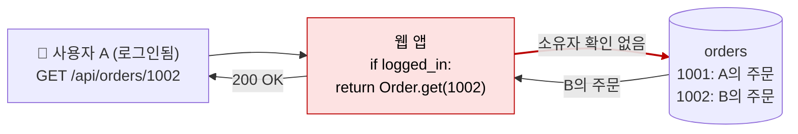

# 접근 제어 (IDOR · 권한 상승)

| 레벨 | 상태 | 최종 개정 | CWE |
|---|---|---|---|
| 🟢 입문 (7절은 🔴) | 🔄 개정중 | 2026-10-22 | [CWE-284](https://cwe.mitre.org/data/definitions/284.html) |

> **한눈에 보기**
> "로그인했는가"만 확인하고 "**이** 사용자가 **이** 자원에 **이** 작업을 해도 되는가"를 안 보면, ID 하나만 바꿔서 남의 데이터를 읽고 역할 필드 하나만 보내서 관리자가 된다.
> 가장 흔하고, 스캐너가 가장 못 찾고, 고치는 원칙은 가장 단순한 취약점이다.
> 막는 핵심은 **객체 단위 인가를 한 곳에서, 기본 거부(deny by default)로** 하는 것이다.

## 1. 원리

인증(authentication)은 "누구인가", 인가(authorization)는 "해도 되는가"다. [4장](04-auth-session.md)이 끝나는 지점에서 이 장이 시작한다. 접근 제어 취약점은 서버가 **요청 안에 들어 있는 식별자와 역할을 그대로 믿을 때** 생긴다. 신뢰 경계는 `GET /api/orders/1002`의 `1002`와 `{"role": "admin"}`의 `admin`에 있다. 둘 다 사용자가 보낸 값이다.



<figure>
<figcaption>그림 1. IDOR. 인증은 통과했다. 그러나 "1002가 A의 것인가"를 아무도 묻지 않았다. 코드에는 버그처럼 보이는 줄이 없다. <strong>있어야 할 줄이 없는 것</strong>이 취약점이다.</figcaption>
</figure>

### 유형

| 유형 | 질문 | 예 |
|---|---|---|
| **수평 권한 상승** | 같은 역할의 다른 사용자 자원에 닿는가 | 내 주문 ID를 바꿔 남의 주문을 본다. **IDOR**(Insecure Direct Object Reference)이 대표 형태 |
| **수직 권한 상승** | 상위 역할의 기능에 닿는가 | 일반 사용자가 `/admin/users`를 연다. 프로필 수정에 `role=admin`을 보낸다 |
| **문맥·상태 기반** | 흐름의 순서나 상태를 건너뛰는가 | 결제 단계를 건너뛰고 배송 확정 API를 호출한다 |

**대량 할당(mass assignment)** 은 수직 상승의 흔한 통로다. 프레임워크가 요청 본문의 필드를 모델 속성에 자동으로 묶어 주는데, 그 목록에 `role`, `is_admin`, `balance`, `owner_id`처럼 사용자가 바꾸면 안 되는 필드가 포함되는 경우다.

### 왜 스캐너가 못 찾는가

SQL 인젝션은 "따옴표를 넣으면 에러"처럼 **응답 자체**에 신호가 있다. 접근 제어는 그렇지 않다. `GET /api/orders/1002`에 200과 JSON이 돌아온 것이 정상인지 취약인지는 **1002가 누구 것인지**를 알아야 판단할 수 있다. 이 의미는 비즈니스 로직에 있고, 도구는 그것을 모른다. 그래서 OWASP Top 10 2021은 접근 제어 결함을 1위(A01)에 올렸다 ([OWASP Top 10:2021 A01](https://owasp.org/Top10/A01_2021-Broken_Access_Control/)). 찾는 방법은 3.2의 **두 계정 교차 테스트**뿐이다.

## 2. 발생하는 코드 패턴

### 수평: 소유자 확인 누락 (IDOR)

```python
# ❌ 취약: Django, 로그인만 확인하고 소유자는 안 본다
@login_required
def order_detail(request, pk):
    order = Order.objects.get(pk=pk)
    return JsonResponse(order.to_dict())
```

```python
# ✅ 안전: 조회 조건에 소유자를 넣는다. 남의 것이면 404 (존재 여부도 숨긴다)
@login_required
def order_detail(request, pk):
    order = get_object_or_404(Order, pk=pk, owner=request.user)
    return JsonResponse(order.to_dict())
```

```js
// ❌ 취약: Express
app.get('/api/orders/:id', requireLogin, async (req, res) => {
  res.json(await Order.findById(req.params.id));
});
// ✅ 안전
app.get('/api/orders/:id', requireLogin, async (req, res) => {
  const order = await Order.findOne({ _id: req.params.id, userId: req.user.id });
  if (!order) return res.sendStatus(404);
  res.json(order);
});
```

ID를 UUID로 바꾸는 것은 **방어가 아니다**. UUID는 다른 응답(목록 API, 공유 링크, HTML 소스)에서 새기 마련이고, 새는 순간 같은 취약점이 된다. 추측하기 어렵게 만드는 것은 완화이지 수정이 아니다.

### 수직: 화면에서만 숨긴 기능, 요청에서 온 역할

```js
// ❌ 취약: 관리자 메뉴를 UI에서만 숨긴다. 라우트에는 검사가 없다
app.post('/admin/users/:id/delete', requireLogin, deleteUser);
// ❌ 취약: 역할을 요청에서 읽는다
if (req.body.isAdmin) { ... }
```

```js
// ✅ 안전: 역할은 서버의 세션·DB에서, 검사는 라우트 미들웨어에서
const requireRole = (role) => (req, res, next) =>
  req.user.role === role ? next() : res.sendStatus(403);
app.post('/admin/users/:id/delete', requireLogin, requireRole('admin'), deleteUser);
```

### 대량 할당

```python
# ❌ 취약: 요청 JSON을 통째로 모델에 쓴다
User.objects.filter(pk=request.user.pk).update(**request.json)   # {"role": "admin"} 통과
```

```js
// ❌ 취약
Object.assign(user, req.body); await user.save();
```

```ruby
# ❌ 취약: Rails, permit! 또는 params 통째로
User.new(params[:user])
# ✅ 안전: strong parameters 허용 목록
User.new(params.require(:user).permit(:name, :email))
```

```python
# ✅ 안전: Django, 폼·시리얼라이저에 쓰기 가능 필드를 명시
class ProfileForm(forms.ModelForm):
    class Meta:
        model = User
        fields = ["name", "email"]          # role, is_staff는 여기 없다
```

원칙은 하나다. **쓰기 가능 필드를 허용 목록으로 명시**하고, 역할·소유자·잔액 같은 필드는 별도의 관리자 전용 경로에서만 바꾼다. 차단 목록(`role`만 빼기)은 7절처럼 우회된다.

### "한 곳에서, 기본 거부"

위 세 패턴의 공통 수정은 검사를 **추가**하는 것이 아니라 검사를 **한 곳에 모으는** 것이다. 라우트마다 `if owner == user`를 흩뿌리면 하나는 반드시 빠진다. 데이터 접근 계층(리포지토리·매니저)이 항상 현재 사용자를 받아 조건에 넣게 하거나, 정책 함수 하나(`can(user, action, resource)`)를 모든 핸들러가 호출하게 한다. 그리고 라우트 테이블은 **기본이 거부**여야 한다. 모든 라우트가 인증·인가 미들웨어를 거치고, 공개 라우트만 명시적으로 예외를 둔다. Django 5.1의 `LoginRequiredMiddleware`, Spring Security의 `anyRequest().authenticated()`가 그 형태다.

## 3. 탐지 방법

### 3.1 코드 리뷰 / 정적 분석

접근 제어는 정적 분석이 가장 약한 영역이다. "있어야 할 검사가 없다"는 패턴 매칭으로 잡기 어렵다. 그래도 시작점은 있다.

```bash
# 소유자 조건 없는 단일 객체 조회
grep -rnE "\.(get|findById|findByPk|find_by_id)\(\s*(pk|id|req\.params\.\w+|request\.\w+)" --include='*.py' --include='*.js' --include='*.ts' --include='*.rb' .
# 대량 할당
grep -rnE "\*\*request\.(json|data|POST)|Object\.assign\([^,]+,\s*req\.body|permit!|\.update\(req\.body" --include='*.py' --include='*.js' --include='*.ts' --include='*.rb' .
# 요청에서 역할을 읽는 코드
grep -rnE "(req\.body|request\.(json|POST|data))\[?['\"]?(role|is_admin|isAdmin|admin|owner)" --include='*.py' --include='*.js' --include='*.ts' .
```

**가장 효과적인 정적 방법은 표를 만드는 것이다.** 라우트 전체 목록(프레임워크의 라우트 덤프 명령으로 뽑는다)을 한 열에, 각 라우트에 걸린 인증·인가 미들웨어를 옆 열에 적는다. 빈 칸이 후보다. 이 표는 테스트(3.2)의 입력이기도 하다.

**리뷰할 때 보는 순서**

1. 라우트 표에서 인가 검사가 없는 라우트를 찾는다. 특히 `/admin`, `/internal`, `/api/v1`(구버전), 디버그 엔드포인트.
2. 객체를 ID로 조회하는 모든 곳에서 조회 조건에 현재 사용자가 들어가는지 본다.
3. 모델에 쓰는 모든 곳에서 필드 허용 목록이 있는지 본다.
4. 역할·권한을 어디서 읽는지 본다. 세션·DB가 아니라 요청·JWT payload(서명 검증 후라도 클라이언트가 만든 claim이면)에서 읽으면 의심한다.
5. 다단계 흐름(가입→결제→확정)의 각 단계가 이전 단계 완료를 서버 상태로 확인하는지 본다.

### 3.2 동적 테스트

**두 계정 교차 테스트**가 전부다. 계정을 셋 준비한다. 같은 역할의 A와 B, 상위 역할의 C, 그리고 비인증.

```
행: C(관리자)로 애플리케이션을 끝까지 쓰며 수집한 모든 요청
열: 같은 요청을 A의 세션으로 / B의 세션으로 / 쿠키 없이 재전송
셀: 응답이 C와 같으면 "Bypassed", 403·404·다른 내용이면 "Enforced"
```

이것을 자동으로 해 주는 것이 Burp Suite 확장 [Autorize](https://github.com/PortSwigger/autorize)다. 설정 탭에 **저권한(A) 세션 쿠키**를 붙여 넣고, 고권한(C) 브라우저로 애플리케이션을 돌아다니면 모든 요청을 A의 쿠키로 다시 보내 응답을 비교해 `Bypassed!`/`Enforced!`로 표시한다. 쿠키를 빼고 보내는 옵션은 인증 누락까지 잡는다. 한계는 CSRF 토큰처럼 **요청마다 바뀌는 값**을 다시 뽑지 못한다는 것이다. 그런 요청은 사람이 Repeater로 한다.

**수평(IDOR) 확인**

| 시도 | 기대 |
|---|---|
| A로 로그인해 A의 자원 ID를 B의 것으로 바꾼다 (경로, 쿼리, JSON 본문, 쿠키 모두) | 403 또는 404 |
| 읽기(GET)에서 막혔다면 쓰기(PUT/PATCH/DELETE)도 따로 확인 | 메서드마다 검사가 다른 경우가 흔하다 |
| ID가 순차 정수면 ±1, 1, 0, -1 | 열거 가능성이 심각도를 정한다 |
| ID가 UUID면 목록 API·공유 링크·HTML 소스에서 다른 사용자의 UUID가 새는지 | 새면 IDOR과 같다 |

**수직 확인**

| 시도 | 기대 |
|---|---|
| A로 `/admin`, `/admin/`, `/ADMIN`, `/admin;/`, `/admin/..;/` | 모두 403 |
| 관리자 기능의 요청을 C에서 수집해 A로 재전송 | 403 |
| 프로필 수정 요청에 응답 JSON의 **모든 필드**를 되돌려 넣고 `role`·`is_admin` 값을 바꾼다 | 무시되거나 400 |
| 가입·수정 폼에 화면에 없는 필드를 추가한다 (`role`, `user[role]`, `role[]`) | 무시 |

**문맥 확인**: 다단계 흐름의 마지막 단계 요청을 저장했다가 처음 단계만 하고 바로 보낸다.

## 4. 실습 🧪

PortSwigger Web Security Academy의 [Access control 랩](https://portswigger.net/web-security/access-control)을 다음 순서로 푼다. 대부분 Apprentice 난이도라 이 책에서 가장 빨리 끝나는 실습이다.

| 순서 | 랩 | 배우는 것 |
|---|---|---|
| 1 | Unprotected admin functionality | `robots.txt`에 적힌 `/administrator-panel`. 숨기는 것은 보호가 아니다 |
| 2 | Unprotected admin functionality with unpredictable URL | JS 소스에 들어 있는 관리자 URL |
| 3 | User role controlled by request parameter | 쿠키 `Admin=false`를 `true`로 |
| 4 | User role can be modified in user profile | 대량 할당. 프로필 수정 JSON에 `"roleid": 2` |
| 5 | User ID controlled by request parameter | 교과서 IDOR. `?id=carlos` |
| 6 | User ID controlled by request parameter, with unpredictable user IDs | GUID가 다른 페이지에서 샌다 |
| 7 | User ID controlled by request parameter with password disclosure | 응답에 다른 사용자의 비밀번호가 미리 채워져 있다 |
| 8 | Insecure direct object references | 파일명이 ID. `/download-transcript/1.txt` |
| 9 | URL-based access control can be circumvented | `X-Original-URL` 헤더로 프런트 검사 우회 (7절) |
| 10 | Method-based access control can be circumvented | POST는 막았는데 GET은 안 막았다 (7절) |
| 11 | Multi-step process with no access control on one step | 확인 단계만 보호하고 실행 단계는 안 함 |
| 12 | Referer-based access control | `Referer` 헤더로 "관리자 페이지에서 왔는지" 판단 |

OWASP Juice Shop을 돌리고 있다면 "View Basket"(남의 장바구니 보기, 수평)과 "Admin Section"(수직) 챌린지가 같은 내용이다.

**로컬에서 재현하기.** 2절의 취약한 Django 뷰가 없어도 Flask 15줄이면 된다.

```python
from flask import Flask, request, abort, jsonify
app = Flask(__name__)
ORDERS = {1001: {"owner": "alice", "item": "Ghidra 책"}, 1002: {"owner": "bob", "item": "pwndbg 스티커"}}

@app.route("/api/orders/<int:oid>")
def order(oid):
    user = request.headers.get("X-User")          # 실습용. 실제로는 세션에서 꺼낸다
    o = ORDERS.get(oid) or abort(404)
    # ❌ 취약: 아래 한 줄이 없다
    # if o["owner"] != user: abort(404)
    return jsonify(o)
```

`curl -H 'X-User: alice' http://127.0.0.1:5000/api/orders/1002`가 bob의 주문을 돌려준다. 주석 처리된 줄을 살리고 404가 되는지 확인한다. 그 다음, 그 한 줄을 모든 뷰에 복사하는 대신 `get_owned(oid, user)` 헬퍼 하나로 옮겨 본다. **"한 곳에서"가 무슨 뜻인지 손으로 느끼는 것까지가 실습이다.**

## 5. 익스플로잇 검증

접근 제어의 심각도는 "무엇을, 얼마나 많이"로 정해진다. **자기 소유 계정 사이에서만** 증명하고, 실제 다른 사용자의 데이터는 읽지 않는다.

| 단계 | 확인 | 심각도에 미치는 영향 |
|---|---|---|
| 1 | A의 세션으로 B의 자원 하나를 읽는다 | 수평 IDOR 확인. 자원의 민감도에 따라 Medium~High |
| 2 | ID가 열거 가능한가 (순차·짧은 숫자·공개 목록) | 전 사용자 데이터 노출 가능 → High~Critical |
| 3 | 쓰기·삭제도 되는가 | 무결성 침해. High |
| 4 | 역할을 바꾸거나 관리자 기능을 쓸 수 있는가 | 시스템 장악. Critical |
| 5 | 인증 없이도 되는가 | 인터넷 전체가 공격자. 한 단계 상향 |

2단계가 왜 중요한지는 사례가 말해 준다. First American Financial(2019)은 문서 링크의 ID를 바꾸면 남의 문서가 보였고, 순차 ID 덕에 약 8억 8,500만 건이 노출된 것으로 추정됐다 📎 ([KrebsOnSecurity, 2019](https://krebsonsecurity.com/2019/05/first-american-financial-corp-leaked-hundreds-of-millions-of-title-insurance-records/)). 보고서에는 "ID를 바꾸면 보인다"에 그치지 말고 **ID 공간의 크기와 열거 속도**를 적는다. 영향도 산정은 [8부 2장](../part8-reporting/02-severity.md)을 따른다.

## 6. 방어

| 계층 | 조치 | 효과 |
|---|---|---|
| 코드 | **객체 단위 인가를 데이터 접근 계층 또는 단일 정책 함수에서**. 핸들러마다 흩뿌리지 않는다 | 근본 제거. 빠뜨릴 곳이 없어진다 |
| 코드 | 역할·권한은 서버 세션·DB에서만 읽는다. 요청·클라이언트 claim에서 읽지 않는다 | 수직 상승 제거 |
| 코드 | 쓰기 가능 필드 허용 목록(strong parameters, DTO, `fields=`) | 대량 할당 제거 |
| 코드 | 남의 자원은 403이 아니라 404로. 존재 여부도 정보다 | 열거 완화 |
| 프레임워크 | **기본 거부**: 전역 인증 미들웨어, 공개 라우트만 명시적 예외. 라우트 표 테스트를 CI에 | 빠진 라우트가 기본으로 막힌다 |
| 프레임워크 | 정책을 코드와 분리해야 할 규모면 정책 엔진(Casbin, OPA 등) 한 곳에서 평가 | 일관성 |
| 인프라 | 관리자 기능은 별도 호스트·네트워크·인증(SSO+MFA) | 수직 상승의 피해 축소 |
| 인프라 | 예측 불가 ID는 **완화**로만. 수정의 대체가 아니다 | 열거 지연 |
| 탐지 | 한 세션의 403·404 급증, ID 순차 접근 패턴, 관리자 API의 비관리자 호출 알림 | 사후 대응 |

**하지 말아야 할 것**: UI에서 메뉴만 숨기기. `Referer`·`X-Forwarded-For`·클라이언트 쿠키 값으로 권한 판단하기. 프런트 프록시(WAF, 게이트웨이, 미들웨어)의 경로 검사에만 의존하기(7절). 차단 목록 기반 대량 할당 방어.

## 7. 우회 기법 🔴

접근 제어 검사가 **있을 때** 공격자가 어떻게 그 검사를 비껴가는지. 대부분 "검사하는 계층과 실행하는 계층이 요청을 다르게 읽는다"는 한 가지 원리다.

| 방어 | 우회 |
|---|---|
| 프런트 프록시의 경로 검사 (`/admin`이면 차단) | 대소문자 `/ADMIN`, 끝 슬래시, URL 인코딩 `/%61dmin`, 이중 인코딩, Tomcat·Spring의 `;` (`/admin;/`, `/x/..;/admin`), 경로 정규화 불일치 |
| 프런트 프록시의 경로 검사 | `X-Original-URL`, `X-Rewrite-URL` 헤더. 일부 프레임워크가 이 헤더로 라우팅을 덮어쓴다 |
| 메서드별 검사 | `POST`는 막고 `GET`·`HEAD`·`PUT`은 안 막음. `X-HTTP-Method-Override` 헤더 |
| IP 기반 (내부망만 허용) | `X-Forwarded-For: 127.0.0.1` (프록시 설정이 틀린 경우), [SSRF](03-ssrf.md)로 내부에서 호출 |
| 파라미터 하나만 검사 | 파라미터 오염 `id=1001&id=1002` (프레임워크마다 첫 번째·마지막·배열 중 무엇을 택하는지 다르다), JSON 타입 변경 `"id": [1002]`, `"id": "1002"` |
| 같은 API의 다른 버전 | `/api/v2/orders/1002`는 막고 `/api/v1/orders/1002`는 안 막음. 모바일·파트너용 엔드포인트 |
| 자원 참조 방식 | `/users/me`는 막고 `/users/1002`는 안 막음, 이메일·사용자명으로도 조회되는 대체 식별자, GraphQL 전역 노드 ID(base64 디코딩하면 타입·정수) |
| 대량 할당 차단 목록 | 중첩 `user[role]`, 점 표기 `user.role`, 배열 `role[]`, 대소문자, 키에 슬래시·공백 추가(8절 Ultimate Member), 별칭 필드(`roleId` vs `role_id`) |
| 미들웨어 계층의 인가 | 미들웨어를 건너뛰게 하는 **프레임워크 내부 헤더**. Next.js의 `x-middleware-subrequest`(8절 CVE-2025-29927)가 대표 |
| 다단계 흐름의 최종 단계 보호 | 중간 단계 요청을 저장해 두었다가 조건 변경 후 재전송. 또는 상태를 클라이언트가 들고 다니는 흐름 |

이 표의 공통점을 보면 방어의 방향이 나온다. 검사는 **요청을 최종 해석하는 코드와 같은 자리**에서, 같은 파서로 해야 한다. 프록시·미들웨어의 검사는 심층 방어일 뿐, 핸들러 안의 객체 단위 검사를 대체하지 못한다.

## 8. 실제 CVE 사례

| CVE | 제품 | 핵심 | 패치 |
|---|---|---|---|
| [CVE-2022-1388](https://nvd.nist.gov/vuln/detail/CVE-2022-1388) | F5 BIG-IP iControl REST | `X-F5-Auth-Token` 헤더가 있으면 프런트(Apache)가 인증을 백엔드에 미루고, `Connection` 헤더로 그 토큰 헤더를 홉에서 제거하면 백엔드는 "로컬에서 온 인증된 요청"으로 처리. 인증 없이 명령 실행 (CVSS 9.8) | [F5 권고 K23605346](https://my.f5.com/manage/s/article/K23605346) |
| [CVE-2023-35078](https://nvd.nist.gov/vuln/detail/CVE-2023-35078) | Ivanti EPMM (MobileIron Core) | 특정 API 경로가 인증 없이 접근 가능. 개인정보 조회·관리자 계정 생성. 노르웨이 정부 기관 공격에 제로데이로 악용 (CVSS 10.0) | [Ivanti 권고](https://forums.ivanti.com/s/article/CVE-2023-35078-Remote-unauthenticated-API-access-vulnerability) |
| [CVE-2025-29927](https://nvd.nist.gov/vuln/detail/CVE-2025-29927) | Next.js (셀프 호스팅) | 내부용 헤더 `x-middleware-subrequest`에 특정 값을 넣으면 미들웨어 실행을 건너뜀. 미들웨어에서만 인가를 하던 앱은 전부 우회 (CVSS 9.1) | [권고 GHSA-f82v-jwr5-mffw](https://github.com/vercel/next.js/security/advisories/GHSA-f82v-jwr5-mffw) |
| [CVE-2023-3460](https://nvd.nist.gov/vuln/detail/CVE-2023-3460) | WordPress Ultimate Member ≤ 2.6.6 | 가입 폼에서 임의 user meta를 설정할 수 있고, 금지 키 목록(`wp_capabilities`)을 슬래시 추가로 우회해 관리자 역할로 가입. 대량 할당 + 차단 목록의 실패 (CVSS 9.8) | [Wordfence 분석](https://www.wordfence.com/blog/2023/06/psa-unpatched-critical-privilege-escalation-vulnerability-in-ultimate-member-plugin-being-actively-exploited/) |

CVE가 없는 공개 사건도 이 장에서는 중요하다. 접근 제어 결함은 제품이 아니라 **서비스**에서 많이 나오고, 서비스 결함에는 CVE가 붙지 않는다.

| 사건 | 연도 | 핵심 | 출처 |
|---|---|---|---|
| GitHub / Rails 대량 할당 | 2012 | 공개키 등록 폼에서 `user_id`를 바꿔 다른 사용자(Rails 커미터)의 계정에 공격자 키를 추가. Rails 리포지토리에 커밋 | [GitHub 공지](https://github.blog/2012-03-04-public-key-security-vulnerability-and-mitigation/) |
| First American Financial | 2019 | 문서 링크의 ID를 바꾸면 남의 문서. 인증 없음, 순차 ID. 약 8억 8,500만 건 추정 | [KrebsOnSecurity](https://krebsonsecurity.com/2019/05/first-american-financial-corp-leaked-hundreds-of-millions-of-title-insurance-records/) |
| Parler 아카이브 | 2021 | 게시물 ID가 순차적이고 삭제된 게시물도 ID로 접근 가능해, 공개 게시물 전체(수십 TB)가 순서대로 수집됨 | [Vice](https://www.vice.com/en/article/n7vqew/the-hacker-who-archived-parler-explains-how-she-did-it-and-what-comes-next) |

**F5 (CVE-2022-1388) 에서 배울 것**: 7절의 "검사하는 계층과 실행하는 계층이 다르다"가 그대로다. 프런트가 "토큰이 있으니 백엔드가 검사하겠지", 백엔드가 "토큰이 없고 로컬이니 프런트가 검사했겠지"라고 서로 미뤘다. 패치는 백엔드가 토큰 유무와 무관하게 인증을 수행하도록 바꿨다(권고문 기준).

**Next.js (CVE-2025-29927) 에서 배울 것**: 미들웨어 한 곳에서 인가를 하는 것은 "한 곳에서"의 좋은 예처럼 보인다. 그러나 그 한 곳이 **건너뛸 수 있는 계층**이면 안 된다. 패치는 외부에서 온 `x-middleware-subrequest` 헤더를 제거하고 내부 요청에만 서명된 값을 쓰도록 바꿨다(권고문 기준). 라우트 핸들러·데이터 계층의 검사가 여전히 필요하다.

**Ultimate Member (CVE-2023-3460) 에서 배울 것**: 차단 목록은 뚫린다. 패치는 여러 번에 걸쳐 금지 키 비교를 정규화하고 결국 허용 목록 방향으로 바꿨다(Wordfence 분석 기준). 2.6.7 이전 버전은 "부분 패치"로 다시 우회됐다. 허용 목록으로 처음부터 갔다면 한 번에 끝났을 일이다.

## 9. 체크리스트

**코드 리뷰할 때**
- [ ] 라우트 전체 표를 만들고 인증·인가 미들웨어가 없는 라우트를 확인했는가?
- [ ] ID로 객체를 조회하는 모든 곳에서 조회 조건에 현재 사용자(또는 정책 함수)가 들어가는가?
- [ ] 모델에 쓰는 모든 곳에 필드 허용 목록이 있는가? `**request.json`, `Object.assign(…, req.body)`, `permit!`이 없는가?
- [ ] 역할·권한을 요청·클라이언트 claim에서 읽는 곳이 없는가?
- [ ] 다단계 흐름의 각 단계가 서버 상태로 이전 단계 완료를 확인하는가?
- [ ] 인가 검사가 한 곳에 있는가, 핸들러마다 복사돼 있는가?

**테스트할 때**
- [ ] 같은 역할 두 계정 + 상위 역할 + 비인증으로 모든 요청을 교차 재전송했는가? (Autorize)
- [ ] ID를 경로·쿼리·본문·쿠키·헤더에서 모두 바꿔 봤는가? 메서드별로 따로 확인했는가?
- [ ] 응답의 모든 필드를 수정 요청에 되돌려 넣고 역할·소유자 필드를 바꿔 봤는가?
- [ ] 경로 변형·메서드 변경·`X-Original-URL`·파라미터 오염·구버전 API를 시도했는가?
- [ ] ID 공간의 크기와 열거 가능성을 보고서에 적었는가?

**배포 전**
- [ ] 기본 거부 미들웨어가 전역에 있고 공개 라우트가 명시적 목록인가?
- [ ] 관리자 기능이 별도 호스트·인증 뒤에 있는가?
- [ ] 라우트 표 기반 인가 테스트가 CI에 있는가?
- [ ] 403·404 급증, ID 순차 접근에 대한 알림이 있는가?

## 10. 더 읽기

- [CWE-284](https://cwe.mitre.org/data/definitions/284.html) 접근 제어 부적절, [CWE-639](https://cwe.mitre.org/data/definitions/639.html) 사용자 제어 키로 인가 우회(IDOR), [CWE-862](https://cwe.mitre.org/data/definitions/862.html) 인가 누락, [CWE-915](https://cwe.mitre.org/data/definitions/915.html) 대량 할당
- [OWASP Top 10:2021 A01 Broken Access Control](https://owasp.org/Top10/A01_2021-Broken_Access_Control/) · 1위에 오른 근거와 하위 CWE 목록
- [OWASP API Security Top 10 (2023)](https://owasp.org/API-Security/editions/2023/en/0x11-t10/) · API1 객체 수준 인가(BOLA), API3 객체 속성 수준 인가(대량 할당 포함), API5 기능 수준 인가(BFLA)
- [OWASP Authorization Cheat Sheet](https://cheatsheetseries.owasp.org/cheatsheets/Authorization_Cheat_Sheet.html) · 기본 거부, 중앙 집중 정책, 객체 단위 검사의 설계 원칙
- [OWASP Mass Assignment Cheat Sheet](https://cheatsheetseries.owasp.org/cheatsheets/Mass_Assignment_Cheat_Sheet.html) · 프레임워크별 허용 목록 방법
- [Autorize](https://github.com/PortSwigger/autorize) · 두 계정 교차 테스트 자동화 (Burp 확장)
- [PortSwigger: Access control vulnerabilities](https://portswigger.net/web-security/access-control) · 무료 실습 랩
- Brian Krebs, [*First American Financial Corp. Leaked Hundreds of Millions of Title Insurance Records*](https://krebsonsecurity.com/2019/05/first-american-financial-corp-leaked-hundreds-of-millions-of-title-insurance-records/), 2019
- [6부 1장 Burp Suite와 웹 프록시](../part6-tools/01-burp-proxy.md) · Repeater·Intruder·확장 설치

## 변경 이력

| 날짜 | 변경 | 기여자 |
|---|---|---|
| 2026-10-21 | 초안(뼈대) 작성 | @anthonynoh5202 |
| 2026-10-22 | 10섹션 본문 작성. IDOR·수직 상승·대량 할당, 두 계정 교차 테스트, CVE 4건 + 공개 사건 3건 | @anthonynoh5202 |
