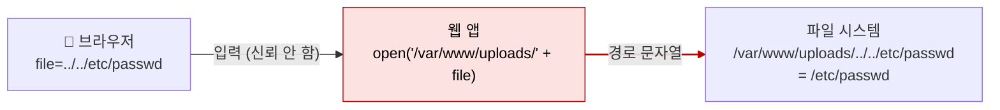

# 파일 업로드와 경로 조작 (File Upload & Path Traversal)

| 레벨 | 상태 | 최종 개정 | CWE |
|---|---|---|---|
| 🟡 실무 (7절은 🔴) | 🔄 개정중 | 2026-10-22 | [CWE-22](https://cwe.mitre.org/data/definitions/22.html) · [CWE-434](https://cwe.mitre.org/data/definitions/434.html) |

> **한눈에 보기**
> 파일명과 경로는 사용자 입력이다. `../`를 거르지 않으면 서버의 아무 파일이나 읽히고, 확장자만 믿으면 웹셸이 올라간다.
> 공격자는 설정 파일과 소스 코드를 읽고, 업로드한 스크립트를 실행해 서버를 장악한다.
> 막는 핵심은 하나다. **입력으로 경로를 만들지 말고, 만들었다면 정규화한 뒤 기준 디렉터리 안에 있는지 확인하라.**

## 1. 원리

경로 조작(path traversal)과 파일 업로드 취약점은 같은 뿌리를 가진다. 사용자가 보낸 문자열이 **파일 시스템의 경로**가 되는 순간, 신뢰 경계(trust boundary)가 무너진다. 파일 시스템은 `../`가 사용자 입력에서 왔는지 개발자가 쓴 것인지 구분하지 않는다. [SQL 인젝션](01-sql-injection.md)에서 DB 파서가 입력과 쿼리를 구분하지 못하는 것과 같은 구조다.



<figure>
<figcaption>그림 1. 기준 디렉터리를 앞에 붙여도 소용없다. 커널은 <code>..</code>를 만나면 한 단계 올라갈 뿐이다.</figcaption>
</figure>

두 가지 방향이 있다.

| 방향 | 입력이 가는 곳 | 공격자가 얻는 것 |
|---|---|---|
| **읽기** (traversal) | `open()`, `readFile()`, 정적 파일 서빙 | 설정 파일, 소스 코드, 키, `/proc/self/environ` |
| **쓰기** (upload) | `save()`, `move_uploaded_file()`, 압축 해제 | 웹셸, `.htaccess`, `authorized_keys`, cron 파일 덮어쓰기 |

쓰기 방향이 더 위험하다. 읽기는 기밀성 침해에서 끝나지만, 쓰기는 **실행**으로 이어진다. 업로드 취약점이 서버 장악으로 가는 경로는 항상 같다. "실행 가능한 파일을, 웹 서버가 실행하는 위치에, 공격자가 아는 이름으로" 올리는 것이다. 셋 중 하나만 끊어도 RCE는 막힌다.

### 정규화 순서라는 함정

경로 검사가 뚫리는 대부분의 이유는 **검사 시점과 해석 시점 사이에 변환이 끼어드는 것**이다.

```
입력 ──> [URL 디코딩] ──> [검사: '../' 있는가?] ──> [또 디코딩] ──> [정규화] ──> 파일 시스템
                                 ▲                       ▲
                        여기서는 '%2e%2e/'            여기서 '../'가 된다
```

검사는 "입력이 최종적으로 어떤 경로가 되는가"를 보고 해야 한다. 그래서 올바른 순서는 **먼저 정규화하고, 그 결과를 검사하는 것**이다. 검사 뒤에 어떤 변환도 끼어들면 안 된다.

### 널 바이트의 역사

C 문자열은 `\0`에서 끝난다. 고수준 언어는 `\0`을 포함한 문자열을 그대로 다루지만, 결국 파일을 여는 것은 C로 짜인 시스템 콜이다. 그래서 `shell.php\0.jpg`는 애플리케이션의 확장자 검사(`.jpg`로 끝남)는 통과하고, 파일 시스템에는 `shell.php`로 전달됐다. PHP는 5.3.4에서 경로에 널 바이트가 있으면 오류를 내도록 고쳤고([CVE-2006-7243](https://nvd.nist.gov/vuln/detail/CVE-2006-7243)), Java도 이후 `File` 경로에 널 바이트가 있으면 유효하지 않은 경로로 취급하도록 바뀌었다. 현재 주요 런타임에서는 거의 막혔지만, 오래된 런타임과 직접 작성한 C 확장에서는 아직 살아 있다.

## 2. 발생하는 코드 패턴

### Python (경로 연결)

```python
# ❌ 취약: 입력으로 경로를 만들고 아무 검사 없이 연다
from flask import request, send_file

@app.route("/download")
def download():
    name = request.args.get("file")
    return send_file("/var/www/uploads/" + name)
```

```python
# ❌ 취약: 검사는 하지만 정규화 전에 한다 (인코딩 변형에 뚫린다)
if "../" in name:
    abort(400)
return send_file("/var/www/uploads/" + name)
```

```python
# ✅ 안전: 정규화한 뒤 기준 디렉터리 안에 있는지 확인
import os

BASE = os.path.realpath("/var/www/uploads")

def safe_path(name: str) -> str:
    full = os.path.realpath(os.path.join(BASE, name))
    if os.path.commonpath([BASE, full]) != BASE:
        raise ValueError("path escapes base directory")
    return full
```

`realpath`는 `..`와 심볼릭 링크를 모두 해석한 **최종 경로**를 돌려준다. `commonpath` 비교는 `startswith` 비교와 다르다. `startswith("/var/www/uploads")`는 `/var/www/uploads_secret/`도 통과시킨다.

### Java (업로드 파일명 그대로 사용)

```java
// ❌ 취약: 클라이언트가 보낸 파일명을 그대로 저장 경로에 쓴다
String fileName = part.getSubmittedFileName();   // "../../webapps/ROOT/shell.jsp"
part.write(uploadDir + File.separator + fileName);
```

```java
// ✅ 안전: 이름은 서버가 정하고, 확장자는 허용 목록, 경로는 normalize 후 검사
Path base = Paths.get("/srv/uploads").toRealPath();
String ext = getExtension(part.getSubmittedFileName());      // 소문자로 정규화
if (!Set.of("png", "jpg", "pdf").contains(ext)) throw new IllegalArgumentException();
Path target = base.resolve(UUID.randomUUID() + "." + ext).normalize();
if (!target.startsWith(base)) throw new IllegalArgumentException();
Files.copy(part.getInputStream(), target);
```

### 압축 해제 (Zip Slip)

```python
# ❌ 취약: 아카이브 안의 항목 이름을 그대로 경로로 쓴다
import zipfile
with zipfile.ZipFile(upload) as z:
    for info in z.infolist():
        with open(os.path.join(dest, info.filename), "wb") as f:  # "../../.ssh/authorized_keys"
            f.write(z.read(info))
```

```python
# ✅ 안전: 항목마다 최종 경로를 검사하고, 크기 합계도 제한
MAX_TOTAL = 100 * 1024 * 1024
with zipfile.ZipFile(upload) as z:
    if sum(i.file_size for i in z.infolist()) > MAX_TOTAL:
        raise ValueError("archive too large when extracted")
    for info in z.infolist():
        target = safe_path_under(dest, info.filename)   # 2절 safe_path와 같은 검사
        with open(target, "wb") as f:
            f.write(z.read(info))
```

Python의 `ZipFile.extractall()`은 절대 경로와 `..`를 제거하지만, `tarfile.extractall()`은 3.12 이전 기본 동작이 그렇지 않다. Python 3.12부터 `filter="data"` 인자가 추가됐고 3.14부터 기본값이 된다. 라이브러리의 기본값을 믿지 말고 버전을 확인한다.

## 3. 탐지 방법

### 3.1 코드 리뷰 / 정적 분석

**싱크(sink)부터 찾는다.** 파일을 여는 모든 함수 호출을 모은 뒤, 경로 인자에 사용자 입력이 섞이는지 거슬러 올라간다.

```bash
# Python: open / send_file / os.path.join 에 요청 값이 들어가는가
grep -rnE "(open|send_file|send_from_directory|os\.path\.join)\s*\(.*(request\.|args|form|files)" --include='*.py' .
# Java: 파일명을 클라이언트에서 받아 경로에 쓰는가
grep -rnE "getSubmittedFileName|getOriginalFilename|new File\(.*\+" --include='*.java' .
# PHP
grep -rnE "(include|require|fopen|file_get_contents|move_uploaded_file)\s*\(.*\\\$_(GET|POST|FILES|REQUEST)" --include='*.php' .
# 압축 해제
grep -rnE "extractall|ZipEntry|getNextEntry|TarFile" -r .
```

**Semgrep**: 레지스트리 룰셋에 경로 조작 룰이 들어 있다.

```bash
semgrep --config p/python --config p/java .
```

**CodeQL**: `java/path-injection`, `py/path-injection`. 소스(요청 파라미터, 멀티파트 파일명, 아카이브 항목명)에서 싱크(파일 열기)까지의 흐름을 추적한다.

**리뷰에서 보는 것**

1. 경로 검사가 **정규화 뒤**에 있는가? `..` 문자열 검사만 있다면 인코딩 변형에 뚫린다.
2. 업로드 파일의 저장 이름을 **서버가 정하는가**, 클라이언트 값을 쓰는가?
3. 확장자 검사가 허용 목록인가, 차단 목록인가? 대소문자를 정규화하는가?
4. 저장 디렉터리가 웹 루트 안에 있는가? 거기서 스크립트가 실행되는가?
5. 압축 해제 코드가 항목 이름과 압축 해제 크기를 검사하는가?

### 3.2 동적 테스트

**경로 조작**: 파일명이나 경로처럼 보이는 모든 파라미터에 단계적으로 넣는다.

| 단계 | 입력 | 보는 것 |
|---|---|---|
| 1 | `../../../etc/passwd` | 응답에 `root:x:0:0` |
| 2 | `....//....//etc/passwd` | `../`를 한 번만 지우는 필터 우회 |
| 3 | `%2e%2e%2f`, `..%2f`, `%2e%2e/` | 검사 후 디코딩하는 필터 우회 |
| 4 | `%252e%252e%252f` | 이중 디코딩 |
| 5 | `/var/www/uploads/../../../etc/passwd` | "기준 경로로 시작해야 함" 검사 우회 |
| 6 | `../../../etc/passwd%00.png` | 확장자 검사 + 널 바이트 (오래된 런타임) |

Windows라면 `..\`, `..%5c`, `C:\Windows\win.ini`를 함께 시도한다.

**파일 업로드**: 다음 순서로 "어디까지 되는가"를 좁혀 간다.

1. 정상 파일을 올리고 **저장 위치와 URL**을 찾는다. 응답, HTML 소스, 이미지 `src`를 본다.
2. 확장자를 바꿔 본다. `.php`, `.phtml`, `.php5`, `.jsp`, `.jspx`, `.aspx`, `.svg`, `.html`.
3. `Content-Type`만 `image/png`로 바꾸고 내용은 스크립트로 올려 본다.
4. 파일 앞에 매직바이트(`\x89PNG`, `GIF89a`)를 붙이고 뒤에 스크립트를 붙여 본다 (폴리글롯).
5. 파일명에 `../`를 넣어 **저장 위치를 바꿀 수 있는가** 본다. 이것이 되면 확장자 검사는 의미가 없어진다.

자동화 도구(Burp Scanner, ffuf의 워드리스트)는 1~3단계를 빠르게 훑는다. 4~5단계와 "실행되는가"의 확인은 사람이 한다.

## 4. 실습 🧪

이 장은 전용 실습 환경이 없다. 두 가지 방법으로 따라 한다.

### 4.1 로컬 최소 재현 (10분)

```python
# vuln.py  (실습용. 실제 서비스에 쓰지 말 것)
from flask import Flask, request, send_file
app = Flask(__name__)

@app.route("/download")
def download():
    return send_file("/tmp/uploads/" + request.args["file"])   # ❌ 취약

if __name__ == "__main__":
    app.run(port=5000)
```

```bash
mkdir -p /tmp/uploads && echo hello > /tmp/uploads/a.txt
pip install flask && python3 vuln.py &
curl "http://127.0.0.1:5000/download?file=a.txt"                       # hello
curl --path-as-is "http://127.0.0.1:5000/download?file=../../etc/passwd" # root:x:0:0:...
```

`--path-as-is`는 curl이 `..`를 스스로 정리하지 않게 한다. 브라우저도 주소창에서 `..`를 정리하므로, 경로 조작 테스트는 항상 프록시나 curl로 한다. 그다음 2절의 `safe_path`를 적용하고 같은 요청이 400으로 끝나는지 확인한다. **고치는 것까지가 실습이다.**

### 4.2 공개 실습 환경

[PortSwigger Web Security Academy](https://portswigger.net/web-security)의 랩을 이 순서로 푼다. 각 랩은 3.2절의 한 단계에 대응한다.

| 순서 | 랩 | 익히는 것 |
|---|---|---|
| 1 | Path traversal: File path traversal, simple case | 기본 `../` |
| 2 | Path traversal: traversal sequences blocked with absolute path bypass | 절대 경로 |
| 3 | Path traversal: traversal sequences stripped non-recursively | `....//` |
| 4 | Path traversal: traversal sequences stripped with superfluous URL-decode | 이중 인코딩 |
| 5 | Path traversal: validation of file extension with null byte bypass | 널 바이트 |
| 6 | File upload: Remote code execution via web shell upload | 검사 없는 업로드 |
| 7 | File upload: Web shell upload via Content-Type restriction bypass | MIME 검사 우회 |
| 8 | File upload: Web shell upload via path traversal | 업로드 + 경로 조작 |
| 9 | File upload: Web shell upload via obfuscated file extension | 다중 확장자, 널 바이트 |
| 10 | File upload: Remote code execution via polyglot web shell upload | 매직바이트 + 스크립트 |

## 5. 익스플로잇 검증

"경로 조작 존재"만으로는 심각도를 정할 수 없다. 실습 환경 안에서 다음을 순서대로 확인한다.

| 단계 | 확인 | 심각도에 미치는 영향 |
|---|---|---|
| 1 | `/etc/passwd` 같은 무해한 파일이 읽힌다 | 취약점 존재 확인 |
| 2 | 애플리케이션 설정, 소스 코드, `.env`, `/proc/self/environ`이 읽힌다 | 기밀성 침해. 자격증명이 있으면 High |
| 3 | 웹 루트 바깥에 파일을 쓸 수 있다 | 무결성 침해. High |
| 4 | 쓴 파일이 실행된다 (웹셸, `.htaccess`, cron, `authorized_keys`) | 서버 장악. Critical |

2단계까지 증명하면 영향 판단에는 보통 충분하다. 4단계는 **허가받은 범위 안에서만** 한다. 실제 서비스에 웹셸을 올리는 것은 허가 범위를 넘는 경우가 대부분이고, 올린 파일은 반드시 제거하고 보고서에 경로를 남긴다. 웹셸 대신 `<?php echo "poc-" . (3*7); ?>`처럼 **실행 여부만 보여주는 무해한 파일**을 쓴다.

## 6. 방어

| 계층 | 조치 | 효과 |
|---|---|---|
| 코드 | 입력을 경로에 쓰지 않는다. 파일 ID → 서버 측 매핑 테이블 | 근본 제거 |
| 코드 | 불가피하면 **정규화(realpath) 후 기준 디렉터리 포함 검사** | 모든 인코딩 변형 무력화 |
| 코드 | 업로드 파일명은 서버가 생성(UUID), 확장자는 허용 목록, 소문자로 정규화 | 다중 확장자·대소문자 우회 차단 |
| 코드 | 내용 검사: 매직바이트 확인, 이미지는 재인코딩(resize 후 저장) | 폴리글롯 무력화 |
| 코드 | 압축 해제 시 항목별 경로 검사 + 해제 후 총 크기·항목 수 제한 | Zip Slip, 압축 폭탄 |
| 프레임워크 | `send_from_directory`, `Path.resolve().startsWith()` 같은 안전한 API 사용 | 기본값으로 차단 |
| 인프라 | 업로드 디렉터리를 **웹 루트 바깥**에 두고 별도 핸들러로 서빙 | 올라가도 실행되지 않는다 |
| 인프라 | 업로드 디렉터리에서 스크립트 실행 비활성화 (`php_admin_flag engine off`, `AllowOverride None`) | `.htaccess` 업로드 무력화 |
| 인프라 | 업로드 파일은 별도 도메인·CDN·오브젝트 스토리지에서 `Content-Disposition: attachment`로 서빙 | XSS·HTML 업로드 피해 축소 |
| 인프라 | 웹 서버 프로세스의 파일 시스템 권한 최소화 | 읽히는 파일의 범위 축소 |
| 탐지 | 요청 경로에 `..`, `%2e`, 업로드 직후 해당 URL 실행 요청 알림 | 사후 대응 |

**하지 말아야 할 것**

- `../` 문자열 제거. 한 번만 지우면 `....//`가 남고, 반복해서 지워도 인코딩 변형은 못 잡는다.
- 확장자 차단 목록. `.php`를 막으면 `.phtml`, `.phar`, `.php7`, `.pHp`가 있다.
- `Content-Type` 헤더 신뢰. 클라이언트가 보내는 값이다.
- "이미지 뷰어에서 열리니까 이미지다"라는 판단. 폴리글롯은 이미지이면서 스크립트다.

## 7. 우회 기법 🔴

방어가 불완전할 때 공격자가 쓰는 기법. **왜 문자열 검사로는 안 되는지**를 이해하기 위해 읽는다.

| 방어 | 우회 |
|---|---|
| `../` 1회 제거 | `....//`, `..././` (지운 뒤 다시 `../`가 된다) |
| 검사 후 URL 디코딩 | `%2e%2e%2f`, `..%2f`, `%2e%2e/` |
| 이중 디코딩 경로 | `%252e%252e%252f` |
| "기준 경로로 시작" 검사 | `/var/www/uploads/../../etc/passwd` |
| "허용 확장자로 끝남" 검사 | `shell.php%00.png` (오래된 런타임), `shell.php/` 또는 `shell.php.` (일부 서버가 뒤를 잘라냄) |
| 확장자 차단 목록 | `.phtml`, `.phar`, `.phP`, `.php.png` + Apache `AddHandler` 다중 확장자 해석 |
| 확장자 검사만 있음 | `.htaccess` 업로드로 `.png`를 PHP로 실행하도록 설정, `.user.ini` + `auto_prepend_file` |
| MIME 검사 | `Content-Type` 헤더 변조 |
| 매직바이트 검사 | 폴리글롯: `GIF89a<?php ... ?>` |
| 이미지 재인코딩 | 재인코딩 후에도 살아남는 영역(JPEG 주석, PLTE 청크)에 페이로드 삽입. 실전 난도 높음 |
| 경로 정규화 (Apache 2.4.49) | `.%2e/` (CVE-2021-41773), 수정 후 `.%%32%65/` 이중 인코딩 (CVE-2021-42013) |
| Windows 경로 | `..\`, `..%5c`, 짧은 이름 `PROGRA~1`, 대체 데이터 스트림 `file.php::$DATA` |

**Zip Slip**(2018, Snyk 공개)은 "업로드 검사는 완벽한데 압축 해제가 뚫리는" 경우다. 아카이브 항목 이름 `../../../../tmp/evil.sh`는 업로드 단계의 파일명 검사를 거치지 않는다. 수십 개 라이브러리에 같은 결함이 있었고, 대표적으로 Maven이 쓰는 plexus-archiver가 3.6.0에서 고쳤다([CVE-2018-1002200](https://nvd.nist.gov/vuln/detail/CVE-2018-1002200)). Java에는 안전한 기본 압축 해제 API가 없어 모든 라이브러리가 각자 구현했고, 그래서 각자 틀렸다.

**압축 폭탄**(decompression bomb)은 경로가 아니라 **크기**를 노린다. 유명한 `42.zip`은 42KB이지만 5단계 중첩을 모두 풀면 📎 [약 4.5PB](https://en.wikipedia.org/wiki/Zip_bomb)가 된다. 바이러스 스캐너와 썸네일 생성기처럼 "업로드되면 자동으로 여는" 백엔드가 표적이다. 방어는 압축 해제 **전**에 헤더의 원본 크기를 읽고, 해제 **중**에 누적 크기를 세다가 한도에서 멈추는 것이다. 헤더의 크기 값은 위조될 수 있으므로 둘 다 필요하다.

## 8. 실제 CVE 사례

| CVE | 제품 | 핵심 | 패치 |
|---|---|---|---|
| [CVE-2021-41773](https://nvd.nist.gov/vuln/detail/CVE-2021-41773) | Apache HTTP Server 2.4.49 | 경로 정규화 변경으로 `.%2e/`가 걸러지지 않음. Alias 디렉터리 밖 파일 읽기, CGI 활성 시 RCE. 공개 당시 이미 공격 중 | [2.4.50 공지](https://httpd.apache.org/security/vulnerabilities_24.html) |
| [CVE-2021-42013](https://nvd.nist.gov/vuln/detail/CVE-2021-42013) | Apache HTTP Server 2.4.49~2.4.50 | 41773의 불완전 수정. `.%%32%65/` 이중 인코딩으로 우회 | [2.4.51 공지](https://httpd.apache.org/security/vulnerabilities_24.html) |
| [CVE-2023-50164](https://nvd.nist.gov/vuln/detail/CVE-2023-50164) | Apache Struts 2 | 멀티파트 업로드 파라미터 조작으로 저장 경로 변경 → 웹 루트에 파일 쓰기 → RCE | [S2-066](https://cwiki.apache.org/confluence/display/WW/S2-066) |
| [CVE-2024-53677](https://nvd.nist.gov/vuln/detail/CVE-2024-53677) | Apache Struts 2 (6.4.0 미만) | 구 `FileUploadInterceptor` 경로의 같은 계열 결함. 새 업로드 메커니즘으로 이전해야 해결 | [S2-067](https://cwiki.apache.org/confluence/display/WW/S2-067) |
| [CVE-2018-1002200](https://nvd.nist.gov/vuln/detail/CVE-2018-1002200) | plexus-archiver (3.6.0 미만) | Zip Slip. 아카이브 항목 이름의 `../`로 임의 위치 쓰기 | [Snyk 공개](https://snyk.io/research/zip-slip-vulnerability) |
| [CVE-2024-23334](https://nvd.nist.gov/vuln/detail/CVE-2024-23334) | aiohttp (3.9.2 미만) | 정적 파일 서빙에서 `follow_symlinks=True`일 때 기준 디렉터리 검사 누락 | [aiohttp 보안 권고](https://github.com/aio-libs/aiohttp/security/advisories) |
| [CVE-2006-7243](https://nvd.nist.gov/vuln/detail/CVE-2006-7243) | PHP (5.3.4 미만) | 경로의 널 바이트 허용. `.php\0.jpg`로 확장자 검사 우회 | 5.3.4에서 널 포함 경로를 오류 처리 |

**Apache (CVE-2021-41773 → 42013) 에서 배울 것**: 2.4.49에서 경로 정규화 함수(`ap_normalize_path`)를 새로 짜면서 URL 인코딩된 점(`%2e`)을 점으로 인식하지 못했다. 2.4.50의 수정은 한 겹의 인코딩만 처리해 이중 인코딩에 다시 뚫렸다. **정규화와 검사의 순서**, 그리고 "불완전한 수정은 공격자에게 두 번째 기회"라는 교훈을 한 사례가 모두 보여 준다. 두 번째 CVE가 나오기까지 걸린 시간은 사흘이었다.

**Struts (CVE-2023-50164) 에서 배울 것**: 공개 분석 기준으로, 업로드 파라미터 이름의 대소문자 처리 불일치를 이용해 파일명 파라미터를 덮어써 저장 경로를 바꿀 수 있었다. 확장자 검사가 있어도 **저장 위치를 공격자가 정할 수 있으면** 무의미하다는 2절의 논지 그대로다. 1년 뒤 같은 코드 경로에서 CVE-2024-53677이 나왔고, Apache는 "구 업로드 메커니즘 자체를 버리라"고 안내했다.

**aiohttp (CVE-2024-23334) 에서 배울 것**: 패치는 요청 경로를 해석한 결과가 정적 루트 아래인지 확인하는 검사를 추가했다. "심볼릭 링크 따라가기" 옵션을 켠 사용자만 영향받았다. 옵션 하나가 보안 검사 한 줄을 건너뛰게 만든 사례다.

## 9. 체크리스트

**코드 리뷰할 때**
- [ ] 파일을 여는 모든 호출에서 경로가 리터럴이거나 서버 측 매핑에서 오는가?
- [ ] 입력이 경로에 들어간다면 정규화(realpath/normalize) **뒤에** 기준 디렉터리 검사가 있는가?
- [ ] 업로드 저장 이름을 서버가 생성하는가? 클라이언트 파일명이 경로에 쓰이지 않는가?
- [ ] 확장자 검사가 허용 목록이고 소문자 정규화를 거치는가?
- [ ] 압축 해제 코드가 항목 이름과 누적 크기를 검사하는가? `tarfile`이라면 `filter` 인자를 쓰는가?

**테스트할 때**
- [ ] 경로처럼 보이는 모든 파라미터에 3.2절 표의 6단계를 시도했는가? (`--path-as-is`)
- [ ] 업로드 기능에서 저장 위치·URL을 찾았는가? 거기서 스크립트가 실행되는가?
- [ ] 파일명에 `../`를 넣어 저장 위치를 바꿀 수 있는가?
- [ ] 압축 파일을 받는 기능이 있다면 Zip Slip과 크기 한도를 확인했는가?

**배포 전**
- [ ] 업로드 디렉터리가 웹 루트 바깥이거나 스크립트 실행이 꺼져 있는가?
- [ ] 업로드 파일이 별도 도메인에서 `attachment`로 서빙되는가?
- [ ] 웹 서버 프로세스가 설정 파일·소스 코드를 읽을 권한이 최소화되어 있는가?
- [ ] SAST에 `path-injection` 계열 룰이 켜져 있는가?

## 10. 더 읽기

- [CWE-22: Path Traversal](https://cwe.mitre.org/data/definitions/22.html) · [CWE-434: Unrestricted Upload of File with Dangerous Type](https://cwe.mitre.org/data/definitions/434.html) · [CWE-409: Improper Handling of Highly Compressed Data](https://cwe.mitre.org/data/definitions/409.html)
- [OWASP File Upload Cheat Sheet](https://cheatsheetseries.owasp.org/cheatsheets/File_Upload_Cheat_Sheet.html) · 업로드 검증의 계층별 권고
- [Apache HTTP Server 2.4 vulnerabilities](https://httpd.apache.org/security/vulnerabilities_24.html) · CVE-2021-41773/42013의 공식 기록
- [Snyk, "Zip Slip Vulnerability" (2018)](https://snyk.io/research/zip-slip-vulnerability) · 영향받은 라이브러리 목록과 안전한 코드 예
- [Python `tarfile` 문서: Extraction filters](https://docs.python.org/3/library/tarfile.html#extraction-filters) · 3.12에서 추가된 `filter` 인자
- [PortSwigger Web Security Academy: Path traversal](https://portswigger.net/web-security/file-path-traversal) · [File upload vulnerabilities](https://portswigger.net/web-security/file-upload) · 4.2절의 랩

## 변경 이력

| 날짜 | 변경 | 기여자 |
|---|---|---|
| 2026-10-21 | 초안(뼈대) 작성 | @anthonynoh5202 |
| 2026-10-22 | 10섹션 전체 작성. CVE 7건, 로컬 재현 코드, PortSwigger 랩 목록 추가 | @anthonynoh5202 |
