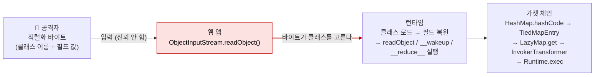

# 안전하지 않은 역직렬화 (Insecure Deserialization)

| 레벨 | 상태 | 최종 개정 | CWE |
|---|---|---|---|
| 🔴 시니어 (1~2절은 🟡) | 🔄 개정중 | 2026-10-22 | [CWE-502](https://cwe.mitre.org/data/definitions/502.html) |

> **한눈에 보기**
> 직렬화된 바이트를 믿고 객체로 되살리면, 공격자가 "어떤 클래스의 어떤 메서드가 어떤 순서로 실행될지"를 정한다.
> 애플리케이션 코드는 한 줄도 바뀌지 않았는데 클래스패스에 이미 있는 코드 조각이 이어져 임의 명령이 실행된다.
> 막는 핵심은 하나다. **신뢰할 수 없는 바이트를 네이티브 직렬화 포맷으로 받지 말라.** 받아야 한다면 허용 목록으로 클래스를 제한하라.

## 1. 원리

직렬화(serialization)는 메모리 속 객체 그래프를 바이트로 바꾸는 것이고, 역직렬화(deserialization)는 그 반대다. 문제는 네이티브 직렬화 포맷이 **데이터만이 아니라 클래스 이름과 객체 구조까지** 담는다는 점이다. 바이트 스트림이 "나는 `java.util.HashMap`이다", "나는 `InvokerTransformer`이고 `Runtime.exec`를 호출한다"고 말하면 런타임은 그대로 그 클래스를 만든다.



<figure>
<figcaption>그림 1. 신뢰 경계는 <code>readObject()</code> 한 줄에서 무너진다. 그 뒤로는 공격자가 고른 클래스들의 메서드가 런타임에 의해 자동으로 호출된다.</figcaption>
</figure>

핵심은 세 가지다.

1. **역직렬화 중에 코드가 실행된다.** Java의 `readObject()`, PHP의 `__wakeup()`·`__destruct()`, Python의 `__reduce__()`, .NET의 `OnDeserialized` 콜백처럼, 객체를 되살리는 동안 런타임이 자동으로 호출하는 메서드("매직 메서드")가 있다.
2. **클래스 선택권이 입력에 있다.** 애플리케이션은 `User` 객체를 기대하지만, 스트림이 `HashMap`이라고 하면 `HashMap`이 만들어진다. 타입 검사는 보통 역직렬화가 끝난 **뒤**에 일어난다. 그때는 이미 늦다.
3. **가젯(gadget)은 이미 거기 있다.** 공격자는 코드를 올리지 않는다. 클래스패스에 있는 라이브러리(Commons Collections, Spring, Groovy, JDK 자체) 안에서 "역직렬화 중 호출되는 메서드 → 다른 객체의 메서드 → … → `Runtime.exec`"로 이어지는 호출 사슬을 찾는다. 이것이 **가젯 체인**(gadget chain)이다.

### 언어별 모습

| 언어 | 위험한 진입점 | 자동 실행되는 것 | 대표 가젯 소스 |
|---|---|---|---|
| Java | `ObjectInputStream.readObject()`, RMI, JMX, T3, XStream·Jackson 다형 타입 | `readObject`, `readResolve`, `hashCode`/`compareTo`(컬렉션 복원 시) | Commons Collections, Spring, Groovy, JDK (`URLDNS`) |
| PHP | `unserialize()`, `phar://` 스트림 래퍼 | `__wakeup`, `__destruct`, `__toString` | 프레임워크·라이브러리 클래스 (POP 체인) |
| Python | `pickle.loads()`, `yaml.load()`(5.1 미만), `shelve`, `jsonpickle` | `__reduce__`가 돌려주는 (callable, args) | 가젯이 필요 없다. `os.system`을 직접 지정한다 |
| .NET | `BinaryFormatter`, `SoapFormatter`, `NetDataContractSerializer`, `LosFormatter`(ViewState), Json.NET `TypeNameHandling` | `OnDeserialized`, 생성자, 프로퍼티 setter | ysoserial.net 가젯 (`TypeConfuseDelegate`, `ObjectDataProvider` 등) |

Python pickle이 가장 극단적이다. `__reduce__`는 "이 객체를 되살리려면 이 함수를 이 인자로 호출하라"는 뜻이고, 함수에 `os.system`을 써도 된다. 가젯 체인을 찾을 필요조차 없다. Python 공식 문서는 pickle 모듈 첫머리에서 "신뢰할 수 없는 출처의 데이터를 언피클하지 말라"고 경고한다.

### ysoserial의 원리

[ysoserial](https://github.com/frohoff/ysoserial)은 Chris Frohoff와 Gabriel Lawrence가 2015년 AppSec California 발표 "Marshalling Pickles"와 함께 공개한 도구다. 하는 일은 단순하다. 알려진 가젯 체인마다 "명령 문자열을 받아 그 명령을 실행하도록 구성한 객체 그래프"를 만들고, 그것을 직렬화해 바이트로 내보낸다. 사용자는 `java -jar ysoserial.jar CommonsCollections6 'id'`처럼 체인 이름과 명령만 고른다. 공격자가 코드를 짜지 않아도 되게 만든 것이 2015년 이후 이 취약점이 폭발한 이유다. PHP에는 [phpggc](https://github.com/ambionics/phpggc), .NET에는 [ysoserial.net](https://github.com/pwntester/ysoserial.net)이 같은 역할을 한다.

## 2. 발생하는 코드 패턴

### Java

```java
// ❌ 취약: 요청 본문을 그대로 역직렬화
ObjectInputStream ois = new ObjectInputStream(request.getInputStream());
Object obj = ois.readObject();           // 여기서 이미 가젯 체인이 실행된다
User user = (User) obj;                  // 캐스팅은 너무 늦다
```

```java
// ✅ 안전 1: 포맷을 바꾼다. 클래스 선택권을 입력에서 빼앗는다
User user = objectMapper.readValue(request.getInputStream(), User.class);  // Jackson, 기본 타이핑 끔

// ✅ 안전 2: 불가피하게 네이티브 직렬화를 써야 하면 허용 목록 필터 (JEP 290, Java 9+ / 8u121+)
ObjectInputFilter filter = ObjectInputFilter.Config.createFilter(
        "com.example.model.*;java.util.ArrayList;java.lang.*;!*");
ObjectInputStream ois = new ObjectInputStream(in);
ois.setObjectInputFilter(filter);
User user = (User) ois.readObject();
```

필터 문법에서 `!*`가 핵심이다. 나열하지 않은 모든 클래스를 거부한다. 차단 목록(`!org.apache.commons.collections.*`)만 쓰는 것은 다음 가젯이 나오면 끝이다.

### PHP

```php
// ❌ 취약: 쿠키를 unserialize
$data = unserialize($_COOKIE['session']);
```

```php
// ✅ 안전: JSON으로 바꾸고, 꼭 써야 하면 allowed_classes 지정
$data = json_decode($_COOKIE['session'], true);
// 또는
$data = unserialize($raw, ['allowed_classes' => false]);   // 객체를 전혀 만들지 않는다 (PHP 7.0+)
```

### Python

```python
# ❌ 취약
import pickle
obj = pickle.loads(base64.b64decode(request.cookies["state"]))

# ❌ 취약: PyYAML 5.1 미만의 yaml.load()는 임의 Python 객체를 만든다 (CVE-2017-18342)
cfg = yaml.load(request.data)
```

```python
# ✅ 안전
obj = json.loads(request.cookies["state"])
cfg = yaml.safe_load(request.data)
# 서명으로 무결성을 보장해도 되지만, 키가 새면 끝이므로 포맷 교체가 우선이다
```

### .NET

```csharp
// ❌ 취약: BinaryFormatter는 "안전하게 만들 수 없다"는 것이 Microsoft의 공식 입장
var formatter = new BinaryFormatter();
var obj = formatter.Deserialize(request.InputStream);
```

```csharp
// ✅ 안전: System.Text.Json (타입은 코드가 정한다)
var user = JsonSerializer.Deserialize<User>(body);
// Json.NET을 쓴다면 TypeNameHandling은 None(기본값)을 유지한다
```

Microsoft는 .NET 9에서 `BinaryFormatter` 구현을 런타임에서 제거했다. 호출하면 항상 예외가 난다. .NET Framework에는 남아 있지만 사용 중단을 권고한다.

## 3. 탐지 방법

### 3.1 코드 리뷰 / 정적 분석

**싱크를 전부 찾는다.** 역직렬화 진입점은 언어마다 이름이 정해져 있어 grep이 잘 듣는다.

```bash
# Java
grep -rnE "ObjectInputStream|readObject\(|readUnshared|XMLDecoder|XStream|enableDefaultTyping|activateDefaultTyping" --include='*.java' .
# PHP
grep -rnE "unserialize\s*\(|phar://" --include='*.php' .
# Python
grep -rnE "pickle\.loads?|cPickle|yaml\.load\(|jsonpickle|shelve|marshal\.loads" --include='*.py' .
# .NET
grep -rnE "BinaryFormatter|SoapFormatter|NetDataContractSerializer|LosFormatter|ObjectStateFormatter|TypeNameHandling" --include='*.cs' .
```

각 싱크에 대해 묻는다. **입력이 어디서 오는가?** 쿠키, 요청 본문, 메시지 큐, 캐시(Redis·Memcached), 파일 업로드, 데이터베이스 컬럼. "DB에서 온다"는 안전하지 않다. 다른 경로로 DB에 쓸 수 있으면 second-order다.

**Semgrep**: `p/java`, `p/python`, `p/php`, `p/csharp` 룰셋에 역직렬화 싱크 룰이 들어 있다. **CodeQL**: `java/unsafe-deserialization`, `py/unsafe-deserialization`.

**의존성 검사도 리뷰다.** 역직렬화 싱크가 있다면 클래스패스에 어떤 가젯 라이브러리가 있는지 본다. `mvn dependency:tree | grep -iE "commons-collections|commons-beanutils|groovy|spring-core"`. 가젯 라이브러리의 존재 자체는 취약점이 아니지만, 싱크와 결합하면 익스플로잇 가능성이 된다.

### 3.2 동적 테스트

**1단계: 직렬화 데이터 알아보기.** 쿠키, 숨은 폼 필드, 요청 본문에서 포맷의 지문을 찾는다.

| 포맷 | 지문 (raw) | Base64 시작 |
|---|---|---|
| Java | `AC ED 00 05` | `rO0AB` |
| PHP | `O:4:"User":2:{s:4:"name";...}` | `Tzo` |
| Python pickle | `\x80\x04` (프로토콜 4), `\x80\x03` | `gASV`, `gAN` |
| .NET BinaryFormatter | `00 01 00 00 00 FF FF FF FF` | `AAEAAAD/////` |
| .NET ViewState | `__VIEWSTATE` 필드 | `/wE` |

**2단계: 구조 바꾸기.** PHP처럼 사람이 읽을 수 있는 포맷이면 필드 값을 바꿔 본다. `s:5:"admin";b:0` → `b:1`. 가젯 없이도 권한 상승이 되는 경우가 많다.

**3단계: 영향 없는 가젯으로 "역직렬화가 일어나는가" 확인.** ysoserial의 `URLDNS` 체인은 JDK 클래스만 쓰고, DNS 조회 하나만 일으킨다. Burp Collaborator나 자체 DNS 로그에 조회가 찍히면 역직렬화가 확인된 것이다.

```bash
java -jar ysoserial.jar URLDNS "http://<your-collaborator-id>.oastify.com" | base64 -w0
```

**4단계: 가젯 라이브러리 추정.** 에러 메시지의 스택 트레이스, `ClassNotFoundException`에 찍힌 클래스 이름, 응답 헤더의 프레임워크 버전으로 클래스패스를 추정한 뒤 체인을 고른다. 시간 지연 가젯(`sleep`)으로 실행 여부를 확인하고 멈춘다.

자동화: Burp 확장 [Java Deserialization Scanner](https://github.com/federicodotta/Java-Deserialization-Scanner)가 1~4단계를 돕는다. 하지만 어떤 체인이 통하는지 판단하는 것은 사람의 일이다.

## 4. 실습 🧪

### 4.1 로컬 최소 재현 (Python, 5분)

가젯 체인 없이 원리만 본다. `__reduce__`가 "되살릴 때 이 함수를 호출하라"는 뜻임을 눈으로 확인한다.

```python
# demo.py  (실습용. 명령은 무해한 echo로 고정한다)
import pickle, os

class Evil:
    def __reduce__(self):
        return (os.system, ("echo pickle-executed-this",))

payload = pickle.dumps(Evil())
print(payload[:20])            # b'\x80\x04\x95...' 지문 확인 (Python 3.14부터는 기본 프로토콜 5 → \x80\x05)
pickle.loads(payload)          # ← 이 줄에서 echo가 실행된다. 객체는 만들어지지도 않는다
```

`pickle.loads`의 반환값은 `os.system`의 반환값(0)이다. `Evil` 인스턴스는 생기지 않는다. 역직렬화가 "객체 복원"이 아니라 "명령 실행"이 될 수 있음을 이 세 줄이 보여 준다. 그다음 `json.loads`로 바꿔 같은 입력이 예외로 끝나는지 확인한다(bytes 입력은 `UnicodeDecodeError`, 문자열 입력은 `JSONDecodeError`).

### 4.2 공개 실습 환경

[PortSwigger Web Security Academy: Insecure deserialization](https://portswigger.net/web-security/deserialization)의 랩을 순서대로 푼다.

| 순서 | 랩 | 익히는 것 |
|---|---|---|
| 1 | Modifying serialized objects | PHP 직렬화 구조 읽고 필드 바꾸기 (3.2절 2단계) |
| 2 | Modifying serialized data types | 타입 저글링과 결합 |
| 3 | Using application functionality to exploit insecure deserialization | `__destruct`가 파일을 지우는 경우 |
| 4 | Arbitrary object injection in PHP | 소스 코드에서 매직 메서드 찾기 |
| 5 | Exploiting Java deserialization with Apache Commons | ysoserial + Commons Collections |
| 6 | Exploiting PHP deserialization with a pre-built gadget chain | phpggc + 서명 쿠키 |
| 7 | Developing a custom gadget chain for Java deserialization | 가젯 체인을 직접 잇기 🔴 |
| 8 | Using PHAR deserialization to deploy a custom gadget chain | `phar://` 경로 🔴 |

## 5. 익스플로잇 검증

| 단계 | 확인 | 심각도에 미치는 영향 |
|---|---|---|
| 1 | 직렬화 포맷이 식별되고, 값을 바꾸면 애플리케이션 동작이 바뀐다 | 역직렬화 존재. 값 변조만으로 권한 상승이면 High |
| 2 | `URLDNS` 같은 무해 가젯으로 외부 조회가 발생한다 | 임의 클래스 역직렬화 확인 |
| 3 | 시간 지연 가젯으로 코드 실행이 확인된다 | RCE 확인. Critical |
| 4 | 실행 컨텍스트(사용자, 네트워크 위치) 확인 | 피해 범위 산정 |

3단계에서 멈춘다. `id`나 `whoami` 출력이 필요하면 허가 범위를 다시 확인하고 OOB 채널로 결과만 받는다. 역직렬화 RCE는 거의 항상 Critical이며, 인증 전 진입점이면 더 그렇다. CVSS보다 "어디서 들어오는 바이트인가"가 심각도를 결정한다. [8부 2장](../part8-reporting/02-severity.md).

## 6. 방어

| 계층 | 조치 | 효과 |
|---|---|---|
| 코드 | **포맷 교체**: JSON·Protobuf처럼 클래스 정보를 담지 않는 포맷. 타입은 코드가 정한다 | 근본 제거 |
| 코드 | 네이티브 직렬화가 불가피하면 **허용 목록** 필터 (`ObjectInputFilter` + `!*`, `allowed_classes`, `RestrictedUnpickler.find_class`) | 가젯 클래스 로드 차단 |
| 코드 | 직렬화 데이터에 HMAC 서명, 검증 **후** 역직렬화 | 변조 차단. 키 유출·고정 키(CVE-2020-0688)에는 무력 |
| 프레임워크 | Jackson `enableDefaultTyping`·Json.NET `TypeNameHandling` 끔, XStream 허용 목록, PyYAML `safe_load` | 다형 타입 역직렬화 차단 |
| 프레임워크 | JVM 전역 필터 `-Djdk.serialFilter=...`, Commons Collections 3.2.2+ / 4.1+ | 애플리케이션 코드를 못 고칠 때의 안전망 |
| 인프라 | RMI·JMX·T3 포트 외부 노출 차단, 역직렬화 서비스 격리·최소 권한 | 인증 전 진입점 제거, 피해 축소 |
| 인프라 | 가젯 라이브러리 버전 관리 (SCA) | 알려진 체인 제거. 새 체인에는 무력 |
| 탐지 | 요청에 `rO0AB`, `AAEAAAD`, `O:` 패턴 알림. 웹 프로세스의 자식 프로세스 생성 감시 | 사후 대응 |

**하지 말아야 할 것**

- 차단 목록. WebLogic은 CVE-2015-4852 이후 차단 목록으로 대응했고, 같은 T3 경로에서 [CVE-2017-3248](https://nvd.nist.gov/vuln/detail/CVE-2017-3248), [CVE-2018-2628](https://nvd.nist.gov/vuln/detail/CVE-2018-2628) 등 우회가 수년간 이어졌다.
- "가젯 라이브러리만 빼면 된다"는 생각. Apache도 Commons Collections 3.2.2를 내며 "이것이 유일한 가젯이 아니다"라고 명시했다. JDK 자체에도 가젯이 있다.
- "역직렬화 뒤에 `instanceof`로 검사한다". 코드 실행은 역직렬화 **중**에 끝난다.

## 7. 우회 기법 🔴

| 방어 | 우회 |
|---|---|
| 클래스 차단 목록 | 목록에 없는 새 가젯 체인. 차단된 클래스를 다른 직렬화 메커니즘(RMI 원격 객체, JRMP)으로 감싸 필터를 건너뛰는 변형 |
| JEP 290 필터의 깊이·크기 제한 | 제한 안에 들어오는 짧은 체인 선택 |
| "Java 직렬화 안 씀, JSON 씀" | Jackson `enableDefaultTyping` ([CVE-2017-7525](https://nvd.nist.gov/vuln/detail/CVE-2017-7525)), Json.NET `TypeNameHandling.All`, XStream, fastjson `autoType`. JSON·XML 안에 클래스 이름을 쓰게 하는 설정이 있으면 같은 문제다 |
| PHP `unserialize` 입력 없음 | `phar://` 래퍼. `file_exists()`, `is_file()`, `getimagesize()` 같은 파일 함수에 `phar://업로드파일`을 넘기면 phar 메타데이터가 역직렬화된다. Sam Thomas, Black Hat USA 2018 |
| PHP 7.4+ `__unserialize` | 구 `__wakeup` 대신 새 메서드를 쓰는 클래스에서 다시 체인을 찾는다 |
| Python `RestrictedUnpickler` | `find_class`에서 허용한 모듈 안의 위험한 속성(예: `builtins.getattr`)을 디딤돌로 사용 |
| .NET ViewState MAC | 머신 키가 고정·유출된 경우 서명을 직접 만든다 (CVE-2020-0688). `ysoserial.net -p ViewState` |
| 서명 검증 | 키가 소스 코드·설정 파일에 있고 다른 취약점(경로 조작, SSRF)으로 읽힌다 |

**Log4Shell과의 관계**: [CVE-2021-44228](../part7-walkthroughs/01-cve-2021-44228-log4shell.md)은 JNDI 조회를 통해 원격 클래스를 로드하거나, 그것이 막힌 JDK에서는 **LDAP 응답 안의 직렬화 객체를 역직렬화**하는 경로로 RCE에 도달했다. 역직렬화 가젯이 다른 취약점의 2차 단계로 쓰이는 대표 사례다.

## 8. 실제 CVE 사례

| CVE | 제품 | 핵심 | 패치 |
|---|---|---|---|
| [CVE-2015-4852](https://nvd.nist.gov/vuln/detail/CVE-2015-4852) | Oracle WebLogic Server | T3 프로토콜(7001/tcp)로 보낸 직렬화 객체를 역직렬화. 번들된 Commons Collections 가젯. 인증 불필요 | [Oracle 권고](https://www.oracle.com/security-alerts/alert-cve-2015-4852.html) |
| [CVE-2015-8103](https://nvd.nist.gov/vuln/detail/CVE-2015-8103) | Jenkins (1.638 / LTS 1.625.2 미만) | CLI 포트가 원격에서 직렬화 객체를 받음. Commons Collections·Groovy 가젯 | [Jenkins 권고 SECURITY-218](https://www.jenkins.io/security/advisory/2015-11-11/) |
| [CVE-2017-9805](https://nvd.nist.gov/vuln/detail/CVE-2017-9805) | Apache Struts 2 REST 플러그인 | XStream이 XML 요청을 타입 제한 없이 역직렬화. 인증 불필요 RCE | [S2-052](https://cwiki.apache.org/confluence/display/WW/S2-052) |
| [CVE-2019-2725](https://nvd.nist.gov/vuln/detail/CVE-2019-2725) | Oracle WebLogic Server | `wls9_async_response.war`·`wls-wsat.war`가 SOAP 본문의 XML 인코딩 Java 객체를 역직렬화. 공개 며칠 만에 크립토마이너 배포에 악용 | [Oracle 권고](https://www.oracle.com/security-alerts/alert-cve-2019-2725.html) |
| [CVE-2020-0688](https://nvd.nist.gov/vuln/detail/CVE-2020-0688) | Microsoft Exchange Server (ECP) | 모든 설치본이 같은 `validationKey`·`decryptionKey`를 사용. ViewState 서명을 위조해 .NET 역직렬화 RCE (SYSTEM 권한) | [MS 권고](https://msrc.microsoft.com/update-guide/vulnerability/CVE-2020-0688) |

**WebLogic (CVE-2015-4852) 에서 배울 것**: 권고문·공개 분석 기준으로, Oracle은 T3 역직렬화 경로에 클래스 차단 목록을 넣는 방식으로 대응했다. 이후 CVE-2017-3248, CVE-2018-2628, CVE-2019-2725 등 WebLogic 역직렬화 CVE가 매년 이어졌다. 차단 목록의 한계를 보여 주는 가장 긴 사례다. 한편 Apache는 같은 달 Commons Collections 3.2.2를 내며 `InvokerTransformer` 등 함수자(functor) 클래스의 직렬화를 기본 비활성화했다(복원하려면 `org.apache.commons.collections.enableUnsafeSerialization=true`). 가젯 쪽에서 막는 것과 싱크 쪽에서 막는 것, 둘 다 필요하다는 뜻이다.

**Jenkins (CVE-2015-8103) 에서 배울 것**: 권고문 기준으로, CLI 역직렬화 경로에 클래스 필터를 적용했다. 그러나 근본 해법은 "원격에서 Java 직렬화를 받는 CLI 프로토콜" 자체를 없애는 것이었고, Jenkins는 이후 수년에 걸쳐 그 방향으로 갔다. 2017년 Oracle이 JEP 290을 8u121·7u131·6u141까지 백포트한 것도 이 시기의 사건들이 배경이다.

**Struts (CVE-2017-9805) 에서 배울 것**: 권고문 기준으로, 패치는 XStream에 타입 허용 목록을 적용했다. "XML이니까 역직렬화가 아니다"가 틀렸음을 보여 준다. 포맷이 아니라 **입력이 클래스를 고를 수 있는가**가 기준이다. 같은 해 Struts의 OGNL 인젝션 [CVE-2017-5638](../part7-walkthroughs/03-cve-2017-5638-struts.md)과 함께, "프레임워크가 입력을 코드로 해석하는" 두 가지 경로를 비교해 읽으면 좋다.

**Exchange (CVE-2020-0688) 에서 배울 것**: 패치는 설치 시 키를 무작위로 생성하게 바꿨다. 역직렬화 싱크(ViewState)는 그대로 두고 서명 키만 고친 것이다. 서명은 "키가 비밀일 때만" 방어다. 6절에서 서명을 포맷 교체 아래에 둔 이유다.

## 9. 체크리스트

**코드 리뷰할 때**
- [ ] 3.1절의 싱크 함수 호출이 있는가? 각각의 입력 출처를 추적했는가?
- [ ] JSON·XML 라이브러리에 다형 타입 설정(`enableDefaultTyping`, `TypeNameHandling`, XStream 무제한)이 켜져 있는가?
- [ ] 네이티브 직렬화가 불가피하다면 허용 목록 필터가 `!*`로 끝나는가?
- [ ] PHP라면 파일 함수에 사용자 제어 경로가 들어가는가? (`phar://`)
- [ ] 클래스패스에 알려진 가젯 라이브러리가 있는가? 버전은?

**테스트할 때**
- [ ] 쿠키·히든 필드·본문에서 3.2절의 지문을 찾았는가?
- [ ] 값만 바꿔서 동작이 변하는가?
- [ ] `URLDNS` 같은 무해 가젯으로 역직렬화 발생을 확인했는가?
- [ ] RMI·JMX·T3·메시지 큐 같은 비(非)HTTP 진입점도 봤는가?

**배포 전**
- [ ] `-Djdk.serialFilter`가 JVM 전역에 설정되어 있는가?
- [ ] 서명 키가 설치본마다 다르고 소스 코드에 없는가?
- [ ] SCA 도구가 가젯 라이브러리의 취약 버전을 잡는가?

## 10. 더 읽기

- [CWE-502: Deserialization of Untrusted Data](https://cwe.mitre.org/data/definitions/502.html)
- [JEP 290: Filter Incoming Serialization Data](https://openjdk.org/jeps/290) · 필터 문법의 원 문서
- [OWASP Deserialization Cheat Sheet](https://cheatsheetseries.owasp.org/cheatsheets/Deserialization_Cheat_Sheet.html) · 언어별 안전한 설정
- [Microsoft, BinaryFormatter security guide](https://learn.microsoft.com/dotnet/standard/serialization/binaryformatter-security-guide) · "안전하게 만들 수 없다"는 공식 입장과 .NET 9 제거 경위
- [Python `pickle` 문서](https://docs.python.org/3/library/pickle.html) · 첫 단락의 경고와 `find_class` 제한 예제
- Chris Frohoff, Gabriel Lawrence, "Marshalling Pickles" (AppSec California, 2015) · [슬라이드](https://frohoff.github.io/appseccali-marshalling-pickles/) · 가젯 체인 개념의 출발점
- Sam Thomas, "It's a PHP Unserialization Vulnerability Jim, but Not as We Know It" (Black Hat USA, 2018) · `phar://` 역직렬화
- [Apache Commons statement on Java deserialisation (2015)](https://blogs.apache.org/foundation/entry/apache_commons_statement_to_widespread) · 3.2.2 변경과 "유일한 가젯이 아니다"
- [PortSwigger Web Security Academy: Insecure deserialization](https://portswigger.net/web-security/deserialization) · 4.2절 랩

## 변경 이력

| 날짜 | 변경 | 기여자 |
|---|---|---|
| 2026-10-21 | 초안(뼈대) 작성 | @anthonynoh5202 |
| 2026-10-22 | 10섹션 전체 작성. 언어별 패턴 4종, CVE 5건, pickle 재현 코드, PortSwigger 랩 목록 추가 | @anthonynoh5202 |
| 2026-10-22 | 기술 검증: CVE 11건 레코드 대조(전부 실존). pickle 재현 코드 실행 확인 후 지문·json.loads 예외 종류 설명 보정. ObjectInputFilter 문법 Java로 실행 확인 | 검증팀 |
