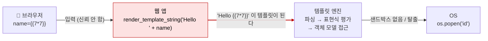
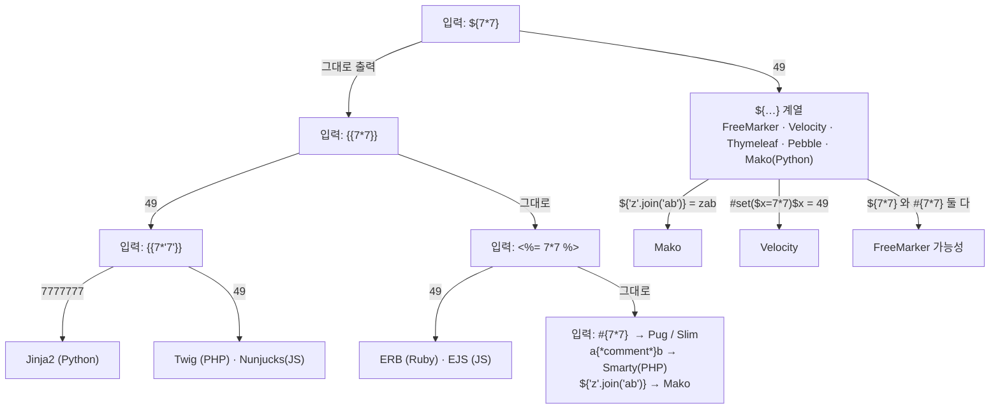

# 서버 측 템플릿 인젝션 (Server-Side Template Injection, SSTI)

| 레벨 | 상태 | 최종 개정 | CWE |
|---|---|---|---|
| 🔴 시니어 (1~3절은 🟡) | 🔄 개정중 | 2026-10-22 | [CWE-1336](https://cwe.mitre.org/data/definitions/1336.html) |

> **한눈에 보기**
> 템플릿 엔진은 "템플릿"을 코드로, "데이터"를 값으로 다룬다. 사용자 입력이 데이터가 아니라 템플릿 자체에 들어가면, 엔진은 그 입력을 코드로 실행한다.
> 공격자는 `{{7*7}}`로 시작해 엔진을 식별하고, 엔진의 객체 모델을 타고 올라가 OS 명령 실행에 도달한다.
> 막는 핵심은 하나다. **템플릿은 개발자가 쓰고, 입력은 변수로만 넘겨라.** 템플릿 문자열을 입력으로 조립하지 말라.

## 1. 원리

템플릿 엔진은 두 가지를 받는다. **템플릿**(코드. `Hello {{ name }}!`)과 **컨텍스트**(데이터. `{"name": "홍길동"}`). 엔진은 템플릿을 파싱해 표현식을 평가하고, 데이터를 끼워 넣는다. 이 구분이 유지되는 한 안전하다. `name`에 `{{7*7}}`을 넣어도 문자 그대로 출력된다.

SSTI는 입력이 **템플릿 쪽**에 섞일 때 생긴다. `"Hello " + name + "!"`을 템플릿으로 넘기면 `name`의 `{{7*7}}`은 코드가 되어 `49`가 된다. [SQL 인젝션](01-sql-injection.md)과 구조가 같다. 문자열 연결로 코드와 데이터의 경계가 사라진 것이다.



<figure>
<figcaption>그림 1. 신뢰 경계는 입력이 템플릿 문자열에 이어 붙는 한 줄에서 무너진다. 그 뒤로 템플릿 엔진은 공격자의 스크립트 실행기다.</figcaption>
</figure>

왜 템플릿 표현식이 OS 명령까지 가는가. 대부분의 템플릿 언어는 호스트 언어(Python, Java, PHP)의 **객체 모델에 접근**할 수 있게 설계됐다. 템플릿에서 `user.name`을 쓸 수 있다는 것은 `user.__class__`도 쓸 수 있다는 뜻이고, 거기서 모듈과 내장 함수까지 거슬러 올라갈 수 있다. 엔진마다 이를 막는 샌드박스가 있지만, 샌드박스는 "실수로 위험한 것을 못 쓰게" 하는 장치이지 "적대적 입력을 막는" 경계가 아니다. Jinja2 문서 자체가 샌드박스를 보안 경계로 쓰지 말라고 한다.

### 어디서 생기는가

| 상황 | 예 |
|---|---|
| 사용자 정의 템플릿 기능 | 이메일 템플릿 편집기, 위키 매크로, CMS 테마, 알림 메시지 커스터마이징 |
| 편의를 위한 문자열 조립 | `render_template_string("오류: " + msg)` |
| 뷰 이름·조각 선택에 입력 사용 | Spring MVC에서 `return "page/" + lang` (Thymeleaf 뷰 조작) |
| 두 번째 단계 평가 | 저장된 값을 나중에 템플릿으로 평가 (second-order) |

### 엔진 식별 결정 트리

응답에 찍히는 값으로 엔진을 좁힌다. 아래는 PortSwigger가 정리한 흐름을 한국어로 옮긴 것이다.



<figure>
<figcaption>그림 2. 다항식 하나로 시작해 두세 번의 요청으로 엔진을 좁힌다. 오류 메시지에 엔진 이름이 찍히는 경우가 많아 그것이 더 빠를 때도 있다.</figcaption>
</figure>

엔진별 특징을 알면 결정 트리가 짧아진다.

| 엔진 | 호스트 언어 | 구문 | 특징 |
|---|---|---|---|
| Jinja2 | Python | `{{ }}` `` | Flask 기본. `__class__`, `__mro__`, `__subclasses__`로 객체 탐색 가능. `SandboxedEnvironment`는 별도 선택 |
| Twig | PHP | `{{ }}` `` | Symfony 기본. 1.x에서 `_self.env`로 필터 등록 → 함수 호출이 가능했고, 2.x·3.x는 대폭 제한. `sandbox` 확장 별도 |
| FreeMarker | Java | `${ }` `<# >` | `?new` 내장으로 임의 클래스 인스턴스화 가능. `new_builtin_class_resolver`로 제한. 2.3.30부터 안전한 기본값 강화 |
| Velocity | Java | `$var` `#set` | 샌드박스가 없고 `$class` 같은 도구 객체가 노출되면 바로 리플렉션. Confluence 사례 |
| Thymeleaf | Java | `${ }` `*{ }` `__${}__` | Spring 표준. 표현식 내 `T(java.lang.Runtime)`으로 정적 메서드 호출. 전처리 구문 `__…__`가 뷰 이름에서 평가 |
| ERB / EJS | Ruby / JS | `<%= %>` | ERB는 호스트 언어 그대로. 샌드박스 없음 |
| Mustache / Handlebars | 다수 | `{{ }}` | 로직리스. 표현식 평가가 없어 SSTI가 구조적으로 어렵다 (Handlebars 헬퍼 남용은 예외) |

## 2. 발생하는 코드 패턴

### Python / Flask (Jinja2)

```python
# ❌ 취약: 입력이 템플릿 문자열에 들어간다
from flask import request, render_template_string

@app.route("/hello")
def hello():
    name = request.args.get("name", "")
    return render_template_string("<h1>Hello " + name + "!</h1>")
```

```python
# ✅ 안전: 템플릿은 상수, 입력은 컨텍스트 변수
@app.route("/hello")
def hello():
    name = request.args.get("name", "")
    return render_template_string("<h1>Hello {{ name }}!</h1>", name=name)
```

안전한 쪽에서 `name`에 `{{7*7}}`을 넣어도 `{{7*7}}`이 그대로 출력된다. 컨텍스트 변수는 파싱 대상이 아니다. 자동 이스케이프가 켜져 있으면 [XSS](02-xss.md)도 함께 막힌다.

### Java (FreeMarker)

```java
// ❌ 취약: 사용자가 보낸 문자열로 템플릿 객체를 만든다
Template t = new Template("mail", new StringReader(userTemplate), cfg);
t.process(model, out);
```

```java
// ✅ 안전: 템플릿은 파일에서, 입력은 모델로. 사용자 정의 템플릿이 꼭 필요하면 (차선책) 클래스 해석기 제한
cfg.setNewBuiltinClassResolver(TemplateClassResolver.SAFER_RESOLVER);
cfg.setAPIBuiltinEnabled(false);
Template t = cfg.getTemplate("mail.ftl");
t.process(Map.of("name", userName), out);
```

### Java (Spring MVC + Thymeleaf, 뷰 이름 조작)

```java
// ❌ 취약: 입력이 뷰 이름에 들어간다. Thymeleaf는 뷰 이름 안의 __${…}__ 전처리 표현식을 평가한다
@GetMapping("/page")
public String page(@RequestParam String lang) {
    return "welcome/" + lang;
}
```

```java
// ✅ 안전: 허용 목록으로 매핑. 또는 @ResponseBody로 뷰 해석을 거치지 않는다
private static final Map<String, String> VIEWS = Map.of("ko", "welcome/ko", "en", "welcome/en");
return VIEWS.getOrDefault(lang, "welcome/en");
```

### PHP (Twig)

```php
// ❌ 취약
echo $twig->createTemplate($_GET['tpl'])->render(['user' => $user]);

// ✅ 안전
echo $twig->render('page.html.twig', ['user' => $user, 'q' => $_GET['q']]);
```

## 3. 탐지 방법

### 3.1 코드 리뷰 / 정적 분석

**"템플릿을 문자열로 받는 API"**가 싱크다. 이름이 정해져 있어 grep이 잘 듣는다.

```bash
# Python
grep -rnE "render_template_string|Template\(|from_string\(|Environment\(" --include='*.py' . | grep -vE "\.html'|\.j2'"
# Java
grep -rnE "new Template\(|cfg\.getTemplate\(.*\+|Velocity\.evaluate|StringTemplateResolver|processTemplate\(.*\+" --include='*.java' .
# Spring MVC: 뷰 이름을 입력으로 조립하는 컨트롤러
grep -rnE "return \"[a-zA-Z/]*\" \+ " --include='*.java' .
# PHP
grep -rnE "createTemplate\(|loadTemplate\(.*\\\$_|->render\(\s*\\\$_" --include='*.php' .
# Node
grep -rnE "ejs\.render\(|nunjucks\.renderString\(|Handlebars\.compile\(.*req\." --include='*.js' .
```

싱크를 찾았으면 첫 인자(템플릿)가 **리터럴인가 조립된 것인가**만 보면 된다. 두 번째 인자(컨텍스트)에 입력이 들어가는 것은 정상이다.

**Semgrep**: `p/python`, `p/java`, `p/javascript` 레지스트리에 `render_template_string` 조립, Spring 뷰 이름 조립 등 SSTI 룰이 있다. 직접 쓴다면 `flask.render_template_string($A + $B, ...)`, `flask.render_template_string(f"...", ...)` 두 패턴이면 대부분 잡힌다.

**CodeQL**: Python은 `py/template-injection`, Java는 실험(experimental) 팩의 뷰 이름 조작 쿼리 `java/spring-view-manipulation`을 쓴다. JavaScript 쪽 쿼리 ID는 사용하는 CodeQL 팩 버전의 목록에서 확인한다.

### 3.2 동적 테스트

**1단계: 반영되는 입력에 다항식.** 입력이 응답에 반영되는 모든 곳(이름, 검색어, 오류 메시지, 이메일 미리보기, 404 페이지의 경로)에 `{{7*7}}`, `${7*7}`, `<%= 7*7 %>`, `#{7*7}`을 넣는다. `49`가 나오면 확정이다. `7*7`이 그대로 나오면 그 구문은 아니다.

**2단계: 오류 유발.** 모든 구문을 섞은 폴리글롯 `${{<%[%'"}}%\.`를 넣는다. 500 오류와 스택 트레이스에 엔진 이름이 찍히는 경우가 많다.

**3단계: 결정 트리**(1절 그림 2)로 엔진을 확정한다.

**4단계: 컨텍스트 확인.** 입력이 텍스트 위치(`Hello {{input}}`)인지 코드 위치(`{{ greet(input) }}`)인지 본다. 코드 위치면 `{{`를 쓰지 않고 표현식을 닫는 방식(`input'` 또는 `input)`)으로 간다.

**5단계: 문서로 간다.** 엔진이 확정되면 공식 문서에서 내장 객체·함수 목록을 읽는다. 익스플로잇은 "문서에 적힌 기능을 공격자 시각으로 조합하는 것"이다. 페이로드 모음을 먼저 보지 않는다.

자동화: Burp Scanner가 1~2단계를 돌린다. [tplmap](https://github.com/epinna/tplmap)은 식별과 기본 체인을 자동화하지만 오래됐다. 식별 이후는 사람이 문서를 읽는 것이 더 빠르다.

## 4. 실습 🧪

### 4.1 로컬 최소 재현 (Flask, 5분)

```python
# ssti_demo.py  (실습용. 명령 실행 체인은 넣지 않는다)
from flask import Flask, request, render_template_string
app = Flask(__name__)

@app.route("/vuln")
def vuln():
    return render_template_string("Hello " + request.args.get("name", "") + "!")      # ❌

@app.route("/safe")
def safe():
    return render_template_string("Hello {{ name }}!", name=request.args.get("name", ""))  # ✅

app.run(port=5000)
```

```bash
pip install flask && python3 ssti_demo.py &
curl 'http://127.0.0.1:5000/vuln?name={{7*7}}'        # Hello 49!
curl 'http://127.0.0.1:5000/vuln?name={{7*%277%27}}'  # Hello 7777777!  ← Jinja2 확정
curl 'http://127.0.0.1:5000/safe?name={{7*7}}'        # Hello {{7*7}}!
curl 'http://127.0.0.1:5000/vuln?name={{config}}'     # Flask 설정 객체가 통째로 보인다 (SECRET_KEY 포함)
```

마지막 요청이 보여 주는 것이 중요하다. 명령 실행까지 가지 않아도 **컨텍스트에 있는 객체를 읽는 것만으로** 비밀 키가 샌다. 5절에서 이 단계를 "정보 노출"로 따로 센다.

### 4.2 공개 실습 환경

[PortSwigger Web Security Academy: SSTI](https://portswigger.net/web-security/server-side-template-injection)의 랩을 순서대로 푼다.

| 순서 | 랩 | 익히는 것 |
|---|---|---|
| 1 | Basic server-side template injection | ERB. 다항식에서 명령 실행까지 |
| 2 | Basic server-side template injection (code context) | 코드 위치의 입력 (3.2절 4단계) |
| 3 | Server-side template injection using documentation | FreeMarker. 문서에서 `?new` 찾기 (5단계) |
| 4 | Server-side template injection in an unknown language with a documented exploit | Handlebars. 식별 후 공개된 체인 |
| 5 | Server-side template injection with information disclosure via user-supplied objects | Django. 명령 실행 없이 `settings.SECRET_KEY` |
| 6 | Server-side template injection in a sandboxed environment | FreeMarker 샌드박스 우회 🔴 |
| 7 | Server-side template injection with a custom exploit | 가젯을 직접 조합 🔴 |

## 5. 익스플로잇 검증

| 단계 | 확인 | 심각도에 미치는 영향 |
|---|---|---|
| 1 | `{{7*7}}` → `49`. 표현식이 평가된다 | 취약점 존재 확인 |
| 2 | 컨텍스트 객체 읽기 (`{{config}}`, `{{settings}}`, `{{request}}`) | 정보 노출. 비밀 키가 있으면 High (세션 위조로 이어진다) |
| 3 | 파일 읽기 (`open('/etc/hostname').read()` 류) | 기밀성 침해. High |
| 4 | 명령 실행 (`id` 출력 또는 시간 지연) | RCE. Critical |

4단계는 `sleep 5`나 OOB DNS 조회처럼 **부작용 없는 증명**으로 끝낸다. 보고서에는 2단계 결과(키 값 자체는 마스킹)와 4단계 응답 시간 차이를 싣는다. 샌드박스가 있는 엔진이라면 "샌드박스를 넘지 못했음"도 결과다. 그 경우 2단계 정보 노출 기준으로 심각도를 매긴다.

## 6. 방어

| 계층 | 조치 | 효과 |
|---|---|---|
| 코드 | **템플릿은 상수(파일), 입력은 컨텍스트 변수.** 템플릿 문자열을 조립하지 않는다 | 근본 제거 |
| 코드 | 뷰 이름·템플릿 이름을 입력에서 만들지 않는다. 허용 목록 매핑 | Thymeleaf 뷰 조작 차단 |
| 코드 | 사용자 정의 템플릿이 **제품 요구사항**이면 로직리스 엔진(Mustache)으로 제공 | 평가할 표현식이 없다 |
| 프레임워크 | 그래도 표현식이 필요하면 샌드박스 + 최소 컨텍스트: Jinja2 `SandboxedEnvironment`, FreeMarker `SAFER_RESOLVER`·`api_builtin_enabled=false`, Twig `SandboxExtension` | 공격 표면 축소. **경계가 아니라 완화** |
| 프레임워크 | 템플릿 엔진 최신 버전 (FreeMarker 2.3.30+, Twig 3.x) | 알려진 탈출 차단 |
| 인프라 | 사용자 템플릿 렌더링을 **별도 프로세스·컨테이너**에서, 네트워크·파일 시스템 없이 | 탈출해도 얻을 것이 없다 |
| 인프라 | 템플릿 컨텍스트에 비밀(설정 객체, DB 핸들)을 넣지 않는다 | 2단계 정보 노출 차단 |
| 탐지 | 입력에 `{{`, `${`, `<%` 와 `__class__`, `getRuntime`, `?new` 같은 토큰 알림 | 사후 대응 |

**하지 말아야 할 것**

- `{{`, `}}` 문자 차단. 코드 컨텍스트에서는 필요 없고, 다른 구문(``, `${}`)이 남는다.
- "샌드박스 켰으니 끝". 샌드박스는 탈출 이력이 길다. 7절.
- 사용자 템플릿을 같은 프로세스에서 렌더링. 비밀 키가 같은 메모리에 있다.

## 7. 우회 기법 🔴

### Jinja2 샌드박스 탈출의 구조

Jinja2 페이로드는 거의 모두 같은 뼈대다. **"컨텍스트에 있는 아무 객체 → 그 클래스 → 상속 트리 → 위험한 클래스나 전역 네임스페이스 → 함수 호출"**이다.

```
''          문자열 리터럴 (컨텍스트에 아무것도 없어도 된다)
.__class__  → <class 'str'>
.__mro__[1] → <class 'object'>          (메서드 해석 순서의 최상위)
.__subclasses__()  → object의 모든 하위 클래스 목록. 여기에 subprocess.Popen 같은 것이 있다
[N]('id', shell=True, stdout=-1).communicate()   → 명령 실행
```

공개된 대표 페이로드 하나를 설명 목적으로 싣는다. Flask에서 `config` 객체가 컨텍스트에 있을 때다.

```
{{ config.__class__.__init__.__globals__['os'].popen('id').read() }}
```

`config`의 클래스(`Config`)의 생성자(`__init__`)는 Python 함수이고, 모든 함수는 자신이 정의된 모듈의 전역 네임스페이스(`__globals__`)를 갖는다. `flask.config` 모듈은 `os`를 import하므로 거기서 `os.popen`을 꺼낸다. 핵심은 **어떤 Python 함수 객체든 `__globals__`를 통해 모듈 전역에 닿는다**는 것이고, 이것이 `SandboxedEnvironment`가 `__`로 시작하는 속성 접근을 막는 이유다.

| 방어 | 우회 |
|---|---|
| 입력 문자열의 `__` 차단 (WAF·입력 필터) | `attr()` 필터 + 문자열 조립: `{{ ''|attr('\x5f\x5fclass\x5f\x5f') }}`, `request.args`에서 문자열을 가져와 조립. 단 `SandboxedEnvironment`는 `attr` 필터도 같은 속성 검사를 거치므로 이것으로는 샌드박스를 넘지 못한다 |
| `.`·`[` 차단 | `|attr`, `|join`, 필터 체인으로 속성 접근을 문자열로 표현 |
| 특정 단어(`os`, `popen`) 차단 | 16진 이스케이프, `+` 연결, `~` 연결(Jinja2), 유니코드 정규화 |
| FreeMarker `?new` 차단 | `?api` 내장(`api_builtin_enabled`가 켜진 경우), 컨텍스트에 노출된 객체의 리플렉션 |
| Twig 2.x/3.x 제한 | `sort`·`filter`·`map` 필터에 PHP 내장 함수명(`system`)을 콜백으로 넘기는 변형. 버전별로 막힘 |
| Velocity | 컨텍스트의 임의 객체에서 `.getClass().forName(...)`로 리플렉션 |
| Thymeleaf 표현식 제한 | 전처리 구문 `__${T(java.lang.Runtime).getRuntime().exec('…')}__::.x`를 뷰 이름에 (2020년 공개된 Spring 뷰 조작) |
| WAF 시그니처 | 표현식을 여러 변수에 나눠 ``로 조립, 주석 삽입 |

패턴은 하나다. **차단된 것은 문자열이고, 필요한 것은 객체 참조다.** 문자열을 다른 경로로 만들 수 있으면 참조에 닿는다. 그래서 6절에서 "입력을 템플릿에 넣지 않는 것"만 근본 방어로 두었다.

## 8. 실제 CVE 사례

| CVE | 제품 | 핵심 | 패치 |
|---|---|---|---|
| [CVE-2019-3396](https://nvd.nist.gov/vuln/detail/CVE-2019-3396) | Atlassian Confluence Server (6.6.12 등 미만) | Widget Connector 매크로의 `_template` 파라미터로 Velocity 템플릿 경로 지정 → 경로 조작 + SSTI → 인증 없는 RCE. 랜섬웨어에 악용 | [Atlassian 이슈 CONFSERVER-57974](https://jira.atlassian.com/browse/CONFSERVER-57974) |
| [CVE-2023-22527](https://nvd.nist.gov/vuln/detail/CVE-2023-22527) | Atlassian Confluence Data Center/Server (구 8.x) | Velocity 템플릿이 사용자 입력을 OGNL 표현식으로 평가. 인증 없는 RCE, CISA KEV 등재 | [Atlassian 권고](https://confluence.atlassian.com/pages/viewpage.action?pageId=1333335615) |
| [CVE-2021-25770](https://nvd.nist.gov/vuln/detail/CVE-2021-25770) | JetBrains YouTrack (2020.5.3123 미만) | FreeMarker SSTI → 알려진 샌드박스 탈출로 RCE. Synacktiv가 패치 전후 FreeMarker 2.3.23 → 2.3.30 변화를 분석 | [Synacktiv 분석](https://www.synacktiv.com/publications/exploiting-cve-2021-25770-a-server-side-template-injection-in-youtrack) |
| [CVE-2022-29078](https://nvd.nist.gov/vuln/detail/CVE-2022-29078) | EJS 3.1.6 (Node.js) | 렌더 옵션 `outputFunctionName`이 입력에서 덮어써져 생성되는 JS 코드에 섞임. 3.1.7에서 수정 | [ejs 3.1.7](https://github.com/mde/ejs/releases/tag/v3.1.7) |
| [CVE-2016-4977](https://nvd.nist.gov/vuln/detail/CVE-2016-4977) | Spring Security OAuth (2.0.10 미만) | 화이트라벨 승인·오류 뷰에서 `response_type` 값을 SpEL로 평가. 템플릿은 아니지만 "입력이 표현식 언어에 들어가는" 같은 계열 | [Spring 권고](https://spring.io/security/cve-2016-4977) |

**Confluence (CVE-2019-3396) 에서 배울 것**: 권고문 기준으로, 패치는 Widget Connector가 외부에서 지정한 템플릿 경로를 받지 못하게 막았다. "템플릿을 **어떤 것으로** 쓸지"를 입력이 정하게 둔 것이 원인이다. 6절의 "뷰 이름·템플릿 이름을 입력에서 만들지 않는다"의 실제 사례다. 4년 뒤 같은 제품에서 CVE-2023-22527이 나왔고, 이번에는 템플릿 **안의** 표현식 평가였다. 같은 제품, 같은 계열, 다른 지점이다.

**YouTrack (CVE-2021-25770) 에서 배울 것**: Synacktiv의 분석에 따르면 패치된 빌드는 FreeMarker 2.3.30을 쓴다. 애플리케이션 코드 수정과 함께 엔진 자체의 기본값 강화에 기댄 것이다. 사용자 정의 템플릿이 제품 기능인 경우, 엔진 버전과 클래스 해석기 설정이 곧 보안 경계가 된다.

**EJS (CVE-2022-29078) 에서 배울 것**: 공개 분석 기준으로, 패치는 옵션 이름을 정규식으로 검증해 내부 옵션 덮어쓰기를 막았다. 템플릿 본문이 아니라 **렌더 옵션**으로 들어온 입력이 코드 생성에 섞였다. 싱크를 찾을 때 "템플릿 문자열"만 보면 놓친다.

## 9. 체크리스트

**코드 리뷰할 때**
- [ ] 템플릿을 문자열로 받는 API(3.1절) 호출의 첫 인자가 리터럴인가?
- [ ] 뷰 이름·템플릿 파일명을 입력으로 조립하는 컨트롤러가 있는가?
- [ ] 렌더 옵션(옵션 객체 전체 병합 등)에 입력이 들어가는가?
- [ ] 사용자 템플릿 기능이 있다면 로직리스 엔진인가, 샌드박스 + 격리 프로세스인가?
- [ ] 템플릿 컨텍스트에 설정 객체·비밀이 들어가는가?

**테스트할 때**
- [ ] 반영되는 모든 입력에 네 가지 구문의 `7*7`을 넣어 봤는가?
- [ ] 오류 페이지·이메일 미리보기·PDF 생성·알림 메시지처럼 "나중에 렌더링되는" 곳도 봤는가?
- [ ] 엔진을 식별하고 **공식 문서**에서 내장 객체를 확인했는가?
- [ ] 명령 실행 전에 정보 노출(2단계)을 먼저 기록했는가?

**배포 전**
- [ ] 템플릿 엔진 버전이 알려진 탈출이 막힌 버전인가?
- [ ] SAST에 템플릿 문자열 조립·뷰 이름 조립 룰이 있는가?
- [ ] 사용자 템플릿 렌더러가 비밀과 네트워크에서 격리되어 있는가?

## 10. 더 읽기

- [CWE-1336: Improper Neutralization of Special Elements Used in a Template Engine](https://cwe.mitre.org/data/definitions/1336.html) · [CWE-94: Code Injection](https://cwe.mitre.org/data/definitions/94.html)
- James Kettle, "Server-Side Template Injection: RCE for the modern webapp" (Black Hat USA, 2015) · [PortSwigger 연구 글](https://portswigger.net/research/server-side-template-injection) · 용어와 결정 트리의 출발점
- [Jinja2 문서: Sandbox](https://jinja.palletsprojects.com/en/stable/sandbox/) · 샌드박스의 범위와 한계에 대한 공식 설명
- [FreeMarker 문서: Configuration](https://freemarker.apache.org/docs/pgui_config_settings.html) · `new_builtin_class_resolver`, `api_builtin_enabled`
- [Twig 문서: Sandbox Extension](https://twig.symfony.com/doc/3.x/api.html#sandbox-extension)
- Michael Stepankin (Veracode), "Spring View Manipulation Vulnerability" (2020) · [GitHub](https://github.com/veracode-research/spring-view-manipulation) · Thymeleaf 뷰 이름 조작
- [Synacktiv, "Exploiting CVE-2021-25770"](https://www.synacktiv.com/publications/exploiting-cve-2021-25770-a-server-side-template-injection-in-youtrack) (2021) · FreeMarker 탈출의 실제 과정
- [PortSwigger Web Security Academy: SSTI](https://portswigger.net/web-security/server-side-template-injection) · 4.2절 랩

## 변경 이력

| 날짜 | 변경 | 기여자 |
|---|---|---|
| 2026-10-21 | 초안(뼈대) 작성 | @anthonynoh5202 |
| 2026-10-22 | 10섹션 전체 작성. 엔진 식별 결정 트리, 언어별 패턴 4종, Jinja2 탈출 구조 해설, CVE 5건 추가 | @anthonynoh5202 |
| 2026-10-22 | 기술 검증: CVE 5건 레코드 대조(전부 실존). Jinja2 attr 필터 우회가 SandboxedEnvironment에는 통하지 않음을 실행으로 확인해 7절 표 정정, CodeQL 쿼리 ID를 저장소 기준으로 명시, Atlassian 링크 2건을 레코드 참조로 교체, CVE-2023-22527 템플릿 종류(Velocity) 명시. Flask SSTI 재현 코드 실행 확인 | 검증팀 |
