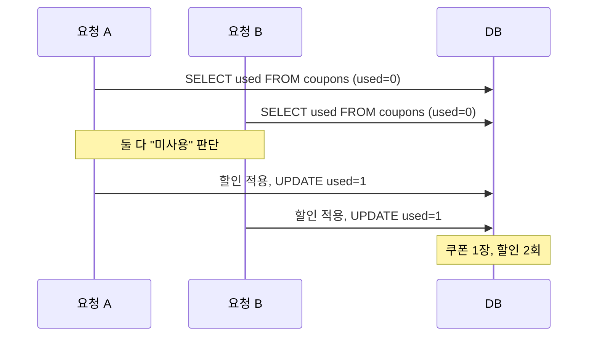

# 경쟁 조건과 로직 취약점 (Race Conditions & Business Logic Flaws)

| 레벨 | 상태 | 최종 개정 | CWE |
|---|---|---|---|
| 🔴 시니어 (1~2절은 🟡) | 🔄 개정중 | 2026-10-22 | [CWE-362](https://cwe.mitre.org/data/definitions/362.html) · [CWE-367](https://cwe.mitre.org/data/definitions/367.html) · [CWE-840](https://cwe.mitre.org/data/definitions/840.html) |

> **한눈에 보기**
> "확인"과 "사용" 사이에는 항상 틈이 있다. 요청 두 개가 그 틈에 동시에 들어오면 둘 다 확인을 통과한다.
> 공격자는 쿠폰을 열 번 쓰고, 잔액을 음수로 만들고, OTP 시도 횟수 제한을 넘고, 검증 안 된 이메일로 가입을 끝낸다.
> 막는 핵심은 하나다. **확인과 사용을 하나의 원자적 연산으로 묶어라.** 코드가 아니라 데이터베이스가 그 단위를 보장해야 한다.

## 1. 원리

애플리케이션 코드는 대부분 이런 모양이다. 읽고, 판단하고, 쓴다.

```
1. 읽기   coupon = SELECT * FROM coupons WHERE code = 'SAVE10'
2. 판단   if coupon.used: 거절
3. 쓰기   UPDATE coupons SET used = 1 ...
```

1과 3 사이가 **경쟁 창**(race window)이다. 몇 마이크로초든 몇 밀리초든 길이는 상관없다. 그 사이에 같은 요청이 하나 더 들어오면 두 요청 모두 "아직 안 썼음"을 읽고, 둘 다 할인을 적용하고, 둘 다 `used = 1`을 쓴다. 두 번째 쓰기는 아무것도 바꾸지 않지만, 할인은 이미 두 번 적용됐다. 이것을 **TOCTOU**(Time-of-check to time-of-use)라고 한다.



<figure>
<figcaption>그림 1. 한 요청 안에서는 논리가 맞다. 두 요청이 겹치면 "한 번만"이라는 가정이 깨진다. 신뢰 경계는 "이 코드는 한 번에 하나씩 실행된다"는 암묵적 가정에 있다.</figcaption>
</figure>

이 취약점이 특별한 이유는 **코드 한 줄 한 줄이 모두 옳다**는 것이다. 입력 검증도, 권한 검사도 있다. 틀린 것은 "동시에 실행되지 않는다"는 가정뿐이다. 그래서 스캐너가 못 찾고, 코드 리뷰에서도 쉽게 지나친다.

### 유형

James Kettle의 2023년 연구는 경쟁 조건을 "쿠폰 두 번 쓰기" 너머로 확장했다. 핵심 개념은 **하위 상태**(sub-state)다. 요청 하나를 처리하는 동안 애플리케이션은 외부에서 보이지 않는 중간 상태를 여러 번 거치고, 그 순간에 다른 요청이 들어오면 설계에 없는 조합이 생긴다.

| 유형 | 설명 | 예 |
|---|---|---|
| **한도 초과**(limit overrun) | "N번만" 제약을 동시 요청으로 넘는다 | 쿠폰 중복, 잔액 초과 인출, 좋아요 중복, 무료 체험 반복 |
| **속도 제한 우회**(rate limit bypass) | 시도 횟수 카운터가 원자적이지 않다 | OTP·비밀번호 무차별 대입 |
| **다중 엔드포인트**(multi-endpoint) | 서로 다른 엔드포인트의 하위 상태가 겹친다 | 결제 검증 중에 장바구니에 상품 추가 |
| **단일 엔드포인트**(single-endpoint) | 같은 엔드포인트에 다른 값으로 동시 요청 | 이메일 변경 두 번 → 검증 토큰이 다른 주소로 |
| **부분 생성**(partial construction) | 객체가 만들어지는 중간 상태를 쓴다 | 가입 직후 API 키가 아직 `null`인 순간에 `null` 키로 인증 |
| **시간 민감**(time-sensitive) | 타임스탬프 기반 토큰이 같은 순간에 같은 값 | 두 계정의 비밀번호 재설정 토큰이 동일 |
| **파일 시스템 TOCTOU** | 권한 확인 후 열기 전에 심볼릭 링크 교체 | setuid 프로그램, 임시 파일. [바이너리 부](../part4-binary/00-overview.md)의 영역 |

### 로직 취약점을 찾는 사고법

경쟁 조건은 **비즈니스 로직 취약점**의 한 갈래다. 로직 취약점은 공통 패턴이 없어 도구가 못 찾는다. 대신 질문이 있다. **"설계자가 무엇을 당연하게 여겼는가?"** 가정을 목록으로 적고 하나씩 깨 본다.

| 설계자의 가정 | 깨는 방법 |
|---|---|
| 단계는 순서대로 진행된다 | 3단계 URL로 바로 간다. 2단계를 건너뛴다 |
| 한 번에 하나씩 실행된다 | 동시 요청 (이 장) |
| 값은 양수다 | 수량 `-1`, 금액 `0.001`, 정수 오버플로 |
| 클라이언트가 검증한 값이다 | 프록시에서 수정 |
| 상태 전이는 정의된 경로만 따른다 | "취소"된 주문을 "배송 완료"로, 환불 후 다시 환불 |
| 사용자는 자기 것만 본다 | [접근 제어 장](05-access-control.md) |
| 외부 시스템(결제, 이메일)은 성공한다 | 콜백을 위조하거나 지연시킨다 |

## 2. 발생하는 코드 패턴

### 읽기-판단-쓰기 (가장 흔한 형태)

```python
# ❌ 취약: Django. 읽고, 판단하고, 쓴다. 세 단계 사이에 다른 요청이 끼어든다
def redeem(request, code):
    coupon = Coupon.objects.get(code=code)
    if coupon.used:
        return HttpResponseBadRequest("already used")
    apply_discount(request.user, coupon)
    coupon.used = True
    coupon.save()
```

```python
# ✅ 안전 1: 조건부 UPDATE. 확인과 사용이 DB 안에서 한 문장이다
def redeem(request, code):
    updated = Coupon.objects.filter(code=code, used=False).update(used=True)
    if updated == 0:
        return HttpResponseBadRequest("already used")
    apply_discount(request.user, code)
```

```python
# ✅ 안전 2: 행 잠금. 트랜잭션 안에서 SELECT ... FOR UPDATE
from django.db import transaction

def redeem(request, code):
    with transaction.atomic():
        coupon = Coupon.objects.select_for_update().get(code=code)
        if coupon.used:
            return HttpResponseBadRequest("already used")
        apply_discount(request.user, coupon)
        coupon.used = True
        coupon.save()
```

안전 1이 더 단순하고 빠르다. `UPDATE ... WHERE used = 0`은 DB가 행 단위로 직렬화하므로 **정확히 한 요청만** `updated == 1`을 받는다. 안전 2는 여러 테이블을 함께 바꿔야 할 때 쓴다.

### 잔액·수량

```sql
-- ❌ 취약: 애플리케이션이 읽은 값으로 계산해서 덮어쓴다
SELECT balance FROM accounts WHERE id = 1;      -- 100
UPDATE accounts SET balance = 100 - 80 WHERE id = 1;   -- 동시 요청 둘 다 20을 쓴다. 160 인출

-- ✅ 안전: DB가 계산하고 조건을 검사한다. CHECK 제약이 마지막 방어선
UPDATE accounts SET balance = balance - 80 WHERE id = 1 AND balance >= 80;
ALTER TABLE accounts ADD CONSTRAINT positive_balance CHECK (balance >= 0);
```

### 애플리케이션 락의 함정

```java
// ❌ 취약: 인스턴스가 둘 이상이면 synchronized는 아무것도 보장하지 않는다
public synchronized void redeem(String code) { ... }
```

```java
// ✅ 안전: 락은 공유 저장소에. DB 행 잠금, 또는 유일 제약으로 "두 번째 삽입"을 실패시킨다
// CREATE UNIQUE INDEX ux_redemption ON redemptions (coupon_id, user_id);
try { jdbc.update("INSERT INTO redemptions (coupon_id, user_id) VALUES (?, ?)", couponId, userId); }
catch (DuplicateKeyException e) { throw new AlreadyRedeemed(); }
```

### 멱등성 키

같은 결제 요청이 두 번 와도 한 번만 처리하려면, 클라이언트가 보낸 **멱등성 키**(idempotency key)를 유일 제약이 있는 테이블에 먼저 넣는다. 삽입이 실패하면 중복이다. 키를 메모리나 캐시에만 두면 인스턴스가 다를 때 깨진다.

## 3. 탐지 방법

### 3.1 코드 리뷰 / 정적 분석

경쟁 조건은 흐름이 아니라 **동시성 가정**의 문제라 SAST가 거의 못 잡는다. 대신 패턴으로 좁힌다.

```bash
# "읽고 → if → save" 가 같은 함수에 있는 곳. Django/SQLAlchemy
grep -rnE "\.objects\.get\(|\.query\.get\(|session\.get\(" --include='*.py' -A8 . | grep -E "if .*\.(used|balance|count|status|attempts)" 
# 안전 장치가 있는지: 있으면 그 주변은 설계가 됐다는 뜻
grep -rnE "select_for_update|FOR UPDATE|with_for_update|@Lock\(|@Version|UNIQUE|CHECK \(" -r .
# 카운터를 애플리케이션에서 증가시키는 곳
grep -rnE "(attempts|count|quantity|balance)\s*(\+|-)=\s*" -r .
```

리뷰 질문은 네 가지다.

1. **상태를 바꾸는 모든 작업**(결제, 쿠폰, 전송, 가입, 비밀번호 재설정)에서 확인과 쓰기가 한 DB 문장 또는 한 트랜잭션 + 행 잠금 안에 있는가?
2. "N번만"이라는 제약이 DB 제약(UNIQUE, CHECK)으로도 표현되어 있는가, 코드에만 있는가?
3. 카운터·잔액을 애플리케이션이 읽어서 계산한 뒤 덮어쓰는가?
4. 락이 있다면 그 락은 **모든 인스턴스가 공유**하는가? (프로세스 메모리 락은 아니다)

### 3.2 동적 테스트

Kettle의 방법론은 세 단계다. **예측(predict) → 탐침(probe) → 증명(prove)**.

**예측**: 어떤 엔드포인트가 상태를 바꾸는가, 어떤 제약("한 번", "N회", "검증 후")이 있는가를 적는다. 로그인·가입·비밀번호 재설정·결제·쿠폰·투표가 1순위다.

**탐침**: 같은 요청을 **순차로** 20번 보낸 결과와 **동시에** 20번 보낸 결과를 비교한다. 응답 코드, 본문, 시간이 조금이라도 다르면 하위 상태의 단서다. 동시 전송 도구는 둘이다.

- **Burp Repeater 탭 그룹**: 요청들을 그룹으로 묶고 "Send group in parallel"을 고르면 HTTP/2 **단일 패킷 공격**(single-packet attack)으로 보낸다. 2023.9 이후 버전.
- **Turbo Intruder**: 스크립트로 제어한다. 게이트(gate)로 요청을 묶었다가 한꺼번에 연다.

```python
# Turbo Intruder. HTTP/2 단일 패킷 공격으로 쿠폰 요청 20개를 동시에 보낸다
def queueRequests(target, wordlists):
    engine = RequestEngine(endpoint=target.endpoint, concurrentConnections=1, engine=Engine.BURP2)
    for _ in range(20):
        engine.queue(target.req, gate='race1')
    engine.openGate('race1')

def handleResponse(req, interesting):
    table.add(req)
```

**증명**: 응답 차이가 보이면 그것이 실제 영향으로 이어지는지 확인한다. 쿠폰이면 주문 금액, 속도 제한이면 허용된 시도 횟수, 이메일 검증이면 검증 안 된 주소로 로그인되는지.

**단일 패킷 공격이 왜 중요한가.** HTTP/1.1에서는 요청을 각각 다른 연결로 보내므로 네트워크 지연의 편차(jitter)가 요청 도착 시각을 흩뜨린다. 경쟁 창이 수 밀리초라면 그 편차만으로 공격이 안 된다. HTTP/2는 한 연결에 여러 요청을 다중화한다. 각 요청의 마지막 바이트를 보내지 않고 모아 두었다가, 마지막 바이트들을 **하나의 TCP 패킷**에 담아 보내면 서버는 수십 개 요청을 사실상 같은 순간에 완성된 것으로 처리한다. 네트워크 지연이 공격에서 사라진다. 📎 [Kettle, 2023](https://portswigger.net/research/smashing-the-state-machine).

## 4. 실습 🧪

### 4.1 로컬 최소 재현 (Flask + SQLite, 10분)

```python
# race_demo.py  (실습용)
import sqlite3, threading
from flask import Flask
app = Flask(__name__)
DB = "/tmp/race.db"
con = sqlite3.connect(DB); con.execute("CREATE TABLE IF NOT EXISTS coupon (code TEXT PRIMARY KEY, used INT)")
con.execute("INSERT OR REPLACE INTO coupon VALUES ('SAVE10', 0)"); con.commit(); con.close()
applied = []

@app.route("/redeem")
def redeem():
    c = sqlite3.connect(DB)
    used = c.execute("SELECT used FROM coupon WHERE code='SAVE10'").fetchone()[0]   # 1. 읽기
    if used: return "already used", 400                                              # 2. 판단
    applied.append(1)                                                                # 할인 적용
    c.execute("UPDATE coupon SET used=1 WHERE code='SAVE10'"); c.commit()            # 3. 쓰기
    return f"applied (total {len(applied)})"

app.run(port=5000, threaded=True)
```

```python
# attack.py  (동시 요청 20개. 네트워크 편차가 없는 로컬이라 HTTP/1.1로도 충분히 겹친다)
import threading, urllib.request
def go(): print(urllib.request.urlopen("http://127.0.0.1:5000/redeem").read())
ts = [threading.Thread(target=go) for _ in range(20)]
[t.start() for t in ts]; [t.join() for t in ts]
```

`applied (total 3)`, `(total 4)`처럼 1보다 큰 숫자가 찍히면 재현이다. 환경에 따라 스레드 기동 편차 때문에 `total 1`만 나올 수 있는데, 그때는 7.1절의 마지막 바이트 동기화 스크립트(`attack_lbs.py`)로 다시 보낸다. 그다음 `/redeem`의 세 줄을 `UPDATE coupon SET used=1 WHERE code='SAVE10' AND used=0`로 바꾸고 `rowcount`로 판단하게 고친 뒤, 몇 번을 돌려도 `total 1`만 나오는지 확인한다. **고치는 것까지가 실습이다.**

### 4.2 공개 실습 환경

[PortSwigger Web Security Academy: Race conditions](https://portswigger.net/web-security/race-conditions)의 랩을 순서대로 푼다. 1절 유형 표와 하나씩 대응한다.

| 순서 | 랩 | 유형 |
|---|---|---|
| 1 | Limit overrun race conditions | 한도 초과 |
| 2 | Bypassing rate limits via race conditions | 속도 제한 우회 |
| 3 | Multi-endpoint race conditions | 다중 엔드포인트 |
| 4 | Single-endpoint race conditions | 단일 엔드포인트 |
| 5 | Exploiting time-sensitive vulnerabilities | 시간 민감 |
| 6 | Partial construction race conditions | 부분 생성 🔴 |

로직 취약점은 같은 사이트의 [Business logic vulnerabilities](https://portswigger.net/web-security/logic-flaws) 랩으로 이어서 푼다. 1절의 "설계자의 가정" 표를 옆에 두고, 각 랩이 어느 가정을 깨는지 적으면서 푼다.

## 5. 익스플로잇 검증

| 단계 | 확인 | 심각도에 미치는 영향 |
|---|---|---|
| 1 | 순차 전송과 동시 전송의 응답이 다르다 | 하위 상태 존재. 영향은 아직 모른다 |
| 2 | 제약이 실제로 넘어간다 (쿠폰 2회 이상, 시도 횟수 초과) | 취약점 확인. 재현율을 적는다 (20회 중 몇 회) |
| 3 | 금전·권한으로 환산된다 (중복 환불 금액, 계정 탈취 가능 여부) | High~Critical |
| 4 | 공격자가 반복 가능한가 (쿠폰 1장이 아니라 계정마다, 매일) | 규모 산정 |

경쟁 조건은 **확률적**이다. 보고서에 "20회 시도 중 3회 성공" 같은 재현율과 사용한 도구·설정을 적어야 수정 쪽에서 재현할 수 있다. 실제 서비스에서 2단계 이상은 **자기 계정, 소액, 허가된 범위**에서만 한다. 중복 환불을 "증명"하느라 실제로 돈을 빼내면 범위를 넘은 것이다.

## 6. 방어

| 계층 | 조치 | 효과 |
|---|---|---|
| 코드 | **원자적 연산**: 조건부 `UPDATE ... WHERE`, `INSERT` + 유일 제약, DB 측 증감 | 근본 제거. 확인과 사용이 한 문장 |
| 코드 | 트랜잭션 + 행 잠금 (`SELECT ... FOR UPDATE`) 또는 낙관적 잠금(버전 컬럼) | 여러 테이블을 함께 바꿀 때 |
| 코드 | **멱등성 키**를 유일 제약 테이블에 먼저 삽입 | 중복 요청·재시도 흡수 |
| 코드 | 상태 전이를 명시적 상태 기계로. 허용된 전이만 조건부 `UPDATE`로 | 로직 취약점 전반 |
| 코드 | 객체 생성은 완성된 뒤에 보이게 (트랜잭션 안에서 생성, `null` 상태 노출 금지) | 부분 생성 차단 |
| 프레임워크 | ORM의 `select_for_update`, `@Version`, `F()` 표현식 같은 원자적 API 사용 | 기본값으로 차단 |
| 인프라 | DB 제약 (UNIQUE, CHECK `balance >= 0`) | 코드가 틀려도 마지막 방어선 |
| 인프라 | 상태 변경 작업을 단일 소비자 큐로 직렬화 | 동시성 자체 제거 (처리량과 교환) |
| 탐지 | 같은 사용자·같은 자원에 짧은 시간 내 동일 요청 N건 알림, 잔액 음수·쿠폰 사용 횟수 > 1 감사 쿼리 | 사후 대응 |

**하지 말아야 할 것**

- 프로세스 메모리 락(`synchronized`, `threading.Lock`)에 의존. 워커 프로세스나 인스턴스가 둘이면 끝이다.
- "요청 사이에 지연을 두면 된다"는 생각. 지연은 창을 옮길 뿐 닫지 않는다.
- 속도 제한을 캐시 카운터 `GET → +1 → SET`으로 구현. 그 자체가 경쟁 조건이다. `INCR` 같은 원자적 명령을 쓴다.
- 읽은 값으로 계산해 덮어쓰기 (`balance = 100 - 80`). DB가 계산하게 한다.

## 7. 우회 기법 🔴

| 방어 | 우회 |
|---|---|
| "경쟁 창이 너무 짧아 네트워크로는 못 맞춘다" | HTTP/2 단일 패킷 공격. HTTP/1.1만 되면 마지막 바이트 동기화(last-byte sync) |
| 서버 측 지연 편차 (첫 요청이 캐시 워밍) | 무관한 요청을 먼저 보내 연결·캐시를 데운 뒤 공격 요청. 정적 파일 요청을 같은 패킷에 섞어 "준비 운동" |
| 프로세스 내 락 | 로드밸런서 뒤의 다른 인스턴스·워커로 분산되게 요청 수를 늘린다 |
| IP 기반 속도 제한 | 경쟁 조건으로 카운터 자체를 넘는다. 카운터가 원자적이면 `X-Forwarded-For` 등 [인증 장](04-auth-session.md)의 우회 |
| 낙관적 잠금 + 자동 재시도 | 재시도 로직 자체가 비원자적이면 거기서 다시 경쟁 |
| 캐시에서 확인, DB에 쓰기 | 캐시 TTL 동안 확인이 낡은 값을 본다. 캐시 무효화 전에 반복 |
| 단일 엔드포인트만 보호 | 다른 엔드포인트의 하위 상태와 조합 (결제 검증 중 장바구니 변경) |
| 토큰 비교로 보호 | 시간 기반 토큰이면 같은 순간 두 계정에 같은 토큰 (시간 민감 유형) |

단일 패킷 공격의 동작 조건과 한계를 표로 정리하면 다음과 같다.

| 조건 · 한계 | 내용 |
|---|---|
| 서버가 HTTP/2를 받아야 한다 | 다중화는 HTTP/2 연결 하나 위에서만 된다. 앞단(로드밸런서·CDN)이 HTTP/2를 끝내고 뒷단에 HTTP/1.1로 넘기면 동기화는 앞단까지만 보장된다. 앞단이 요청을 바로 흘려보내면 대개 충분하지만, 거기서 다시 편차가 생긴다 |
| 한 패킷에 들어가는 요청 수 | 마지막 바이트 프레임은 요청당 10바이트 남짓이라 MTU 안에 수십 개가 들어간다. Kettle의 측정은 20~30개 요청이 약 1ms 안에 도착했다. 수백 개는 안 된다 |
| 서버 안의 편차는 못 없앤다 | 워커 스케줄링, DB 커넥션 풀 대기, GC 멈춤은 공격자가 통제하지 못한다. 그래서 같은 공격을 여러 번 반복하고 재현율로 적는다 |
| 서버가 요청을 병렬로 처리해야 한다 | 워커가 하나뿐이거나 큐로 직렬화된 엔드포인트는 도착이 동시여도 처리는 순차다. 이 경우 경쟁 창 자체가 없다 |
| 하위 상태가 실제로 있어야 한다 | 도착 시각을 맞추는 기술이지 창을 만드는 기술이 아니다. 확인과 사용이 한 문장(6절)이면 어떤 정밀도로 보내도 넘지 못한다. 아래 7.1의 실측이 그것이다 |

### 7.1 한 사례의 실제 과정: 쿠폰 한도 초과를 동기화 수준별로

4.1절의 `race_demo.py`(취약 버전)를 상대로, 같은 요청 20개를 세 가지 방식으로 보내 "얼마나 동시인가"가 결과를 어떻게 바꾸는지 본다. 모두 로컬(127.0.0.1)이라 네트워크 지터는 없고, 남는 편차는 보내는 쪽의 준비 시간뿐이다.

**1단계. 스레드 20개로 그냥 보낸다(4.1의 `attack.py`).** 스레드마다 `urlopen()`이 연결을 열고 요청을 만들어 보내므로 서버 도착 시각이 수 밀리초씩 흩어진다. 이 책의 확인 환경(Flask 3.0.3, `threaded=True`)에서는 5회 모두 `applied 1/20`이었다. 경쟁 창이 SQLite 읽기 한 번과 쓰기 한 번 사이의 1ms 미만이라, 그 편차만으로도 요청이 줄을 선다. 검증팀의 다른 환경에서는 같은 스크립트로 1~5회가 나왔다. **같은 코드, 같은 취약점인데 환경에 따라 "재현 안 됨"이 나온다**는 것이 경쟁 조건 보고의 첫 번째 함정이다.

**2단계. 마지막 바이트 동기화(last-byte sync).** HTTP/1.1만 되는 서버에서 쓰는 기법이다. 연결 20개를 **미리** 열고, 각 연결에 요청의 마지막 1바이트만 뺀 나머지를 보내 둔다. 서버는 요청이 끝나지 않았으므로 핸들러를 부르지 않고 기다린다. 그런 다음 마지막 바이트 20개를 한순간에 보낸다. 연결 수립, 요청 조립, 커널 송신 버퍼 채우기 같은 준비 시간이 모두 "미리"로 빠지고, 동시에 보내야 할 것은 1바이트짜리 패킷 20개뿐이다.

```python
# attack_lbs.py  (실습용. 4.1의 race_demo.py 상대)
import socket, threading
N = 20
REQ = b"GET /redeem HTTP/1.1\r\nHost: 127.0.0.1:5000\r\nConnection: close\r\n\r\n"
socks = []
for _ in range(N):
    s = socket.create_connection(("127.0.0.1", 5000))
    s.setsockopt(socket.IPPROTO_TCP, socket.TCP_NODELAY, 1)   # 커널이 작은 패킷을 모아 두지 않게
    s.sendall(REQ[:-1]); socks.append(s)                      # 마지막 '\n' 하나를 남긴다
barrier = threading.Barrier(N)
res = []
def fire(s):
    barrier.wait(); s.sendall(REQ[-1:])                       # 20개 스레드가 동시에 마지막 바이트
    buf = b""
    while (d := s.recv(4096)): buf += d
    res.append(buf.split(b"\r\n\r\n", 1)[-1].decode())
ts = [threading.Thread(target=fire, args=(s,)) for s in socks]
[t.start() for t in ts]; [t.join() for t in ts]
print("applied:", sum(r.startswith("applied") for r in res), "/", N)
```

같은 환경에서 5회 결과는 `12, 10, 11, 10, 6 / 20`이었다. 1단계의 `1/20`과 비교하면 **취약점이 생긴 것이 아니라 보이게 된 것**이다. 패킷은 여전히 20개이므로 원격에서는 경로마다 지터가 남는다. 그래서 다음 단계가 있다.

**3단계. HTTP/2 단일 패킷 공격.** 원리는 2단계와 같고 "마지막 바이트 20개"를 **TCP 패킷 하나**에 넣는 것만 다르다. HTTP/2는 연결 하나에서 스트림 여러 개를 다중화하므로, 요청 20개의 HEADERS 프레임과 본문 대부분을 END_STREAM 플래그 없이 먼저 보내 서버가 스트림 20개를 "미완성"으로 들고 있게 한다. 그런 다음 각 스트림의 마지막 DATA 프레임(1바이트 + END_STREAM, 프레임 헤더 9바이트)을 모아 한 번의 `send()`로 보내면 커널은 그것을 패킷 하나로 내보낸다. 서버는 패킷 하나를 읽는 동안 스트림 20개를 차례로 완성하고 핸들러에 넘기므로, 요청 사이의 간격은 네트워크가 아니라 서버의 프레임 파싱 속도(마이크로초)가 된다. 경로상의 지터는 패킷 하나에 한 번만 작용하고 20개 요청에 **같은 값**으로 작용하므로 상대 순서를 흩뜨리지 못한다. Burp Repeater 그룹의 "Send group in parallel"과 Turbo Intruder `Engine.BURP2`가 이것을 구현한다(3.2절 스크립트).

**연결 워밍은 왜 하는가.** 세 단계 어디서든 첫 요청들은 느리다. TCP 혼잡 창이 작아 큰 요청이 여러 왕복에 걸쳐 나가고, TLS 세션과 서버의 커넥션 풀·JIT·캐시가 아직 차갑다. 공격 요청을 보내기 전에 같은 연결로 무관한 요청(정적 파일 GET)을 몇 개 보내 두면 이 편차가 사라진다. 서버 측 캐시 워밍도 같은 이유다. 첫 번째 쿠폰 조회가 캐시 미스로 50ms 걸리고 나머지가 1ms면, 첫 요청만 창 밖으로 밀려나 "19개 성공"처럼 보이는 왜곡이 생긴다.

**조건부 UPDATE는 왜 막는가.** 같은 `attack_lbs.py`를 4.1절 수정본(`UPDATE coupon SET used=1 WHERE code='SAVE10' AND used=0` + `rowcount` 판단)에 보내면 5회 모두 `1/20`이다. 핸들러 20개가 같은 마이크로초에 들어와도, DB는 같은 행에 대한 쓰기를 **한 번에 하나씩** 실행한다(SQLite는 쓰기 잠금, PostgreSQL·MySQL은 행 잠금). 첫 번째 `UPDATE`가 `used`를 0에서 1로 바꾸고 `rowcount 1`을 받는 순간 나머지 19개는 잠금이 풀린 뒤 `used=1`인 행을 보고 `rowcount 0`을 받는다. 1절의 "확인"과 "사용"이 한 문장 안에 있어서, 두 단계 사이에 끼어들 틈이 **시간 축에 존재하지 않는다**. 단일 패킷 공격은 도착 시각을 맞추는 기술이지 DB의 직렬화를 깨는 기술이 아니다. 반대로 말하면, 공격이 통한다는 것은 서버 어딘가에 "읽고 → 판단하고 → 쓰는" 비원자적 구간이 남아 있다는 뜻이고, 보고서는 그 구간을 가리켜야 한다.

## 8. 실제 CVE 사례

| CVE | 제품 | 핵심 | 패치 |
|---|---|---|---|
| [CVE-2026-31824](https://nvd.nist.gov/vuln/detail/CVE-2026-31824) | Sylius (전자상거래 프레임워크) | 프로모션 사용 한도 검사와 사용 횟수 증가가 분리된 TOCTOU. 동시 주문 완료 요청으로 1회용 쿠폰 반복 사용. 1절 "한도 초과"의 교과서 사례 | [GitHub 권고 GHSA-7mp4-25j8-hp5q](https://github.com/Sylius/Sylius/security/advisories/GHSA-7mp4-25j8-hp5q) |
| [CVE-2022-4037](https://nvd.nist.gov/vuln/detail/CVE-2022-4037) | GitLab CE/EE (15.5.7 / 15.6.4 / 15.7.2 미만) | 이메일 검증 흐름의 경쟁 조건으로 검증된 이메일을 위조. GitLab을 OAuth 공급자로 쓰는 서드파티 계정 탈취로 이어짐(CVSS 6.4). Kettle의 2023년 연구가 다룬 단일 엔드포인트 유형의 사례 | [GitLab 이슈](https://gitlab.com/gitlab-org/gitlab/-/issues/382957) |
| [CVE-2019-11546](https://nvd.nist.gov/vuln/detail/CVE-2019-11546) | GitLab CE/EE (11.8.9 / 11.9.10 / 11.10.2 미만) | 머지 리퀘스트 승인의 경쟁 조건. 한 사용자가 **같은 MR을 여러 번 승인**해 머지에 필요한 승인 수를 혼자 채울 수 있었다. 1절 "한도 초과" 유형이 쿠폰이 아니라 코드 리뷰 통제에서 나타난 사례 | [GitLab 11.10.2 보안 릴리스](https://about.gitlab.com/2019/04/29/security-release-gitlab-11-dot-10-dot-2-released/) |
| [CVE-2024-11222](https://nvd.nist.gov/vuln/detail/CVE-2024-11222) | GitLab CE/EE (13.0~19.1.8 / 19.2.6 / 19.3.2 미만) | 파이프라인 생성의 경쟁 조건으로 개발자 권한 사용자가 **다른 사용자의 MR 커밋 맥락에서** 작업 수행(CVSS 6.4). 1절 "다중 엔드포인트" 유형. 13.0부터 19.x까지 잠복한 것은 3.1절의 "SAST가 못 잡는다"의 예 | [GitLab 작업 항목](https://gitlab.com/gitlab-org/gitlab/-/work_items/504395) |

**경쟁 조건의 비웹 사례.** 같은 원리가 네트워크 데몬과 커널에서 어떻게 나타나는지 비교하기 위한 두 건이다. 웹 로직 취약점의 사례는 아니다.

| CVE | 제품 | 핵심 | 패치 |
|---|---|---|---|
| [CVE-2024-6387](https://nvd.nist.gov/vuln/detail/CVE-2024-6387) | OpenSSH 8.5p1~9.7p1 (glibc Linux) | "regreSSHion". `LoginGraceTime` 만료 시 SIGALRM 핸들러가 비동기 신호 안전하지 않은 `syslog()`를 호출. 신호 핸들러 경쟁으로 인증 전 RCE. 2006년 수정된 CVE-2006-5051의 회귀 | [OpenSSH 9.8 릴리스 노트](https://www.openssh.com/txt/release-9.8) |
| [CVE-2016-5195](https://nvd.nist.gov/vuln/detail/CVE-2016-5195) | Linux 커널 (4.8.3 미만) | "Dirty COW". `mm/gup.c`의 copy-on-write 처리 경쟁으로 읽기 전용 매핑에 쓰기. 로컬 권한 상승 | [커널 커밋 19be0eaf](https://git.kernel.org/linus/19be0eaffa3ac7d8eb6784ad9bdbc7d67ed8e619) |

**Sylius (CVE-2026-31824) 에서 배울 것**: 권고문 기준으로, 사용 한도 검사(읽기)와 사용 횟수 저장(쓰기)이 별개 단계였고 DB 잠금이 없었다. 증가가 원자적 `+1`이 아니라 애플리케이션이 계산한 절대값 저장이었다는 점이 2절 "잔액·수량" 패턴 그대로다. 수정은 원자적 증가와 잠금 적용이다. 인증 없이 되는 금전 취약점이라 CVSS 8.2(High)를 받았다.

**GitLab (CVE-2022-4037) 에서 배울 것**: 권고문 기준으로, 경쟁 조건으로 검증되지 않은 주소가 "검증됨"으로 확정될 수 있었고, GitLab을 OAuth 공급자로 쓰는 서드파티 서비스의 계정 탈취로 이어졌다. "쿠폰 두 번"이 아니라 **계정 보안의 핵심 흐름**에서 경쟁 조건이 터진다는 것, 그리고 1절의 단일 엔드포인트 유형이 실제로 어떻게 나타나는지 보여 준다.

**GitLab (CVE-2019-11546) 에서 배울 것**: 레코드 기준으로, 승인 수 검사와 승인 기록이 원자적이지 않아 같은 사용자의 동시 승인 요청이 모두 기록됐다. "승인자 N명"이라는 통제는 `(merge_request_id, user_id)` 유일 제약 하나로 끝나는 문제였다(2절 "애플리케이션 락의 함정"의 안전 패턴). 경쟁 조건은 돈이 걸린 곳만이 아니라 **4-eyes 원칙 같은 절차 통제**에도 똑같이 생긴다.

**OpenSSH (CVE-2024-6387) 에서 배울 것**: 웹이 아니지만 같은 원리다. 신호 핸들러는 "언제든 끼어드는 다른 요청"이고, 그 안에서 `malloc`을 건드리는 함수를 부르면 힙 상태의 하위 상태가 노출된다. 패치는 핸들러에서 안전하지 않은 호출을 제거했다. 2020년의 리팩터링이 2006년의 수정을 되돌린 **회귀**라는 점에서, [보고 3장 패치 검증](../part8-reporting/03-patch-verification.md)의 "회귀 테스트가 없는 보안 수정은 언젠가 사라진다"는 논지의 사례다.

## 9. 체크리스트

**코드 리뷰할 때**
- [ ] 상태를 바꾸는 모든 작업에서 확인과 쓰기가 한 문장 또는 한 트랜잭션 + 행 잠금 안에 있는가?
- [ ] "N번만" 제약이 DB 제약(UNIQUE, CHECK)으로도 있는가?
- [ ] 카운터·잔액을 애플리케이션이 읽어 계산한 뒤 덮어쓰는 곳이 있는가?
- [ ] 락이 모든 인스턴스·워커가 공유하는 것인가?
- [ ] 객체가 생성 도중의 상태(`null` 키, 미검증 이메일)로 외부에 보이는 순간이 있는가?

**테스트할 때**
- [ ] 상태 변경 엔드포인트 목록을 만들고 각각의 제약을 적었는가? (예측)
- [ ] 순차 20회와 동시 20회의 응답을 비교했는가? (탐침)
- [ ] 단일 패킷 공격(Repeater 그룹 또는 Turbo Intruder `Engine.BURP2`)을 썼는가?
- [ ] 다중 엔드포인트 조합(결제 중 장바구니 변경)을 시도했는가?
- [ ] 재현율과 도구 설정을 기록했는가?

**배포 전**
- [ ] 금전·권한 관련 테이블에 UNIQUE·CHECK 제약이 있는가?
- [ ] 결제·환불 API에 멱등성 키가 있는가?
- [ ] 쿠폰 사용 횟수 > 1, 잔액 < 0 같은 불변 조건을 주기적으로 검사하는 감사 쿼리가 있는가?

## 10. 더 읽기

- [CWE-362: Race Condition](https://cwe.mitre.org/data/definitions/362.html) · [CWE-367: TOCTOU](https://cwe.mitre.org/data/definitions/367.html) · [CWE-840: Business Logic Errors](https://cwe.mitre.org/data/definitions/840.html)
- James Kettle, "Smashing the state machine: the true potential of web race conditions" (Black Hat USA / DEF CON 31, 2023) · [PortSwigger 연구 글](https://portswigger.net/research/smashing-the-state-machine) · [발표 슬라이드](https://i.blackhat.com/BH-US-23/Presentations/US-23-Kettle-Smashing-the-state-machine.pdf) · 하위 상태 개념과 단일 패킷 공격의 원 자료
- [Turbo Intruder](https://github.com/PortSwigger/turbo-intruder) · 단일 패킷 공격 스크립트 예제 포함
- [OWASP Top 10 for Business Logic Abuse](https://owasp.org/www-project-top-10-for-business-logic-abuse/) · 한도 초과(Action Limit Overrun) 등 로직 남용 유형의 분류와 사례
- [PostgreSQL 문서: Explicit Locking](https://www.postgresql.org/docs/current/explicit-locking.html) · `FOR UPDATE`의 정확한 의미
- [Django 문서: `select_for_update`](https://docs.djangoproject.com/en/stable/ref/models/querysets/#select-for-update)
- Qualys, "regreSSHion: RCE in OpenSSH's server" (2024) · [권고](https://www.qualys.com/2024/07/01/cve-2024-6387/regresshion.txt) · 신호 핸들러 경쟁의 상세 분석
- [PortSwigger Web Security Academy: Race conditions](https://portswigger.net/web-security/race-conditions) · [Business logic vulnerabilities](https://portswigger.net/web-security/logic-flaws) · 4.2절 랩

## 변경 이력

| 날짜 | 변경 | 기여자 |
|---|---|---|
| 2026-10-21 | 초안(뼈대) 작성 | @anthonynoh5202 |
| 2026-10-22 | 10섹션 전체 작성. 유형 표, 로직 취약점 사고법, 원자적 연산 패턴, 단일 패킷 공격 해설, 로컬 재현 코드, CVE 4건 추가 | @anthonynoh5202 |
| 2026-10-22 | 기술 검증: CVE 5건 레코드 대조(전부 실존; CVE-2022-4037은 GitLab 경쟁 조건으로 실존 확인, 영향·버전·링크를 레코드 기준으로 수정). Sylius 권고 링크 구체화, OWASP BLA 링크를 프로젝트 페이지로 완화. race_demo.py 실행(취약 1~5회/20요청, 조건부 UPDATE 수정본 항상 1회) 확인 | 검증팀 |
| 2026-10-22 | 독자 테스트 반영: 8절 CVE-2026-31824를 cvelistV5 레코드로 재확인(실존, Sylius GHSA-7mp4-25j8-hp5q). OpenSSH·Dirty COW를 "경쟁 조건의 비웹 사례" 표로 분리. 장 참조 표기 정리 | @anthonynoh5202 |
| 2026-10-23 | 독자 테스트 2차 반영: 7절을 단일 패킷 공격의 조건·한계 표와 7.1(한 사례의 실제 과정: 스레드 전송 1/20 → 마지막 바이트 동기화 6~12/20 → 조건부 UPDATE 1/20, Flask 3.0.3+SQLite 실측)로 확장. HTTP/2 단일 패킷·last-byte sync·연결 워밍의 원리와 조건부 UPDATE가 막는 이유 서술. 8절에 CVE-2019-11546·CVE-2024-11222(GitLab, 레코드에 race condition 명시) 추가 | @anthonynoh5202 |
