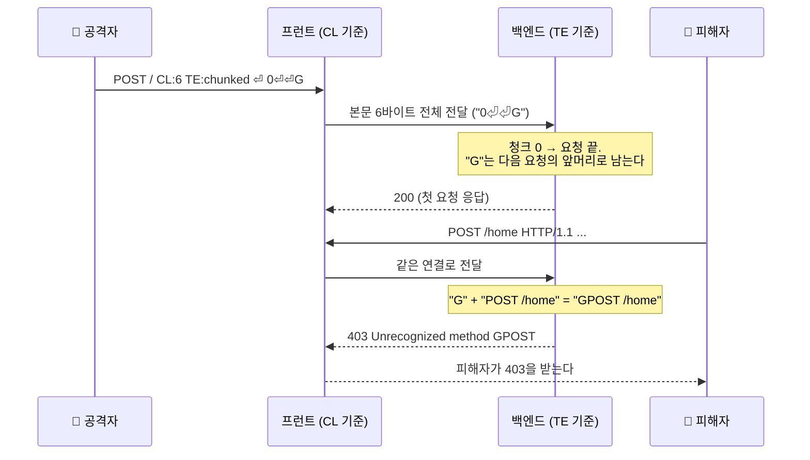

# HTTP 요청 스머글링 (HTTP Request Smuggling)

| 레벨 | 상태 | 최종 개정 | CWE |
|---|---|---|---|
| 🔴 시니어 | 🔄 개정중 | 2026-10-22 | [CWE-444](https://cwe.mitre.org/data/definitions/444.html) |

> **한눈에 보기**
> 프런트(프록시·로드밸런서)와 백엔드가 한 TCP 연결 위에서 요청의 **경계**를 서로 다르게 자르면, 공격자가 보낸 바이트의 일부가 다음 사람의 요청 앞머리가 된다.
> 공격자는 프런트의 보안 통제를 건너뛰고, 다른 사용자의 요청(쿠키 포함)을 가로채며, 캐시에 독을 푼다.
> 막는 핵심은 하나다. **경계가 모호한 요청은 거부하고, 모든 구간에서 같은 규칙으로 자르라.** HTTP/2를 끝까지 쓰면 모호함 자체가 사라진다.

## 1. 원리

### 두 서버, 한 연결

현대 웹 서비스는 프런트 서버(리버스 프록시, 로드밸런서, CDN, WAF)가 요청을 받아 백엔드에 넘기는 구조다. 성능을 위해 프런트는 백엔드와의 TCP 연결을 **재사용**하고, 여러 사용자의 요청을 그 연결 위에 **이어서** 보낸다. 그러므로 백엔드는 바이트 스트림에서 "이 요청이 어디서 끝나는가"를 스스로 판단해야 한다.

HTTP/1.1에서 본문 길이를 알리는 헤더는 둘이다. `Content-Length`(바이트 수)와 `Transfer-Encoding: chunked`(크기 줄 + 데이터를 반복하고 `0`으로 끝). [RFC 9112 6.3절](https://www.rfc-editor.org/rfc/rfc9112#section-6.3)은 둘 다 있으면 `Transfer-Encoding`을 우선하고, 그런 메시지는 스머글링 시도일 수 있으니 오류로 다루라고 한다. 문제는 **모든 서버가 이 규칙을 같은 방식으로 지키지는 않는다**는 데 있다. 하나는 CL을 믿고 하나는 TE를 믿으면, 같은 바이트열을 두 서버가 다른 위치에서 자른다.



<figure>
<figcaption>그림 1. CL.TE 데싱크. 프런트가 넘긴 마지막 바이트 "G"가 백엔드 버퍼에 남아 다음 사용자의 요청에 붙는다. 신뢰 경계는 "프런트가 자른 요청 = 백엔드가 자른 요청"이라는 가정이다.</figcaption>
</figure>

이것이 **데싱크**(desync)다. 남는 바이트가 `G` 한 글자면 다음 사용자가 403을 받는 장난으로 끝나지만, 남는 바이트가 **완전한 요청 하나**면 그 요청은 프런트를 거치지 않은 것처럼 백엔드에서 실행된다.

### 유형

| 유형 | 프런트 | 백엔드 | 비고 |
|---|---|---|---|
| **CL.TE** | Content-Length | Transfer-Encoding | 가장 흔했던 형태 |
| **TE.CL** | Transfer-Encoding | Content-Length | 스머글할 요청을 청크 안에 넣는다 |
| **TE.TE** | 둘 다 TE 지원 | 둘 다 TE 지원 | TE 헤더를 **난독화**해 한쪽만 못 알아보게 만든다(7절) |
| **H2.CL / H2.TE** | HTTP/2 | HTTP/1.1로 다운그레이드 | HTTP/2 요청의 `content-length`·`transfer-encoding`을 그대로 넘긴다 |
| **CL.0** | Content-Length | 본문 무시 | TE 무관. 백엔드가 정적 파일·리다이렉트·오류 응답에서 본문을 읽지 않고 버리면, 프런트가 CL대로 넘긴 본문이 다음 요청이 된다. 8절의 nginx `error_page`(CVE-2019-20372)와 httpd 2.4.52 이하의 [CVE-2022-22720](https://nvd.nist.gov/vuln/detail/CVE-2022-22720)(본문 폐기 중 오류가 나도 연결을 닫지 않음)이 이 유형 |

CL.TE와 TE.CL의 바이트열은 이렇다. 공백·줄바꿈 하나가 길이를 바꾸므로 `\r\n`을 명시한다.

```http
POST / HTTP/1.1          ← CL.TE. 프런트는 6바이트 본문 전체를 넘기고,
Host: lab                   백엔드는 청크 "0"에서 끝내 "G"를 남긴다
Content-Length: 6
Transfer-Encoding: chunked

0\r\n
\r\n
G
```

```http
POST / HTTP/1.1          ← TE.CL. 프런트는 청크를 끝까지 읽어 넘기고,
Host: lab                   백엔드는 CL=4("5c\r\n")에서 끝낸다.
Content-Length: 4           나머지 "GPOST / HTTP/1.1 ... x=1 0" 이 다음 요청이 된다.
Transfer-Encoding: chunked  5c(92바이트)는 GPOST 줄부터 x=1까지의 길이(로컬에서 계산 확인).
                            스머글 요청의 CL:15는 본문 x=1보다 길어, 다음 사용자의 요청 앞부분을 삼킨다

5c\r\n
GPOST / HTTP/1.1\r\n
Content-Type: application/x-www-form-urlencoded\r\n
Content-Length: 15\r\n
\r\n
x=1\r\n
0\r\n
\r\n
```

### HTTP/2 다운그레이드

HTTP/2는 바이너리 프레임에 길이가 명시돼 있어 요청 경계가 모호하지 않다. 문제는 프런트가 HTTP/2를 받아 **HTTP/1.1로 바꿔** 백엔드에 넘길 때다. 이때 프런트는 본문 길이에 맞는 `Content-Length`를 새로 만들어야 하는데, 클라이언트가 보낸 `content-length`나 `transfer-encoding` 헤더를 **그대로 베끼면** 백엔드는 프레임 길이가 아니라 그 헤더로 경계를 정한다. [RFC 9113 8.2.2절](https://www.rfc-editor.org/rfc/rfc9113#section-8.2.2)이 HTTP/2에서 `Transfer-Encoding` 같은 연결 전용 헤더를 금지하는 이유다. 또 HTTP/2는 바이너리 프레임이라 헤더 값에 `\r\n` 바이트를 실을 수 있고([RFC 9113 8.2.1절](https://www.rfc-editor.org/rfc/rfc9113#section-8.2.1)은 금지하지만 검사하지 않는 구현이 있다), 다운그레이드 후 **헤더 한 줄이 두 줄**이 되는 CRLF 주입도 같은 결과를 낸다. James Kettle의 2021년 연구 [HTTP/2: The Sequel is Always Worse](https://portswigger.net/research/http2)가 이 계열을 체계화했다.

## 2. 발생하는 코드 패턴

스머글링은 애플리케이션 코드보다 **서버 구현과 구성**에서 생긴다. 분석가가 보는 코드는 세 종류다.

### 파서: 두 헤더가 함께 올 때

```python
# ❌ 취약: CL이 있으면 CL을, TE는 보조로. RFC 9112 6.3절과 반대
def body_length(headers):
    if "content-length" in headers:
        return int(headers["content-length"])
    if headers.get("transfer-encoding") == "chunked":
        return CHUNKED
    return 0
```

```python
# ✅ 안전: 둘 다 있으면 거부. TE가 있는데 chunked로 끝나지 않아도 거부
def body_length(headers):
    te, cl = headers.get("transfer-encoding"), headers.get("content-length")
    if te is not None and cl is not None:
        raise BadRequest("ambiguous message framing")          # 400
    if te is not None:
        if te.split(",")[-1].strip().lower() != "chunked":
            raise BadRequest("unsupported transfer-encoding")
        return CHUNKED
    return int(cl) if cl is not None else 0
```

Node.js의 HTTP 파서(llhttp)는 기본값이 두 번째다. 로컬 Node 22에서 CL과 TE를 함께 보내면 `400 HPE_INVALID_TRANSFER_ENCODING`으로 끊는다(`insecureHTTPParser: true`를 주면 다시 열린다).

### 다운그레이드: HTTP/2 헤더를 HTTP/1.1에 베낄 때

```java
// ❌ 취약(개념): HTTP/2 의사 헤더를 뺀 나머지를 전부 HTTP/1.1 헤더로 복사
for (var h : h2Headers) if (!h.getKey().startsWith(":")) h1Request.headers().add(h.getKey(), h.getValue());
// ✅ 안전: content-length는 프레임에서 센 길이로 새로 만들고, transfer-encoding·connection 계열은 버리며, 이름·값에 CR/LF가 있으면 거부
```

8절의 Netty CVE-2021-21295가 이 패턴이다. HTTP/2 스트림의 `content-length`를 검증 없이 HTTP/1.1 객체로 넘겼다.

### 구성: 입력 일부를 프록시 URL에 다시 넣을 때

```apache
# ❌ 취약(CVE-2023-25690 권고문의 예): 요청 경로 일부를 패턴으로 받아 프록시 대상 URL에 재삽입
RewriteEngine on
RewriteRule "^/here/(.*)" "http://backend:8080/elsewhere?$1" [P]
ProxyPassReverse /here/ http://backend:8080/
```

경로에 들어온 인코딩된 CRLF가 치환 과정에서 복원되면 백엔드로 가는 요청이 **둘**이 된다. 요청 분할(request splitting)이라 부르지만 결과는 스머글링과 같다. httpd 2.4.56이 고쳤다.

## 3. 탐지 방법

### 3.1 코드 리뷰 / 정적 분석

스머글링은 코드 한 줄의 패턴보다 **구간 목록**에서 찾는다.

1. 클라이언트에서 애플리케이션까지의 모든 홉(CDN, WAF, LB, 리버스 프록시, 서비스 메시 사이드카)을 적는다.
2. 각 홉이 받는 프로토콜과 넘기는 프로토콜(HTTP/2 → HTTP/1.1 다운그레이드가 있는가)을 적는다.
3. 홉 사이의 연결 재사용 여부(`keepalive`, `proxy_http_version 1.1`, `ProxyPass … keepalive=On`)와 각 홉의 서버 소프트웨어·**버전**을 적고, 8절과 벤더 권고를 대조한다.

구성 파일에서 바로 볼 수 있는 것도 있다.

```bash
# Apache: 경로 일부를 프록시 URL에 재삽입하는 RewriteRule [P] / ProxyPassMatch
grep -rnE "RewriteRule .*\\\$[0-9].*\[.*P.*\]|ProxyPassMatch" /etc/apache2 /etc/httpd 2>/dev/null
# nginx: error_page 로 리다이렉트하면서 본문을 받는 location (1.17.7 미만이면 CL.0)
grep -rnE "error_page\s+[0-9]+.*(=|http)" /etc/nginx 2>/dev/null
```

Semgrep·CodeQL은 이 유형에 맞는 기본 룰이 사실상 없다. 직접 HTTP 파서를 가진 코드(프록시, 게이트웨이, 임베디드 서버)를 리뷰할 때는 2절의 `body_length` 패턴을 손으로 찾는다. 찾는 질문은 하나다. "CL과 TE가 함께 오면 무엇을 하는가?"

### 3.2 동적 테스트

**1단계: 시간 지연.** 가장 안전한 첫 탐침이다. 한쪽 서버가 본문을 기다리다 타임아웃되면 응답이 늦는다.

```http
POST / HTTP/1.1               ← CL.TE 탐침. 프런트(CL=4)는 "1\r\nA" 까지만 넘기고,
Host: lab                        백엔드(TE)는 "A" 다음 청크를 기다린다 → 지연
Transfer-Encoding: chunked
Content-Length: 4

1\r\n
A\r\n
X
```

```http
POST / HTTP/1.1               ← TE.CL 탐침. 프런트(TE)는 "0\r\n\r\n" 까지만 넘기고,
Host: lab                        백엔드(CL=6)는 1바이트를 더 기다린다 → 지연
Transfer-Encoding: chunked
Content-Length: 6

0\r\n
\r\n
X
```

CL.TE 탐침을 **먼저** 보낸다. 순서를 바꾸면 TE.CL 탐침이 CL.TE 환경에서 실제 데싱크를 일으켜 다른 사용자에게 영향을 줄 수 있다.

**2단계: 응답 차이로 확정.** 지연만으로는 네트워크 편차와 구분이 어렵다. "공격 요청" 뒤에 "정상 요청"을 보내, 정상 요청의 응답이 바뀌는지 본다. CL.TE라면 스머글한 `GET /404-page`가 정상 요청 앞에 붙어 정상 요청이 404를 받는다. 두 요청은 **다른 연결**로 보내고, 그 사이에 다른 사용자 트래픽이 끼어들 수 있으므로 여러 번 반복한다.

**3단계: 도구.** Burp Suite의 [HTTP Request Smuggler](https://portswigger.net/bappstore/aaaa60ef945341e8a6e9f8bb7a0d84a4) 확장(BApp Store)은 1~2단계를 TE 난독화 변형까지 자동으로 돌리고, Burp Scanner도 같은 탐침을 쓴다. 자동화 결과는 반드시 2단계로 손으로 확정한다. 탐침 자체가 다른 사용자의 요청을 깨뜨릴 수 있으므로 **허가 범위와 시간대**를 먼저 정한다.

## 4. 실습 🧪

원리 실습은 Academy에서, 로컬 재현은 선택이다. 스머글링을 로컬에서 재현하려면 CL과 TE를 **다르게 해석하는 두 서버**가 필요하고, 현행 버전은 대부분 모호한 요청을 거부하므로 특정 옛 버전이나 특정 구성을 맞춰야 한다. 그 구성 자체가 실습 내용보다 어렵다.

### 4.1 공개 실습 환경 (기본)

[PortSwigger Web Security Academy: HTTP request smuggling](https://portswigger.net/web-security/request-smuggling)의 랩을 이 순서로 푼다.

1. **HTTP request smuggling, basic CL.TE vulnerability** · 1절의 "G" 바이트열 그대로. `GPOST` 응답을 본다.
2. **HTTP request smuggling, basic TE.CL vulnerability** · 청크 크기를 손으로 센다. Burp Repeater에서 **Update Content-Length 를 끄고** 보낸다.
3. **HTTP request smuggling, obfuscating the TE header** · TE.TE. 7절의 변형 표를 하나씩 대입한다.
4. **confirming a CL.TE vulnerability via differential responses** · 3.2의 2단계.
5. **Exploiting HTTP request smuggling to bypass front-end security controls** · 프런트가 막는 `/admin`을 백엔드에서 연다.
6. **Exploiting HTTP request smuggling to capture other users' requests** / **… to perform web cache poisoning** · 스머글한 POST의 본문이 다음 사용자의 요청(쿠키 포함)을 삼켜 저장되고, 스머글한 요청의 응답이 캐시에 남아 모든 사용자에게 간다.
7. **H2.CL request smuggling** / **CL.0 request smuggling** · 변종. 전자는 Burp Repeater의 HTTP/2 모드와 Inspector로 헤더를 넣고, 후자는 본문을 버리는 엔드포인트를 찾는다.

1~4번이 탐지, 5~6번이 영향, 7번이 변종이다. 보고서에 쓸 "영향"은 5~6번에서 나온다.

### 4.2 로컬 (선택): 파서 모형으로 경계가 갈리는 것 보기

서버 두 대 대신, 같은 바이트열을 CL 우선 파서와 TE 우선 파서가 어떻게 자르는지 28줄짜리 모형으로 본다. 실제 서버가 아니라 **원리를 확인하는 도구**다.

```python
# desync_parse.py  (핵심만. 전체는 28줄)
def split(buf, prefer_te):
    reqs = []
    while b"\r\n\r\n" in buf:
        head, _, rest = buf.partition(b"\r\n\r\n")
        if prefer_te and re.search(rb"(?im)^transfer-encoding:.*chunked", head):
            body = b""
            while True:                              # 크기(16진수) CRLF 데이터 CRLF … 0 CRLF CRLF
                size_line, _, rest = rest.partition(b"\r\n")
                size = int(size_line.split(b";")[0], 16)
                body += rest[:size]; rest = rest[size + 2:]
                if size == 0: break
        else: n = body_len_cl(head); body, rest = rest[:n], rest[n:]      # CL 길이만큼
        reqs.append(head + b"\r\n\r\n" + body); buf = rest
    return reqs, buf                                 # buf: 다음 요청의 앞머리로 남는 바이트
```

1절의 CL.TE 바이트열(`…\r\n\r\n0\r\n\r\nG`)을 `prefer_te=False`와 `True`로 한 번씩 돌린다.

```
== CL 우선(프런트): 요청 1개, 남은 바이트 b''
== TE 우선(백엔드): 요청 1개, 남은 바이트 b'G'
```

남은 `b'G'`가 그림 1의 "G"다. 2절의 `✅ body_length`처럼 둘 다 있을 때 예외를 던지도록 고치면 어느 쪽도 남는 바이트가 없다. 고치는 것까지가 실습이다.

## 5. 익스플로잇 검증

스머글링은 "있다"와 "무엇이 되는가" 사이의 거리가 멀다. 실습 환경에서 다음 순서로 확인한다.

| 단계 | 확인 | 심각도에 미치는 영향 |
|---|---|---|
| 1 | 시간 지연 탐침이 재현된다 | 후보 |
| 2 | 응답 차이로 데싱크가 확정된다 (다음 요청이 404·`GPOST` 등) | 취약점 존재. 그 자체로 다른 사용자의 요청을 깨뜨리는 DoS |
| 3 | 프런트가 막는 경로(`/admin`, 내부 API)가 백엔드에서 열린다 | 접근 제어 우회. High |
| 4 | 다른 사용자의 요청(세션 쿠키, 본문)을 저장·열람할 수 있다 | 세션 탈취. Critical |
| 5 | 스머글한 응답이 캐시에 남는다 (캐시 포이즈닝 결합) | 전체 사용자 영향. Critical |

실제 서비스에서는 2단계까지만 하고, 그것도 **자기 요청 둘** 사이에서만 확인한다. 3단계 이상은 다른 사용자의 트래픽을 건드릴 수밖에 없으므로 허가 없이 하지 않는다. 보고서에는 구간 목록(3.1)과 어느 홉 사이에서 경계가 갈리는지를 적는다. 조치 주체가 애플리케이션 팀이 아니라 **인프라 팀**인 경우가 대부분이기 때문이다.

## 6. 방어

| 계층 | 조치 | 효과 |
|---|---|---|
| 프로토콜 | **HTTP/2를 끝까지**(end-to-end) 쓴다. 백엔드까지 HTTP/2면 다운그레이드가 없다 | 근본 제거. 길이가 프레임에 있어 모호함이 없다 |
| 프런트·백엔드 | 모호한 요청 거부: CL과 TE 동시 → 400, TE가 chunked로 끝나지 않음 → 400, 헤더 이름·값의 CR/LF·제어문자 → 400. 응답 후 **연결을 닫는다** | 탐침 단계에서 차단. 남은 바이트가 다음 요청에 붙지 못한다 |
| 프런트 | 요청을 **정규화해 다시 직렬화**한다. 받은 바이트를 그대로 넘기지 않고, 프런트가 해석한 결과로 새 요청을 만든다 | 두 파서의 입력이 같아진다 |
| 프런트 | HTTP/2 다운그레이드 시 `content-length`는 프레임 길이로 재계산, `transfer-encoding`·`connection` 계열 제거 | H2.CL·H2.TE 차단 |
| 인프라 | 백엔드 연결 재사용 금지(요청마다 새 연결) | 데싱크의 전제를 없앤다. 성능 비용이 커 마지막 수단 |
| 탐지 | 백엔드 접근 로그에서 `GPOST` 같은 미지의 메서드, 프런트 로그와 백엔드 로그의 요청 수 불일치 | 사후 대응 |

**하지 말아야 할 것**

- "WAF가 있으니 괜찮다". WAF는 프런트 중 하나다. 그 뒤 홉과 해석이 다르면 WAF 자체가 데싱크의 한쪽이 된다.
- 특정 페이로드 시그니처 차단이나 한 홉만 고치는 것. TE 변형은 수십 가지고 계속 늘어나며, 경계 해석은 **모든 홉이 같아야** 한다.

## 7. 우회 기법 🔴

### TE 헤더 난독화 (TE.TE)

두 서버가 모두 TE를 지원하면 CL.TE도 TE.CL도 아니다. 그러면 **한쪽만** TE를 못 알아보게 변형한다. 알아본 쪽은 TE로, 못 알아본 쪽은 CL로 경계를 정해 다시 CL.TE나 TE.CL이 된다. Kettle의 2019년 연구 [HTTP Desync Attacks: Request Smuggling Reborn](https://portswigger.net/research/http-desync-attacks-request-smuggling-reborn)과 Academy가 정리한 변형이다.

| 변형 | 노리는 것 |
|---|---|
| `Transfer-Encoding: xchunked` | 값을 느슨하게 매칭(`contains "chunked"`)하는 파서 |
| `Transfer-Encoding : chunked` | 콜론 앞 공백. 한쪽은 헤더 이름을 `Transfer-Encoding `로 본다(CVE-2019-16869) |
| `Transfer-Encoding: chunked` 뒤에 `Transfer-Encoding: x` | 중복 헤더. 첫 값만 보는 파서 vs 마지막 값만 보는 파서 |
| `[공백]Transfer-Encoding: chunked` | 줄 머리 공백. 앞 헤더의 이어짐(obs-fold)으로 보는 파서 |
| `X: X[\n]Transfer-Encoding: chunked` | 줄 끝을 `\r\n`만 인정하는 파서 vs `\n`도 인정하는 파서(CVE-2020-1935 계열) |
| `Transfer-Encoding: chunked, identity` / `identity` | 마지막 인코딩이 chunked가 아니어도 통과시키는 파서(CVE-2021-33037) |

**청크 확장과 크기 줄.** 청크 크기 줄은 `크기;확장=값` 형식을 허용한다. 확장을 무시하는 파서와 거기서 멈추는 파서가 갈린다. 크기를 16진수로 읽을 때 `0x`, 앞자리 0, 공백, 음수 부호를 어떻게 다루는지도 구현마다 달라, 같은 청크 본문이 다른 길이로 읽힌다. 분석할 때는 청크 파서의 **크기 줄 파싱 코드**를 본다.

### CL.0와 H2 다운그레이드

TE 변형이 전부 막혀도 두 길이 남는다. 첫째, 백엔드가 본문을 읽지 않는 엔드포인트를 찾는 CL.0이다. 정적 파일, 리다이렉트, 오류 페이지, `HEAD`·`OPTIONS` 처리기를 상대로 본문에 두 번째 요청을 넣고 다음 응답이 바뀌는지 본다. 둘째, HTTP/2로 접속해 프런트의 다운그레이드를 노리는 H2.CL·H2.TE다. HTTP/2 프레임은 바이너리라 `Content-Length: 0`을 헤더로 넣어도 프런트가 본문을 따로 넘길 수 있고, 헤더 값에 `\r\n`을 넣으면 HTTP/1.1로 변환될 때 새 헤더 줄이 된다. Burp Repeater는 HTTP/2 모드에서 이런 헤더를 Inspector로 직접 넣게 해 준다.

백엔드에 **완전한 요청 하나**를 남기면 응답이 하나씩 밀려 이후 사용자가 남의 응답을 받는 응답 큐 포이즈닝(response queue poisoning)이 되고, 2022년 연구 [Browser-Powered Desync Attacks](https://portswigger.net/research/browser-powered-desync-attacks)는 프록시 없이 브라우저 혼자서도 데싱크를 만들 수 있음을 보였다. 이 장은 서버 간 데싱크까지만 다룬다.

## 8. 실제 CVE 사례

| CVE | 제품 | 핵심 | 패치 |
|---|---|---|---|
| [CVE-2019-20372](https://nvd.nist.gov/vuln/detail/CVE-2019-20372) | NGINX 1.17.7 미만 | 특정 `error_page` 구성에서 리다이렉트할 때 요청 본문을 남겨 스머글링(CL.0 계열). 앞에 LB가 있으면 허가되지 않은 페이지를 읽을 수 있었다 | [commit c1be55f](https://github.com/nginx/nginx/commit/c1be55f97211d38b69ac0c2027e6812ab8b1b94e) |
| [CVE-2022-26377](https://nvd.nist.gov/vuln/detail/CVE-2022-26377) | Apache HTTP Server 2.4.53 이하 `mod_proxy_ajp` | AJP 백엔드로 넘기는 요청의 해석 불일치. 백엔드(Tomcat 등)에 요청을 스머글 | [httpd 2.4 보안 공지](https://httpd.apache.org/security/vulnerabilities_24.html) |
| [CVE-2023-25690](https://nvd.nist.gov/vuln/detail/CVE-2023-25690) | Apache HTTP Server 2.4.0~2.4.55 `mod_proxy` + `mod_rewrite` | 경로 일부를 `$1`로 프록시 URL에 재삽입하는 구성에서 요청 분할. 접근 제어 우회·캐시 포이즈닝. 2절의 구성 예 | [httpd 2.4 보안 공지](https://httpd.apache.org/security/vulnerabilities_24.html) (2.4.56) |
| [CVE-2021-33037](https://nvd.nist.gov/vuln/detail/CVE-2021-33037) | Apache Tomcat 10.0.0-M1~10.0.6, 9.0.0.M1~9.0.46, 8.5.0~8.5.66 | TE 처리 오류 세 가지: HTTP/1.0 응답만 받겠다는 클라이언트의 TE를 무시, `identity` 인코딩 허용, chunked가 마지막 인코딩인지 미확인 | [Tomcat 공지](https://lists.apache.org/thread.html/r612a79269b0d5e5780c62dfd34286a8037232fec0bc6f1a7e60c9381%40%3Cannounce.tomcat.apache.org%3E) |
| [CVE-2021-21295](https://nvd.nist.gov/vuln/detail/CVE-2021-21295) | Netty `netty-codec-http2` 4.1.60.Final 미만 | HTTP/2 요청의 `content-length`를 검증 없이 HTTP/1.1 객체로 변환해 프록시(Zuul 등)에서 H2.CL | [GHSA-wm47-8v5p-wjpj](https://github.com/netty/netty/security/advisories/GHSA-wm47-8v5p-wjpj) · [commit 89c241e](https://github.com/netty/netty/commit/89c241e3b1795ff257af4ad6eadc616cb2fb3dc4) |
| [CVE-2023-25725](https://nvd.nist.gov/vuln/detail/CVE-2023-25725) | HAProxy 2.7.3 미만 (2.0.31, 2.2.29, 2.4.22, 2.5.12, 2.6.9) | 빈 헤더 이름을 받아들여 그 뒤 헤더 목록이 잘림. 접근 제어용 헤더가 사라져 우회 | [commit a0e561a](https://git.haproxy.org/?p=haproxy-2.7.git;a=commit;h=a0e561ad7f29ed50c473f5a9da664267b60d1112) |

다음 두 건은 스머글링과 붙어 다니지만 분류가 다르다.

| CVE | 제품 | 왜 비교용인가 |
|---|---|---|
| [CVE-2023-46747](https://nvd.nist.gov/vuln/detail/CVE-2023-46747) | F5 BIG-IP 13.1~17.1 Configuration utility | 레코드 분류는 인증 우회(CWE-288). 공개 분석은 관리 UI 앞단(Apache)에서 뒤의 AJP로 요청을 스머글해 인증을 건너뛴 것으로 설명한다. **스머글링이 수단, 인증 우회가 결과**인 전형 |
| [CVE-2024-27316](https://nvd.nist.gov/vuln/detail/CVE-2024-27316) | Apache HTTP Server 2.4.17~2.4.58 | HTTP/2 CONTINUATION 프레임을 끝없이 보내 메모리를 고갈시키는 **DoS**(CWE-770). "HTTP/2"라는 단어 때문에 스머글링으로 오인되지만 경계 해석과 무관하다 |

**NGINX (CVE-2019-20372) 에서 배울 것**: 레코드가 가리키는 커밋 c1be55f는 `error_page`로 리다이렉트할 때 요청 본문을 **폐기**(discard)하도록 고쳤다. 리다이렉트 응답을 내면서 본문을 읽지 않으면, 그 본문이 연결에 남아 다음 요청이 된다. "본문을 안 쓰는 응답"이야말로 본문을 **반드시 소비하거나 연결을 닫아야** 한다. CL.0의 교과서다.

**Apache httpd (CVE-2023-25690) 에서 배울 것**: 서버에 버그가 없어도 **구성**이 스머글링을 만든다. 권고문은 취약한 `RewriteRule` 예를 그대로 실었다. 3.1의 grep이 이 패턴을 찾는다. 수정은 치환된 URL에 CRLF가 들어가지 않도록 하는 쪽이었다(권고문 기준).

**Tomcat (CVE-2021-33037) 에서 배울 것**: 한 CVE에 7절의 변형 세 가지가 한꺼번에 들어 있다. `identity`를 받아 주고, chunked가 마지막인지 확인하지 않고, 클라이언트의 HTTP 버전에 따라 TE를 무시했다. 각각은 사소한 관용이고, 앞단 프록시와 조합될 때만 취약점이 된다. 레코드 설명 기준으로 수정은 세 관용을 모두 없앤 것이다.

**Netty (CVE-2021-21295)·HAProxy (CVE-2023-25725) 에서 배울 것**: HTTP/2→HTTP/1.1 변환 계층은 **길이를 새로 세는 것**이 원칙이고(Netty 권고문: "사용자는 content-length가 검증됐다고 가정하지만 그렇지 않았다"), 경계 해석 불일치는 본문 길이에만 있지 않다. HAProxy는 **헤더 이름이 빈** 줄 하나로 뒤의 헤더가 통째로 사라져 프런트가 넣은 인증 헤더가 없어졌다.

## 9. 체크리스트

**구성 리뷰할 때**
- [ ] 클라이언트에서 앱까지 모든 홉과 각 홉의 소프트웨어·버전을 적었는가?
- [ ] HTTP/2 → HTTP/1.1 다운그레이드 지점이 있는가? 있다면 `content-length`를 재계산하고 TE·connection 헤더를 제거하는가?
- [ ] 각 홉이 CL과 TE 동시 요청을 400으로 거부하는가?
- [ ] 경로 일부를 프록시 URL에 재삽입하는 `RewriteRule [P]`·`ProxyPassMatch`가 있는가?
- [ ] 본문을 읽지 않고 응답하는 엔드포인트(리다이렉트, 정적 파일, 오류 페이지)가 본문을 소비하거나 연결을 닫는가?

**테스트할 때**
- [ ] CL.TE 시간 탐침을 TE.CL보다 **먼저** 보냈는가? Repeater에서 Content-Length 자동 갱신을 껐는가?
- [ ] 응답 차이로 확정할 때 두 요청을 다른 연결로 여러 번 보냈는가? 허가 범위에 "다른 사용자 트래픽에 영향 가능"이 명시돼 있는가?

**배포 전**
- [ ] 백엔드까지 HTTP/2를 쓸 수 있는가? 프런트·백엔드의 스머글링 관련 패치(8절)가 적용돼 있는가?
- [ ] 백엔드 로그에서 미지의 메서드·요청 수 불일치를 감시하는가?

## 10. 더 읽기

- [CWE-444](https://cwe.mitre.org/data/definitions/444.html) · 공식 정의
- [RFC 9112 HTTP/1.1, 6.3절 Message Body Length](https://www.rfc-editor.org/rfc/rfc9112#section-6.3) · CL·TE 동시 수신 규칙의 원전. [11.2절](https://www.rfc-editor.org/rfc/rfc9112#section-11.2)이 스머글링을 보안 고려사항으로 다룬다
- [RFC 9113 HTTP/2, 8.2.2절](https://www.rfc-editor.org/rfc/rfc9113#section-8.2.2) · 연결 전용 헤더 금지, 다운그레이드 시 지켜야 할 것
- James Kettle, [HTTP Desync Attacks: Request Smuggling Reborn](https://portswigger.net/research/http-desync-attacks-request-smuggling-reborn) (PortSwigger Research, 2019) · 이 유형을 되살린 1차 자료. 탐침·TE 변형·영향 사례
- James Kettle, [HTTP/2: The Sequel is Always Worse](https://portswigger.net/research/http2) (PortSwigger Research, 2021) · H2.CL·H2.TE·CRLF 주입
- Chaim Linhart, Amit Klein, Ronen Heled, Steve Orrin, *HTTP Request Smuggling* (Watchfire, 2005) · 이 이름을 처음 붙인 백서

## 변경 이력

| 날짜 | 변경 | 기여자 |
|---|---|---|
| 2026-10-22 | 초안 작성. CL.TE·TE.CL 바이트열 길이 계산과 파서 모형, Node 22의 CL+TE 거부를 로컬 확인. CVE 8건 cvelistV5 레코드 대조 | @anthonynoh5202 |
| 2026-10-23 | 기술 검증(2차): CVE 11건 레코드 재대조(전부 실존, 버전·CWE 일치). TE.CL 청크 길이(0x5c=92)·탐침 CL 값·파서 모형 재실행, Node 22 `HPE_INVALID_TRANSFER_ENCODING` 재확인, nginx 1.17.7 `error_page` 경로의 `ngx_http_discard_request_body` 추가를 소스로 확인. CL.0 행의 CVE-2022-22720이 8절에 없는데 "8절의"로 가리키던 것을 바로잡고, HTTP/2 헤더 값의 CR/LF가 규격상 금지(RFC 9113 8.2.1)임을 명시 | 검증팀 |
