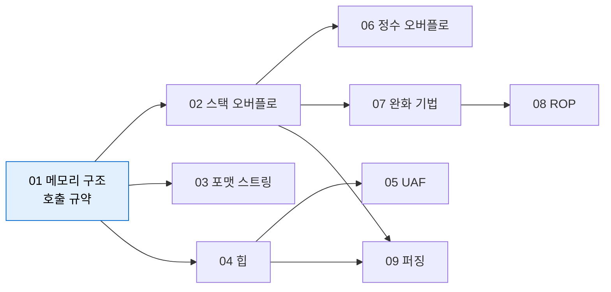

# 바이너리 취약점 개요

| 레벨 | 상태 | 최종 개정 |
|---|---|---|
| 🟢 | 🔄 개정중 | 2026-10-22 |

> **한눈에 보기**
> 메모리 안전하지 않은 언어(C/C++)에서 '경계'와 '수명'을 잘못 다루면 공격자가 메모리를 직접 쓴다.
> 4부는 그 메모리를 이해하는 데서 시작한다. 웹 취약점이 "입력이 코드로 해석되는" 문제라면, 바이너리 취약점은 "입력이 메모리 구조를 깨뜨리는" 문제다.
> 이 장은 4부 전체에서 쓰는 도구, 어셈블리 최소 지식, 실습 빌드 규칙을 정한다.

## 1. 왜 아직도 메모리 취약점인가

C와 C++는 메모리를 프로그래머가 직접 관리한다. 배열의 길이를 넘어 써도, 해제한 메모리를 다시 읽어도, 언어는 막지 않는다. 그 결과가 수십 년째 심각 취약점의 주류다.

📎 Microsoft는 2019년 BlueHat IL 발표와 MSRC 블로그에서 "매년 CVE를 부여한 취약점의 약 70%가 메모리 안전 문제"라고 밝혔다. [MSRC 블로그, 2019-07](https://www.microsoft.com/en-us/msrc/blog/2019/07/a-proactive-approach-to-more-secure-code) · [발표 자료 저장소](https://github.com/microsoft/MSRC-Security-Research/tree/master/presentations/2019_02_BlueHatIL)
📎 Chromium 프로젝트도 2015년 이후 안정 채널에 영향을 준 high/critical 버그 912건을 분석해 약 70%가 메모리 안전 문제이고, 그 절반이 use-after-free라고 공개했다. [Chromium Security: Memory safety](https://www.chromium.org/Home/chromium-security/memory-safety/)

두 수치는 같은 이야기를 한다. 완화 기법(ASLR, NX, 카나리 등)이 20년 넘게 쌓였지만 **근본 원인은 그대로**이고, 공격자는 완화를 우회하는 쪽으로 진화했다. 분석가가 메모리 취약점을 알아야 하는 이유는 세 가지다.

| 이유 | 설명 | 이 책에서 |
|---|---|---|
| 영향도 판단 | "크래시"와 "코드 실행"의 차이를 가려야 심각도를 매긴다 | [8부 2장](../part8-reporting/02-severity.md) |
| 패치 검증 | 패치가 증상만 막았는지, 원인을 제거했는지 diff로 읽어야 한다 | [7부 워크스루](../part7-walkthroughs/00-overview.md) |
| 재현 | 벤더 권고문만으로는 재현이 안 된다. 디버거에서 직접 봐야 한다 | 4부 전체 |

### 4부의 지도



<figure>
<figcaption>그림 1. 4부의 의존 관계. 01장은 모든 장의 선수 과목이다. 02장(스택)과 04장(힙)이 두 축이고, 07~08장은 "완화가 켜진 세상"에서 02~06장이 어떻게 달라지는지를 다룬다.</figcaption>
</figure>

근본 원인으로 묶으면 두 가지다. [1부 1장](../part1-foundations/01-what-is-vulnerability.md)에서 말한 "경계와 수명"이다.

| 근본 원인 | 취약점 유형 | CWE | 장 |
|---|---|---|---|
| **경계**(bounds)를 틀림 | 스택/힙 버퍼 오버플로, 범위 밖 읽기, 포맷 스트링 | CWE-121, 122, 125, 787, 134 | 02, 03, 04 |
| **수명**(lifetime)을 틀림 | use-after-free, double free | CWE-416, 415 | 05 |
| 경계 계산의 **입력**을 틀림 | 정수 오버플로, 부호 변환 | CWE-190, 195 | 06 |

## 2. 분석 도구 세트

"언제 쓰는가"가 먼저다. 네 도구를 다음 순서로 쓴다. 설치와 세부 사용법은 [6부 2장](../part6-tools/02-ghidra-ida.md)과 [6부 3장](../part6-tools/03-debuggers.md)에 있다.

| 순서 | 도구 | 언제 | 핵심 명령 |
|---|---|---|---|
| 1 | **checksec** (pwntools 내장) | 바이너리를 받자마자. 어떤 완화가 켜져 있는지 | `checksec --file=./target` |
| 2 | **Ghidra** | 소스가 없을 때. 정적으로 함수와 데이터 흐름을 읽는다 | 디컴파일 창에서 `strcpy`, `sprintf` 호출 찾기 |
| 3 | **gdb + pwndbg** | 가설을 확인할 때. 실제 메모리와 레지스터를 본다 | `disas`, `x/8gx $rsp`, `info frame` |
| 4 | **pwntools** | 재현을 자동화할 때. 입력 생성, 프로세스 제어, 패킹 | `cyclic`, `p64`, `process`, `fmtstr_payload` |

```bash
# 설치 (Ubuntu 24.04 기준)
sudo apt install gdb gcc build-essential
pip install pwntools            # checksec, pwn 명령도 함께 설치된다
git clone https://github.com/pwndbg/pwndbg && cd pwndbg && ./setup.sh
```

checksec 출력은 이렇게 읽는다. 각 항목이 무엇을 막는지는 [07장 완화 기법](07-mitigations.md)에서 다룬다.

```
$ checksec --file=./vuln
    Arch:       amd64-64-little
    RELRO:      Partial RELRO      # GOT 덮어쓰기 가능 (03장)
    Stack:      No canary found    # 반환 주소 덮어쓰기 가능 (02장)
    NX:         NX unknown - GNU_STACK missing
    PIE:        No PIE (0x400000)  # 코드 주소 고정 → 주소 누출 불필요
    Stack:      Executable         # 스택에서 셸코드 실행 가능
```

> 🟡 pwndbg가 없어도 이 책의 gdb 명령은 모두 동작한다. pwndbg는 같은 정보를 색과 주석을 붙여 보여줄 뿐이다. 처음에는 **순정 gdb로 한 번** 해 보고 pwndbg를 얹는 것이 구조 이해에 낫다.

## 3. x86-64 어셈블리 최소 지식

4부를 읽는 데 필요한 것만 추린다. 전체 명령어 집합은 필요 없다.

### 3.1 레지스터

| 레지스터 | 역할 | 분석할 때 보는 이유 |
|---|---|---|
| `rip` | 다음에 실행할 명령 주소 | 이것을 빼앗는 것이 모든 제어 흐름 탈취의 목표 |
| `rsp` | 스택 꼭대기 | `ret`은 `[rsp]`를 `rip`에 넣는다 |
| `rbp` | 현재 프레임의 기준점 (`-O0`에서) | 지역 변수는 `rbp - N`, 반환 주소는 `rbp + 8` |
| `rdi, rsi, rdx, rcx, r8, r9` | 함수 인자 1~6번 | 호출 직전에 보면 인자 값을 안다 |
| `rax` | 반환값, 시스템 콜 번호 | `execve`는 59 |
| `rbx, r12~r15` | 호출 후에도 보존되는 레지스터(callee-saved) | ROP 가젯에서 자주 쓴다 |

같은 레지스터의 하위 비트는 다른 이름으로 부른다. `rax`(64비트) ⊃ `eax`(32) ⊃ `ax`(16) ⊃ `al`(8). 32비트 레지스터에 쓰면 상위 32비트는 0이 된다. [06장 정수 오버플로](06-integer-overflow.md)에서 이 규칙이 중요해진다.

### 3.2 스택 명령

| 명령 | 하는 일 | 같은 뜻 |
|---|---|---|
| `push X` | `rsp -= 8; [rsp] = X` | 스택에 쌓는다 |
| `pop X` | `X = [rsp]; rsp += 8` | 꺼낸다 |
| `call F` | `push rip_next; jmp F` | 돌아올 주소를 저장하고 점프 |
| `ret` | `pop rip` | **스택에서 꺼낸 값으로 점프** |
| `leave` | `rsp = rbp; pop rbp` | 프레임 해체 |

스택은 **주소가 낮아지는 방향으로 자란다**. 반면 배열에 쓰기는 **주소가 높아지는 방향**이다. 지역 배열을 넘어 쓰면 더 높은 주소에 있는 저장된 `rbp`와 반환 주소를 덮는다. 02장의 전부가 이 한 문장이다.

### 3.3 호출 규약 (System V AMD64 ABI)

| 항목 | 규칙 |
|---|---|
| 정수·포인터 인자 | `rdi, rsi, rdx, rcx, r8, r9` 순서. 7번째부터 스택 |
| 반환값 | `rax` (128비트면 `rdx:rax`) |
| 보존 레지스터 | `rbx, rbp, r12~r15`는 피호출자가 지킨다 |
| 스택 정렬 | `call` 직전에 `rsp`는 **16바이트 배수** |
| 레드 존 | `rsp` 아래 128바이트는 리프 함수가 자유롭게 쓴다 |

Windows x64는 다르다(`rcx, rdx, r8, r9`, 32바이트 shadow space). 이 책은 Linux 기준이다. 출처는 [x86-64 psABI 문서](https://gitlab.com/x86-psABIs/x86-64-ABI)다.

### 3.4 문법 두 가지

gdb 기본은 AT&T 문법(`mov %rsp,%rbp`), Ghidra와 대부분의 문서는 Intel 문법(`mov rbp, rsp`)이다. 피연산자 순서가 반대다. 이 책은 gdb 출력을 그대로 싣되, 헷갈리면 gdb에서 `set disassembly-flavor intel`을 쓴다.

## 4. 컴파일러가 하는 일과 안 하는 일

취약점은 소스 코드에 있지만 익스플로잇은 바이너리에서 일어난다. 둘 사이에 컴파일러가 있다.

**컴파일러가 하는 일**
- 프레임을 만든다. `push rbp; mov rbp, rsp; sub rsp, N`. 지역 변수의 **배치 순서는 컴파일러 마음**이다. 소스에서 선언 순서와 메모리 순서는 무관하다.
- 최적화한다. `-O2`에서는 "쓰고 다시 읽지 않는" 변수를 지우고, 비밀번호를 지우는 `memset`도 지울 수 있다. 오버플로 검사 `if (x + 1 < x)`는 부호 있는 정수에서 정의되지 않은 동작(undefined behavior)이라 통째로 제거될 수 있다.
- 플래그를 주면 완화를 넣는다. `-fstack-protector-strong`(카나리), `-D_FORTIFY_SOURCE=2`(길이 아는 복사 검사), `-fPIE -pie`, `-Wl,-z,relro,-z,now`, `-fcf-protection`. **Ubuntu의 gcc는 이 중 대부분을 기본으로 켠다**. 그래서 실습은 일부러 끈다.

**컴파일러가 안 하는 일**
- 경계 검사. `buf[100]`에 101번째를 써도 경고 없이 컴파일된다. 길이가 상수일 때 `-Wstringop-overflow` 경고가 나오는 정도다.
- 초기화. 지역 변수는 이전 함수가 남긴 쓰레기 값을 갖는다.
- 수명 추적. `free(p)` 뒤에 `p`를 써도 모른다.
- 포맷 문자열 검사는 **리터럴일 때만** 한다. `printf(buf)`는 `-Wformat-security`가 있어야 경고한다.

## 5. 실습 빌드 규칙

4부의 모든 실습은 **로컬에서 직접 컴파일**한다. 별도 Docker 환경이 없다. 완화를 끈 플래그가 핵심이다.

```bash
gcc -g -O0 -fno-stack-protector -z execstack -no-pie -o vuln vuln.c
```

| 플래그 | 끄는 것 | 켜 두면 생기는 일 |
|---|---|---|
| `-g` | (디버그 정보 추가) | gdb에서 소스 줄과 변수 이름이 보인다 |
| `-O0` | 최적화 | 변수가 사라지거나 순서가 바뀐다 |
| `-fno-stack-protector` | 스택 카나리 | 반환 주소를 덮기 전에 `*** stack smashing detected ***`로 종료 |
| `-z execstack` | NX (실행 불가 스택) | 스택의 셸코드가 SIGSEGV |
| `-no-pie` | PIE (코드 위치 무작위화) | 함수 주소를 매번 누출해야 한다 |

ASLR은 커널 설정이라 플래그로 못 끈다. 시스템 전체를 바꾸지 말고 **해당 프로세스만** 끈다.

```bash
setarch $(uname -m) -R ./vuln        # 이 프로세스만 ASLR 해제
# gdb는 기본으로 ASLR을 끄고 실행한다 (set disable-randomization on)
```

각 장은 이 플래그로 시작해서, 하나씩 다시 켜며 무엇이 막히는지 확인한다. 그 "다시 켜기"가 [07장](07-mitigations.md)이다.

> ⚠️ 실습 바이너리는 **자기 컴퓨터, 자기 프로세스**에서만 돌린다. 실제 서비스나 타인의 시스템을 대상으로 한 페이로드는 이 책에 싣지 않는다. [1부 4장 윤리와 법적 범위](../part1-foundations/04-ethics-and-law.md).

## 체크리스트

이 장을 읽고 나면 다음을 할 수 있어야 한다.

- [ ] `checksec` 출력 다섯 줄을 보고 "어떤 공격이 가능한가"를 말할 수 있는가?
- [ ] `call`과 `ret`이 스택에 무엇을 넣고 빼는지 설명할 수 있는가?
- [ ] 함수 호출 직전 `rdi`, `rsi`, `rdx`에 무엇이 들어 있는지 gdb에서 확인할 수 있는가?
- [ ] 위 gcc 플래그 다섯 개가 각각 어떤 완화를 끄는지 아는가?
- [ ] 지역 배열을 넘어 쓰면 왜 반환 주소가 덮이는지 "스택이 자라는 방향"으로 설명할 수 있는가?

## 더 읽기

- [System V AMD64 ABI](https://gitlab.com/x86-psABIs/x86-64-ABI) · 호출 규약의 1차 출처
- [Intel 64 and IA-32 Architectures Software Developer Manuals](https://www.intel.com/content/www/us/en/developer/articles/technical/intel-sdm.html) · 명령어 의미의 1차 출처. 2권(명령어 집합)만 참고
- [pwntools 공식 문서](https://docs.pwntools.com/en/stable/) · 4부 전체에서 쓰는 API
- [pwndbg](https://github.com/pwndbg/pwndbg) · gdb 플러그인. `README`의 기능 목록만 봐도 무엇이 가능한지 안다
- [Ghidra](https://ghidra-sre.org/) · NSA 공개 디컴파일러. 무료
- [GCC: Instrumentation Options](https://gcc.gnu.org/onlinedocs/gcc/Instrumentation-Options.html) · `-fstack-protector`, `-fsanitize` 등 플래그의 공식 설명
- [pwn.college](https://pwn.college/) · 이 책의 02~05장과 같은 주제를 단계별 문제로 제공하는 무료 과정
- Aleph One, "Smashing The Stack For Fun And Profit", *Phrack* 49 (1996). [원문](http://phrack.org/issues/49/14.html) · 30년 전 글이지만 02장의 원리는 그대로다

## 변경 이력

| 날짜 | 변경 | 기여자 |
|---|---|---|
| 2026-10-21 | 초안(뼈대) 작성 | @anthonynoh5202 |
| 2026-10-22 | 본문 작성: 도구 세트, 어셈블리 최소 지식, 호출 규약 표, 실습 빌드 규칙 | @anthonynoh5202 |
| 2026-10-22 | 기술 검증 완료, 수정 없음. 빌드 플래그로 컴파일한 바이너리의 `checksec --file=` 출력(pwntools 4.15)이 본문과 일치, `-Wstringop-overflow` 경고·`setarch -R`·gdb ASLR 동작 확인, 레지스터·호출 규약·스택 명령 설명 검토 | 검증팀 |
