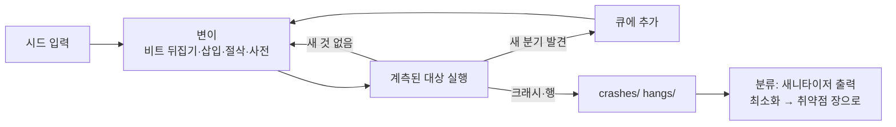

# 퍼징으로 취약점 찾기

| 레벨 | 상태 | 최종 개정 |
|---|---|---|
| 🟡 | 🔄 개정중 | 2026-10-22 |

> **한눈에 보기**
> 사람이 생각 못 한 입력을 기계가 초당 수천 번 넣는다. 커버리지 피드백이 퍼징을 '무작위 던지기'에서 '탐색'으로 바꿨다.
> 퍼저는 크래시를 찾을 뿐이고, 크래시를 **취약점**으로 만드는 것은 하네스 설계와 새니타이저, 그리고 분류(triage)다.
> 이 장은 AFL++로 첫 퍼징을 돌리고, 하네스를 쓰고, 크래시를 분류해 [이 부의 취약점 장](00-overview.md)으로 넘기는 흐름을 다룬다. 도구별 세부 옵션은 [도구 4장](../part6-tools/04-fuzzers.md)에 있다.

## 1. 원리: 커버리지 피드백

고전적 퍼징은 입력을 무작위로 바꿔 넣고 죽는지 본다. 깊은 파서는 첫 검사(매직 바이트, 체크섬)에서 대부분 거부하므로 효율이 낮다. **커버리지 유도 퍼징**(coverage-guided fuzzing)은 대상 프로그램에 계측(instrumentation)을 넣어 "이 입력이 어떤 분기를 새로 지났는가"를 보고, 새 분기를 연 입력만 **큐**(corpus)에 남겨 다시 변이시킨다.



<figure>
<figcaption>그림 1. 커버리지 피드백 루프. 큐가 자라면서 입력이 점점 깊은 코드까지 도달한다.</figcaption>
</figure>

이 루프의 결과물은 세 가지다. **큐**(도달한 경로마다 하나씩, 그 자체로 테스트 코퍼스), **크래시**, **행**(hang, 시간 초과). 큐는 다음 퍼징의 시드가 되고 회귀 테스트가 되므로 버리지 않는다.

퍼징의 한계도 여기서 나온다. 퍼저는 **크래시로 드러나는** 버그만 본다. 조용히 틀린 값을 내는 정수 오버플로([6장](06-integer-overflow.md))나 해제된 메모리를 읽는 UAF([5장](05-uaf.md))는 크래시가 안 날 수 있다. 그래서 새니타이저(4절)와 묶는다. 그리고 퍼저는 **하네스가 보여 주는 코드**만 본다. 하네스가 전부인 이유다(3절).

## 2. AFL++ 첫 퍼징

AFL++는 AFL의 후속 커뮤니티 포크로, 현재 사실상 표준이다(이 글 기준 릴리스 5.03c 📎 [README](https://github.com/AFLplusplus/AFLplusplus)). 가장 빠른 설치는 공식 Docker 이미지다.

```bash
docker pull aflplusplus/aflplusplus:latest
docker run -ti -v /location/of/your/target:/src aflplusplus/aflplusplus
```

소스에서 빌드하면 `make distrib && sudo make install`이고 LLVM 개발 패키지가 필요하다([INSTALL.md](https://github.com/AFLplusplus/AFLplusplus/blob/stable/docs/INSTALL.md)).

### 2.1 세 단계

**(1) 계측 컴파일.** 컴파일러를 `afl-cc`(C++은 `afl-c++`)로 바꾼다. 내부에서 설치된 LLVM에 맞는 최적 모드(`afl-clang-fast`, `afl-clang-lto` 등)를 고른다.

```bash
afl-cc -g -O1 target.c -o target
# 빌드 시스템이 있으면
CC=afl-cc CXX=afl-c++ ./configure --disable-shared && make clean all
```

**(2) 시드 준비.** 대상이 받아들이는 **작고 유효한** 입력 몇 개를 `in/` 디렉터리에 둔다. 1KB 이하가 좋다. 큰 시드는 변이 공간만 넓힌다.

**(3) 실행.**

```bash
afl-fuzz -i in -o out -- ./target            # 표준 입력으로 읽는 대상
afl-fuzz -i in -o out -- ./target @@         # 파일 경로 인자로 읽는 대상. @@ 자리에 입력 파일이 들어간다
afl-fuzz -i in -o out -x fmt.dict -- ./target @@   # 사전 추가 (키워드·매직 바이트)
afl-fuzz -i - -o out -- ./target @@          # 중단한 캠페인 재개
```

`--` 뒤가 대상 명령줄이다. 상태 화면에서 먼저 볼 항목은 다음과 같다([afl-fuzz_approach.md](https://github.com/AFLplusplus/AFLplusplus/blob/stable/docs/afl-fuzz_approach.md)).

| 항목 | 뜻 | 신경 쓸 때 |
|---|---|---|
| `exec speed` | 초당 실행 수 | 수백 이하면 하네스가 느리다. 퍼시스턴트 모드(3.2절) 검토 |
| `cycles done` | 큐 전체를 몇 바퀴 돌았나 | 색이 녹색(여러 바퀴 돌고 새 경로 없음)이면 그 하네스는 포화 |
| `uniq crashes` / `uniq hangs` | 고유 크래시·행 수 | 0이 아니면 5절로 |
| `pending` | 아직 변이해 보지 않은 큐 항목 | 많으면 더 돌려야 한다 |
| `stability` | 같은 입력이 같은 경로를 내는 비율 | 90% 아래면 하네스에 비결정성(난수, 시간, 전역 상태)이 있다 |

결과는 `out/default/` 아래 `queue/`, `crashes/`, `hangs/`에 쌓인다. 크래시 재현은 파일을 그대로 넣으면 된다.

```bash
cat out/default/crashes/id:000000,* | ./target
```

### 2.2 병렬과 보조 기능

코어가 여러 개면 메인 하나(`-M`)와 보조 여럿(`-S`)을 같은 `-o` 디렉터리로 띄운다. 서로 큐를 동기화한다.

```bash
afl-fuzz -M main -i in -o out -- ./target @@
afl-fuzz -S var1 -i in -o out -- ./target @@
afl-whatsup -s out/        # 전체 캠페인 요약
```

**CMPLOG**(`-c`)는 비교 연산의 피연산자를 추적해 입력에 넣는다. 매직 바이트·체크섬·길이 필드 비교를 사전 없이 뚫는다. `AFL_LLVM_CMPLOG=1`로 따로 빌드한 바이너리를 `-c`에 준다.

```bash
AFL_LLVM_CMPLOG=1 afl-cc -g -O1 target.c -o target.cmplog
afl-fuzz -i in -o out -c ./target.cmplog -- ./target @@
```

## 3. 하네스가 전부다

**하네스**(harness)는 퍼저가 주는 바이트열을 받아 대상 함수에 넣는 작은 프로그램이다. 퍼저가 찾는 버그의 상한은 하네스가 도달시키는 코드로 정해진다. 퍼징 성과의 차이는 대부분 퍼저가 아니라 하네스 차이다.

### 3.1 좋은 하네스의 조건

Google의 [What makes a good fuzz target](https://github.com/google/fuzzing/blob/master/docs/good-fuzz-target.md)을 요약하면 다음과 같다.

| 조건 | 이유 | 어기면 |
|---|---|---|
| **결정적**이다. 같은 입력 → 같은 경로 | 커버리지 피드백이 성립하려면 | `stability` 하락, 재현 불가 크래시 |
| **빠르다**. 전역 초기화는 한 번만 | 초당 실행 수가 곧 탐색량 | 느린 퍼징 |
| **전역 상태를 바꾸지 않는다** | 이전 입력이 다음 입력에 영향 | 가짜 크래시, 재현 불가 |
| 입력을 **파일·네트워크 없이** 메모리에서 받는다 | I/O는 느리고 비결정적 | 속도 저하 |
| 메모리 누수·시간 초과를 내지 않는다 | 퍼저가 진짜 버그 대신 그것만 보고한다 | 노이즈 |
| 입력 크기 상한을 둔다 (`-max_len`, `if (len > N) return`) | 거대 입력은 느리고 실제 공격 면과 다를 수 있다 | 시간 낭비 |
| **시드 코퍼스**와 **사전**이 있다 | 유효한 입력 구조에서 출발 | 첫 검사를 못 넘김 |

그리고 가장 중요한 것은 **공격 표면과 같은 입구**를 쓰는 것이다. 네트워크에서 오는 패킷을 파싱하는 함수를 퍼징해야지, 그 뒤의 내부 유틸리티를 퍼징하면 "도달 불가능한 버그"만 쌓인다. [기초 3장 공격 표면](../part1-foundations/03-attack-surface.md)의 분석이 하네스 설계의 입력이다.

### 3.2 AFL++ 퍼시스턴트 모드

프로세스를 매번 새로 띄우면 `fork`와 초기화 비용이 든다. **퍼시스턴트 모드**는 한 프로세스 안에서 루프를 돌며 입력만 바꾼다. 공식 문서([README.persistent_mode.md](https://github.com/AFLplusplus/AFLplusplus/blob/stable/instrumentation/README.persistent_mode.md))의 형태 그대로다.

```c
#include "target.h"

__AFL_FUZZ_INIT();

int main(void) {
    /* 한 번만 하는 초기화 */
#ifdef __AFL_HAVE_MANUAL_CONTROL
    __AFL_INIT();
#endif
    unsigned char *buf = __AFL_FUZZ_TESTCASE_BUF;   /* __AFL_INIT 뒤, __AFL_LOOP 앞 */

    while (__AFL_LOOP(10000)) {
        int len = __AFL_FUZZ_TESTCASE_LEN;          /* 매크로를 호출 인자에 직접 쓰지 않는다 */
        if (len < 8) continue;                      /* 의미 있는 최소 길이 */
        target_parse(buf, len);                     /* 퍼징 대상 */
        /* 상태 초기화 */
    }
    return 0;
}
```

`__AFL_LOOP(10000)`은 1만 번 반복 후 프로세스를 재시작해 누적 상태를 지운다. 이 형태로 바꾸면 보통 실행 속도가 수 배에서 수십 배 오른다. 단, 반복 사이에 상태가 남으면 `stability`가 떨어지므로 "상태 초기화" 줄이 필수다.

### 3.3 libFuzzer: 인프로세스 퍼징

**libFuzzer**는 LLVM에 포함된 인프로세스 퍼저다. 하네스는 함수 하나다([LibFuzzer 문서](https://llvm.org/docs/LibFuzzer.html)).

```c
#include <stdint.h>
#include <stddef.h>

extern "C" int LLVMFuzzerTestOneInput(const uint8_t *Data, size_t Size) {
    target_parse(Data, Size);   /* 반환값은 0. 입력을 거부해도 0 */
    return 0;
}
```

C 파일이면 `extern "C"`를 뺀다. `-fsanitize=fuzzer`가 `main()`을 링크해 준다.

```bash
clang -g -O1 -fsanitize=fuzzer,address harness.c target.c -o fuzzer
mkdir corpus && cp seeds/* corpus/
./fuzzer corpus/ -max_len=4096 -dict=fmt.dict -jobs=8     # 코퍼스 디렉터리를 주면 거기에 큐를 쌓는다
./fuzzer corpus/ -runs=1000000                               # 횟수 제한
./fuzzer -merge=1 corpus/ new_inputs/                        # 새 입력 중 커버리지를 늘리는 것만 병합
./fuzzer -minimize_crash=1 -runs=10000 crash-<sha1>          # 크래시 입력 최소화
```

크래시는 작업 디렉터리에 `crash-<sha1>`, `leak-<sha1>`, `timeout-<sha1>`로 저장된다. 한 번만 할 초기화는 `LLVMFuzzerInitialize(int *argc, char ***argv)`에, 구조화된 변이는 `LLVMFuzzerCustomMutator`에 둔다.

같은 `LLVMFuzzerTestOneInput` 하네스를 AFL++로도 돌릴 수 있다(`afl-clang-fast++ -fsanitize=fuzzer -o harness harness.cpp target.a`). 하네스를 libFuzzer 형식으로 쓰면 두 퍼저와 OSS-Fuzz(7절)에 모두 맞는다. **새로 쓰는 하네스는 이 형식으로 쓴다.**

## 4. 새니타이저 결합

크래시가 나야 퍼저가 안다. 새니타이저는 "크래시가 안 날 버그"를 크래시로 바꾼다.

| 새니타이저 | 찾는 것 | AFL++ | libFuzzer |
|---|---|---|---|
| **ASan** | 힙·스택 오버플로, UAF, double free | `export AFL_USE_ASAN=1` 후 컴파일 | `-fsanitize=fuzzer,address` |
| **UBSan** | 부호 있는 정수 오버플로, 시프트, 널 역참조 등 UB | `AFL_USE_UBSAN=1` | `-fsanitize=fuzzer,undefined` (일부만: `signed-integer-overflow` 등) |
| **MSan** | 초기화되지 않은 메모리 읽기 | `AFL_USE_MSAN=1` | `-fsanitize=fuzzer,memory` |
| CFISan | 타입 혼동(잘못된 간접 호출) | `AFL_USE_CFISAN=1` | `-fsanitize=cfi` + LTO |
| TSan | 데이터 레이스 | `AFL_USE_TSAN=1` | `-fsanitize=thread` |

알아 둘 것은 네 가지다([fuzzing_in_depth.md](https://github.com/AFLplusplus/AFLplusplus/blob/stable/docs/fuzzing_in_depth.md)).

1. 새니타이저는 CPU와 메모리를 많이 쓴다. 병렬 캠페인에서는 **새니타이저별로 한 인스턴스**만 돌리고 나머지는 계측만 한 빠른 바이너리로 돌린다. 큐가 동기화되므로 빠른 인스턴스가 찾은 경로를 ASan 인스턴스가 검사한다.
2. ASan과 MSan은 함께 쓸 수 없다. MSan은 **모든** 의존 라이브러리가 MSan으로 빌드되어야 오탐이 없다.
3. 부호 없는 정수 되감김은 UBSan 기본 묶음에 없다. Clang이면 `-fsanitize=unsigned-integer-overflow`를 따로 켠다([6장 3.2절](06-integer-overflow.md)).
4. MSan·LSan은 중단 대신 특정 종료 코드(MSan 86, LSan 23)로 끝나며 AFL++는 이를 크래시로 취급한다.

새니타이저 출력은 크래시 분류의 핵심 자료다. ASan 보고서 읽는 법은 [5장 3.2절](05-uaf.md), UBSan은 [6장 3.2절](06-integer-overflow.md)에 있다.

## 5. 크래시 분류와 최소화

퍼저는 "고유" 크래시를 경로 기준으로 센다. 같은 버그가 여러 경로로 도달하면 여러 개로 보이고, 반대로 다른 버그가 하나로 묶이기도 한다. 분류는 사람이 한다.

### 5.1 순서

1. **재현.** 크래시 파일을 **새니타이저 빌드**에 넣어 보고서를 받는다. 계측만 된 바이너리의 SIGSEGV 한 줄보다 ASan의 할당·해제·접근 스택이 훨씬 많이 말해 준다.
2. **최소화.** `afl-tmin`은 크래시(또는 경로)를 유지하면서 입력을 가능한 한 줄인다. 줄어든 입력은 원인을 읽기 쉽고 보고서에 넣기 좋다.
   ```bash
   afl-tmin -i out/default/crashes/id:000000,* -o min.bin -- ./target @@
   ```
3. **중복 제거.** 최소화된 입력들의 새니타이저 보고서에서 **크래시 지점의 상위 스택 프레임 몇 개**를 키로 묶는다. 같은 키는 같은 버그로 본다.
4. **원인 분류.** 보고서의 종류로 취약점 장에 대응시킨다.

| 새니타이저 보고 | 유형 | 장 |
|---|---|---|
| `heap-buffer-overflow` WRITE | 힙 오버플로 | [4장](04-heap.md) |
| `heap-buffer-overflow` READ, `global-buffer-overflow` READ | 경계 밖 읽기 (정보 누출) | [4장](04-heap.md), [워크스루 2장](../part7-walkthroughs/02-cve-2014-0160-heartbleed.md) |
| `stack-buffer-overflow` | 스택 오버플로 | [2장](02-stack-overflow.md) |
| `heap-use-after-free`, `double-free` | UAF | [5장](05-uaf.md) |
| `signed integer overflow`, 할당 크기 이상 | 정수 오버플로 | [6장](06-integer-overflow.md) |
| `SEGV on unknown address 0x000...` | 널 역참조 (보통 DoS) | — |
| `allocation-size-too-big`, `out of memory` | 길이 필드 검증 누락 | [6장](06-integer-overflow.md) |

5. **영향 판단.** 쓰기인가 읽기인가, 쓰는 값과 위치를 입력으로 제어할 수 있는가. 여기부터는 각 취약점 장의 "5. 익스플로잇 검증" 표를 따른다. AFL++의 **크래시 탐색 모드**(`afl-fuzz -C`)는 크래시 입력을 시드로 "여전히 크래시하는" 변형들을 모아, 공격자가 크래시 주소를 얼마나 제어할 수 있는지 보여 준다.

### 5.2 코퍼스 관리

캠페인이 끝나면 큐를 줄여 보관한다. `afl-cmin`은 같은 엣지 커버리지를 주는 최소 파일 집합을 고른다.

```bash
afl-cmin -i out/default/queue -o corpus_min -- ./target @@
```

이 코퍼스를 저장소에 넣고 CI에서 회귀 테스트로 돌린다. 버그를 유발한 입력은 고친 뒤 코퍼스에 추가해 재발을 막는다.

## 6. 구조화된 입력 퍼징

바이트 변이는 체크섬, 중첩 구조, 상태가 있는 프로토콜 앞에서 약하다. 세 가지 접근이 있다.

| 접근 | 방법 | 도구 |
|---|---|---|
| **사전**(dictionary) | 키워드·매직 바이트 목록을 주면 변이 때 통째로 삽입 | AFL++ `-x`, libFuzzer `-dict=`. AFL++ 저장소 `dictionaries/`에 포맷별 사전 |
| **문법 기반**(grammar) | 문법에서 유효한 입력을 생성하거나, 입력을 파싱해 트리 단위로 변이 | AFL++ Grammar-Mutator(커스텀 뮤테이터), libFuzzer `LLVMFuzzerCustomMutator`로 직접 구현, libprotobuf-mutator |
| **프로토콜·상태 기반** | 요청-응답 시퀀스를 시드로 받아 메시지 단위로 변이하고, 응답 코드로 서버 상태를 추적 | AFLNet, boofuzz |

**AFLNet**은 AFL을 네트워크 서버용으로 확장한 것이다. 기록한 클라이언트-서버 교환을 시드로 쓰고, 서버 응답 코드로 상태 기계를 추론하며 탐색한다([README](https://github.com/aflnet/aflnet)). 명령줄은 AFL과 같고 서버 정보·프로토콜 옵션이 더해진다.

```bash
afl-fuzz -d -i in -o out -N tcp://127.0.0.1/8554 -x rtsp.dict -P RTSP -D 10000 -q 3 -s 3 -E -K -R ./server 8554
# -N 서버 주소  -P 프로토콜(RTSP, FTP, DNS, SMTP, SSH, TLS 등)  -D 서버 초기화 대기(µs)  -E 상태 인식 모드  -K 종료 시 SIGTERM
```

**boofuzz**는 Sulley의 후속으로, 파이썬으로 프로토콜 메시지 구조를 선언하면 각 필드를 체계적으로 변이해 보내는 **생성 기반** 퍼저다. 커버리지 피드백은 없지만 계측할 수 없는 장비(네트워크 장비, IoT 펌웨어)에 쓸 수 있고, 대상이 죽었는지 감시하고 재시작하는 기능이 있다. [확장 3장 IoT](../part5-extended/03-iot-firmware.md)에서 다시 다룬다.

상태가 있는 대상의 하네스는 "상태를 만드는 메시지 몇 개를 고정으로 보낸 뒤 마지막 메시지만 변이"하는 식으로 단순화하는 것이 먼저다. 그래도 안 되면 AFLNet 같은 전용 도구로 간다.

## 7. OSS-Fuzz와 지속 퍼징

퍼징은 한 번 돌리고 끝나는 것이 아니다. 코드가 바뀌면 새 버그가 생기고, 큐가 쌓일수록 더 깊이 들어간다. Google의 **OSS-Fuzz**는 오픈소스 프로젝트의 libFuzzer/AFL++/honggfuzz 하네스를 받아 지속적으로 돌리고, 크래시를 자동 분류해 개발자에게 보고하는 인프라다. 2025년 5월 기준 1,000여 프로젝트에서 13,000건 이상의 취약점과 50,000건 이상의 버그를 찾아 고쳤다고 밝히고 있다 📎 [OSS-Fuzz README](https://github.com/google/oss-fuzz#readme).

분석가 입장에서 OSS-Fuzz가 주는 것은 두 가지다. 첫째, 분석 대상이 오픈소스라면 **이미 하네스가 있을 가능성**이 높다. `projects/<name>/`에 Dockerfile, `build.sh`, 하네스 소스가 있고 그대로 가져다 로컬에서 돌릴 수 있다. 둘째, 자체 코드에 같은 구조(하네스 + 빌드 스크립트 + 시드 코퍼스)를 갖추면 CI에서 **ClusterFuzzLite**나 단순 `libFuzzer -runs=N` 호출로 회귀 퍼징이 된다.

## 8. 실습 🧪

[6장 4절](06-integer-overflow.md)의 `records.c`(레코드 수 + 레코드들을 읽는 파서)를 대상으로 한다. 표준 입력을 읽으므로 하네스 없이 바로 퍼징된다. AFL++는 **로컬 apt 패키지**(`sudo apt install afl++`, Ubuntu 24.04는 4.09c)나 **2절의 Docker 이미지** 중 하나로 준비한다. 00장의 "별도 Docker 환경이 없다"는 규칙은 컴파일·디버깅 실습에 대한 것이고, 퍼저는 어느 쪽이든 된다. Docker를 쓰면 `records.c`가 있는 디렉터리를 `/src`로 마운트하고 그 안에서 아래를 그대로 실행한다.

1. 계측 + ASan 빌드.
   ```bash
   export AFL_USE_ASAN=1
   afl-cc -g -O1 records.c -o records_afl
   ```
2. 시드. 정상 입력 하나면 충분하다. `count=2`와 레코드 2개.
   ```bash
   mkdir in && python3 -c "import sys,struct; sys.stdout.buffer.write(struct.pack('<I',2)+b'AAAABBBB')" > in/seed
   ```
3. 실행.
   ```bash
   afl-fuzz -i in -o out -- ./records_afl
   ```
   `count * 4`가 되감기는 값(`0x40000000` 이상)을 변이가 만들어 내면 `uniq crashes`가 올라간다. 입력이 4바이트 정수 하나라 변이 공간이 작아 보통 오래 걸리지 않는다. 한참 안 나오면 CMPLOG(2.2절)를 켜거나 사전에 `"\x01\x00\x00\x40"` 같은 경계값을 넣는다.
4. 분류. 크래시를 최소화하고 ASan 보고서를 받는다.
   ```bash
   afl-tmin -i out/default/crashes/id:000000,* -o min.bin -- ./records_afl
   ./records_afl < min.bin        # heap-buffer-overflow WRITE ... 4-byte region
   ```
   보고서가 [6장 4절](06-integer-overflow.md) 2단계의 것과 같은지 확인한다. 이제 이 크래시는 "정수 오버플로 → 힙 오버플로" 유형으로 분류되어 6장의 익스플로잇 검증 표로 넘어간다.
5. 고치고 다시 돌린다. `__builtin_mul_overflow`로 고친 뒤 같은 시드와 `min.bin`을 포함한 큐로 다시 퍼징해 크래시가 0인지 본다. 고친 것까지가 실습이다.

**더 해 보기**
- 같은 파서를 `LLVMFuzzerTestOneInput`으로 감싸 libFuzzer로 돌리고(`clang -fsanitize=fuzzer,address`), 두 퍼저의 크래시 도달 시간을 비교한다. 입력을 `fmemopen`으로 `FILE*`로 바꿔 넘기면 코드를 거의 고치지 않아도 된다.
- 공개 실습: [Fuzzing101](https://github.com/antonio-morales/Fuzzing101)은 실제 CVE가 있던 오픈소스(Xpdf, libexif, TCPdump 등)를 AFL++로 재발견하는 10단계 연습이다. 이 장 다음에 바로 가기 좋다.

## 체크리스트

**하네스를 쓸 때**
- [ ] 공격 표면과 같은 입구(네트워크 파서, 파일 로더)를 퍼징하는가?
- [ ] 같은 입력이 같은 경로를 내는가? (`stability` 90% 이상)
- [ ] 전역 초기화는 한 번만, 입력마다 상태를 초기화하는가?
- [ ] 입력 크기 상한과 시드 코퍼스, 사전이 있는가?
- [ ] libFuzzer 형식(`LLVMFuzzerTestOneInput`)으로 썼는가?

**캠페인을 돌릴 때**
- [ ] ASan 인스턴스가 하나 이상 있는가? UBSan(부호 없는 포함)도 돌렸는가?
- [ ] `cycles done`이 여러 바퀴를 돌고 새 경로가 없을 때까지 돌렸는가?
- [ ] 큐를 `afl-cmin`으로 줄여 보관했는가?

**크래시를 보고할 때**
- [ ] `afl-tmin`으로 최소화한 입력과 새니타이저 보고서를 첨부했는가?
- [ ] 크래시 종류를 취약점 유형(장)에 대응시키고, 읽기/쓰기·제어 가능 여부를 적었는가?
- [ ] 고친 뒤 같은 코퍼스로 재퍼징해 재발이 없음을 확인했는가?

## 더 읽기

- [AFL++ 문서: fuzzing_in_depth.md](https://github.com/AFLplusplus/AFLplusplus/blob/stable/docs/fuzzing_in_depth.md) · 계측 선택, 새니타이저, 병렬화, 분류까지 공식 가이드. 이 장의 명령은 모두 여기 기준이다
- [AFL++ 퍼시스턴트 모드](https://github.com/AFLplusplus/AFLplusplus/blob/stable/instrumentation/README.persistent_mode.md) · `__AFL_LOOP` 하네스 형식
- [libFuzzer 문서](https://llvm.org/docs/LibFuzzer.html) · 옵션 전체, 코퍼스 병합, 크래시 최소화
- [What makes a good fuzz target (Google)](https://github.com/google/fuzzing/blob/master/docs/good-fuzz-target.md) · 하네스 설계 원칙
- [OSS-Fuzz](https://github.com/google/oss-fuzz) · 프로젝트 구조와 기존 하네스 재사용
- Van-Thuan Pham, Marcel Böhme, Abhik Roychoudhury, "AFLNet: A Greybox Fuzzer for Network Protocols", ICST 2020 · 상태 기반 프로토콜 퍼징의 원 논문
- [도구 4장 퍼저: AFL++ · libFuzzer · boofuzz](../part6-tools/04-fuzzers.md) · 도구별 옵션 레퍼런스

## 변경 이력

| 날짜 | 변경 | 기여자 |
|---|---|---|
| 2026-10-21 | 초안(뼈대) 작성 | @anthonynoh5202 |
| 2026-10-22 | 본문 8절·실습 작성. 명령·매크로·옵션을 AFL++ 5.03c 문서와 libFuzzer 문서 기준으로 확인 | @anthonynoh5202 |
| 2026-10-22 | 기술 검증: AFL++ README(릴리스 5.03c, Docker 명령)·fuzzing_in_depth(MSan 86/LSan 23 종료 코드)·README.persistent_mode(매크로 순서)·AFLNet README(명령줄 옵션)·OSS-Fuzz README(2025-05 수치)를 원문으로 대조해 일치 확인. AFL++ 미설치 환경이라 8절 캠페인은 미실행 → "수 분 안에"라는 시간 추정을 완화 | 검증팀 |
| 2026-10-22 | 독자 테스트 반영: 8절 실습 환경을 "로컬 apt afl++ 또는 Docker 이미지 중 택일"로 바꿔 00장과의 충돌 해소. 장 참조 표기 정리 | @anthonynoh5202 |
