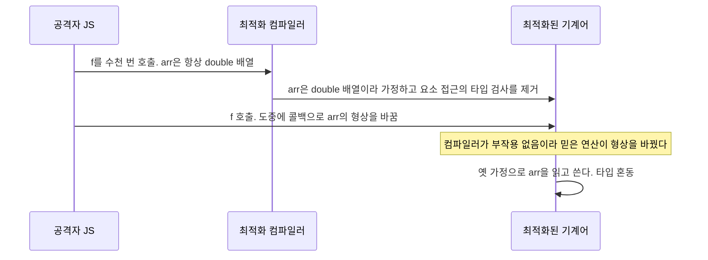

# 타입 혼동 (Type Confusion)

| 레벨 | 상태 | 최종 개정 | CWE |
|---|---|---|---|
| 🔴 | 🔄 개정중 | 2026-10-22 | [CWE-843](https://cwe.mitre.org/data/definitions/843.html) |

> **한눈에 보기**
> 코드가 메모리를 타입 A로 믿고 읽는데 실제로는 타입 B가 들어 있으면 생긴다. 경계를 넘지도, 해제된 메모리를 쓰지도 않는데 메모리가 깨진다.
> 공격자는 B의 데이터 필드를 A의 포인터·길이·vtable 자리에 겹쳐 놓아 제어 흐름을 빼앗거나 임의 읽기·쓰기를 얻는다. 브라우저 JS 엔진 취약점의 가장 흔한 유형이다.
> 막는 핵심은 하나다. **타입을 바꾸는 모든 지점에서 실제 타입을 검사하라.** `dynamic_cast`, 태그가 있는 union, 그리고 검사를 언어가 강제하는 설계.

## 1. 원리

### 1.1 메모리는 타입을 모른다

C와 C++에서 타입은 **컴파일러의 믿음**이다. 메모리에는 바이트만 있고, 그 바이트를 어떤 레이아웃으로 읽을지는 포인터의 정적 타입이 정한다. 포인터 타입과 실제 객체가 어긋나는 순간, 코드는 B의 바이트를 A의 필드로 읽는다. 신뢰 경계는 **타입을 바꾸는 한 줄**(캐스트, union 멤버 선택, 엔진의 타입 추론)에 있다.

```
 코드가 믿는 타입 Circle                     실제로 그 자리에 있는 타입 Admin
 +0x00  vptr ──▶ Circle vtable               +0x00  vptr ──▶ Admin vtable
                 [0] Circle::draw                            [0] Admin::shell   ★ c->draw()가 여기를 부른다
                 [1] ~Circle                                 [1] ~Admin
 +0x08  (필드 없음)                           +0x08  (필드 없음)

 코드가 믿는 타입 Buffer                     실제로 그 자리에 있는 타입 String
 +0x00  char *data   ──────────────────▶     +0x00  size_t length   ← 공격자가 정한 숫자가 포인터가 된다
 +0x08  size_t len                           +0x08  char   bytes[]  ← 공격자가 정한 바이트가 길이가 된다
```

<figure>
<figcaption>그림 1. 타입 혼동의 두 모습. 위는 vtable 혼동이다. 두 클래스가 각자 vtable을 가지면 같은 슬롯 번호가 다른 함수를 가리키므로, 캐스트 한 번으로 호출되는 함수가 바뀐다(4절에서 재현). 아래는 데이터·포인터 혼동이다. 공격자가 쓸 수 있는 숫자와 바이트가 포인터와 길이 자리에 겹쳐, 임의 주소 읽기·쓰기가 된다.</figcaption>
</figure>

오버플로([2장](02-stack-overflow.md), [4장](04-heap.md))와 UAF([5장](05-uaf.md))가 "메모리가 먼저 깨지고 그 결과로 타입이 어긋나는" 순서라면, 타입 혼동은 **메모리는 멀쩡한데 해석이 틀리는** 순서다. 그래서 ASan이 잡지 못한다. 접근 자체는 할당된 영역 안에서, 살아 있는 객체에 대해 일어나기 때문이다.

### 1.2 타입이 어긋나는 경로

| 경로 | 설명 | 흔한 곳 |
|---|---|---|
| C++ 다운캐스트 | 기반 클래스 포인터를 `static_cast`·C 스타일 캐스트로 파생 클래스로 바꾼다. 런타임 검사가 없다 | 브라우저 DOM, PDF 리더의 객체 모델, 게임 엔진 |
| 태그 없는 union | 어떤 멤버가 유효한지 알려 주는 태그를 안 두거나, 태그와 멤버를 따로 갱신한다 | 파서, 인터프리터의 값 표현, 커널 자료구조 |
| 해제 후 재할당 | 해제된 A 자리에 같은 크기의 B가 할당되고, 옛 포인터가 A로 읽는다. [5장 1.3절](05-uaf.md)의 UAF형 타입 혼동 | 모든 C/C++ |
| JIT 엔진의 타입 추론 오류 | 최적화 컴파일러가 "이 값은 항상 정수 배열"이라고 가정해 검사를 지웠는데, 가정이 깨진다 | V8, SpiderMonkey, JavaScriptCore |
| 핸들·ID·역직렬화 | 정수 핸들로 조회한 객체나 입력이 지정한 타입 ID로 만든 객체의 종류를 확인하지 않는다 | 커널 객체 테이블, IPC, [웹 7장](../part3-web/07-deserialization.md)의 바이너리판 |

### 1.3 C++ 캐스트 네 가지

| 캐스트 | 런타임 검사 | 잘못된 타입이면 |
|---|---|---|
| `static_cast<D*>(b)` | 없음. 상속 관계만 컴파일 시 확인 | 그대로 D로 해석. **타입 혼동** |
| C 스타일 `(D*)b` | 없음. 상속 관계조차 안 본다(`reinterpret_cast`로 추락) | 무관한 타입끼리도 통과 |
| `reinterpret_cast<D*>(b)` | 없음. 비트 재해석 | 의도적 재해석. 리뷰 대상 |
| `dynamic_cast<D*>(b)` | **있음**. RTTI로 실제 타입 확인 | 포인터면 `nullptr`, 참조면 `std::bad_cast` |

`dynamic_cast`는 다형적 클래스에서만 쓸 수 있고 RTTI가 필요하며 비용이 든다. 큰 코드베이스가 자체 타입 태그와 검사 캐스트 헬퍼를 만드는 이유다(6절).

### 1.4 태그 없는 union

```c
union value { long i; double d; char *s; };        /* 어떤 멤버가 유효한지 아무도 모른다 */
```

C의 union은 같은 자리에 여러 타입을 겹쳐 놓는 **의도적 타입 혼동**이다. 안전하려면 "지금 어떤 멤버가 유효한가"를 적는 태그가 있어야 하고, 태그와 멤버를 **항상 함께** 바꿔야 한다. 태그 갱신을 빠뜨린 경로 하나가 공격자가 넣은 정수 `i`를 포인터 `s`로 역참조하게 만든다. 인터프리터의 값 표현(숫자·객체·문자열이 한 워드에 섞인다), 프로토콜 파서, 커널 netlink 속성 처리에서 반복되는 모양이다.

### 1.5 JS 엔진의 형상과 타입 추론 (개념)

브라우저 JS 엔진은 동적 언어를 빠르게 돌리기 위해 객체마다 **형상**(shape, V8에서는 map, SpiderMonkey에서는 shape, JSC에서는 structure)을 둔다. 형상은 "이 객체는 어떤 프로퍼티를 어떤 순서로 갖고, 요소 배열은 정수 전용인가 실수 전용인가 아무거나인가(elements kind)"를 말한다. 최적화 컴파일러(V8 TurboFan, SpiderMonkey IonMonkey, JSC DFG/FTL)는 "이 지점의 값은 항상 형상 M이다"라는 **추측**(speculation) 위에 타입 검사를 지운 기계어를 만든다.



<figure>
<figcaption>그림 2. JIT 타입 혼동의 전형. 컴파일러가 "이 연산은 객체 형상을 바꾸지 않는다"고 잘못 모델링한 한 지점이 취약점이다. 검사를 지운 코드는 double 배열용 쓰기로 객체 배열의 포인터를 덮는다.</figcaption>
</figure>

이 유형의 취약점은 메모리 안전 버그가 아니라 **컴파일러의 모델링 오류**다. 엔진 소스의 `kNoWrite`, `kNoDeopt` 같은 부작용 플래그 한 줄, 또는 "이 내장 함수는 사용자 코드를 부르지 않는다"는 가정 한 줄이 틀린 것이다. 8절의 CVE-2020-6418(V8 `JSCreate`의 부작용 누락)이 그 예다. 패치도 대개 한 줄이고, 그래서 패치 diff만으로 익스플로잇을 유추하기 쉬워 **패치 공개에서 악용까지의 시간이 짧다**.

### 1.6 대표 유형

| 영역 | 어디서 어긋나는가 | 결과 |
|---|---|---|
| 브라우저 JS 엔진 | JIT의 형상 추측, 내장 함수의 부작용 모델, 배열 elements kind 전환 | `addrof`/`fakeobj` 프리미티브 → 임의 읽기·쓰기 → 렌더러 코드 실행 |
| 브라우저 DOM·IPC | C++ 노드 다운캐스트, IPC 메시지의 타입 ID와 페이로드 불일치 | 샌드박스 탈출(브라우저 프로세스에서의 혼동) |
| PDF 리더 | 문서 객체 모델(사전·배열·스트림)의 타입을 확인하지 않고 필드 접근, JS API의 객체 핸들 | 문서 열기만으로 코드 실행 |
| 커널 | 핸들 테이블에서 꺼낸 객체의 종류 미확인, netlink·ioctl 속성의 타입과 길이 불일치, union 태그 누락 | 로컬 권한 상승 |
| 인터프리터·VM | 값 표현의 태그 비트 오류, 네이티브 확장의 `this` 타입 미검사 | 샌드박스 탈출 |

## 2. 발생하는 코드 패턴

### C++: 검사 없는 다운캐스트

```cpp
// ❌ 취약: node의 실제 타입은 입력(문서 구조)이 정한다. static_cast는 묻지 않는다
void handle(Node *node) {
    Element *el = static_cast<Element *>(node);   // node가 Text면 Element 레이아웃으로 읽는다
    el->attributes()->get("href");                // Text의 문자열 바이트를 포인터로 역참조
}
```

```cpp
// ✅ 안전: 실제 타입을 확인한다. RTTI가 있으면 dynamic_cast, 없으면 자체 타입 태그
void handle(Node *node) {
    if (auto *el = dynamic_cast<Element *>(node))
        el->attributes()->get("href");
}
// 또는 (Blink·LLVM 식) if (node->kind() == Node::kElement) { auto *el = static_cast<Element *>(node); ... }
```

### C: 태그와 멤버를 따로 갱신하는 union

```c
struct value { enum { INT, STRING } tag; union { long i; char *s; } u; };
// ❌ 취약: 오류 경로에서 태그는 STRING으로 남고 멤버는 정수로 바뀐다. 다음 puts(v->u.s)가 정수 i를 포인터로 읽는다
int set_int(struct value *v, long i) {
    v->u.i = i;                 /* 멤버 먼저 */
    if (i < 0) return -1;       /* 태그 갱신 전에 반환 */
    v->tag = INT; return 0;
}
// ✅ 안전: 검증을 먼저 하고, 태그와 멤버를 한 곳에서 함께 바꾼다
int set_int(struct value *v, long i) {
    if (i < 0) return -1;
    v->tag = INT; v->u.i = i; return 0;
}
```

### 커널·파서: 종류와 길이를 따로 믿는다

크기는 자료구조의 선언(`set->klen`)을 믿고 할당하고, 복사는 입력 속성의 길이(`nla_len(attr)`)를 믿는 모양이다. 두 길이가 같은지 검사하는 한 줄(`if (nla_len(attr) != set->klen) return -EINVAL;`)이 빠지면 선언된 타입보다 긴 데이터가 들어온다. 8절의 CVE-2022-34918이 이 모양이다.

### JS 엔진: 부작용 없는 연산이라는 가정

엔진 코드는 이 책에 싣기엔 크지만, 패턴은 한 줄로 요약된다. **"사용자 코드를 부르지 않는다"고 표시된 연산이 실제로는 부른다.** `valueOf`, `toString`, getter, `Proxy` 트랩, `Symbol.species`, `new.target`의 `prototype` 조회가 그 통로다. 리뷰 포인트는 "이 연산이 JS로 되돌아갈 수 있는가"이고, 되돌아갈 수 있으면 그 뒤의 모든 타입 가정은 다시 검사해야 한다.

## 3. 탐지 방법

### 3.1 코드 리뷰 / 정적 분석

**grep으로 시작한다.** 검사 없는 캐스트와 union을 찾는다.

```bash
grep -rnE 'static_cast<\s*\w+\s*\*\s*>|reinterpret_cast<' --include='*.cpp' --include='*.h' .   # 다운캐스트 후보
grep -rnE '\(\s*(struct\s+)?\w+\s*\*\s*\)\s*\w' --include='*.cpp' .                          # C 스타일 포인터 캐스트
grep -rnE '\bunion\b' --include='*.c' --include='*.h' .                                         # 태그 검사 대상
```

결과의 각 줄에 "왜 이 타입이라고 확신하는가"를 묻는다.

**컴파일러 경고.** `-Wold-style-cast`(g++/clang++)는 C 스타일 캐스트를 전부 보고한다. 기존 코드에 켜면 수천 줄이 나오므로 새 코드와 파서·IPC 경계 파일부터 적용한다.

**정적 분석기.** 타입 혼동은 "어떤 타입이 실제로 올 수 있는가"를 알아야 해서 정적 분석이 약한 영역이다. 현실적인 것은 Semgrep 등으로 `static_cast<$T *>($E)`를 찾되 `pattern-not-inside`로 바로 앞의 타입 검사(`dynamic_cast`, `kind()`, `IsA<>`)가 있는 경우를 제외하는, "검사 없는 캐스트" 패턴 룰이다.

**리뷰할 때 보는 순서**

1. 객체의 **종류가 입력에 의해 정해지는** 지점을 찾는다. 파서가 만든 노드, 역직렬화된 메시지, 핸들로 조회한 객체, JS에서 넘어온 인자.
2. 그 객체가 더 구체적인 타입으로 **바뀌는** 지점(캐스트, union 멤버 접근, `kind` 분기)을 모두 찾는다.
3. 각 지점에서 "이 타입이라는 근거"가 **같은 함수 안에** 있는지 본다. 호출자가 검사했다는 주석은 근거가 아니다.
4. 검사와 사용 사이에 **타입이 바뀔 수 있는 호출**(콜백, 가상 함수, 스크립트 실행, 락 해제)이 끼어 있는지 본다. [5장](05-uaf.md)의 "콜백 중 해제"와 같은 구조다.
5. union은 태그를 쓰는 모든 곳과 멤버를 쓰는 모든 곳을 나란히 놓고 짝을 맞춘다.

### 3.2 동적 테스트

**UBSan `-fsanitize=vptr`** 가 C++ 다운캐스트와 가상 호출의 타입 혼동을 잡는다. 캐스트 결과의 vptr이 목표 타입의 vtable과 맞는지 실행 시점에 비교한다. `-fsanitize=undefined`에 포함되며, gcc와 clang 모두 지원한다(RTTI 필요).

```
$ g++ -g -O0 -fsanitize=vptr -o tc_vptr tc.cpp && ./tc_vptr x
tc.cpp:10:17: runtime error: downcast of address 0x55ccda31c2b0 which does not point to an object of type 'Circle'
0x55ccda31c2b0: note: object is of type 'Admin'
```

**Clang CFI `-fsanitize=cfi`** 는 완화 기법이지만 진단 모드(`-fno-sanitize-trap=all`)로 쓰면 탐지기가 된다. `cfi-derived-cast`·`cfi-unrelated-cast`는 캐스트에서, `cfi-vcall`은 가상 호출에서 "vtable이 허용 집합에 있는가"를 본다. LTO와 `-fvisibility=hidden`이 필요하다([7장 7.1절](07-mitigations.md)).

```
$ clang++ -g -O1 -flto -fvisibility=hidden -fsanitize=cfi -fno-sanitize-trap=all -fuse-ld=lld -o tc_cfi tc.cpp
$ ./tc_cfi x
tc.cpp:9:29: runtime error: control flow integrity check for type 'Shape' failed during cast to unrelated type (vtable address 0x56263c2fd078)
0x56263c2fd078: note: vtable is of type 'Admin'
```

두 도구의 차이는 **잡는 지점**이다. `vptr`은 RTTI로 캐스트 줄(10행)에서 잡고, CFI는 vtable 집합으로 **C 스타일 캐스트 줄(9행)** 에서 먼저 잡는다. 둘 다 vtable이 없는 타입(평범한 구조체, union, JS 엔진의 값)은 보지 못한다. 그 영역은 **퍼징**이 주력이다. JS 엔진은 문법 인식 퍼저(Fuzzilli 등)로, 파서·커널은 [9장](09-fuzzing.md)의 ASan·UBSan 빌드로 돌린다. 타입 혼동은 크래시가 "엉뚱한 곳"에서 나므로, 크래시 스택보다 **그 객체가 어디서 어떤 타입으로 만들어졌는가**를 거슬러 올라가야 원인이 보인다.

## 4. 실습 🧪

g++·gdb만 있으면 된다. 가상 함수 테이블을 가진 두 클래스를 잘못 다운캐스트해, **호출되는 함수가 바뀌는 것**을 본다.

### 4.1 재현 코드

```cpp
/* tc.cpp */
#include <cstdio>
#include <cstdlib>
struct Shape { virtual void draw() { puts("Shape::draw"); } virtual ~Shape() {} };
struct Circle : Shape { void draw() override { puts("Circle::draw"); } };
struct Admin  { virtual void shell() { puts("Admin::shell  <- 호출되면 안 되는 함수"); } virtual ~Admin() {} };

int main(int argc, char **argv) {
    Shape *s = (argc > 1) ? (Shape *)new Admin : new Circle;   /* ❌ 검사 없는 캐스트 */
    Circle *c = static_cast<Circle *>(s);                        /* ❌ 다운캐스트, 런타임 검사 없음 */
    c->draw();                                                   /* vtable[0] 호출 */
    delete s;
    return 0;
}
```

`Admin`은 `Shape`와 아무 관계가 없다. 9행의 C 스타일 캐스트가 "입력이 객체 종류를 정하는" 지점(실제 코드에서는 파서·역직렬화·핸들 조회)을 대신한다.

### 4.2 단계

1. 빌드하고 두 경로를 실행한다. 주소를 고정하기 위해 PIE만 끈다.
   ```bash
   g++ -g -O0 -no-pie -o tc tc.cpp
   ./tc          # Circle::draw
   ./tc x        # Admin::shell  <- 호출되면 안 되는 함수
   ```
   크래시가 없다. `c->draw()`는 "vtable의 0번 슬롯을 부른다"로 컴파일됐고, Admin의 0번 슬롯은 `shell`이다.

2. gdb에서 객체와 vtable을 본다.
   ```
   $ gdb -q ./tc
   (gdb) break 11
   (gdb) run x
   (gdb) p s
   $1 = (Shape *) 0x4172b0
   (gdb) x/gx s                                  # 객체의 첫 8바이트 = vptr
   0x4172b0:       0x0000000000403d48            # = vtable for Admin + 16 (info symbol)
   (gdb) x/2a 0x403d48                           # 슬롯 0, 1
   0x403d48 <_ZTV5Admin+16>:  0x401312 <_ZN5Admin5shellEv>  0x401334 <_ZN5AdminD2Ev>
   (gdb) x/2a (char*)&_ZTV6Circle+16             # 코드가 믿는 vtable
   0x403d70 <_ZTV6Circle+16>: 0x4012f0 <_ZN6Circle4drawEv>  0x4013ec <_ZN6CircleD2Ev>
   (gdb) info vtbl c
   vtable for 'Circle' @ 0x403d48 (subobject @ 0x4172b0):
   ```
   마지막 줄이 핵심이다. gdb는 `c`의 **정적 타입**을 믿고 "Circle의 vtable"이라 하지만 그 주소는 Admin의 것이다. 컴파일된 코드도 같은 믿음으로 동작한다.

3. 호출 명령을 본다. 타입 검사는 어디에도 없다(Intel 문법 기준. 순정 gdb는 AT&T 문법이 기본이므로 `set disassembly-flavor intel`을 먼저 친다. [00장 3.4절](00-overview.md)).
   ```
   (gdb) x/6i $pc
   => 0x4011fc <main(int, char**)+102>: mov    rax,QWORD PTR [rbp-0x38]   ; c
      0x401200 <main(int, char**)+106>: mov    rax,QWORD PTR [rax]        ; vptr
      0x401203 <main(int, char**)+109>: mov    rdx,QWORD PTR [rax]        ; vtable[0]
      ...                                                                  ; rdi = this
      0x40120d <main(int, char**)+119>: call   rdx                        ; → Admin::shell
   ```
   `delete s`도 같은 방식으로 Admin의 소멸자(슬롯 1)를 부른다. 실제 취약점에서는 공격자가 객체의 **내용**까지 정하므로, vptr 자리에 가짜 vtable 주소를 넣어 `call rdx`를 임의 주소로 보낸다. 그다음은 [8장 ROP](08-rop.md)다.

4. 탐지기를 켠다. 3.2절의 두 출력이 나온다.
   ```bash
   g++ -g -O0 -fsanitize=vptr -o tc_vptr tc.cpp && ./tc_vptr x
   clang++ -O1 -flto -fvisibility=hidden -fsanitize=cfi -fuse-ld=lld -o tc_cfi_trap tc.cpp && ./tc_cfi_trap x
   # Illegal instruction (core dumped)        ← 진단 없이 ud2로 중단하는 기본(트랩) 모드. 종료 코드 132
   ```
   Ubuntu 24.04의 clang 18은 CFI·UBSan 런타임과 `cfi_ignorelist.txt`가 `libclang-rt-18-dev`에 있다(없으면 `missing sanitizer ignorelist` 오류). `-fsanitize=cfi`는 `-fvisibility=` 없이는 컴파일 자체를 거부한다(`only allowed with '-fvisibility='`). `vptr` 빌드는 3.2절의 10행 보고 뒤에 11행(`c->draw()`)과 12행(`delete s`)의 `member call on address ... does not point to an object of type` 보고가 이어지고(총 3건) 프로그램은 계속 실행되어 `Admin::shell`까지 찍는다. CFI 진단 빌드는 첫 보고 뒤 종료 코드 1로 멈춘다.

5. 고친다. 10행을 `dynamic_cast<Circle *>(s)`로 바꾸고 `nullptr` 검사를 넣으면 `./tc x`는 `draw`도 `shell`도 부르지 않고 종료한다(실측: 캐스트가 `nullptr`을 돌려준다). 9행의 C 스타일 캐스트는 `dynamic_cast`로 바꿀 수 없다(무관한 타입). 그 줄이 "입력이 타입을 정하는 지점"이고, 실제 코드에서는 그 지점에 타입 태그 검사가 있어야 한다.

### 4.3 더 해 보기

[5장 4.2절](05-uaf.md)의 `uaf2.c`를 이 장의 관점으로 다시 본다. 해제된 `session` 자리에 들어온 바이트를 `session`의 함수 포인터로 읽는 것은 "재할당이 만든 타입 혼동"이다.

## 5. 익스플로잇 검증

| 단계 | 확인 | 심각도에 미치는 영향 |
|---|---|---|
| 1 | 입력으로 객체의 실제 타입과 코드의 가정을 어긋나게 할 수 있다 (UBSan `vptr`·CFI 보고, 또는 엉뚱한 함수 호출) | 취약점 존재. 최소 DoS |
| 2 | 혼동되는 두 타입의 레이아웃에서 **포인터·길이·vtable 자리에 공격자 제어 데이터**가 겹친다 | 임의 읽기 또는 제어 흐름 탈취 가능성. High |
| 3 | 겹친 필드로 임의 주소 읽기가 된다 (길이 필드 조작, 가짜 포인터 역참조) | 정보 누출 → ASLR 무력화. High |
| 4 | 임의 쓰기 또는 vtable 호출 제어가 된다 | 코드 실행. Critical. 브라우저 렌더러면 "샌드박스 안"임을 명시 |

2단계가 분기점이다. 두 타입의 레이아웃을 **나란히 그려서**(그림 1처럼) 어떤 오프셋에 무엇이 겹치는지 보고서에 넣는다. 겹치는 것이 정수끼리면 논리 오류에 그치고, 한쪽이 포인터면 메모리 안전 문제가 된다. JS 엔진에서는 2단계가 "`addrof`(객체 주소 얻기)와 `fakeobj`(임의 주소를 객체로 믿게 하기)가 만들어지는가"에 해당하며, 둘이 있으면 4단계까지는 공학 문제다. [방법론 6장](../part2-methodology/06-exploit-verification.md)의 원칙대로, 렌더러 코드 실행과 샌드박스 탈출은 별개의 취약점이므로 보고서에서 구분한다.

## 6. 방어

| 계층 | 조치 | 효과 |
|---|---|---|
| 코드 | 다형적 타입의 다운캐스트는 `dynamic_cast`로, 결과를 반드시 검사 | 근본 제거. RTTI 필요 |
| 코드 | RTTI를 끈 코드베이스는 **자체 타입 태그 + 검사 캐스트 헬퍼**로 통일 (LLVM `isa<>`/`dyn_cast<>`, Blink `IsA<>`/`DynamicTo<>`). 맨 `static_cast`를 리뷰에서 거부 | 검사를 빠뜨릴 수 없는 API |
| 코드 | union은 태그와 함께 구조체로 묶고, 태그·멤버를 한 함수에서만 바꾼다. C++은 `std::variant`, Rust는 `enum` | 태그 불일치 제거 |
| 코드 | JIT·최적화 코드는 "사용자 코드를 부를 수 있는 연산" 목록을 보수적으로. 의심되면 부작용 있음으로 표시 | 추측 오류 차단 |
| 언어 | 새 코드는 메모리 안전 언어로. 안전한 Rust에는 태그 없는 union이 **없다**(`enum`은 항상 태그를 가지며, `union` 멤버 읽기는 `unsafe` 블록에서만 된다) | 유형 자체 제거 |
| 컴파일러 | 테스트 빌드 `-fsanitize=undefined`(vptr 포함), 릴리스 빌드 Clang CFI(`-fsanitize=cfi-vcall,cfi-icall` + LTO). Android 플랫폼·Chrome 적용 | 혼동된 vtable 호출을 크래시로 |
| 커널 | `CONFIG_CFI_CLANG`(kCFI, Linux 6.1+ x86-64·arm64), 객체 조회 API의 타입 검사 | 커널 함수 포인터 혼동 차단 |
| 런타임 | 브라우저 V8 샌드박스(힙 안의 포인터를 오프셋으로 바꿔 힙 밖 쓰기 차단), 사이트 격리 | 혼동 뒤 피해 범위 축소 |
| 탐지 | CI에서 UBSan 빌드로 테스트·퍼징, CFI 크래시(`SIGILL`, `ud2`) 수집 | 사후 대응 |

**하지 말아야 할 것**: "이 경로로는 그 타입만 온다"는 주석. 타입 혼동 CVE의 대부분이 그 주석이 틀린 날 생겼다. 검사는 **사용 지점**에 있어야 하고, 비용이 문제면 검사 캐스트 헬퍼로 비용을 한 번만 낸다.

## 7. 우회 기법 🔴

| 방어 | 우회 |
|---|---|
| `dynamic_cast` | 검사 **뒤에** 타입이 바뀌는 창(콜백, 스크립트 실행, 락 해제)을 찾는다. 검사된 포인터를 오래 들고 있는 코드가 표적 |
| 자체 타입 태그 | 태그 자체가 객체 안에 있으면, 다른 취약점(오버플로·UAF)으로 태그를 덮는다. 태그 검사를 건너뛰는 "빠른 경로"(캐시, 인라인 캐시)를 찾는다 |
| CFI `cfi-vcall` | 허용 집합은 "호출 지점의 **정적 타입**과 그 파생 클래스의 vtable, 같은 슬롯"이다. 계층 안의 **다른 파생 클래스** 함수는 허용되므로, 공격자는 같은 슬롯에 있는 쓸모 있는 함수(파일 쓰기, 명령 실행에 가까운 메서드)를 고른다. 이를 COOP(counterfeit object-oriented programming)이라 부른다. 무관한 클래스의 vtable은 거부된다(7.1 실측) |
| CFI `cfi-icall` | 같은 함수 시그니처를 가진 모든 함수가 허용된다. `void (*)(void*)` 같은 흔한 시그니처는 집합이 수백 개다 |
| CFI 전체 | **데이터 전용 공격**. 코드 포인터를 건드리지 않고 길이·권한·경로 같은 데이터만 바꾼다. 타입 혼동으로 얻은 임의 읽기·쓰기는 CFI와 무관하게 성립한다 |
| CFI 캐스트 검사 | `cfi-derived-cast`·`cfi-unrelated-cast`는 비용 때문에 끄는 제품이 많다(Chromium `build/config/sanitizers/sanitizers.gni`의 `use_cfi_cast = is_cfi && is_chromeos`, 즉 ChromeOS 공식 빌드에서만 켜진다). 캐스트 지점의 혼동은 vcall 검사까지 가야 잡힌다 |
| Windows CFG | 함수 **시작 주소**만 검사한다. 타입을 보지 않으므로 아무 함수의 시작으로 호출을 돌릴 수 있다 |
| V8 샌드박스 | 샌드박스 안의 힙은 여전히 임의 읽기·쓰기가 되므로, 샌드박스 밖으로 나가는 **두 번째 취약점**(샌드박스 우회)이 필요하다. 8절 CVE-2023-3079의 공개 분석이 "타입 혼동 + 새 샌드박스 탈출"로 구성된 이유 |

**CFI 아래에서의 한계를 한 번 더.** CFI는 "호출 목적지가 타입에 맞는 함수인가"를 묻지, "이 객체가 정말 그 타입인가"를 묻지 않는다. 그래서 타입 혼동으로 만든 **가짜 객체**(fakeobj)의 vptr이 호출 지점의 타입 계층 안에 있는 **진짜 vtable**을 가리키면 검사를 통과한다(7.1에서 실측). 공격자는 가짜 객체에 진짜 vtable을 붙이고, 그 클래스의 메서드가 객체 필드를 어떻게 쓰는지를 이용해 읽기·쓰기 프리미티브를 만든다. JS 엔진 익스플로잇이 "함수 포인터 덮기"가 아니라 "길이 필드 조작 → 임의 읽기·쓰기 → 쓰기 가능한 코드 영역(JIT 페이지, WebAssembly) 찾기"로 흘러가는 이유이고, 그 마지막 단계가 7장·8장의 완화와 만난다.

브라우저 JS 엔진에서의 전형적 흐름은 다음과 같다(개념. 엔진·버전별 세부는 다르다).

1. **혼동 만들기 → `addrof`/`fakeobj`**: 최적화된 함수 안에서 double 배열로 믿는 객체를 객체 배열로 바꾼다. 객체 배열에 객체를 넣고 double 배열로 읽으면 객체 주소가 숫자로 나오고(`addrof`), 반대로 숫자를 쓰고 객체로 읽으면 그 숫자가 객체 포인터가 된다(`fakeobj`).
2. **가짜 배열**: `fakeobj`로 "길이가 거대한 배열"을 흉내 내는 가짜 객체를 만들어 그 인덱스로 힙 전체를 읽고 쓴다.
3. **코드 실행**: 쓰기·실행이 모두 되는 영역(과거에는 JIT 코드 페이지, 현재는 WebAssembly 관련 구조)을 찾아 코드를 넣거나 함수 포인터를 돌린다. V8 샌드박스가 켜진 버전에서는 2단계가 샌드박스 안에 갇히므로 추가 취약점이 필요하다.

### 7.1 한 사례의 실제 우회 과정: CFI 아래의 가짜 객체는 어디까지 통과하는가

표의 `cfi-vcall` 행을 실측으로 확인한다. 질문은 두 개다. 4절의 `tc.cpp`처럼 `Circle`로 믿는 자리에 **무관한** `Admin`의 진짜 vtable이 있으면 `cfi-vcall`은 허용하는가. 그리고 **같은 계층**의 다른 파생 클래스 vtable이면 어떤가. 공격자가 내용을 정하는 버퍼(`fake[16]`)의 첫 8바이트에 진짜 vtable 주소를 넣고, 정적 타입 `Shape*`와 `Circle*` 두 지점에서 호출한다. 캐스트 검사(`cfi-unrelated-cast`)가 먼저 잡는 것을 피하려고 `-fsanitize=cfi-vcall`만 켠다.

```cpp
/* tc_cfi2.cpp — cfi-vcall 아래에서 "진짜 vtable"을 단 가짜 객체 */
#include <cstdio>
#include <cstdlib>
#include <cstring>
#include <cstdint>
struct Shape  { virtual void draw() { puts("Shape::draw"); } virtual ~Shape() {} };
struct Circle : Shape { void draw() override { puts("Circle::draw"); } };
struct Debug  : Shape { void draw() override { puts("Debug::draw   <- 같은 계층의 다른 파생 클래스"); } };
struct Admin  { virtual void shell() { puts("Admin::shell  <- 무관한 클래스"); } virtual ~Admin() {} };

int main(int argc, char **argv) {
    setvbuf(stdout, NULL, _IONBF, 0);                    /* CFI 실패 시 버퍼를 못 비우므로 */
    Shape *real[3] = { new Circle, new Debug, nullptr };   /* vtable이 링크에 남도록 */
    Admin *adm = new Admin;
    char fake[16];                                       /* 가짜 객체: 공격자가 내용을 정한다 */
    uintptr_t vt = (argc > 1 && argv[1][0] == 'a') ? *(uintptr_t *)adm     /* Admin의 진짜 vtable */
                 : (argc > 1)                          ? *(uintptr_t *)real[1] /* Debug의 진짜 vtable */
                 :                                       *(uintptr_t *)real[0]; /* Circle의 진짜 vtable */
    memcpy(fake, &vt, sizeof vt);
    Shape  *s = (Shape *)fake;                           /* 정적 타입 Shape로 호출 (21행) */
    s->draw();
    Circle *c = (Circle *)fake;                          /* 정적 타입 Circle로 호출 (23행) */
    c->draw();
    return 0;
}
```

```bash
clang++ -g -O1 -flto -fvisibility=hidden -fsanitize=cfi-vcall -fno-sanitize-trap=all -fuse-ld=lld -o tc_cfi2 tc_cfi2.cpp
./tc_cfi2        # vptr = Circle의 진짜 vtable
# Circle::draw
# Circle::draw                                  ← 두 지점 모두 통과. exit 0
./tc_cfi2 d      # vptr = Debug의 진짜 vtable (Shape의 다른 파생 클래스)
# Debug::draw   <- 같은 계층의 다른 파생 클래스      ← Shape* 지점(21행) 통과. Debug::draw가 실행됐다
# tc_cfi2.cpp:23:5: runtime error: control flow integrity check for type 'Circle' failed during virtual call (vtable address 0x55c1998c22b0)
# 0x55c1998c22b0: note: vtable is of type 'Debug'   ← Circle* 지점(23행) 거부. exit 1
./tc_cfi2 a      # vptr = Admin의 진짜 vtable (무관한 클래스)
# tc_cfi2.cpp:21:5: runtime error: control flow integrity check for type 'Shape' failed during virtual call (vtable address 0x560f63d7c2f0)
# 0x560f63d7c2f0: note: vtable is of type 'Admin'    ← Shape* 지점에서 이미 거부. exit 1
```

결과를 표의 말로 옮기면 이렇다. 허용 집합은 **호출 지점의 정적 타입과 그 파생 클래스들의 vtable**이다. `Shape*`로 부르는 지점에서는 `Circle`·`Debug`가 모두 통과하고 `Admin`은 거부된다. `Circle*`로 부르는 지점에서는 `Circle`만 통과한다. 4절 `tc.cpp`의 상황(Circle 자리에 Admin)은 캐스트 검사 없이 `cfi-vcall`만 켜도 **거부**된다. 진단 모드를 빼면(`-fno-sanitize-trap=all` 제거) 같은 지점에서 `ud2`로 죽는다(exit 132, 실측).

**읽을 것 세 가지.** (1) CFI가 막는 것은 "집합 밖의 vtable"이지 "가짜 객체"가 아니다. `./tc_cfi2 d`에서 `Debug::draw`는 `fake[16]`을 자기 객체로 알고 실행됐다. 메서드가 객체 필드를 읽고 쓰는 만큼 공격자는 그 필드를 정한다. 이것이 7절 본문의 fakeobj 흐름이고, COOP는 집합 안에서 **가장 쓸모 있는 메서드**를 고르는 작업이다. (2) 집합의 크기는 호출 지점의 정적 타입이 정한다. 실제 엔진 코드는 대개 기반 클래스 포인터(`Node*`, `JSObject*`)로 호출하므로 집합이 수십~수백 개다. 리뷰에서 "이 가상 호출의 정적 타입이 얼마나 일반적인가"가 곧 CFI 아래에서의 공격 표면이다. (3) 같은 이유로 `cfi-vcall`은 **같은 계층의 타입 혼동**(`Circle`과 `Square`를 섞는 종류)을 잡지 못한다. 그 혼동은 캐스트 검사(`cfi-derived-cast`, 표의 "비용 때문에 끄는 제품이 많다")나 UBSan `vptr`(3.2절)의 영역이고, 릴리스 빌드에는 대개 없다.

## 8. 실제 CVE 사례

| CVE | 제품 | 핵심 | 패치 |
|---|---|---|---|
| [CVE-2021-30551](https://nvd.nist.gov/vuln/detail/CVE-2021-30551) | Google Chrome 91.0.4472.101 이전, V8 | 타입 혼동으로 힙 손상. Google이 릴리스 공지에서 실제 악용(in the wild)을 명시 | [Chrome 릴리스 공지 2021-06](https://chromereleases.googleblog.com/2021/06/stable-channel-update-for-desktop.html) · [crbug 1216437](https://crbug.com/1216437) |
| [CVE-2022-1096](https://nvd.nist.gov/vuln/detail/CVE-2022-1096) | Google Chrome 99.0.4844.84 이전, V8 | 타입 혼동으로 힙 손상. 실제 악용 명시. 단일 CVE만 고친 긴급 릴리스 | [Chrome 릴리스 공지 2022-03](https://chromereleases.googleblog.com/2022/03/stable-channel-update-for-desktop_25.html) · [crbug 1309225](https://crbug.com/1309225) |
| [CVE-2023-3079](https://nvd.nist.gov/vuln/detail/CVE-2023-3079) | Google Chrome 114.0.5735.110 이전, V8 | 타입 혼동으로 힙 손상. 실제 악용 명시. 공개 분석이 V8 샌드박스 탈출과 결합한 전체 체인을 다룸 | [Chrome 릴리스 공지 2023-06](https://chromereleases.googleblog.com/2023/06/stable-channel-update-for-desktop.html) · [crbug 1450481](https://crbug.com/1450481) |
| [CVE-2020-6418](https://nvd.nist.gov/vuln/detail/CVE-2020-6418) | Google Chrome 80.0.3987.122 이전, V8 | TurboFan이 `JSCreate` 연산을 부작용 없음으로 모델링했으나 `new.target`의 `prototype` 조회가 JS 콜백을 불러 객체 형상이 바뀜. 실제 악용 | [Chrome 릴리스 공지 2020-02](https://chromereleases.googleblog.com/2020/02/stable-channel-update-for-desktop_24.html) · [crbug 1053604](https://crbug.com/1053604) |
| [CVE-2019-11707](https://nvd.nist.gov/vuln/detail/CVE-2019-11707) | Mozilla Firefox 67.0.3·ESR 60.7.1 이전 | `Array.pop` 처리에서 JS 객체 타입 혼동. Mozilla가 표적 공격에 악용됨을 명시 | [MFSA 2019-18](https://www.mozilla.org/security/advisories/mfsa2019-18/) · [Bugzilla 1544386](https://bugzilla.mozilla.org/show_bug.cgi?id=1544386) |
| [CVE-2022-34918](https://nvd.nist.gov/vuln/detail/CVE-2022-34918) | Linux 커널 5.18.9 이하, netfilter nf_tables | `nft_set_elem_init`에서 집합 원소의 타입(선언된 키 길이)과 netlink로 받은 데이터 길이를 따로 믿어 타입 혼동 → 힙 오버플로 → 로컬 root (비특권 사용자 네임스페이스 필요) | [커널 커밋 7e6bc1f6](https://git.kernel.org/pub/scm/linux/kernel/git/netdev/net.git/commit/?id=7e6bc1f6cabcd30aba0b11219d8e01b952eacbb6) · [Randorisec 분석](https://www.randorisec.fr/crack-linux-firewall/) |

**CVE-2020-6418에서 배울 것**: 공개 분석(레코드 참조의 Exodus Intelligence 글) 기준, 패치는 `JSCreate` 노드의 속성에서 "부작용 없음" 표시를 바꿔 컴파일러가 그 뒤의 타입 가정을 다시 검사하게 했다. 1.5절 그림 2 그대로다. 메모리 코드는 한 줄도 바뀌지 않았고, 바뀐 것은 **컴파일러의 모델**이다. 이 유형의 패치 diff는 작고 읽기 쉬워서 N-day 악용이 빠르다.

**CVE-2021-30551 · CVE-2022-1096 · CVE-2023-3079에서 배울 것**: 세 건 모두 레코드의 설명이 "Type confusion in V8 ... heap corruption via a crafted HTML page" 한 문장이고, 세부는 Chromium 버그 트래커가 공개된 뒤에야 알 수 있다. 분석가가 할 일은 (1) 영향 버전 경계를 레코드의 `lessThan`(각각 91.0.4472.101, 99.0.4844.84, 114.0.5735.110)으로 적고, (2) "실제 악용"은 **Chrome 릴리스 공지**에서 확인하며, (3) V8을 내장한 제품(Electron, Node.js, 레코드 참조의 Couchbase)으로 영향 범위를 넓히는 것이다. CVE-2023-3079의 공개 분석은 타입 혼동으로 얻은 임의 읽기·쓰기가 V8 샌드박스에 갇혀 **별도의 샌드박스 탈출**이 필요했음을 보여 주며, 7절 마지막 표 행의 근거다.

**CVE-2019-11707에서 배울 것**: 레코드와 권고문 기준, `Array.pop` 처리에서 JS 객체 타입 혼동이 생겼고 Mozilla는 표적 공격에 악용됨을 명시했다. 이틀 뒤 Mozilla는 IPC 메시지 검증 부족으로 부모 프로세스가 자식이 고른 웹 콘텐츠를 여는 샌드박스 탈출([CVE-2019-11708](https://nvd.nist.gov/vuln/detail/CVE-2019-11708), MFSA 2019-19)을 따로 고쳤다. "렌더러 코드 실행"과 "샌드박스 탈출"이 별개의 CVE로 매겨지는 전형이다.

**CVE-2022-34918에서 배울 것**: 패치 커밋은 `nft_setelem_parse_data()`에서 받은 데이터의 길이가 집합에 선언된 타입의 길이와 같은지 검사한다(레코드 설명과 커밋 기준). 2절 세 번째 패턴 그대로다. 공개 분석(Randorisec)은 이 혼동을 힙 오버플로로 바꿔 root까지 갔다. 커널에서 타입 혼동은 거의 항상 "종류를 정하는 필드"와 "길이를 정하는 필드"가 다른 메시지에서 오는 netlink·ioctl 경로에서 나온다.

## 9. 체크리스트

**코드 리뷰할 때**
- [ ] 객체의 종류를 입력이 정하는 지점(파서, 역직렬화, 핸들 조회, 스크립트 인자)을 모두 찾았는가?
- [ ] 그 객체를 더 구체적인 타입으로 바꾸는 모든 캐스트 바로 앞에 실제 타입 검사가 있는가?
- [ ] union마다 태그가 있고, 태그와 멤버를 바꾸는 코드가 한 곳인가? 오류 경로에서도 짝이 맞는가?
- [ ] 타입 검사와 사용 사이에 콜백·스크립트·가상 함수 호출이 끼어 있는가?
- [ ] "종류"와 "길이"가 서로 다른 입력 필드에서 오는가? 둘의 일치를 검사하는가?

**테스트할 때**
- [ ] C++ 코드를 `-fsanitize=undefined`(vptr 포함)로 빌드해 테스트와 퍼징을 돌렸는가?
- [ ] 퍼저가 타입을 바꾸는 입력(다른 종류의 노드, 다른 태그 값)을 생성하는가?

**배포 전**
- [ ] 릴리스 빌드에 CFI(`cfi-vcall`·`cfi-icall`)가 켜져 있는가? 커널이면 `CONFIG_CFI_CLANG`인가?
- [ ] 내장한 JS·PDF 엔진의 버전이 최신 보안 릴리스인가?

## 10. 더 읽기

- [CWE-843: Access of Resource Using Incompatible Type ('Type Confusion')](https://cwe.mitre.org/data/definitions/843.html) · 공식 정의
- [Clang: Control Flow Integrity](https://clang.llvm.org/docs/ControlFlowIntegrity.html) · `cfi-vcall`, `cfi-icall`, `cfi-derived-cast`, `cfi-unrelated-cast`의 의미와 LTO 요구 사항
- [Clang: UndefinedBehaviorSanitizer — `-fsanitize=vptr`](https://clang.llvm.org/docs/UndefinedBehaviorSanitizer.html) · 다운캐스트·가상 호출 검사의 조건과 출력 형식
- [Chromium: Control Flow Integrity](https://www.chromium.org/developers/testing/control-flow-integrity/) · 대규모 제품이 CFI를 어떤 하위 검사로 켜는지
- [V8 블로그: Fast properties in V8](https://v8.dev/blog/fast-properties) · 1.5절의 형상(map)·elements kind 개념의 1차 자료
- [V8 블로그: The V8 Sandbox](https://v8.dev/blog/sandbox) · 타입 혼동 뒤 임의 읽기·쓰기를 힙 안에 가두는 설계
- Byoungyoung Lee 외, "Type Casting Verification: Stopping an Emerging Attack Vector", USENIX Security 2015 · C++ 다운캐스트 타입 혼동을 체계적으로 다룬 논문(CaVer)
- Felix Schuster 외, "Counterfeit Object-oriented Programming", IEEE S&P 2015 · 7절의 COOP, CFI 허용 집합 안에서의 공격
- [Exodus Intelligence, "Google Chrome 80 JSCreate side-effect type confusion" (2020)](http://packetstormsecurity.com/files/156632/Google-Chrome-80-JSCreate-Side-Effect-Type-Confusion.html) · CVE-2020-6418 분석. 레코드 참조 링크

## 변경 이력

| 날짜 | 변경 | 기여자 |
|---|---|---|
| 2026-10-22 | 독자 테스트 반영: 장 신설. tc.cpp를 g++ 13.3/clang 18.1(Ubuntu 24.04)로 빌드해 vtable 혼동·gdb 출력·`-fsanitize=vptr`·Clang CFI(진단·트랩) 출력 실측. CVE 6건 cvelistV5 레코드 대조 | @anthonynoh5202 |
| 2026-10-23 | 기술 검증(2차): CVE 7건(표 6건 + CVE-2019-11708) cvelistV5 재대조(모두 실존, 버전·참조 일치), MFSA 2019-18/19 공지일(6/18, 6/20) 확인. tc.cpp를 본문 플래그 그대로 재빌드해 두 경로·gdb 값(vptr=`_ZTV5Admin+16`, `info vtbl`)·`-fsanitize=vptr`(3건 보고)·CFI 진단/트랩(rc 1/132)·`dynamic_cast` 수정판 실측. gdb 디스어셈블리를 실측 심볼명으로 정정하고 Intel 문법 전제 명시, `-fvisibility=` 필수(clang 18 오류 메시지) 추가, Chromium `use_cfi_cast` 조건을 `sanitizers.gni` 원문(ChromeOS 한정)으로 정정, Rust `union` 서술 정정 | 검증팀 |
| 2026-10-23 | 독자 테스트 2차 반영: 7절에 7.1 "CFI 아래의 가짜 객체" 실측 추가(`tc_cfi2.cpp` 25줄, clang 18 `-fsanitize=cfi-vcall`: Circle 통과, Debug는 `Shape*` 지점 통과·`Circle*` 지점 거부, Admin은 `Shape*` 지점부터 거부, 트랩 모드 exit 132). 7절 표의 `cfi-vcall` 행과 "한계" 문단을 실측(허용 집합 = 정적 타입과 그 파생 클래스)에 맞춰 보강. COOP·addrof/fakeobj는 개념 서술 유지 | @anthonynoh5202 |
