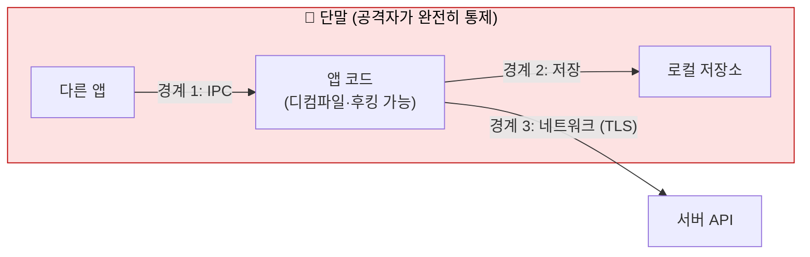

# 모바일 (Android · iOS)

| 레벨 | 상태 | 최종 개정 |
|---|---|---|
| 🟡 (5절·6절 일부는 🔴) | 🔄 개정중 | 2026-10-22 |

> **한눈에 보기**
> 모바일 앱은 "클라이언트를 믿지 말라"는 원칙의 시험장이다. 앱 바이너리, 로컬 저장소, 메모리, 네트워크가 모두 공격자 손에 있다.
> 공격자는 다른 앱의 데이터를 읽고, 인증서 고정을 벗기고, 루팅 탐지를 끄고, 서버 API를 그대로 호출한다.
> 막는 핵심은 하나다. **보안 결정은 서버에서 내리고, 단말은 "지연 장치"로만 쓴다.**

## 1. 모바일이 웹과 다른 점

웹 앱에서 신뢰 경계는 브라우저와 서버 사이 한 곳이다. 모바일에서는 경계가 세 겹이다.



<figure>
<figcaption>그림 1. 붉은 영역 전체가 공격자 통제 아래 있다. 서버가 단말에서 온 어떤 값도 "검증됐다"고 가정하면 그 지점이 취약점이다.</figcaption>
</figure>

모바일 취약점은 세 범주로 나뉜다.

| 범주 | 신뢰 경계 | 대표 결함 | 이 책에서 |
|---|---|---|---|
| **단말 내부** | 앱 ↔ 다른 앱, 앱 ↔ OS | 노출된 컴포넌트, 평문 저장, 딥링크 → WebView | 이 장 3·4절 |
| **네트워크** | 앱 ↔ 서버 | TLS 미검증, 인증서 고정 없음, 평문 HTTP | 이 장 6절 |
| **서버** | 서버 API | 인증·접근 제어·인젝션. 웹과 같다 | [3부 웹 취약점](../part3-web/00-overview.md) |

세 번째 범주가 실제 영향이 가장 크고, 점검에서 가장 자주 빠진다. 앱을 뜯는 데 시간을 다 쓰고 정작 서버 API의 [IDOR](../part3-web/05-access-control.md)를 안 보는 경우다. 앱 분석의 목적 중 절반은 **서버 API를 호출하는 방법을 알아내는 것**이다.

## 2. OWASP MASVS와 MASTG

모바일 점검의 사실상 표준은 OWASP Mobile Application Security(MAS) 프로젝트의 두 문서다.

| 문서 | 역할 | 현행 버전 |
|---|---|---|
| **MASVS** (Mobile Application Security Verification Standard) | "무엇을" 검증하는가. 통제 항목 목록 | v2.1.0 (2024-01) 📎 [릴리스](https://github.com/OWASP/masvs/releases) |
| **MASTG** (Mobile Application Security Testing Guide) | "어떻게" 검증하는가. 테스트 절차·도구·데모 | v2.0.0 📎 [릴리스](https://github.com/OWASP/mastg/releases) |

MASVS v2는 통제를 8개 그룹으로 나누고, MASTG v2는 각 통제를 약점 목록(MASWE)·테스트·데모로 잇는다. 보고서의 결함 분류에 이 ID를 그대로 쓰면 개발자와 대화가 빨라진다.

| 그룹 | 다루는 것 | 이 장에서 |
|---|---|---|
| MASVS-STORAGE | 단말에 저장되는 민감 데이터 | 3.6, 4.1 |
| MASVS-CRYPTO | 암호 사용의 올바름 | 3.6 |
| MASVS-AUTH | 인증과 인가 | 3부 4장 |
| MASVS-NETWORK | 서버와의 통신 보호 | 6 |
| MASVS-PLATFORM | 플랫폼·다른 앱과의 상호작용 (IPC, WebView) | 3.2~3.5 |
| MASVS-CODE | 안전한 데이터 처리, 업데이트 | 3.4 |
| MASVS-RESILIENCE | 리버싱·변조 저항 (루팅 탐지, 난독화) | 3.7, 4.3 |
| MASVS-PRIVACY | 사용자 프라이버시 (v2.1.0에서 추가) | — |

검증 수준은 v1의 L1·L2·R 레벨에서 v2의 **MAS 프로파일**로 바뀌었다. 어떤 프로파일을 적용할지는 위험 기반으로 서비스 담당자와 합의한다. 금융 앱은 RESILIENCE까지, 단순 정보 앱은 STORAGE·NETWORK·PLATFORM 중심이 보통이다.

## 3. Android

### 3.1 준비: APK 풀기

```bash
adb shell pm path com.example.app && adb pull <경로>/base.apk   # 단말에서 꺼내기
apktool d base.apk -o app_src        # 리소스·매니페스트·smali
jadx-gui base.apk                    # Java 디컴파일
```

분석은 항상 `AndroidManifest.xml`에서 시작한다. 공격 표면(컴포넌트, 권한, 딥링크, 디버그 플래그)이 한 파일에 선언돼 있다.

### 3.2 노출된 컴포넌트

Activity, Service, BroadcastReceiver, ContentProvider는 `android:exported="true"`이면 **단말의 모든 앱**이 호출할 수 있다. Android 12(API 31)부터는 인텐트 필터가 있는 컴포넌트에 `exported`를 명시해야 설치되지만, 그 이전을 타깃하는 앱은 인텐트 필터만 있어도 암묵적으로 노출된다.

```bash
grep -nE 'exported="true"|<intent-filter' app_src/AndroidManifest.xml   # 노출 후보
adb shell am start -n com.example.app/.AdminActivity                    # 인증 없이 띄워지는가
adb shell content query --uri content://com.example.app.provider/users  # Provider가 읽히는가
```

보는 순서는 "노출됐는가 → 권한(`android:permission`)이 걸려 있는가 → 그 권한의 보호 수준이 `signature`인가 → 호출 시 입력을 검증하는가"다. `normal` 보호 수준의 커스텀 권한은 다른 앱이 선언만 하면 얻는다.

### 3.3 인텐트와 딥링크

| 패턴 | 문제 | 확인 |
|---|---|---|
| 암묵적 인텐트로 민감 데이터 전송 | 같은 필터를 가진 악성 앱이 가로챈다 | `startActivity(new Intent("com.example.SHOW_TOKEN"))` 류 |
| `PendingIntent` 변경 가능 | 받은 앱이 내용을 바꿔 원래 앱 권한으로 실행 | API 31 미만에서 `FLAG_IMMUTABLE` 누락 |
| 딥링크 → WebView | URL 검증 실패 시 임의 페이지가 앱 권한의 JS 브리지에 접근 | 7절 TikTok 사례 |

딥링크는 `intent-filter`의 `<data android:scheme=... android:host=...>`로 선언된다. 호스트를 검증한다고 해도 `startsWith("https://example.com")` 같은 검사는 `https://example.com.attacker.net`에 뚫린다. `Uri.getHost()`를 허용 목록과 **완전 일치**로 비교해야 한다.

### 3.4 debuggable과 backup

`<application android:debuggable="true">`가 릴리스 빌드에 남으면 누구나 디버거를 붙이고, 루팅 없이 `adb shell run-as com.example.app`으로 앱 샌드박스에 들어간다. `allowBackup="true"`(기본값)면 `adb backup`으로 앱 데이터를 통째로 꺼낼 수 있다(API 31 이상을 타깃하면 `adb backup`이 앱 데이터를 더는 내보내지 않지만, 구버전 타깃 앱은 여전히 해당된다). 둘 다 릴리스 빌드에서 `false`인지 확인한다.

### 3.5 WebView

WebView는 앱 안의 브라우저다. 세 가지를 본다.

```java
// ❌ 취약: 외부에서 받은 URL을 그대로 로드하고, 자바 객체를 JS에 노출
WebView wv = findViewById(R.id.web);
wv.getSettings().setJavaScriptEnabled(true);
wv.addJavascriptInterface(new NativeBridge(this), "android");
wv.loadUrl(getIntent().getStringExtra("url"));   // 딥링크로 들어온 값
```

```java
// ✅ 안전: 허용 호스트 완전 일치 검증 + 파일 접근 차단 (+ 브리지는 꼭 필요한 메서드만 @JavascriptInterface)
Uri u = Uri.parse(url);
if (!"https".equals(u.getScheme()) || !ALLOWED_HOSTS.contains(u.getHost())) return;
wv.getSettings().setAllowFileAccess(false);
wv.loadUrl(u.toString());
```

- `addJavascriptInterface`: API 17 미만을 타깃하면 노출된 객체의 **모든 public 메서드**가 리플렉션으로 호출돼 원격 코드 실행이 된다([CVE-2012-6636](https://nvd.nist.gov/vuln/detail/CVE-2012-6636)). API 17 이상에서는 `@JavascriptInterface`가 붙은 메서드만 노출된다. 그래도 그 메서드가 무엇을 하는지(파일 읽기, 토큰 반환)가 문제다.
- `setAllowFileAccess(true)` + `file://` 로드: 로컬 파일을 읽어 JS로 보낼 수 있다. 임의 URL 로드는 피싱 화면, 세션 쿠키 탈취, JS 브리지 남용으로 이어진다. 7절 TikTok 사례가 이 조합이다.

### 3.6 로컬 저장소와 로그

`adb shell run-as com.example.app cat shared_prefs/auth.xml`로 토큰이 평문인지, `adb logcat | grep -iE "token|password|authorization"`으로 로그에 비밀이 찍히는지 본다. 민감 값은 Android Keystore로 감싼 키로 암호화하거나, 애초에 단말에 두지 않는다. "암호화했다"고 해도 키가 코드에 하드코딩돼 있으면 `jadx`에서 바로 보인다. MASVS-CRYPTO는 이 지점을 본다.

### 3.7 루팅 탐지와 우회

루팅 탐지는 보통 `su` 바이너리 경로 확인, Magisk 관련 패키지 조회, `Build.TAGS`의 `test-keys`, 쓰기 가능한 시스템 파티션 확인 같은 검사를 조합한다. 라이브러리(RootBeer 등)를 쓰면 메서드 이름이 그대로 남는다.

우회는 두 방향이다. (1) Magisk의 DenyList로 해당 앱에 루팅을 숨긴다. (2) Frida로 검사 메서드의 반환값을 바꾼다(5절). 어느 쪽이든 **몇 분 안에 된다**. 루팅 탐지는 방어가 아니라 자동화 공격을 늦추는 장치이고, MASVS-RESILIENCE가 이것을 "저항"이라 부르는 이유다. 보고서에 "루팅 탐지 우회 가능"을 단독 High로 적지 않는다. 우회한 뒤 **무엇을 할 수 있는가**가 심각도를 정한다.

## 4. iOS

### 4.1 Keychain과 로컬 저장

iOS에서 비밀은 Keychain에 둔다. 문제는 **접근성 클래스**다.

| 접근성 상수 | 의미 | 평가 |
|---|---|---|
| `kSecAttrAccessibleAfterFirstUnlock` | 재부팅 후 첫 잠금 해제 이후 계속 | 백그라운드 필요 시만 |
| `kSecAttrAccessibleWhenUnlocked` | 잠금 해제 중에만 | 기본값, 보통 적절 |
| `...ThisDeviceOnly` 변형 | 백업으로 다른 기기에 옮겨지지 않음 | ✅ 인증 토큰에 권장 |

`NSUserDefaults`(plist)와 앱 `Documents` 디렉터리는 암호화된 Keychain이 아니다. 토큰이 여기 있으면 탈옥 기기나 백업 파일에서 그대로 읽힌다. 탈옥 기기에서는 `objection -n com.example.app start`(1.12 이전 문법은 `--gadget <앱> explore`)로 들어가 `ios keychain dump`, `ios nsuserdefaults get`으로 한 번에 확인한다. App Store 바이너리는 FairPlay로 암호화돼 있어 `strings`를 돌려도 아무것도 안 나온다. 탈옥 기기에서 메모리 덤프로 복호화한 뒤(`frida-ios-dump` 류) `otool -L`, `strings`로 본다.

### 4.2 ATS (App Transport Security)

ATS는 iOS 9부터 앱의 모든 연결에 TLS를 강제한다. 예외는 `Info.plist`에 선언한다.

```xml
<!-- ❌ 취약: 모든 도메인에 평문 HTTP 허용 -->
<key>NSAppTransportSecurity</key>
<dict>
    <key>NSAllowsArbitraryLoads</key><true/>
</dict>
```

IPA를 풀어 `plutil -p Payload/App.app/Info.plist`로 본다. `NSAllowsArbitraryLoads`, `NSAllowsArbitraryLoadsInWebContent`, 도메인별 `NSExceptionAllowsInsecureHTTPLoads`가 있으면 왜 필요한지 묻는다. 대부분 "예전에 넣고 안 뺀 것"이다.

### 4.3 탈옥 탐지

흔한 검사는 `/Applications/Cydia.app`, `/bin/bash`, `/private/var/lib/apt` 같은 경로 존재 확인, `fork()` 성공 여부, `cydia://` URL 스킴 열림 여부, 샌드박스 밖 쓰기 시도다. Android와 마찬가지로 Frida나 `objection`의 `ios jailbreak disable`로 우회된다. 평가 기준도 같다. 우회 자체가 아니라 우회한 뒤의 영향을 본다.

## 5. Frida로 런타임 계측 🔴

[Frida](https://frida.re)는 실행 중인 프로세스에 JavaScript를 주입해 함수를 가로채고 반환값을 바꾸는 도구다. 모바일 분석에서 루팅 탐지 우회, 인증서 고정 해제, 암호화 전 평문 확인에 쓴다. [6부 3장 디버거](../part6-tools/03-debuggers.md)에서 gdb와 비교한다.

### 5.1 설치와 연결

```bash
pip install frida-tools                 # PC 쪽 CLI. 단말의 frida-server와 메이저 버전을 맞춘다
adb push frida-server-<ver>-android-arm64 /data/local/tmp/frida-server && adb shell "su -c '/data/local/tmp/frida-server &'"
frida-ps -U                             # USB 기기의 프로세스 목록이 보이면 성공
```

### 5.2 스크립트: 루팅 탐지 메서드 무력화

```javascript
// hook.js — Java 메서드의 반환값을 바꾼다
Java.perform(function () {
    var RootCheck = Java.use("com.example.app.security.RootCheck");
    RootCheck.isRooted.implementation = function () {
        var original = this.isRooted();          // 원래 구현도 호출해 둔다
        console.log("[*] isRooted() 원래 값=" + original + " → false 반환");
        return false;
    };
});
```

```bash
# 앱을 새로 띄우면서(-f) 스크립트를 주입한다. 주입 후 자동으로 실행이 재개된다.
frida -U -f com.example.app -l hook.js
# 시작 직후 코드를 보고 싶으면 --pause 로 멈춘 뒤 REPL에서 %resume
```

- `Java.perform`: Java VM 스레드에 붙는다. Java API는 이 안에서만 쓴다.
- `Java.use(클래스명)`: 클래스 래퍼를 얻는다. 난독화된 이름은 `jadx`에서 확인한 그대로 쓴다.
- `.implementation = function`: 메서드를 교체한다. 오버로드가 여러 개면 `RootCheck.isRooted.overload('android.content.Context').implementation = ...` 처럼 시그니처를 지정한다.
- Frida 17(2025-05)부터 Java·ObjC·Swift 브리지는 GumJS 런타임에 번들되지 않는다. `frida` REPL과 `frida-trace`(frida-tools 14+)는 브리지를 포함하므로 위 명령은 그대로 되지만, Python·Node API로 직접 스크립트를 주입하거나 `frida-compile`로 빌드할 때는 `frida-java-bridge`를 import해야 한다. 📎 [Frida 17.0.0 릴리스 노트](https://frida.re/news/2025/05/17/frida-17-0-0-released/)

무엇을 후킹할지는 `jadx`에서 문자열("rooted", "su", "Cydia")로 역추적해 찾고, `frida-trace -U -f com.example.app -j 'com.example.app.security.*!*'`로 실제 호출되는 메서드를 확인한 뒤 스크립트를 쓴다. 네이티브 라이브러리(`.so`) 안의 검사는 `Interceptor.attach`로 C 함수를 가로챈다. 함수 이름이 스트립돼 있으면 Ghidra로 오프셋을 찾아 `Process.getModuleByName("libapp.so").base.add(0x1234)`에 붙인다(Frida 17에서 `Module.getBaseAddress()` 정적 메서드는 제거됐다).

## 6. 인증서 고정과 트래픽 분석

### 6.1 트래픽을 보는 기본 절차

1. PC에서 Burp를 띄우고 단말의 Wi‑Fi 프록시를 PC로 설정한다. [6부 1장](../part6-tools/01-burp-proxy.md)
2. Burp CA 인증서를 단말에 설치한다.
3. 여기서 Android는 막힌다. **API 24(Android 7.0) 이상을 타깃하는 앱은 사용자 설치 CA를 기본으로 신뢰하지 않는다.** 📎 [Network Security Config 문서](https://developer.android.com/privacy-and-security/security-config) 해결책은 (a) 루팅 기기의 시스템 CA 저장소에 넣거나, (b) APK를 다시 패키징해 `network_security_config.xml`에 `<certificates src="user"/>`를 추가하거나, (c) Frida로 TLS 검증을 통째로 우회한다.
4. 그래도 안 되면 인증서 고정이다.

### 6.2 인증서 고정 (certificate pinning)

고정은 "시스템 CA가 서명했는가"가 아니라 "**내가 아는 그 공개키인가**"를 검사한다. 사용자나 공격자가 CA를 추가해도 통하지 않는다. Android에서는 Network Security Config로 선언한다.

```xml
<!-- ✅ res/xml/network_security_config.xml. 백업 핀을 반드시 둔다 -->
<network-security-config>
    <domain-config>
        <domain includeSubdomains="true">api.example.com</domain>
        <pin-set expiration="2027-01-01">
            <pin digest="SHA-256">7HIpactkIAq2Y49orFOOQKurWxmmSFZhBCoQYcRhJ3Y=</pin>
            <pin digest="SHA-256">fwza0LRMXouZHRC8Ei+4PyuldPDcf3UKgO/04cDM1oE=</pin>
        </pin-set>
    </domain-config>
</network-security-config>
```

OkHttp는 `CertificatePinner`, iOS는 ATS의 `NSPinnedDomains`(iOS 14+)로 선언한다. 고정은 MASVS-NETWORK-2에 해당하며 모든 앱의 필수가 아니라 **위험 기반 선택**이다. 키 교체 절차 없이 고정하면 만료일에 앱이 멈춘다. 그래서 백업 핀과 만료일을 둔다.

### 6.3 고정 우회 🔴

점검자는 트래픽을 봐야 하므로 고정을 벗긴다. 이것은 취약점이 아니라 **점검 절차**다. 루팅/탈옥 기기에서 앱이 고정을 하는 이상 우회는 항상 가능하다.

```bash
# objection: OkHttp · TrustManager · iOS NSURLSession 등 알려진 구현을 한꺼번에 패치
objection -n com.example.app start      # 1.12 이전: objection --gadget com.example.app explore
... android sslpinning disable
... ios sslpinning disable

# Frida CodeShare의 범용 스크립트 (검증 로직을 통과시키는 TrustManager를 심는다)
frida -U -f com.example.app --codeshare pcipolloni/universal-android-ssl-pinning-bypass-with-frida
```

범용 스크립트가 안 통하면 앱이 직접 구현한 검증이다. `jadx`에서 `checkServerTrusted`, `X509TrustManager`, `CertificatePinner`, iOS는 `SecTrustEvaluate`를 찾아 5절처럼 직접 후킹한다. HTTP가 아닌 트래픽(gRPC, WebSocket, 자체 TCP 프로토콜)은 Burp에 안 잡히므로 단말에서 `tcpdump`로 뜨거나 Frida로 소켓 송수신 함수를 가로채 평문을 본다.

## 7. 실제 사례

| 사례 | 제품 | 핵심 | 출처 |
|---|---|---|---|
| [CVE-2020-0096](https://nvd.nist.gov/vuln/detail/CVE-2020-0096) StrandHogg 2.0 (2020) | Android 8.0~9 | 악성 앱이 리플렉션으로 다른 앱의 Activity 위에 가짜 화면을 띄워 자격증명·권한을 가로챔. 권한 없이 동작. 2020-05 보안 패치 | [Android 보안 게시판 2020-05](https://source.android.com/docs/security/bulletin/2020-05-01) · [Promon](https://promon.io/resources/downloads/strandhogg-2-0-new-serious-android-vulnerability) |
| [CVE-2020-8913](https://nvd.nist.gov/vuln/detail/CVE-2020-8913) (2020) | Google Play Core 1.7.2 미만 | `SplitCompat.install` 경로 순회. 단말의 다른 앱이 피해 앱 컨텍스트에서 코드 실행. "라이브러리 하나가 수백 앱의 취약점" 사례 | [Oversecured 분석](https://blog.oversecured.com/Oversecured-automatically-discovers-persistent-code-execution-in-the-Google-Play-Core-Library/) |
| [CVE-2022-28799](https://nvd.nist.gov/vuln/detail/CVE-2022-28799) (2022) | TikTok Android 23.7.3 미만 | 딥링크 검증 우회 → WebView에 임의 URL 로드 → 노출된 JS 브리지 70여 개로 원클릭 계정 탈취. 3.3·3.5절의 조합 | [Microsoft 보안 블로그](https://www.microsoft.com/en-us/security/blog/2022/08/31/vulnerability-in-tiktok-android-app-could-lead-to-one-click-account-hijacking/) |
| [CVE-2012-6636](https://nvd.nist.gov/vuln/detail/CVE-2012-6636) (2012~2014) | Android WebView, API 17 미만 타깃 앱 | `addJavascriptInterface` 객체의 모든 메서드를 리플렉션으로 호출 → RCE. `@JavascriptInterface` 도입의 계기 | [Android WebView 문서](https://developer.android.com/reference/android/webkit/WebView#addJavascriptInterface(java.lang.Object,%20java.lang.String)) |

**TikTok (CVE-2022-28799) 에서 배울 것**: 딥링크, WebView, JS 브리지 각각은 "설계대로" 동작했다. 취약점은 셋의 **연결**에 있었다. 딥링크 호스트 검증 하나가 뚫리자 그 뒤의 70여 개 브리지 메서드가 모두 공격자 것이 됐다. 모바일 점검에서 컴포넌트를 하나씩 보는 것만으로 부족한 이유다.

## 8. 실습 🧪

- **OWASP MASTG UnCrackable Apps** ([mas.owasp.org/crackmes](https://mas.owasp.org/crackmes/)): Android Level 1은 루팅 탐지와 숨겨진 비밀값으로 구성된다. 5절 스크립트를 변형해 탐지를 끄고 비밀을 꺼내는 것이 목표다. 그다음 Level 2(네이티브 검사)로 간다. iOS는 **DVIA-v2**를 쓴다.
- **직접 만들기**: 빈 Android 프로젝트에 `exported="true"` Activity 하나와 `addJavascriptInterface`를 쓴 WebView를 넣고, `adb shell am start`로 인증 없이 띄운 뒤 고치는 것까지가 실습이다.

## 체크리스트

**정적 분석할 때**
- [ ] `AndroidManifest.xml`의 `exported="true"` 컴포넌트마다 권한과 보호 수준을 확인했는가?
- [ ] 딥링크 호스트 검증이 완전 일치인가? 받은 URL이 WebView로 가는가? 노출된 JS 브리지 메서드는 무엇을 하는가?
- [ ] `debuggable`, `allowBackup`, `usesCleartextTraffic`, ATS 예외가 릴리스 빌드에 남아 있는가?
- [ ] 하드코딩된 키·토큰·API 엔드포인트가 있는가? (`strings`, `jadx` 검색)

**동적 분석할 때**
- [ ] 인증 후 저장소(shared_prefs, SQLite, Keychain, plist)와 `logcat`에 토큰이 어떤 형태로 있는가?
- [ ] 고정 우회 후 서버 API를 Burp로 직접 호출했는가? (IDOR, 인증 우회는 여기서 나온다)
- [ ] 루팅·탈옥 탐지를 우회한 뒤 **추가로** 무엇이 가능한지 확인했는가?

**보고할 때**
- [ ] 결함마다 MASVS 그룹 ID를 적었는가? "루팅 탐지 우회 가능", "고정 없음"을 단독 High로 올리지 않았는가?

## 더 읽기

- [OWASP MASVS](https://mas.owasp.org/MASVS/) · 통제 항목의 원문. 보고서 분류 기준
- [OWASP MASTG](https://mas.owasp.org/MASTG/) · 테스트 절차와 도구. 이 장은 MASTG의 요약판이다
- [Android Network Security Config](https://developer.android.com/privacy-and-security/security-config) · 고정·CA 신뢰·debug-overrides 공식 문서
- [Apple: Preventing Insecure Network Connections](https://developer.apple.com/documentation/security/preventing-insecure-network-connections) · ATS 공식 문서
- [Apple: Keychain Services](https://developer.apple.com/documentation/security/keychain-services) · 접근성 클래스 정의
- [Frida 공식 문서](https://frida.re/docs/home/) · JavaScript API 레퍼런스와 브리지 변경 사항 · [objection](https://github.com/sensepost/objection)

## 변경 이력

| 날짜 | 변경 | 기여자 |
|---|---|---|
| 2026-10-21 | 초안(뼈대) 작성 | @anthonynoh5202 |
| 2026-10-22 | 본문 작성. MASVS/MASTG 현행 버전, Android·iOS 항목, Frida 스크립트, 고정 우회, 사례 4건 | @anthonynoh5202 |
| 2026-10-22 | 기술 검증: CVE 4건 cvelistV5 대조(모두 실존). Frida 17 제거 API(`Module.getBaseAddress`)를 현행 API로 교체, 릴리스 노트 링크를 17.0.0으로 정정, objection 1.12 CLI(`-n … start`) 반영, allowBackup/API 31 서술 정정, MASTG 릴리스 날짜(미확인) 삭제, MASVS/MASTG 저장소 URL 현행화 | 검증팀 |
