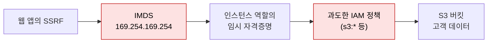

# 클라우드와 컨테이너

| 레벨 | 상태 | 최종 개정 |
|---|---|---|
| 🟡 (5절 일부는 🔴) | 🔄 개정중 | 2026-10-22 |

> **한눈에 보기**
> 클라우드 취약점은 코드보다 **설정**에서 나온다. IAM 권한 하나, 공개 버킷 하나, 메타데이터 엔드포인트 하나가 침해의 출발점이다.
> 공격자는 작은 권한에서 시작해 역할을 넘겨받고, 컨테이너 안에서 호스트로 나오고, 클러스터 하나로 전체 계정에 닿는다.
> 막는 핵심은 **최소 권한**과 **경계를 하나 넘을 때마다 다시 인증하게 만드는 것**이다.

## 1. 설정이 곧 코드다

온프레미스에서 네트워크 경계였던 것이 클라우드에서는 **IAM(Identity and Access Management)** 이다. 방화벽 안에 있다는 사실은 아무것도 보장하지 않는다. API 호출마다 "이 주체가 이 자원에 이 행위를 해도 되는가"를 정책이 판단한다. 그래서 클라우드 취약점의 대부분은 정책·설정 오류이고, [기초 1장](../part1-foundations/01-what-is-vulnerability.md)에서 말한 네 번째 근본 원인("설정과 과정")에 속한다.

전형적인 침해 경로는 이렇다.



<figure>
<figcaption>그림 1. 2019년 Capital One 침해의 재구성. 웹 취약점(SSRF) 하나와 설정 오류(과도한 역할 권한) 하나가 연결됐다. 어느 한쪽만 막혔어도 데이터는 안 나갔다.</figcaption>
</figure>

이 장은 이 경로의 각 지점을 순서대로 본다. IAM(2절), 스토리지(3절), IMDS(4절), 컨테이너(5절), Kubernetes(6절), 그리고 이것들을 배포 전에 잡는 IaC 스캐닝(7절)이다. 예시는 AWS 중심이지만 Azure·GCP에 같은 구조가 있다.

## 2. IAM 권한 상승 경로

### 2.1 원리

IAM 권한 상승은 "A 권한을 가진 주체가 A를 써서 B 권한을 얻는" 것이다. 2018년 Rhino Security Labs의 Spencer Gietzen이 AWS에서 21가지 경로를 정리했고 📎 [원문](https://rhinosecuritylabs.com/aws/aws-privilege-escalation-methods-mitigation/), 지금도 점검의 기준 목록이다. 대표 경로는 다음과 같다.

| 필요한 권한 | 경로 | 결과 |
|---|---|---|
| `iam:CreatePolicyVersion` | 자기에게 붙은 관리형 정책의 새 버전을 만들어 기본으로 설정 | 정책 내용을 마음대로 |
| `iam:AttachUserPolicy` / `iam:AttachRolePolicy` | `AdministratorAccess`를 자기에게 붙임 | 관리자 |
| `iam:CreateAccessKey` (다른 사용자 대상) | 관리자 사용자의 액세스 키 생성 | 그 사용자로 행동 |
| `iam:UpdateAssumeRolePolicy` + `sts:AssumeRole` | 관리자 역할의 신뢰 정책에 자기를 추가 | 그 역할 |
| **`iam:PassRole`** + `lambda:CreateFunction` + `lambda:InvokeFunction` | 관리자 역할을 넘긴 Lambda를 만들어 실행 | 그 역할의 권한으로 코드 실행 |
| **`iam:PassRole`** + `ec2:RunInstances` | 관리자 인스턴스 프로파일을 붙인 EC2를 띄우고 IMDS에서 자격증명 획득 | 그 역할 |
| **`iam:PassRole`** + `glue:CreateDevEndpoint` 등 | 역할을 받는 다른 서비스들도 같다 | 그 역할 |

`iam:PassRole`이 반복해서 나오는 이유가 있다. 이 권한은 "서비스에 역할을 넘겨줄 수 있다"는 뜻이고, 넘겨줄 수 있는 역할에 제한이 없으면 **그 계정에서 가장 강한 역할**이 내 것이 된다. 정책에 `"Resource": "*"`로 `iam:PassRole`을 주는 경우가 흔하다.

### 2.2 정책 패턴

```json
// ❌ 취약: 어떤 역할이든 어떤 서비스에든 넘길 수 있다
{ "Effect": "Allow", "Action": ["iam:PassRole", "lambda:*"], "Resource": "*" }
```

```json
// ✅ 안전: 넘길 수 있는 역할과 받는 서비스를 제한한다
{
  "Effect": "Allow",
  "Action": "iam:PassRole",
  "Resource": "arn:aws:iam::123456789012:role/app-lambda-role",
  "Condition": { "StringEquals": { "iam:PassedToService": "lambda.amazonaws.com" } }
}
```

### 2.3 점검 방법

```bash
aws sts get-caller-identity                                    # 나는 누구인가
aws iam list-attached-user-policies --user-name <me>
aws iam get-policy-version --policy-arn <arn> --version-id v1   # 실제 문서를 읽는다
aws iam get-account-authorization-details > auth.json          # 전체 덤프 (권한 있을 때)
```

사람이 읽기에는 정책이 너무 많다. 덤프를 **PMapper**(NCC Group), **Cloudsplaining**(Salesforce), **Pacu**(Rhino)에 넣어 상승 경로를 그래프로 찾는다. 점검 보고서에는 "어떤 주체가 어떤 권한 조합으로 어떤 역할까지 갈 수 있는가"를 경로로 적는다. 권한 이름 나열보다 설득력이 크다.

## 3. 스토리지 공개 설정

S3 버킷이 공개되는 경로는 세 가지다. 버킷 정책의 `"Principal": "*"`, 객체·버킷 ACL의 `AllUsers`/`AuthenticatedUsers`, 그리고 이 둘을 막는 **Block Public Access**가 꺼져 있는 것. AWS는 2023년 4월부터 새 버킷에 Block Public Access를 기본으로 켜고 ACL을 비활성화하지만, 그 전에 만든 버킷은 그대로다. 📎 [S3 문서](https://docs.aws.amazon.com/AmazonS3/latest/userguide/access-control-block-public-access.html)

```bash
# 외부에서: 자격증명 없이 읽히는가?
aws s3 ls s3://target-bucket --no-sign-request
curl -s https://target-bucket.s3.amazonaws.com/ | head

# 내부에서: 설정 확인
aws s3api get-public-access-block --bucket target-bucket
aws s3api get-bucket-policy-status --bucket target-bucket     # "IsPublic": true 면 공개
aws s3api get-bucket-acl --bucket target-bucket
```

`AuthenticatedUsers`는 "우리 조직 사용자"가 아니라 **AWS 계정을 가진 전 세계 누구나**다. 이름 때문에 생기는 오해가 가장 흔한 원인이다. Azure Blob의 컨테이너 "익명 읽기", GCP의 `allUsers`/`allAuthenticatedUsers` 바인딩이 같은 자리다.

쓰기 권한이 공개된 경우는 더 심각하다. 정적 웹 호스팅 버킷에 쓸 수 있으면 사이트 변조이고, 배포 아티팩트 버킷이면 [공급망 공격](04-supply-chain.md)이다.

## 4. IMDS와 SSRF 연계

### 4.1 원리

EC2 인스턴스는 링크 로컬 주소 `169.254.169.254`의 **인스턴스 메타데이터 서비스(IMDS)** 에서 자기 정보와 역할의 임시 자격증명을 받는다. 인스턴스 안에서 보내는 요청이면 누가 보냈는지 묻지 않는다. 그래서 인스턴스 위의 웹 앱에 [SSRF](../part3-web/03-ssrf.md)가 있으면 공격자는 앱을 시켜 이 주소를 읽는다.

```bash
# IMDSv1: GET 한 번이면 끝난다 (SSRF로 그대로 재현 가능)
curl http://169.254.169.254/latest/meta-data/iam/security-credentials/
curl http://169.254.169.254/latest/meta-data/iam/security-credentials/<role-name>
# → AccessKeyId, SecretAccessKey, Token
```

```bash
# IMDSv2: PUT으로 토큰을 먼저 받아야 한다. 단순 GET SSRF로는 안 된다
TOKEN=$(curl -X PUT "http://169.254.169.254/latest/api/token" \
        -H "X-aws-ec2-metadata-token-ttl-seconds: 21600")
curl -H "X-aws-ec2-metadata-token: $TOKEN" http://169.254.169.254/latest/meta-data/
```

IMDSv2가 SSRF를 막는 이유는 두 가지다. (1) PUT 메서드와 커스텀 헤더가 필요한데 대부분의 SSRF는 GET만 보낸다. (2) 토큰 응답의 IP 홉 제한(hop limit)이 기본 1이라 컨테이너나 프록시를 거친 요청에는 토큰이 돌아오지 않는다. GCP는 `Metadata-Flavor: Google` 헤더, Azure는 `Metadata: true` 헤더를 요구해 같은 효과를 낸다.

### 4.2 조치

```bash
# 기존 인스턴스에 IMDSv2 강제
aws ec2 modify-instance-metadata-options --instance-id i-0123456789abcdef0 \
    --http-tokens required --http-endpoint enabled
```

AWS는 2022년 AMI 속성, 2023년 Amazon Linux 2023, 2024년 3월 계정 수준 기본값까지 단계적으로 IMDSv2를 기본으로 만들었다. 📎 [AWS 발표](https://aws.amazon.com/about-aws/whats-new/2024/03/set-imdsv2-default-new-instance-launches/) 그래도 **기존 인스턴스에는 소급되지 않는다**. 점검 시 `aws ec2 describe-instances --query 'Reservations[].Instances[].[InstanceId,MetadataOptions.HttpTokens]'`로 `optional`인 인스턴스를 찾는다.

IMDSv2가 켜져 있어도 자격증명을 얻은 뒤의 피해 범위는 역할 권한이 정한다. 4절은 2절과 묶어서 본다.

## 5. 컨테이너 탈출

컨테이너는 가상 머신이 아니다. 호스트 커널을 공유하고, 네임스페이스·cgroup·capability·seccomp·LSM으로 **격리를 흉내** 낸다. 탈출은 이 중 하나가 빠졌거나 커널에 결함이 있을 때 일어난다.

### 5.1 안에서 먼저 확인할 것

```bash
cat /proc/1/cgroup; ls -la /.dockerenv              # 컨테이너인가
cat /proc/self/status | grep CapEff                 # capability 비트. 0000003fffffffff 면 전부 = privileged
capsh --decode=$(grep CapEff /proc/self/status | awk '{print $2}')
ls -la /var/run/docker.sock                          # 데몬 소켓이 마운트돼 있는가
mount | grep -E "docker.sock|/host|hostPath"         # 호스트 경로 마운트
fdisk -l 2>/dev/null                                 # 호스트 디스크가 보이면 privileged
cat /var/run/secrets/kubernetes.io/serviceaccount/token 2>/dev/null | head -c 40   # K8s 토큰
```

### 5.2 설정 오류로 인한 탈출

| 설정 | 왜 나가지는가 | 재현 (실습 환경에서만) |
|---|---|---|
| `--privileged` | 모든 capability + 장치 접근 + seccomp/AppArmor 해제 | `mount /dev/sda1 /mnt` 로 호스트 루트 파일시스템 마운트 |
| `/var/run/docker.sock` 마운트 | 소켓은 곧 도커 데몬 = 호스트 root | `docker -H unix:///var/run/docker.sock run -v /:/host -it alpine chroot /host sh` |
| `CAP_SYS_ADMIN` + cgroup v1 | `release_agent`에 호스트 명령 경로를 써 넣으면 cgroup 해제 시 호스트에서 실행 | CVE-2022-0492는 이 경로를 **capability 없이도** 열었다 |
| `--pid=host` + `CAP_SYS_PTRACE` | 호스트 프로세스에 ptrace로 코드 주입 | `nsenter --target 1 --mount --uts --ipc --net --pid sh` |
| 호스트 경로 마운트 (`-v /:/host`, K8s `hostPath`) | 파일시스템이 곧 호스트 | `/host/etc/cron.d`에 작업 추가 |

CI 러너가 "Docker in Docker"를 위해 소켓을 마운트하는 것이 가장 흔한 실수다. 빌드 스크립트를 제어하는 사람(= PR을 보내는 사람)이 곧 호스트 root가 된다. [공급망 장 4절](04-supply-chain.md)과 이어진다.

### 5.3 런타임 취약점으로 인한 탈출 🔴

설정이 완벽해도 런타임 자체의 결함은 남는다. runc는 Docker·containerd·Podman·CRI-O가 공통으로 쓰는 저수준 런타임이라 결함 하나가 전체 생태계에 미친다.

- **CVE-2019-5736** (2019-02): 컨테이너 안의 프로세스가 `/proc/self/exe`(= 호스트의 runc 바이너리)를 `O_PATH`로 열고 runc가 종료될 때까지 쓰기를 반복해 덮어쓴다. 다음에 관리자가 `docker exec`를 하면 변조된 runc가 호스트 root로 실행된다. 악성 이미지 하나, 또는 침해된 컨테이너 하나면 된다.
- **CVE-2024-21626 "Leaky Vessels"** (2024-01-31, Snyk): runc가 내부 파일 디스크립터(호스트 `/sys/fs/cgroup` 핸들)를 `runc init`에 흘렸고, `chdir` 후 작업 디렉터리가 컨테이너 안인지 검증하지 않았다. `process.cwd`(Dockerfile의 `WORKDIR`)를 `/proc/self/fd/7/`로 지정하면 첫 프로세스의 cwd가 **호스트 마운트 네임스페이스**가 된다. `runc exec --cwd` 변형은 악성 이미지 없이도 통한다. runc 1.1.12에서 fd를 `O_CLOEXEC`로 닫고 cwd를 검증하도록 고쳤다. 📎 [runc 권고](https://github.com/opencontainers/runc/security/advisories/GHSA-xr7r-f8xq-vfvv)

점검 관점에서 런타임 버전은 **호스트 노드의 패치 수준** 문제다. `runc --version`, `containerd --version`, 커널 버전을 노드별로 수집해 알려진 CVE와 대조한다.

## 6. Kubernetes: RBAC와 시크릿

### 6.1 파드 안에서 시작하기

파드에는 기본으로 서비스 계정 토큰이 마운트된다. 이 토큰의 RBAC 권한이 곧 공격자의 출발 권한이다.

```bash
SA=/var/run/secrets/kubernetes.io/serviceaccount
TOKEN=$(cat $SA/token); NS=$(cat $SA/namespace)
kubectl --token=$TOKEN --certificate-authority=$SA/ca.crt \
        --server=https://kubernetes.default.svc auth can-i --list -n $NS
```

`auth can-i --list` 결과에서 위험한 조합을 찾는다.

| 권한 | 왜 위험한가 |
|---|---|
| `secrets` `list`/`get` (네임스페이스 또는 클러스터) | 다른 워크로드의 DB 비밀번호, 클라우드 키, 다른 SA 토큰 |
| `pods` `create` + `hostPath` 허용 | 호스트 루트를 마운트한 파드 = 노드 탈출 (5.2절) |
| `pods/exec` `create` | 다른 파드에 들어가 그 SA 토큰 수집 |
| `clusterrolebindings` `create` / `roles` `escalate`·`bind` | 자기에게 cluster-admin 부여 |
| `nodes/proxy`, `serviceaccounts/token` `create` | 노드 kubelet 접근, 임의 SA 토큰 발급 |

### 6.2 시크릿

Kubernetes Secret은 **base64이지 암호화가 아니다**. `kubectl get secret db -o jsonpath='{.data.password}' | base64 -d`로 읽힌다. etcd 저장 시 암호화(EncryptionConfiguration)는 기본으로 꺼져 있고, 켜도 API 권한이 있으면 평문으로 받는다. 따라서 보호의 본질은 RBAC이고, 시크릿 값 자체는 KMS·외부 시크릿 매니저(Vault, 클라우드 Secrets Manager)로 빼는 것이 낫다.

### 6.3 파드 보안

PodSecurityPolicy는 1.25에서 제거됐고 **Pod Security Standards**(privileged / baseline / restricted)를 네임스페이스 라벨로 적용한다. `restricted`는 privileged 컨테이너, hostPath, hostPID, 대부분의 capability를 막는다. 점검 시 네임스페이스별 `pod-security.kubernetes.io/enforce` 라벨을 확인하고, 없는 네임스페이스는 5.2절의 모든 경로가 열려 있다고 본다. 벤치마크 자동화는 `kube-bench`(CIS), 설정·이미지 스캔은 `trivy k8s`를 쓴다.

## 7. IaC 스캐닝

인프라가 코드(Terraform, CloudFormation, Kubernetes 매니페스트, Dockerfile)로 정의되면 **배포 전에** 위 설정 오류를 잡을 수 있다. 이것이 클라우드 점검에서 가장 비용 효율이 좋은 지점이다.

```hcl
# ❌ 취약: 공개 ACL, 암호화·버전 관리 없음
resource "aws_s3_bucket" "logs" {
  bucket = "corp-logs"
  acl    = "public-read"
}
```

```hcl
# ✅ 안전: 공개 차단 블록을 함께 선언
resource "aws_s3_bucket" "logs" { bucket = "corp-logs" }
resource "aws_s3_bucket_public_access_block" "logs" {
  bucket                  = aws_s3_bucket.logs.id
  block_public_acls       = true
  block_public_policy     = true
  ignore_public_acls      = true
  restrict_public_buckets = true
}
```

| 도구 | 범위 | 명령 |
|---|---|---|
| **Checkov** (Prisma Cloud, 오픈소스) | Terraform·CFN·K8s·Dockerfile·Helm 등 | `pip3 install checkov && checkov -d .` |
| **Trivy** (Aqua) | IaC 설정 + 이미지 취약점 + 시크릿 + SBOM | `trivy config .` · `trivy image myapp:1.0` |
| tfsec | Terraform 전용. **Trivy에 통합되어 더는 별도 개발되지 않는다** 📎 [이전 안내](https://github.com/aquasecurity/tfsec/blob/master/tfsec-to-trivy-migration-guide.md) | `tfsec .` → `trivy config .` |
| KICS (Checkmarx) | IaC 전반 | `kics scan -p .` |

CI에서 두 도구를 돌리고 실패를 병합 차단으로 연결한다. 룰은 "IAM `*` 액션", "공개 S3", "IMDSv1 허용(`http_tokens = "optional"`)", "privileged 컨테이너", "hostPath", "`latest` 태그" 같은 것이 기본에 들어 있다. 거짓 양성은 룰 ID 단위로 예외 처리하고 이유를 주석으로 남긴다.

## 8. 실제 사례

| 사례 | 대상 | 핵심 | 출처 |
|---|---|---|---|
| Capital One 침해 (2019) | AWS EC2 위 WAF + S3 | SSRF → IMDSv1 → WAF 인스턴스 역할 자격증명 → 과도한 S3 권한으로 1억 명 이상 고객 데이터 유출. IMDSv2 도입의 직접 계기 | [Krebs on Security 분석](https://krebsonsecurity.com/2019/08/what-we-can-learn-from-the-capital-one-hack/) |
| [CVE-2018-1002105](https://nvd.nist.gov/vuln/detail/CVE-2018-1002105) (2018) | Kubernetes ≤1.12.2 | API 서버의 프록시 연결을 통해 인증된 사용자가 백엔드(kubelet, 집계 API)에 **API 서버의 TLS 자격증명**으로 임의 요청. CVSS 9.8. 1.10.11/1.11.5/1.12.3에서 수정 | [k8s 이슈 #71411](https://github.com/kubernetes/kubernetes/issues/71411) |
| [CVE-2019-5736](https://nvd.nist.gov/vuln/detail/CVE-2019-5736) (2019) | runc | `/proc/self/exe`를 통해 호스트 runc 바이너리 덮어쓰기. 악성 이미지 또는 침해된 컨테이너에서 호스트 root | [oss-security 공지](https://seclists.org/oss-sec/2019/q1/119) |
| [CVE-2022-0492](https://nvd.nist.gov/vuln/detail/CVE-2022-0492) (2022) | Linux 커널 cgroup v1 | `release_agent` 쓰기에 `CAP_SYS_ADMIN` 검사 누락. seccomp·AppArmor·SELinux 없이 띄운 컨테이너에서 탈출 | [Unit 42 분석](https://unit42.paloaltonetworks.com/cve-2022-0492-cgroups/) |
| [CVE-2024-21626](https://nvd.nist.gov/vuln/detail/CVE-2024-21626) Leaky Vessels (2024) | runc 1.0.0-rc93~1.1.11 | 누출된 fd + cwd 미검증. `WORKDIR /proc/self/fd/7/` 이미지 또는 `runc exec --cwd`로 호스트 파일시스템 접근. 1.1.12에서 수정 | [Snyk 공개](https://snyk.io/blog/cve-2024-21626-runc-process-cwd-container-breakout/) · [runc 권고](https://github.com/opencontainers/runc/security/advisories/GHSA-xr7r-f8xq-vfvv) |

**Capital One 에서 배울 것**: 취약점 보고서에 "SSRF"라고만 쓰면 Medium이다. "SSRF로 IMDS에 닿고, 그 역할이 `s3:ListBuckets`·`s3:GetObject`를 가진다"까지 증명하면 Critical이다. 클라우드 점검의 익스플로잇 검증은 **권한 체인을 끝까지 따라가는 것**이고, [보고 2장 영향도 산정](../part8-reporting/02-severity.md)에서 맥락이 점수를 정하는 이유다.

## 9. 실습 🧪

- **flAWS** ([flaws.cloud](http://flaws.cloud), Scott Piper): 공개 S3, IMDS, IAM 상승을 단계별로 익히는 무료 AWS CTF. 2·3·4절을 순서대로 체험한다. 후속작 flAWS 2도 있다.
- **컨테이너 탈출 재현 (로컬)**: 자기 PC의 Docker에서만 한다.
  ```bash
  docker run --rm -it -v /var/run/docker.sock:/var/run/docker.sock docker:cli sh
  # 안에서: docker run -v /:/host -it alpine chroot /host sh  → 호스트 셸
  docker run --rm -it --privileged alpine sh
  # 안에서: fdisk -l 로 호스트 디스크가 보이는지 확인
  ```
  확인한 뒤 `--privileged`와 소켓 마운트를 빼고 같은 명령이 실패하는지 본다. **고치는 것까지가 실습이다.**
- **Kubernetes**: `kind`로 로컬 클러스터를 만들고, `hostPath`를 허용한 네임스페이스와 `restricted` 라벨을 붙인 네임스페이스에 같은 파드를 적용해 차이를 본다.
- **IaC**: 7절의 ❌ Terraform을 저장하고 `checkov -d .`와 `trivy config .`가 무엇을 잡는지 비교한다.

## 체크리스트

**IAM**
- [ ] `iam:PassRole`이 `Resource: *`로 허용된 정책이 있는가?
- [ ] `iam:*`, `*:*`, `Resource: *` 조합을 가진 사용자·역할이 몇 개인가? 각각 왜 필요한가?
- [ ] 역할 신뢰 정책에 외부 계정이나 `Principal: *`가 있는가?
- [ ] PMapper/Cloudsplaining으로 상승 경로를 그려 봤는가?

**스토리지·IMDS**
- [ ] 모든 버킷에 Block Public Access가 켜져 있는가? 예외는 문서화돼 있는가?
- [ ] `--no-sign-request`로 외부에서 읽히는 버킷이 있는가?
- [ ] IMDSv1(`HttpTokens: optional`)인 인스턴스가 있는가?
- [ ] 인스턴스 역할이 그 워크로드에 필요한 최소 권한인가?

**컨테이너·Kubernetes**
- [ ] privileged, `hostPath`, `hostPID`, docker.sock 마운트를 쓰는 워크로드가 있는가? 특히 CI 러너
- [ ] runc·containerd·커널 버전이 알려진 탈출 CVE 이전인 노드가 있는가?
- [ ] 네임스페이스마다 Pod Security 라벨이 있는가?
- [ ] 기본 서비스 계정에 불필요한 RBAC이 붙어 있는가? `automountServiceAccountToken: false`를 쓰는가?
- [ ] etcd 저장 암호화가 켜져 있는가? 시크릿을 외부 매니저로 뺐는가?

**배포 전**
- [ ] IaC 스캐너가 CI에 있고 실패가 병합을 막는가?

## 더 읽기

- [Rhino Security Labs: AWS IAM Privilege Escalation Methods](https://rhinosecuritylabs.com/aws/aws-privilege-escalation-methods-mitigation/) · Spencer Gietzen, 2018. 21가지 경로의 원문
- [AWS: Instance metadata service (IMDSv2)](https://docs.aws.amazon.com/AWSEC2/latest/UserGuide/configuring-instance-metadata-service.html) · 토큰·홉 제한 공식 문서
- [AWS: Blocking public access to S3](https://docs.aws.amazon.com/AmazonS3/latest/userguide/access-control-block-public-access.html)
- [Kubernetes: Pod Security Standards](https://kubernetes.io/docs/concepts/security/pod-security-standards/) · 세 프로파일의 정확한 항목
- [Kubernetes: Using RBAC Authorization](https://kubernetes.io/docs/reference/access-authn-authz/rbac/) · `escalate`·`bind` 동사의 의미
- [runc 보안 권고 목록](https://github.com/opencontainers/runc/security/advisories) · 런타임 CVE의 1차 자료
- [Checkov 문서](https://www.checkov.io/) · [Trivy 문서](https://trivy.dev/) · 룰 목록과 예외 처리 방법
- [CIS Benchmarks](https://www.cisecurity.org/cis-benchmarks) · AWS·Docker·Kubernetes 설정 기준. kube-bench가 구현한다

## 변경 이력

| 날짜 | 변경 | 기여자 |
|---|---|---|
| 2026-10-21 | 초안(뼈대) 작성 | @anthonynoh5202 |
| 2026-10-22 | 본문 작성. IAM 상승 경로, S3·IMDS, 컨테이너 탈출(설정·runc CVE), K8s RBAC, IaC 스캐닝, 사례 5건 | @anthonynoh5202 |
| 2026-10-22 | 기술 검증: CVE 4건 cvelistV5·runc GHSA 대조(버전·CVSS·fd 7·1.1.12 수정 내용 일치), 수정 없음 | 검증팀 |
| 2026-10-22 | 독자 테스트 반영: 장 참조 표기를 편·부 이름 규칙으로 통일 | @anthonynoh5202 |
