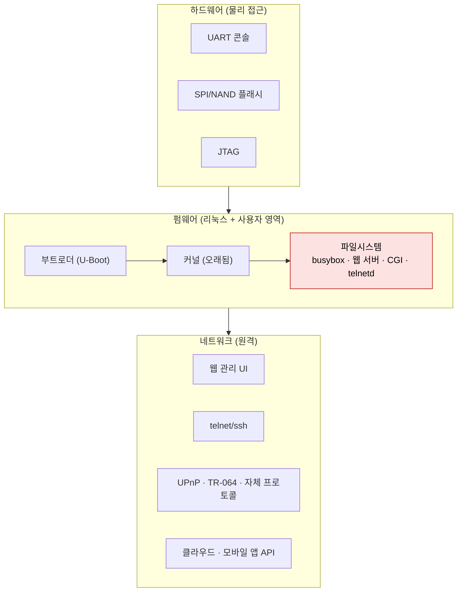

# IoT와 펌웨어

| 레벨 | 상태 | 최종 개정 |
|---|---|---|
| 🔴 (2~4절은 🟡) | 🔄 개정중 | 2026-10-22 |

> **한눈에 보기**
> 펌웨어는 "10년 전 리눅스 + 하드코딩된 비밀번호 + 업데이트 없음"인 경우가 많다. 웹·바이너리 취약점이 완화 기법 없는 환경에서 그대로 살아 있다.
> 공격자는 기본 자격증명으로 로그인하거나, 웹 UI의 명령 인젝션 하나로 수십만 대를 봇넷에 넣는다.
> 분석은 **획득 → 언패킹 → 정적 분석 → 에뮬레이션** 네 단계이고, 이 장은 그 순서대로 간다.

## 1. 임베디드 장비의 공격 표면



<figure>
<figcaption>그림 1. 하드웨어로 펌웨어를 꺼내고, 펌웨어에서 네트워크 서비스의 결함을 찾는다. 실제 공격은 거의 항상 네트워크 쪽에서 온다. 하드웨어 접근은 분석자의 수단이다.</figcaption>
</figure>

라우터·IP 카메라·NAS·셋톱박스의 공통 구조는 "오래된 리눅스 커널 + BusyBox + 벤더가 C로 짠 웹 서버·CGI"다. 이 구조가 만드는 특징이 있다.

| 특징 | 결과 |
|---|---|
| 모든 프로세스가 root | 서비스 하나의 결함 = 장비 전체 |
| 완화 기법 없음 (NX·ASLR·canary·PIE 미적용이 흔함) | [바이너리](../part4-binary/00-overview.md)의 교과서적 익스플로잇이 그대로 통함 |
| 업데이트 경로 없음 또는 사용자가 안 함 | N-day가 수년간 살아 있음 |
| 같은 SDK(칩셋 벤더 제공)를 수십 제조사가 공유 | CVE 하나가 수백 모델에 해당 |
| 관리 인터페이스가 WAN에 노출 | 인터넷에서 바로 공격 가능 |

## 2. 펌웨어 획득

### 2.1 다운로드 (가장 쉽다)

1. 벤더 지원 페이지에서 펌웨어 파일을 받는다. 과거 버전까지 받아 두면 패치 diff 분석에 쓴다.
2. 없으면 장비의 자동 업데이트 요청을 가로챈다. 장비의 DNS를 분석 PC로 돌리거나 Burp로 프록시해 업데이트 서버 URL을 얻는다. 모바일 앱이 펌웨어를 내려받는 제품은 [모바일 장 6절](01-mobile.md)의 트래픽 분석으로 URL이 나온다.
3. 파일이 암호화돼 있으면 3.3절로 간다.

### 2.2 UART

보드의 4핀(GND·VCC·TX·RX) 헤더가 UART다. 멀티미터로 GND를 찾고, 부팅 중 전압이 흔들리는 핀이 TX다. USB-TTL 어댑터(3.3V 주의)를 연결한다.

```bash
screen /dev/ttyUSB0 115200          # 보레이트는 115200이 가장 흔하다. 깨지면 57600, 9600
# 부팅 로그에서 커널 버전, 파일시스템 종류, 서비스 시작 순서가 그대로 보인다
```

부트로더(U-Boot) 프롬프트가 열리면 `printenv`로 부트 인자를 보고, `setenv bootargs ... init=/bin/sh`로 비밀번호 없이 루트 셸을 얻거나 `md`로 플래시 메모리를 덤프한다. 로그인 프롬프트만 나오면 3절에서 찾은 자격증명으로 들어간다.

### 2.3 SPI 플래시 덤프

UART가 없거나 막혀 있으면 플래시 칩을 직접 읽는다. SOIC‑8 패키지의 SPI NOR(Winbond 25Qxx, Macronix MX25Lxx 등)가 대부분이다. 칩 클립과 CH341A 프로그래머로 보드에서 떼지 않고 읽는다.

```bash
flashrom -p ch341a_spi -r dump1.bin
flashrom -p ch341a_spi -r dump2.bin && cmp dump1.bin dump2.bin   # 두 번 읽어 같아야 신뢰
```

읽히지 않으면 보드의 다른 칩이 전원을 끌어 쓰는 것이다. 칩을 떼어 어댑터에 올린다. NAND·eMMC는 별도 리더가 필요하고 ECC·OOB 처리가 붙는다. JTAG는 OpenOCD로 CPU를 멈추고 메모리를 읽지만 핀 찾기와 설정에 시간이 든다. 이 장의 범위에서는 UART·SPI까지만 다룬다.

## 3. 언패킹

### 3.1 binwalk

```bash
binwalk firmware.bin          # 시그니처 스캔: 헤더, 커널, squashfs 오프셋
binwalk -e firmware.bin       # 추출
binwalk -Me firmware.bin      # 재귀 추출 (추출물 안의 압축까지)
binwalk -E firmware.bin       # 엔트로피 그래프. 전 구간 ~8.0 이면 암호화 또는 압축
```

binwalk는 2024년 v3에서 Rust로 다시 쓰였다. 📎 [ReFirmLabs/binwalk](https://github.com/ReFirmLabs/binwalk) Python v2의 일부 플래그(`--dd` 등)는 없어졌으니 `binwalk --help`를 먼저 본다. Kali에서는 v2와 v3가 `binwalk`·`binwalk3`로 공존한다. 대안으로 ONEKEY의 [unblob](https://github.com/onekey-sec/unblob)이 있다.

추출 결과에서 보통 이런 것이 나온다.

| 발견물 | 의미 | 다음 단계 |
|---|---|---|
| `uImage`, `zImage`, LZMA 압축 커널 | 커널. 버전 문자열은 `strings | grep "Linux version"` | 커널 CVE 대조 |
| `squashfs-root/`, JFFS2, UBIFS, CramFS | 루트 파일시스템 | 4절 |
| 벤더 헤더 + 알 수 없는 블롭 | 자체 포맷 또는 암호화 | 3.3 |
| 여러 개의 같은 파일시스템 | A/B 파티션 또는 복구 이미지 | 둘 다 본다 |

`-e`로 안 풀리는 squashfs는 `unsquashfs -d out fs.sqsh`, JFFS2는 `jefferson`, UBI는 `ubireader_extract_files`를 직접 쓴다. 벤더가 비표준 압축을 쓰면 추출이 실패하는데, 이때 squashfs 매직(`hsqs`)과 압축 종류 바이트를 헥스 에디터로 확인해 `sasquatch`(비표준 squashfs 지원 포크)를 쓴다.

### 3.2 아키텍처 확인

```bash
file squashfs-root/bin/busybox
# ELF 32-bit LSB executable, MIPS, MIPS32 rel2 version 1 (SYSV), dynamically linked, ...
```

MIPS(빅/리틀 엔디안), ARM(32/64)이 대부분이다. 엔디안을 틀리면 5절의 에뮬레이터가 뜨지 않는다. `readelf -h`의 `Data` 필드로 확인한다.

### 3.3 암호화된 펌웨어

엔트로피가 전 구간 높고 시그니처가 안 나오면 암호화다. 접근 순서는 (1) 같은 모델의 **더 오래된 비암호화 펌웨어**를 받아 그 안의 업데이트 처리 바이너리에서 복호화 루틴·키를 찾는다, (2) 그래도 없으면 2.2·2.3절로 장비에서 평문 파일시스템을 직접 꺼낸다. 암호화 도입 직전 버전에 복호화 코드가 들어 있는 경우가 많다. 이것이 벤더 사이트의 과거 버전을 모두 받아 두는 이유다.

## 4. 파일시스템 분석

루트 파일시스템이 풀리면 바이너리를 열기 전에 **텍스트와 설정**부터 본다. 가장 빠르고, 가장 자주 나온다.

### 4.1 하드코딩된 자격증명

```bash
cd squashfs-root
cat etc/passwd etc/shadow                          # 해시가 있으면 john/hashcat. DES·MD5crypt가 흔하다
grep -rniE "passw(or)?d|passwd=|admin:" etc/ www/ 2>/dev/null | head -50
find . -name "*.pem" -o -name "*.key" -o -name "*_rsa" -o -name "*.crt" | xargs -I{} sh -c 'echo {}; head -2 {}'
strings -n 8 bin/* sbin/* usr/bin/* 2>/dev/null | grep -iE "^(admin|root|user).*:|telnet|/bin/sh -c" | sort -u
```

`/etc/shadow`의 해시가 모든 장비에 동일하면 **고정 비밀번호**다. 사용자가 바꿔도 다른 서비스(telnet, 디버그 계정)에는 적용되지 않는 경우가 흔하다. 2016년 Mirai가 쓴 것이 정확히 이 목록이다. Mirai 스캐너 소스에는 `root/xc3511`, `admin/admin` 같은 **62개의 사용자명·비밀번호 쌍**이 하드코딩돼 있고, 각 항목에 해당 제조사가 주석으로 달려 있다. 📎 [공개된 소스의 scanner.c](https://github.com/jgamblin/Mirai-Source-Code/blob/master/mirai/bot/scanner.c)

### 4.2 숨은 서비스와 시작 스크립트

```bash
cat etc/inittab etc/init.d/rcS etc/rc.local 2>/dev/null   # 부팅 시 무엇이 뜨는가
grep -rn "telnetd\|dropbear\|sshd\|utelnetd" etc/ | head
ls -la www/ www/cgi-bin/ usr/www/ 2>/dev/null               # 웹 루트와 CGI 바이너리
find . -perm -4000 -type f                                   # setuid (root 아닌 프로세스가 있다면)
```

`telnetd`가 `rcS`에서 조건 없이 뜨고 `/etc/passwd`의 계정이 고정이면, 그것이 장비의 가장 큰 취약점이다. 웹 UI에 "숨은" 진단 페이지(`/cgi-bin/debug.cgi`, `ping` 기능)는 명령 인젝션의 단골 위치다. 웹 서버 바이너리(`httpd`, `boa`, `lighttpd`, `goahead`)와 CGI가 분리돼 있는지, 하나로 합쳐져 있는지도 본다. 합쳐져 있으면 URL 핸들러 테이블을 Ghidra에서 찾는 것이 분석의 시작이다.

### 4.3 자동화: EMBA

손으로 하는 위 작업을 [EMBA](https://github.com/e-m-b-a/emba)가 한 번에 돌린다. 자격증명·키 탐색, 바이너리별 보호 기법 확인, 알려진 CVE 대조(버전 문자열 기반), SBOM 생성, 그리고 5절의 시스템 에뮬레이션까지 포함한다.

```bash
git clone https://github.com/e-m-b-a/emba.git && cd emba && sudo ./installer.sh -d
sudo ./emba -l ~/log -f ~/firmware.bin -p ./scan-profiles/default-scan.emba
sudo ./emba -l ~/log -f ~/firmware.bin -p ./scan-profiles/default-scan-emulation.emba   # 에뮬레이션 포함
```

결과는 HTML 보고서로 나온다. 자동 도구의 CVE 대조는 **버전 문자열 매칭**이라 거짓 양성이 많다. 보고서에 옮기기 전에 해당 함수가 실제로 쓰이는지 확인한다.

## 5. 에뮬레이션

하드웨어 없이 서비스를 띄워 동적 분석을 하는 단계다. 두 수준이 있다.

### 5.1 사용자 모드 (바이너리 하나)

```bash
sudo apt install qemu-user-static
cp /usr/bin/qemu-mipsel-static squashfs-root/
sudo chroot squashfs-root ./qemu-mipsel-static /bin/sh        # 셸이 뜨면 성공
sudo chroot squashfs-root ./qemu-mipsel-static ./usr/sbin/httpd   # 웹 서버만 띄우기
```

CGI 하나, 파서 하나를 퍼징하거나 디버깅할 때 쓴다. `qemu-mipsel-static -g 1234 ./target`으로 gdb 서버를 열고 `gdb-multiarch`로 붙는다. 하드웨어 레지스터·NVRAM·특정 디바이스 노드를 읽는 바이너리는 여기서 죽는다. 그때는 NVRAM 라이브러리를 가짜로 끼워 넣거나(`LD_PRELOAD`) 5.2로 간다.

### 5.2 시스템 모드 (펌웨어 전체)

`qemu-system-mips`/`qemu-system-arm`에 범용 커널을 올리고 추출한 파일시스템을 붙여 장비 전체를 부팅한다. 네트워크 설정, NVRAM 에뮬레이션, 커널 모듈 부재를 자동으로 처리하는 프레임워크가 있다.

| 도구 | 상태 | 비고 |
|---|---|---|
| **Firmadyne** (2016) | 유지보수 중단 | 최초의 자동화 프레임워크. 개념 학습용 |
| **FirmAE** (ACSAC 2020, KAIST) | 유지보수 거의 없음 | Firmadyne 개선. 논문 기준 에뮬레이션 성공률 79%(Firmadyne 16%) 📎 [FirmAE](https://github.com/pr0v3rbs/FirmAE) |
| **EMBA** 에뮬레이션 모듈 | 활발 | FirmAE 아이디어를 재구현. 4.3절 프로파일로 실행 |

```bash
# FirmAE: -c 는 에뮬레이션 가능 여부 확인, -a 는 분석, -r 은 띄워 두고 직접 테스트
./init.sh
sudo ./run.sh -c <브랜드> <firmware.bin>
sudo ./run.sh -r <브랜드> <firmware.bin>
```

에뮬레이션이 뜨면 장비의 웹 UI에 Burp를 붙여 [3부 웹 취약점](../part3-web/00-overview.md)의 절차를 그대로 돌린다. 명령 인젝션은 `; sleep 5`·`$(sleep 5)`로, 버퍼 오버플로는 긴 파라미터로 CGI 프로세스가 죽는지로 본다. 에뮬레이션이 안 뜨는 펌웨어는 많다. 프레임워크가 내세우는 성공률(FirmAE 논문의 79% 등)은 성공 기준이 "네트워크 서비스 하나 이상 응답"이라 실제 공격 표면이 모두 뜬 것은 아니다. 안 뜨면 5.1로 내려가거나 실제 장비로 간다.

## 6. 바이너리 취약점의 임베디드 변형 🔴

임베디드 바이너리에서 가장 많이 나오는 결함은 순서대로 **명령 인젝션, 스택 버퍼 오버플로, 인증 우회**다. 4부와 원리는 같고 환경이 다르다.

### 6.1 명령 인젝션 (가장 흔하다)

```c
// ❌ 취약: 웹 UI의 ping 진단. host 파라미터가 셸 문자열에 그대로 들어간다
char cmd[256];
snprintf(cmd, sizeof(cmd), "ping -c 1 %s", host);
system(cmd);                      // host = "8.8.8.8; telnetd -l /bin/sh -p 2323"
```

```c
// ✅ 안전: 셸을 거치지 않고 인자 배열로 실행 + 입력 형식 검증
if (!is_valid_ipv4(host)) return -1;
char *argv[] = {"/bin/ping", "-c", "1", host, NULL};
pid_t pid = fork();
if (pid == 0) { execv("/bin/ping", argv); _exit(127); }
waitpid(pid, NULL, 0);
```

Ghidra에서 `system`, `popen`, `execl`의 호출처(xref)를 모두 열고 인자가 어디서 오는지 거슬러 올라간다. 벤더 코드는 `nvram_get`·`websGetVar`·`cgi_get` 같은 함수로 요청 파라미터를 읽으므로, 이 함수들을 소스(source)로 잡고 `system`을 싱크(sink)로 잡으면 된다. 7절의 CVE-2017-17215(Huawei)와 CVE-2023-1389(TP-Link)가 정확히 이 패턴이다.

### 6.2 스택 오버플로

`strcpy`·`sprintf`·`strcat`에 HTTP 파라미터가 들어가는 CGI가 흔하다. 다른 점은 다음과 같다.

| 항목 | 데스크톱 리눅스 | 전형적 임베디드 |
|---|---|---|
| 스택 보호 (`checksec`) | NX·canary·PIE·ASLR | 대부분 없음. MIPS는 캐시 비일관성 때문에 셸코드 실행 전 `sleep` 호출 등 트릭 필요 |
| libc | glibc | uClibc·musl. ROP 가젯과 함수 오프셋이 다름 |
| 프로세스 | 서비스 계정 | root |
| 디버깅 | 바로 gdb | 5.1의 QEMU + `gdb-multiarch`, 또는 UART 셸에서 gdbserver |

[바이너리 2장](../part4-binary/02-stack-overflow.md)의 절차를 MIPS/ARM 호출 규약으로 바꾸면 된다. 완화가 없으니 오히려 쉽다. 익스플로잇 검증은 "CGI 프로세스 크래시"까지 보이면 심각도 판단에 충분한 경우가 많다. root 프로세스의 원격 크래시는 그 자체로 DoS이고, 코드 실행 가능성은 완화 부재로 거의 확실하다.

### 6.3 인증 우회

웹 서버가 "인증 필요 페이지" 목록을 URL 문자열 비교로 관리하는 경우가 많다. `?images/` 같은 접미사, 경로 정규화 차이, 대소문자로 목록을 벗어난다(CVE-2018-10561). 인증 쿠키를 자체 파싱하는 코드는 그 자체가 메모리 버그의 온상이다(CVE-2014-9222). 인증 우회 + 명령 인젝션의 연결이 라우터 CVE의 가장 흔한 체인이다.

### 6.4 퍼징

네트워크 서비스는 `boofuzz`로 프로토콜 수준 퍼징을, 파서 바이너리는 QEMU 사용자 모드 + AFL++(`afl-fuzz -Q`)로 돌린다. [바이너리 9장](../part4-binary/09-fuzzing.md)을 참고한다.

## 7. 실제 사례

| 사례 | 대상 | 핵심 | 출처 |
|---|---|---|---|
| **Mirai** (2016) | IP 카메라·DVR·라우터 수십만 대 | CVE 없음. telnet(23/2323) 스캔 + 62개 기본 자격증명 사전으로 감염. 2016-09 KrebsOnSecurity·OVH, 2016-10-21 Dyn DNS DDoS. 소스는 2016-09 말 공개 | [USENIX Security 2017 분석 논문](https://www.usenix.org/conference/usenixsecurity17/technical-sessions/presentation/antonakakis) · [소스](https://github.com/jgamblin/Mirai-Source-Code) |
| [CVE-2014-9222](https://nvd.nist.gov/vuln/detail/CVE-2014-9222) Misfortune Cookie (2014) | AllegroSoft RomPager (수십 벤더 라우터, 약 1,200만 대 📎) | HTTP 쿠키 처리의 메모리 손상으로 인증 우회. 2005년에 고쳐진 코드가 2014년까지 출하됨. "SDK 공유"의 전형 | [Check Point 발표 보도](https://www.securityweek.com/misfortune-cookie-vulnerability-exposes-millions-routers/) |
| [CVE-2017-17215](https://nvd.nist.gov/vuln/detail/CVE-2017-17215) (2017) | Huawei HG532 | WAN의 37215 포트 UPnP(TR-064) `DeviceUpgrade`에 셸 메타문자 → 명령 인젝션. Satori(Mirai 변종) 봇넷에 사용 | [Check Point Research](https://research.checkpoint.com/2017/good-zero-day-skiddie/) |
| [CVE-2018-10561](https://nvd.nist.gov/vuln/detail/CVE-2018-10561) + [CVE-2018-10562](https://nvd.nist.gov/vuln/detail/CVE-2018-10562) (2018) | Dasan GPON 라우터 (약 100만 대 노출 📎) | URL에 `?images/`를 붙이면 인증 우회 + 진단 폼의 명령 인젝션. 공개 직후 봇넷이 채택. CISA KEV 등재 | [SecurityWeek](https://www.securityweek.com/hackers-target-flaws-affecting-million-internet-exposed-routers) |
| [CVE-2023-1389](https://nvd.nist.gov/vuln/detail/CVE-2023-1389) (2023) | TP-Link Archer AX21 | 웹 UI `locale` API의 인증 없는 명령 인젝션. Pwn2Own Toronto 2022에서 공개, 첫 패치 불완전, 2023-04부터 Mirai 변종이 악용 | [ZDI 분석](https://www.zerodayinitiative.com/blog/2023/4/21/tp-link-wan-side-vulnerability-cve-2023-1389-added-to-the-mirai-botnet-arsenal) |

**공통점**: 다섯 사례 중 넷이 "인터넷에 노출된 관리 인터페이스 + 입력 검증 없는 C 코드"이고, 공개부터 봇넷 채택까지 **며칠**이다. 임베디드에서는 N-day가 곧 대규모 감염이다. 보고서의 조치 권고에 "WAN에서 관리 포트 차단"을 패치와 별도로 항상 넣는 이유다.

## 8. 실습 🧪

- **OWASP IoTGoat** ([github.com/OWASP/IoTGoat](https://github.com/OWASP/IoTGoat)): OpenWrt 기반의 의도적 취약 펌웨어. 3절 binwalk 언패킹 → 4.1 자격증명 찾기 → 5절 QEMU 부팅 → 웹 UI 명령 인젝션까지 이 장의 흐름을 한 번에 연습한다.
- **DVRF** (Damn Vulnerable Router Firmware, [github.com/praetorian-inc/DVRF](https://github.com/praetorian-inc/DVRF)): MIPS 바이너리의 스택 오버플로·포맷 스트링 문제. 6.2절과 [바이너리](../part4-binary/00-overview.md)의 임베디드 적용.
- **자기 소유 장비**: 집의 공유기 펌웨어를 벤더 사이트에서 받아 3·4절만 해 본다. 장비에 공격 트래픽을 보내는 것은 **자기 소유 장비에, 인터넷과 분리한 네트워크에서만** 한다. 남의 장비는 [기초 4장](../part1-foundations/04-ethics-and-law.md)의 범위 밖이다.

## 체크리스트

**펌웨어를 받았을 때**
- [ ] 과거 버전까지 모두 받아 두었는가? (암호화 키, 패치 diff에 필요)
- [ ] 엔트로피를 확인했는가? 암호화라면 비암호화 구버전이 있는가?
- [ ] 아키텍처와 엔디안을 `file`/`readelf`로 확인했는가?

**파일시스템을 풀었을 때**
- [ ] `/etc/passwd`·`/etc/shadow`의 해시가 고정인가? 크랙했는가?
- [ ] 시작 스크립트에서 telnetd·디버그 서비스가 조건 없이 뜨는가?
- [ ] 개인키·인증서·API 키가 파일시스템에 있는가? 모든 장비에 동일한가?
- [ ] 웹 서버 바이너리에서 `system`/`popen` xref를 모두 확인했는가? 인자의 소스는?
- [ ] 인증이 URL 문자열 비교인가? 우회 접미사를 시도했는가?
- [ ] `checksec`로 보호 기법 부재를 기록했는가? (심각도 판단 근거)

**보고할 때**
- [ ] 영향 모델 범위를 확인했는가? (같은 SDK·칩셋을 쓰는 다른 제품)
- [ ] 패치 외에 "WAN에서 관리 인터페이스 차단"을 임시 조치로 넣었는가?
- [ ] 자동 도구(EMBA)의 CVE 매칭을 실제 코드로 검증했는가?

## 더 읽기

- Antonakakis et al., *Understanding the Mirai Botnet*, USENIX Security 2017 · [논문](https://www.usenix.org/conference/usenixsecurity17/technical-sessions/presentation/antonakakis) · 감염 규모·자격증명·공격 타임라인의 1차 분석
- Kim et al., *FirmAE: Towards Large-Scale Emulation of IoT Firmware for Dynamic Analysis*, ACSAC 2020 · [저장소](https://github.com/pr0v3rbs/FirmAE) · 에뮬레이션이 왜 실패하는지의 분류
- [EMBA 문서](https://github.com/e-m-b-a/emba/wiki) · 모듈 목록과 프로파일
- [binwalk v3](https://github.com/ReFirmLabs/binwalk) · [unblob](https://github.com/onekey-sec/unblob) · 언패커 공식 문서
- [OWASP IoT Security Testing Guide (ISTG)](https://owasp.org/owasp-istg/) · 하드웨어·펌웨어·네트워크 테스트 항목 체계
- [flashrom 지원 프로그래머·칩 목록](https://www.flashrom.org/supported_hw/index.html)
- [CISA Known Exploited Vulnerabilities](https://www.cisa.gov/known-exploited-vulnerabilities-catalog) · 라우터·IoT CVE 중 실제 악용된 것의 목록

## 변경 이력

| 날짜 | 변경 | 기여자 |
|---|---|---|
| 2026-10-21 | 초안(뼈대) 작성 | @anthonynoh5202 |
| 2026-10-22 | 본문 작성. 획득(다운로드·UART·SPI), binwalk v3, 파일시스템 분석, EMBA·FirmAE·QEMU, 임베디드 바이너리 변형, 사례 5건 | @anthonynoh5202 |
| 2026-10-22 | 기술 검증: CVE 5건 cvelistV5 대조(모두 실존, KEV 등재 확인), Mirai scanner.c 62쌍·FirmAE 79%/16% 1차 자료 확인, 출처 미확인 EMBA 95% 수치·heise 링크 삭제, Mirai 소스 공개 시점 정정, C 예제 컴파일 확인 | 검증팀 |
| 2026-10-22 | 독자 테스트 반영: 장 참조 표기를 편·부 이름 규칙으로 통일 | @anthonynoh5202 |
