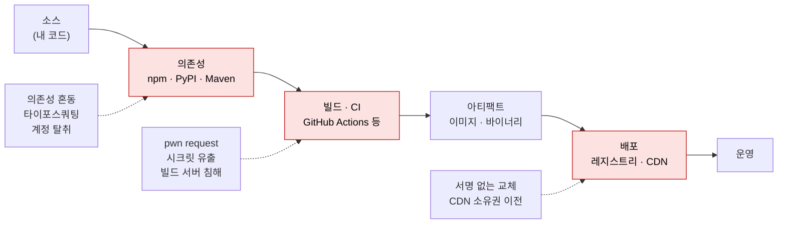

# 공급망 취약점

| 레벨 | 상태 | 최종 개정 |
|---|---|---|
| 🟡 | 🔄 개정중 | 2026-10-22 |

> **한눈에 보기**
> 내 코드가 안전해도 의존성 하나, 빌드 서버 하나, CI 설정 한 줄이 뚫리면 끝이다. 공급망에서는 신뢰 경계가 **조직 밖**에 있다.
> 공격자는 패키지 이름을 선점하고, 유지보수자 계정을 탈취하고, 빌드 파이프라인에 코드를 심어 수천 조직에 한 번에 들어간다.
> 막는 핵심은 **"무엇이 들어왔는가"를 기록(SBOM)하고, "누가 만들었는가"를 증명(서명·출처 증명)하며, 빌드 환경에 최소 권한을 주는 것**이다.

## 1. 신뢰 경계가 조직 밖에 있다



<figure>
<figcaption>그림 1. 공급망의 각 단계와 그 단계를 노리는 공격. 붉은 단계는 조직이 직접 통제하지 않는 것이 섞이는 곳이다.</figcaption>
</figure>

공급망 문제는 성격이 다른 세 종류를 한 이름으로 부른다. 대응도 다르다.

| 종류 | 예 | 결함의 위치 | 대응 |
|---|---|---|---|
| **취약한 의존성** | Log4Shell | 의존성 코드의 실수 | SBOM으로 영향 범위 즉시 파악, 패치 |
| **악의적 의존성** | event-stream, ua-parser-js, xz | 의도적으로 심은 코드 | 설치 전 탐지, 설치 스크립트 차단, 핀 고정 |
| **빌드·배포 침해** | SolarWinds, Codecov, tj-actions, polyfill.io | 빌드 환경 또는 배포 채널 | 파이프라인 최소 권한, 서명·출처 증명, 해시 검증 |

[기초 1장](../part1-foundations/01-what-is-vulnerability.md)의 분류로 말하면 첫 번째는 보통의 취약점이고, 나머지 둘은 "과정"의 취약점이다. 이 장은 뒤의 둘에 집중한다. 센터 업무에서는 이 영역이 디지털위협예방본부와 가장 자주 겹친다.

## 2. 의존성 혼동 (dependency confusion)

### 2.1 원리

2021년 2월 Alex Birsan이 공개한 기법이다. 📎 [원문](https://medium.com/@alex.birsan/dependency-confusion-4a5d60fec610) 회사 내부 패키지 이름(`acme-auth-utils`)이 공개 코드, `package.json`, 에러 메시지에 노출된다. 공격자가 **같은 이름**을 공개 레지스트리(npm, PyPI)에 더 높은 버전으로 올린다. 사내 빌드가 공개 레지스트리와 사설 레지스트리를 함께 보도록 설정돼 있으면 패키지 관리자는 "더 높은 버전"을 고른다. 설치 스크립트가 빌드 서버에서 실행된다. Birsan은 이 방법으로 Apple, Microsoft, PayPal 등 35개 조직의 내부 빌드에 코드를 실행시켰고 13만 달러 이상의 포상금을 받았다(원문 기준).

```ini
# ❌ 취약: pip.conf. extra-index-url은 "추가"지 "우선"이 아니다. 두 인덱스를 모두 보고 높은 버전을 고른다
[global]
extra-index-url = https://pypi.internal.corp/simple
```

```ini
# ✅ 안전: 사설 미러만 본다. 미러가 공개 패키지를 프록시하되, 내부 이름은 공개로 넘기지 않게 설정
[global]
index-url = https://pypi.internal.corp/simple
```

npm은 스코프(`@acme/auth-utils`)를 쓰고 스코프를 조직이 공개 레지스트리에 등록해 두면 같은 이름 충돌이 원천적으로 없다. 그래도 사설 레지스트리의 "없으면 공개로 폴백" 설정은 꺼야 한다.

### 2.2 점검 방법

1. 조직의 공개 저장소·배포된 JS 번들·에러 로그에서 내부 패키지 이름을 수집한다.
2. 각 이름을 공개 레지스트리에서 조회한다. 없으면 **혼동 가능**, 있는데 조직 것이 아니면 **이미 선점됨**이다.
3. 빌드 설정(`.npmrc`, `pip.conf`, `settings.xml`, `NuGet.config`)에서 다중 인덱스 여부를 본다.

점검자는 공개 레지스트리에 패키지를 올리지 않는다. 올리는 순간 그 이름을 쓰는 **모든 조직**의 빌드에 영향을 주며, 이는 허가 범위를 넘는다. 이름이 비어 있다는 사실만 보고한다.

## 3. 타이포스쿼팅과 악성 패키지 탐지

### 3.1 공격 형태

| 형태 | 예 | 실행 시점 |
|---|---|---|
| 타이포스쿼팅 | `requests` → `reqeusts`, `python-dateutil` → `python3-dateutil` | 설치 |
| 유지보수자 계정 탈취 | ua-parser-js (2021) | 설치 (`preinstall`) |
| 유지보수권 사회공학 | event-stream (2018), xz (2024) | 런타임, 특정 조건 |
| 의존성 추가 | 정상 패키지가 악성 패키지를 의존성으로 추가 | 설치 |
| 저장소·도메인 소유권 이전 | polyfill.io (2024) | 런타임 (브라우저) |

설치 시 실행되는 것이 핵심이다. npm의 `preinstall`/`postinstall`, Python의 `setup.py`는 `npm install`·`pip install`만으로 임의 코드를 돌린다. 패키지를 import하지 않아도 이미 늦다.

### 3.2 탐지 휴리스틱

악성 패키지는 공통된 흔적을 남긴다.

- `package.json`의 `scripts.preinstall`/`postinstall`에 `curl | sh`, `node -e`, base64 디코드
- `setup.py`에 네트워크 호출, `os.system`, `exec(base64.b64decode(...))`
- 소스에 난독화된 긴 문자열, 환경변수(`AWS_SECRET_ACCESS_KEY`, `NPM_TOKEN`) 수집, 외부 도메인으로 POST
- 메타데이터: 최근 유지보수자 변경, 오래 조용하던 패키지의 갑작스러운 릴리스, 저장소 URL과 실제 코드 불일치
- 버전 간 diff에 기능과 무관한 파일 추가 (event-stream은 테스트 픽스처로 위장했다)

```bash
# 설치 스크립트를 끄고 받은 뒤 내용을 먼저 본다
npm install --ignore-scripts
npm pack some-package && tar tzf some-package-*.tgz        # 포함 파일 목록
npm diff --diff=some-package@1.2.0 --diff=some-package@1.2.1   # 버전 간 변경

# DataDog GuardDog: Semgrep 룰 + 메타데이터 휴리스틱
pip install guarddog
guarddog pypi scan requests
guarddog npm scan express
guarddog pypi verify requirements.txt        # 요구 파일의 모든 패키지
```

알려진 취약점은 **OSV-Scanner**(`osv-scanner --lockfile package-lock.json`)나 `npm audit`·`pip-audit`로, 프로젝트의 보안 관행은 **OpenSSF Scorecard**로 본다. 둘 다 "악의"는 못 잡는다. 악의는 설치 스크립트 차단, 락파일 해시 고정, 그리고 새 의존성 추가 시 사람의 검토로 막는다.

## 4. CI 파이프라인 취약점

### 4.1 pwn request: `pull_request_target`

GitHub Actions에서 `pull_request` 이벤트는 포크에서 온 PR에 시크릿을 주지 않는다. `pull_request_target`은 **기본 브랜치의 워크플로**를 **시크릿과 쓰기 토큰을 가진 채** 실행한다. 설계상 안전하다. 문제는 그 워크플로가 PR의 코드를 체크아웃해서 실행할 때 생긴다. 2021년 GitHub Security Lab이 "pwn request"라고 이름 붙였다. 📎 [원문](https://securitylab.github.com/research/github-actions-preventing-pwn-requests)

```yaml
# ❌ 취약: PR 코드를 체크아웃하고 그 안의 스크립트를 시크릿과 함께 실행
on: pull_request_target
jobs:
  build:
    runs-on: ubuntu-latest
    steps:
      - uses: actions/checkout@v4
        with:
          ref: ${{ github.event.pull_request.head.sha }}   # 공격자의 커밋
      - run: npm install && npm test                        # package.json의 postinstall이 실행된다
        env:
          NPM_TOKEN: ${{ secrets.NPM_TOKEN }}
```

```yaml
# ✅ 안전: 신뢰할 수 없는 코드는 pull_request 로 시크릿 없이. 시크릿이 필요한 작업은 분리
on: pull_request
permissions:
  contents: read
jobs:
  test:
    runs-on: ubuntu-latest
    steps:
      - uses: actions/checkout@v4
      - run: npm ci --ignore-scripts && npm test
```

같은 원리의 변형이 많다. `issue_comment`로 트리거해 코멘트 내용을 셸에 넣는 것(`run: echo ${{ github.event.comment.body }}` → 명령 인젝션), 자체 호스팅 러너를 공개 저장소에 붙이는 것(러너가 곧 사내 서버), `GITHUB_TOKEN`에 기본 `write-all` 권한을 두는 것이다.

### 4.2 변경 가능한 참조 (mutable reference)

`uses: some-org/some-action@v4`의 `v4`는 **태그**이고, 태그는 옮길 수 있다. 2025년 3월 tj-actions/changed-files 사건에서 공격자는 봇 계정의 토큰으로 v1~v45.0.7 **모든 태그**를 악성 커밋으로 옮겼고, 이 액션을 쓰는 23,000여 저장소의 워크플로가 러너 메모리의 시크릿을 로그에 찍었다. 📎 [CISA 경보](https://www.cisa.gov/news-events/alerts/2025/03/18/supply-chain-compromise-third-party-github-action-cve-2025-30066)

```yaml
# ✅ 커밋 SHA로 고정하고, 주석으로 사람이 읽을 버전을 남긴다
- uses: tj-actions/changed-files@<40자리 커밋 SHA>  # v46.0.1 — 릴리스 페이지에서 복사한다
```

Docker 이미지의 `latest`, Terraform 모듈의 브랜치 참조, `pip install` 의 버전 미지정도 같은 문제다. **재현 가능한 빌드는 모든 입력이 해시로 고정된 빌드**다.

### 4.3 시크릿 노출

빌드 로그, 아티팩트, 캐시, 에러 덤프에 시크릿이 남는다. Codecov 사건(2021)은 업로더 스크립트 한 줄이 CI 환경변수 전체를 외부로 보냈고, 그 환경변수에는 고객들의 다른 서비스 토큰이 들어 있었다. 📎 [Codecov 공지](https://about.codecov.io/security-update/) 점검 시 보는 것은 (1) 워크플로에 장기 자격증명이 있는가(OIDC로 단기 토큰을 받는 대신), (2) 시크릿이 필요 없는 잡에도 노출되는가, (3) 외부 스크립트를 `curl | bash`로 받는가, (4) 로그에 `::add-mask::` 없이 값이 찍히는가다.

## 5. SBOM

**SBOM**(Software Bill of Materials)은 "이 소프트웨어에 무엇이 들어 있는가"의 목록이다. 2021년 12월 Log4Shell 때 대부분의 조직이 며칠 동안 답하지 못한 질문, "우리 어디에 log4j-core 2.x가 있나"에 즉시 답하기 위한 것이다. [워크스루 1장 Log4Shell 워크스루](../part7-walkthroughs/01-cve-2021-44228-log4shell.md)

| 표준 | 주관 | 상태 |
|---|---|---|
| **SPDX** | Linux Foundation | ISO/IEC 5962:2021 (v2.2.1). SPDX 3.0은 2024-04 공개, 보안·AI·빌드 프로파일 추가 📎 [발표](https://www.linuxfoundation.org/press/spdx-3-revolutionizes-software-management-in-systems-with-enhanced-functionality-and-streamlined-use-cases) |
| **CycloneDX** | OWASP | ECMA-424 (1판 2024-06, v1.6 기준). 취약점(VEX)·암호(CBOM)·AI 모델 등 확장 📎 [ECMA-424](https://ecma-international.org/publications-and-standards/standards/ecma-424/) |

둘 다 JSON으로 생성하고 도구가 상호 변환한다. 형식 선택보다 **생성 시점**(빌드 시 자동)과 **보관**(아티팩트와 함께)이 중요하다.

```bash
# 생성
syft dir:. -o spdx-json > sbom.spdx.json
trivy fs --format cyclonedx --output sbom.cdx.json .
trivy image --format cyclonedx --output image.cdx.json myapp:1.0

# 활용: SBOM만으로 취약점 대조 (소스나 이미지 없이)
trivy sbom sbom.cdx.json
grep -i "log4j-core" sbom.cdx.json
```

점검 보고서에 "SBOM 없음"은 그 자체로 발견 사항이다. 취약점이 공개됐을 때 영향 범위 파악 시간이 곧 노출 시간이다.

## 6. 서명과 출처 증명: Sigstore, SLSA

### 6.1 Sigstore / cosign

SBOM이 "무엇"이라면 서명은 "누가, 어디서 만들었는가"다. Sigstore는 장기 키 없이 **OIDC 신원**(GitHub Actions 워크플로, 이메일)으로 짧은 수명의 인증서를 받아 서명하고, 서명 사실을 투명성 로그(Rekor)에 남긴다.

```bash
# CI에서 keyless 서명 (GitHub Actions의 OIDC 토큰 사용). 태그가 아니라 다이제스트에 서명한다
cosign sign --yes ghcr.io/acme/app@sha256:0a1b...

# 소비자 쪽 검증: "acme/app 저장소의 release 워크플로가 서명했는가"
cosign verify \
  --certificate-identity=https://github.com/acme/app/.github/workflows/release.yml@refs/tags/v1.2.0 \
  --certificate-oidc-issuer=https://token.actions.githubusercontent.com \
  ghcr.io/acme/app@sha256:0a1b...
```

`--certificate-identity`를 정규식으로 느슨하게 잡으면(`--certificate-identity-regexp='.*'`) 검증이 무의미해진다. 누구의 서명이든 통과하기 때문이다. npm은 `npm publish --provenance`로 같은 구조의 출처 증명을 붙이고, 레지스트리 페이지에 빌드한 워크플로가 표시된다.

### 6.2 SLSA

**SLSA**(Supply-chain Levels for Software Artifacts) v1.0은 빌드 트랙의 네 수준을 정의한다. 📎 [slsa.dev](https://slsa.dev/spec/v1.0/levels)

| 수준 | 요구 | 막는 것 |
|---|---|---|
| Build L0 | 없음 | — |
| Build L1 | 출처 증명(provenance) 존재. 서명 불필요 | 실수, 문서화 |
| Build L2 | 호스팅된 빌드 플랫폼이 provenance를 생성·서명 | 빌드 **후** 변조 |
| Build L3 | 강화된 빌드 플랫폼. 빌드가 자기 provenance를 위조하거나 다른 빌드의 키에 닿을 수 없음 | 빌드 **중** 변조 (SolarWinds 유형) |

SolarWinds는 빌드 서버에 상주한 악성코드가 컴파일 직전에 소스를 바꿨다. 소스 저장소는 깨끗했고 서명도 유효했다. 이것을 막는 것이 L3의 격리 요구다. 점검에서 SLSA는 "달성 여부"보다 **어느 단계가 비어 있는가**를 설명하는 어휘로 쓴다.

## 7. 실제 사례

| 사례 | 유형 | 핵심 | 출처 |
|---|---|---|---|
| **event-stream** (2018-11) | 유지보수권 사회공학 | 새 유지보수자가 `flatmap-stream@0.1.1`을 의존성으로 추가. 암호화된 페이로드가 Copay 비트코인 지갑 빌드에서만 복호화돼 지갑 키 탈취. 약 2개월 미탐지 | [npm 공식 사후 분석](https://blog.npmjs.org/post/180565383195/details-about-the-event-stream-incident) |
| **SolarWinds SUNBURST** (2020-12) | 빌드 환경 침해 | Orion 빌드 과정에 백도어 삽입, 정상 서명으로 배포. 2019.4 HF5~2020.2.1 영향, 최대 18,000 고객에 배포 📎 | [SolarWinds 권고](https://www.solarwinds.com/sa-overview/securityadvisory) |
| **Codecov Bash Uploader** (2021-04) | 배포 스크립트 변조 | Docker 이미지 빌드 오류로 노출된 GCS 키로 업로더 스크립트 수정. CI 환경변수 전체를 외부 전송. 2021-01-31부터 약 2.5개월 | [Codecov 공지](https://about.codecov.io/security-update/) |
| **ua-parser-js** (2021-10) | 계정 탈취 | 0.7.29 / 0.8.0 / 1.0.0에 `preinstall`로 XMRig 채굴기 + 정보 탈취기. 주간 수백만 다운로드 패키지. 수 시간 내 0.7.30 등으로 교체 | [GitHub 이슈 #536](https://github.com/faisalman/ua-parser-js/issues/536) · [CERT-EU](https://www.cert.europa.eu/publications/security-advisories/2021-057/) |
| **Log4Shell** [CVE-2021-44228](https://nvd.nist.gov/vuln/detail/CVE-2021-44228) (2021-12) | 취약한 의존성 | 악의 없는 결함. 문제는 "어디 있는지 모른다"였다. SBOM 필요성의 결정적 사례 | [7부 워크스루](../part7-walkthroughs/01-cve-2021-44228-log4shell.md) · [Apache 권고](https://logging.apache.org/log4j/2.x/security.html) |
| **xz-utils** [CVE-2024-3094](https://nvd.nist.gov/vuln/detail/CVE-2024-3094) (2024-03) | 유지보수권 사회공학 + 빌드 스크립트 | 2년간 신뢰를 쌓은 기여자가 배포 tarball의 빌드 스크립트로 sshd 백도어 삽입. Andres Freund가 성능 이상으로 발견 | [7부 워크스루](../part7-walkthroughs/05-cve-2024-3094-xz-backdoor.md) · [최초 공개](https://www.openwall.com/lists/oss-security/2024/03/29/4) |
| **polyfill.io** (2024-06) | 도메인 소유권 이전 | 2024-02 중국 업체 Funnull이 도메인·GitHub 계정 인수 후 스크립트에 모바일 사용자 리다이렉트 삽입. 10만 개 이상 사이트가 참조 📎. 원작자는 "애초에 쓰지 말라" 권고 | [Sansec 분석](https://sansec.io/research/polyfill-supply-chain-attack) |
| **tj-actions/changed-files** [CVE-2025-30066](https://nvd.nist.gov/vuln/detail/CVE-2025-30066) (2025-03) | CI 액션 태그 변조 | 봇 PAT 탈취 → 전 태그를 악성 커밋으로 이동 → 워크플로 로그에 시크릿 출력. 23,000여 저장소 사용 📎. CISA KEV 등재 | [CISA 경보](https://www.cisa.gov/news-events/alerts/2025/03/18/supply-chain-compromise-third-party-github-action-cve-2025-30066) |

**공통 교훈**: 여덟 사례 중 코드 취약점은 Log4Shell 하나다. 나머지는 **신뢰 관계**(유지보수자, 빌드 서버, 도메인, 태그)가 뚫렸다. 취약점 분석가가 익숙한 "코드를 읽고 결함을 찾는" 방법으로는 안 보인다. 대신 "이 아티팩트가 이 소스에서 이 환경을 거쳐 나왔다는 것을 무엇이 보증하는가"를 묻는다. 답이 "없다"인 지점이 발견 사항이다.

## 8. 실습 🧪

- **락파일 스캔**: 자기 프로젝트(또는 아무 오픈소스)의 `package-lock.json`·`requirements.txt`에 `osv-scanner --lockfile <파일>`을 돌려 알려진 취약점을 확인하고, `trivy fs --format cyclonedx` 로 SBOM을 만들어 `trivy sbom`으로 같은 결과가 나오는지 비교한다.
- **설치 스크립트 관찰**: 빈 디렉터리에서 `npm init -y` 후 `package.json`에 `"postinstall": "env | head"`를 넣고 `npm install`과 `npm install --ignore-scripts`의 차이를 본다. 설치만으로 환경변수가 읽히는 것을 눈으로 확인하는 것이 목적이다.
- **pwn request 찾기**: [GitHubSecurityLab/pwn-request-scanner](https://github.com/GitHubSecurityLab/pwn-request-scanner)를 자기 조직 저장소에 돌려 4.1절 패턴을 찾는다. 남의 저장소에는 PR을 보내지 않는다.
- **keyless 서명**: 로컬 이미지를 ttl.sh 같은 임시 레지스트리에 올리고 `cosign sign`/`cosign verify`를 해 본다. `--certificate-identity`를 일부러 틀려 실패하는 것까지 본다.

## 체크리스트

**의존성**
- [ ] 락파일이 있고 CI가 `npm ci`/`pip install --require-hashes`처럼 락파일을 강제하는가?
- [ ] 사설 레지스트리가 내부 이름을 공개 레지스트리로 폴백하지 않는가? 내부 이름이 공개 레지스트리에 비어 있거나 선점돼 있는가?
- [ ] CI에서 설치 스크립트를 끄는가? 켜야 한다면 어느 패키지 때문인가?
- [ ] 새 의존성 추가 PR에 유지보수자·다운로드 수·설치 스크립트 검토가 있는가?

**CI**
- [ ] `pull_request_target`·`issue_comment`·`workflow_run` 트리거에서 PR 코드를 체크아웃·실행하는 워크플로가 있는가?
- [ ] 이벤트 데이터(`github.event.*`)가 `run:` 셸에 직접 들어가는가?
- [ ] 외부 액션이 커밋 SHA로 고정돼 있는가?
- [ ] `permissions:`가 잡마다 최소인가? 장기 자격증명 대신 OIDC를 쓰는가?
- [ ] 자체 호스팅 러너가 공개 저장소에 붙어 있는가?

**아티팩트**
- [ ] 빌드마다 SBOM이 생성·보관되는가? "log4j가 어디 있나"에 몇 분 안에 답할 수 있는가?
- [ ] 이미지·패키지에 서명이 있고, 배포 환경이 **검증**하는가? (서명만 있고 검증이 없는 경우가 대부분이다)
- [ ] 검증 정책의 `certificate-identity`가 특정 워크플로로 제한돼 있는가?
- [ ] 외부 CDN 스크립트(`<script src="https://cdn.../x.js">`)에 SRI(`integrity=`)가 있는가?

## 더 읽기

- Alex Birsan, *Dependency Confusion: How I Hacked Into Apple, Microsoft and Dozens of Other Companies* (2021) · [원문](https://medium.com/@alex.birsan/dependency-confusion-4a5d60fec610)
- GitHub Security Lab, *Keeping your GitHub Actions and workflows secure Part 1: Preventing pwn requests* (2021) · [원문](https://securitylab.github.com/research/github-actions-preventing-pwn-requests) · [GitHub 공식 가이드](https://docs.github.com/en/actions/reference/security/securely-using-pull_request_target)
- [SLSA 명세 v1.0](https://slsa.dev/spec/v1.0/) · 수준별 요구와 위협 모델
- [Sigstore 문서](https://docs.sigstore.dev/) · cosign 서명·검증, Fulcio·Rekor 구조
- [SPDX](https://spdx.dev/) · [CycloneDX](https://cyclonedx.org/) · SBOM 표준 원문과 도구 목록
- [OpenSSF Scorecard](https://github.com/ossf/scorecard) · 오픈소스 프로젝트의 보안 관행 점수
- [CNCF TAG Security: Catalog of Supply Chain Compromises](https://tag-security.cncf.io/community/catalog/compromises/) · 사례 목록. 7절의 확장판
- [CISA: Software Bill of Materials](https://www.cisa.gov/sbom) · 정책 배경과 최소 요소

## 변경 이력

| 날짜 | 변경 | 기여자 |
|---|---|---|
| 2026-10-21 | 초안(뼈대) 작성 | @anthonynoh5202 |
| 2026-10-22 | 본문 작성. 의존성 혼동, 악성 패키지 탐지, CI(pwn request·태그 변조·시크릿), SBOM, Sigstore·SLSA, 사례 8건 | @anthonynoh5202 |
| 2026-10-22 | 기술 검증: CVE 3건 cvelistV5·GHSA 대조(tj-actions 태그 범위·23,000 저장소·v46.0.1 일치), CNCF 카탈로그로 Codecov·ua-parser-js·polyfill 날짜·수치 확인, 도구 명령(guarddog·cosign·syft·checkov) README 대조, 확인 불가한 Daily Swig 링크 삭제, 워크플로 YAML 파싱 확인 | 검증팀 |
| 2026-10-22 | 독자 테스트 반영: 장 참조 표기를 편·부 이름 규칙으로 통일 | @anthonynoh5202 |
