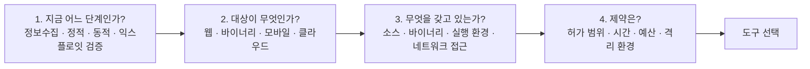
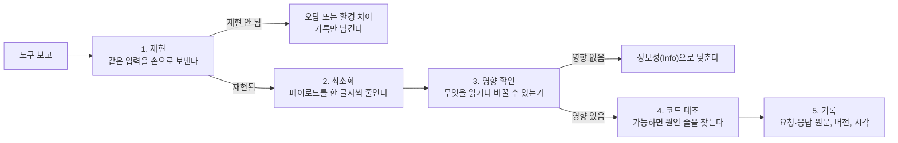

# 언제 무엇을 쓰는가

| 레벨 | 상태 | 최종 개정 |
|---|---|---|
| 🟢 입문 | 🔄 개정중 | 2026-10-22 |

> **한눈에 보기**
> 도구는 "분석 단계"와 "대상의 종류"로 고른다. 이 장의 매트릭스 한 장이 6부 전체의 지도다.
> 자동화 도구는 넓게 찾고, 사람은 깊게 본다. 도구가 못 찾는 영역(로직, 인가, 경쟁 조건)이 분석가의 몫이다.
> 도구 출력은 가설이지 결론이 아니다. 재현하기 전에는 보고서에 쓰지 않는다.

## 1. 도구를 고르는 순서

도구 이름부터 떠올리면 실패한다. 질문의 순서는 정해져 있다.

<figure>
<figcaption>그림 1. 단계와 대상이 정해지면 후보 도구는 두세 개로 줄어든다. 그 다음에야 무료·유료, 익숙함을 따진다.</figcaption>
</figure>

단계의 정의는 [2부 1장 분석 방법론 개요](../part2-methodology/01-overview.md)를 따른다. 정보 수집은 "무엇이 있는가", 정적 분석은 "코드가 무엇을 하는가", 동적 분석은 "실제로 그렇게 동작하는가", 익스플로잇 검증은 "영향이 실재하는가"를 묻는 단계다.

## 2. 단계 × 대상 매트릭스

| 단계 \ 대상 | 웹 | 바이너리 (네이티브) | 모바일 | 클라우드 · 컨테이너 |
|---|---|---|---|---|
| **정보 수집** | nmap, ffuf, httpx · subfinder, Burp의 Target 사이트맵 | `file`, `strings`, `checksec`, `readelf`/`objdump`, binwalk(펌웨어) | apktool, jadx(APK → Java), MobSF(자동 요약), `adb` | 클라우드 CLI(`aws`/`az`/`gcloud`), Prowler, ScoutSuite, Trivy(이미지·IaC) |
| **정적 분석** | Semgrep, CodeQL, grep ([5장](05-sast-semgrep-codeql.md)) | Ghidra, IDA, Binary Ninja, radare2/rizin ([2장](02-ghidra-ida.md)) | jadx + Semgrep(Java/Kotlin), MobSF, Ghidra(네이티브 라이브러리) | Checkov, Trivy `config`, Semgrep(Terraform 룰), 정책 문서 검토 |
| **동적 분석** | Burp Proxy/Repeater/Intruder, ZAP, mitmproxy ([1장](01-burp-proxy.md)), sqlmap, nuclei | gdb + pwndbg/GEF ([3장](03-debuggers.md)), AFL++, libFuzzer ([4장](04-fuzzers.md)), ASan | Frida, objection, mitmproxy(앱 트래픽), 에뮬레이터 | 실제 API 호출(CLI), 권한 열거, 컨테이너 탈출 점검 스크립트 |
| **익스플로잇 검증** | Burp Repeater + 짧은 Python 스크립트, sqlmap | pwntools, ROPgadget/ropper, gdb | Frida 스크립트, 재패키징한 APK | 최소 권한 계정으로 재현, 임시 자격증명 발급 확인 |

읽는 법은 두 가지다.

- **세로로 읽으면** 한 대상에 대한 전체 워크플로다. 웹 하나를 끝까지 보려면 1열을 위에서 아래로 따라간다.
- **가로로 읽으면** 같은 단계에서 대상이 바뀔 때 도구가 어떻게 바뀌는지 보인다. "동적 분석"의 본질은 같다. 입력을 넣고 반응을 본다. 도구만 다르다.

> 🟡 모바일과 클라우드는 별도 장이 없다. [5부 1장 모바일](../part5-extended/01-mobile.md)과 [5부 2장 클라우드](../part5-extended/02-cloud.md)가 대상별 관점을 다루고, 도구 자체는 이 매트릭스와 6부 1~5장의 설명으로 충분하다. Frida는 [3장](03-debuggers.md)에서, 앱 트래픽 가로채기는 [1장](01-burp-proxy.md)에서 다룬다.

### 2.1 칸마다 하나만 고른다면

| 상황 | 첫 번째 도구 | 이유 |
|---|---|---|
| 웹 앱, 소스 없음 | Burp Suite (Community면 충분) | 요청을 보고, 바꾸고, 반복하는 일이 웹 분석의 대부분이다 |
| 웹 앱, 소스 있음 | Semgrep → 수동 리뷰 → 필요하면 CodeQL | 싱크부터 거꾸로 추적하는 데 빠르다 |
| 리눅스 바이너리, 소스 없음 | Ghidra + gdb(pwndbg) | 둘 다 무료이고 서로 보완한다 |
| 리눅스 바이너리, 소스 있음 | AFL++ 또는 libFuzzer + ASan | 사람이 못 떠올리는 입력을 기계가 넣는다 |
| Android 앱 | jadx → Frida | 정적으로 읽고, 동적으로 후킹한다 |
| 클라우드 계정 | Prowler 또는 ScoutSuite | 설정 오류 점검은 자동화가 잘 맞는 영역이다 |

## 3. 자동화 도구가 못 찾는 것

스캐너는 "입력 → 응답"에서 **판정 기준(oracle)** 이 기계적으로 정의되는 것만 찾는다. 따옴표를 넣었더니 DB 오류가 났다, 페이로드가 응답에 그대로 반사됐다, 같은 것이다. 다음은 판정 기준이 "이 앱의 의도"에 달려 있어서 도구가 못 찾는다.

| 영역 | 왜 못 찾는가 | 사람이 하는 일 |
|---|---|---|
| **비즈니스 로직** | 할인 쿠폰을 두 번 쓰는 것이 버그인지 기능인지 도구는 모른다 | 기능 명세와 실제 동작을 대조한다 |
| **인가(authorization)** | 다른 사용자의 주문 `id=1002`가 보이는 것이 "정상 공유"인지 IDOR인지 모른다 | 두 계정으로 같은 요청을 보내 비교한다. [3부 5장](../part3-web/05-access-control.md) |
| **경쟁 조건(race condition)** | 시간 창이 수십 ms이고, 요청 하나로는 재현되지 않는다 | 동시 요청을 보내는 스크립트를 짠다. [3부 10장](../part3-web/10-race-condition.md) |
| **다단계 흐름** | 결제 2단계를 건너뛰고 3단계로 가는 것은 "정상 요청"으로 보인다 | 상태 전이를 그리고 각 전이를 건너뛰어 본다 |
| **암호 사용 오류** | 자체 구현한 토큰이 예측 가능한지는 코드를 읽어야 안다 | 토큰 생성 코드를 찾아 엔트로피 원천을 확인한다 |
| **2차(second-order) 인젝션** | 저장 시점과 실행 시점이 다른 요청에 있다 | 저장된 값이 어디서 다시 쓰이는지 코드로 추적한다 |
| **정보의 맥락** | 공개 API가 반환하는 `email`이 유출인지 사양인지 모른다 | 데이터 분류 기준을 확인한다 |

결론은 단순하다. **도구로 넓게 걸러내고, 남은 시간을 이 표의 영역에 쓴다.** 스캐너 결과를 정리하느라 시간을 다 쓰면 정작 심각한 것을 놓친다.

## 4. 도구 출력을 믿지 않는 법

도구의 보고는 "의심 지점"이다. 보고서에 올리려면 다음 절차를 거친다.

<figure>
<figcaption>그림 2. 오탐 검증 절차. 2단계 최소화가 핵심이다. 최소 페이로드가 남아야 원인을 특정할 수 있고, 개발자가 고칠 수 있다.</figcaption>
</figure>

도구 종류별로 자주 나오는 오탐 패턴을 알아 두면 2단계에서 시간을 아낀다.

| 도구 종류 | 흔한 오탐 | 확인 방법 |
|---|---|---|
| SAST (Semgrep, CodeQL) | 도달 불가능한 코드, 테스트 코드, 이미 검증된 경로의 싱크 | 소스에서 싱크까지 경로를 직접 따라간다. 중간 검증이 **그 위치에서 유효한지** 본다 |
| DAST (ZAP, nuclei, Burp Scanner) | 페이로드가 응답에 반사됐지만 실행되지 않음(인코딩됨), 시간 기반 판정이 네트워크 지연과 겹침 | 브라우저에서 실제 실행 여부 확인, 시간 지연은 3회 이상 반복 측정 |
| 퍼저 (AFL++, libFuzzer) | 하네스 자체의 버그, 타임아웃을 크래시로 분류, 메모리 한도 초과 | 계측 없는 바이너리와 ASan 바이너리 양쪽에서 재현 |
| SCA (의존성 스캐너) | 취약한 버전이지만 취약 함수를 호출하지 않음 | 취약 함수가 호출 그래프에 있는지 확인 |
| 설정 스캐너 (Prowler 등) | 정책상 의도된 공개 설정 | 자산 소유자에게 의도를 확인하고 기록 |

> 🟢 **"재현 안 됨"도 기록한다.** 같은 도구를 다음 분기에 다시 돌리면 같은 의심 지점이 또 나온다. 한 번 판정한 오탐은 사유와 함께 남겨야 두 번 일하지 않는다. [8부 1장 보고서 구조](../part8-reporting/01-report-structure.md)의 "검토했으나 제외한 항목" 절이 그 자리다.

## 5. 무료와 유료의 선택 기준

이 책의 실습은 전부 무료 도구로 할 수 있다. 유료가 값을 하는 지점은 분명히 정해져 있다.

| 도구 | 무료로 충분한 경우 | 유료가 값을 하는 경우 |
|---|---|---|
| Burp Suite | 수동 분석, 실습, 소규모 점검 (Community) | 자동 스캔, Collaborator(외부 상호작용 탐지), 프로젝트 저장이 필요한 반복 점검 (Professional). 차이는 [1장 5절](01-burp-proxy.md) |
| Ghidra / IDA | Ghidra는 전 기능 무료. 대부분의 분석에 충분 | IDA Pro는 지원 아키텍처, 로컬 디컴파일러, 디버거 연동, 팀의 기존 자산(IDB, 플러그인)이 있을 때. 차이는 [2장 6절](02-ghidra-ida.md) |
| Semgrep | 자체 룰, 레지스트리 룰로 단일 파일·단일 함수 범위 분석 (Community Edition) | 파일 간·함수 간 taint 추적, 플랫폼의 분류 관리 (유료 플랫폼) |
| CodeQL | 오픈소스 프로젝트와 학술 연구는 무료 | 사내 비공개 코드에 쓰려면 GitHub의 상용 라이선스(GitHub Advanced Security)가 필요하다 |
| 퍼저 | AFL++, libFuzzer 모두 무료. 유료 대안이 사실상 없다 | 상용은 퍼징 **인프라**(분산 실행, 크래시 분류 대시보드)를 판다 |
| 디버거 | gdb, WinDbg, Frida 모두 무료 | 해당 없음 |

판단 기준 세 가지.

1. **병목이 사람인가 도구인가.** 분석가가 결과를 검토할 시간이 없는데 스캐너를 더 사는 것은 낭비다.
2. **반복되는가.** 같은 대상을 분기마다 점검한다면 프로젝트 저장·비교 기능이 시간을 산다.
3. **라이선스 범위.** 무료 버전은 "비상업용"인 경우가 많다. 기관 업무에 쓰기 전에 라이선스 문구를 읽는다.

## 6. 6부의 지도

| 장 | 도구 | 이 장을 펴는 때 |
|---|---|---|
| [1장 Burp Suite와 웹 프록시](01-burp-proxy.md) | Burp, ZAP, mitmproxy, Caido | 브라우저와 서버 사이의 요청을 보고 바꿔야 할 때 |
| [2장 Ghidra와 IDA](02-ghidra-ida.md) | Ghidra, IDA, Binary Ninja, radare2/rizin | 소스 없는 바이너리를 읽어야 할 때 |
| [3장 디버거](03-debuggers.md) | gdb + pwndbg/GEF, WinDbg, Frida | 특정 입력에서 메모리·레지스터·함수 호출을 직접 봐야 할 때 |
| [4장 퍼저](04-fuzzers.md) | AFL++, libFuzzer, boofuzz, AFLNet | 입력 공간이 넓어 사람이 다 못 넣을 때 |
| [5장 정적 분석기](05-sast-semgrep-codeql.md) | Semgrep, CodeQL | 소스가 있고, 특정 패턴이나 데이터 흐름을 코드베이스 전체에서 찾을 때 |

각 장의 구성은 같다. **"언제 쓰는가"를 먼저**, 그 다음 **핵심 워크플로 하나를 끝까지**, 마지막으로 옵션과 대안이다. 명령과 플래그는 2024~2026년 버전 기준이며, 도구가 크게 바뀌면 해당 장을 🔄 개정중으로 돌린다.

## 체크리스트

도구를 켜기 전에 답한다.

- [ ] 지금 어느 단계인가? (정보수집 / 정적 / 동적 / 익스플로잇 검증)
- [ ] 대상이 무엇이고, 소스·바이너리·실행 환경 중 무엇을 갖고 있는가?
- [ ] 허가 범위 안에서만 동작하도록 스코프(대상 호스트·경로)를 도구에 설정했는가?
- [ ] 도구 결과를 재현·최소화·영향 확인 없이 보고서에 옮기지 않았는가?
- [ ] 자동화가 못 찾는 영역(로직, 인가, 경쟁 조건)에 시간을 남겨 두었는가?
- [ ] 무료 버전의 라이선스가 기관 업무 사용을 허용하는가?

## 더 읽기

- [OWASP Web Security Testing Guide](https://owasp.org/www-project-web-security-testing-guide/) · 웹 점검 단계별 절차. 이 장의 "웹" 열을 더 깊게 다룬다
- [OWASP Mobile Application Security (MASTG)](https://mas.owasp.org/MASTG/) · 모바일 열의 표준 참고서
- [NIST SP 800-115, Technical Guide to Information Security Testing and Assessment](https://csrc.nist.gov/pubs/sp/800/115/final) · 점검 단계의 공식 정의
- [AFL++ 문서: fuzzing_in_depth](https://github.com/AFLplusplus/AFLplusplus/blob/stable/docs/fuzzing_in_depth.md) · "퍼저는 하네스가 전부"라는 관점의 원전
- [Semgrep Community Edition README](https://github.com/semgrep/semgrep#readme) · 단일 파일·단일 함수 범위라는 한계를 벤더가 직접 밝힌 문서

## 변경 이력

| 날짜 | 변경 | 기여자 |
|---|---|---|
| 2026-10-21 | 초안(뼈대) 작성 | @anthonynoh5202 |
| 2026-10-22 | 매트릭스, 오탐 검증 절차, 무료·유료 기준, 6부 지도 작성 | @anthonynoh5202 |
