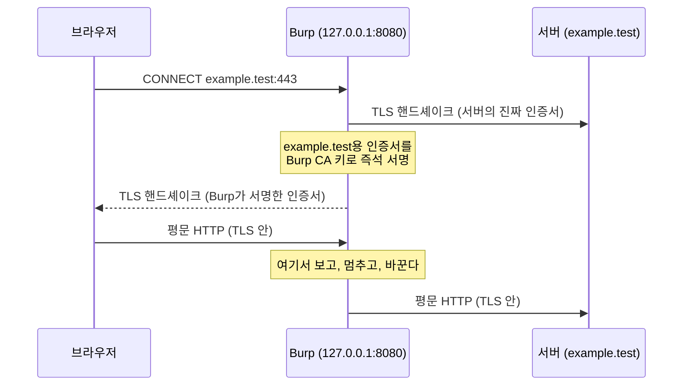

# Burp Suite와 웹 프록시

| 레벨 | 상태 | 최종 개정 |
|---|---|---|
| 🟢 입문 | 🔄 개정중 | 2026-10-22 |

> **한눈에 보기**
> 웹 분석의 대부분은 프록시 안에서 일어난다. 요청을 **가로채고, 바꾸고, 반복하는** 세 동작을 손에 익힌다.
> HTTPS는 프록시가 두 개의 TLS 연결을 따로 맺고 중간에서 평문을 보는 방식으로 가로챈다. 그래서 브라우저에 프록시의 CA 인증서를 설치해야 한다.
> Burp Suite Community로 이 책의 모든 실습을 할 수 있다. ZAP, mitmproxy, Caido는 같은 일을 다른 방식으로 한다.

## 1. 언제 쓰는가

브라우저는 요청을 숨긴다. 폼 하나를 제출하면 쿠키, 숨은 필드, JSON 본문, 헤더가 함께 나가지만 화면에는 보이지 않는다. 가로채기 프록시(intercepting proxy)는 브라우저와 서버 사이에 앉아 모든 요청·응답을 보여 주고, 멈춰 세워 고치게 해 준다.

프록시를 켜야 하는 순간은 세 가지다.

| 순간 | 쓰는 기능 | 이유 |
|---|---|---|
| 앱이 어떤 요청을 보내는지 모를 때 | Proxy (HTTP history) | 공격 표면 목록이 여기서 나온다. [기초 3장](../part1-foundations/03-attack-surface.md) |
| 요청 하나를 조금씩 바꿔 가며 반응을 볼 때 | Repeater | 브라우저로는 헤더·쿠키·숨은 필드를 못 바꾼다 |
| 같은 요청을 수십~수천 번 변형해 보낼 때 | Intruder | 컬럼 수 찾기, 파라미터 퍼징, ID 열거 |

반대로 프록시가 **필요 없는** 일도 있다. 단순한 GET 요청 반복은 `curl`이 빠르고, 복잡한 다단계 로직은 Python `requests` 스크립트가 낫다. 프록시는 "눈으로 보며 탐색하는 단계"의 도구다.

## 2. HTTPS를 가로채는 원리



<figure>
<figcaption>그림 1. 프록시는 TLS 연결을 두 개로 쪼갠다. 브라우저가 Burp의 CA를 신뢰하지 않으면 왼쪽 핸드셰이크에서 인증서 경고가 난다.</figcaption>
</figure>

이 구조에서 두 가지가 따라 나온다.

- **CA 인증서를 브라우저에 설치해야 한다.** 설치하지 않으면 모든 HTTPS 사이트에서 경고가 뜨거나 연결이 거부된다.
- **인증서 피닝(certificate pinning)을 한 앱은 가로채지 못한다.** 앱이 "이 서버의 인증서는 이 지문이어야 한다"고 박아 두면 Burp가 서명한 인증서를 거부한다. 모바일 앱에서 자주 만나며, 해법(Frida로 피닝 함수 후킹)은 [3장 8절](03-debuggers.md)과 [확장 1장](../part5-extended/01-mobile.md)에서 다룬다.

## 3. 설치와 인증서

1. [PortSwigger 다운로드 페이지](https://portswigger.net/burp/communitydownload)에서 Community Edition을 받는다. Java가 포함된 설치본을 받으면 따로 JDK를 설치할 필요가 없다.
2. 처음 실행하면 Temporary project로 시작한다. Community Edition은 프로젝트를 디스크에 저장하지 못하므로, 중요한 요청은 Repeater 탭에 남겨 두거나 Logger 출력을 따로 저장한다.
3. 기본 리스너는 `127.0.0.1:8080`이다. Proxy 탭의 Proxy settings에서 확인한다.

**가장 쉬운 길은 Burp 내장 브라우저다.** Proxy 탭의 "Open browser"를 누르면 프록시와 인증서가 이미 설정된 Chromium이 뜬다. 실습은 이것으로 충분하다.

외부 브라우저를 쓰려면 두 단계가 더 필요하다.

1. 브라우저의 프록시를 `127.0.0.1:8080`으로 설정한다. Firefox는 자체 네트워크 설정에서, Chrome은 운영체제 프록시 설정을 따른다.
2. 프록시가 설정된 브라우저로 `http://burpsuite` 에 접속해 "CA Certificate"를 눌러 `cacert.der`를 받는다. Firefox는 설정 → 개인 정보 및 보안 → 인증서 보기 → 인증 기관 → 가져오기에서 "웹 사이트 식별" 신뢰를 켜고 가져온다. Chrome과 Edge는 운영체제의 신뢰 저장소에 설치한다.

> 🟡 **로컬호스트 실습 환경이 프록시를 타지 않을 때.** 최신 브라우저는 `localhost` 요청을 프록시로 보내지 않는다. Firefox는 `about:config`에서 `network.proxy.allow_hijacking_localhost`를 `true`로, Chrome 계열은 실행 인자 `--proxy-bypass-list=<-loopback>`을 준다. Burp 내장 브라우저는 이 설정이 이미 되어 있다.

## 4. 핵심 워크플로: 실습 앱의 검색 기능을 끝까지

대상은 [웹 1장](../part3-web/01-sql-injection.md)의 실습 환경 `labs/web-sqli`(`http://localhost:8080`)다. 목표는 검색 파라미터 `q`에 SQL 인젝션이 있는지 Burp만으로 확인하고, UNION에 필요한 컬럼 수를 찾는 것이다.

### 4.1 스코프를 먼저 정한다

Target 탭 → Scope settings에서 `http://localhost:8080`을 Include에 추가한다. 그리고 Proxy settings의 "Intercept client requests"에서 **"And URL Is in target scope"** 조건을 켠다. 이제 스코프 밖 요청(브라우저 업데이트 확인, 분석 트래픽)은 인터셉트에 걸리지 않고 HTTP history도 깨끗해진다.

> 🔴 스코프는 편의 기능이 아니라 **안전장치**다. 실제 점검에서 스코프 밖 호스트로 Intruder를 돌리면 허가 범위를 넘는다. [기초 4장](../part1-foundations/04-ethics-and-law.md)

### 4.2 탐색은 Intercept를 끄고

Proxy → Intercept를 "off"로 두고 내장 브라우저로 앱을 한 바퀴 돈다. 로그인, 검색, 상품 보기를 한 번씩 한다. Proxy → HTTP history에 요청 목록이 쌓인다. 여기서 파라미터를 받는 요청만 골라낸다. `/search?q=`, `/login`(POST), `/item?id=` 세 개가 보인다.

### 4.3 Repeater로 가설을 세운다

HTTP history에서 `GET /search?q=Ghidra` 행을 우클릭 → "Send to Repeater"(단축키 Ctrl+R). Repeater 탭에서 `q`의 값을 바꿔 가며 Send를 누른다.

| 보낸 값 | 응답 | 해석 |
|---|---|---|
| `Ghidra` | 200, 결과 1건 | 기준선 |
| `Ghidra'` | 500, SQL 오류 문구 | 따옴표가 쿼리에 닿는다 |
| `Ghidra''` | 200, 결과 1건 | 따옴표 두 개로 문자열이 닫힌다. 문자열 컨텍스트 확정 |
| `Ghidra' ORDER BY 1-- ` | 200 | 컬럼 수 탐색 시작 |

Repeater의 값은 URL 인코딩이 필요하다. 공백과 `#`, `&`가 들어가면 Decoder 탭에 붙여 넣고 "Encode as → URL"로 바꾸거나, Repeater 요청 편집기에서 값을 선택해 Ctrl+U를 누른다.

### 4.4 Intruder로 반복한다

`ORDER BY 1`, `2`, `3` … 을 손으로 보내는 대신 Intruder에 맡긴다.

1. Repeater의 요청을 우클릭 → "Send to Intruder"(Ctrl+I).
2. Positions 탭에서 `Clear §`를 누른 뒤 `ORDER BY ` 다음 숫자만 선택하고 `Add §`를 누른다. 공격 유형은 Sniper.
3. Payloads 탭에서 Payload type을 "Numbers", From 1, To 10, Step 1로 둔다.
4. Start attack. 결과 표를 Status와 Length로 정렬한다. 200이 500으로 바뀌는 직전 숫자가 컬럼 수다.

| 공격 유형 | 위치 수 | 페이로드 집합 | 쓰는 때 |
|---|---|---|---|
| Sniper | 1개 이상, 한 번에 하나씩 | 1개 | 파라미터 하나 퍼징, 컬럼 수 찾기 |
| Battering ram | 여러 개, 같은 값 동시에 | 1개 | 같은 값을 여러 위치에 넣을 때 |
| Pitchfork | 여러 개, 쌍으로 | 위치 수만큼 | 사용자명·비밀번호 쌍 같은 대응 목록 |
| Cluster bomb | 여러 개, 모든 조합 | 위치 수만큼 | 조합 폭발을 감수한 전수 탐색 |

> 🟡 Community Edition의 Intruder는 요청 속도가 제한된다. 수백 건이면 괜찮고 수만 건이면 체감된다. 그 규모는 어차피 Python 스크립트나 ffuf 쪽이 맞다.

### 4.5 기록한다

보고서에는 스크린샷이 아니라 **요청·응답 원문**을 싣는다([기여 가이드](../../appendix/g-contributing.md)의 이미지 규칙). Repeater에서 요청 편집기를 우클릭 → "Copy to file" 또는 전체 선택 후 복사한다. 최소 페이로드(`Ghidra'`)와 그 응답, 그리고 컬럼 수를 확정한 두 요청(마지막 200과 첫 500)이면 충분하다. 이후의 추출 단계는 웹 1장의 실습이 이어받는다.

## 5. Community와 Professional의 차이 (확인된 것만)

| 기능 | Community | Professional |
|---|---|---|
| Proxy, Repeater, Decoder, Comparer | 있음 | 있음 |
| Intruder | 있음, 속도 제한 | 제한 없음 |
| 자동 스캐너 (크롤·감사) | 없음 | 있음 |
| Burp Collaborator (외부 상호작용 탐지, 블라인드 SSRF·OOB) | 없음 | 있음 |
| 프로젝트 파일 저장 | 없음 (메모리에만) | 있음 |
| 확장(BApp Store) | 일부 확장은 Pro 전용 | 전부 |

가격과 세부 조건은 바뀌므로 [PortSwigger 가격 페이지](https://portswigger.net/burp/pro/pricing)를 본다. 이 책의 판단은 하나다. **수동 분석을 배우는 단계에서는 Community로 충분하다.** 스캐너는 [이 부 0장 3절](00-when-to-use-what.md)이 말한 "도구가 못 찾는 것"을 찾아 주지 않는다.

## 6. 자주 하는 실수

- **Intercept를 켜 둔 채 잊는다.** 브라우저가 멈춘 것처럼 보인다. Proxy 탭의 Intercept 버튼 색부터 본다.
- **스코프 없이 Intruder를 돌린다.** 4.1절 참조. 실습 환경 밖으로 한 건이라도 나가면 안 된다.
- **세션이 만료된 줄 모르고 결과를 해석한다.** Intruder 결과가 전부 302(로그인 페이지)면 쿠키가 죽은 것이다. Repeater에서 한 번 확인하고 다시 돌린다.
- **인코딩을 빠뜨린다.** `#`은 URL 프래그먼트, `&`는 파라미터 구분자다. 인코딩하지 않으면 서버에 닿지 않는다.
- **업스트림 프록시(사내 프록시)를 설정하지 않는다.** 사내망에서는 Settings → Network → Connections → Upstream proxy servers에 회사 프록시를 넣어야 외부로 나간다.

## 7. 대안 도구

| 도구 | 성격 | 이런 때 |
|---|---|---|
| **OWASP ZAP** | 무료·오픈소스. GUI와 자동화 양쪽 | 예산이 없고 자동 스캔과 CI 통합이 필요할 때 |
| **mitmproxy** | 무료·오픈소스. 터미널·웹 UI·Python addon | 트래픽을 코드로 다루고 싶을 때, 모바일 앱 트래픽 |
| **Caido** | Rust 기반 상용. 무료 Basic 플랜 있음 | Burp보다 가볍고 빠른 GUI를 원할 때 |

### 7.1 ZAP

기본 리스너는 Burp와 같은 `localhost:8080`이다. ZAP이 Burp와 다른 점은 **Docker 한 줄로 도는 자동 스캔**이다. Baseline scan은 공격 없이 패시브 스캔만 하므로 몇 분 안에 끝난다.

```bash
docker run --add-host=host.docker.internal:host-gateway \
  -v "$(pwd)":/zap/wrk/:rw -t ghcr.io/zaproxy/zaproxy:stable \
  zap-baseline.py -t http://host.docker.internal:8080 -r report.html
```

Automation Framework는 YAML 계획서로 스캔 전체를 기술한다. `zap.sh -cmd -autorun /zap/wrk/zap.yaml`로 실행한다. CI에 넣을 때 이 방식을 쓴다.

### 7.2 mitmproxy

`brew install --cask mitmproxy` 또는 `uv tool install mitmproxy`로 설치한다. 세 가지 실행 파일이 있다. `mitmproxy`(터미널 UI), `mitmweb`(브라우저 UI), `mitmdump`(비대화형, 스크립트용). CA 인증서는 프록시를 설정한 기기에서 `http://mitm.it`에 접속해 받고, 파일은 `~/.mitmproxy/mitmproxy-ca-cert.pem`에 있다.

mitmproxy의 강점은 addon이다. 요청·응답 훅을 Python 메서드로 쓰고 `-s`로 로드한다.

```python
# tag_and_log.py — 실행: mitmdump -s tag_and_log.py
import logging
from mitmproxy import http


class TagAndLog:
    def __init__(self):
        self.count = 0

    def request(self, flow: http.HTTPFlow) -> None:
        self.count += 1
        flow.request.headers["X-Lab"] = "vmc-bible"   # 실습용 표식 헤더
        logging.info("#%d %s %s", self.count, flow.request.method, flow.request.pretty_url)

    def response(self, flow: http.HTTPFlow) -> None:
        if flow.response is not None and "Set-Cookie" in flow.response.headers:
            logging.info("Set-Cookie from %s", flow.request.host)


addons = [TagAndLog()]
```

`flow.request.query["q"] = "..."`로 파라미터를 바꾸고, `flow.response = http.Response.make(200, b"...", {"Content-Type": "text/html"})`로 서버에 보내지 않고 응답을 만들어 줄 수도 있다. 경쟁 조건 실험처럼 "요청 100개를 같은 밀리초에"가 필요하면 프록시보다 스크립트가 맞다는 뜻이기도 하다.

### 7.3 Caido

Caido는 Burp와 같은 Proxy·Replay·Automate 구조를 Rust로 다시 쓴 도구다. 무료 Basic 플랜은 기능 제한이 있고 유료 플랜의 이름과 구성은 자주 바뀌므로 📎 [공식 가격 페이지](https://caido.io/pricing)를 본다. HTTPQL이라는 자체 필터 문법으로 히스토리를 검색하는 점이 다르다.

## 체크리스트

**설정**
- [ ] 리스너가 `127.0.0.1:8080`에만 열려 있는가? (모든 인터페이스 바인딩은 같은 네트워크의 타인이 내 프록시를 쓰게 한다)
- [ ] CA 인증서를 설치한 브라우저를 일상 용도와 분리했는가?
- [ ] 스코프를 설정하고 "URL Is in target scope" 조건을 켰는가?

**분석**
- [ ] HTTP history에서 파라미터를 받는 요청을 모두 골라냈는가? (쿠키, 헤더, JSON 필드 포함)
- [ ] Repeater에서 기준선 응답을 먼저 확보했는가?
- [ ] Intruder 결과를 Status와 Length로 정렬해 이상치를 봤는가?

**기록**
- [ ] 최소 페이로드의 요청·응답 원문을 저장했는가?
- [ ] 실습 환경 밖으로 나간 요청이 없는지 HTTP history를 확인했는가?

## 더 읽기

- [Burp Suite 공식 문서](https://portswigger.net/burp/documentation) · 각 도구의 기준 설명. 버전이 바뀌면 여기부터 본다
- [PortSwigger Web Security Academy](https://portswigger.net/web-security) · 무료 실습 랩. Burp 사용법을 랩 안에서 익히는 가장 빠른 길
- [ZAP 공식 문서: Docker](https://www.zaproxy.org/docs/docker/) · baseline/full/API 스캔과 Automation Framework
- [mitmproxy 공식 문서: Addons](https://docs.mitmproxy.org/stable/addons-overview/) · 훅 목록과 예제 모음
- [mitmproxy 공식 문서: Certificates](https://docs.mitmproxy.org/stable/concepts-certificates/) · 플랫폼별 CA 설치
- [Caido 공식 문서](https://docs.caido.io/) · HTTPQL과 워크플로

## 변경 이력

| 날짜 | 변경 | 기여자 |
|---|---|---|
| 2026-10-21 | 초안(뼈대) 작성 | @anthonynoh5202 |
| 2026-10-22 | HTTPS 가로채기 원리, 인증서 설치, 핵심 워크플로, Community/Pro 비교, ZAP·mitmproxy·Caido 작성 | @anthonynoh5202 |
| 2026-10-22 | 기술 검증: ZAP Docker 명령·mitmproxy 설치/인증서 경로/addon 훅/`Response.make` 시그니처를 공식 문서·소스로 대조, addon 예제를 mitmproxy 12.2에서 실제 실행 확인, 확인 불가한 Caido 플랜 개명 서술·링크 삭제 | 검증팀 |
| 2026-10-22 | 독자 테스트 반영: 장 참조 표기를 편·부 이름 규칙으로 통일 | @anthonynoh5202 |
