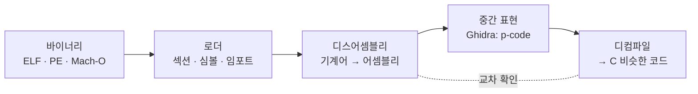

# Ghidra와 IDA: 디스어셈블러·디컴파일러

| 레벨 | 상태 | 최종 개정 |
|---|---|---|
| 🟡 실무 | 🔄 개정중 | 2026-10-22 |

> **한눈에 보기**
> 디스어셈블러는 기계어를 어셈블리로, 디컴파일러는 어셈블리를 C 비슷한 코드로 바꾼다. 둘 다 **추측**이다.
> 디컴파일 결과를 그대로 믿지 않고 어셈블리와 교차 확인하는 습관이 이 장의 전부다.
> Ghidra는 무료로 전 기능을 제공하며, 이 책의 실습은 Ghidra 기준이다. IDA는 확인된 차이만 적는다.

## 1. 언제 쓰는가

소스가 없을 때다. 바이너리만 받은 취약점 신고를 검증할 때, 패치 전후 바이너리를 비교해 고쳐진 지점을 찾을 때(N-day 분석, [8부 3장](../part8-reporting/03-patch-verification.md)), 펌웨어 안의 네이티브 라이브러리를 읽을 때다.



<figure>
<figcaption>그림 1. 오른쪽으로 갈수록 읽기 쉽고 틀릴 가능성도 커진다. 디컴파일 결과가 이상하면 한 칸 왼쪽(어셈블리)으로 돌아간다.</figcaption>
</figure>

정적 분석이 답하는 질문은 "이 함수가 **무엇을 할 수 있는가**"다. "이 입력에서 **실제로 무엇이 일어나는가**"는 [3장 디버거](03-debuggers.md)의 몫이다. 둘은 번갈아 쓴다. 디컴파일러로 의심 함수를 찾고, 디버거로 그 함수에 브레이크포인트를 건다.

## 2. Ghidra 시작하기

### 2.1 설치

[공식 릴리스](https://github.com/NationalSecurityAgency/ghidra/releases)에서 zip을 받아 풀면 끝이다. 요구 사항은 버전마다 오른다. 2026년 10월 현재 최신 계열인 Ghidra 12.2는 **JDK 25 이상**을 요구하고, PyGhidra에는 Python 3.9~3.15가 필요하다 📎 [Ghidra 12.2 What's New](https://github.com/NationalSecurityAgency/ghidra/blob/master/Ghidra/Configurations/Public_Release/src/global/docs/WhatsNew.md), [Getting Started](https://github.com/NationalSecurityAgency/ghidra/blob/master/GhidraDocs/GettingStarted.md). 설치 디렉터리의 `ghidraRun`(Windows는 `ghidraRun.bat`)으로 실행한다. Python 3로 스크립트를 쓰려면 `support/pyghidraRun`으로 실행하고, 처음 한 번 `pyghidra` 모듈 설치를 승인한다.

### 2.2 프로젝트와 자동 분석

1. File → New Project → Non-Shared Project. 프로젝트는 폴더 하나다. 여러 바이너리를 한 프로젝트에 넣을 수 있다.
2. File → Import File로 바이너리를 넣는다. 포맷(ELF, PE)과 언어(x86:LE:64:default 등)를 로더가 자동으로 고른다.
3. 프로젝트 창에서 파일을 더블클릭하면 CodeBrowser가 열리고 "Analyze now?"를 묻는다. **Yes**. 기본 분석기 옵션 그대로 두면 함수 경계 찾기, 문자열 참조, 스택 변수 복원이 돌아간다.

CodeBrowser의 창 다섯 개를 기억한다. **Listing**(어셈블리), **Decompiler**(C), **Symbol Tree**(함수·임포트·익스포트), **Defined Strings**(Window 메뉴), **Data Type Manager**(구조체·열거형). Listing과 Decompiler는 커서가 동기화된다. 한쪽에서 클릭하면 다른 쪽이 따라온다.

### 2.3 손에 익혀야 하는 단축키

| 키 | 동작 | 어디서 |
|---|---|---|
| `L` | 이름 바꾸기(함수, 변수, 레이블) | Listing, Decompiler |
| `Ctrl+L` | 변수 타입 바꾸기(retype) | Decompiler |
| `T` | 데이터 타입 지정 | Listing |
| `;` | 줄 끝 주석 | Listing, Decompiler |
| `G` | 주소·심볼로 이동 | 어디서나 |
| `Ctrl+Shift+F` | 이 심볼을 참조하는 곳 보기 | Listing |
| `D` / `C` | 코드로 해석 / 코드 해석 지우기 | Listing |
| `F` | 커서 위치에 함수 만들기 | Listing |

## 3. 핵심 워크플로: 소스 없는 바이너리에서 오버플로를 찾기

소스가 있는 작은 프로그램을 소스 없는 척 분석한다. 결과를 소스와 맞춰 볼 수 있어 훈련에 좋다.

```c
// target.c — 실습용. 실제 서비스 코드가 아니다
#include <stdio.h>
#include <string.h>

static int check(const char *s) {
    char buf[32];
    strcpy(buf, s);                 /* 길이 검사 없음 */
    return strcmp(buf, "s3cret") == 0;
}

int main(int argc, char **argv) {
    if (argc < 2) return 1;
    puts(check(argv[1]) ? "ok" : "no");
    return 0;
}
```

```bash
gcc -O0 -fno-stack-protector -no-pie -o target target.c
strip target            # 심볼을 지워 실전처럼 만든다
```

### 3.1 문자열에서 출발한다

Window → Defined Strings에서 `"s3cret"`, `"ok"`, `"no"`를 찾는다. `"ok"`를 더블클릭하면 Listing이 그 데이터로 이동한다. 거기서 `Ctrl+Shift+F`로 참조를 보면 이 문자열을 쓰는 함수(`FUN_00401xxx`)가 나온다. 그것이 `main`이다. 심볼이 없어도 **문자열 → 참조 → 함수** 경로는 항상 열려 있다.

### 3.2 디컴파일 결과를 읽는다

`main`에서 호출하는 함수 하나가 `strcpy`를 부른다. Decompiler 창에 대략 이렇게 보인다.

```c
undefined8 FUN_00401136(char *param_1)
{
  int iVar1;
  char local_28 [32];

  strcpy(local_28, param_1);
  iVar1 = strcmp(local_28, "s3cret");
  return CONCAT71(..., iVar1 == 0);
}
```

여기서 이름을 붙인다. 함수에 `L` → `check`, `param_1` → `input`, `local_28` → `buf`. 반환 타입이 `undefined8`로 나오면 함수 시그니처를 우클릭 → Edit Function Signature에서 `int check(char *input)`으로 고친다. `CONCAT71`이 사라지고 `return iVar1 == 0;`이 된다. **이름과 타입을 고칠수록 디컴파일 결과가 정확해진다.** 디컴파일러는 타입 정보를 추론의 입력으로 쓰기 때문이다.

### 3.3 어셈블리로 확인한다

Decompiler의 `local_28 [32]`를 믿을 수 있는가. Listing에서 함수 머리를 본다.

```
PUSH   RBP
MOV    RBP,RSP
SUB    RSP,0x30
MOV    qword ptr [RBP + -0x28],RDI
LEA    RAX,[RBP + -0x20]
...
CALL   strcpy
```

프레임 크기는 `0x30`이고 `buf`는 `RBP-0x20`에서 시작한다(실제 오프셋은 컴파일러 버전에 따라 다르다). 즉 `buf`에서 저장된 `RBP`까지 32바이트, 복귀 주소까지 40바이트다. 디컴파일러가 보여준 `[32]`는 맞다. 이 숫자가 [4부 2장 스택 버퍼 오버플로](../part4-binary/02-stack-overflow.md)의 익스플로잇에서 그대로 쓰인다. 스택 프레임은 Decompiler 창에서는 안 보이고 Listing의 함수 머리 또는 Edit Function → Stack Frame 편집기에서만 보인다.

### 3.4 결론을 적는다

"`check()`는 길이 검사 없이 `strcpy`로 32바이트 스택 버퍼에 복사한다. 입력 40바이트 이상이면 복귀 주소를 덮는다. 바이너리는 스택 카나리와 PIE가 없다(`checksec`로 확인)." 여기까지가 정적 분석의 결론이고, 실제로 덮이는지는 [3장 4절](03-debuggers.md)에서 디버거로 본다.

## 4. 디컴파일러의 한계와 흔한 오류

디컴파일러는 컴파일러가 버린 정보를 되살리려는 추측기다. 다음은 자주 틀리는 지점이며, 각각 **어셈블리에서 무엇을 보면 되는지**를 함께 적었다.

| 증상 | 원인 | 확인 방법 |
|---|---|---|
| 인자 개수·타입이 이상하다 (`param_5`가 갑자기 나옴) | 호출 규약 오인, 가변 인자, 레지스터 재사용 | 호출 지점 직전의 레지스터·스택 설정을 Listing에서 센다. Edit Function Signature로 바로잡는다 |
| 배열 크기가 소스와 다르다 | 패딩, 정렬, 인접 변수 병합 | 프레임 크기(`SUB RSP`)와 접근 오프셋을 직접 계산한다 |
| 변수 하나가 둘로 쪼개지거나 둘이 하나로 합쳐진다 | 컴파일러가 같은 레지스터·슬롯을 재사용 | `Ctrl+L`로 타입을 주면 대개 풀린다. 안 풀리면 어셈블리를 믿는다 |
| `switch`가 `if` 사슬이나 "halt_baddata"로 나온다 | 점프 테이블 미복원 | 간접 점프(`JMP RAX`) 지점에서 테이블 주소를 찾아 수동으로 switch 복원(우클릭 → Override) |
| 함수 중간에서 코드가 끊긴다 | `noreturn` 함수(`exit`, `abort`) 뒤를 데이터로 판단, 또는 그 반대 | 호출된 함수에 No Return 속성을 지정하고 재분석 |
| 부호가 뒤집혀 보인다 (`< 0`이 `> 0xffff…`) | 부호 없는 타입 추론 | 비교 명령(`JL` vs `JB`)을 본다. `JL`/`JG`는 부호 있음, `JB`/`JA`는 부호 없음 |
| 루프가 펼쳐져 있거나 함수가 사라졌다 | 최적화(루프 전개, 인라인) | 틀린 것이 아니다. 소스와 1:1 대응을 포기한다 |
| 인라인 어셈블리·SIMD가 알 수 없는 함수 호출로 나온다 | p-code로 표현 못 하는 명령 | Listing에서 원 명령을 읽는다 |

세 가지 원칙으로 요약된다. **타입을 줄수록 좋아진다. 숫자(크기, 오프셋)는 어셈블리로 확인한다. 흐름(분기, 루프)은 디컴파일러를 믿되 조건의 부호는 명령어로 확인한다.**

## 5. 스크립팅

같은 작업을 바이너리 100개에 하거나, "위험 함수를 부르는 모든 지점"을 뽑으려면 스크립트다. Ghidra 스크립트는 Java(`GhidraScript` 상속) 또는 Python으로 쓴다. Python은 두 종류가 있다. **PyGhidra**(CPython 3, 기본 내장)와 **Jython**(Python 2.7, 선택 확장). 새로 쓰는 스크립트는 PyGhidra로 쓴다.

스크립트는 `~/ghidra_scripts/`에 두고 Window → Script Manager에서 실행한다. 스크립트 안에서는 `currentProgram`, `currentAddress`, `monitor` 같은 상태 변수를 바로 쓴다.

```python
# FindRiskyCalls.py — 위험 C 함수의 호출 지점과 호출자를 모두 출력한다
# @category Examples.Python
# @runtime PyGhidra

RISKY = {"strcpy", "strcat", "gets", "sprintf", "vsprintf", "system", "memcpy"}

fm = currentProgram.getFunctionManager()
rm = currentProgram.getReferenceManager()

for callee in fm.getFunctions(True):          # True = 주소 오름차순
    if callee.getName() not in RISKY:
        continue
    for ref in rm.getReferencesTo(callee.getEntryPoint()):
        if not ref.getReferenceType().isCall():
            continue
        caller = fm.getFunctionContaining(ref.getFromAddress())
        caller_name = caller.getName() if caller else "?"
        print(f"{ref.getFromAddress()}  {caller_name} -> {callee.getName()}")
```

출력의 각 줄이 "검토할 지점" 목록이다. 3절의 예제에서는 `check -> strcpy` 한 줄이 나온다.

같은 스크립트를 GUI 없이 돌리려면 headless 모드를 쓴다. 바이너리를 가져오고, 분석하고, 스크립트를 실행하는 것까지 한 줄이다.

```bash
support/analyzeHeadless ~/proj MyProject -import ./target -postScript FindRiskyCalls.py
```

Java 스크립트는 `ghidra.app.script.GhidraScript`를 상속해 `run()`을 구현하는 클래스 하나다. 설치본의 `Ghidra/Features/Base/ghidra_scripts/HelloWorldScript.java`가 최소 뼈대이고, API는 Python과 같다.

디컴파일 결과를 스크립트에서 쓰려면 `ghidra.app.decompiler.DecompInterface`를 열어(`openProgram`) `decompileFunction`을 부른다. 설치본에 포함된 `ShowCCallsScript.java`가 이 패턴의 예다.

## 6. IDA

### 6.1 판본 차이 (확인된 것만)

| 판본 | 용도 | 아키텍처 | 디컴파일러 | 스크립팅 |
|---|---|---|---|---|
| IDA Free | 개인·비상업용 | x86/x64만 | 클라우드 기반, x64 | 공식 안내가 버전마다 달라 **직접 확인** |
| IDA Home | 비상업용, 지명 사용자 | 구매 시 고른 한 프로세서 계열 | 클라우드 기반, 한 계열 | IDAPython, IDC, C++ SDK |
| IDA Pro | 상용 | 전 계열 | Essential은 클라우드 2개, Expert/Ultimate는 로컬(air gap) 실행 | IDAPython, IDC, C++ SDK |

출처: [Hex-Rays: IDA Free](https://hex-rays.com/ida-free), [IDA Home](https://hex-rays.com/ida-home), [디컴파일러 플랜 차이 FAQ](https://hex-rays.com/faqs/whats-the-difference-between-the-decompiler-offerings-across-various-ida-pro-plans). 가격과 플랜 구성은 자주 바뀌므로 구매 전 공식 페이지를 다시 본다. 기관에서 Ghidra 대신 IDA를 고르는 이유는 보통 둘이다. 팀에 쌓인 IDB 파일과 플러그인이 있거나, Ghidra가 지원하지 않는 프로세서를 봐야 하거나.

### 6.2 IDAPython 개요

IDA의 Python API는 세 층이다. `idc`(IDC 호환 함수, 단순 조회), `idautils`(순회 도우미: 함수, 참조, 세그먼트), `ida_*` 모듈(SDK 직접 매핑). 5절의 Ghidra 스크립트와 같은 일을 하면 다음과 같다.

```python
# IDA: File → Script file 로 실행
import idautils, idc

for name in ("strcpy", "strcat", "gets", "sprintf", "system", "memcpy"):
    ea = idc.get_name_ea_simple(name)
    if ea == idc.BADADDR:
        continue
    for xref in idautils.XrefsTo(ea):
        print(hex(xref.frm), idc.get_func_name(xref.frm), "->", name)
```

단축키는 Ghidra와 다르다. `F5` 디컴파일, `N` 이름 바꾸기, `Y` 타입 지정, `X` 참조 보기, `Shift+F12` 문자열 창. Hex-Rays 디컴파일러의 결과는 `ida_hexrays.decompile(ea)`로 얻는다. 예제 모음은 [IDAPython 공식 예제](https://github.com/idapython/src/tree/master/examples)에 있다.

## 7. 비교표

| | Ghidra | IDA Pro | Binary Ninja | radare2 | rizin + Cutter |
|---|---|---|---|---|---|
| 라이선스 | Apache 2.0, 무료 | 상용 (Free/Home은 비상업) | 상용 (Personal/Commercial/Ultimate 등급) | LGPL, 무료 | LGPL, 무료 |
| 디컴파일러 | 내장(p-code 기반), 전 아키텍처 | Hex-Rays, 플랜별 아키텍처 | 내장(HLIL) | 플러그인: r2ghidra(`pdg`), r2dec(`pdd`) | rz-ghidra(`pdg`) |
| 스크립팅 | Java, Python 3(PyGhidra), Jython | IDAPython, IDC, C++ | Python, C++, Rust | r2pipe(여러 언어) | rz-pipe, Cutter Python 플러그인 |
| GUI | 있음 | 있음 | 있음 | 없음(터미널) | Cutter |
| 협업 | 공유 프로젝트 서버 내장 | 별도 | 별도 | 없음 | 없음 |
| 이런 때 | 기본 선택. 예산 없이 전 기능 | 팀 자산이 IDA 기반, 특수 프로세서 | 빠른 UI, API 중심 자동화 | 스크립트·파이프라인, 경량 | radare2 계열의 GUI가 필요할 때 |

rizin은 radare2에서 갈라져 나온(fork) 프로젝트이고, Cutter는 rizin의 공식 GUI다. rz-ghidra는 Ghidra의 디컴파일러 부분(C++)만 떼어 내 rizin에 붙인 것이라 Ghidra 설치 없이 동작한다.

## 체크리스트

**분석 시작 전**
- [ ] 바이너리의 포맷·아키텍처·엔디안을 로더가 맞게 골랐는가? (`file` 출력과 대조)
- [ ] 자동 분석을 돌렸고, 함수 개수가 상식적인가? (0개면 엔트리·아키텍처가 틀렸다)
- [ ] 심볼이 없으면 문자열과 임포트에서 출발했는가?

**읽는 중**
- [ ] 이름과 타입을 붙여 가며 읽고 있는가? (디컴파일 품질이 올라간다)
- [ ] 버퍼 크기·오프셋 같은 숫자를 어셈블리에서 확인했는가?
- [ ] 비교의 부호를 명령어(`JL` vs `JB`)로 확인했는가?
- [ ] 위험 함수 호출 지점을 스크립트로 빠짐없이 뽑았는가?

**결론 내기 전**
- [ ] "할 수 있다"(정적)와 "실제로 일어난다"(동적)를 구분해 적었는가?
- [ ] 완화 기법(카나리, NX, PIE, RELRO)을 확인했는가? [4부 7장](../part4-binary/07-mitigations.md)

## 더 읽기

- [Ghidra 공식 문서: Getting Started](https://github.com/NationalSecurityAgency/ghidra/blob/master/GhidraDocs/GettingStarted.md) · 요구 사항, 실행, headless, PyGhidra
- [Ghidra 설치본의 GhidraClass](https://github.com/NationalSecurityAgency/ghidra/tree/master/GhidraDocs/GhidraClass) · 공식 교육 자료. Beginner → Intermediate → Advanced
- [PyGhidra README](https://github.com/NationalSecurityAgency/ghidra/blob/master/Ghidra/Features/PyGhidra/src/main/py/README.md) · Python 3 API와 스크립트 실행 방식
- [Hex-Rays 문서](https://docs.hex-rays.com/) · IDA와 IDAPython 공식 문서
- [IDAPython 예제 저장소](https://github.com/idapython/src/tree/master/examples) · 분야별 예제 목록
- [rz-ghidra](https://github.com/rizinorg/rz-ghidra), [Cutter](https://github.com/rizinorg/cutter) · 무료 대안의 디컴파일러와 GUI
- Chris Eagle & Kara Nance, *The Ghidra Book* (No Starch Press, 2020) · 스크립팅과 프로세서 모듈까지 다루는 유일한 단행본

## 변경 이력

| 날짜 | 변경 | 기여자 |
|---|---|---|
| 2026-10-21 | 초안(뼈대) 작성 | @anthonynoh5202 |
| 2026-10-22 | Ghidra 워크플로, 디컴파일러 한계 표, PyGhidra·Java 스크립트, IDA 판본 비교, 도구 비교표 작성 | @anthonynoh5202 |
