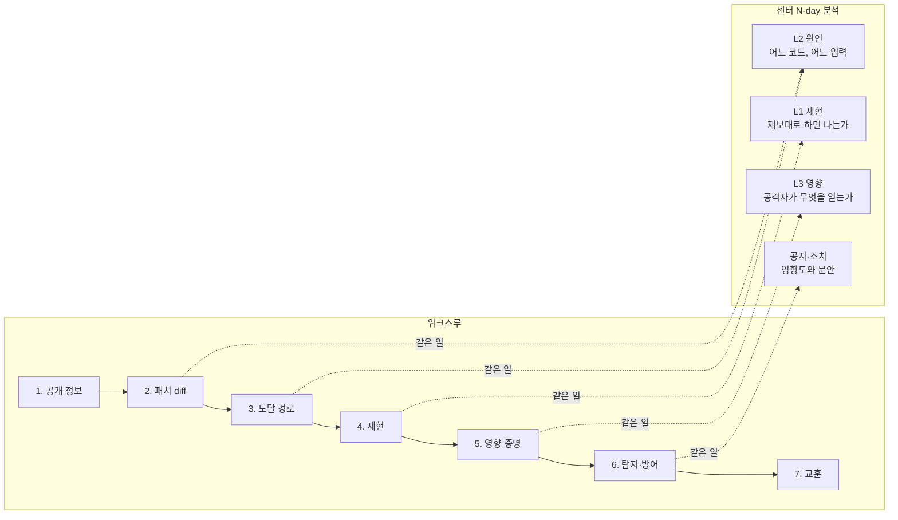

# 워크스루 읽는 법

| 레벨 | 상태 | 최종 개정 |
|---|---|---|
| 🟡 | 🔄 개정중 | 2026-10-22 |

> **한눈에 보기**
> 7부는 실제 CVE를 '공개 정보 → 패치 diff → 재현 → 영향 증명 → 교훈' 순서로 끝까지 따라간다.
> 3~6부에서 유형별로 배운 지식이 한 사건 안에서 어떻게 조합되는지 보는 곳이다.
> 이 순서는 센터의 N-day 분석 업무 순서와 같다. 워크스루를 읽는 것은 곧 업무 예행연습이다.

## 1. 워크스루는 무엇이 다른가

3부와 4부의 장은 **유형**을 다룬다. SQL 인젝션이 무엇이고, 어떤 코드 패턴에서 생기고, 어떻게 막는지를 설명한다. 반면 7부의 워크스루는 **사건**을 다룬다. 한 CVE를 골라, 그 취약점이 어떤 코드에 있었고, 패치가 무엇을 바꿨고, 어떻게 재현하고, 실제 영향이 무엇이었는지를 처음부터 끝까지 따라간다.

둘의 관계는 교과서와 해부 실습의 관계다. 유형 장에서 배운 원리는 워크스루에서 "이 함수의 이 줄"로 구체화된다. 거꾸로 워크스루에서 얻은 교훈은 유형 장의 "실제 CVE 사례" 표로 되돌아간다.

| | 유형 장 (3~6부) | 워크스루 (7부) |
|---|---|---|
| 단위 | 취약점 유형 (CWE) | 하나의 CVE |
| 질문 | 왜 생기고 어떻게 막는가 | 이 사건에서 정확히 무엇이 어디서 잘못됐는가 |
| 코드 | 교육용 최소 예제 | 실제 프로젝트의 실제 diff |
| 결론 | 체크리스트 | 유형 장에 되돌려 주는 교훈 |

## 2. 템플릿 구조

모든 워크스루는 [`templates/walkthrough-template.md`](https://github.com/anthonynoh5202/anthonynoh/blob/main/templates/walkthrough-template.md)의 8개 섹션을 같은 번호와 제목으로 갖는다.

| 섹션 | 답해야 할 질문 | 산출물 |
|---|---|---|
| 0. 환경 | 영향 버전, 패치 버전, 재현 환경을 어떻게 만드는가 | Docker 명령, 직접 빌드 절차, 또는 공개 실습 환경 이름 |
| 1. 공개 정보에서 시작하기 | 권고문·NVD·패치 커밋에서 무엇을 읽어 내는가 | 가설: "입력 X가 코드 Y에서 Z를 일으킨다" |
| 2. 패치 diff 읽기 | 고친 줄이 말해 주는 원인은 무엇인가 | 취약 코드 위치, 누락된 검사 |
| 3. 취약 지점까지 도달하기 | 공격자 입력이 그 줄에 닿는 경로는 무엇인가 | 호출 체인 또는 요청 흐름 |
| 4. 재현 | 최소 입력으로 같은 현상이 나는가 | 크래시 로그, 응답, 디버거 출력 |
| 5. 영향 증명 | 크래시가 실제 피해로 이어지는가 | 실습 환경 안에서의 최소 증명 |
| 6. 탐지와 방어 | 놓치지 않으려면 무엇을 봤어야 했는가 | 리뷰 포인트, 완화책, 탐지 룰 |
| 7. 배운 것 | 유형 장에 되돌려 줄 교훈은 무엇인가 | 2~3개 문장 |

섹션을 건너뛰지 않는다. 해당 없으면 "해당 없음: 이유"를 적는다. 예를 들어 xz 백도어 워크스루는 "4. 재현"에 **재현하지 않는 이유**를 적는다. 재현하지 않기로 한 판단 자체가 분석 결과이기 때문이다.

## 3. 이 순서가 센터의 업무 순서인 이유

워크스루의 1~7절은 [제3편 1부 2장 검증 단계](../../vol3-practice/01-workflow-tech/02-verification.md)의 세 수준과 그대로 겹친다.

<figure>
<figcaption>그림 1. 워크스루의 섹션과 센터의 검증 수준은 일대일로 대응한다. 순서가 조금 다른 이유는 워크스루가 이미 공개된 패치에서 출발하기 때문이다.</figcaption>
</figure>

차이가 하나 있다. 센터는 급박도에 따라 L1에서 멈추기도 하지만, 워크스루는 교육 목적이므로 항상 7절까지 간다. 그래서 워크스루를 한 번 끝까지 따라가 본 사람은 실제 업무에서 어느 수준에서 멈춰야 하는지도 판단할 수 있게 된다. 공지 문안으로 이어지는 부분은 [공유·공지 단계](../../vol3-practice/01-workflow-tech/04-advisory.md)와 [8부 영향도 산정](../part8-reporting/02-severity.md)을 함께 읽는다.

## 4. 사례 선정 기준

7부에 실린 다섯 사례는 다음 네 기준으로 골랐다.

| 기준 | 설명 | 탈락 예 |
|---|---|---|
| **교육적 가치** | 유형 장 하나 이상의 원리를 실제 코드로 보여 준다 | 설정 실수 하나로 끝나는 사례 |
| **재현 가능성** | Docker 한 줄, 소스를 받아 직접 빌드하는 절차, 또는 공개 실습 환경(Vulhub 등)으로 격리된 재현이 된다 | 특정 하드웨어·상용 라이선스가 필요한 사례 |
| **공개 자료 충분** | 벤더 권고, 패치 커밋, 원 발견자 보고서가 모두 공개돼 있다 | 패치 diff가 비공개인 상용 제품 |
| **역사적 무게** | 제도나 관행을 바꾼 사건이다 | 기술적으로 흥미롭지만 영향이 작은 사례 |

| 워크스루 | 유형 장 | 보여 주는 것 |
|---|---|---|
| [Log4Shell](01-cve-2021-44228-log4shell.md) | [역직렬화](../part3-web/07-deserialization.md), [SSRF](../part3-web/03-ssrf.md) | 기능이 곧 공격 표면. 세 번 고친 패치 |
| [Heartbleed](02-cve-2014-0160-heartbleed.md) | [힙](../part4-binary/04-heap.md), [퍼징](../part4-binary/09-fuzzing.md) | 길이 필드는 입력이다. 두 줄짜리 패치 |
| [Struts OGNL](03-cve-2017-5638-struts.md) | [SSTI](../part3-web/09-ssti.md) | 에러 메시지도 출력이다. 패치 미적용의 비용 |
| [Baron Samedit](04-cve-2021-3156-sudo-baron-samedit.md) | [힙](../part4-binary/04-heap.md), [완화 기법](../part4-binary/07-mitigations.md) | 한 바이트의 무게. 10년 묵은 버그 |
| [xz 백도어](05-cve-2024-3094-xz-backdoor.md) | [공급망](../part5-extended/04-supply-chain.md) | 코드가 아니라 과정이 뚫린다 |

## 5. 읽는 요령

1. **먼저 해당 유형 장을 읽는다.** 워크스루는 원리를 다시 설명하지 않는다.
2. **2절(패치 diff)을 읽기 전에 멈추고 스스로 추측해 본다.** 권고문만 보고 "어디가 문제일까"를 적어 둔 뒤 diff와 비교한다. 이 연습이 N-day 분석 속도를 결정한다.
3. **4절은 직접 돌려 본다.** 0절의 환경 구성은 모두 격리된 로컬 환경 기준이다. 실제 서비스에는 절대 시도하지 않는다. [윤리와 법적 범위](../part1-foundations/04-ethics-and-law.md)
4. **7절을 유형 장의 "실제 CVE 사례" 표와 대조한다.** 빠진 교훈이 있으면 그 표에 보태는 것이 좋은 기여다.

## 6. 직접 워크스루를 써서 기여하기

새 사례를 추가하려면 다음 순서로 한다. [기여 가이드](../../appendix/g-contributing.md)의 "새 장 추가" 절차(이슈 제안 → 승인 → PR, 리뷰어 2명)를 따른다.

1. **4절 선정 기준을 모두 만족하는지** 이슈에 적는다. 특히 패치 diff와 원 발견자 보고서 링크가 있어야 한다.
2. `templates/walkthrough-template.md`를 복사해 `NN-cve-YYYY-NNNNN-short-name.md`로 저장한다. 번호는 이 파트 안에서의 순서다.
3. 메타 표에 레벨, CWE, 유형 장 링크, CVSS를 채운다. CVSS는 NVD 기준을 쓰고, 벤더 점수가 다르면 둘 다 적는다.
4. 모든 사실(버전, 날짜, 함수명)에 1차 자료 링크를 단다. 확인되지 않는 세부는 쓰지 않는다. "~로 알려져 있다"는 문장은 출처가 없다는 뜻이므로 쓰지 않는다.
5. 재현 환경은 (a) Docker 한두 줄로 만들 수 있는 최소 구성이거나, (b) 영향 버전의 소스를 받아 직접 빌드하는 절차([Heartbleed 워크스루](02-cve-2014-0160-heartbleed.md)의 환경 B처럼 태그·빌드 명령·실행 명령까지)이거나, (c) Vulhub 같은 공개 실습 환경의 구체적 디렉터리를 지정한다. "준비 예정"으로 남기지 않는다.
6. 공격 페이로드는 격리된 실습 환경에서만 동작하는 형태로 쓴다. 실제 서비스용 익스플로잇, 공개 익스플로잇의 전문 복사는 싣지 않는다. 원리를 설명하는 데 필요한 핵심 줄만 인용한다.
7. `mdbook build`가 경고 없이 통과하는지 확인하고 `SUMMARY.md`에 항목을 추가한다.

> 🟡 사내에서 분석한 사례를 워크스루로 쓸 때는 제조사 조치가 끝나고 공개된 것만 다룬다. 미공개 사례는 내부 블록(`<!-- internal:start -->`)에 둔다.

## 체크리스트

워크스루 한 편을 읽고 나면 다음에 답할 수 있어야 한다.

- [ ] 패치 diff의 어느 줄이 취약점을 고쳤는지 짚을 수 있는가?
- [ ] 공격자 입력이 그 줄에 닿는 경로를 함수 이름으로 말할 수 있는가?
- [ ] 재현 환경을 10분 안에 띄울 수 있는가?
- [ ] "크래시"와 "영향"의 차이를 이 사례로 설명할 수 있는가?
- [ ] 이 사례의 교훈이 유형 장의 어느 체크리스트 항목에 해당하는지 말할 수 있는가?

## 더 읽기

- [워크스루 템플릿](https://github.com/anthonynoh5202/anthonynoh/blob/main/templates/walkthrough-template.md) · 이 파트의 모든 장이 따르는 구조
- [제3편 1부 2장 검증 단계: 재현이 전부다](../../vol3-practice/01-workflow-tech/02-verification.md) · 워크스루 순서가 업무 순서인 이유
- [보고 3장 패치 검증과 재발 방지](../part8-reporting/03-patch-verification.md) · 2절 "패치 diff 읽기"의 업무판
- [Vulhub](https://github.com/vulhub/vulhub) · Docker Compose 기반 공개 취약점 재현 환경 모음. 이 파트의 재현 환경 여러 개가 여기에 있다
- [부록 C. 연표](../../appendix/c-timeline.md) · 다섯 사례가 보안 역사에서 어디에 있는지

## 변경 이력

| 날짜 | 변경 | 기여자 |
|---|---|---|
| 2026-10-21 | 초안(뼈대) 작성 | @anthonynoh5202 |
| 2026-10-22 | 본문 작성: 템플릿 구조, 선정 기준, 업무 흐름 대응, 기여 절차 | @anthonynoh5202 |
| 2026-10-22 | 기술 검증 완료, 수정 없음 (링크 대상 파일·템플릿 경로 존재 확인) | 검증팀 |
| 2026-10-22 | 독자 테스트 반영: 장 참조 표기를 편·부 이름 규칙으로 통일 | @anthonynoh5202 |
| 2026-10-23 | 독자 테스트 2차 반영: 2절 템플릿 표와 4·6절의 재현 환경 설명에 "직접 빌드 절차"를 추가(Heartbleed 워크스루 환경 B 반영) | @anthonynoh5202 |
