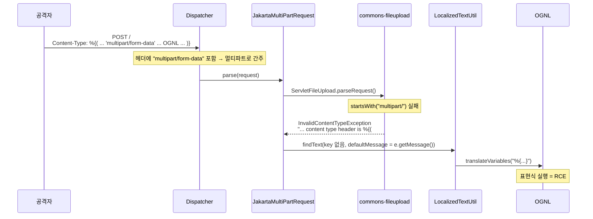

# CVE-2017-5638 Apache Struts: OGNL 인젝션

| 레벨 | 상태 | 최종 개정 | CWE | 유형 | CVSS |
|---|---|---|---|---|---|
| 🔴 | 🔄 개정중 | 2026-10-22 | [CWE-20](https://cwe.mitre.org/data/definitions/20.html) | [SSTI](../part3-web/09-ssti.md) | 10.0 |

> **한눈에 보기**
> 잘못된 Content-Type 헤더가 예외 메시지에 들어가고, 그 메시지가 OGNL 표현식으로 평가됐다. 헤더 한 줄로 서버 명령이 실행됐다.
> 패치는 공개 당일 나왔지만, 두 달 뒤 Equifax는 이 취약점으로 미국 인구 절반에 가까운 개인정보를 잃었다.
> 이 사례에서 배울 것은 둘이다. **에러 메시지도 출력이다.** 그리고 **패치는 적용되어야 패치다.**

## 0. 환경

- **영향 버전**: Struts 2.3.5 ~ 2.3.31, 2.5 ~ 2.5.10 (Jakarta Multipart 파서를 쓰는 기본 설정) 📎 [S2-045](https://cwiki.apache.org/confluence/display/WW/S2-045)
- **패치 버전**: 2.3.32, 2.5.10.1 (두 아티팩트 모두 2017-03-06 Maven Central 게시) 📎 [Struts 공지](https://struts.apache.org/announce-2017) · [Maven Central struts2-core](https://repo1.maven.org/maven2/org/apache/struts/struts2-core/)
- **CVSS**: 10.0 (NVD v3.0, AV:N/AC:L/PR:N/UI:N/S:C/C:H/I:H/A:H). CVE 레코드의 CISA-ADP 점수는 S:U로 매겨 9.8
- **보고자**: Nike Zheng (DBAPPSecurity). 권고문 S2-045는 2017-03-06 공개, 같은 CVE에 Content-Disposition 변형(S2-046)이 3월 20일 추가됨
- **재현 환경**: [Vulhub `struts2/s2-045`](https://github.com/vulhub/vulhub/tree/master/struts2/s2-045). Struts 2.3.30 샘플 앱이 8080 포트에 뜬다
- **필요한 도구**: Docker, `curl`

## 1. 공개 정보에서 시작하기

1. **S2-045 권고문**. "Possible Remote Code Execution when performing file upload based on Jakarta Multipart parser." 입력은 **파일 업로드 요청**, 코드는 **Jakarta Multipart 파서**, 결과는 **RCE**다. 권고문은 "Content-Type 값이 잘못됐을 때 예외가 던져지고, 그 예외 메시지가 사용자에게 표시되는 과정"을 문제로 지목한다.
2. **NVD 설명**. "incorrect exception handling and error-message generation during file-upload attempts, which allows remote attackers to execute arbitrary commands via a crafted Content-Type ... header, as exploited in the wild in March 2017 with a Content-Type header containing a `#cmd=` string." 공개 시점에 이미 악용 중이었다.
3. **패치 커밋**. 두 개다. [6b8272c](https://github.com/apache/struts/commit/6b8272ce47160036ed120a48345d9aa884477228)(`FileUploadInterceptor`)와 [3523064](https://github.com/apache/struts/commit/352306493971e7d5a756d61780d57a76eb1f519a)(`JakartaMultiPartRequest` 등 세 파일). 둘 다 2017-03-06, 커밋 메시지는 같다. "Uses default error key if specified key doesn't exist."

가설: "업로드 파서가 Content-Type 헤더를 포함한 예외 메시지를 만들고, 그 메시지를 i18n 함수가 OGNL로 평가한다." 단서는 커밋 메시지의 "error key"다. 메시지 **키**가 없을 때 **메시지 본문**을 어떻게 처리했는지가 문제였을 것이다.

## 2. 패치 diff 읽기

```diff
--- a/core/src/main/java/org/apache/struts2/dispatcher/multipart/JakartaMultiPartRequest.java
+++ b/core/src/main/java/org/apache/struts2/dispatcher/multipart/JakartaMultiPartRequest.java
   protected String buildErrorMessage(Throwable e, Object[] args) {
       String errorKey = "struts.messages.upload.error." + e.getClass().getSimpleName();
       ...
-      return LocalizedTextUtil.findText(this.getClass(), errorKey, defaultLocale, e.getMessage(), args);
+      if (LocalizedTextUtil.findText(this.getClass(), errorKey, defaultLocale, null, new Object[0]) == null) {
+          return LocalizedTextUtil.findText(this.getClass(), "struts.messages.error.uploading", defaultLocale, null, new Object[] { e.getMessage() });
+      } else {
+          return LocalizedTextUtil.findText(this.getClass(), errorKey, defaultLocale, null, args);
+      }
```

📎 [커밋 3523064](https://github.com/apache/struts/commit/352306493971e7d5a756d61780d57a76eb1f519a). `JakartaStreamMultiPartRequest`, `MultiPartRequestWrapper`에도 같은 변경.

취약 줄에서 `e.getMessage()`는 `findText()`의 네 번째 인자, 즉 **defaultMessage**였다. `findText()`는 키에 해당하는 번역을 못 찾으면 defaultMessage를 반환하는데, 그 전에 이렇게 한다.

```java
// xwork LocalizedTextUtil.getDefaultMessage (2.5.10)
MessageFormat mf = buildMessageFormat(TextParseUtil.translateVariables(message, valueStack), locale);
```

`TextParseUtil.translateVariables()`는 문자열 안의 `${...}`와 `%{...}`를 **OGNL로 평가**한다. 기본 메시지는 개발자가 쓴 리소스 문자열이라고 가정한 설계였다. 예외 메시지에 사용자 입력이 섞인다는 것은 고려되지 않았다.

패치는 `e.getMessage()`를 defaultMessage 자리에서 빼서 **포맷 인자**(`new Object[] { e.getMessage() }`) 자리로 옮겼다. 포맷 인자는 `MessageFormat`의 `{0}` 치환에만 쓰이고 OGNL을 거치지 않는다. 즉 패치는 "입력을 코드 위치에서 데이터 위치로 옮긴" 것이다. [SQL 인젝션 장](../part3-web/01-sql-injection.md)의 파라미터 바인딩과 정확히 같은 구조다.

`FileUploadInterceptor` 쪽 커밋 [6b8272c](https://github.com/apache/struts/commit/6b8272ce47160036ed120a48345d9aa884477228)는 `LocalizedTextUtil.findText(..., error.getDefaultMessage(), ...)` 호출 자체를 지우고 `TextProvider`로 바꿨다. 같은 메시지가 인터셉터에서 **한 번 더** 평가되고 있었기 때문이다.

## 3. 취약 지점까지 도달하기



<figure>
<figcaption>그림 1. 헤더가 "멀티파트처럼 보이지만 멀티파트가 아니어야" 한다. 두 검사의 기준이 달랐던 틈으로 예외 경로에 들어간다.</figcaption>
</figure>

1. **Dispatcher가 멀티파트로 판단한다.** 2.3.x의 `Dispatcher.wrapRequest()`는 Content-Type에 `multipart/form-data`가 **포함**되면 `MultiPartRequestWrapper`로 감싼다. `contains` 검사다.
2. **commons-fileupload가 거부한다.** `FileUploadBase`는 Content-Type이 `multipart/`로 **시작**하는지 본다. `startsWith` 검사다. 실패하면 `InvalidContentTypeException`을 던지는데, 메시지가 `"the request doesn't contain a multipart/form-data or multipart/mixed stream, content type header is " + contentType`이다. **헤더 전체가 메시지에 들어간다.**
3. **JakartaMultiPartRequest가 메시지를 번역하려 한다.** `parse()`의 catch 블록이 `buildErrorMessage(e, ...)`를 부르고, 키 `struts.messages.upload.error.InvalidContentTypeException`에 해당하는 번역이 없으므로 defaultMessage, 즉 예외 메시지 자체가 반환 경로로 간다.
4. **`translateVariables()`가 `%{...}`를 OGNL로 평가한다.** 평가 컨텍스트는 Struts의 ValueStack이며, 여기서 `@java.lang.Runtime@getRuntime()`에 닿을 수 있다.

따라서 공격 헤더의 조건은 두 가지다. `multipart/form-data` 문자열을 **포함**하되 그것으로 **시작하지 않을** 것, 그리고 `%{...}` 표현식일 것. 실제 악용 페이로드가 `%{(#_='multipart/form-data').(...)}`로 시작하는 이유다. 첫 항 `#_='multipart/form-data'`는 아무 의미 없는 대입이고, 1단계 검사를 통과하기 위한 문자열일 뿐이다.

### OGNL 샌드박스는 왜 못 막았나

Struts는 OGNL에 `SecurityMemberAccess`를 걸어 정적 메서드 호출과 특정 패키지 접근을 막는다. 그러나 그 설정 객체 자체가 OGNL 컨텍스트(`#_memberAccess`)에서 접근 가능했다. 공개 페이로드는 먼저 `#_memberAccess`를 `@ognl.OgnlContext@DEFAULT_MEMBER_ACCESS`로 바꾸고, 컨테이너에서 `OgnlUtil`을 꺼내 `excludedClasses`·`excludedPackageNames`를 비운 뒤 실제 명령을 호출한다. 샌드박스가 샌드박스 안에서 해제 가능했다는 것이 2017~2018년 Struts OGNL 취약점(S2-045, S2-046, S2-053, S2-057)이 반복된 구조적 이유다.

## 4. 재현

```bash
git clone --depth 1 https://github.com/vulhub/vulhub && cd vulhub/struts2/s2-045
docker compose up -d        # http://127.0.0.1:8080
```

### 4.1 취약 여부 확인

명령 실행 없이 **표현식이 평가되는지**만 본다. 응답 헤더에 계산 결과를 넣게 한다. Vulhub README도 같은 방식(`233*233` 결과를 응답 헤더에 싣기)으로 확인하며, 아래는 S2-045 공개 PoC 계열의 페이로드다.

```bash
curl -s -o /dev/null -D - http://127.0.0.1:8080/ \
  -H "Content-Type: %{(#_='multipart/form-data').(#dm=@ognl.OgnlContext@DEFAULT_MEMBER_ACCESS).(#_memberAccess?(#_memberAccess=#dm):((#container=#context['com.opensymphony.xwork2.ActionContext.container']).(#ognlUtil=#container.getInstance(@com.opensymphony.xwork2.ognl.OgnlUtil@class)).(#ognlUtil.getExcludedPackageNames().clear()).(#ognlUtil.getExcludedClasses().clear()).(#context.setMemberAccess(#dm)))).(#res=@org.apache.struts2.ServletActionContext@getResponse()).(#res.addHeader('X-Check',233*233))}"
```

응답에 `X-Check: 54289`가 있으면 헤더가 OGNL로 평가된 것이다. 페이로드를 쪼개 읽으면 3절의 구조가 그대로다. (1) `multipart/form-data` 문자열 포함, (2) 멤버 접근 제한 해제, (3) 응답 객체에 헤더 추가.

### 4.2 관찰

컨테이너 로그(`docker compose logs`)에 `Unable to parse request` 경고와 `InvalidContentTypeException`이 남는다. 예외 메시지 안에 헤더가 그대로 찍히므로, **로그만 봐도 어떤 표현식이 평가됐는지 알 수 있다.** 사고 조사에서 이 로그가 1차 증거가 된다.

## 5. 영향 증명

| 단계 | 확인 | 의미 |
|---|---|---|
| 1 | `233*233` → `54289`가 응답 헤더에 | 표현식 평가 확인 |
| 2 | `@java.lang.System@getProperty('user.name')` 결과가 헤더에 | 서버 컨텍스트 접근. 정보 유출 |
| 3 | `ProcessBuilder`로 명령 실행, 출력이 응답에 | RCE. 서블릿 컨테이너 권한 |

3단계는 실습 환경에서 `id` 한 번이면 충분하다. 실제 서비스에는 시도하지 않는다.

### Equifax 2017

이 CVE를 역사에 남긴 것은 기술이 아니라 **적용되지 않은 패치**였다. 미국 회계감사원(GAO) 보고서 GAO-18-559(2018-08) 기준으로 경과는 다음과 같다. 📎 [GAO-18-559](https://www.gao.gov/products/gao-18-559)

| 날짜 (2017) | 일 |
|---|---|
| 03-07 | Apache가 S2-045 패치 공개 |
| 03-08 | US-CERT가 Equifax에 취약점 공지 |
| 03-09 ~ 03-15 | Equifax 내부 공지와 취약점 스캔. 그러나 공지는 담당자에게 닿지 않았고, 스캔은 취약한 소비자 분쟁 포털(ACIS)을 찾지 못함 |
| 05-13 | 공격자 최초 침입 |
| 05-13 ~ 07-30 | 76일간 내부 DB 질의와 반출. 네트워크 트래픽 검사 장비의 인증서가 약 10개월간 만료 상태라 암호화 트래픽을 보지 못함 |
| 07-29 | 인증서 갱신 직후 이상 트래픽 발견 |
| 09-07 | 공개. 약 1억 4,550만 명의 미국 소비자 정보 유출 (GAO 집계) |

Equifax 자신도 2017-09-15 성명에서 원인을 CVE-2017-5638로 특정했다. 패치가 나온 지 두 달이 지나 있었다. 조직 안에서 "취약점 공지 → 자산 식별 → 패치 → 검증"의 어느 고리가 끊겨도 결과는 같다는 것을 이 사건이 보여 줬다. [제3편 조치 단계](../../vol3-practice/01-workflow-tech/03-remediation.md)가 "고쳐지게 만드는" 보고서를 강조하는 이유다.

## 6. 탐지와 방어

### 코드 리뷰에서 봤어야 할 것

- **예외 메시지에 외부 입력이 들어가는가.** `e.getMessage()`는 라이브러리가 만든 문자열이고, 라이브러리는 디버깅 편의를 위해 입력값을 메시지에 넣는 경우가 많다. 예외 메시지는 **입력의 연장**이다.
- **문자열을 평가하는 함수에 무엇이 들어가는가.** `translateVariables()`, `TextParseUtil`, `OgnlUtil.getValue()`처럼 `${}`·`%{}`를 처리하는 함수를 싱크로 보고 역추적한다. 템플릿 엔진의 `render(string)`와 같은 자리다. [SSTI 장](../part3-web/09-ssti.md)
- **두 컴포넌트의 검사 기준이 다른가.** `contains`와 `startsWith`처럼 비슷해 보이는 두 검사의 차집합이 공격 경로가 된다.

### 패치 외 완화책

| 조치 | 효과 | 한계 |
|---|---|---|
| Jakarta Stream 파서로 교체 또는 업로드 비활성화 | 권고문의 임시 조치 | Stream 파서도 같은 커밋에서 고쳐졌다. 즉 완전하지 않았다 |
| 서블릿 필터로 Content-Type이 `multipart/`로 시작하지 않는 멀티파트 요청 차단 | 이 CVE의 경로 차단 | S2-046(Content-Disposition 경로)은 못 막음 |
| WAF: 헤더에 `%{`, `#_memberAccess`, `@ognl`, `getRuntime` 패턴 | 자동화 공격 지연 | OGNL은 문자열 조립·유니코드 이스케이프로 우회된다 |
| 컨테이너 최소 권한, 아웃바운드 차단 | 피해 범위 축소 | RCE 자체는 못 막음 |

### 탐지 룰

- 웹 로그: 요청 헤더(Content-Type, Content-Disposition)에 `%{` 또는 `${`가 포함된 요청. 정상 트래픽에서는 거의 없다.
- 앱 로그: `InvalidContentTypeException` 메시지 안에 `%{`가 있는 줄. 이 CVE는 **스스로 증거를 남긴다.**
- 공개 룰: Snort/Suricata ET 룰 "Apache Struts Jakarta Multipart parser OGNL injection"(2017-03) 계열.

## 7. 배운 것

1. **에러 메시지도 출력이다.** 입력을 받아 예외 메시지에 넣고, 그 메시지를 "안전한 개발자 문자열"로 취급해 평가했다. 입력은 변환을 거쳐도 입력이다. [SSTI 장](../part3-web/09-ssti.md)의 "템플릿에 입력이 들어가는 모든 경로" 체크리스트에 "예외 메시지 경유"를 추가해야 한다.
2. **같은 메시지를 두 번 평가하는 코드는 한 번도 안전하지 않았다.** 패치가 두 커밋인 이유다. 싱크를 찾았으면 그 싱크를 부르는 **모든** 호출자를 고친다. [보고 3장](../part8-reporting/03-patch-verification.md)
3. **패치는 적용되어야 패치다.** 공개 당일 패치가 나온 취약점이 두 달 뒤 역사적 유출을 만들었다. 센터가 공지 이후 "적용 여부"까지 추적하는 이유다. [제3편 공유·공지 단계](../../vol3-practice/01-workflow-tech/04-advisory.md)

## 참고

- 벤더 권고: [S2-045](https://cwiki.apache.org/confluence/display/WW/S2-045) · [S2-046](https://cwiki.apache.org/confluence/display/WW/S2-046) · [Struts 2017 릴리스 공지](https://struts.apache.org/announce-2017)
- NVD: [CVE-2017-5638](https://nvd.nist.gov/vuln/detail/CVE-2017-5638)
- 패치 커밋: [6b8272c (FileUploadInterceptor)](https://github.com/apache/struts/commit/6b8272ce47160036ed120a48345d9aa884477228) · [3523064 (Multipart 요청 클래스 3개)](https://github.com/apache/struts/commit/352306493971e7d5a756d61780d57a76eb1f519a)
- 취약 코드: [JakartaMultiPartRequest 2.5.10](https://github.com/apache/struts/blob/STRUTS_2_5_10/core/src/main/java/org/apache/struts2/dispatcher/multipart/JakartaMultiPartRequest.java) · [LocalizedTextUtil 2.5.10](https://github.com/apache/struts/blob/STRUTS_2_5_10/core/src/main/java/com/opensymphony/xwork2/util/LocalizedTextUtil.java)
- Equifax 조사: [GAO-18-559, "Actions Taken by Equifax and Federal Agencies in Response to the 2017 Breach"](https://www.gao.gov/products/gao-18-559) (2018-08) · 미 하원 감독위원회 보고서 (2018-12)
- 재현 환경: [Vulhub struts2/s2-045](https://github.com/vulhub/vulhub/tree/master/struts2/s2-045)

## 변경 이력

| 날짜 | 변경 | 기여자 |
|---|---|---|
| 2026-10-21 | 초안(뼈대) 작성 | @anthonynoh5202 |
| 2026-10-22 | 전체 작성: 패치 diff, 예외 경로 분석, 샌드박스 해제 구조, Equifax 경과 | @anthonynoh5202 |
| 2026-10-22 | 기술 검증: CVE 레코드(영향 버전·참조 커밋), 커밋 6b8272c·3523064 diff 원문, LocalizedTextUtil 2.5.10·Dispatcher 2.3.31·commons-fileupload 메시지 대조, Vulhub(2.3.30, 8080) 확인. 릴리스 날짜를 Maven Central 게시일로, CVSS에 벡터·ADP 점수 병기, Vulhub 페이로드와 다름을 명시 | 검증팀 |
| 2026-10-22 | 독자 테스트 반영: 장 참조 표기를 편·부 이름 규칙으로 통일 | @anthonynoh5202 |
