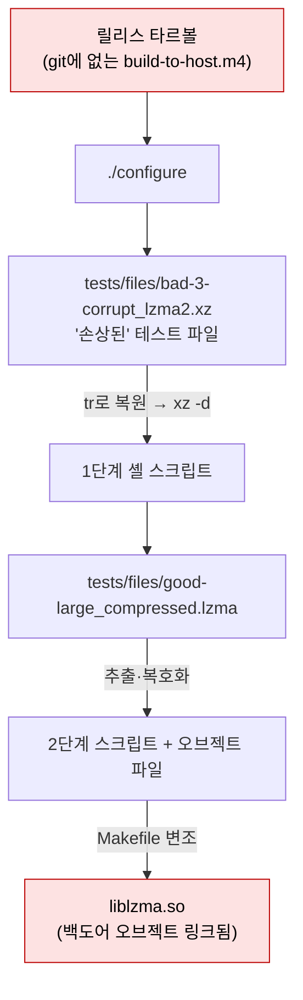
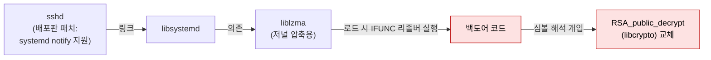

# CVE-2024-3094 xz 백도어: 공급망 공격

| 레벨 | 상태 | 최종 개정 | CWE | 유형 | CVSS |
|---|---|---|---|---|---|
| 🔴 | 🔄 개정중 | 2026-10-22 | [CWE-506](https://cwe.mitre.org/data/definitions/506.html) | [공급망](../part5-extended/04-supply-chain.md) | 10.0 |

> **한눈에 보기**
> 2년 넘게 신뢰를 쌓은 기여자가 압축 라이브러리의 빌드 과정에 백도어를 심었고, 그 라이브러리를 거쳐 sshd의 인증 함수가 바뀌었다.
> 취약점이 아니라 '의도된 취약점'이고, 코드가 아니라 '과정'이 뚫렸다. 발견은 한 개발자가 로그인이 0.5초 느린 이유를 끝까지 파고든 덕분이었다.
> 이 사례에서 배울 것은 하나다. **신뢰는 검증을 대신하지 못한다.**

## 0. 환경

- **영향 버전**: xz / liblzma 5.6.0 (2024-02-24), 5.6.1 (2024-03-09) 📎 [GitHub 릴리스 태그](https://github.com/tukaani-project/xz/releases) (두 태그 모두 JiaT75 계정이 생성)
- **조치**: 배포판은 5.4.6으로 다운그레이드. 이후 백도어를 제거한 5.6.2(2024-05-29, Lasse Collin 서명) 공개
- **CVSS**: 10.0 (AV:N/AC:L/PR:N/UI:N/S:C/C:H/I:H/A:H) 📎 [GHSA-rxwq-x6h5-x525](https://github.com/advisories/GHSA-rxwq-x6h5-x525)
- **발견자**: Andres Freund (PostgreSQL 개발자). 2024-03-29 oss-security에 공개 📎 [원 보고](https://www.openwall.com/lists/oss-security/2024/03/29/4)
- **영향 배포판**: 안정 버전에는 들어가지 않았다. Fedora Rawhide·40 베타, Debian testing/unstable, openSUSE Tumbleweed, Kali 등 롤링·개발 브랜치
- **재현 환경**: **없음. 재현하지 않는다.** 이유는 4절에 적는다
- **필요한 도구**: 분석 자료를 읽는 데는 없음. 자기 시스템 확인에는 `xz --version`, `ldd`

## 1. 공개 정보에서 시작하기

이 사례는 권고문보다 **원 보고가 먼저** 나왔다. 읽는 순서는 다음과 같다.

1. **Andres Freund의 oss-security 보고(2024-03-29)**. 제목이 "backdoor in upstream xz/liblzma leading to ssh server compromise"다. 핵심 문장은 이렇다. xz 5.6.0·5.6.1의 **릴리스 타르볼**에 git 저장소에는 없는 빌드 명령이 있고, 그것이 테스트 디렉터리의 바이너리 파일에서 오브젝트를 꺼내 liblzma에 링크한다. 그 liblzma를 sshd가 로드한다.
2. **CVE/GHSA**. CVSS 10.0. 설명이 짧다. "Malicious code was discovered in the upstream tarballs of xz, starting with version 5.6.0." 취약점 설명이 아니라 **사건 설명**이다. CWE-506(Embedded Malicious Code)이 붙은 이유다.
3. **배포판 공지**. Red Hat은 Fedora 41(당시 Rawhide)과 40 베타 사용자에게 즉시 사용 중단을 권고했다. Debian은 unstable의 xz-utils를 5.6.1+really5.4.5로 되돌렸다.
4. **커뮤니티 분석**. [Russ Cox의 타임라인](https://research.swtch.com/xz-timeline), [Sam James의 FAQ](https://gist.github.com/thesamesam/223949d5a074ebc3dce9ee78baad9e27), 그리고 역공학 자료들. 이 워크스루의 2~5절은 이 자료들에 기댄다.

여기서 세울 질문은 다른 워크스루와 다르다. "어떤 입력이 어디서 문제를 일으키는가"가 아니라 **"어떻게 이것이 들어갔고, 왜 아무도 몰랐는가"**다.

### 타임라인

| 시점 | 일 | 출처 |
|---|---|---|
| 2021 | `Jia Tan`(JiaT75) 계정이 xz-devel 메일링 리스트에 패치를 보내기 시작 | Russ Cox 타임라인 |
| 2022-02-06 | Jia Tan(jiat75) 이름의 첫 커밋이 저장소에 들어감(작성일은 01-28, 반영일 UTC 기준) | [GitHub 커밋 이력](https://github.com/tukaani-project/xz/commits/v5.4.0/?author=JiaT75) |
| 2022-04 ~ 06 | `Jigar Kumar`, `Dennis Ens` 등 다른 곳에서 활동 이력이 없는 계정들이 메일링 리스트에서 유지보수 속도를 비난하며 공동 유지보수자 영입을 압박. 유일한 유지보수자 Lasse Collin은 개인 사정으로 시간이 부족하다고 답함 | Russ Cox 타임라인 |
| 2022 말 ~ 2023 | Jia Tan이 커밋 권한과 릴리스 관리 권한을 얻음. 5.4.x 릴리스 일부를 담당 | Sam James FAQ |
| 2023 | 성능 개선 명목으로 CRC 함수에 IFUNC(glibc 간접 함수) 적용. 백도어가 나중에 진입점으로 쓸 메커니즘 | Sam James FAQ |
| 2024-02-23 | "Tests: Add a few test files." 커밋으로 `bad-3-corrupt_lzma2.xz`, `good-large_compressed.lzma` 추가 | [커밋 cf44e4b](https://github.com/tukaani-project/xz/commit/cf44e4b7f5dfdbf8c78aef377c10f71e274f63c0) |
| 2024-02-24 | 5.6.0 릴리스. 타르볼에만 변조된 `m4/build-to-host.m4` 포함 | GitHub 태그 |
| 2024-02-26 | Landlock 샌드박스 감지용 CMake 검사에 `.` 한 글자를 넣어 검사가 항상 실패하게 만듦 | [커밋 328c52da](https://github.com/tukaani-project/xz/commit/328c52da8a2bbb81307644efdb58db2c422d9ba7), Sam James FAQ |
| 2024-03-09 | 5.6.1 릴리스. 백도어가 일으킨 Valgrind 오류 등을 "수정" | GitHub 태그 |
| 2024-03-28 ~ 29 | Andres Freund가 배포판 보안팀에 알리고 이튿날 공개 | 원 보고 |
| 2024-03 말 | 공개 직후 GitHub가 저장소와 Jia Tan 계정을 일시 비활성화. 이후 Jia Tan의 커밋 권한 회수 | Sam James FAQ |

📎 날짜는 각 행의 출처 기준. 메일링 리스트 시점은 Russ Cox 타임라인의 정리를 따른다.

## 2. 패치 diff 읽기

이 사례의 "diff"는 패치가 아니라 **git과 타르볼의 차이**다. 그것이 첫 번째 교훈이다.

```diff
--- git 저장소의 m4/build-to-host.m4 (gnulib 원본, serial 3)
+++ 5.6.0 타르볼의 m4/build-to-host.m4 (serial 30)
+ gl_am_configmake=`grep -aErls "#{4}[[:alnum:]]{5}#{4}$" $srcdir/ 2>/dev/null`
+ ...
+ gl_[$1]_config='sed \"r\n\" $gl_am_configmake | eval $gl_path_map | $gl_[$1]_prefix -d 2>/dev/null'
```

변조된 매크로는 `configure` 실행 중에 (1) 특정 바이트 패턴을 가진 파일을 소스 트리에서 찾고(그것이 `tests/files/bad-3-corrupt_lzma2.xz`다), (2) `tr`로 몇 바이트를 치환해 "손상된" xz 파일을 정상으로 되돌린 뒤, (3) 압축을 풀어 나온 셸 스크립트를 실행한다. 그 스크립트가 다시 `good-large_compressed.lzma`에서 오브젝트 파일을 꺼내 빌드 중인 liblzma에 링크되도록 Makefile을 바꾼다.



<figure>
<figcaption>그림 1. 소스 코드 리뷰로는 보이지 않는 경로. 변조는 리뷰 대상이 아닌 세 곳(타르볼 전용 파일, 바이너리 테스트 파일, 빌드 스크립트)에만 있다.</figcaption>
</figure>

왜 이 구조인가. 세 가지가 리뷰를 피했다.

| 숨긴 곳 | 왜 안 보였나 |
|---|---|
| 타르볼 전용 m4 파일 | 리뷰어는 git을 본다. `autogen`이 생성하는 파일은 타르볼에만 있고, 생성 파일을 diff하는 사람은 없다 |
| 바이너리 테스트 파일 | "손상된 입력에 대한 테스트"는 압축 라이브러리에 당연히 있다. 바이너리라 diff가 안 되고, 커밋 메시지는 평범했다 |
| 빌드 조건 | x86-64, glibc, gcc·GNU ld, deb 또는 rpm 패키징 빌드일 때만 활성화. 개발자가 자기 머신에서 빌드하면 아무 일도 없다 |

"패치"는 이 파일들을 제거하고 5.4.6으로 되돌리는 것이었다. 유지보수자 Lasse Collin은 2024-05-29 백도어를 제거한 5.6.2를 냈다. 이 릴리스는 IFUNC 지원도 걷어냈는데, 릴리스 노트는 그것이 보안 때문이 아니라 성능 이득에 비해 복잡도가 크기 때문이라고 명시했다.

## 3. 취약 지점까지 도달하기

압축 라이브러리가 어떻게 SSH 인증에 닿는가. 경로가 세 단계다.



<figure>
<figcaption>그림 2. 업스트림 OpenSSH는 liblzma를 쓰지 않는다. 배포판이 넣은 systemd 연동 패치가 다리가 됐다.</figcaption>
</figure>

1. **sshd → libsystemd.** 업스트림 OpenSSH는 systemd에 의존하지 않는다. Debian·Fedora 등은 서비스 준비 알림(`sd_notify`)을 위해 sshd에 libsystemd 링크 패치를 넣었다. OpenSSH 9.8은 이 때문에 라이브러리 없이 알림을 보내는 코드를 추가했다.
2. **libsystemd → liblzma.** libsystemd가 저널 압축에 liblzma를 쓴다. sshd가 시작되면 동적 링커가 liblzma도 함께 로드한다.
3. **liblzma 로드 → IFUNC → 후킹.** glibc의 IFUNC는 라이브러리 로드 시점에 "어느 구현을 쓸지" 고르는 리졸버 함수를 실행한다. 백도어는 CRC 함수의 리졸버에 끼어들어, 동적 링커가 심볼을 해석하는 동안 libcrypto의 `RSA_public_decrypt`를 자기 코드로 바꿔치기한다. 이 함수는 sshd가 공개키 인증에서 서명을 검증할 때 호출된다.
4. **런타임 조건.** 프로세스 이름(`argv[0]`)이 `/usr/sbin/sshd`일 때만 작동한다. 디버깅 환경으로 보이는 조건에서는 동작하지 않는 검사도 있었다. 분석가가 붙으면 조용해지는 설계다.

### 백도어가 하는 일

공개 역공학 결과([xzbot](https://github.com/amlweems/xzbot) 등)에 따르면, 교체된 `RSA_public_decrypt`는 클라이언트가 보낸 SSH 인증서의 **CA 서명키 N 값**에서 페이로드를 읽는다. 페이로드는 ChaCha20으로 암호화되고 공격자의 **Ed448** 개인키로 서명돼 있다. 서명이 서버 호스트키 해시에 묶여 있어 다른 서버에서는 재사용할 수 없다. 서명이 맞으면 페이로드 안의 명령을 `system()`으로 실행한다. 로그인은 실패로 처리되거나 정상 흐름으로 돌아가므로 **INFO 이상의 로그가 남지 않는다.**

즉 이것은 "취약점"이 아니라 **공격자만 열 수 있는 자물쇠**다. 키가 없는 제3자는 백도어를 쓸 수 없다. 그래서 CVSS 10.0이면서도 공개 익스플로잇은 존재하지 않는다. xzbot은 공개키를 바꿔 끼운 패치 버전으로만 동작한다.

## 4. 재현

**이 워크스루는 재현하지 않는다.** 이유는 세 가지다.

1. **재현할 것이 취약점이 아니라 악성코드다.** 백도어가 든 liblzma를 빌드해 sshd에 붙이는 것은 자기 시스템에 백도어를 설치하는 일이다. 실험용 컨테이너라도 결과물이 밖으로 새면 해를 끼친다.
2. **키가 없으면 재현의 의미가 없다.** 공격자의 Ed448 개인키 없이는 트리거를 보낼 수 없다. 공개키를 바꿔 끼우면 동작하지만, 그것은 "xz 백도어 재현"이 아니라 "비슷한 구조의 내 백도어 작성"이다.
3. **분석 자료가 충분하다.** 바이너리 역공학 결과가 함수 단위로 공개돼 있다. 아래 자료를 읽는 것이 재현보다 더 많이 가르친다.

| 자료 | 내용 |
|---|---|
| [Andres Freund 원 보고](https://www.openwall.com/lists/oss-security/2024/03/29/4) | 발견 경위, 1차 분석, 활성화 조건, 스크립트 단계별 설명 |
| [Sam James, xz-utils backdoor situation FAQ](https://gist.github.com/thesamesam/223949d5a074ebc3dce9ee78baad9e27) | 영향 범위, 메커니즘, 타임라인, 관련 링크 모음 |
| [Russ Cox, Timeline of the xz open source attack](https://research.swtch.com/xz-timeline) | 2021년부터의 메일링 리스트·커밋 타임라인 |
| [amlweems/xzbot](https://github.com/amlweems/xzbot) | 페이로드 형식, Ed448 검증, 허니팟. 공개키를 교체한 재현 |
| [smx-smx/xzre](https://github.com/smx-smx/xzre) | 백도어 바이너리의 함수 단위 역공학 |

대신 **자기 시스템 확인**은 한다.

```bash
xz --version                    # 5.6.0 또는 5.6.1이면 영향
ldd "$(command -v sshd)" | grep -E 'liblzma|libsystemd'   # sshd가 liblzma를 로드하는가
```

## 5. 영향 증명

| 질문 | 답 |
|---|---|
| 누가 쓸 수 있었나 | Ed448 개인키를 가진 공격자만 |
| 무엇을 얻나 | 인증 없이, 로그 없이, sshd 권한(root)으로 임의 명령 |
| 어디에 | 5.6.0/5.6.1을 deb/rpm으로 빌드한 x86-64 시스템의 sshd. 2024년 3월 기준 롤링·개발 배포판 |
| 실제 피해 | 안정 배포판 반영 전에 발견됐다. 공개된 악용 사례는 없다 |

영향 증명에서 눈여겨볼 것은 **"하마터면"의 크기**다. Jia Tan 계정은 2024년 3월 Fedora 등 배포판 쪽에 5.6.x를 빨리 반영해 달라고 요청하고 있었다(Sam James FAQ, Russ Cox 타임라인). 몇 주만 늦게 발견됐다면 Fedora 40 정식판과 Ubuntu 24.04 LTS에 들어갔을 가능성이 있었다. "안정판에 안 들어갔으니 영향 없음"으로 매기면 이 사건의 본질을 놓친다.

### 발견 과정

Andres Freund는 PostgreSQL 성능 측정 중 Debian unstable 시스템에서 sshd가 로그인마다 CPU를 비정상적으로 쓰는 것을 봤다. 원 보고 기준으로 로그인 하나에 약 0.5초가 더 들었고, 프로파일에서 그 시간이 liblzma 안에 있었다. 그보다 앞서 Valgrind 오류도 보였다. 보통은 넘어갈 신호였다. 그는 넘어가지 않았고, liblzma를 소스에서 다시 빌드해 비교하고, 타르볼과 git의 차이를 찾아 들어갔다.

여기서 분석가가 배울 것은 "0.5초"가 아니라 **비교 대상을 만드는 습관**이다. 패키지 바이너리와 소스 빌드 결과를 비교하는 것, 그것이 이 사건에서 결정적인 한 걸음이었다.

## 6. 탐지와 방어

### 리뷰에서 봤어야 할 것

- **타르볼과 git의 차이.** 릴리스 산출물이 저장소에서 재현 가능한지(reproducible)를 검사하는 것이 가장 직접적인 방어였다. 배포판들은 이후 가능한 한 git 태그에서 직접 빌드하거나 타르볼 diff를 자동화했다.
- **바이너리 테스트 파일의 출처.** 테스트 입력은 생성 방법(스크립트, 시드)이 함께 있어야 한다. "손상된 파일"이라는 설명만 있는 바이너리는 재생성할 수 없으므로 리뷰할 수 없다.
- **빌드 시스템의 변경.** m4, CMake, Makefile.am 변경은 코드 변경보다 리뷰가 느슨하다. 공격자는 그곳을 골랐다. Landlock 검사에 넣은 `.` 한 글자가 리뷰를 통과한 것이 증거다.
- **안전 기능을 끄는 "사소한" 변경.** IFUNC 도입, 샌드박스 검사 실패, Valgrind 경고 억제. 각각은 설명이 붙어 있었고 개별로는 타당해 보였다. 합쳐 놓고 보면 모두 백도어를 위한 준비였다.

### 과정의 방어

| 계층 | 조치 |
|---|---|
| 프로젝트 | 유지보수자 1인 프로젝트에 대한 지원. 권한 부여 전 신원·이력 확인. 릴리스 서명과 재현 가능 빌드 |
| 배포판 | 타르볼 대신 git 태그 빌드. 타르볼과 저장소의 자동 diff. 업스트림에 없는 패치(sshd의 libsystemd 링크 등)가 만드는 의존성 재검토 |
| 운영 | SBOM으로 "우리 sshd가 무엇을 로드하는가"를 답할 수 있게. 롤링 배포판을 외부 노출 서버에 쓰지 않기 |
| 탐지 | 패키지 바이너리와 소스 빌드의 비교. 인증 데몬의 성능 회귀를 보안 신호로 취급 |

### 탐지 룰

- `xz --version`이 5.6.0/5.6.1. 패키지 관리자 이력에서 해당 버전 설치 여부.
- liblzma 안에 백도어 특유의 바이트 시퀀스가 있는지. Binarly 등이 공개한 스캐너와 YARA 룰이 있다.
- sshd 프로세스가 로드한 liblzma의 해시가 배포판 패키지 해시와 다른지.
- 2024-02-24 ~ 03-29 사이 롤링 배포판 서버의 sshd 접속 로그 재검토. 단, 성공한 악용은 로그를 남기지 않으므로 **부재가 안전의 증거는 아니다.**

## 7. 배운 것

1. **신뢰는 검증을 대신하지 못한다.** Jia Tan은 2년간 정상적인 기여를 했고, 그것이 권한의 근거가 됐다. 그러나 권한이 생긴 뒤의 변경을 검증하는 장치는 없었다. 기여 이력은 권한을 줄 이유는 되어도 리뷰를 생략할 이유는 아니다. [공급망 장](../part5-extended/04-supply-chain.md)
2. **공격 표면은 코드 밖에도 있다.** 타르볼, 테스트 데이터, 빌드 스크립트, 배포판 패치. 소스 리뷰와 SAST는 이 중 어느 것도 보지 않는다. [공격 표면 장](../part1-foundations/03-attack-surface.md)의 목록에 "빌드 과정"을 넣어야 한다.
3. **분석가의 마지막 방어선은 호기심이다.** 0.5초의 지연을 "원래 그런가 보다"로 넘기지 않은 사람 한 명이 사건을 막았다. 센터의 검증 업무에서 "재현이 안 되는데 뭔가 이상하다"는 느낌을 기록하고 추적하는 습관이 여기에 해당한다. [제3편 검증 단계](../../vol3-practice/01-workflow-tech/02-verification.md)

## 참고

- 원 보고: [Andres Freund, oss-security, 2024-03-29](https://www.openwall.com/lists/oss-security/2024/03/29/4)
- NVD: [CVE-2024-3094](https://nvd.nist.gov/vuln/detail/CVE-2024-3094) · [GHSA-rxwq-x6h5-x525](https://github.com/advisories/GHSA-rxwq-x6h5-x525)
- 배포판 공지: [Red Hat, "Urgent security alert for Fedora 41 and Rawhide users"](https://www.redhat.com/en/blog/urgent-security-alert-fedora-41-and-rawhide-users) (2024-03-29)
- 유지보수자 공식 페이지: [tukaani.org/xz-backdoor](https://tukaani.org/xz-backdoor/)
- 타임라인·FAQ: [Russ Cox](https://research.swtch.com/xz-timeline) (2024-04) · [Sam James](https://gist.github.com/thesamesam/223949d5a074ebc3dce9ee78baad9e27) (2024-03~)
- 역공학: [amlweems/xzbot](https://github.com/amlweems/xzbot) · [smx-smx/xzre](https://github.com/smx-smx/xzre)
- 관련 커밋: [테스트 파일 추가 cf44e4b (2024-02-23)](https://github.com/tukaani-project/xz/commit/cf44e4b7f5dfdbf8c78aef377c10f71e274f63c0)

## 변경 이력

| 날짜 | 변경 | 기여자 |
|---|---|---|
| 2026-10-21 | 초안(뼈대) 작성 | @anthonynoh5202 |
| 2026-10-22 | 전체 작성: 타임라인, 빌드 시스템 은닉 구조, sshd 도달 경로, 재현하지 않는 이유, 과정의 방어 | @anthonynoh5202 |
| 2026-10-22 | 기술 검증: CVE 레코드(5.6.0/5.6.1, CVSS 10.0, CWE-506, Freund 크레딧), 커밋 cf44e4b(02-23)·328c52da(02-26)·태그 v5.6.0/v5.6.1/v5.6.2 날짜와 5.6.2 NEWS의 IFUNC 제거 사유, OpenSSH 9.8 systemd 알림 코드, 첫 jiat75 커밋(2022-02-06 UTC) 대조. 타임라인 행을 시간순으로 정렬, 확인 못 한 03-31 날짜·Ubuntu 언급 완화 | 검증팀 |
