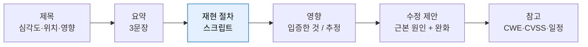

# 보고서 구조

| 레벨 | 상태 | 최종 개정 |
|---|---|---|
| 🟢 | 🔄 개정중 | 2026-10-22 |

> **한눈에 보기**
> 좋은 보고서는 '제목만 보고 심각도를, 첫 문단만 보고 영향을, 재현 절차만 보고 수정 위치를' 알 수 있게 한다.
> 보고서는 분석의 결과물이 아니라 **조치를 일으키는 도구**다. 읽는 사람이 다음 행동을 바로 할 수 있어야 끝난 것이다.

## 1. 누가 읽는가

보고서 하나를 보통 네 종류의 사람이 읽는다. 각자 찾는 것이 다르다.

| 독자 | 찾는 것 | 읽는 부분 |
|---|---|---|
| 트리아지(triage) 담당 | 중복인가, 범위 안인가, 심각도는 얼마인가 | 제목, 요약, CVSS |
| 개발자 | 어느 파일 몇 번째 줄을 어떻게 고치는가 | 재현 절차, 수정 제안 |
| 관리자·경영진 | 무엇을 잃을 수 있고, 언제까지 고쳐야 하는가 | 요약, 영향 |
| 법무·대외 | 공개 일정, 제3자 영향, 신고자 신원 | 참고, 일정 |

분석가는 보통 **자기가 가장 오래 들여다본 부분**(우회 과정, 디버깅 삽질)을 가장 길게 쓴다. 독자는 그 부분을 가장 안 읽는다. 쓰기 전에 "이 문단을 지우면 누가 곤란해지는가"를 묻는다. 아무도 곤란하지 않으면 지운다.

## 2. 제목 공식

```
[심각도] [위치]에서 [인증 조건] [영향]
```

| ❌ 나쁜 제목 | ✅ 좋은 제목 | 왜 |
|---|---|---|
| SQL 인젝션 발견 | [Critical] 로그인 API `/login`에서 인증 없이 전체 사용자 DB 읽기 (SQLi) | 위치·조건·영향이 한 줄에 있다 |
| 심각한 취약점 | [High] 첨부파일 다운로드 `/files?id=`에서 로그인 사용자가 타인 파일 열람 (IDOR) | "심각"은 정보가 아니다 |
| XSS | [Medium] 게시글 제목에 저장형 XSS, 관리자 세션 탈취 가능 | 유형만 쓰면 심각도를 알 수 없다 |

제목에는 **입증한 영향**만 쓴다. "RCE 가능성"처럼 추정을 제목에 올리면 트리아지에서 신뢰를 잃는다. 추정은 영향 절에서 "확인하지 않았다"를 붙여 따로 쓴다.

## 3. 다섯 요소

보고서는 어떤 양식을 쓰든 다섯 요소로 환원된다. 양식이 다르면 순서만 바꾼다.



<figure>
<figcaption>그림 1. 다섯 요소. 재현 절차가 중심이다. 재현되지 않는 보고서는 나머지 네 요소가 아무리 좋아도 "미확인"으로 남는다.</figcaption>
</figure>

### 3.1 요약 (Summary)

세 문장. (1) 어디에 무엇이 있는가 (2) 공격자가 무엇을 얻는가 (3) 왜 생겼는가. CVSS 벡터는 요약 끝에 한 줄로 붙인다. 요약만 읽고 다른 사람에게 전달할 수 있어야 한다.

### 3.2 재현 절차 (Steps to Reproduce)

4절에서 따로 다룬다. 원칙은 하나다. **다른 사람이, 다른 날, 나 없이** 같은 결과를 봐야 한다.

### 3.3 영향 (Impact)

두 단으로 나눈다.

- **입증한 것**: 실제로 읽은 데이터, 실제로 로그인한 계정, 실제로 실행한 명령. 증거(응답 본문, 스크린샷 대신 텍스트 출력)를 붙인다.
- **추정하는 것**: 더 갈 수 있지만 허가 범위 밖이라 멈춘 지점. "이론상 가능"이 아니라 "다음 단계는 X이고, 그 조건은 Y다"로 쓴다.

[3부 1장 5절](../part3-web/01-sql-injection.md)의 익스플로잇 검증 단계표가 이 구분의 기준이다.

### 3.4 수정 제안 (Remediation)

근본 원인 제거를 먼저, 완화(mitigation)를 나중에 쓴다. 코드 수준 제안은 **고친 코드 조각**으로 쓴다. "입력값을 검증하세요"는 제안이 아니다. 파일 경로와 함수명을 쓴다.

### 3.5 참고 (References)

CWE 번호, CVSS 벡터와 점수, 관련 CVE, 공개 예정일, 분석 도구와 버전. 센터 접수 번호 같은 내부 식별자는 내부 블록에 둔다.

## 4. 재현 절차는 스크립트로

"로그인 폼에 따옴표를 넣고 UNION을 시도한다"는 재현 절차가 아니다. 읽는 사람이 해석해야 하기 때문이다. 재현 절차는 **실행 가능한 스크립트 + 기대 출력**으로 쓴다.

```bash
# ✅ 재현 스크립트: 기대 출력까지 명시
# 전제: labs/web-sqli 가 127.0.0.1:8080 에 떠 있다
curl -s -X POST http://127.0.0.1:8080/login \
  --data-urlencode "username=admin'-- " \
  --data-urlencode "password=x" | grep -o "목표 1 달성"
# 기대 출력: 목표 1 달성
```

스크립트로 쓰면 세 가지가 따라온다.

| 효과 | 설명 |
|---|---|
| 재현 비용이 0에 가깝다 | 개발자가 패치 전후에 그대로 돌린다 |
| 회귀 테스트가 된다 | [3장](03-patch-verification.md)에서 테스트 코드로 바꾼다 |
| 모호함이 사라진다 | "공백 포함"을 말로 쓰지 않아도 `-- ` 가 스크립트에 들어 있다 |

스크립트에 넣어야 할 것: 대상 버전, 전제 조건(계정, 설정), 각 단계의 **기대 출력**, 실패했을 때 확인할 것. 넣지 말아야 할 것: 실제 서비스 주소, 실제 사용자 데이터, 허가 범위를 넘는 단계.

## 5. 독자별 버전

같은 사실을 두 번 쓴다. 분량이 아니라 **언어**가 다르다.

| | 경영진 요약 | 개발자 상세 |
|---|---|---|
| 길이 | 반 페이지 | 제한 없음 |
| 첫 문장 | "회원 50만 명의 비밀번호가 인증 없이 읽힌다" | "`app.py:89` `login()`에서 f-string으로 쿼리를 조립한다" |
| 심각도 | 사업 언어(법적 신고 의무, 서비스 중단 시간) | CVSS 벡터, CWE |
| 요청 | 결정(공개 일정 승인, 인력 배정) | 행동(패치, 테스트, 배포) |
| 증거 | 한 줄 결과 | 전체 요청·응답, 스크립트 |
| 금지 | 약어, 페이로드 | 추정, 과장 |

경영진 요약에서 가장 흔한 실수는 기술 용어를 줄이는 대신 **영향을 추상화**하는 것이다. "데이터 유출 위험"보다 "주민등록번호 뒷자리를 포함한 회원 테이블 전체"가 결정을 빠르게 만든다. 📎 개인정보 유출 시 신고 의무와 기한은 [1편 12장](../../vol1-center/03-partners/12-legal.md)에서 확인한다.

## 6. 완전한 보고서 예시

[3부 1장 실습](../part3-web/01-sql-injection.md)의 `labs/web-sqli`를 대상으로 한 가상 보고서다. 실습 환경이므로 페이로드와 데이터를 그대로 싣는다. 실제 서비스 보고서에서는 데이터 값을 가리고 페이로드는 재현에 필요한 최소만 남긴다.

```markdown
# [Critical] web-sqli `/login`, `/search`, `/item` 에서 인증 없이 전체 사용자 DB 읽기 및 관리자 로그인 (SQL 인젝션)

## 요약
로그인·검색·아이템 조회 세 엔드포인트가 사용자 입력을 SQL 문자열에 직접 이어 붙인다.
인증 없는 원격 공격자가 비밀번호 없이 `admin`으로 로그인하고, `users` 테이블의 모든 계정과
평문 비밀번호를 읽을 수 있다. 원인은 `app/app.py`의 f-string 쿼리 조립 세 곳이다.
CVSS:3.1/AV:N/AC:L/PR:N/UI:N/S:U/C:H/I:H/A:N — 9.1 (Critical)

## 대상
- labs/web-sqli (Flask + SQLite), 커밋 기준 `main`, 로컬 127.0.0.1:8080
- 테스트 일시: 2026-10-22, 도구: curl 8.x, Python 3.12

## 재현 절차
### 1. 인증 우회 (/login)
    curl -s -X POST http://127.0.0.1:8080/login \
      --data-urlencode "username=admin'-- " --data-urlencode "password=x" \
      | grep -o "목표 1 달성"
    # 기대 출력: 목표 1 달성
### 2. 전체 계정 읽기 (/search, UNION)
    curl -s "http://127.0.0.1:8080/search" \
      --get --data-urlencode "q=' UNION SELECT username, password FROM users-- " \
      | grep -oE "<b>(admin|alice|bob)</b> — [^<]+"
    # 기대 출력 (3행):
    # <b>admin</b> — S3cr3t!Bible
    # <b>alice</b> — alice2024
    # <b>bob</b> — hunter2
### 3. 블라인드 확인 (/item, 참/거짓)
    curl -s "http://127.0.0.1:8080/item?id=1%20AND%201=1" | grep -o "Found"      # 기대: Found
    curl -s "http://127.0.0.1:8080/item?id=1%20AND%201=2" | grep -o "Not found"  # 기대: Not found
    python3 labs/web-sqli/solve_blind.py   # 기대: admin 비밀번호 S3cr3t!Bible 출력

## 영향
입증한 것:
- 인증 없이 관리자 세션 획득 (무결성: 관리자 권한으로 할 수 있는 모든 행위)
- users 테이블 전체 열람. 비밀번호가 평문 저장되어 있어 즉시 사용 가능 (기밀성)
확인하지 않은 것:
- 데이터 변경·삭제. sqlite3 `execute()`는 한 번에 한 문장만 실행하므로 스택 쿼리(`; DROP`)는
  동작하지 않았다. UPDATE 경로는 시도하지 않았다. 따라서 A:N 으로 산정했다.
- 파일 읽기·명령 실행. SQLite 기본 설정에서는 해당 기능이 없다.

## 수정 제안
근본 원인 제거 — `app/app.py` 세 함수의 쿼리를 파라미터화한다.
    # login()  (app.py 89행의 f-string을 교체)
    query = "SELECT * FROM users WHERE username = ? AND password = ?"
    row = get_db().execute(query, (username, password)).fetchone()
    # search()
    rows = get_db().execute("SELECT name, description FROM items WHERE name LIKE ?", (f"%{q}%",)).fetchall()
    # item()
    row = get_db().execute("SELECT name FROM items WHERE id = ?", (item_id,)).fetchone()
추가 조치:
- 비밀번호를 평문 대신 해시(bcrypt/argon2)로 저장한다. 이 보고서 범위 밖이지만 피해 규모를 키운 요인이다.
- DB 오류 메시지와 조립된 쿼리를 응답에 노출하지 않는다 (`/login`, `/search`).
- CI에 `semgrep --config p/sql-injection` 을 넣는다.
검증 방법: 재현 절차 1~3 을 다시 실행해 모두 실패하는지 확인한다.

## 참고
- CWE-89 (SQL Injection), CWE-256 (평문 비밀번호 저장)
- CVSS 3.1 산정 근거: 8부 2장 참조. A:N 은 가용성 영향을 입증하지 못했기 때문이다.
- 분석 자료: solve_blind.py, 요청·응답 전문 (첨부)
```

이 예시에서 눈여겨볼 것은 두 가지다. **영향 절의 "확인하지 않은 것"** 이 점수(A:N)의 근거가 된다. 그리고 **수정 제안이 코드**로 되어 있어 개발자가 복사해서 쓸 수 있다.

## 7. 자주 하는 실수

| 실수 | 결과 | 고치는 법 |
|---|---|---|
| 스크린샷만 있고 요청 전문이 없다 | 재현 불가 → 미확인 처리 | 요청·응답은 텍스트로 |
| "RCE 가능" 같은 추정을 제목에 | 트리아지 불신, 등급 하향 | 입증한 것만 제목에 |
| 여러 취약점을 한 보고서에 | 하나만 고치고 종결됨 | 취약점 하나에 보고서 하나. 체인은 하나로 묶되 각 고리를 번호 매김 |
| 페이로드 설명 없이 나열 | 개발자가 원인을 못 찾음 | 각 페이로드가 **무엇을 증명하는지** 한 줄 |
| 수정 제안이 "검증하세요" | 증상만 막는 패치 | 근본 원인과 코드 위치 |
| 분석 과정(삽질)을 다 씀 | 핵심이 묻힘 | 과정은 부록으로 |

## 8. 센터 양식에 적용하기

센터의 조치 요청서는 상대(개발사, 사용 기관, 중소기업)에 따라 형식이 다르다. 이 장의 다섯 요소를 그 양식에 어떻게 넣는지, 그리고 "고쳐지게 만드는" 문안은 [3편 1부 3장 조치 단계](../../vol3-practice/01-workflow-tech/03-remediation.md)에서 다룬다. 공지문으로 바꾸는 법은 [3편 1부 4장](../../vol3-practice/01-workflow-tech/04-advisory.md)이다.

## 체크리스트

**보내기 전에**
- [ ] 제목에 심각도·위치·인증 조건·영향이 모두 있는가?
- [ ] 요약 세 문장만 읽고 다른 사람에게 전달할 수 있는가?
- [ ] 재현 절차를 스크립트로 썼고, 각 단계에 기대 출력이 있는가?
- [ ] 영향 절이 "입증한 것"과 "확인하지 않은 것"으로 나뉘어 있는가?
- [ ] CVSS 벡터의 각 메트릭이 영향 절의 문장으로 뒷받침되는가?
- [ ] 수정 제안에 파일·함수·고친 코드가 있는가?
- [ ] 실제 사용자 데이터, 실제 서비스 주소, 허가 범위 밖 단계가 없는가?
- [ ] 경영진 요약이 따로 있고, 거기에 페이로드와 약어가 없는가?

## 더 읽기

- [ISO/IEC 29147:2018 Vulnerability disclosure](https://www.iso.org/standard/72311.html) · 보고서에 담을 정보의 국제 표준. 유료 문서이나 목차는 공개
- [FIRST, CVSS v3.1 Specification Document](https://www.first.org/cvss/v3.1/specification-document) · 벡터 문자열 표기 규칙
- [CERT/CC, The CERT Guide to Coordinated Vulnerability Disclosure (Householder 외, 2017)](https://vuls.cert.org/confluence/display/CVD) · 보고서가 공개 조율 과정에서 어떻게 쓰이는가
- [OWASP Vulnerability Disclosure Cheat Sheet](https://cheatsheetseries.owasp.org/cheatsheets/Vulnerability_Disclosure_Cheat_Sheet.html) · 신고자와 벤더 양쪽 관점의 체크리스트
- [HackerOne Docs: Submitting Reports](https://docs.hackerone.com/hackers/submitting-reports.html) · 플랫폼이 요구하는 최소 요소
- [3편 1부 3장 조치 단계: 고쳐지게 만드는 보고서](../../vol3-practice/01-workflow-tech/03-remediation.md) · 센터 양식 적용

## 변경 이력

| 날짜 | 변경 | 기여자 |
|---|---|---|
| 2026-10-21 | 초안(뼈대) 작성 | @anthonynoh5202 |
| 2026-10-22 | 본문 작성. 제목 공식, 다섯 요소, 스크립트 재현, 독자별 버전, web-sqli 보고서 예시 | @anthonynoh5202 |
