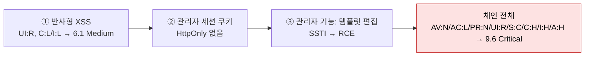

# 영향도 산정

| 레벨 | 상태 | 최종 개정 |
|---|---|---|
| 🟡 | 🔄 개정중 | 2026-10-22 |

> **한눈에 보기**
> CVSS 점수는 출발점이지 결론이 아니다. 비즈니스 맥락, 악용 가능성, 연쇄 가능성을 더해 '이 조직에서의 심각도'를 정한다.
> 점수는 **입증한 만큼만** 매긴다. 과장도 축소도 다음 보고서의 신뢰를 깎는다.

## 1. 점수가 재는 것과 재지 않는 것

CVSS(Common Vulnerability Scoring System)는 FIRST가 관리하는 **기술적 심각도** 척도다. FIRST 스스로 사용자 가이드에서 "CVSS는 심각도(severity)를 재는 것이지 위험(risk)을 재는 것이 아니다"라고 못 박는다. 📎 [CVSS v3.1 User Guide §2.1](https://www.first.org/cvss/v3.1/user-guide)

| 재는 것 | 재지 않는 것 |
|---|---|
| 어디서, 얼마나 쉽게, 어떤 권한으로 공격하는가 | 그 시스템이 우리 조직에 얼마나 중요한가 (환경 메트릭으로 보정) |
| 성공하면 기밀성·무결성·가용성이 얼마나 깨지는가 | 지금 실제로 공격받고 있는가 (시간/위협 메트릭으로 보정) |
| 영향이 취약한 컴포넌트 밖으로 번지는가 | 국내 사용 규모, 대체 가능성 (센터의 파급도) |

[1부 1장](../part1-foundations/01-what-is-vulnerability.md)의 "같은 취약점, 다른 위험"이 이 장의 출발점이다. 벡터 문자열 읽는 법은 [1부 2장](../part1-foundations/02-cwe-cve-cvss.md)에 있다.

## 2. CVSS 3.1 기본 메트릭

여덟 개 메트릭이 **공격 가능성** 넷, **범위** 하나, **영향** 셋으로 나뉜다. 괄호 안은 계산에 쓰는 가중치다.

| 메트릭 | 값 (가중치) | 판단 질문 |
|---|---|---|
| AV 공격 벡터 | N 네트워크(0.85) / A 인접(0.62) / L 로컬(0.55) / P 물리(0.2) | 공격자가 어디에 있어야 하는가 |
| AC 공격 복잡도 | L(0.77) / H(0.44) | 공격자가 통제할 수 없는 조건(경쟁 조건, 특정 설정)이 필요한가 |
| PR 필요 권한 | N(0.85) / L(0.62) / H(0.27) | 공격 전에 어떤 계정이 필요한가. S:C 이면 L 0.68, H 0.5 |
| UI 사용자 상호작용 | N(0.85) / R(0.62) | 피해자가 클릭·열기 같은 행동을 해야 하는가 |
| S 범위 | U 변화 없음 / C 변화 | 영향이 취약한 컴포넌트의 보안 권한 경계를 넘는가 |
| C / I / A | H(0.56) / L(0.22) / N(0) | 기밀성·무결성·가용성이 얼마나 깨지는가 |

계산은 세 줄이다.

```
ISS  = 1 − (1−C)(1−I)(1−A)
Impact = S:U → 6.42 × ISS
         S:C → 7.52 × (ISS − 0.029) − 3.25 × (ISS − 0.02)^15
Exploitability = 8.22 × AV × AC × PR × UI
Base = Impact ≤ 0 → 0
       S:U → Roundup( min(Impact + Exploitability, 10) )
       S:C → Roundup( min(1.08 × (Impact + Exploitability), 10) )
```

Roundup은 소수 첫째 자리로 **올림**이다. 등급은 None 0.0, Low 0.1~3.9, Medium 4.0~6.9, High 7.0~8.9, Critical 9.0~10.0. 📎 [CVSS v3.1 Specification §7](https://www.first.org/cvss/v3.1/specification-document)

## 3. 실습: 실제 CVE 두 개 풀이

계산기에 넣기 전에 **각 메트릭을 왜 그렇게 골랐는지** 한 줄씩 적는 연습이다. 그 한 줄이 보고서 영향 절의 문장이 된다.

### 3.1 CVE-2014-0160 Heartbleed

[7부 2장 워크스루](../part7-walkthroughs/02-cve-2014-0160-heartbleed.md)의 대상이다. NVD 벡터: `CVSS:3.1/AV:N/AC:L/PR:N/UI:N/S:U/C:H/I:N/A:N` = **7.5 High**. 📎 [NVD](https://nvd.nist.gov/vuln/detail/CVE-2014-0160)

| 메트릭 | 선택 | 근거 |
|---|---|---|
| AV:N | 네트워크 | TLS 하트비트 요청 하나로 인터넷에서 공격 |
| AC:L | 낮음 | 특별한 조건 없음. 요청을 보내면 된다 |
| PR:N | 없음 | 인증 전 단계의 프로토콜 처리 |
| UI:N | 없음 | 서버가 피해자. 사람 개입 없음 |
| S:U | 변화 없음 | 읽히는 메모리는 OpenSSL을 쓰는 그 프로세스의 것 |
| C:H | 높음 | 개인키·세션 쿠키까지 읽힌다. 64KB씩이지만 반복하면 사실상 전부 |
| I:N / A:N | 없음 | 쓰기 없음. 프로세스가 죽지도 않는다 |

```
ISS = 1 − (1−0.56)(1−0)(1−0) = 0.56
Impact = 6.42 × 0.56 = 3.595
Exploitability = 8.22 × 0.85 × 0.77 × 0.85 × 0.85 = 3.887
Base = Roundup(3.595 + 3.887) = Roundup(7.482) = 7.5
```

여기서 배울 것은 **"High인데 왜 모두가 Critical처럼 대응했는가"** 다. CVSS는 I:N/A:N을 정직하게 반영해 7.5를 준다. 그러나 읽히는 것이 **서버 개인키**라면, 그 뒤에 오는 것은 모든 통신의 복호화다. 점수에 담기지 않는 이 **후속 영향**이 4절 환경 메트릭과 6절 연쇄 재평가의 주제다.

### 3.2 CVE-2021-3156 sudo Baron Samedit

[7부 4장 워크스루](../part7-walkthroughs/04-cve-2021-3156-sudo-baron-samedit.md)의 대상이다. NVD 벡터: `CVSS:3.1/AV:L/AC:L/PR:L/UI:N/S:U/C:H/I:H/A:H` = **7.8 High**. 📎 [NVD](https://nvd.nist.gov/vuln/detail/CVE-2021-3156)

| 메트릭 | 선택 | 근거 |
|---|---|---|
| AV:L | 로컬 | 쉘이 있어야 `sudoedit -s`를 실행한다 |
| AC:L | 낮음 | 힙 정렬(heap grooming)이 필요하지만 공개 익스플로잇이 안정적으로 동작 |
| PR:L | 낮음 | 일반 사용자 계정이면 된다. sudoers에 없어도 됨 |
| UI:N | 없음 | |
| S:U | 변화 없음 | root를 얻지만 **같은 OS 안**이다. 권한 상승은 범위 변화가 아니다 |
| C:H / I:H / A:H | 높음 | root = 전부 |

```
ISS = 1 − (0.44)^3 = 0.9148
Impact = 6.42 × 0.9148 = 5.873
Exploitability = 8.22 × 0.55 × 0.77 × 0.62 × 0.85 = 1.835
Base = Roundup(5.873 + 1.835) = Roundup(7.708) = 7.8
```

두 가지를 짚는다. 첫째, **권한 상승은 S:U**다. 범위 변화는 "다른 보안 권한(security authority)이 관리하는 컴포넌트"로 넘어갈 때만이다. 샌드박스 탈출, 하이퍼바이저 탈출, 그리고 [Log4Shell](../part7-walkthroughs/01-cve-2021-44228-log4shell.md)처럼 라이브러리 취약점이 그것을 품은 애플리케이션 전체를 장악하는 경우가 S:C다. Log4Shell이 같은 C:H/I:H/A:H로 10.0인 이유가 S:C와 AV:N의 차이다. 둘째, AC는 **익스플로잇 작성 난이도가 아니다**. 힙 정렬이 어려워도 공격자가 조건을 통제할 수 있으면 L이다.

## 4. 시간·환경 메트릭

### 4.1 시간 메트릭 (Temporal)

기본 점수에 곱한다. 셋 다 "정의 안 됨(X)"이면 1.0이다.

| 메트릭 | 값 (계수) |
|---|---|
| E 익스플로잇 성숙도 | U 미확인(0.91) / P 개념 증명(0.94) / F 동작(0.97) / H 고도(1.0) |
| RL 수정 수준 | O 공식 패치(0.95) / T 임시(0.96) / W 우회책(0.97) / U 없음(1.0) |
| RC 보고 신뢰도 | U 미확인(0.92) / R 합리적(0.96) / C 확인됨(1.0) |

Heartbleed에 공식 패치(RL:O)와 공개 익스플로잇(E:H)을 넣으면 7.5 × 1.0 × 0.95 = 7.2가 된다. 패치가 나오면 점수가 **내려가는** 구조라서, "패치가 있으니 덜 급하다"로 읽히기 쉽다. 실제로는 패치 공개 뒤가 N-day 공격의 정점이다. 시간 메트릭은 우선순위 보조 자료로만 쓴다.

### 4.2 환경 메트릭 (Environmental)

**같은 취약점을 우리 환경 기준으로 다시 매기는** 도구다. 두 종류가 있다.

- **보안 요구 수준** CR / IR / AR: 이 시스템에서 기밀성·무결성·가용성이 얼마나 중요한가. H(1.5) / M(1.0) / L(0.5).
- **수정된 기본 메트릭** MAV, MAC, MPR, MUI, MS, MC, MI, MA: 우리 배치 환경에서 실제 값. 예를 들어 인터넷에 노출되지 않은 시스템이면 MAV:A.

Heartbleed를 두 환경에 넣어 본 결과다. (계산은 3.1 명세의 환경 공식 그대로. MISS 상한 0.915.)

| 환경 | 수정 | 결과 |
|---|---|---|
| 내부망 테스트 서버, 가짜 데이터 | MAV:A, CR:L | **4.7 Medium** |
| 인터넷 노출, 결제 서버, 개인키가 그 프로세스에 | CR:H | **9.3 Critical** |

같은 CVE가 4.7과 9.3이 된다. 센터가 "국내 환경에서 실제로"를 한 번 더 묻는 이유이고, [신고포상제의 파급도](../../vol1-center/02-programs/05-bug-bounty.md) 축이 CVSS 바깥에 따로 있는 이유다. 보고서에는 **기본 점수와 환경 점수를 둘 다** 쓴다. 기본 점수는 전 세계가 같은 숫자를 보게 하고, 환경 점수는 이 조직의 결정을 돕는다.

## 5. CVSS 4.0에서 바뀐 것

CVSS 4.0은 2023년 11월에 공개되었다. 📎 [FIRST CVSS v4.0](https://www.first.org/cvss/v4.0/) 2026년 현재 NVD는 3.1과 4.0을 함께 표기한다. 바뀐 것만 정리한다.

| 항목 | 3.1 | 4.0 |
|---|---|---|
| 메트릭 그룹 | Base / Temporal / Environmental | Base / **Threat** / Environmental / **Supplemental** |
| 범위(S) | S:U / S:C | 폐지. 대신 영향을 **취약 시스템**(VC/VI/VA)과 **후속 시스템**(SC/SI/SA)으로 나눠 매긴다 |
| 공격 복잡도 | AC 하나 | AC(방어 우회 노력) + **AT 공격 요구 조건**(N/P. 경쟁 조건 같은 전제) |
| 사용자 상호작용 | N / R | N / **P 수동**(피해자가 평소처럼 쓰기만) / **A 능동**(특정 행동) |
| 시간 메트릭 | E, RL, RC | **E 하나**만 남음. X / A 공격 관측 / P 개념 증명 / U 미보고 |
| 보조 메트릭 | 없음 | Safety(안전 영향), Automatable(자동화 가능), Recovery(복구), Value Density(가치 밀도), Vulnerability Response Effort(대응 노력), Provider Urgency(공급자 긴급도). **점수에 반영되지 않는다** |
| 점수 표기 | 하나 | CVSS-B / CVSS-BT / CVSS-BE / CVSS-BTE 로 어느 그룹까지 넣었는지 명시 |
| 계산 | 공식 | 공식 대신 메트릭 조합을 등가 집합(MacroVector)으로 묶은 **조회표** |

실무 영향은 두 가지다. 4.0에서는 "S:C냐"는 논쟁 대신 **후속 시스템에 실제로 무슨 일이 생기는가**를 쓴다. Heartbleed라면 VC:H에 더해 훔친 키로 다른 세션이 깨지므로 SC를 고려한다. 그리고 Supplemental의 Automatable은 웜(worm) 가능성을, Safety는 OT·의료 기기 영향을 점수 밖에서 따로 적게 해 준다. 센터 공지에서 "자동화된 대량 공격 가능"을 쓸 때 근거로 삼기 좋다.

## 6. 연쇄(chaining) 시 재평가

취약점 하나씩은 Medium인데 이어 붙이면 Critical이 되는 경우가 흔하다.



<figure>
<figcaption>그림 1. 세 개의 Medium~High가 하나의 Critical이 된다. 체인은 하나의 보고서로 묶되, 각 고리를 번호 매겨 개별로도 고칠 수 있게 쓴다.</figcaption>
</figure>

재평가 원칙은 세 가지다.

1. **최종 영향으로 매긴다.** 체인의 끝에서 공격자가 얻는 것(위 예에서는 RCE)으로 C/I/A와 S를 정한다.
2. **가장 엄격한 전제로 매긴다.** 체인 어느 고리라도 UI:R이면 전체가 UI:R이다. 어느 고리라도 PR:L이면 전체가 PR:L이다.
3. **각 고리를 따로 고칠 수 있게 쓴다.** 하나만 끊어도 체인이 깨진다. 고리별로 수정 제안을 쓰면 개발자가 가장 싼 것부터 끊는다.

실습 환경으로 돌아가면, `/item`의 블라인드 SQLi 하나만 보고하면 "느린 데이터 읽기"다. `/login`의 인증 우회와 묶으면 "관리자 세션 + 전체 DB"가 된다. [8부 1장의 예시 보고서](01-report-structure.md)가 세 엔드포인트를 하나로 묶고 각각 번호를 매긴 이유다.

## 7. 과장과 축소의 비용

| | 과장 | 축소 |
|---|---|---|
| 흔한 형태 | "RCE 가능성", 입증 없는 S:C, 이론상 A:H | 허가 범위 때문에 멈춘 지점을 "영향 없음"으로 |
| 즉시 비용 | 트리아지가 등급을 내리고, 다음 보고서부터 의심한다 | 패치 우선순위가 밀려 N-day 공격을 맞는다 |
| 장기 비용 | 신고자·분석가의 평판 | 조직의 평판. "알고도 낮게 매겼다" |
| 해법 | **입증한 것만** 벡터에 넣고, 나머지는 "확인하지 않음"으로 따로 | "멈춘 지점과 다음 단계의 조건"을 명시. 추정 상한을 **별도 줄**로 |

1장 예시 보고서가 A:N으로 9.1을 매긴 것이 이 원칙이다. 스택 쿼리가 동작하지 않음을 확인했고 UPDATE는 시도하지 않았다고 썼다. 시도했다면 9.8이었을 것이고, 쓰지 않고 9.8을 매겼다면 과장이다. **벡터의 모든 글자에 영향 절의 문장 하나가 대응해야 한다.**

## 8. 버그바운티 플랫폼의 기준

플랫폼은 CVSS를 그대로 쓰지 않고 자기 척도로 번역한다. 센터로 들어오는 신고 중 플랫폼 경험이 있는 신고자의 "P1"이나 "Critical"이 어떤 뜻인지 알아야 한다.

| 플랫폼 | 척도 | 특징 |
|---|---|---|
| HackerOne | None / Low / Medium / High / Critical | CVSS 3.1과 4.0 표준 계산기를 제공한다. 3.0은 자체 변형 구현이라 first.org 계산기와 점수가 다를 수 있다. 자산별로 **최대 심각도 상한**을 둘 수 있다. 📎 [HackerOne Docs: Severity](https://docs.hackerone.com/organizations/severity.html) |
| Bugcrowd | VRT(Vulnerability Rating Taxonomy) P1 Critical ~ P5 Informational | CVSS 대신 **유형별 기본 등급표**다. 예: SQL 인젝션 P1, IDOR는 변형에 따라 P1(반복 가능한 ID로 민감 정보 변경·열람)~P5, 반사형 XSS는 Non-Self P3 / Self P5, 보안 헤더 누락은 대부분 P5. 공개 JSON으로 배포되며 2026-07 판이 최신. 📎 [Bugcrowd VRT](https://bugcrowd.com/vrt), [GitHub](https://github.com/bugcrowd/vulnerability-rating-taxonomy) |
| KISA 신고포상제 | 위험도 · 파급도 · 발굴 난이도 | 위험도가 CVSS에 가깝고, 파급도(국내 사용 규모·분야)와 난이도는 CVSS 밖의 축이다. [1편 5장 4절](../../vol1-center/02-programs/05-bug-bounty.md) |

VRT의 교훈은 **같은 유형도 변형에 따라 다섯 단계가 갈린다**는 것이다. "IDOR 발견"으로는 등급을 못 매긴다. 열람인가 변경인가, ID가 순차인가 UUID인가, 데이터가 민감한가를 보고서가 답해야 한다.

우선순위 보조 지표로 **EPSS**(Exploit Prediction Scoring System, 30일 내 악용 확률 예측)와 **CISA KEV**(실제 악용 확인 목록)가 있다. 둘 다 "심각도"가 아니라 "악용 가능성"이다. EPSS v4는 2025년 3월에 공개되었다. 📎 [FIRST EPSS](https://www.first.org/epss/), [CISA KEV](https://www.cisa.gov/known-exploited-vulnerabilities-catalog)

## 체크리스트

**벡터를 매길 때**
- [ ] 메트릭 여덟 개마다 근거 문장이 한 줄씩 있는가?
- [ ] 권한 상승을 S:C로 매기지 않았는가? (같은 보안 권한 안이면 S:U)
- [ ] AC를 "익스플로잇 작성이 어려웠다"는 이유로 H로 매기지 않았는가?
- [ ] 입증하지 못한 C/I/A를 H로 매기지 않았는가?
- [ ] 기본 점수와 환경 점수를 구분해 썼는가?

**보고서에 쓸 때**
- [ ] 체인이면 최종 영향으로 매기고, 각 고리를 번호 매겼는가?
- [ ] 4.0 벡터를 쓸 때 CVSS-B / BT / BE 표기를 붙였는가?
- [ ] 플랫폼 등급(P1, Critical)을 받았다면 센터 축(위험도·파급도·난이도)으로 다시 번역했는가?

## 더 읽기

- [FIRST, CVSS v3.1 Specification Document](https://www.first.org/cvss/v3.1/specification-document) · 메트릭 정의와 공식의 원전
- [FIRST, CVSS v3.1 User Guide](https://www.first.org/cvss/v3.1/user-guide) · 범위 판단, 라이브러리 채점 등 자주 틀리는 사례 모음
- [FIRST, CVSS v4.0 Specification Document](https://www.first.org/cvss/v4.0/specification-document) · 4.0 메트릭 정의. [계산기](https://www.first.org/cvss/calculator/4.0)로 직접 넣어 본다
- [FIRST, CVSS v4.0 Examples](https://www.first.org/cvss/v4.0/examples) · 실제 CVE를 4.0으로 매긴 공식 예제
- [Bugcrowd Vulnerability Rating Taxonomy](https://bugcrowd.com/vrt) · 유형·변형별 기본 등급. 보고서가 답해야 할 질문 목록으로 읽는다
- [NIST NVD: Vulnerability Metrics](https://nvd.nist.gov/vuln-metrics/cvss) · NVD가 3.1과 4.0을 병기하는 기준
- [1편 5장 보안 취약점 신고포상제](../../vol1-center/02-programs/05-bug-bounty.md) · 위험도·파급도·난이도 축

## 변경 이력

| 날짜 | 변경 | 기여자 |
|---|---|---|
| 2026-10-21 | 초안(뼈대) 작성 | @anthonynoh5202 |
| 2026-10-22 | 본문 작성. 3.1 풀이 2건, 환경 메트릭 예시, 4.0 변화, 연쇄, 플랫폼 기준 | @anthonynoh5202 |
