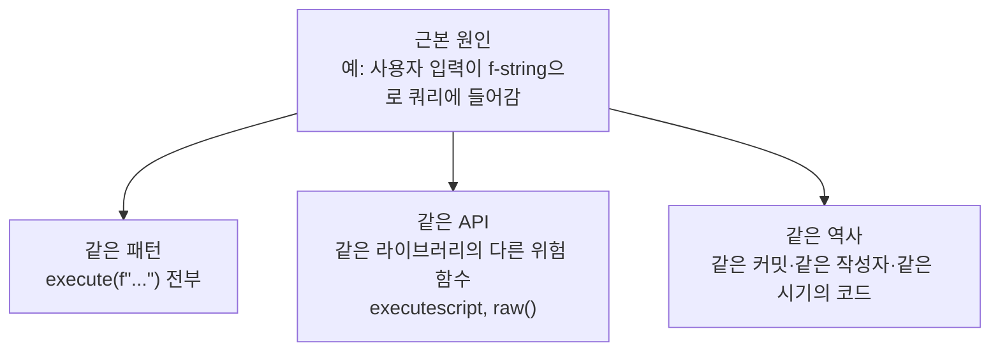

# 패치 검증과 재발 방지

| 레벨 | 상태 | 최종 개정 |
|---|---|---|
| 🟡 | 🔄 개정중 | 2026-10-22 |

> **한눈에 보기**
> '고쳤다'는 말을 믿지 말고 다시 테스트한다. 같은 유형의 다른 지점(variant)까지 찾아야 진짜 끝이다.
> 패치 하나는 증상을 막고, 변형 분석은 원인을 없애고, 회귀 테스트와 탐지 룰은 다시 생기지 않게 한다.

## 1. '고쳤다'의 세 단계

| 단계 | 질문 | 확인 방법 |
|---|---|---|
| ① 증상 차단 | 보고서의 재현 스크립트가 실패하는가 | 스크립트 재실행 |
| ② 원인 제거 | 같은 입력 경로의 **다른 페이로드**도 실패하는가 | 패치 diff 읽기, 우회 시도 |
| ③ 유형 제거 | 코드베이스의 **다른 지점**에 같은 패턴이 없는가 | 변형 분석(3절) |

대부분의 "고쳤습니다"는 ①에서 멈춘다. Google Project Zero가 2022년 상반기에 실제 공격에 쓰인 0-day 18건을 분석한 결과, **9건이 이미 패치된 취약점의 변형**이었다. 같은 글은 "최소 절반은 더 철저한 패치와 회귀 테스트로 막을 수 있었다"고 썼다. 📎 [Project Zero, "2022 0-day In-the-Wild Exploitation…so far" (Maddie Stone, 2022-06)](https://googleprojectzero.blogspot.com/2022/06/2022-0-day-in-wild-exploitationso-far.html), [Risky Biz 요약](https://www.risky.biz/risky-biz-news-half-of-2022s-zero/)

센터 입장에서 패치 검증은 [3편 1부 3장 4절](../../vol3-practice/01-workflow-tech/03-remediation.md)의 업무이고, 이 장은 그 기술적 내용이다.

## 2. 패치 리뷰: 증상을 막았나, 원인을 없앴나

패치 diff를 받으면 **무엇이 바뀌었는가**보다 **무엇이 안 바뀌었는가**를 본다.

```python
# ❌ 증상만 막은 패치: 보고서의 페이로드만 거른다
def login(username, password):
    if "'" in username or "--" in username:
        return error("잘못된 입력")
    query = f"SELECT * FROM users WHERE username = '{username}' AND password = '{password}'"
    return db.execute(query).fetchone()
```

이 패치는 재현 스크립트(`admin'-- `)를 실패시킨다. 그러나 `password` 쪽은 그대로이고, 숫자 컨텍스트(`/item?id=`)에는 따옴표가 필요 없다. ①은 통과하고 ②에서 떨어진다.

```python
# ✅ 원인을 없앤 패치: 입력과 쿼리를 분리
def login(username, password):
    query = "SELECT * FROM users WHERE username = ? AND password = ?"
    return db.execute(query, (username, password)).fetchone()
```

리뷰할 때 묻는 네 가지. (1) **신뢰 경계가 어디로 옮겨졌는가.** 검증을 추가했다면 모든 진입 경로를 덮는가, 파라미터화처럼 경계 자체를 없앴는가. (2) **같은 함수의 다른 인자는.** 위 예에서 `password`. (3) **같은 패턴의 다른 함수는.** 3절. (4) **패치가 새 버그를 만들지 않았는가.** 길이 검사를 넣으며 off-by-one, 인코딩을 바꾸며 이중 디코딩.

## 3. 변형(variant) 분석

변형 분석은 **"이 버그를 만든 조건이 다른 곳에도 있는가"** 를 체계적으로 찾는 일이다. Project Zero는 실제 공격에 쓰인 0-day마다 근본 원인 분석(RCA, root cause analysis)을 공개하는데, 그 문서의 마지막 절이 항상 "The Next Steps"이고 그 안에 **Variant analysis**, **Structural improvements**, **0-day detection methods** 세 항목이 있다. 📎 [Project Zero 0-days In-the-Wild RCA 모음](https://googleprojectzero.github.io/0days-in-the-wild/) 패치 검증의 마지막 절도 이 셋이어야 한다.

### 3.1 변형을 찾는 세 방향



| 방향 | 방법 | 실습 환경 예 |
|---|---|---|
| 같은 패턴 | grep → Semgrep → CodeQL 순으로 넓힌다 | `grep -nE 'execute\(f"' app.py` → `login`, `search`, `item` 세 곳 |
| 같은 API | 그 라이브러리의 위험 함수 목록으로 다시 검색 | `executescript`, ORM의 `raw()`/`extra()` |
| 같은 역사 | `git log -S'execute(f"' --oneline`, 같은 커밋의 다른 파일 | 한 사람이 같은 주에 쓴 다른 엔드포인트 |

보고서가 `/login` 하나만 지적했고 패치가 `/login`만 고쳤다면, 변형 분석 없이는 `/search`와 `/item`이 남는다. 실습 환경에서 직접 확인한다. `app/app.py`의 `login()`만 고친 뒤 [8부 1장 예시 보고서](01-report-structure.md)의 재현 절차 2, 3번을 돌리면 그대로 성공한다.

### 3.2 도구로 넓히기

```bash
# Semgrep: 레지스트리 룰로 같은 유형 전부
semgrep scan --config p/sql-injection --severity ERROR .

# CodeQL: 소스→싱크 흐름으로 grep이 놓치는 간접 경로까지
codeql database create db-py --language=python --source-root=.
codeql database analyze db-py codeql/python-queries:codeql-suites/python-security-extended.qls \
  --format=sarif-latest --output=variants.sarif --download
```

도구 사용법은 [6부 5장](../part6-tools/05-sast-semgrep-codeql.md)에 있다. 변형 분석에서 도구의 역할은 **후보를 빠짐없이 나열**하는 것이고, 각 후보가 진짜 취약한지는 사람이 본다.

바이너리도 같다. "길이를 입력에서 읽어 `memcpy`에 그대로 넘기는 곳"처럼 패턴을 정의하고 같은 파서·같은 구조체·같은 작성자의 코드를 훑는다. 보고서의 PoC를 퍼징 시드에 넣어 두면 변형이 크래시로 올라온다([4부 9장](../part4-binary/09-fuzzing.md)).

## 4. 회귀 테스트로 남기기

재현 스크립트는 **테스트 코드**가 되어야 끝난다. 사람이 기억하는 한 "다시 터지지 않는다"는 보장이 없다.

```python
# ✅ labs/web-sqli 용 회귀 테스트 예 (pytest + Flask 테스트 클라이언트)
# 파일: tests/test_sqli_regression.py
import pytest
from app import app as flask_app, init_db


@pytest.fixture
def client():
    init_db()
    flask_app.config["TESTING"] = True
    with flask_app.test_client() as c:
        yield c


def test_login_comment_bypass_fails(client):
    # 보고서 재현 절차 1: 주석으로 비밀번호 조건 제거
    r = client.post("/login", data={"username": "admin'-- ", "password": "x"})
    assert "목표 1 달성" not in r.get_data(as_text=True)


def test_search_union_does_not_leak_users(client):
    # 보고서 재현 절차 2: UNION 으로 users 테이블 결합
    r = client.get("/search", query_string={"q": "' UNION SELECT username, password FROM users-- "})
    body = r.get_data(as_text=True)
    assert "S3cr3t!Bible" not in body and "DB 오류" not in body


def test_item_boolean_blind_no_difference(client):
    # 보고서 재현 절차 3: 참/거짓 응답 차이가 없어야 한다
    t = client.get("/item", query_string={"id": "1 AND 1=1"}).get_data(as_text=True)
    f = client.get("/item", query_string={"id": "1 AND 1=2"}).get_data(as_text=True)
    assert t == f
```

규칙 세 가지. 테스트 이름에 **보고서 번호나 CVE**를 넣어 1년 뒤에도 이유를 찾을 수 있게 한다. **패치 전에 실패하고 패치 후에 통과**하는지 둘 다 확인한다(처음부터 통과하는 테스트는 아무것도 검증하지 않는다). 페이로드 하나가 아니라 **유형**을 테스트한다. 위 세 번째 테스트는 특정 문자열이 아니라 "참/거짓 차이"를 본다. 이 세 테스트는 취약한 `app.py`에서 3건 실패, 파라미터화 패치 후 3건 통과를 확인했다.

## 5. 탐지 룰 추가

패치가 배포되기 전, 그리고 패치를 못 받는 시스템을 위해 **탐지**를 남긴다. 두 층이다.

### 5.1 코드 수준: 다시 들어오지 못하게

```yaml
# ✅ 이 코드베이스 전용 Semgrep 룰. 파일: rules/sqli.yaml
# 쿼리 문자열이 변수를 거쳐 execute()에 닿는 경우까지 잡으려면 taint 모드를 쓴다
rules:
  - id: vmc-sqli-string-built-query
    languages: [python]
    severity: ERROR
    message: >
      SQL 쿼리를 f-string / % / + / format 으로 조립해서 execute() 에 넘기고 있습니다.
      파라미터 바인딩(?)을 쓰세요. 근거: 보고서 VMC-2026-0001 (web-sqli /login, /search, /item)
    mode: taint
    pattern-sources:
      - pattern: f"..."
      - pattern: '"..." % ...'
      - pattern: '"..." + ...'
      - pattern: '"...".format(...)'
    pattern-sinks:
      - patterns:
          - pattern: $DB.execute($Q, ...)
          - focus-metavariable: $Q
```

```bash
semgrep scan --config rules/ --metrics=off app/   # 실습 앱에서 3건(89·107·121행 조립 → 91·110·123행 execute) 검출
semgrep validate rules/                 # 룰 문법 검사
semgrep test rules/                     # 같은 이름의 .py 파일에 "# ruleid:" / "# ok:" 주석으로 참·거짓 양성 확인
semgrep ci --config rules/              # CI: 변경된 파일만, 기준 커밋 대비
```

### 5.2 운영 수준: 공격 시도를 보게

- **웹 로그**: 파라미터에 `'`, `UNION`, `SLEEP(` 패턴과 응답 500 급증. 인코딩·블라인드는 놓친다.
- **DB 로그**: 구문 오류 급증, 평소 없던 `sqlite_master`/`information_schema` 조회. 쿼리 로깅이 켜져 있어야 한다.
- **WAF**: 벤더 SQLi 룰셋에 이 보고서의 페이로드 시그니처 추가. [3부 1장 7절](../part3-web/01-sql-injection.md)의 우회로 뚫리므로 **패치의 대체물이 아니다**.

탐지 룰의 목적은 "막는다"가 아니라 **"패치가 늦어지는 동안 시도를 본다"** 다.

## 6. 사후 분석(postmortem) 작성

사후 분석은 **사람이 아니라 시스템을 고치는 문서**다. Google SRE 책이 정의한 "비난 없는(blameless)" 원칙이 핵심이다. "누가 f-string을 썼는가"가 아니라 "왜 코드 리뷰와 CI가 f-string 쿼리를 통과시켰는가"를 묻는다. 📎 [Site Reliability Engineering, 15장 "Postmortem Culture: Learning from Failure" (Google, 2016)](https://sre.google/sre-book/postmortem-culture/)

취약점 사후 분석 템플릿. 보안 사고가 아니라 **취약점 발견·조치 과정** 자체를 대상으로 한다.

```markdown
# 사후 분석: VMC-2026-0001 web-sqli SQL 인젝션

| 항목 | 내용 |
|---|---|
| 작성 | 2026-10-22, 담당 분석가 / 개발 리드 |
| 상태 | 조치 완료 · 후속 과제 진행 중 |

## 타임라인
- 10-20 보고 접수, 재현 확인, Critical 산정
- 10-21 조치 요청(/login 만 지적) → 1차 패치: 블랙리스트 필터 → 검증 실패 (②)
- 10-22 2차 패치: 세 엔드포인트 파라미터화 → 검증 통과, 회귀 테스트 3건 추가

## 근본 원인
쿼리 조립에 f-string 사용. 코드 리뷰 체크리스트에 SQL 항목 없음. CI에 SAST 없음.

## 잘 된 것
재현 스크립트가 있어 1차 패치의 실패를 10분 만에 확인했다.

## 운이 좋았던 것
비밀번호가 평문이었는데 실습 환경이었다. 실제였다면 전 계정 재설정이 필요했다.

## 잘못 된 것
보고서가 /login 하나만 지적해 1차 패치 범위가 좁았다. 변형 분석을 보고 단계에서 했어야 했다.

## 후속 과제
| 과제 | 담당 | 기한 | 상태 |
|---|---|---|---|
| CI에 semgrep p/sql-injection + 전용 룰 | 개발 리드 | 10-29 | 진행 중 |
| 리뷰 체크리스트에 "쿼리 문자열 리터럴인가" 추가 | 개발 리드 | 10-29 | 완료 |
| 비밀번호 해시 저장 | 개발사 | 11-30 | 미착수 |
```

후속 과제에는 **담당자와 기한**이 반드시 있다. 둘 중 하나라도 없는 과제는 완료되지 않는다.

## 7. 종결 기준

여섯 가지가 다 채워지면 종결한다. (1) 보고서 재현 절차 전부 실패 — 재실행 로그 (2) 같은 경로의 우회 페이로드 실패 — 2절 네 질문에 답한 리뷰 기록 (3) 변형 분석 완료, 발견된 변형 모두 조치 — 도구 출력과 후보별 판정표 (4) 회귀 테스트가 CI에서 돈다 — 패치 전 실패·패치 후 통과 기록 (5) 탐지 룰 배포 — 룰 ID와 테스트 결과 (6) 사후 분석 작성, 후속 과제에 담당·기한 — 문서 링크.

하나라도 비면 "조치 완료"가 아니라 "패치 배포"다. 두 말을 구분해 쓰는 것이 센터 공지의 신뢰를 지킨다.

## 체크리스트

**패치를 받았을 때**
- [ ] 보고서의 재현 스크립트를 패치 전후에 돌려 결과를 기록했는가?
- [ ] 패치 diff에서 신뢰 경계가 어디로 옮겨졌는지 설명할 수 있는가?
- [ ] 같은 함수의 다른 인자, 같은 패턴의 다른 함수를 확인했는가?

**종결하기 전에**
- [ ] 변형 분석을 세 방향(패턴·API·역사)으로 했는가?
- [ ] 회귀 테스트가 패치 전에 실패하는 것을 확인했는가?
- [ ] 탐지 룰에 이 보고서의 식별자가 적혀 있는가?
- [ ] 사후 분석의 후속 과제에 담당자와 기한이 모두 있는가?

## 더 읽기

- [Project Zero, "2022 0-day In-the-Wild Exploitation…so far" (Maddie Stone, 2022-06)](https://googleprojectzero.blogspot.com/2022/06/2022-0-day-in-wild-exploitationso-far.html) · 변형이 절반이라는 데이터와 그 이유
- [Project Zero, 0-days In-the-Wild Root Cause Analyses](https://googleprojectzero.github.io/0days-in-the-wild/) · "The Next Steps: Variant analysis / Structural improvements / 0-day detection methods" 구조의 실제 문서들
- [Google, Site Reliability Engineering 15장 "Postmortem Culture: Learning from Failure" (2016)](https://sre.google/sre-book/postmortem-culture/) · 비난 없는 사후 분석의 원전. 부록 D에 예시 문서
- [Semgrep Docs: Testing rules](https://semgrep.dev/docs/writing-rules/testing-rules) · `semgrep test` / `semgrep validate` 사용법
- [CodeQL CLI 문서](https://codeql.github.com/docs/codeql-cli/) · `database create` / `database analyze`
- [3편 1부 3장 4절 패치 검증](../../vol3-practice/01-workflow-tech/03-remediation.md) · 센터 업무 흐름에서의 위치

## 변경 이력

| 날짜 | 변경 | 기여자 |
|---|---|---|
| 2026-10-21 | 초안(뼈대) 작성 | @anthonynoh5202 |
| 2026-10-22 | 본문 작성. 증상 vs 원인, 변형 분석, 회귀 테스트, 탐지 룰, 사후 분석 템플릿 | @anthonynoh5202 |
