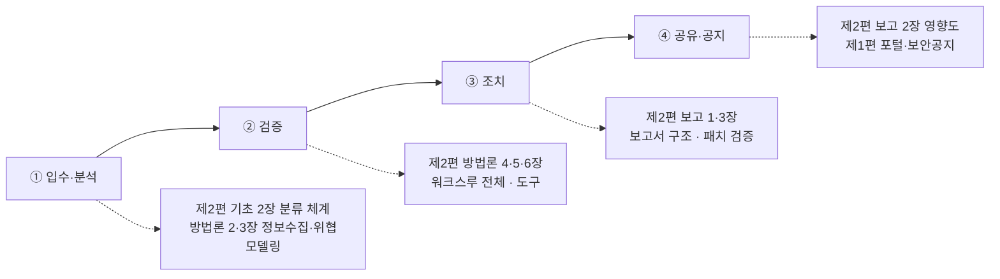

# 업무 흐름 × 기술

제1편의 [업무 네 단계](../../vol1-center/01-understanding/04-workflow.md)와 제2편의 기술이 만나는 곳. 센터 직원에게 가장 실용적인 편이며, 이 책을 한 권으로 합친 이유다.

| 장 | 센터 단계 | 쓰는 기술 |
|---|---|---|
| [입수·분석 단계에서 쓰는 기술](01-intake-analysis.md) | ① | 중복 확인, 신규 판단, 파급도 1차 판정 |
| [검증 단계: 재현이 전부다](02-verification.md) | ② | 재현 환경, 패치 diff, PoC 최소화, AI 결과 재검증 |
| [조치 단계: 고쳐지게 만드는 보고서](03-remediation.md) | ③ | 조치 요청서, 완화책, 패치 검증, 변형 탐색 |
| [공유·공지 단계: 영향도와 문안](04-advisory.md) | ④ | CVSS + 국내 맥락, 공지 문안, 시점 결정 |
